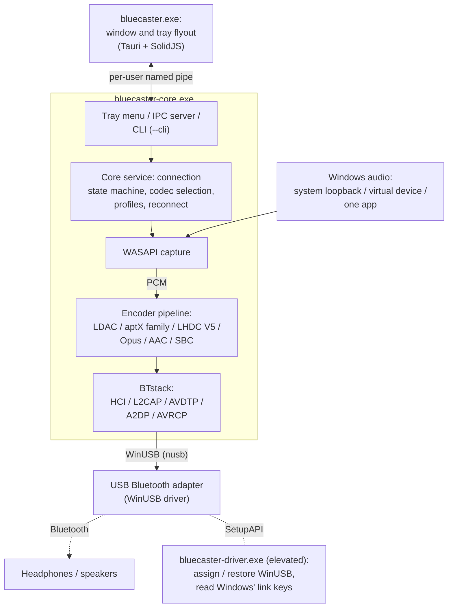
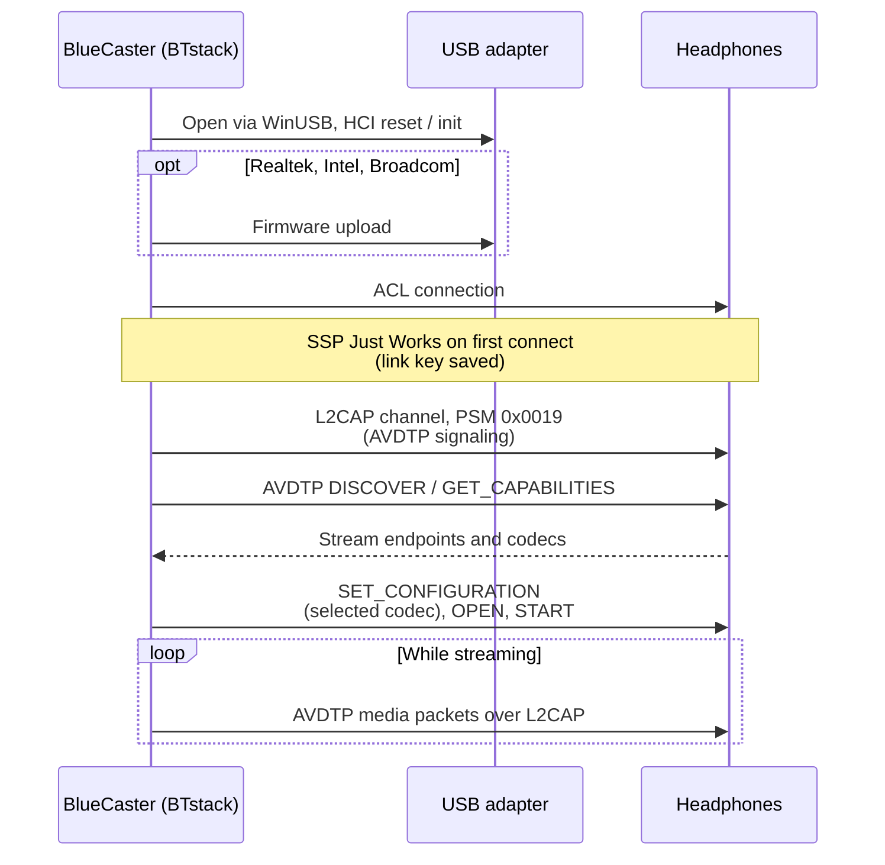
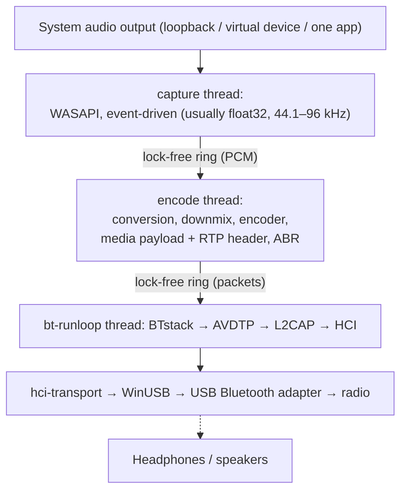
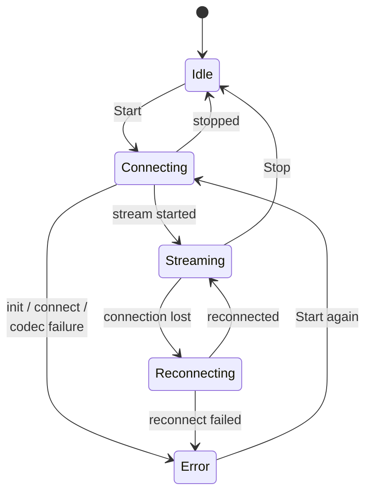
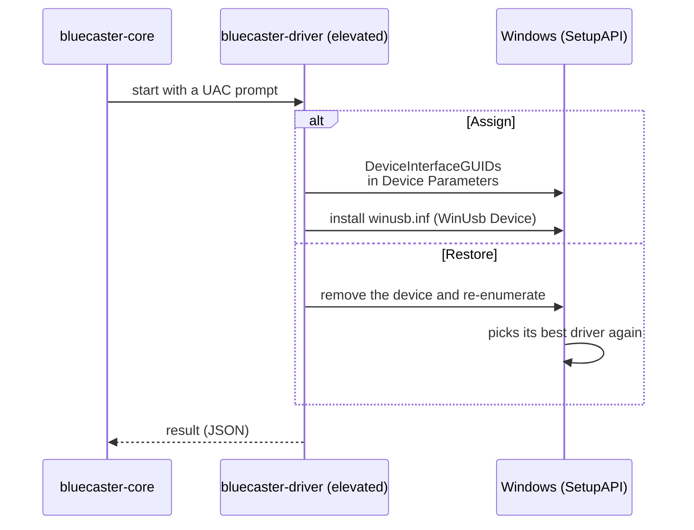

# Architecture
{: .no_toc }

## Table of contents
{: .no_toc .text-delta }

1. TOC
{:toc}

---

## Overview

BlueCaster enables LHDC V5, LDAC, aptX Adaptive, aptX HD,
aptX Low Latency, aptX, Opus, AAC, SBC XQ and SBC Bluetooth audio on Windows
(and LC3 over LE Audio, experimental). Windows' own Bluetooth stack supports
only SBC, classic aptX and (Windows 11 only) AAC for A2DP; BlueCaster adds the
others without a kernel driver.

It uses **BTstack + WinUSB**: everything runs in user mode, so no driver signing is needed.

BlueCaster 2.0 is written in Rust. The C libraries that cannot be replaced
(BTstack and the codec encoders) are compiled from source and called through
small FFI crates; everything else, the SBC encoder included, is Rust.

## Processes

BlueCaster runs as up to three programs:

| Program | Runs | Does |
|:--------|:-----|:-----|
| `bluecaster-core.exe` | While BlueCaster is running (started by the window, the Start menu or **Start with Windows**) | Bluetooth, audio capture and encoding, profiles and settings, the tray icon and its menu, the IPC server. `--cli` runs the same core from a console instead |
| `bluecaster.exe` | Only while a window is open (exits 3 minutes after the last one was closed) | The main window and the tray flyout (Tauri 2, SolidJS + TypeScript). Holds no state of its own |
| `bluecaster-driver.exe` | Briefly, with administrator rights (UAC), for a driver change or key import | Assigns WinUSB to an adapter, restores the adapter's previous driver, or reads the link keys that Windows' Bluetooth stores for an adapter (`windows-keys`), then exits |

- **The core is not a Windows service.** It runs as an ordinary process of the
  signed-in user, because WASAPI loopback captures that user's session audio.
  A per-session mutex allows only one instance; starting the core again opens
  the window.
- **The tray belongs to the core.** The tray icon's right-click menu (open, the
  first 10 devices, disconnect, exit) opens instantly, without starting the
  window. A left click opens the flyout (or the main window, depending on
  Settings).
- **The window only displays state.** It receives a snapshot of the core's
  state, then each change. Closing the window, or a window crash, does not
  stop the audio. Closing only hides the window, so reopening it from the
  tray is instant.
- **The command line uses the same core.** `bluecaster-core.exe --cli` runs the
  core service without the tray or IPC; the emulator test uses this mode.

## Transport: BTstack + WinUSB

BlueCaster bypasses the Windows Bluetooth stack entirely and talks directly to a
USB Bluetooth adapter through WinUSB (Microsoft's signed generic USB driver). BTstack,
a source-available Bluetooth stack (non-commercial license), implements HCI, L2CAP, AVDTP and A2DP in
user mode.

**Advantages**:
- No driver signing cost
- No test signing mode required
- No Secure Boot disabling
- All code runs in user-mode (easier debugging)

**Trade-offs**:
- Requires a dedicated USB Bluetooth adapter (separate from Windows's built-in
  Bluetooth)
- While claimed by WinUSB, the adapter is unavailable for normal Windows
  Bluetooth
- Devices are found by a scan (GAP inquiry) with the USB adapter, or their
  address is entered manually

**How it works**:
1. The user assigns WinUSB to a USB Bluetooth adapter, in the app (**Adapter >
   Replace with WinUSB driver**, see [Driver Assignment](#driver-assignment)) or with Zadig
2. The `hci-transport` crate opens the adapter through WinUSB with `nusb`
   and connects it to BTstack as its HCI transport
3. BTstack sends HCI commands to initialize the Bluetooth controller
4. For Realtek, Intel and Broadcom adapters, BlueCaster uploads firmware if needed
5. BTstack establishes an ACL connection and opens L2CAP channels (PSM 0x0019)
6. AVDTP signaling discovers remote SEPs and negotiates codecs
7. Encoded audio is sent as AVDTP media packets over L2CAP

The USB transport keeps the recovery steps that real adapters needed in
v1: it resets the event and ACL pipes when it opens the adapter, retries a
failed event read, times out HCI commands, and sends HCI Reset when it closes
the adapter (except to a controller still in its bootloader), so the next
session finds an idle controller.

## Crate Structure

The code is one Cargo workspace (`Cargo.toml` at the repository root) in five
layers; each layer depends only on the layers below it. Libraries are in
`app/src/crates/`, and the programs in `app/src/core`, `app/src/ui` and
`app/src/driver`. The vendored `aptx-adaptive` crate is a path dependency of
`codec` and stays out of the workspace. Only the `*-sys` crates and `win-sys` may contain `unsafe`
code; all other crates have `#![forbid(unsafe_code)]`.

| Layer | Crate | Does |
|:------|:------|:-----|
| 1. FFI | `btstack-sys` | Builds BTstack with `cc` (MSVC), hand-written FFI declarations and safe wrappers, `btstack_config.h`. BTstack may only be called on its run loop thread, which the `!Send` `Stack` token enforces |
| 1. FFI | `ldac-sys`, `openaptx-sys`, `fdkaac-sys`, `lhdcv5-sys`, `opus-sys`, `lc3-sys` | Build the C encoders and expose them; one crate per library, so each license stays separate |
| 1. FFI | `win-sys` | Win32 APIs without a Rust library: MMCSS, the default audio device (IPolicyConfig), the WLAN API (AFH), power notifications, the Run key, media keys, the pipe's DACL, elevation, the WinUSB driver assignment (SetupAPI), and Windows' own Bluetooth (its radios, paired devices and link keys) |
| 2. Parts | `hci-transport` | HCI over USB ("H2") with `nusb`, and H4 over TCP to a virtual controller (`tools/emu`) |
| 2. Parts | `aptx-adaptive` | The aptX Adaptive encoder in Rust (vendored from AKS-Logic/aptx-adaptive-linux, MIT) |
| 2. Parts | `codec` | The `Encoder` trait, the SBC encoder (Rust port of Bluedroid's), safe wrappers of the C encoders, Codec Information parsing and the codec choice |
| 2. Parts | `audio-capture` | WASAPI capture (`wasapi` crate): system loopback, virtual device, one application (process loopback); device and app lists, test tone, per-app volume (Volume Mixer) |
| 2. Parts | `pcm-link` | PCM between two processes: a lock-free ring in shared memory and a wake event |
| 3. Engine | `session-host` | The session-bound work (device lists, capture, playback) behind one facade, `SessionHost`: done in the core's process, or in the session agent (`--session-agent`) over a named pipe |
| 2. Parts | `voice-link` | The headset microphone's audio (developer mode): mono PCM rendered to the chosen output device (WASAPI), the capture downmixed for the uplink, and the CVSD / mSBC / LC3-SWB voice codecs over SCO payloads |
| 3. Engine | `bt-host` | Runs BTstack on its own thread, driven by commands and typed events: GAP, A2DP Source, AVRCP, SDP, RFCOMM channels for the passthrough (`rfcomm.*`), link keys, a device's SDP services, AFH, firmware loading and chip loaders (`bringup`), the chip probe and chip scripts, HCI capture (`.pklg`), LE Audio (`le/`) |
| 2. Parts | `le-audio` | LE Audio: the logic without BTstack or Windows (assigned numbers, LTV, PACS / ASCS PDUs, presets, the CSIP / VCP / MCP / CCP models) |
| 3. Engine | `pipeline` | PCM rings, format conversion, downmix, encoding, media payloads, pacing, ABR |
| 4. Core | `bluecaster-core` (directory `core`) | The state machine, reconnects, sleep / resume, profiles, settings and the v1 migration, volume sync, the output mute, update check, Realtek firmware download, the receiver test client, statistics, vendor protocols (`vendor/`) |
| 4. Core | `ipc` | The protocol types shared by core and window (serde; TypeScript types generated with `ts-rs`) and the pipe framing |
| 5. Programs | `bluecaster-core-exe` (`app/src/core`) | `bluecaster-core.exe`: core, tray (`tray-icon` on a `tao` event loop), IPC server, `--cli` |
| 5. Programs | `bluecaster-ui` (`app/src/ui`) | `bluecaster.exe`: Tauri 2; the Rust side is an IPC client, the page is SolidJS + TypeScript + Vite |
| 5. Programs | `bluecaster-driver` (`app/src/driver`) | `bluecaster-driver.exe`: the elevated helper |

## Audio Path and Threads

| Thread | Priority | Work |
|:-------|:---------|:-----|
| capture | MMCSS "Audio" | Reads WASAPI; fills silent stretches with silence |
| encode | MMCSS "Pro Audio" | Converts PCM to the encoder's input format, encodes whole encoder blocks (the remainder waits for the next round) and packs frames into media payloads, in rounds of about 10 ms so packets go out evenly |
| bt-runloop | -- | BTstack's run loop; sends a queued packet whenever L2CAP can send. Each time a packet is queued, the send queue (64 packets) drops packets that have waited 350 ms (100 ms with LHDC V5 low latency), oldest first |
| USB | -- | WinUSB transfers: three reads in flight on each IN pipe (events, ACL data), a writer for commands and one for ACL data (up to 8 transfers in flight) |
| core | Normal | State machine, IPC (tokio; the RFCOMM passthrough's queues per connection), settings, statistics (4 Hz), update check |

Once a stream runs, the audio path allocates no memory and takes no lock.
Statistics are atomic counters that the core reads four times a second.
BTstack is not thread-safe, so other threads send it commands that run on
the bt-runloop thread.

## Core and IPC

The window talks to the core over the user's named pipe
`\\.\pipe\bluecaster-<user SID>`, whose DACL admits only that user. Messages are
length-prefixed JSON frames:

1. The window sends `hello { protocol, client }`. A core with another
   protocol version answers `reject`, and the window reports that the two
   programs are from different versions. Otherwise the core answers
   `welcome { protocol, server, features }`; `features` names additions to
   the protocol (`rfcomm`).
2. The core sends a `snapshot`: its whole state (adapter, devices,
   stream, profiles, settings, update) and a revision number.
3. From then on the core sends `event`s with the changes. If the window
   misses a revision, it fetches a new snapshot.
4. Actions are `request { id, method, params }` with a `response { id,
   result | error }`. The method groups are `state.*`, `stream.*`,
   `device.*`, `profile.*`, `settings.*`, `adapter.*`, `audio.*`, `diag.*`,
   `receiver.*`, `rfcomm.*` and `app.*`.

Other programs use the same pipe; see
[Integration (IPC)](integration). Versions before 3.0.0 named the pipe
`\\.\pipe\a2dpwb-<user SID>`; the core also serves that name for at least 6
months after 3.0.0.

Errors are codes with parameters (for example `adapter.driver_missing`), not
text; the window translates them and shows the fix next to the message.
The core sends high-rate data (link quality, the log) only while a screen
subscribes to it.

The connection state machine:

The core tries a failed connection up to 3 times. It reconnects a lost link up
to 3 times, or up to 10 times after a stack restart (sleep, an adapter that
stopped working). When the PC goes to sleep, the core stops BTstack without counting
the lost link as a failure and reconnects after the PC resumes.

## Driver Assignment {#driver-assignment}

Windows 8 and later include the Microsoft-signed WinUSB driver
(`winusb.inf`). `bluecaster-driver.exe` does what Device Manager's "Update
driver > Let me pick > WinUsb Device" does, through SetupAPI:

1. Open the adapter by its device instance ID.
2. Write a `DeviceInterfaceGUIDs` value to its `Device Parameters`, so that
   WinUSB registers a device interface for it.
3. Select the "WinUsb Device" model of `%SystemRoot%\INF\winusb.inf` and
   install it with `DiInstallDevice`. The inbox driver is signed, so no
   certificate is installed (unlike Zadig / libwdi, which sign a generated
   INF with a self-made certificate).
4. **Restore**: remove the device (`DiUninstallDevice`) and re-enumerate it;
   Windows then picks its best-ranked driver again (normally `BthUSB` or the
   vendor's driver). The adapter's previous driver is recorded in the
   settings folder (`driver\`) and checked against the result after the restore.
   `restore --records <folder>` restores every recorded adapter in one
   elevated run; the uninstaller uses it after asking the user.

The core never runs as administrator: for an assignment or a restore it starts
the helper with a UAC prompt (`ShellExecuteEx` "runas") and reads the helper's
JSON result. Listing adapters and their drivers needs no elevation.

## Key Modules

### Codec choice (`codec::caps`)

- Parses the remote's capabilities: the standard SBC and AAC elements and the
  vendor codecs, including aptX LL under both vendor IDs and aptX Adaptive
  (R1 and R2 sinks; usable only with 48 kHz stereo)
- Picks the codec: Auto takes the codec with the highest sound quality that
  the remote offers. If the remote does not offer a requested codec, the codec
  Auto would take replaces it (always for a profile since issue #86; on the
  command line only with `--fallback`); otherwise this is an error. A codec
  chosen on its card while the remote did not offer it (the profile's
  `codec_forced`) is requested anyway, with no fallback (`RemoteCaps::forcing`).
  A codec whose card offers more than the remote lists
  (`unlisted_options`) is configured from `RemoteCaps::unlisted`
- While the `auto_codec` setting is on (Codecs > Auto-select the codec with the
  highest quality; one setting for all devices since schema 5), streams every
  A2DP profile as Auto with Auto's default settings. The codec chosen for the
  device stays in its profile for when the setting is off
- Follows the codec order the user set by dragging the device's cards (the
  profile's `codec_order`; `codec::AutoOrder`, empty
  for highest sound quality first), both for Auto's pick and for a chosen
  codec's fallback, also under Auto-select. FastStream and Opus
  05 are never Auto's pick or a fallback. (The 2.0.2 betas had one order for
  all devices, `auto_order` in settings.json, which is now ignored.)
- Picks the aptX-family sample rate (44.1 / 48 kHz from the rates the remote
  advertises; WASAPI resamples the capture); aptX Adaptive uses 48 kHz, or
  96 kHz when 96 kHz is chosen, the quality is High, and the sink is R2 and
  lists 96 kHz. A sample rate set to Auto (also under Auto-select) requests
  48 kHz; if the sink does not list it, each codec's picker takes the best
  rate the sink lists (issue #86: not the highest listed rate, nor the
  Windows mix rate)
- Maps the profile's quality to the ones the codec offers
  (`Quality::for_codec`, issue #86): LDAC and LHDC V5 High / Medium
  (`sq`) / Low (`mq`), LHDC V5 also Medium-High (`mhq`), aptX Adaptive
  High / Low Latency, every other codec High (the highest bit rate the device
  accepts). A quality the codec no longer has (aptX Adaptive's Standard /
  Mobile, AAC's lower levels) runs as High
- Records what the device lists for each codec it offered (`KnownCodecs.caps`:
  sample rates, bit depths, maximum bit rate; `RemoteCaps::listed_*`), so the
  codec settings offer only those values; SBC's bitpool range was already recorded

### Bluetooth host (`bt-host`)

**Responsibilities**:
- Run BTstack with the USB (or TCP) HCI transport on its own thread
- Register stream endpoints: vendor codecs (LDAC, aptX HD, aptX, aptX LL,
  LHDC V5, FastStream, Opus, Opus 05, aptX Adaptive) plus SBC (also used by
  SBC XQ) and AAC: 11 in all (BTstack's `MAX_NR_AVDTP_STREAM_ENDPOINTS`)
- Register SDP records (A2DP Source, AVRCP Controller, AVRCP Target; HFP
  Audio Gateway, for the battery level only, while that setting
  is on)
- Manage SSP pairing (Just Works, General Bonding; link keys persisted)
- Tear down a half-open connection after a connect timeout so retries work
- Retry a failed connection (up to 3 attempts) and tell the causes apart (no
  answer, silent link, remote ended the link, authentication); drop a link key
  the device no longer knows and pair again
- GAP inquiry for the device scan
- AVRCP absolute volume and the headphones' buttons
- AFH host channel classification and RSSI / AFH readings for the link quality
  view
- Firmware loading: Realtek and Broadcom through BTstack's chipset drivers,
  Intel (legacy and TLV bootloaders) in Rust on the common chip loader
  interface (`bringup`); the Adapters screen shows the loading progress while
  the adapter starts
- Developer mode: the chip probe (what an adapter answers to standard read
  commands, a JSON report in `logs\probe\`), chip scripts (requests written
  as text, run on a WinUSB adapter), and the SDP services a connected
  device lists
- HCI capture (`.pklg`), including the connection setup when the capture starts mid-connection

**Key BTstack APIs used**:
- `a2dp_source_create_stream_endpoint()` — Register codec endpoints
- `a2dp_source_establish_stream()` — Connect to A2DP sink
- `a2dp_source_set_config_other()` — Configure vendor-specific codec
- `a2dp_source_stream_send_media_payload_rtp()` — Send encoded audio with an
  RTP header (LDAC, aptX HD, AAC, SBC, SBC XQ, LHDC V5, Opus)
- `a2dp_source_stream_send_media_packet()` — Send raw media packets without
  an RTP header (aptX, aptX LL, FastStream), or with BlueCaster's own RTP header
  (aptX Adaptive)

### Audio capture (`audio-capture`)

Captures audio in real time using the Windows Audio Session API.
- System loopback of the default output device, loopback of a chosen
  (virtual) device, or process loopback of one application and its child
  processes (Windows 10 build 19041 or later)
- Delivers the device's shared-mode mix format (usually float32; the
  pipeline converts it for the encoder)
- In Application mode, waits for the application to start and resumes
  capturing it after a restart
- Sets an app's volume and mute on the default output, as Windows' volume
  mixer does (`mixer`): a session's volume applies to loopback capture, even
  while the core mutes that output during a System Loopback stream
  (`bluecaster-core::mute_output`)

### Vendor protocols (`bluecaster-core::vendor`)

Some earbuds offer a codec or bit rate only after the vendor's app switches a
mode over the earbuds' own RFCOMM service. One module per vendor does this over
BlueCaster's link, recognizing the earbuds by their name:

- **Huawei / Honor**: when a profile asks for LDAC and the earbuds do not
  list it, the module turns on their "sound quality first" mode and connects
  again; if that brings no LDAC, earbuds that had the mode off get it turned
  off again. Never for Auto
- **OPPO**: when LHDC V5 streams (chosen or by Auto), the module asks the
  earbuds for Hi-Res once and reconnects once to read what they then list;
  this is recorded with the device's codecs (`device_codecs.json`) until
  `device.forget_codecs` clears it

Developer mode's Vendors tab sets when each module runs (Auto by name,
Always, Never) and offers the vendor's own options.

### Pairings (`link_keys`, `win-sys::bt_keys`)

Link keys are stored in `link_keys.txt`. When devices are added, the core can
import the keys Windows' Bluetooth stored for the adapter BlueCaster now uses:
`bluecaster-driver.exe windows-keys` reads them (one UAC prompt). Keys BlueCaster
already has are kept, and the audio devices among the imported ones are saved
under their Windows names. Developer mode shows a device's link key and the SDP
services the device lists.

The key files in `pairing\` (link keys, LE bonds, coordinated sets, LE keys
taken from Windows, Windows' replaced keys) are encrypted for the Windows user
with DPAPI (`win-sys::dpapi`); other users cannot read them, and neither can
another PC they are copied to. Plain-text files from earlier versions are read
and rewritten encrypted. A file that cannot be decrypted is kept as
`<name>.undecryptable` and its devices are paired again. BlueCaster keeps
BTstack's LE TLV itself (the `TlvStore` of `btstack-sys`, with the content
`btstack_tlv_windows` wrote). `keys_for_windows.json`, which the elevated
helper reads during a restore, stays plain text (the helper may run as another
administrator) and is deleted when the helper exits.

### Audio Encoders

| Encoder | Library | Bitrate | Features |
|---------|---------|---------|----------|
| LHDC V5 | lhdcv5-enc (C port of the AOSP encoder) | 400/500/900/1000 kbps (Low/Medium/Medium-High/High), at most the sink's listed maximum, ABR 160–400 kbps | 16/24-bit, 5 ms frames, 2-byte media payload header, RTP header; low latency where the sink lists it (encodes every 10 ms instead of 20; with ABR off, adds the queue guard below) |
| LDAC | libldac (AOSP) | 330/660/990 kbps | High/Medium/Low (HQ/SQ/MQ) modes, ABR |
| aptX Adaptive | aptx-adaptive (pure-Rust encoder of AKS-Logic/aptx-adaptive-linux, MIT) | 427 kbps High, 265 kbps Low Latency (R2 sinks: 270); ABR steps down to 364/318 (R2: 270/204) | 48 kHz stereo (96 kHz in High when chosen, to an R2 sink that lists it: 646/340/255 kbps), 24-bit; one codec packet per media packet behind BlueCaster's own RTP header; ABR in High; Auto takes it after LHDC V5 and LDAC |
| Opus | libopus 1.6.1 | 256 kbps (stereo; mono half) | Android's A2DP Opus: 48 kHz, 20 ms frames (10 ms if the sink has only that), constrained VBR capped to the media payload, one frame per packet, 1-byte media payload header, RTP header |
| aptX HD | libopenaptx | 576 kbps | 24-bit input, fixed rate, RTP header |
| aptX | libopenaptx | 352/384 kbps (44.1/48 kHz) | 16-bit stereo, no RTP header |
| aptX LL | libopenaptx | 352 kbps | ~32 ms latency, no RTP header, packets ≤ ~7.5 ms |
| AAC | fdk-aac | up to 256 kbps (at most the sink's listed bit rate) | AAC-LC, LATM transport |
| SBC XQ | the same SBC encoder | ~385/505/552 kbps | Dual channel, bitpool 47 / 43 at 44.1 / 48 kHz (High); only when the sink's SBC allows dual channel and a bitpool of at least 29 (the bitpool is then capped at the sink's maximum, as PipeWire); shares SBC's stream endpoint, media payload header and RTP header |
| SBC | Rust port of the Bluedroid encoder | up to ~345 kbps | Mandatory A2DP baseline; bit-exact with the C encoder (tested over all configurations) |
| FastStream | the same SBC encoder | 198/216 kbps (44.1/48 kHz) | CSR vendor codec, music direction only (no voice backchannel): SBC joint stereo bitpool 29, frames padded to 72 bytes, 3 per packet, no media payload header and no RTP header (as PipeWire); never chosen by Auto |

**LHDC V5 queue guard** (low latency on, ABR off): while the send queue
averages 12 packets or more over a second, the encoder steps down one level
(1000, 900, then 500 kbps), at least 2 s apart. After a calm minute it steps
back up one level. If a step up does not hold for 30 s, the wait doubles, up
to 10 minutes.

All encoders implement the `codec::Encoder` trait: they state the PCM
format and the number of frames one call consumes, and return codec frames.

libopenaptx expects groups of 4 stereo samples as packed 24-bit little-endian
PCM; the aptX wrappers convert the 16-bit or 32-bit samples into that format,
and mono input is duplicated to both channels.

## Vendor Codec Information Elements

Non-standard codecs are registered as Vendor Specific in AVDTP:

| Codec | Vendor ID | Codec ID |
|-------|-----------|----------|
| LHDC V5 | Savitech (0x0000053A) | 0x4C35 |
| LDAC | Sony (0x0000012D) | 0x00AA |
| aptX Adaptive | Qualcomm (0x000000D7) | 0x00AD |
| Opus | Google (0x000000E0) | 0x0001 |
| aptX HD | Qualcomm (0x000000D7) | 0x0024 |
| aptX | APT (0x0000004F) | 0x0001 |
| aptX Low Latency | CSR (0x0000000A) or Qualcomm (0x000000D7) | 0x0002 |
| FastStream | CSR (0x0000000A) | 0x0001 |
| Opus 05 | The Linux Foundation (0x000005F1, PipeWire) | 0x1005 |

AAC and SBC use standard A2DP codec IDs defined in the A2DP specification.

Codec information element sizes (including the 6-byte vendor/codec ID):

- **aptX**: 7 bytes (byte 6 = sample rate / channel mode)
- **aptX HD**: 11 bytes (byte 6 as aptX, plus 4 reserved bytes); stereo is
  required
- **aptX LL**: 8 bytes, or 17 bytes when the sink sets the extended
  ("new caps") flag. BlueCaster registers one aptX LL endpoint and configures the
  stream with the vendor ID the sink used
- **LHDC V5**: 11 bytes (Android `a2dp_vendor_lhdcv5_constants.h`): byte 6
  sample rates (0x20 44.1k, 0x10 48k, 0x04 96k, 0x01 192k), byte 7 bit depth
  (0x04 16-bit, 0x02 24-bit) and the sink's min/max bit rate limits, byte 8
  codec sub-version (0x01 = V5 ver.1) and 0x10 = 5 ms frames, bytes 9-10
  optional features (low latency, lossless, JAS, AR, META). BlueCaster asks
  for low latency (byte 9, 0x40) when low latency is on in the LHDC V5
  settings and the sink lists it. BlueCaster offers none of the other
  features. Stereo only. The sink's bit rate limits are echoed back in the
  configuration and applied to the encoder, as Android does. Media packets
  carry a 2-byte payload header: frame count << 2 (latency bits 0) and a
  sequence number
- **FastStream**: 8 bytes (PipeWire `a2dp_faststream_t`): byte 6 direction
  (0x01 sink = music, 0x02 source = voice), byte 7 low nibble the sink rates
  (0x2 44.1k, 0x1 48k), high nibble the source rate (0x2 16k). BlueCaster offers
  and configures the music direction only
- **Opus**: 7 bytes (Android `a2dp_vendor_opus_constants.h`): byte 6 bits
  2..0 channel mode (0x01 mono, 0x02 stereo, 0x04 dual mono), bits 4..3
  frame duration (0x08 10 ms, 0x10 20 ms), bit 7 48 kHz. BlueCaster offers mono
  and stereo, 10 and 20 ms, and configures 20 ms stereo (mono only for mono
  input to a sink that has it). Media packets carry one Opus packet behind
  a 1-byte payload header (frame count 1 in the low 4 bits)
- **aptX Adaptive**: 40 bytes. BTstack's capability event cuts the sink's
  codec information to 30 bytes, which still hold everything BlueCaster uses.
  SET_CONFIGURATION: 48 kHz with source type 2 (host encoder: the sink times
  playback itself), stereo; an R1 sink gets its own target-latency bytes
  back with LL0 raised to at least 80 ms and a zero HQ latency replaced by
  200 ms; an R2 sink gets the source's own R2 block

**RTP vs no RTP**: LDAC, aptX HD, AAC, SBC, SBC XQ, LHDC V5 and Opus media packets carry the
12-byte RTP header. aptX, aptX LL and FastStream are sent **without** an RTP header (as Android and
PipeWire do), so the whole L2CAP MTU is available for aptX frames.

**aptX Adaptive** sends one codec packet per media packet
behind BlueCaster's own 12-byte RTP header (BTstack adds none): payload type 96,
sequence number +1 per packet, timestamp = the samples per channel in the
packet (not a clock), SSRC = the sink's latency mode (0x000000A3 HQ,
0x000000A1 LL). The payload is byte-swapped in 16-bit words. HQ packets are
656 bytes (12 ms), LL packets 348 bytes (10 ms). Auto ranks it above
classic aptX, Opus and AAC and below LHDC V5 and LDAC (issue #86's order).

## Settings and Files

Everything is stored in the settings folder, `%APPDATA%\BlueCaster` (or the
folder named by the `BLUECASTER_CONFIG_DIR` environment variable). Files from
v1 and 2.0.x keep their formats; 2.0.x used `%APPDATA%\A2DPWB`, which 3.0.0
renames on its first start, sorting the files into these folders:

| Path | Contents |
|:-----|:---------|
| `settings.json` | App settings, with a `schema_version`; unknown keys are kept |
| `profiles.json` | Profiles |
| `devices\devices.txt` | Known devices |
| `devices\le_audio_devices.txt` | LE Audio: the LE Audio entries of the device list |
| `devices\le_audio_sets.txt` | LE Audio: the coordinated sets of the saved devices (member addresses only; both earbuds of a pair are one device) |
| `devices\device_codecs.json` | What each classic device offered when it last connected (and whether OPPO earbuds were asked for Hi-Res) |
| `pairing\link_keys.txt` | Link keys: headphones paired with v1 or 2.0.x reconnect without pairing again |
| `pairing\le_audio_bonds.tlv`, `pairing\le_audio_csip.txt` | LE Audio: LE bonds (with the GATT server's persistent CCC values) and coordinated sets |
| `pairing\windows_le_keys.txt`, `pairing\replaced_windows_keys.json` | LE keys taken from Windows until a stack adds them; Windows' keys that **Restore original driver** replaced |
| `adapters\adapter_caps.json` | What the stack learned about each adapter (LE Audio support, address, HCI version, Windows' name for it) |
| `adapters\driver\<instance id>.json` | The previous driver of each adapter WinUSB was assigned to |
| `firmware\` | Firmware files (`*.bin`, `*.hcd`, `ibt-*`; Intel's also in `firmware\intel\`, as linux-firmware lays them out); files earlier versions kept loose in the settings folder are moved there |
| `logs\<YYYY-MM-DD>\core.log`, `ui.log`, `driver.log` | The logs of the core, the window and the driver helper, one folder per day (UTC); not masked |
| `logs\hci\*.pklg` | HCI captures: the flight recorder's, written when a stream fails or a connection is lost (the newest 10), and the ones you start yourself (`hci_<date>_<time>.pklg`) |
| `logs\probe\` | Chip probe and chip script reports (the newest 10) |
| `logs\crash\` | Crash reports: a minidump (`*.dmp`) and a text file per crash (the newest 5 per program) |
| `logs\bundles\*.zip` | Diagnostic bundles (the newest 3) |
| `backup\v1\` | A copy of the v1 settings, made once at the first v2 start |
| `backup\v2\` | A copy of the 2.0.x settings and pairings, made once at the first 3.0.0 start |
| `backup\profiles-before-codecs.json` | `profiles.json` as it was before the Codecs screen folded several profiles of a device into one (written once) |

The program folder is `%LOCALAPPDATA%\BlueCaster\`: the three programs, the
uninstaller and `licenses\` (`licenses\README.txt`, `licenses\bluecaster\LICENSE...`,
`licenses\third-party\...`). The firmware download cache is `%TEMP%\bluecaster-cache`.

## Build System

- **Cargo** builds the programs; they need no CMake. Each `-sys` crate
  compiles its C library from the git submodule in `extern/` with MSVC in
  `build.rs`. Only the developer tool `tools/a2dp_decode` is built with CMake
- The window's page is built with **Vite** (`pnpm build` in `app/src/ui`) and
  embedded into `bluecaster.exe` by Tauri
- The TypeScript types of the IPC protocol are generated from the Rust types
  (`cargo test -p ipc export_bindings`)
- The window and the core's tray menu both use the language files
  (`app/lang/*.json`)
- `installer/build-release.ps1` makes the installer (Inno Setup, `installer/BlueCaster.iss`),
  the portable zip and the updater manifest. See [Building](building)

## Important Considerations

- **Adapter compatibility**: Realtek (best tested), CSR, Intel, Broadcom, MediaTek
  and others ([Verified Hardware](hardware)). Realtek adapters, and Intel adapters in bootloader mode,
  need a firmware upload at startup
- **Pairing**: BlueCaster uses SSP Just Works with General Bonding. Link keys are saved
  to a local file or imported from Windows' Bluetooth for the adapter
- **Second adapter recommended**: Keep the built-in Bluetooth for Windows and use
  a dedicated USB adapter for BlueCaster
- The firmware of some adapters limits the achievable bitrate
- USB Bluetooth 5.0+ adapters generally work well for LDAC
- Auto codec selection priority (by sound quality, issue #86): LHDC V5 > LDAC > aptX Adaptive > Opus > aptX HD > aptX > aptX LL > AAC > SBC XQ > SBC (FastStream and Opus 05 only when chosen); a chosen codec that the device no longer offers falls back to the first codec in the device's order that the device offers; a codec chosen on its card while the device did not offer it is requested anyway (`codec_forced`, no fallback)
