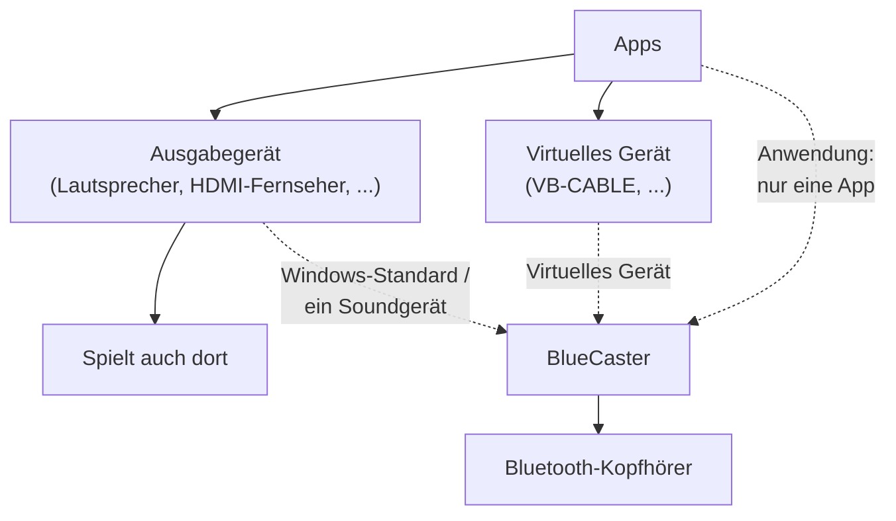
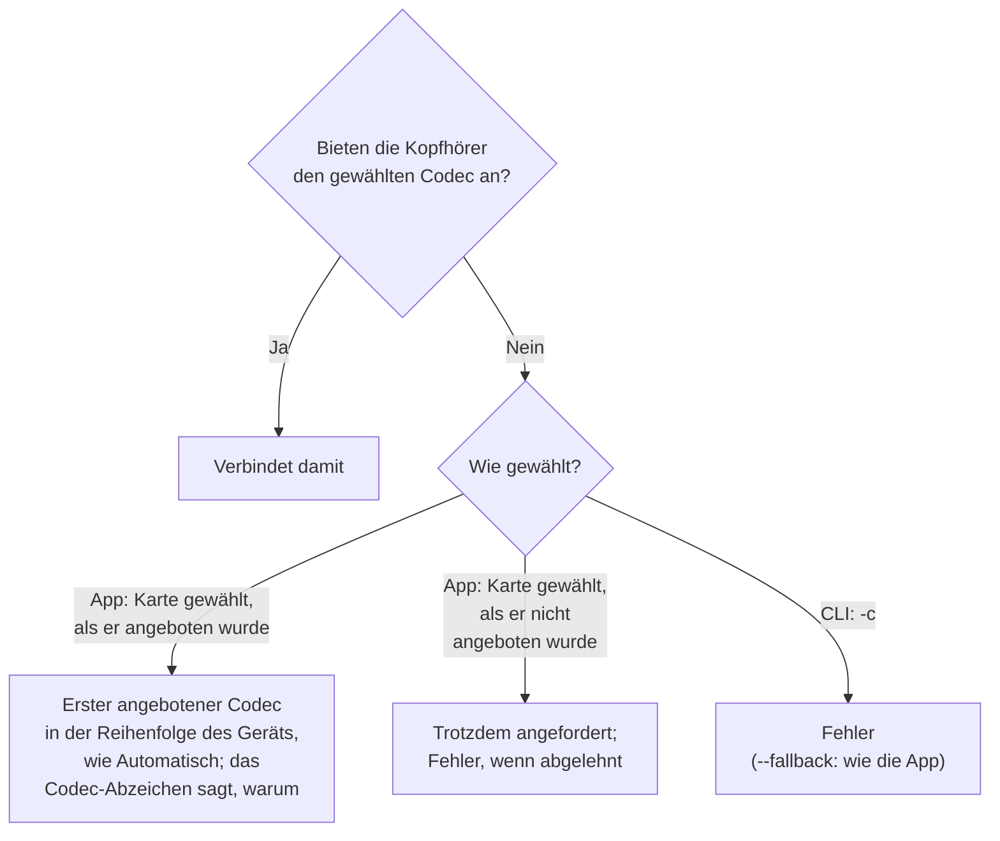

# Verwendung
{: .no_toc }

## Inhalt
{: .no_toc .text-delta }

1. TOC
{:toc}

---

## Das Fenster

Starten Sie **BlueCaster** über das Startmenü (oder mit `bluecaster.exe`). Das Menü links führt zu den unten beschriebenen Seiten: Start, Codecs, Audiogeräte, Adapter, Diagnose, Einstellungen und Info, im Entwicklermodus außerdem Entwickler und, wenn dort eingeschaltet, Lautstärkemixer. In einem schmalen Fenster zeigt das Menü nur Symbole. Das Fenster ist nur eine Ansicht von `bluecaster-core.exe`, das im Hintergrund weiterläuft. Wenn Sie das Fenster schließen, endet das Streaming also nicht (siehe [Infobereich und Flyout](#tray)).

### Start

- Für jedes gespeicherte Audiogerät eine Karte, nebeneinander, mit Zustand und Akkustand. Die Karte des verbundenen Geräts zeigt außerdem den verwendeten Codec als Liste (siehe unten) und seine Bitrate. Wird ein anderer als der gewählte Codec verwendet, nennt die Codec-Zeile kurz den Grund, z. B. **aptX Adaptive (Opus nicht unterstützt)** (oder *wird bereits verwendet*). Nach einigen Sekunden bleibt nur ein Warnzeichen (der Grund erscheint beim Darüberfahren), und die Statuszeile zeigt nur **Verbunden**
- **Verbinden** / **Trennen** unter jeder Karte. Es kann immer nur ein Gerät verbunden sein: **Verbinden** bei einem anderen Gerät trennt das aktuelle und verbindet das neue
- **Lautstärke**: die Lautstärke der Kopfhörer (siehe [Lautstärke](#volume)). Ein Klick auf den Lautsprecher schaltet stumm (BlueCaster sendet dann Stille), ein weiterer Klick hebt die Stummschaltung auf. Auf den Karten der anderen Geräte ist der Regler deaktiviert
- Eine Codec-Liste auf der Karte des verbundenen Geräts, um schnell zu wechseln (etwa ein Codec für Spiele und einer für Musik). Sie enthält die Codecs, die das Gerät unterstützt, wie unter [Codecs](#codecs), aber nur mit Namen, und zeigt den verwendeten Codec, auch bei automatischer Auswahl. Wenn Sie einen Codec wählen, wird die automatische Auswahl ausgeschaltet (unter Codecs schalten Sie sie wieder ein). Die Wahl gilt sofort: Das Gerät verbindet sich mit dem neuen Codec neu, und wie unter Codecs wartet die nächste Wahl, bis die Verbindung wieder steht
- Ein kleines Diagramm der Verbindungsqualität auf der Karte des verbundenen Geräts, während es streamt. Die Ausgabequelle wählen Sie unter **Audiogeräte**. Ist diese Quelle eine Anwendung, die noch nicht läuft, weist die Karte darauf hin
- Fehler zeigen ihre Ursache und, falls vorhanden, eine Schaltfläche, die das Problem behebt (**Durch WinUSB-Treiber ersetzen**, **Downloadseite öffnen**, **Bluetooth neu starten**, **Erneut versuchen**, **Codecs**, **Audiogeräte**, ...)
- Über den Karten, bis Sie sie schließen: eine Warnung, wenn in Windows ein anderer Bluetooth-Adapter aktiv ist, und ein Hinweis, wenn OPPO-Ohrhörer Hi-Res eingeschaltet haben (siehe [Codecs](#codecs))

Die Seitenleiste zeigt dieselben Informationen auf jeder Seite für jedes Gerät, das Flyout im Infobereich für das verbundene Gerät.

### Codecs {#codecs}

Jedes gespeicherte Audiogerät hat einen eigenen Abschnitt. Darüber stehen ein Punkt (grün, solange das Gerät verbunden ist), sein Name und die Markierungen **Gekoppelt** / **Audio**; die Adresse finden Sie unter **Audiogeräte**. Darunter folgen die Codec-Karten, die mit der höchsten Klangqualität zuerst, sofern Sie sie nicht selbst anordnen. Jede Karte hat drei Balken (Klangqualität, niedrige Latenz, Stabilität) und zeigt, ob das Gerät den Codec bei seiner letzten Verbindung angeboten hat: **Unterstützt** (grünes Zeichen) oder **Nicht unterstützt** (rotes Zeichen). Ist **Nur unterstützte Codecs anzeigen** eingeschaltet (Standard), sind alle angezeigten Karten unterstützt, daher trägt keine die Markierung **Unterstützt**. Ein Gerät, das noch nie verbunden war (etwa eines aus Windows übernommenes), zeigt dann nur die Karte **SBC**, die jedes Bluetooth-Audiogerät hat, und einen eventuell dafür gewählten Codec. Die übrigen Karten erscheinen nach der ersten Verbindung oder wenn Sie den Schalter ausschalten. Ohrhörer von Huawei und Honor behalten ihre Karte **LDAC** mit der Markierung **Unbestätigt**, bis sie LDAC aufführen, denn das tun sie womöglich erst, wenn LDAC gewählt ist. Wenn LHDC V5 streamt (von Ihnen oder von der automatischen Auswahl gewählt, aber nicht mit der Qualität **Niedrig** oder ABR), werden OPPO-Ohrhörer, die für LHDC V5 eine Spitzenbitrate aufführen, einmal gebeten, Hi-Res einzuschalten. Dafür verbinden sie sich einmal neu, und Start zeigt an, wenn sich ihre Bitrate dadurch erhöht hat. Hi-Res bleibt danach in den Ohrhörern eingeschaltet; Ohrhörer, denen es nichts gebracht hat, werden zurückgestellt. Im Entwicklermodus vergisst **Erneut nach Hi-Res fragen** in den Einstellungen von LHDC V5, was das Gerät aufgeführt hat und dass es schon gefragt wurde. Die nächste Verbindung fragt dann erneut.

- **Automatisch den unterstützten Codec mit der höchsten Qualität wählen** (eine Einstellung für alle Geräte, oben auf der Seite; standardmäßig eingeschaltet): Jedes Gerät verwendet den Codec mit der höchsten Qualität, den es unterstützt, in dieser Reihenfolge: LHDC V5 > LDAC > aptX Adaptive > Opus > aptX HD > aptX > aptX LL > AAC > SBC XQ > SBC. Dabei gelten die Standardeinstellungen, wie bei **Automatisch** in den Einstellungen eines Codecs: hohe Qualität, 24 Bit, wo der Codec das unterstützt, und 48 kHz (hat das Gerät kein 48 kHz, eine andere gemeldete Rate, zuerst 44,1 kHz; die Rate von Windows wird umgerechnet). Die Karten sind bis auf ihre Reihenfolge schreibgeschützt (ziehen Sie sie wie unten beschrieben; die automatische Auswahl nimmt die erste Karte, die das Gerät unterstützt). Hervorgehoben ist der verwendete Codec bzw. der, den die automatische Auswahl nehmen wird. Ein Klick auf eine Karte oder ihr **...** fragt, ob die automatische Auswahl ausgeschaltet werden soll (**Automatische Auswahl ausschalten** / **Abbrechen**). Danach ist die angeklickte Karte gewählt (und ihr **...** öffnet ihre Einstellungen). Schalten Sie die automatische Auswahl aus, um Codec und Einstellungen jedes Geräts selbst zu wählen; ein Gerät, für das noch kein Codec gewählt ist, behält den der automatischen Auswahl. Solange die automatische Auswahl eingeschaltet ist, bleibt der für jedes Gerät gewählte Codec für später gespeichert. Haben Einstellungen von vor 2.0.2 für ein Gerät einen Codec gewählt, startet die automatische Auswahl ausgeschaltet
- Bei ausgeschalteter automatischer Auswahl wählen Sie mit einem Klick auf eine Karte den Codec dieses Geräts. Die Wahl wird sofort gespeichert, und ein streamendes Gerät verbindet sich damit neu. Sie können auch eine Karte wählen, die das Gerät nicht unterstützt (sichtbar, wenn **Nur unterstützte Codecs anzeigen** ausgeschaltet ist): BlueCaster fordert den Codec trotzdem an. Lehnt das Gerät ihn ab, endet die Verbindung mit einer entsprechenden Fehlermeldung (wählen Sie eine andere Karte oder schalten Sie die automatische Auswahl ein). Start, die Seitenleiste, das Flyout und die QuickInfo des Infobereich-Symbols nennen dann die Ursache in wenigen Worten (z. B. *LDAC nicht unterstützt*). Das tun sie immer, wenn der Codec eine Verbindung beendet (weil das Gerät ihn nicht unterstützt, ablehnt oder für eine andere Quelle nutzt). Eine andere Karte oder andere Einstellungen für dieses Gerät oder das Einschalten der automatischen Auswahl verbinden es neu. Haben Sie einen Codec gewählt, als das Gerät ihn anbot, und bietet es ihn später nicht mehr an (etwa weil Ohrhörer auf einen anderen Codec umgestellt wurden), weicht BlueCaster auf die erste Karte in der Reihenfolge des Geräts aus, die es unterstützt: den besten unterstützten Codec, sofern Sie die Reihenfolge nicht geändert haben (siehe [Ausdrücklich gewählter Codec wird nicht angeboten](#codec-fallback))
- Ziehen Sie die Karten eines Geräts, um seine Codecs in Ihre eigene Reihenfolge zu bringen (die Hand erscheint, solange die Maustaste gedrückt ist; bei ausgeschalteter automatischer Auswahl geht es auch mit Alt und einer Pfeiltaste auf einer Karte). Jedes Gerät behält seine eigene Reihenfolge. Die automatische Auswahl, ein Gerät ohne gewählten Codec und ein gewählter Codec, den das Gerät nicht unterstützt, verwenden jeweils die erste unterstützte Karte. FastStream und Opus 05 (die Karte **Opus (PipeWire)**, nur im Entwicklermodus; ohne Entwicklermodus wird sie auch gewählt nicht verwendet) werden nur verwendet, wenn sie gewählt sind, egal wo sie stehen. **Codec-Reihenfolge zurücksetzen** stellt die Standardreihenfolge wieder her. Die Schaltfläche erscheint nur, solange die angezeigten Karten davon abweichen (auch Karten, die Sie von Hand zurückschieben, stellen sie wieder her). Ein streamendes Gerät, dessen Codec sich dadurch ändert, verbindet sich neu
- Wählen Sie für das streamende Gerät einen anderen Codec, verbindet es sich damit neu. Die Karten (und die Codec-Liste auf Start und im Flyout) nehmen die nächste Wahl erst an, wenn das Gerät wieder verbunden ist. So brechen schnelle Klicks hintereinander keine Verbindung ab, die noch aufgebaut wird. Ein Codec-Wechsel zeigt keine Verbindungsbenachrichtigung, das Verbinden eines Geräts schon
- **Nur unterstützte Codecs anzeigen** (standardmäßig eingeschaltet; ausschalten, um unterstützte und nicht unterstützte Codecs anzuzeigen): blendet die Codecs aus, die ein Gerät nicht angeboten hat. Vor der ersten Verbindung eines Geräts wird nur **SBC** angezeigt (und ein eventuell dafür gewählter Codec)
- **...** auf einer Karte öffnet die Einstellungen dieses Codecs. Änderungen gelten sofort. Beim verwendeten Codec wird eine Änderung gespeichert, und das Gerät verbindet sich damit neu. Ausnahmen sind der **Bitpool**, der sich während der Wiedergabe ändert, und der Schalter unten, wenn der Stream so oder so gleich aufgebaut würde. Bei einem anderen Codec wird die Änderung aufbewahrt, bis Sie diesen Codec wählen. Jeder Codec behält seine eigenen Einstellungen, ebenso aptX Adaptive und aptX Adaptive LL: Wechseln Sie zu einem anderen Codec und zurück, sind sie wieder da. Angeboten werden nur Optionen, die der Codec unterstützt und die das Gerät bei seiner letzten Verbindung gemeldet hat. Schalten Sie oben **Nur Optionen anzeigen, die *Gerät* unterstützt** aus (standardmäßig eingeschaltet; erscheint, sobald das Gerät seine Optionen gemeldet hat), um alles zu sehen, was der Codec bietet, etwa eine Abtastrate, Bittiefe, Qualität oder einen Bitpool, die das Gerät nicht gemeldet hat (gekennzeichnet mit *(nicht unterstützt)*). Das Gerät kann diese ablehnen; die Verbindung endet dann mit einer entsprechenden Fehlermeldung. Schalten Sie den Schalter wieder ein, kehrt alles, was das Gerät nicht gemeldet hat, zu Automatisch zurück. Die Einstellungen je Codec (die automatische Auswahl verwendet sie nie):
  - **Qualität**: LDAC **Hoch** / **Mittel** / **Niedrig** (990 / 660 / 330 kbps); LHDC V5 **Hoch** / **Mittel-hoch** / **Mittel** / **Niedrig** (1000 / 900 / 500 / 400 kbps, die vier Stufen von Android); aptX Adaptive **Hoch** (sein Niedriglatenzmodus hat eine eigene Karte, **aptX Adaptive LL**: 265 kbps, 48 kHz, kein ABR; siehe [aptX Adaptive](#aptx-adaptive)). Ist bei LHDC V5 ABR eingeschaltet, ist die Qualität ausgegraut (ABR bleibt bei 400 kbps oder darunter). AAC, Opus, Opus 05, SBC und SBC XQ haben nur eine Stufe, **Hoch**, die angezeigt statt gewählt wird: die höchste Bitrate, die das Gerät annimmt (ABR oder VBR verändern sie trotzdem, wo vorhanden; SBC und SBC XQ zeigen die Bitrate, die sich aus Bitpool und Frame-Aufbau ergibt). Bei aptX, aptX HD, aptX LL und FastStream legt der Codec die Bitrate fest. Eine von einer früheren Version gespeicherte Qualität, die der Codec nicht mehr hat (Standard / Mobil bei aptX Adaptive, die niedrigeren Stufen von AAC, ...), wird als Hoch geladen
  - **Adaptive Bitrate (ABR)**: für LDAC, LHDC V5, aptX Adaptive, SBC und SBC XQ (siehe [ABR](#abr)); **VBR** für AAC
  - **Niedrige Latenz** (LHDC V5, bei Geräten, die sie melden): Der Ton kommt früher bei den Kopfhörern an. Ist ABR ausgeschaltet, sinkt die Bitrate, solange die Verbindung nicht mithält (1000, 900, dann 500 kbps), und steigt nach einer Minute ohne Probleme wieder. Pakete werden nach 100 ms in der Sendewarteschlange verworfen statt nach 350 ms. Eine schwache Verbindung verursacht so einen kurzen Aussetzer statt einer anhaltenden Verzögerung
  - **Abtastrate**: Automatisch ist 48 kHz oder, wenn das Gerät kein 48 kHz hat, eine andere gemeldete Rate (zuerst 44,1 kHz), und zeigt die resultierende Rate an (z. B. *Automatisch (48000 Hz)*). Automatisch wählt nie 96 kHz: Das bringt mehr Latenz und weniger Kompatibilität ohne hörbaren Gewinn (Windows mischt mit 48 kHz). Wählen Sie 96 kHz hier, um es zu nutzen. Angeboten werden nur die Raten, die das Gerät meldet (LHDC V5 hat kein 88,2 kHz; aptX Adaptive bietet 96 kHz nur einem Gerät an, das es meldet, siehe [aptX Adaptive](#aptx-adaptive)). Meldet ein Gerät nur eine Rate, wird diese ohne Automatisch angezeigt
  - **Bittiefe**: 16 oder 24 Bit für LDAC und LHDC V5, soweit das Gerät sie meldet (Automatisch: 24 Bit; bei LHDC V5 nur, wenn das Gerät es meldet); 24 Bit für aptX HD und aptX Adaptive; 16 Bit für die übrigen. Die 24 Bit von LDAC erreichen den Encoder als 32-Bit-Samples, wie bei der 32-Bit-Option von Android. Die Bittiefe ist nicht Teil der LDAC-Konfiguration, die Kopfhörer erhalten also in beiden Fällen denselben Stream
  - **Bitpool** (SBC, SBC XQ): ein Regler mit zwei Griffen für den minimalen und den maximalen Bitpool, innerhalb des Bereichs, den das Gerät meldet. Der maximale ist der verwendete Bitpool, der minimale der niedrigste, der verwendet wird (das untere Ende des Bereichs, mit dem die Verbindung aufgebaut wird, und die Grenze, bis zu der ABR heruntergehen darf). **Automatisch** setzt beide zurück: den maximalen passend zur Qualität, den minimalen auf den Wert des Geräts und von ABR. Die Zeile darunter zeigt den Kanalmodus, der für jeden Codec fest ist: Joint Stereo bei SBC, Dual Channel bei SBC XQ. Der Bitpool von SBC XQ reicht bis 47 bei 44,1 kHz und 43 bei 48 kHz, oder bis 53, wenn **Nur Optionen anzeigen, die *Gerät* unterstützt** ausgeschaltet ist.
  - **Frame-Aufbau** (SBC und SBC XQ, nur im Entwicklermodus): Blöcke, Subbänder, Bitzuteilung und bei SBC der Kanalmodus. Automatisch behält 16 Blöcke, 8 Subbänder, Loudness und Joint Stereo. Ein Wert, den das Gerät nicht annimmt, fällt beim Verbinden auf Automatisch zurück. Bei einem Sony-Gerät, das ein Nutzer getestet hat, verzerren 12 Blöcke den Ton und können die Verbindung trennen (die Ausgabe des Encoders lässt sich korrekt dekodieren, und die anderen Blockzahlen spielen einwandfrei). Ihre Auswahl bleibt gespeichert, wird aber nicht verwendet, solange der Entwicklermodus aus ist. Die Bitraten von AAC und LHDC V5 bleiben innerhalb des Maximums, das das Gerät meldet

Die Standardwerte liefern den besten Klang; die meisten Geräte brauchen nur **Automatisch**. Ein LE-Audio-Gerät (experimentell) hat zwei Karten, **LC3** und **LC3 LL** (siehe [LE Audio](#le-audio)). Ihr **...** zeigt wie bei den Anrufcodecs dieselben Felder wie bei einem A2DP-Codec, aber schreibgeschützt. Der Niedriglatenzmodus von aptX Adaptive hat eine eigene Karte, **aptX Adaptive LL**, neben **aptX Adaptive**. Die automatische Auswahl nimmt sie nie, und ein aptX Adaptive, das eine frühere Version auf niedrige Latenz gestellt hat, erscheint auf dieser Karte.

Solange das Mikrofon eines klassischen Geräts geöffnet ist (siehe [Audiogeräte](#audio-devices)), ersetzen die Anrufcodecs, die es nutzen kann, seine Musikkarten: LC3 (32 kHz), mSBC (16 kHz) und CVSD (8 kHz); der aktive ist ausgewählt. Bei automatischer Auswahl wählt die Anrufverbindung den besten Codec, den beide Seiten unterstützen, und ein Klick auf eine Karte fragt, ob die automatische Auswahl ausgeschaltet werden soll. Ist sie ausgeschaltet, wählen Sie mit einem Klick auf eine Karte den Anrufcodec: Das Mikrofon öffnet sich damit neu, oder mit dem nächstniedrigeren Codec, wenn die Kopfhörer ihn nicht unterstützen. **...** zeigt die Einstellungen schreibgeschützt. Schließt sich das Mikrofon, kehren die Musikkarten zurück. Solange die automatische Auswahl eingeschaltet ist, bleibt der gewählte Anrufcodec für später gespeichert. Mit **Nur unterstützte Codecs anzeigen** werden Codecs ausgeblendet, die die Kopfhörer nicht unterstützen.

Solange das Mikrofon eines LE-Audio-Geräts geöffnet ist, erscheint nach seinen Musikkarten eine Karte **Mikrofon** (LC3, mono). Bei ausgeschalteter automatischer Auswahl stellt ihr **...** die Abtastrate des Mikrofons ein, aus den Raten, die die Kopfhörer unterstützen (**Automatisch** nimmt die erste; eine Änderung verbindet das Gerät neu). Bei automatischer Auswahl zeigt es die verwendete Rate.

Intern führt BlueCaster in `profiles.json` einen Eintrag pro Gerät (sein Codec, die Einstellungen jedes Codecs und seine Codec-Reihenfolge), dort „*Gerät* | *Codec*“ benannt; das Fenster und das Menü im Infobereich zeigen nur den Gerätenamen. In früheren Versionen konnten Sie für ein Gerät mehrere Profile anlegen. Beim ersten Start einer Version mit der Seite Codecs bleibt das zuletzt verwendete Profil erhalten (sonst das erste), und die übrigen werden damit zusammengeführt. Ihre Codec-Einstellungen (Qualität, Abtastrate, Bittiefe, ABR, SBC-Einstellung) bleiben dabei für ihre Codecs erhalten. Ihre Namen, Ausgabequellen und Paketgrößen gehen verloren; die ursprüngliche `profiles.json` wird einmalig als `profiles-before-codecs.json` im Einstellungsordner gesichert. Die **Reihenfolge der Automatik…** aus den Vorabversionen von 2.0.2 (eine Reihenfolge für alle Geräte, im Entwicklermodus) wird nicht mehr verwendet: Jedes Gerät hat jetzt seine eigene Reihenfolge.

### Audiogeräte {#audio-devices}

Die Kopfhörer und Lautsprecher, an die BlueCaster streamen kann, jeweils mit eigenen Einstellungen. Darunter, unter **Audiogerät hinzufügen**, sucht **Geräte suchen** 30 Sekunden lang mit dem USB-Adapter nach Geräten in der Nähe und listet sie auf, sobald sie antworten; **Suche beenden** beendet die Suche. Versetzen Sie die Kopfhörer vorher in den Kopplungsmodus. Ist ein Gerät verbunden, fragt BlueCaster vor der Suche, ob es getrennt werden soll. **Hinzufügen** speichert ein gefundenes Gerät und verbindet es. Geräte, mit denen BlueCaster schon gekoppelt war, tragen die Markierung **Gekoppelt**. Findet die Suche ein Gerät nicht, geben Sie seine Adresse unter **Manuell:** ein und klicken Sie auf **Hinzufügen**. Adressen werden beim Tippen oder Einfügen formatiert (`aa-bb-cc-dd-ee-ff`, `AABBCCDDEEFF` und `AA BB CC DD EE FF` werden alle zu `AA:BB:CC:DD:EE:FF`). Kopfhörer sehen den Adapter unter dem Namen Ihres Computers mit BlueCaster dahinter, z. B. *Taro-PC (BlueCaster)*, damit Sie ihn vom Bluetooth von Windows unterscheiden können. Hat Windows ein Gerät über einen anderen Adapter gekoppelt, etwa das eingebaute Bluetooth des PCs, fragt BlueCaster zuerst nach (**In Windows gekoppelt**: dort entfernen oder **Trotzdem hinzufügen**). Ebenso fragt es bei einem Gerät, das Windows über diesen Adapter gekoppelt hat (die Einrichtung kann diese Kopplung übernehmen, siehe [Dienste und Kopplungsschlüssel](#shared-pairing)). Ein gespeichertes Gerät können Sie umbenennen oder entfernen. Beim Entfernen werden auch seine Einstellungen und seine Kopplung gelöscht; es muss dann neu gekoppelt werden, bevor es sich verbinden kann. Jedes gespeicherte Gerät hat:

- **Ausgabequelle**: **Windows-Standard** (für sich allein zuerst aufgeführt: die Windows-Standardausgabe, in Klammern genannt, die auch ein virtuelles Gerät sein kann; Standard für ein neues Gerät), ein Ausgabegerät unter **Soundgeräte**, ein virtuelles Gerät oder eine Anwendung (siehe [Aufnahmemodi](#capture-modes)). Daneben steht das Format, in dem Windows das aufgenommene Gerät mischt (Abtastrate und Bittiefe, schreibgeschützt). Es wird bernsteinfarben, wenn das Gerät ein anderes Format streamt (oder, wenn nicht verbunden, seine Codec-Einstellungen eines verlangen), und eine Zeile darunter nennt beide Formate (das Streaming funktioniert trotzdem, mit Umrechnung). Darunter steht, was die Quelle tut
- **Bei Verbindung als Windows-Standardausgabe festlegen** (Entwicklermodus, mit einem virtuellen Gerät oder einem Soundgerät)
- **Eingangsquelle**: das Mikrofon der Kopfhörer und im Entwicklermodus **Bei Verbindung als Windows-Standardeingabe festlegen** (siehe unten)

**Eingangsquelle** schickt bei jedem Gerät das Mikrofon der Kopfhörer an Windows, für Anrufe und Sprachchat. BlueCaster hat keinen eigenen Audiotreiber und spielt das Mikrofon daher in ein virtuelles Audiokabel wie VB-CABLE. Die Liste nennt jedes Kabel nach der Seite, von der Apps aufnehmen (*CABLE Output* bei VB-CABLE); wählen Sie diese in Ihren Apps als Mikrofon. Wählen Sie neben der Liste **Aus** oder **Auto**: **Auto** öffnet das Mikrofon nur, solange eine App davon aufnimmt, sodass die Wiedergabe sonst ihre volle Qualität behält. Im Entwicklermodus gibt es zusätzlich **An**: Das Mikrofon bleibt dann ständig offen. Ohne Entwicklermodus verhält sich ein Gerät auf **An** wie auf **Auto**. Bei **Aus** bleibt die Liste sichtbar, aber ausgegraut. **Aus** und die Mikrofon-Schaltfläche auf Start und im Flyout sind dieselbe Einstellung: Bei einem Gerät auf **Auto** oder **An** deaktiviert **Aus** das Mikrofon wie die Schaltfläche und merkt sich den Modus, den die Schaltfläche wiederherstellt. **Bei Verbindung als Windows-Standardeingabe festlegen** (Entwicklermodus; ohne Entwicklermodus immer an) macht die Aufnahmeseite des Kabels (*CABLE Output*) zum Windows-Standardmikrofon, solange das Gerät verbunden ist. Apps, die vom Standardmikrofon aufnehmen, erhalten dann das Mikrofon der Kopfhörer, und **Auto** öffnet es für sie. Wird das Gerät getrennt, kehrt der vorherige Standard zurück, sofern Sie inzwischen keinen anderen gewählt haben.

**Mikrofon anpassen** ganz unten öffnet die Regler, die das Mikrofon bearbeiten, bevor Apps es erhalten. Steht **Eingangsquelle** auf **Aus**, ist die Zeile ausgegraut. **Mikrofonanpassung verwenden** schaltet die Bearbeitung ein oder aus. Ist sie ausgeschaltet, kommt das Mikrofon unverändert durch, und die Regler behalten ihre Werte. **Verstärkung** macht das Mikrofon lauter oder leiser (-12 bis +24 dB). **Rauschunterdrückung** entfernt gleichmäßige Hintergrundgeräusche wie einen Lüfter oder Brummen. Je weiter rechts, desto stärker wirkt sie; je weiter links, desto mehr bleibt vom ursprünglichen Klang. Ganz links ist sie **Aus**. **Noise Gate** schaltet das Mikrofon stumm, solange es unter dem gewählten Pegel bleibt (ganz links: **Aus**). Ein Limiter verhindert, dass ein verstärktes Mikrofon übersteuert. Änderungen gelten sofort, ohne neue Verbindung. Die Rauschunterdrückung verzögert das Mikrofon um etwa 20 ms; ist alles aus, kommt das Mikrofon unverändert durch. Der **Mikrofon**-Test unter **Diagnose** nimmt es so auf, wie Apps es hören.

Neue Geräte starten mit VB-CABLE, wenn es installiert ist, sonst mit dem Hi-Fi Cable, außer dieses Kabel ist ihre **Ausgabequelle**: ein klassisches Gerät auf **Auto**, ein LE-Audio-Gerät auf **Aus** (dort hält **Auto** das Mikrofon offen). Ein Gerät, dessen Mikrofon eingeschaltet ist, aber kein Kabel hat, erhält eines, sobald Windows eines auflistet. **Audiogeräte** und die Einrichtung schlagen fehlende Kabel vor (siehe [Aufnahmemodi](#capture-modes)). Installieren Sie später eines, richtet BlueCaster die Geräte, die es automatisch eingerichtet hat, und die auf **Windows-Standard** mit einem solchen Mikrofon neu ein, so wie es die Einrichtung täte. Mit beiden Kabeln ist das Hi-Fi Cable für den Ton und VB-CABLE für das Mikrofon zuständig. Mit einem Kabel ist dieses für das Mikrofon zuständig, und der Ton kommt von einem Ausgabegerät unter **Soundgeräte** (der Ton eines Monitors oder Fernsehers, falls vorhanden, bei mehreren die Windows-Standardausgabe; sonst die Windows-Standardausgabe), gleich welches Gerät die Windows-Standardausgabe ist. Eine selbst gewählte Ausgabequelle oder ein selbst gewähltes Mikrofon bleibt unverändert. Ohne Kabel, wenn Windows sowohl den Ton eines Monitors oder Fernsehers als auch eine Soundkarte hat, kommt der Ton vom Monitor oder Fernseher, und das Mikrofon spielt in die Soundkarte, auf **Aus** gestellt. Steht das Mikrofon im Entwicklermodus auf **An**, kann eine App, die ein Ausgabegerät aufnimmt (die Audioausgabeaufnahme von OBS), es dort abgreifen; **Auto** kann nicht erkennen, wer einer Soundkarte zuhört. Ein unter **Audiogeräte** hinzugefügtes Gerät startet genauso. Ein Gerät auf **Windows-Standard**, dessen Mikrofon in das Kabel spielt, das die Windows-Standardausgabe ist, wird ebenfalls auf diese Tonquelle umgestellt, da das Mikrofon sonst in den Kopfhörern zu hören wäre.

Spielt das Mikrofon in das Hi-Fi Cable und laufen Wiedergabe- und Aufnahmeseite des Kabels in den Soundeinstellungen von Windows mit unterschiedlichen Abtastraten, erscheint eine Warnung: Hören Apps nichts, stellen Sie beide auf dieselbe Rate. Die Liste zeigt nur Kabel, von denen Apps aufnehmen können. Sie lässt das Kabel weg, das BlueCaster selbst aufnimmt (die **Ausgabequelle** oder bei **Windows-Standard** die Windows-Standardausgabe, nicht aber die Ausgabequelle eines anderen Geräts, die zum Standard wurde, solange dieses verbunden ist). Ebenso fehlt die andere Seite dieses Kabels (*CABLE In 16ch* von VB-CABLE nimmt in dasselbe *CABLE Output* auf wie *CABLE Input*), da das Mikrofon sonst mit der Wiedergabe gemischt würde. Umgekehrt lässt die Liste **Ausgabequelle** das Kabel weg, in das das Mikrofon spielt, solange **Eingangsquelle** nicht auf **Aus** steht. Ist **Entwickler > App-Einstellungen > Alle Audiogeräte in den Quelllisten anzeigen** eingeschaltet, bieten beide Listen jedes Gerät an: Ausgaben ohne Aufnahmeseite (Lautsprecher usw.) unter **Mithören**, da sie das Mikrofon nur wiedergeben; das 16-Kanal-Kabel von VB-CABLE als *CABLE Output · CABLE In 16ch* (die gemeinsame Aufnahmeseite, dann sein eigener Name); und das Kabel der Ausgabequelle ausgegraut, mit *(als Ausgabequelle verwendet)* hinter dem Namen. *CABLE Input* und *CABLE Output* sind die beiden Enden eines Kabels; für eine virtuelle Ausgabequelle und das Mikrofon brauchen Sie also zwei Kabel. Empfohlen: das **Hi-Fi Cable** von VB-Audio (*HiFi-Cable & ASIO-Bridge* auf [der Seite von VB-Audio](https://vb-audio.com/Cable/)) für den Ton, da es die geringste Verzögerung hinzufügt, und VB-CABLE für das Mikrofon. Auch das Gerät des Mikrofons darf nicht die Windows-Standardausgabe sein: Apps hörten sonst die Wiedergabe gemischt mit dem Mikrofon, und eine Ausgabequelle auf einem anderen Gerät bekäme nichts. Eine Warnung unter **Eingangsquelle** weist darauf hin.

Solange das Mikrofon offen ist, spielt ein klassisches Bluetooth-Gerät über seine Anrufverbindung: mono in Anrufqualität (CVSD, mSBC oder LC3, das Beste, was beide Seiten unterstützen). Sein Codec wird währenddessen abgeblendet. Schließt sich das Mikrofon, kehrt das Gerät ohne neue Verbindung zu diesem Codec zurück. Ein LE-Audio-Gerät spielt LC3 in seiner üblichen Qualität weiter und sendet das Mikrofon nebenher; ein Wechsel des Modus verbindet es neu (dort hält Auto das Mikrofon offen). Manche Kopfhörer lehnen das Mikrofon womöglich ab oder zeigen einen Anruf an, obwohl keiner läuft. Bei **Auto** oder **An** und einem ausgewählten Gerät zeigt eine Zeile **Mikro:** unter dem Codec (in der Seitenleiste, auf Start und im Flyout) das Mikrofon, solange das Gerät verbunden ist oder sich verbindet: Codec und Rate mit einem roten Punkt, solange es offen ist (*Mikro: mSBC 16 kHz*), oder abgeblendet seinen Modus, solange es geschlossen ist. Auf Start und im Flyout deaktiviert die Mikrofon-Schaltfläche daneben das Mikrofon: Die Schaltfläche wird durchgestrichen, das Mikrofon schließt sich, ein klassisches Gerät kehrt zu seinem Codec zurück, und **Eingangsquelle** zeigt **Aus**. Ein weiterer Klick aktiviert das Mikrofon wieder im vorherigen Modus, ebenso die Wahl von **Auto** oder **An** unter **Eingangsquelle**. Die Schaltfläche ist gestrichelt, solange Auto auf eine App wartet. Ließ sich das Mikrofon nicht öffnen, zeigt sie ein Warnzeichen mit dem Grund in der QuickInfo.

**Alle Audiogeräte** über der Liste enthält die Schalter, die für jedes Gerät gelten: **Windows-Lautstärke-Sync** (siehe [Lautstärke](#volume)), **Wiedergabe über die Tasten des Audiogeräts steuern** und **Automatisch wieder verbinden**. Die **Max. Mediapaketgröße** jedes Geräts steht auf der Seite **Entwickler** (siehe [Max. Mediapaketgröße](#max-packet)).

### Diagnose

- **Verbindungsqualität** während des Streamings: tatsächliche Bitrate, Pakete, vor dem Senden verworfene Pakete, bei der Aufnahme verworfenes Audio, Sendewarteschlange, die vom Gerät gemeldete Verzögerung (siehe [Latenz](#latency)), genutzte Funkzeit, Signal (RSSI) und die AFH-Kanäle (siehe [Verbindungsqualität und AFH](#link-quality)). Solange das Headset-Mikrofon offen ist, wird die Anrufverbindung eines klassischen Geräts genauso gemessen (ihr Codec, z. B. mSBC, und was sie sendet), und eine Karte **Mikrofon** zeigt die zurückkommenden Pakete: empfangen, auf der Funkstrecke beschädigt und überbrückt
- **Funk**: die 79 Bluetooth-Kanäle im 2,4-GHz-Band. Der Tab zeigt, welche die Verbindung nutzt und welche der Adapter auslässt, darunter die WLAN-Kanäle und ein paar Tipps für eine störungsfreiere Verbindung. Im Entwicklermodus zeigt **Suchen** zusätzlich die 2,4-GHz-WLANs in der Nähe (siehe [Der Funk-Tab](#radio-tab))
- **Codec-Details** während des Streamings: Medien-Nutzlast, Header, Codec-Frame und Frames pro Paket sowie das, was der Endpunkt des Geräts aufführt, neben dem, was verwendet wird: bei SBC Bitpool, Abtastraten, Kanalmodi, Blöcke, Subbänder und Bitzuteilung; bei AAC Objekttypen, Abtastraten, Kanäle, Spitzenbitrate und VBR; bei den übrigen Codecs Abtastraten, Bittiefen und Spitzenbitrate
- **Mikrofon**: testet das Headset-Mikrofon eines klassischen Bluetooth-Geräts während des Streamings. **Aufnehmen** öffnet das Mikrofon und nimmt bis zu 10 Sekunden auf; die Leiste zeigt den Pegel (das Gerät spielt währenddessen in Anrufqualität; wurde das Mikrofon auf dieser Verbindung noch nie geöffnet, verbindet sich das Gerät zuerst neu). **Abspielen** spielt die Aufnahme auf den Kopfhörern ab. Wenn Sie den Tab verlassen, endet der Test, und die Wiedergabe kehrt zu ihrem Codec zurück. LE-Audio-Geräte werden noch nicht unterstützt
- **Verbindungsablauf**: die elf Phasen des letzten Verbindungsversuchs (Start, Bluetooth-Adapter, ACL- / AVDTP-Verbindung, Fähigkeitenabfrage, Codec-Auswahl, Audioaufnahme, Stream-Konfiguration, Encoder, Stream-Start, Audio senden, Verbindungserhalt mit Trennungen / erneuten Verbindungen), jeweils als OK, Warnung oder Fehler markiert, mit ihrer Dauer. **Ablauf kopieren** kopiert ihn
- **Protokoll**: das Live-Protokoll, gefiltert nach Stufe (alle, Info und höher, Warnungen und Fehler, nur Fehler), nach Text und auf den aktuellen Verbindungsversuch (**Nur aktueller Versuch**). **Angezeigtes Protokoll kopieren** kopiert, was angezeigt wird. **Protokollordner öffnen** öffnet den Ordner mit den Protokolldateien. Anders als bei **Diagnose kopieren** sind diese Dateien nicht maskiert (sie enthalten Bluetooth-Adressen und Ihren Windows-Benutzernamen)
- **HCI-Aufzeichnung starten** / **HCI-Aufzeichnung beenden** (siehe [Den Medienstream prüfen](#verify-stream))
- **Diagnose kopieren**: kopiert Version, Betriebssystem, Adapter, Audiogerät (Codec, seine Einstellungen und Reihenfolge), den Ablauf, Warnungen / Fehler und das aktuelle Protokoll in die Zwischenablage, bereit zum Einfügen in einen Fehlerbericht. **Bluetooth-Adressen maskieren** (standardmäßig eingeschaltet) ersetzt Adressen durch `<addr-1>`, `<addr-2>`... (die des Adapters durch `<adapter>`) und Gerätenamen durch `<device-1>`, `<device-2>`.... Außerdem blendet es USB-Seriennummern, Dateipfade oberhalb des eigenen Ordners der App (`<path>\BlueCaster\logs\...`) und Ihr Windows-Konto (Benutzername und SID) aus. Dieselbe Maskierung gilt für den Absturzbericht und für Fehlertexte, die Sie für einen Fehlerbericht kopieren
- **Problem melden**:
  - **Ausführliche Protokollierung**: **Detailliert (debug)** oder **Alles (trace, 1 Stunde)** protokolliert deutlich mehr über Bluetooth, USB, Audioaufnahme und Kodierung. Debug bleibt 24 Stunden eingeschaltet, auch über Neustarts hinweg (für Probleme beim Start), und schaltet sich dann automatisch aus. Schalten Sie es ein, stellen Sie das Problem nach und speichern Sie dann ein Diagnosepaket
  - **Diagnosepaket > Speichern…**: Wählen Sie, ob HCI-Mitschnitte enthalten sein sollen (lassen Sie das aus, sofern Sie nicht darum gebeten wurden: Sie enthalten Adressen und Gerätenamen) und ob Bluetooth-Adressen in den Textdateien maskiert werden. Speichern Sie dann eine einzelne `.zip`-Datei (in `logs\bundles\` des Einstellungsordners; die neuesten 3 bleiben erhalten). Sie enthält die Diagnoseinformationen, die Protokolldateien von Kern, Fenster und Treiberhelfer, Absturzberichte, Systeminformationen (USB-Bluetooth-Adapter und ihre Treiber, die in Windows gekoppelten Geräte, Audiogeräte), Einstellungen und die Codec-Einstellungen jedes Geräts (nie die Verbindungsschlüssel) sowie den HCI-Flugschreiber. Die HCI-Mitschnitte behalten die Adressen (aber nicht die Kopplungsschlüssel). BlueCaster hält das Paket nach Möglichkeit unter der Anhanggrenze von GitHub von 25 MB (die neuesten Protokolle zuerst, bis zu 48 MB Text, die neuesten 5 Aufzeichnungen und 2 Minidumps)
  - **Auf GitHub melden** (nach dem Speichern): öffnet einen neuen Fehlerbericht, in dem Version, Windows-Build, Adapter, Kopfhörer, Codec, Aufnahmemodus und die Diagnoseinformationen (Adressen maskiert) bereits eingetragen sind, und zeigt das Paket im Explorer, damit Sie es hineinziehen können

BlueCaster zeichnet außerdem ständig einige Daten auf, damit sich auch ein Problem, das nur einmal aufgetreten ist, noch untersuchen lässt:

- **HCI-Flugschreiber**: Die letzten Minuten des Bluetooth-Verkehrs werden im Speicher gehalten (Mediennutzdaten gekürzt, Kopplungsschlüssel entfernt) und in `logs\hci\` gespeichert, sobald ein Stream fehlschlägt oder eine Verbindung abbricht (die neuesten 10 Dateien bleiben erhalten)
- **Absturzberichte**: Stürzt BlueCaster ab, landen ein `.dmp`-Minidump und eine `.txt`-Datei in `logs\crash\` (die neuesten 5 pro Programm)

Der Speicherbedarf bleibt begrenzt: Das Protokoll eines normalen Tages bleibt deutlich unter 1 MB, und 7 Tage werden aufbewahrt. Mit ausführlicher Protokollierung enthält die Datei eines Tages höchstens 100 MB an Debug- und Trace-Zeilen (danach bis zum nächsten Tag nur noch Info und höher). Dateien des Flugschreibers haben höchstens einige MB, und 10 werden aufbewahrt.

### Entwickler {#developer}

Erscheint, solange **Einstellungen > Entwicklermodus** eingeschaltet ist; die meisten brauchen diese Seite nie. Sie dient zum Testen von Geräten und zur Fehlersuche, und manche ihrer Einstellungen funktionieren nur mit bestimmten Geräten. Sieben Registerkarten:

- **App-Einstellungen**: **Lautstärkemixer verwenden** (standardmäßig aus) schaltet die Seite **Lautstärkemixer**, die App-Liste im Flyout und die Stummschaltung der Ausgabe ein (siehe [Aufnahmemodi](#capture-modes)). Nicht empfohlen; mit VB-CABLE bleibt der PC zuverlässiger stumm. **Alle Audiogeräte in den Quelllisten anzeigen** (standardmäßig aus) lässt **Ausgabequelle** und **Eingangsquelle** unter **Audiogeräte** jedes Gerät anbieten, auch ungeeignete (siehe [Audiogeräte](#audio-devices)). **Warnung zu virtuellen Audiogeräten ausblenden** (standardmäßig aus) entfernt die Warnung, dass ein Kabel von VB-Audio fehlt (siehe [Aufnahmemodi](#capture-modes)). **Alphaversionen bei der Updatesuche einbeziehen** (in Alpha-Builds standardmäßig an) bietet auch Alphaversionen an (siehe [Updates](#updates))
- **Codec-Einstellungen**: Schalter, um herauszufinden, warum ein Gerät stumm bleibt (RTP-Markerbit, Protokollieren der ersten Medienpakete, AAC-Konfiguration und Encoder-Optionen), und die **Max. Mediapaketgröße** jedes gespeicherten Geräts (siehe [Max. Mediapaketgröße](#max-packet)). **Bei automatischer Codec-Wahl die Einstellungen jedes Codecs nutzen**: Bei eingeschalteter automatischer Auswahl öffnet sich das **…** einer Codec-Karte, ohne die automatische Auswahl auszuschalten, und der automatisch gewählte Codec verbindet sich mit diesen Einstellungen statt mit den automatischen. **Abtastrate und Bittiefe an die PC-Ausgabe anpassen**: Eine Abtastrate oder Bittiefe auf Automatisch folgt statt 48 kHz dem Format des Ausgabegeräts in den Soundeinstellungen von Windows. Von den Raten, die das Gerät für den Codec aufführt, nimmt BlueCaster die des PCs, sonst die nächstgelegene derselben Familie (Vielfache von 44,1 oder 48 kHz), sonst die nächsthöhere; eine 16-Bit-Ausgabe streamt mit 16 Bit. **Maximale Bitrate des Geräts ignorieren**: Jeder Codec läuft mit der Bitrate der gewählten Qualität, auch wenn das Gerät ein niedrigeres Maximum aufführt (die Bitrate von LHDC V5, AAC oder Opus 05 oder den SBC-Bitpool), und die Seite **Codecs** bietet jede Qualität und jeden Bitpool an. Oberhalb seines Maximums kann ein Gerät aussetzen oder verstummen. **Limit der Sendewarteschlange**: wie lange ein Medienpaket in der Sendewarteschlange warten darf, bevor es verworfen wird, 50 bis 2000 ms (leer = 350 ms); bei guter Verbindung verringert es die Verzögerung nicht (siehe [Latenz](#latency)). **Erst beim Senden kodieren**: Solange die Verbindung stockt, wartet das Audio unkodiert statt als bereits kodierte Pakete. Mit eingeschaltetem ABR (SBC, SBC XQ, LDAC, LHDC V5 und aptX Adaptive) wird es dann mit der Bitrate gesendet, auf die ABR inzwischen gesenkt hat, nicht mit der vom Beginn des Stockens. Das Stocken selbst wird dadurch nicht kürzer: Nichts wird gesendet, bis der Funk wieder läuft, nur das Aufholen danach braucht weniger Daten. Audio, das länger als das Limit der Sendewarteschlange wartet, wird so oder so verworfen; die Diagnose zählt das wartende Audio zur Wartezeit der Sendewarteschlange. Alle diese Schalter sind standardmäßig aus und gelten ab dem nächsten Streamstart; solange einer eingeschaltet ist, weist ein Banner darauf hin. **Alle ausschalten** setzt sie zurück
- **Hersteller**: ob BlueCaster die eigenen Protokolle von Ohrhörern verwendet (Huawei: LDAC, OPPO: Hi-Res; siehe [Codecs](#codecs)). Jeder Hersteller hat **Herstellerprotokoll**: **Automatisch** (Ohrhörer, deren Name diesen Hersteller erkennen lässt; Standard), **Immer** (jedes Gerät) oder **Nie**. OPPO hat außerdem **Bei jeder Verbindung Hi-Res anfordern (verbindet jedes Mal neu)**. Änderungen gelten ab dem nächsten Streamstart. Solange eine Einstellung geändert ist, weist ein Banner darauf hin, und **Alle ausschalten** setzt sie zurück. Ohne Entwicklermodus werden sie nicht verwendet
- **Protokollierung**: wie lange Protokolldateien aufbewahrt werden (Standard 7 Tage), die tägliche Größengrenze (Standard 100 MB), eine ausführliche Protokollierung, die eingeschaltet bleibt (ohne Grenze von 24 Stunden oder 1 Stunde und schon ab dem Start des Kerns aktiv), die Zeile zum Zustand des Streams alle 10 Sekunden und **Markierung hinzufügen** (schreibt eine nummerierte Zeile ins Protokoll, damit Sie den Zeitpunkt später wiederfinden). Wird der Entwicklermodus ausgeschaltet, gelten wieder die Standardwerte
- **Peer-Empfängertest**: streamt an den messenden Empfänger auf einem anderen PC und vergleicht, was gesendet wurde, mit dem, was ankam (siehe [Peer-Empfängertest](#receiver))
- **Chip**: führt auf einem Adapter mit WinUSB ein Chip-Skript aus, also Anfragen an den Chip, eingetippt oder aus einer Datei geladen. Das ist für alle gedacht, die Unterstützung für einen Chip hinzufügen (siehe [Unterstützung für Chips hinzufügen](chip-support#chip-scripts)). Zeilen, die den Chip verändern können, laufen erst, wenn Sie auf **Ausführen erlauben** klicken; Bluetooth hält dafür an und startet bei der nächsten Nutzung neu
- **Debug**: Experimente, alle standardmäßig aus. **Kopplungsschlüssel und Windows**: **Beim Wiederherstellen des Originaltreibers auch die LE-Schlüssel nach Windows kopieren** schreibt bei **Originaltreiber wiederherstellen** die LE-Schlüssel von BlueCaster (Long Term Key, EDIV, Rand, Schlüssellänge, Identity Resolving Key) nach Windows. Das gilt nur für Geräte, für die Windows über diesen Adapter bereits LE-Schlüssel hat. Die alten Schlüssel von Windows werden in `pairing\replaced_windows_keys.json` gesichert, nur für Ihren Windows-Benutzer lesbar. **Mit Windows vergleichen** (Administratorrechte) zählt für einen Adapter die Geräte, deren Verbindungs- und LE-Schlüssel in BlueCaster und Windows übereinstimmen, sich unterscheiden oder nur auf einer Seite vorhanden sind. Angezeigt und protokolliert werden nur Zahlen, nie eine Adresse oder ein Schlüssel; das Ergebnis können Sie also bedenkenlos weitergeben. Außerdem listet es Namen, Typen und Größen der Werte auf, die Windows für den Adapter und seine LE-Geräte speichert, nie deren Inhalt

### Adapter

- Die erkannten USB-Bluetooth-Adapter mit Chip, Adresse, USB-ID, Bluetooth-Version, **Treiber** und **Firmware**. Die Liste aktualisiert sich automatisch, wenn Sie einen Adapter ein- oder ausstecken. Der Treiber ist **Originaltreiber** (der von Windows oder vom Hersteller installierte; sein Name erscheint beim Darüberfahren) oder **WinUSB-Treiber** (der, den BlueCaster verwendet). Ein Realtek-Adapter zeigt seine Adresse, die aus seiner USB-Seriennummer stammt, schon bevor er verwendet wurde. Bei anderen Adaptern erscheinen Adresse und Bluetooth-Version, sobald das Bluetooth von Windows oder BlueCaster den Adapter verwendet hat (warum, steht beim Darüberfahren über die Zeile). Ein Adapter, den BlueCaster nicht verwenden kann (einige Modelle von MediaTek und Qualcomm), behält seinen Treiber, und seine Schaltflächen für WinUSB und Firmware sind deaktiviert. Im Entwicklermodus können Sie ihm trotzdem WinUSB zuweisen. **Chip-Infos lesen** speichert dann bei einem Adapter mit WinUSB die Antworten seines Chips auf einige Lesebefehle in `logs\probe\`, für alle, die Unterstützung dafür hinzufügen (Bluetooth hält dafür an und startet bei der nächsten Nutzung neu). **Auf GitHub melden** eröffnet anschließend ein Issue, in dem diese Informationen bereits eingetragen sind. Während ein Adapter startet, dessen Firmware BlueCaster selbst lädt (Intel, MediaTek, Qualcomm), zeigt die Seite den Ladefortschritt und ob das Laden fehlgeschlagen ist
- **Durch WinUSB-Treiber ersetzen** / **Originaltreiber wiederherstellen** (siehe [Einrichtung](setup#winusb)). Windows fragt jedes Mal nach Administratorrechten, wie bei jeder Schaltfläche mit einem Schild. Beim Wiederherstellen erhält Windows außerdem die neueren Kopplungen von BlueCaster für die Geräte, die Windows über diesen Adapter gekoppelt hatte. Diese verbinden sich in Windows also ohne erneutes Koppeln. **Einschränkung:** LE-Schlüssel werden nicht übergeben. Ein Gerät, das Windows über LE nutzt (LE Audio), muss daher in Windows neu gekoppelt werden (im Entwicklermodus lässt sich die Übergabe ausprobieren: **Entwickler > Debug**)
- **Bluetooth-Chip** für die Firmware, mit **Firmware herunterladen**, **Downloadseite öffnen** und **Firmware-Ordner öffnen** (siehe [Firmware](setup#firmware)). Ein Adapter eines anderen Herstellers zeigt stattdessen, woher seine Firmware kommt, etwa **Aus dem Treiber von MediaTek**, **Aus dem Firmware-Ordner** oder **Nicht nötig**, und **Geladen**, sobald BlueCaster sie geladen hat. Ein Realtek-Adapter, dessen Firmware aus dem Windows-Treiber von Realtek kommt, zeigt stattdessen **Eigene Firmware verwenden**. Mit **Firmware des Treibers verwenden** wechseln Sie zurück
- **WLAN-Kanäle meiden**: Automatisch, Aus oder Manuell, daneben die WLAN-Kanäle: die, die Automatisch gerade meidet, keine bei Aus (beide schreibgeschützt) oder die, die Sie bei Manuell eingeben (siehe [Verbindungsqualität und AFH](#link-quality))
- **Bluetooth-Stack**: angehalten (startet mit der ersten Suche oder Verbindung), wird gestartet, bereit oder Fehler, sowie **Bluetooth neu starten**
- **Diesen Adapter verwenden** (auf jeder Adapterkarte, sobald zwei Adapter WinUSB haben): BlueCaster öffnet diesen Adapter statt des ersten gefundenen. Bluetooth startet auf ihm neu, ein Stream verbindet sich erneut. **Automatisch wählen** auf der Karte des gewählten kehrt zum ersten gefundenen zurück. Der verwendete Adapter ist mit **In Verwendung** markiert und neben **Bluetooth-Stack** genannt; ein gewählter, noch nicht verwendeter (Bluetooth öffnet ihn beim nächsten Start, oder ein anderes Programm belegt ihn) ist mit **Gewählt** markiert

### Einstellungen

| Abschnitt | Einstellungen |
|:----------|:--------------|
| Darstellung | Sprache, Design (System / Hell / Dunkel) |
| Start | **Mit Windows starten** und **Im Infobereich starten** (siehe [Mit Windows starten](#autostart)), **In den Infobereich minimieren** und **Kleines Fenster öffnen über** (siehe [Infobereich und Flyout](#tray)) |
| Benachrichtigungen | **Benachrichtigen, wenn ein Gerät verbunden wird** (das Gerät, sein Akkustand, der Codec und seine Einstellungen; standardmäßig an), **Bei niedrigem Akkustand benachrichtigen**: **Unter 20%** (Standard), **Unter 10%**, **Unter 5%** oder **Nie**, einmal pro Verbindung (und erneut erst, nachdem der Akkustand wieder um 5 Punkte darüber gestiegen ist) |
| Updates | **Nach Updates suchen**, **Beim Start nach Updates suchen**, **Vorabversionen bei der Updatesuche einbeziehen** (bietet auch Betaversionen an), **Jetzt aktualisieren** (siehe [Updates](#updates)) |
| Erweitert | **Entwicklermodus** (fügt die Seite [Entwickler](#developer), den SBC-**Frame-Aufbau** in den Codec-Einstellungen, die Kopplungsschlüssel unter der Markierung **Dienste** bei **Audiogeräte** (siehe [Dienste und Kopplungsschlüssel](#shared-pairing)), den Codec **Opus (PipeWire)** und **Chip-Infos lesen** unter **Adapter** hinzu und schreibt mehr Details ins Protokoll; kein Neustart nötig), **Einstellungsordner** mit **Einstellungsordner öffnen**, **Einrichtung ausführen** |

**BlueCaster beenden** steht ganz unten. Die Seite **Info** zeigt die Version und die Lizenz von BlueCaster. Unter **Software von Drittanbietern** listet sie die Bibliotheken, **Lizenzen von Drittanbietern**, einen Hinweis, dass die Kabel von VB-Audio Donationware von VB-Audio sind, und den Dialog der Kabel (**Virtuelle Audiogeräte**).

### Einrichtung beim ersten Start

Beim ersten Start (noch kein Audiogerät oder kein Adapter mit WinUSB) öffnet sich der **Einrichtungsassistent**, und zwar so lange, bis Sie ihn einmal abschließen oder überspringen. Wählen Sie zuerst Adapter, Treiber und Firmware (Geräte, die Windows über den Adapter gekoppelt hat, werden zuerst genannt, da sie danach mit Windows nicht mehr funktionieren). Suchen Sie dann Ihre Audiogeräte: **Verbinden** speichert ein Gerät mit den besten Einstellungen dafür und verbindet es; bei einem Gerät, das Windows gekoppelt hat, fragt die Einrichtung zuerst nach; **Kopplungen aus Windows übernehmen** listet die Geräte auf, die Windows über diesen Adapter gekoppelt hat (siehe [Dienste und Kopplungsschlüssel](#shared-pairing)); **Weiter** funktioniert auch ohne Gerät, und Sie können später unter **Audiogeräte** eines hinzufügen. Zuletzt kommt der Schritt **Allgemeine Einstellungen**: Design, **Mit Windows starten** und **Im Infobereich starten** (eine erste Einrichtung schaltet beide ein), Benachrichtigungen und **Beim Start nach Updates suchen**. Siehe [Einrichtung](setup#first-run). **Einstellungen > Einrichtung ausführen** öffnet die Einrichtung erneut.

## Infobereich und Flyout {#tray}

BlueCaster läuft im Infobereich weiter, mit oder ohne Fenster:

- **Linksklick** auf das Symbol im Infobereich öffnet das Flyout: das Gerät und sein Zustand, **Verbinden** / **Trennen**, die Lautstärke, die Geräteauswahl, der Codec (eine Liste zum Wählen, wie auf Start), die Verbindungsqualität und **BlueCaster öffnen**. Das Flyout ist nur so hoch wie sein Inhalt. Mit Esc oder einem Klick an eine andere Stelle blenden Sie es aus. Braucht ein Fehler eine Seite des Hauptfensters (Codecs, Audiogeräte, den Adapter), öffnet seine Schaltfläche das Fenster auf dieser Seite
- **Einstellungen > Kleines Fenster öffnen über** (Standard: **Infobereich-Symbol**): Unter Windows 11 öffnet das Symbol im Infobereich mit **Schnelleinstellungen (Lautstärketaste)** das Hauptfenster. Das Flyout öffnet sich dann stattdessen zusammen mit den Schnelleinstellungen, über deren Bereichen, und schließt sich mit ihnen. Sie können das Flyout dort verwenden, ohne die Schnelleinstellungen zu schließen. Ist der Bildschirm zu niedrig, öffnet es sich links davon. Mit **Gar nicht** öffnet sich kein Flyout, und das Symbol im Infobereich öffnet das Hauptfenster.
- **Rechtsklick** öffnet das Menü: **BlueCaster öffnen**, die ersten 10 Geräte nach Namen (ein LE-Audio-Eintrag ist mit „(LE Audio)“ markiert, das streamende Gerät mit einem Häkchen; ein Klick verbindet es), **Trennen** und **Beenden**. Das Menü öffnet sich sofort, ohne das Fenster zu starten
- Die QuickInfo zeigt, ob BlueCaster inaktiv oder verbunden ist

Ist **Einstellungen > In den Infobereich minimieren** eingeschaltet (Standard), blendet das Minimieren oder Schließen das Fenster nur in den Infobereich aus, und das Streaming läuft weiter. Ist die Option aus, wird das Fenster in die Taskleiste minimiert, und Schließen beendet BlueCaster. **Beenden** im Menü des Infobereichs oder **Einstellungen > BlueCaster beenden** stoppt das Streaming, gibt den Adapter frei und beendet BlueCaster vollständig.

## Mit Windows starten {#autostart}

**Einstellungen > Mit Windows starten** startet BlueCaster bei der Anmeldung. Ist **Im Infobereich starten** eingeschaltet, startet es im Hintergrund: Nur das Symbol im Infobereich erscheint, und Sie öffnen das Fenster darüber. Ist die Option aus (Standard), öffnet sich das Hauptfenster. Gespeichert wird die Einstellung als Wert `BlueCaster` unter `HKEY_CURRENT_USER\Software\Microsoft\Windows\CurrentVersion\Run` mit den Daten `"<folder>\bluecaster-core.exe"`, gefolgt von `--background`, wenn **Im Infobereich starten** eingeschaltet ist. Um die Funktion von Hand auszuschalten, löschen Sie diesen Wert. Wird v2 über v1 installiert, wird **Im Infobereich starten** eingeschaltet, da v1 immer im Infobereich startete.

## CLI-Modus

`bluecaster-core.exe --cli` streamt aus einer Konsole und nutzt denselben Kern wie das Fenster. Beenden Sie BlueCaster vorher (Infobereich > **Beenden**), denn nur ein Programm kann den Adapter gleichzeitig verwenden. Die CLI liest die Einstellungen der gespeicherten Geräte nicht; Sie übergeben alles als Optionen.

### Grundlagen

```bash
# Besten Codec automatisch wählen
bluecaster-core.exe --cli -d AA:BB:CC:DD:EE:FF
```

Strg+C beendet das Streaming. Die CLI gibt Zustand, Codec und Bitrate aus und am Ende die Anzahl der gesendeten und verworfenen Pakete.

### Codec-Auswahl

```bash
bluecaster-core.exe --cli -d AA:BB:CC:DD:EE:FF -c ldac      # LDAC
bluecaster-core.exe --cli -d AA:BB:CC:DD:EE:FF -c aptxhd    # aptX HD
bluecaster-core.exe --cli -d AA:BB:CC:DD:EE:FF -c aptxll    # aptX Low Latency
bluecaster-core.exe --cli -d AA:BB:CC:DD:EE:FF -c aptx      # aptX
bluecaster-core.exe --cli -d AA:BB:CC:DD:EE:FF -c aac       # AAC
bluecaster-core.exe --cli -d AA:BB:CC:DD:EE:FF -c sbc       # SBC
bluecaster-core.exe --cli -d AA:BB:CC:DD:EE:FF -c lhdcv5    # LHDC V5
bluecaster-core.exe --cli -d AA:BB:CC:DD:EE:FF -c opus      # Opus (48 kHz, 256 kbps)
bluecaster-core.exe --cli -d AA:BB:CC:DD:EE:FF -c opus05    # Opus 05 von PipeWire (zu PipeWire-Senken)
bluecaster-core.exe --cli -d AA:BB:CC:DD:EE:FF -c aptxad    # aptX Adaptive (48 kHz, --rate 96000 für 96 kHz)
```

Priorität der automatischen Auswahl: LHDC V5 > LDAC > aptX Adaptive > Opus > aptX HD > aptX > aptX LL > AAC > SBC XQ > SBC (FastStream und Opus 05 nur, wenn ausdrücklich gewählt)

Bieten die Kopfhörer den angeforderten Codec nicht an, bricht die CLI mit einem Fehler ab, der den Grund nennt. Verwenden Sie `-c auto` (Standard), um den besten angebotenen Codec zu nehmen, oder `--fallback`, um wie die App statt des angeforderten auf den besten angebotenen Codec auszuweichen (siehe [aptX-Familie und aptX Adaptive](#aptx-compatibility)).

### Qualität

```bash
bluecaster-core.exe --cli -d AA:BB:CC:DD:EE:FF -c ldac -q hq   # Hoch, 990 kbps (Standard)
bluecaster-core.exe --cli -d AA:BB:CC:DD:EE:FF -c ldac -q sq   # Mittel, 660 kbps
bluecaster-core.exe --cli -d AA:BB:CC:DD:EE:FF -c ldac -q mq   # Niedrig, 330 kbps

# LHDC V5: hq 1000 / mhq 900 / sq 500 / mq 400 kbps
bluecaster-core.exe --cli -d AA:BB:CC:DD:EE:FF -c lhdcv5 -q sq   # Mittel, 500 kbps

# aptX Adaptive: hq 427 / ll 265 kbps
bluecaster-core.exe --cli -d AA:BB:CC:DD:EE:FF -c aptxad -q ll   # Niedrige Latenz
```

Die übrigen Codecs haben keine Qualitätseinstellung: Sie laufen als `hq`, mit der höchsten Bitrate, die die Kopfhörer annehmen (bei aptX, aptX HD, aptX LL und FastStream legt der Codec die Bitrate fest). Eine Stufe, die ein Codec nicht hat (`mhq` bei allen Codecs außer LHDC V5, `sq` / `mq` bei aptX Adaptive, `ll` bei allen Codecs außer aptX Adaptive), läuft als `hq`.

### ABR (adaptive Bitrate) {#abr}

```bash
bluecaster-core.exe --cli -d AA:BB:CC:DD:EE:FF -c ldac -a
bluecaster-core.exe --cli -d AA:BB:CC:DD:EE:FF -c lhdcv5 -a
bluecaster-core.exe --cli -d AA:BB:CC:DD:EE:FF -c aptxad -a
```

ABR senkt die Bitrate automatisch, wenn die Bluetooth-Verbindung instabil ist, und erhöht sie wieder, wenn sich die Bedingungen bessern. LDAC wechselt zwischen seinen Qualitätsstufen; LHDC V5 folgt der Richtlinie von Android und bleibt zwischen 160 und 400 kbps; aptX Adaptive wechselt innerhalb von Hoch zwischen seinen Stufen (siehe [aptX Adaptive](#aptx-adaptive)); SBC und SBC XQ senken den Bitpool jede Sekunde um 2 und erhöhen ihn um 1. Musste die Verbindung bei SBC, SBC XQ und aptX Adaptive von einem Bitpool oder einer Stufe zurückweichen, wird diese Stufe erst nach 10 s erneut versucht. Bei jedem weiteren Zurückweichen dort verdoppelt sich die Wartezeit (bis zu 2 Minuten). So pendelt sich ein Gerät, das eine Stufe tiefer zurechtkommt, dort ein. Nach einer Minute ohne Probleme auf dieser Stufe beginnt die Wartezeit von vorn. Im Fenster finden Sie ABR in den Einstellungen eines Codecs (**...** auf seiner Karte unter **Codecs**).

### Gerätesuche

```bash
# Geräte in der Nähe, gefunden mit dem USB-Adapter (10 Sekunden; --scan 20 für länger)
bluecaster-core.exe --cli --scan
```

Versetzen Sie die Kopfhörer vorher in den Kopplungsmodus.

### Alle Optionen {#all-options}

| Option | Beschreibung |
|:-------|:-------------|
| `-d <addr>` | Bluetooth-Adresse der Kopfhörer / des Empfängers (`AA:BB:CC:DD:EE:FF`; Standard: das erste mit Windows gekoppelte Audiogerät) |
| `--device-name <name>` | Der Name des Geräts, zusammen mit `-d`, wie bei einem gespeicherten Gerät (Huawei-Ohrhörer werden daran erkannt) |
| `-l` | Die mit Windows gekoppelten Bluetooth-Geräte auflisten und beenden |
| `-u <adapter>` | Der zu verwendende USB-Adapter, wenn mehrere WinUSB haben: Instanz-ID, Gerätepfad oder `VID:PID` (z. B. `0bda:8771`) |
| `-c <codec>` | `ldac`, `aptxhd`, `aptxll`, `aptx`, `aptxad`, `aac`, `sbcxq`, `sbc`, `lhdcv5`, `opus`, `opus05`, `faststream`, `auto` (Standard: `auto`) |
| `-q <mode>` | Qualität: `hq` (Hoch, Standard); LDAC und LHDC V5 auch `sq` (Mittel) und `mq` (Niedrig), LHDC V5 auch `mhq` (Mittel-hoch); aptX Adaptive auch `ll` (Niedrige Latenz). Andere Codecs laufen bei jeder Stufe als `hq` |
| `-a` | ABR (LDAC, LHDC V5 und aptX Adaptive; SBC / SBC XQ: adaptiver Bitpool) |
| `--fallback` | Bieten die Kopfhörer den mit `-c` gewählten Codec nicht an, wie die App auf den besten angebotenen ausweichen, statt mit einem Fehler abzubrechen |
| `-m <mode>` | Aufnahmemodus: `loopback` (Standard), `virtual`, `app` |
| `--audio-device <id>` | Wiedergabegerät für `-m virtual` |
| `--app <exe>` | Ausführbare Datei für `-m app` (z. B. `spotify.exe`) |
| `--headset-mic` | Headset-Mikrofon (siehe [Audiogeräte](#audio-devices)): spielt das Mikrofon der Kopfhörer in `--mic-output`; ein klassisches Gerät spielt währenddessen in Anrufqualität. Mit `--le-audio` wird die LE-Audio-Konfiguration verwendet, die auch das Mikrofon überträgt |
| `--mic-output <Name>` | Das Ausgabegerät, in das das Mikrofon spielt, angegeben über einen Teil seines Namens (z. B. `"CABLE Input"`; Standard: die Windows-Standardausgabe), oder eine `.wav`-Datei, die geschrieben wird |
| `--voice-codec <cvsd\|msbc\|lc3_swb>` | Mit `--headset-mic` bei einem klassischen Gerät: der beste zu verwendende Anrufcodec (der nächstniedrigere, wenn die Kopfhörer ihn nicht unterstützen; Standard: der beste, den beide Seiten unterstützen) |
| `--mic-rate <Hz>` | Mit `--headset-mic --le-audio`: die Abtastrate des Mikrofons (z. B. `16000`; unterstützen die Kopfhörer sie nicht, wird die erste unterstützte Rate verwendet) |
| `--mic-gain <dB>` | Mit `--headset-mic`: die Verstärkung des Mikrofons (-12 bis 24; Standard 0) |
| `--mic-noise-suppression` | Mit `--headset-mic`: unterdrückt Rauschen auf dem Mikrofon |
| `--rate <hz>` | Abtastrate der Aufnahme (Standard: 48 kHz oder, wenn das Gerät kein 48 kHz hat, eine andere gemeldete Rate) |
| `--bits <16\|24>` | Bittiefe (Standard: 24, wo der Codec sie überträgt) |
| `--max-packet <bytes>` | Max. Mediapaketgröße, 679-1679, Standard 1023 (siehe [Max. Mediapaketgröße](#max-packet)) |
| `--sbc-blocks <n>`, `--sbc-subbands <n>`, `--sbc-alloc <method>`, `--sbc-bitpool <n>` | Frame-Aufbau von SBC / SBC XQ: Blöcke 4/8/12/16 (Standard 16), Subbänder 4/8 (Standard 8), Bitzuteilung `loudness` (Standard) oder `snr`, Bitpool (Standard: nach Qualität) |
| `--sbc-mode <mode>` | SBC-Kanalmodus: `joint_stereo` (Standard), `stereo`, `mono` (Dual Channel ist `-c sbcxq`) |
| `--afh <auto\|off\|6,11>` | AFH-Host-Kanalklassifizierung (siehe [Verbindungsqualität und AFH](#link-quality)) |
| `--remote-sink <host[:port]\|auto>` | Anzeigen, was der Peer-Empfänger erhält; ohne `-d` an diesen Empfänger streamen (siehe [Peer-Empfängertest](#receiver)) |
| `--scan [seconds]` | Geräte in der Nähe auflisten und beenden (Standard 10 Sekunden) |
| `--probe` | Die Antworten des Adapters auf Lesebefehle in `logs\probe\` speichern und beenden, für Adapter, die BlueCaster noch nicht verwenden kann (siehe [Unterstützung für Chips hinzufügen](chip-support)) |
| `--script <file>`, `--allow-writes` | Ein Chip-Skript auf dem Adapter ausführen, seinen Bericht speichern und beenden; `--allow-writes` erlaubt Zeilen, die den Chip verändern können (siehe [Unterstützung für Chips hinzufügen](chip-support#chip-scripts)) |
| `-h` | Hilfe anzeigen |

Für Entwicklung und Tests gibt es außerdem `--hci-tcp <host:port>` (ein virtueller Controller über TCP statt des WinUSB-Adapters), `--test-tone` (1 kHz links / 1,5 kHz rechts statt des aufgenommenen Audios), `--duration <s>` (nach dieser Anzahl Sekunden beenden), `--sessions <n>` (n-mal hintereinander streamen, wie Trennen / Verbinden in der App), `--restart` (mit `--sessions`: Bluetooth dazwischen neu starten), `--restart-on-link` (die Sitzung neu starten, sobald ihre Verbindung steht, wie es eine während des Verbindens geänderte Einstellung tut), `--wait-off` (Ausschalten der Kopfhörer beendet den Lauf nicht) und `--hci-capture <file.pklg>` (HCI-Aufzeichnung des gesamten Laufs); siehe [Bauen](building#emu). `-h` listet die LE-Audio-Optionen auf (siehe [LE Audio](#le-audio)). `--services` listet nach dem Streamstart die Dienste auf, die das Gerät per SDP ankündigt.

Ohne `--cli` läuft `bluecaster-core.exe` als residentes Programm und startet auch das Fenster, außer mit `--background` (nur das Symbol im Infobereich; wird von **Mit Windows starten** verwendet, wenn **Im Infobereich starten** eingeschaltet ist). `bluecaster-core.exe --quit` fordert ein laufendes BlueCaster auf, das Streaming zu beenden und sich zu schließen (das Installationsprogramm nutzt das).

## Aufnahmemodi {#capture-modes}

BlueCaster unterstützt vier Aufnahmemodi, aufgeführt als **Windows-Standard** (zuerst, für sich allein) und unter **Soundgeräte**, **Virtuelles Gerät** und **Anwendung**. Jeder nimmt an einer anderen Stelle des Audiopfads auf:

| Modus | Was aufgenommen wird |
|:------|:---------------------|
| Windows-Standard | Was das Windows-Standardausgabegerät wiedergibt: alle Apps gemischt |
| Virtuelles Gerät | Was Apps auf dem ausgewählten Gerät wiedergeben (z. B. VB-CABLE) |
| Ein Soundgerät | Was ein Ausgabegerät wiedergibt (Lautsprecher, ein USB-Headset, ein Fernseher, ...) |
| Anwendung | Nur was eine App (und ihre untergeordneten Prozesse) wiedergibt, nach der eigenen Verarbeitung der App. Erfordert Windows 11 oder Windows 10 Version 2004 (Build 19041) oder höher |



**Audiogeräte** zeigt dieselbe Erklärung unter **Ausgabequelle**. Ein neues Gerät nimmt **Windows-Standard** auf, was ohne weitere Installation funktioniert (ist ein virtuelles Kabel installiert, steht oben unter **Eingangsquelle**, womit ein neues Gerät startet). Dort können Sie eine andere Quelle wählen.

Die Aufnahme von **Windows-Standard** kopiert das Audio und nimmt es dem Standardausgabegerät nicht weg. Es wird also auch dort wiedergegeben (Lautsprecher, kabelgebundene Kopfhörer, ein HDMI-Fernseher, ...). Um es nur auf den Bluetooth-Kopfhörern zu hören, verwenden Sie ein virtuelles Gerät wie VB-CABLE.

Ist im Entwicklermodus **Entwickler > App-Einstellungen > Lautstärkemixer verwenden** eingeschaltet, schaltet **Bei Verbindung die Windows-Standardausgabe stummschalten** (auf der Seite **Lautstärkemixer**; standardmäßig aus) dieses Gerät während des Streamings stumm. Endet das Streaming, wird die Stummschaltung aufgehoben. Das gilt für jede Aufnahmequelle außer dem Testton. Was BlueCaster aufnimmt, ändert sich dadurch nicht. Die Stummschalttaste von Windows schaltet dann stattdessen die Kopfhörer stumm (BlueCaster sendet Stille; erneut drücken, um fortzusetzen), und das Gerät bleibt stumm. Die Lautstärketasten, die in Windows ebenfalls die Stummschaltung aufheben, lassen das Gerät stumm und die Kopfhörer weiterspielen. Bei einem LE-Audio-Gerät hält die Stummschalttaste nur das Gerät stumm. Ein Gerät, das Sie selbst stummgeschaltet haben, bleibt stumm. Beendet sich BlueCaster unerwartet, bleibt das Gerät stumm: Heben Sie die Stummschaltung dann in Windows auf. Ohne Entwicklermodus wird nie stummgeschaltet, unabhängig von dieser Einstellung.

Ist dieser Schalter eingeschaltet, stellen die Seite **Lautstärkemixer** und das Flyout die Lautstärke jeder App ein, mit oder ohne Stummschaltung. Sie funktionieren auch bei stummgeschalteter Ausgabe, wenn der Windows-Mixer den Ton womöglich unterbricht. Ist die Windows-Standardausgabe ein virtuelles Gerät, kann die Stummschaltung auch den Stream stumm machen: Schalten Sie sie dann aus.

Mit einem virtuellen Gerät oder einem Soundgerät macht **Bei Verbindung als Windows-Standardausgabe festlegen** das ausgewählte Gerät während des Streamings zur Windows-Standardausgabe. So geben Apps darauf wieder, ohne dass Sie Windows-Einstellungen ändern müssen. Endet das Streaming, stellt BlueCaster das vorherige Standardgerät wieder her. Der Schalter ist im Entwicklermodus verfügbar; ohne Entwicklermodus ist die Funktion immer eingeschaltet, unabhängig von der Einstellung.

- Unter Virtuelles Gerät zeigt die Liste **Ausgabequelle** nur Geräte, die BlueCaster als virtuelle Audiogeräte erkennt.
- **Virtuelle Kabel**: Für den Ton wird das **Hi-Fi Cable** von VB-Audio empfohlen (es fügt die geringste Verzögerung hinzu), für das Mikrofon der Kopfhörer **VB-CABLE**. Solange eines davon fehlt, zeigen **Audiogeräte** und die Einrichtung eine Warnung, die sich nicht schließen lässt. Sind beide installiert, bestätigt das eine grüne Zeile (**Entwickler > App-Einstellungen > Warnung zu virtuellen Audiogeräten ausblenden** blendet beides aus). Ihr **Mehr erfahren** listet beide Kabel auf und lässt sich auch über **Info** öffnen. **Installieren** bei VB-CABLE lädt das VB-CABLE-Paket von VB-Audio herunter (1,3 MB) und installiert es unverändert (mit einer Abfrage nach Administratorrechten). Schlägt der Download fehl, öffnet stattdessen **Herunterladen** die Seite von VB-Audio; erscheint das Kabel nicht, starten Sie Windows neu. **Herunterladen** beim Hi-Fi Cable öffnet die Seite von VB-Audio. Ein installiertes Kabel hat **Deinstallieren**: Es führt das Setup von VB-Audio aus, um das Kabel zu entfernen, und sucht dann wie der Geräte-Manager nach geänderter Hardware (eine Abfrage nach Administratorrechten). Ist das Kabel danach noch aufgeführt, starten Sie Windows neu. Das Hi-Fi Cable wird zusammen mit ASIO Bridge installiert. Ein Gerät, das ein entferntes Kabel verwendet hat, wird mit den verbleibenden Kabeln neu eingerichtet, wie ein neues Gerät. Beide Kabel sind Donationware von VB-Audio ([vb-cable.com](https://vb-cable.com/)), wie **Info** vermerkt, und Spenden gehen an VB-Audio. In einem Unternehmen oder einer anderen Organisation verlangt VB-Audio eine Lizenz pro Installation ([Lizenzierung](https://vb-audio.com/Services/licensing.htm)).
- Das Standardkommunikationsgerät (von Telefonie-Apps verwendet) wird nicht geändert.
- Manche Apps spielen weiter auf dem vorherigen Gerät, bis sie neu gestartet werden.
- Wird BlueCaster unerwartet beendet, wird das Standardgerät nicht zurückgestellt. Ändern Sie es dann in den Soundeinstellungen von Windows.

Unter **Soundgeräte** zeigt die Liste **Ausgabequelle** jedes Ausgabegerät von Windows einmal (das 16-Kanal-Kabel von VB-CABLE nur mit **Entwickler > App-Einstellungen > Alle Audiogeräte in den Quelllisten anzeigen**). BlueCaster nimmt auf, was das gewählte Gerät wiedergibt, und macht es wie ein virtuelles Gerät während des Streamings zur Windows-Standardausgabe (siehe **Bei Verbindung als Windows-Standardausgabe festlegen** oben). So kann ein freier Ausgang, etwa der HDMI-Ton eines Monitors, ein virtuelles Kabel ersetzen; **Windows-Lautstärke-Sync** synchronisiert die Lautstärke dieses Geräts. Fehlt das Gerät beim Verbinden (ausgesteckt oder deaktiviert), sendet BlueCaster stattdessen **Windows-Standard**, und der Verbindungsstatus weist darauf hin; **Audiogeräte** zeigt das Gerät als nicht verbunden.

### Modus Anwendung {#application-mode}

Der Modus Anwendung sendet das Audio einer einzelnen App, etwa eines Musikplayers, eines Browsers oder einer Effekt-App. Wählen Sie die App in der Liste **Ausgabequelle** unter Anwendung. Die Liste zeigt die Apps, die gerade Audio wiedergeben. Fehlt Ihre, starten Sie darin die Wiedergabe und klicken Sie neben der Liste auf **Aktualisieren**. Untergeordnete Prozesse der App sind eingeschlossen, daher funktioniert auch ein Browser, der Audio aus einem separaten Prozess wiedergibt.

- Die App muss nicht laufen. BlueCaster verbindet sich trotzdem mit den Kopfhörern und beginnt zu senden, sobald die App startet. Wird die App während des Streamings beendet, bleibt BlueCaster verbunden und nimmt die App wieder auf, wenn sie neu startet.
- Die App spielt auch weiterhin auf ihrem eigenen Ausgabegerät. Um sie nur auf den Kopfhörern zu hören, schalten Sie dieses Ausgabegerät stumm (seine Gesamtlautstärke); das ändert nichts an dem, was BlueCaster aufnimmt. Schalten Sie die App aber nicht im Lautstärkemixer von Windows stumm, sonst erhalten auch die Kopfhörer nur Stille.
- Der Regler der App im Lautstärkemixer von Windows ändert den Pegel, der an die Kopfhörer gesendet wird (und den auf ihrem Ausgabegerät). Gesamtlautstärke und Lautstärketasten ändern das gesendete Audio nicht; ist **Windows-Lautstärke-Sync** eingeschaltet, ändern sie stattdessen die Lautstärke der Kopfhörer (siehe [Lautstärke](#volume)).
- Windows wandelt das Audio in die Abtastrate um, die BlueCaster anfordert. Das Geräteformat in den Soundeinstellungen begrenzt es also nicht.
- Windows 10 vor Version 2004 (Build 19041) hat keine Aufnahme pro App. Auf diesen Versionen zeigt das Verbinden eines Geräts mit der Aufnahme Anwendung einen Fehler, der Sie bittet, eine andere Ausgabequelle zu wählen.

### Lautstärke {#volume}

Während des Streamings funktioniert der Regler **Lautstärke** auf Start und im Flyout, wenn die Kopfhörer AVRCP Absolute Volume unterstützen (sonst ist er deaktiviert). Er stellt die Lautstärke direkt an den Kopfhörern ein, sodass das gesendete Audio seine volle Auflösung behält. Der Lautsprecher daneben schaltet stumm (Lautstärke 0 an den Kopfhörern) und hebt die Stummschaltung wieder auf (die vorherige Lautstärke kehrt zurück). Bei Lautstärke 0, egal wie sie eingestellt wurde (Lautsprecher, Regler, Windows oder die Tasten der Kopfhörer), sendet BlueCaster Stille, denn viele Kopfhörer spielen bei ihrer niedrigsten Lautstärke noch leise. Der Regler folgt auch den Lautstärketasten und der Touch-Bedienung der Kopfhörer.

**Windows-Lautstärke-Sync** (unter **Audiogeräte**, für alle Geräte; standardmäßig eingeschaltet) koppelt während des Streamings eine Windows-Lautstärke an die Lautstärke der Kopfhörer, sodass sich beide gemeinsam ändern. Synchronisiert wird die Windows-Lautstärke des Geräts, das BlueCaster aufnimmt: bei **Windows-Standard** und bei einer Anwendung das Standardausgabegerät, bei einem virtuellen Gerät oder einem Soundgerät das ausgewählte Gerät. Ist die Synchronisierung aus, sind Windows-Lautstärke und Kopfhörerlautstärke unabhängig voneinander.

- Lautstärketasten und -gesten der Kopfhörer sowie der Regler **Lautstärke** verändern die synchronisierte Windows-Lautstärke. Ändern Sie diese in den Soundeinstellungen, ändert sich die Lautstärke der Kopfhörer.
- Die Lautstärketasten und das Lautstärke-Flyout von Windows wirken immer auf das Standardausgabegerät. Sie ändern die Kopfhörerlautstärke also nur, wenn das Standardausgabegerät das synchronisierte ist (immer, außer bei einem virtuellen Gerät oder Soundgerät ohne **Bei Verbindung als Windows-Standardausgabe festlegen**).
- Beim Start des Streamings übernehmen die Kopfhörer die Windows-Lautstärke. Endet das Streaming, erhält das Gerät seine vorherige Lautstärke zurück.
- Das Audio wird aufgenommen, bevor die Windows-Lautstärke angewendet wird. Es wird also nur einmal abgesenkt, an den Kopfhörern. Verändert die synchronisierte Lautstärke auch das aufgenommene Audio, wirkt sie doppelt: Schalten Sie die Synchronisierung dann aus (siehe [Systemweite Effekt-Apps](#effects-apps)).
- Die Stummschaltung wird nicht synchronisiert: Ein stummgeschaltetes Ausgabegerät hält den PC still, schaltet aber die Kopfhörer nicht stumm.

In früheren Versionen konnte ein Gerät (im Entwicklermodus) der Lautstärke eines anderen Ausgabegeräts folgen; diese Auswahl wird nicht mehr verwendet.

BlueCaster speichert die Lautstärke jedes Audiogeräts und stellt sie beim Verbinden wieder her, noch bevor Audio gesendet wird. So überträgt sich die Lautstärke eines Geräts nicht auf ein anderes.

### Kopfhörertasten {#headphone-buttons}

Die Bedienelemente der Kopfhörer für Wiedergabe/Pause, nächsten und vorherigen Titel (Tasten oder Touch-Gesten, z. B. doppeltes Tippen beim WH-1000XM4) steuern während des Streamings die Wiedergabe auf dem PC. BlueCaster gibt sie als Medientasten an Windows weiter, und diese gehen an die App, die in der Mediensteuerung von Windows angezeigt wird (Spotify, ein Browser, ein Mediaplayer ...). Auch Stopp wird weitergegeben.

- Wiedergabe und Pause wirken beide als Windows-Taste Wiedergabe/Pause. Ein Tippen schaltet also immer zwischen Wiedergabe und Pause um, auch wenn die Kopfhörer von einem veralteten Zustand ausgehen.
- BlueCaster teilt den Kopfhörern mit, ob Audio wiedergegeben wird (je nachdem, ob es Audio zum Aufnehmen gibt). So senden Kopfhörer, die beim Absetzen pausieren, den richtigen Befehl.
- Vor- und Zurückspulen (Taste gedrückt halten) haben keine Medientaste in Windows und werden ignoriert.
- Lautstärkegesten ändern die Lautstärke der Kopfhörer selbst; mit **Windows-Lautstärke-Sync** folgt die synchronisierte Windows-Lautstärke (siehe [Lautstärke](#volume)).
- Schalten Sie diese Steuerung mit **Audiogeräte > Wiedergabe über die Tasten des Audiogeräts steuern** aus (ein Schalter für alle Geräte), etwa wenn ein anderes Programm ebenfalls auf die Medientasten reagiert und sie dadurch doppelt wirken.

Dafür müssen die Kopfhörer AVRCP unterstützen, was fast alle tun. Ohne AVRCP funktioniert das Streaming wie gewohnt, nur ohne die Tasten.

### Systemweite Effekt-Apps {#effects-apps}

Eine systemweite Effekt-App (ein Equalizer, ein Klangverbesserer, eine App für virtuellen Surround-Sound, ...) installiert meist ein eigenes virtuelles Ausgabegerät. Andere Apps spielen auf diesem Gerät; die Effekt-App bearbeitet das Audio und gibt das Ergebnis auf dem Ausgabegerät aus, das Sie in der Effekt-App wählen. Der Modus, den Sie in BlueCaster wählen, entscheidet, ob die Kopfhörer die Effekte erhalten:

| Einstellung | Was bei den Kopfhörern ankommt |
|:------------|:-------------------------------|
| Virtuelles Gerät: das eigene virtuelle Gerät der Effekt-App | Das Audio **vor** den Effekten: was Apps an die Effekt-App senden |
| Anwendung: die Effekt-App | Das Audio **nach** den Effekten: was die Effekt-App wiedergibt (empfohlen) |
| Virtuelles Gerät: das Ausgabegerät der Effekt-App (z. B. VB-CABLE als deren Ausgabe) | Das Audio nach den Effekten (für Windows-Versionen ohne Modus Anwendung) |

Im Modus Anwendung kann das Ausgabegerät der Effekt-App ein beliebiges Gerät sein. BlueCaster nimmt auf, was die App wiedergibt, nicht was das Gerät wiedergibt; das Gerät ist nur das Ziel für das Audio. Damit der PC das Audio nicht gleichzeitig wiedergibt, wählen Sie eine Ausgabe, die niemand hört (z. B. den HDMI-Ton eines Monitors), oder schalten Sie die Gesamtlautstärke dieses Geräts stumm. Ein virtuelles Gerät wie VB-CABLE eignet sich ebenfalls als stilles Ziel, ist aber nicht erforderlich. Das Gerät muss aktiviert und angeschlossen sein.

Ist das eigene virtuelle Gerät der Effekt-App die Windows-Standardausgabe, senkt seine Lautstärke auch das ab, was die Effekt-App empfängt. Mit eingeschaltetem **Windows-Lautstärke-Sync** wirkt eine Lautstärkeänderung dann doppelt (am Eingang der Effekt-App und an den Kopfhörern). Schalten Sie die Synchronisierung aus und verwenden Sie stattdessen die Lautstärke der Kopfhörer oder den Regler **Lautstärke**.

#### Warum BlueCaster kein eigenes virtuelles Ausgabegerät hat {#no-virtual-device}

Damit die Bluetooth-Kopfhörer in der Liste der Ausgabegeräte von Windows erscheinen und eine Effekt-App sie direkt auswählen kann, wäre ein Audiotreiber im Kernelmodus nötig. BlueCaster enthält keinen:

- Einen Kernel-Audiotreiber zu schreiben und zu pflegen ist ein großer Aufwand, und ein Fehler darin kann Windows zum Absturz bringen (Bluescreen).
- Windows 10 und 11 laden nur von Microsoft signierte Treiber. Für diese Signatur sind ein EV-Code-Signing-Zertifikat (mehrere hundert US-Dollar pro Jahr) und ein Konto im Microsoft Partner Center nötig, das normalerweise auf eine Firma registriert ist.
- Die einzige Möglichkeit, die Signatur zu umgehen, ist der Testsignaturmodus von Windows. Er verringert die Systemsicherheit und beeinträchtigt manche Software (z. B. Spiele mit Anti-Cheat). BlueCaster wird sich nicht darauf verlassen.

Der Modus Anwendung oder ein kostenloses virtuelles Gerät wie VB-CABLE erfüllt denselben Zweck.

- Windows hat keine öffentliche API, um das Standardgerät zu ändern. BlueCaster verwendet die undokumentierte Schnittstelle IPolicyConfig, wie andere Tools zum Umschalten von Audiogeräten auch (Windows 10 und 11).

{: .warning }
Soundgeräte und virtuelle Geräte verwenden den gemeinsamen Modus (Shared Mode) von WASAPI: Steht die Abtastrate auf Automatisch (auch bei automatischer Auswahl), fordert BlueCaster 48 kHz an oder, wenn die Kopfhörer kein 48 kHz haben, eine andere gemeldete Rate (zuerst 44,1 kHz). WASAPI rechnet das **Standardformat** des Geräts darauf um. Um LDAC mit 96 kHz zu nutzen, wählen Sie 96 kHz in den Einstellungen des Codecs; das **Standardformat** unter **Soundeinstellungen > Geräteeigenschaften > Erweitert** müssen Sie dafür nicht ändern.

## Codec-Vergleich

| Codec | Am besten für | Nachteil |
|:------|:--------------|:---------|
| LHDC V5 | Höchste Bitrate und Abtastrate (bis 1000 kbps, 192 kHz) | Wenige Geräte; benötigt eine stabile Verbindung |
| LDAC (HQ) | Höchste Audioqualität bei vielen Sony- und Android-orientierten Geräten | Höhere Latenz, benötigt eine stabile Verbindung |
| LDAC (ABR) | Qualität + Stabilität | Bitrate schwankt mit der Verbindung |
| aptX Adaptive | Hohe Qualität mit einem Modus mit geringer Latenz, bei Geräten auf Qualcomm-Basis | Bitrate schwankt mit der Verbindung |
| Opus | Effizient, gute Qualität bei 256 kbps | Wenige Senken (A2DP-Opus von Android, PipeWire) |
| aptX HD | Hohe Qualität, breitere Geräteunterstützung | Fest 576 kbps |
| aptX | Breiteste Unterstützung unter aptX-Geräten | 16 Bit, 352/384 kbps |
| aptX LL | Spiele, Video (geringe Latenz) | Geringere Audioqualität (16 Bit) |
| AAC | Apple-Geräte, gute Effizienz | Mittlere Qualität |
| SBC XQ | Deutlich besser als SBC bei jedem Gerät, dessen SBC es zulässt | Benötigt Dual Channel und Bitpool ≥ 29; ~385-552 kbps |
| SBC | Maximale Kompatibilität | Niedrigste Audioqualität |

Die Seite **Codecs** zeigt denselben Vergleich als drei Balken auf jeder Codec-Karte.

## aptX-Familie und aptX Adaptive {#aptx-compatibility}

BlueCaster unterstützt drei aptX-Codecs, kodiert mit [libopenaptx](https://github.com/pali/libopenaptx), sowie aptX Adaptive, kodiert mit dem Encoder von [AKS-Logic/aptx-adaptive-linux](https://github.com/AKS-Logic/aptx-adaptive-linux).

{: .warning }
**aptX HD und aptX Low Latency** folgen den Implementierungen von Android / PipeWire und bestehen Round-Trip-Tests (Kodieren/Dekodieren), wurden aber noch nicht mit echten Kopfhörern geprüft.

{: .note }
**Nur klassisches aptX nötig?** Windows 10 unterstützt klassisches aptX bereits in seinem integrierten Bluetooth-Stack (nicht aptX HD, aptX LL oder aptX Adaptive); dafür brauchen Sie BlueCaster also nicht. BlueCaster ist vor allem für LDAC, aptX HD und aptX Low Latency nützlich.

| Codec | Vendor ID / Codec ID | RTP-Header | Status |
|:------|:---------------------|:-----------|:-------|
| aptX Adaptive | 0x000000D7 / 0x00AD | Ja | Unterstützt (265-427 kbps, 48 / 96 kHz, 24 Bit) |
| aptX HD | 0x000000D7 / 0x0024 | Ja | Unterstützt (576 kbps, 24-Bit-Eingang) |
| aptX | 0x0000004F / 0x0001 | Nein | Unterstützt (352/384 kbps bei 44,1/48 kHz) |
| aptX Low Latency | 0x0000000A oder 0x000000D7 / 0x0002 | Nein | Unterstützt (352 kbps) |

### aptX Adaptive {#aptx-adaptive}

{: .note }
**aptX Adaptive ist bei 48 kHz mit echten Kopfhörern bestätigt:** Ein Nutzer hat es unter 2.0.2-beta.6 ohne Aussetzer oder Stottern an einen EarFun Air Pro 4+ gestreamt, so stabil wie klassisches aptX ([#86](https://github.com/SeiyaFunaokaJP/BlueCaster/issues/86)). Es besteht außerdem die Unit-Tests, die bitgenaue Testsuite des Originalprojekts und den End-to-End-Test gegen die virtuelle Bluetooth-Senke (`tools/emu`, die den RTP-Header, die Paketgrößen und die Frame-Typen prüft; das Audio wird nicht dekodiert, da es keinen offenen Decoder gibt). Laut dem Originalprojekt funktioniert es unter Linux / PipeWire mit Bose QuietComfort Ultra (1. Generation) und B&W Px7 S2e bei 48 kHz in Hoch und Niedrige Latenz. Auch 96 kHz (Hoch, 646 kbps) ist mit echten Kopfhörern bestätigt ([#86](https://github.com/SeiyaFunaokaJP/BlueCaster/issues/86)). BlueCaster verwendet es, wenn Sie es in den Einstellungen des Codecs wählen (CLI `--rate 96000`) und die Kopfhörer eine R2-Senke sind, die es meldet (nur dann bieten die Einstellungen es an), aber nie in Niedrige Latenz. Automatisch, auch bei automatischer Auswahl, streamt 48 kHz. [Rückmeldungen willkommen](https://github.com/SeiyaFunaokaJP/BlueCaster/issues/11).

Der Encoder ist der rein in Rust geschriebene aptX-Adaptive-Encoder von [AKS-Logic/aptx-adaptive-linux](https://github.com/AKS-Logic/aptx-adaptive-linux) (MIT). Das Originalprojekt beschreibt ihn als Clean-Room-Neuimplementierung, deren Zahlentabellen aus rechtmäßig erworbenen, ausgelieferten Qualcomm-Binärdateien und Funkmitschnitten rekonstruiert wurden; Code, SDK oder Binärdateien von Qualcomm sind nicht enthalten (siehe [Lizenzen](licenses)).

- **Auswahl**: Die automatische Auswahl nimmt es, wenn die Kopfhörer weder LHDC V5 noch LDAC anbieten. Sie können auch **aptX Adaptive** unter **Codecs** wählen oder `-c aptxad` verwenden.
- **Format**: 48 kHz Stereo, 24 Bit; 96 kHz in Hoch, wenn gewählt, für ein Gerät, das es meldet (aptX Adaptive R2). Eine Anforderung von 44,1 kHz wird mit 48 kHz aufgenommen.
- **Kopfhörer**: R1-Senken (ohne Fähigkeitserweiterung, z. B. B&W Px7 S2e) und R2-Senken (R2-Bitstrom).

| Qualität (**...** / `-q`) | R1-Senken | R2-Senken | Pakete |
|:-------------------------|:----------|:----------|:-------|
| Hoch (`hq`) | 427 kbps | 427 kbps | 12 ms, 656 Byte |
| Niedrige Latenz (`ll`) | 265 kbps | 270 kbps | 10 ms, 348 Byte |

`ll` wird nur von aptX Adaptive verwendet; andere Codecs behandeln es wie Hoch. Die Stufen Standard und Mobil (R1 364 / 318 kbps, R2 270 / 204 kbps) werden nicht mehr als Qualität angeboten: Ein damit gespeichertes Gerät sowie `-q sq` / `-q mq` laufen in Hoch; ABR durchläuft sie weiterhin.

**ABR** (Codec-Einstellung **ABR**, CLI `-a`): In Hoch sinkt die Bitrate um eine Stufe (Standard, dann Mobil, nicht tiefer), solange die Sendewarteschlange 3 oder mehr Pakete enthält, höchstens alle ~0,5 s. Sie steigt wieder um eine Stufe (bis Hoch), nachdem ~3 s lang höchstens ein Paket in der Warteschlange war. Niedrige Latenz hat kein ABR.

### Es gibt keinen „Fallback“ von aptX Adaptive auf aptX

Beim Verbinden melden die Kopfhörer eine **Liste von Codecs** (AVDTP-Stream-Endpunkte). BlueCaster wählt daraus einen Codec. aptX Adaptive und klassisches aptX sind darin getrennte Einträge, daher „fällt“ innerhalb des Codecs nichts vom einen auf das andere „zurück“:

- **Die Kopfhörer führen zusätzlich klassisches aptX auf** -- Das tun viele aptX-Adaptive-Kopfhörer, weil Qualcomm aptX Adaptive als abwärtskompatibel zu aptX / aptX HD bewirbt. Die automatische Auswahl nimmt aptX Adaptive (es steht vor aptX HD und aptX). Klassisches aptX wird verwendet, wenn Sie es wählen, und zwar als eigener Codec in der Liste der Kopfhörer, nicht als reduzierter Modus von aptX Adaptive.
- **Die Kopfhörer führen nur aptX Adaptive auf** (kein klassisches aptX, aptX HD oder aptX LL) -- Wählen Sie aptX, weicht BlueCaster auf den besten angebotenen Codec aus (in der Reihenfolge des Geräts auf der Seite **Codecs**), meist aptX Adaptive selbst.

Priorität der automatischen Auswahl: LHDC V5 > LDAC > aptX Adaptive > Opus > aptX HD > aptX > aptX LL > AAC > SBC XQ > SBC (FastStream und Opus 05 nur, wenn ausdrücklich gewählt)

### Ausdrücklich gewählter Codec wird nicht angeboten {#codec-fallback}

Wenn Sie einen bestimmten Codec anfordern, den die Kopfhörer nicht aufführen:

| Wo | Verhalten |
|:---|:----------|
| App (**Codecs**, Automatisch aus) | Verbindet wie die automatische Auswahl mit dem ersten Codec in der Reihenfolge des Geräts (der Priorität der automatischen Auswahl, sofern Sie die Karten nicht verschoben haben), den die Kopfhörer anbieten. Beispiel: Ist Opus gewählt und bieten die Kopfhörer aptX Adaptive, aptX, AAC und SBC an, wird aptX Adaptive verwendet, nicht aptX (der nächste unter Opus); steht SBC XQ an erster Stelle, wird SBC XQ verwendet. Das Codec-Abzeichen zeigt kurz, welcher Codec stattdessen verwendet wird und warum. Das gilt für einen Codec, der gewählt wurde, als die Kopfhörer ihn anboten; die Seite **Codecs** zeigt dann den verwendeten Codec als gewählt. Eine Karte, die gewählt wurde, als die Kopfhörer den Codec (bei ihrer letzten Verbindung) nicht anboten, wird trotzdem angefordert, ohne Ausweichen: Lehnen sie ihn ab, endet die Verbindung mit einem Fehler. |
| CLI (`-c <codec>`) | Bricht mit einem Fehler ab („Das Gerät unterstützt ... nicht“); haben Sie aptX, aptX HD oder aptX LL angefordert und bieten die Kopfhörer nur aptX Adaptive an, sagt die Meldung das. Fügen Sie `--fallback` hinzu, um wie die App auszuweichen, oder verwenden Sie `-c auto`. |



Frühere Versionen hatten stattdessen die Option **Einen anderen unterstützten Codec verwenden, wenn dieser nicht verfügbar ist**; das Ausweichen ist jetzt immer eingeschaltet. Einige Vorabversionen von 2.0.2 wichen auf den nächsten Codec unterhalb des gewählten aus statt auf den besten.

### Codec fehlt, während die Kopfhörer mit einem anderen Gerät verbunden sind {#sep-in-use}

Kopfhörer bieten jeden Codec auf einem Stream-Endpunkt (SEP) an. Bei einer Doppelverbindung (Multipoint) wird ein Endpunkt, der gerade an das Smartphone oder den PC streamt, als **in Gebrauch** gemeldet, und sein Codec ist erst nutzbar, wenn dieser Stream endet. Manche Kopfhörer bieten hochauflösende Codecs (LDAC, L2HC, ...) außerdem nur an, solange ein einziges Gerät verbunden ist. BlueCaster protokolliert dann:

```
remote SEP 6: sink audio, IN USE (codec not queried)
remote SEPs in use by another connection: 1 of 6 audio sink SEP(s); ...
capability discovery complete (LDAC=false ... , 1 of 6 audio sink SEP(s) in use)
```

Die Fehlermeldung besagt dann, dass Endpunkte von einem anderen Gerät belegt sind. Trennen Sie die Kopfhörer vom Smartphone / PC (oder schalten Sie die Doppelverbindung in der App der Kopfhörer aus) und verbinden Sie erneut. Ein PC, dessen eingebautes Bluetooth noch mit den Kopfhörern gekoppelt ist, zählt ebenfalls als anderes Gerät.

Sony-Kopfhörer wie der WH-1000XM4 bieten kein LDAC an, solange **Gleichzeitig mit 2 Geräten verbinden** (Multipoint) eingeschaltet ist: Schalten Sie es in der App Sony Sound Connect aus und verbinden Sie erneut. Einige Modelle, etwa der WH-1000XM6, unterstützen LDAC zusammen mit Multipoint.

Die App der Kopfhörer (Akku, Geräuschunterdrückung, EQ) braucht eine eigene Verbindung zu den Kopfhörern, vom Smartphone oder vom eingebauten Bluetooth dieses PCs. Solange diese besteht, sind die Kopfhörer doppelt verbunden, und Codec-Wechsel in BlueCaster dauern womöglich länger oder schlagen fehl. Trennen Sie das Smartphone oder schließen Sie die App, bevor Sie den Codec wechseln. [EncoDeck](works-with) steuert die Kopfhörer dagegen über die Verbindung von BlueCaster und fügt keine zweite hinzu.

### Abtastrate

aptX, aptX HD und aptX LL unterstützen nur 44,1 kHz und 48 kHz (aptX Adaptive: 48 kHz, oder 96 kHz, wenn gewählt und von den Kopfhörern gemeldet). BlueCaster wählt eine der Raten, die die Kopfhörer melden (bei Automatisch 48 kHz, sonst 44,1 kHz), und lässt WASAPI die Aufnahme umrechnen. Für aptX müssen Sie die Soundeinstellungen von Windows nicht ändern.

### Prüfen, was Ihre Kopfhörer anbieten

1. Verbinden Sie sich mit den Kopfhörern.
2. Öffnen Sie **Diagnose** und geben Sie `remote` in den Protokollfilter ein.

Dieselben Zeilen stehen in den Protokolldateien im Einstellungsordner (`%APPDATA%\BlueCaster\logs\<YYYY-MM-DD>\core.log`; sie sind nicht maskiert, prüfen Sie sie also, bevor Sie eine an einen Bericht anhängen). Im CLI-Modus erscheinen sie in der Konsole. Die Fähigkeitszeilen zeigen genau, welche Codecs die Kopfhörer aufführen:

```
remote supports aptX (SEID ..., [...])
remote supports aptX Adaptive (SEID ..., [...])
remote vendor codec 0x........./0x.... (SEID ...) - unsupported
capability discovery complete (LDAC=false aptX HD=false aptX LL=false aptX=true aptX Adaptive=true SBC=true SBC XQ=true AAC=true LHDC V5=false Opus=false Opus 05=false FastStream=false)
```

- `aptX=true` -- klassisches aptX ist verfügbar (auch wenn zusätzlich `aptX Adaptive=true` gilt); Automatisch verwendet es.
- `aptX=false`, `aptX HD=false`, `aptX LL=false` mit `aptX Adaptive=true` -- die Kopfhörer bieten nur aptX Adaptive an; wählen Sie aptX Adaptive oder Automatisch, AAC oder SBC.
- `aptX Adaptive=true [not usable]` -- die Kopfhörer bieten aptX Adaptive ohne 48 kHz Stereo an, das BlueCaster aber braucht.
- `remote vendor codec ... - unsupported` -- ein anderer Hersteller-Codec, den BlueCaster nicht implementiert.

## Max. Mediapaketgröße (pro Gerät) {#max-packet}

Die **Max. Mediapaketgröße** jedes Geräts (Seite **Entwickler**, ein Feld pro gespeichertem Gerät; CLI: `--max-packet <bytes>`) legt die Obergrenze für die Audiodaten in jedem Bluetooth-Paket fest, von 679 bis 1679 Bytes. So können Audiogeräte, die einen anderen Wert brauchen, ihren eigenen erhalten. Die Seite Entwickler erscheint im Entwicklermodus (**Einstellungen > Entwicklermodus**); die meisten brauchen sie nie. Zusätzlich gilt immer die eigene Grenze des Audiogeräts (MTU), und BlueCaster verwendet den kleineren der beiden Werte. Änderungen gelten ab der nächsten Verbindung. Früher war dies eine Profileinstellung (unter **Erweitert**): Ein Gerät behält den Wert des Profils, das für es erhalten blieb (siehe [Codecs](#codecs)); von v1 vor 1.1 gespeicherte Profile übernehmen den Wert, der damals global eingestellt war.

**1023 (Standard) wird empfohlen.** Dieser Wert passt in ein Bluetooth-Basisbandpaket (3-DH5). Größere Werte sparen nur 1-2 % Overhead, und jedes verlorene Paket kostet dann mehr Audio. 679 passt in ein 2-DH5-Paket und ist das Minimum, das LDAC annimmt.

## Den Medienstream prüfen (bluecaster_decode) {#verify-stream}

Die meisten Kopfhörer können nicht anzeigen, welcher Codec verwendet wird. **Diagnose > HCI-Aufzeichnung starten** / **HCI-Aufzeichnung beenden** zeichnet ein HCI-Paketprotokoll auf (`logs\hci\hci_<date>_<time>.pklg` im Einstellungsordner), mit der Codec-Aushandlung und jedem gesendeten Medienpaket. Bei LDAC mit 990 kbps wächst es um etwa 0,5 GB pro Stunde; zeichnen Sie daher nur so lange auf wie nötig. Im CLI-Modus zeichnet `--hci-capture <file.pklg>` den gesamten Lauf auf.

Sie können eine Aufzeichnung vor dem Verbinden oder während des Streamings starten. Starten Sie sie während einer Verbindung, schreibt BlueCaster zuerst die gemerkten Pakete des Verbindungsaufbaus (L2CAP-Kanalaufbau und AVDTP-Signalisierung, einschließlich der Codec-Aushandlung). So lässt sich die Datei trotzdem auswerten. Die Diagnose zeigt den Dateipfad während der Aufzeichnung und nach dem Beenden.

Öffnen Sie die Aufzeichnung in Wireshark oder prüfen Sie sie mit dem Entwicklerwerkzeug `bluecaster_decode` (aus dem Quellcode gebaut, siehe [Bauen](building)):

```
bluecaster_decode "%APPDATA%\BlueCaster\logs\hci\hci_20260925_120000.pklg" -o C:\temp\check
```

Das Werkzeug verfolgt die AVDTP-Signalisierung (SET_CONFIGURATION / RECONFIGURE und ob die Kopfhörer sie akzeptiert haben), extrahiert die von BlueCaster gesendeten Medienpakete und prüft sie gegen die ausgehandelte Konfiguration:

| Codec | Was geprüft wird | Ausgabe |
|:------|:-----------------|:--------|
| SBC, SBC XQ, FastStream, AAC, aptX, aptX HD, aptX LL, Opus, Opus 05 | Vollständige Dekodierung mit den Referenzdecodern; Frame-Parameter gegen Konfiguration; Frame-Anzahl im Header der Mediennutzdaten | `<prefix>.<n>.<codec>.wav` zum Anhören |
| LDAC | Nur Frame-Header (Sync-Wort, Abtastrate, Kanalmodus, Frame-Länge), Frame-Anzahl, Bitrate. Es gibt keinen Open-Source-LDAC-Decoder | Nur Bericht |
| LHDC V5 | Nur Frame-Header (Frame-Anzahl im Header der Mediennutzdaten, Sequenznummern), Bitrate. Es gibt keinen Open-Source-Decoder | Nur Bericht |
| aptX Adaptive | Nur sein eigener RTP-Header (Zeitstempel als Sample-Zähler, Latenzmodus) und der Header der Codec-Pakete. Es gibt keinen Open-Source-Decoder | Nur Bericht |

`bluecaster_decode --le-audio` macht dasselbe für eine LE-Audio-Aufzeichnung (LC3 über CIS).

Für jeden Stream meldet es außerdem Lücken in den RTP-Sequenznummern, wie schnell der RTP-Zeitstempel fortschreitet, die Bitrate und wie viele ACL-Pakete der Bluetooth-Controller als abgeschlossen gemeldet hat. Die letzte Zeile lautet `RESULT: OK` oder `RESULT: PROBLEMS FOUND` (Exitcode 0 oder 1).

{: .note }
Dies zeigt, was BlueCaster gesendet hat und dass es für den ausgehandelten Codec gültig ist. Da eine Senke nur den ausgehandelten Codec dekodieren kann, sind korrektes Audio aus den Kopfhörern und ein fehlerfreier Bericht zusammen ein starker Beleg dafür, dass der Codec tatsächlich verwendet wird.

## Verbindungsqualität und AFH {#link-quality}

**Diagnose > Verbindungsqualität** zeigt, was BlueCaster während des Streamings sendet: die tatsächliche Bitrate, gesendete Pakete, vor dem Senden verworfene Pakete (sie warteten zu lange in der Sendewarteschlange, weil die Funkverbindung nicht nachkam), bei der Aufnahme verworfenes Audio (der PC kam nicht nach), die Sendewarteschlange und die genutzte Funkzeit. Dazu kommen das **Signal zum Idealwert** (der RSSI der Verbindung relativ zum Golden Receive Range des Controllers: 0 = gut, negativ = zu schwach; das ist kein absoluter Pegel, und unterhalb des Bereichs steht in dBm dabei, wie hoch der tatsächliche Pegel höchstens sein kann) und die Zahl der 79 Bluetooth-Kanäle, auf denen die Verbindung springt (AFH). Start und das Flyout fassen das als Gut, Mittel oder Schwach zusammen, oder als PC ausgelastet, wenn die Verbindung in Ordnung ist, der PC aber Audio verworfen hat.

Auch Windows selbst kann Audio auslassen, bevor BlueCaster es erhält, wenn seine Audio-Engine stockt (hohe Last oder andere Audiosoftware, die sie aufhält). **Diagnose kopieren** zählt diese Lücken und das dabei verlorene Audio getrennt von PC ausgelastet und vom Funk: Ein dort gezählter Aussetzer liegt nicht an der Verbindung.

Bluetooth meidet belegte Kanäle automatisch (AFH), erfährt von WLAN aber nur über Fehler. BlueCaster teilt seinem Controller deshalb bei jeder Verbindung zusätzlich mit, welche Kanäle er meiden soll (AFH-Host-Kanalklassifizierung):

| AFH | |
|:--|:--|
| Automatisch (Standard) | Nur der 2,4-GHz-WLAN-Kanal, über den dieser PC verbunden ist (während der Verbindung alle 30 Sekunden neu geprüft). Nichts, wenn der PC nicht über 2,4-GHz-WLAN verbunden ist (getrennt, über 5 GHz oder per Kabel). Gelesen wird nur die Kanalnummer, wofür keine Standortberechtigung nötig ist; ein 6-GHz-Kanal mit einer Nummer von 1 bis 14 zählt als 2,4 GHz |
| Aus | Nichts: Der Controller entscheidet allein |
| Manuell, z. B. `6,11` | Diese WLAN-Kanäle (1 bis 14) |

Netze, die der PC nur empfängt, überlässt Automatisch dem eigenen AFH des Controllers: Den belegten Kanal eines Nachbarn zu meiden, nimmt dem Frequenzsprungverfahren 22 MHz weg und kann die Verbindung verschlechtern statt verbessern. Um einen solchen Kanal trotzdem zu meiden, geben Sie ihn unter Manuell ein.

Mindestens 20 Bluetooth-Kanäle bleiben immer in Gebrauch. Einstellen lässt sich das auf der Seite **Adapter**, mit `"afh"` in `settings.json` (Einstellungsordner) oder mit `--afh` im CLI-Modus. Die Funkzeile zeigt, welche WLAN-Kanäle gemieden werden. Ob es hilft, hängt von der Umgebung ab: Messen Sie es mit dem Peer-Empfängertest.

### Der Funk-Tab {#radio-tab}

**Diagnose > Funk** zeichnet die Kanalkarte, die der Adapter für die Verbindung meldet (Read AFH Channel Map). So sehen Sie, wo die Verbindung auf Störungen trifft, auch auf einem PC ohne WLAN. Rote Kanäle hat das AFH des Adapters selbst ausgelassen; ist der Großteil eines WLAN-Kanals rot, nennt der Tab diesen Kanal. Kanäle, die der Adapter auf Anweisung von BlueCaster meidet (Automatisch oder Manuell, siehe oben), sind umrandet.

Im Entwicklermodus fordert **Suchen** bei Windows eine neue WLAN-Suche an und zeichnet jedes 2,4-GHz-Netz über das Band, je stärker, desto höher. Ab Windows 11 24H2 gilt die Liste als Standortdaten: Windows fragt womöglich nach Standortzugriff und liefert keine Liste, wenn **Desktop-Apps Zugriff auf Ihren Standort gewähren** ausgeschaltet ist. Die Suche ändert AFH nicht: Automatisch meidet weiterhin nur den Kanal des PCs selbst (Gründe siehe oben).

### Kombiniert {#afh-blend}

Im Entwicklermodus bietet **WLAN-Kanäle meiden** zusätzlich **Kombiniert** mit **Mild**, **Mittel** oder **Streng**. Es meidet, was Automatisch meidet, und dazu Bluetooth-Kanäle, bei denen zwei Signale auf Störungen hindeuten: WLAN-Netze, die innerhalb von 11 MHz zu hören sind (gezählt ab -90 dBm, voll bei -50 dBm), und wie oft der Adapter selbst den Kanal in seinen letzten Kanalkarten ausgelassen hat. Bei Mild und Mittel reicht ein lautes Netz, das der Adapter ohne Probleme weiter nutzt, allein nicht aus. Je strenger die Einstellung, desto eher wird ein Kanal gemieden und desto weniger Kanäle bleiben immer in Gebrauch: 56 (Mild), 48 (Mittel) oder 40 (Streng) von 79.

Solange Kombiniert aktiv ist, sucht BlueCaster alle 2 Minuten nach WLAN-Netzen. Das braucht wie **Suchen** den Standortzugriff; ohne ihn entscheidet allein die Kanalkarte des Adapters. Kombiniert wurde noch nicht mit echten Adaptern gemessen und kann die Verbindung schlechter machen als Automatisch: Vergleichen Sie es mit dem [Peer-Empfängertest](#receiver), bevor Sie es beibehalten. Ohne Entwicklermodus läuft es als Automatisch. In `settings.json` und mit `--afh` heißt es `blend-mild`, `blend-medium` oder `blend-strong`.

## Latenz {#latency}

Was Sie hören, hinkt dem PC um die Summe mehrerer Verzögerungen hinterher. Auf dem PC: die 10-ms-Periode der Audio-Engine, die 10-ms-Durchläufe des Encoders, die Frames des Codecs selbst (die 1024 Samples von AAC sind 21 ms, LDAC-Pakete etwa 5 ms) und die Sendewarteschlange, die bei guter Verbindung fast leer bleibt (**Diagnose > Verbindungsqualität** zeigt sie). Der größte Teil entsteht im Audiogerät: Es puffert den Stream vor der Wiedergabe, um Funklücken zu überbrücken, und puffert bei den Bitraten von LDAC und LHDC V5 noch mehr. Dieser Teil ist gleich, egal was das Audio sendet, auch bei einem Smartphone.

Unterstützt ein Gerät Delay Reporting, teilt es BlueCaster seine Verzögerung mit, sobald der Stream eingerichtet ist, und erneut bei jeder Änderung. **Diagnose > Verbindungsqualität** zeigt sie als **Gerätelatenz (gemeldet)** (und **Diagnose kopieren** enthält sie). Ein Gerät ohne Delay Reporting zeigt einen Strich. Android nutzt dieselbe Meldung, um das Video zu verzögern, damit es synchron zum Ton bleibt. Windows hat keinen solchen Mechanismus, daher zeigt ein Videoplayer das Bild um diese Verzögerung vor dem Ton. Die meisten Player können Ton oder Bild um einen festen Betrag verzögern (eine Einstellung für Audio-Offset oder Audioverzögerung): Stellen Sie dort die gemeldete Verzögerung ein oder probieren Sie Werte, bis die Lippensynchronität stimmt. Bei Spielen hilft das nicht, aber eine niedrigere Bitrate (LDAC Mittel oder Niedrig, ein Codec mit kleineren Frames, aptX Adaptive LL, aptX LL) lässt manche Geräte weniger puffern.

Das **Limit der Sendewarteschlange** im Entwicklermodus (**Entwickler > Codec-Einstellungen**) begrenzt, wie lange ein Paket warten darf, bevor es verworfen wird. Es fügt selbst keine Verzögerung hinzu, und bei guter Verbindung kommt kein Paket auch nur in seine Nähe. Es zählt nur, wenn der Funk stockt: Dann tauscht ein kürzeres Limit eine Lücke im Ton gegen weniger Verzögerung danach.

## Peer-Empfängertest (tools/linux_sink) {#receiver}

Die Verbindungsqualität zeigt, was BlueCaster sendet. Um zu sehen, was tatsächlich ankommt, führen Sie `tools/linux_sink/bluecaster_sink.py` auf einem zweiten PC mit Linux aus. Das Skript steuert den gewöhnlichen Bluetooth-Adapter dieses PCs direkt an (der eingebaute genügt; Bumble über den HCI User Channel), als A2DP-Senke für alle Codecs einschließlich LDAC. Es misst jedes ankommende Medienpaket und stellt die Statistik über das Netzwerk bereit.

Kopieren Sie den Ordner `tools/linux_sink` auf den Linux-PC (der Ordner allein genügt) und führen Sie dann aus:

```bash
sh setup.sh      # einmalig: Decoder-Bibliotheken, Python-Umgebung (Ubuntu / Debian, Python 3.11+)
sudo sh run.sh   # Empfänger starten (root: er übernimmt den Bluetooth-Adapter)
```

Beenden Sie auf dem Windows-PC BlueCaster (Infobereich > **Beenden**) und führen Sie aus:

```bash
bluecaster-core.exe --cli --remote-sink auto -c ldac --test-tone
```

`--remote-sink auto` findet den Empfänger im lokalen Netzwerk, streamt an dessen Bluetooth-Adapter, sofern `-d` kein anderes Gerät angibt, und gibt die Statistik des Empfängers alle 5 Sekunden und am Ende aus: Bitrate, verlorene und verspätete Pakete (RTP-Sequenznummern), Jitter und Lücken, Aussetzer und Sprünge eines simulierten Wiedergabepuffers, Stream- / Dekodierfehler und den RSSI beim Empfänger (relativ zu dessen Golden Receive Range: 0 = gut, negativ = zu schwach). Ohne `--test-tone` sendet es das Systemaudio. `--remote-sink <host[:port]>` gibt den Empfänger direkt an, statt ihn zu suchen.

Derselbe Test läuft auch im Fenster: Schalten Sie **Einstellungen > Entwicklermodus** ein und öffnen Sie **Entwickler > Peer-Empfängertest**. Lassen Sie **Empfänger** leer, um den Empfänger im lokalen Netzwerk zu finden (oder geben Sie seine Adresse ein); **Verbinden** verbindet sich mit seiner Statistik. Wählen Sie den Codec, seine Einstellungen, die Quelle (**Testton** oder **Systemaudio**) und bei Bedarf die L2CAP-MTU und den Wiedergabepuffer, die der Empfänger anbietet, und klicken Sie dann auf **Start**. Der Test prüft jeden Schritt und zeigt, was dieser PC gesendet hat, neben dem, was der Empfänger gezählt hat. Sie müssen vorher nichts beenden: Das Fenster verwendet das laufende BlueCaster.

Beide Seiten zählen die Pakete eines Streams ab seinem ersten Paket, sodass sich gesendete und empfangene Pakete vergleichen lassen: Die Zahlen sollten übereinstimmen. Bluetooth überträgt verlorene Funkpakete innerhalb der Controller erneut, und BlueCaster gibt ein Paket nicht auf, solange die Verbindung besteht. Eine schlechte Funkverbindung zeigt sich beim Empfänger daher als Lücken, Jitter und Aussetzer statt als verlorene Pakete. Kommt die Verbindung nicht nach, verwirft die Sendeseite Pakete vor dem Senden. Keine der beiden Seiten sieht, wie oft die Controller neu übertragen. Die aufgegebenen Übertragungen des Adapters zählen nur Pakete, die er aufgegeben hat. Sie bleiben daher normalerweise bei 0, da BlueCaster keine Pakete aufgibt.

Solange das Werkzeug läuft, steht der Adapter des Empfängers dem eigenen Bluetooth-Stack dieses PCs nicht zur Verfügung. Die Suche verwendet einen UDP-Broadcast auf Port 51201, daher müssen beide PCs im selben Netzwerksegment sein (sonst geben Sie die Adresse ein). Alle Optionen und das Statistikprotokoll finden Sie in `tools/linux_sink/README.md`.

## Dienste und Kopplungsschlüssel {#shared-pairing}

Ein gespeichertes Gerät hat unter **Audiogeräte** die Markierung **Dienste**. Bei einem LE-Audio-Eintrag listet sie die GATT-Dienste der letzten Verbindung auf, ohne Schlüssel. Bei einem klassischen Gerät öffnet sie:

- im Entwicklermodus zuerst **Kopplungsschlüssel**, eingeklappt, bis Sie darauf klicken, als Tabelle mit **Name** und **Wert** wie bei den Diensten: **Link Key**, der Verbindungsschlüssel, den BlueCaster für das Gerät speichert, und sein Typ; **Long Term Key (LTK)** (mit seiner Länge, z. B. *Schlüssellänge 16*) und **Identity Resolving Key (IRK)**, die LE-Schlüssel des Geräts. Die LE-Schlüssel stammen vom Verbindungsschlüssel: BlueCaster fragt das Gerät direkt nach der Kopplung danach, oder bei der nächsten Verbindung, wenn es schon früher gekoppelt wurde (einmal pro Gerät bei jedem Start von Bluetooth). Beide Seiten leiten den Long Term Key aus dem Verbindungsschlüssel ab (Cross-Transport Key Derivation), und das Gerät sendet seinen Identity Resolving Key. Nur Geräte, die das unterstützen, liefern die Schlüssel, und nur auf einer Verbindung, die BlueCaster führt (meist eine, die es selbst aufgebaut hat); LE Audio muss dafür nicht eingeschaltet sein. Ein Schlüssel, den BlueCaster nicht hat, zeigt **Nicht verfügbar**, nie einen erfundenen Wert. Fehlen die LE-Schlüssel, erklärt eine Zeile unter den Schlüsseln, warum: noch nicht angefragt (BlueCaster fragt nur auf einer Verbindung, die es selbst aufbaut) oder die Antwort des Geräts (kann keine liefern, verweigert, keine Antwort). Die Schlüssel stehen in der Bytereihenfolge, in der Bluetooth sie sendet (niederwertigstes Byte zuerst). Die Kopieren-Schaltfläche neben einem Schlüssel kopiert ihn, etwa um einem anderen System auf demselben PC dieselbe Kopplung mit demselben Adapter zu geben. Wer diese Schlüssel hat, kann sich als das Gerät ausgeben: Geben Sie sie nicht weiter
- darunter (außerhalb des Entwicklermodus allein) die Dienste, die das Gerät aufführt, als Tabelle mit **Name** und **GUID**. **Name** ist der Bluetooth-Name, sonst der eigene Name des Geräts, sonst ein bekannter Herstellername wie Qualcomm GAIA oder Google Fast Pair (**Unbekannter Dienst**, wenn es keinen gibt). Die Liste wird abgefragt, während das Gerät verbunden ist; sonst wird die Liste der letzten Verbindung gezeigt

**Kopplungen aus Windows übernehmen** im Geräteschritt der Einrichtung (bei einem Adapter mit WinUSB; angezeigt, wenn Windows über ihn ein Gerät gekoppelt hat, das BlueCaster nicht gespeichert hat) listet diese Geräte auf, alle angehakt. Es übernimmt die Verbindungsschlüssel, die das Bluetooth von Windows für diesen Adapter gespeichert hatte, bevor er auf WinUSB umgestellt wurde. Kopfhörer, die über diesen Adapter mit Windows gekoppelt wurden, verbinden sich dann ohne erneutes Koppeln mit BlueCaster. Windows fragt nach Administratorrechten, da nur das System diese Schlüssel lesen darf. Ein Gerät, für das BlueCaster bereits einen Schlüssel hat, behält seinen eigenen (es wurde später mit BlueCaster gekoppelt, der Schlüssel von Windows ist also der ältere). Schlüssel, die Windows mit einem anderen Adapter erstellt hat, etwa dem eingebauten Bluetooth des PCs, funktionieren nicht, da eine Kopplung an die Adresse des Adapters gebunden ist. Windows speichert den Typ eines Schlüssels nicht, daher erhält ein übernommener Schlüssel Typ 4. Die LE-Schlüssel eines Geräts (Long Term Key und Identity Resolving Key) werden zusammen mit seinem Verbindungsschlüssel übernommen, für LE Audio. Übernommene Kopfhörer werden unter den Namen aus Windows zu den gespeicherten Geräten hinzugefügt und lassen sich sofort verbinden. Ein Gerät, das Windows gekoppelt hat, ist meist nicht im Kopplungsmodus, daher zeigt die Suche es nicht; die Übernahme holt es auch ohne Kopplungsmodus. Zeigt die Suche es doch oder geben Sie seine Adresse ein, warnt **Hinzufügen** (**Verbinden** in der Einrichtung) zuerst, dass Windows es gekoppelt hat; **Trotzdem hinzufügen** koppelt es erneut als neues Gerät.

## LE Audio (experimentell) {#le-audio}

BlueCaster kann auch an LE-Audio-Kopfhörer und -Ohrhörer streamen (LC3 über verbundene isochrone Streams, BAP Unicast), mit Headset-Lautstärke (VCP), Medientasten (MCP), beiden Ohrhörern eines Paars (CSIP) und einem Modus mit niedriger Latenz für Gaming-Headsets (GMAP). Diese Funktion ist **experimentell** und wird pro Gerät gewählt: Sie wird nur für den LE-Audio-Eintrag eines Geräts verwendet. Getestet wurde sie an einem Adapter (MediaTek MT7925), mit bekannten Problemen, und mit einem Bluetooth-Emulator; mit Ihrem Adapter funktioniert sie womöglich nicht. Verwenden Sie zum normalen Hören klassisches A2DP.

Voraussetzungen:

- Ein USB-Bluetooth-Adapter mit **Bluetooth 5.2 oder neuer, der isochrone Kanäle (ISO) unterstützt**, mit zugewiesenem WinUSB wie für A2DP. Ein Adapter ohne ISO wird mit „adapter does not support LE Audio (no ISO buffers)“ abgelehnt.
- Kopfhörer oder Ohrhörer mit LE Audio (LC3); bei manchen muss LE Audio zuerst in der eigenen App eingeschaltet werden.

So geht es:

1. Versetzen Sie die Kopfhörer in den Kopplungsmodus und suchen Sie unter **Audiogeräte** nach Geräten. LE-Audio-Geräte tragen die Markierung **LE Audio**, ein Ohrhörerpaar die Markierung **LE-Audio-Set** (wählen Sie einen der beiden; BlueCaster findet den anderen). Kopfhörer, die auch A2DP unterstützen, erscheinen nur einmal: **Hinzufügen** speichert sie für beide Arten, und **LE Audio verwenden, wenn verfügbar (experimentell)** entscheidet, welche Verbindung genutzt wird. Unterstützen die Kopfhörer es, genügt eine Kopplung über eine Art für beide (BlueCaster fragt sie nach einer klassischen Kopplung nach ihren LE-Schlüsseln).
2. Unter **Codecs** hat das Gerät zwei Karten: **LC3** (Standard), die beste LC3-Konfiguration, die die Kopfhörer annehmen, und **LC3 LL**, die bei Headsets mit der Spiele-Rolle von GMAP kürzere LC3-Frames verwendet; andere Headsets erhalten in beiden Fällen die Medienkonfiguration. **...** zeigt während der Wiedergabe Rate und Bitrate. Frühere Versionen verwendeten LC3 LL als Standard und speicherten es bei der Wahl nicht. Ein Gerät, das es hatte, startet daher jetzt mit LC3; ein auf LC3 gestelltes Gerät behält es. Aufnehmen lassen sich nur Soundgeräte und virtuelle Geräte.
3. **Eingangsquelle** unter **Audiogeräte** schickt auch das Mikrofon der Ohrhörer an den PC, während die Wiedergabe ihre LC3-Qualität behält (siehe [Audiogeräte](#audio-devices); im CLI-Modus `--headset-mic`).

LE Audio ist standardmäßig aus und vorerst nur im Entwicklermodus verfügbar. Schalten Sie dort **LE Audio verwenden, wenn verfügbar (experimentell)** unter **Adapter** ein, um es zu nutzen. Der Schalter erscheint nur, wenn der Adapter LE Audio unterstützt, und Bluetooth startet beim Umschalten neu. Ein verbundenes Gerät verbindet sich dann sofort neu, über LE Audio oder über seine klassische Verbindung.

Im CLI-Modus streamt `--le-audio -d <Adresse>` an ein LE-Audio-Gerät, `--le-device <Adresse>` fügt ein weiteres Gerät der Gruppe hinzu (den zweiten Ohrhörer), `--le-scan` listet die LE-Audio-Geräte in der Nähe auf, und `--le-low-latency` / `--le-preset <Name>` wählen die Konfiguration (`bluecaster-core.exe --cli -h` zeigt alle LE-Optionen).

## Updates {#updates}

BlueCaster prüft GitHub Releases höchstens einmal am Tag (**Einstellungen > Beim Start nach Updates suchen**; **Vorabversionen bei der Updatesuche einbeziehen** bietet auch Betaversionen an). Ist eine neue Version verfügbar, zeigt ein Dialog in wenigen Zeilen, was neu ist (mit einem Link zu den vollständigen Hinweisen), mit **Jetzt aktualisieren** (**Download-Seite öffnen** bei einer portablen Kopie) und **Später**. Mit **Später** bleibt das Update bis zur nächsten Version in den Einstellungen verfügbar. Auch die Einstellungen bieten es an:

- **Installierte Kopie**: **Jetzt aktualisieren** lädt das signierte Update herunter. Ist ein Audiogerät verbunden, wartet das Update und wird installiert, sobald das Gerät getrennt ist; ein Update unterbricht also nie das Audio. BlueCaster schließt sich dann, installiert die neue Version und startet automatisch neu.
- **Portable Kopie** (oder ein Build ohne Update-Signatur): **Download-Seite öffnen** öffnet die Release-Seite.

Im Entwicklermodus bietet **Entwickler > App-Einstellungen > Alphaversionen bei der Updatesuche einbeziehen** auch Alphaversionen an: Builds zwischen zwei Betas, etwa mit neuer Chip-Unterstützung, die häufiger erscheinen und weniger getestet sind. Außerhalb des Entwicklermodus werden sie nicht angeboten.

## Fehlerbehebung

Bei Ton, der aussetzt oder stottert, einer fehlschlagenden Verbindung oder einer niedrigeren Bitrate als erwartet lesen Sie **[Aussetzer und Verbindungsprobleme](wireless)**. Dort steht, was hinter den bisherigen Berichten steckte und was Sie zuerst prüfen sollten.

### Das Fenster meldet, dass der Kern nicht läuft

Das Fenster braucht `bluecaster-core.exe` im selben Ordner und startet es automatisch. „BlueCaster konnte nicht starten“ bedeutet, dass der Kern fehlt oder nicht gestartet werden konnte: Installieren Sie BlueCaster erneut (oder entpacken Sie das portable ZIP erneut). „Versionskonflikt“ bedeutet, dass die beiden Programme aus verschiedenen Versionen stammen: Installieren Sie für beide dieselbe Version (das neueste Release erledigt das).

### Zuweisen oder Wiederherstellen des Treibers schlägt fehl

- „Die Administratorabfrage wurde abgelehnt“: Der Treiber wurde nicht geändert. Klicken Sie erneut auf die Schaltfläche und erlauben Sie die Abfrage.
- „Die Änderung des Treibers ist fehlgeschlagen“: Details finden Sie unter **Diagnose > Protokoll**.
- „Der Adapter ist nicht zu seinem vorherigen Treiber zurückgekehrt“: Wurde der Adapter mit Zadig eingerichtet, wählt Windows womöglich wieder das WinUSB-Treiberpaket von Zadig. Entfernen Sie dieses Treiberpaket im Geräte-Manager (Adapter > Gerät deinstallieren, mit „Versuchen, den Treiber für dieses Gerät zu entfernen“), ziehen Sie dann den Adapter ab und stecken Sie ihn wieder ein.
- „Der Treiber ist wiederhergestellt, aber Windows kann nur einen Bluetooth-Adapter gleichzeitig verwenden“: Ein anderer Bluetooth-Adapter (etwa der eingebaute des PCs) ist in Windows in Gebrauch. Um stattdessen diesen in Windows zu nutzen, deaktivieren Sie den anderen im Geräte-Manager und stecken Sie dann diesen ab und wieder ein.
- Ein Gerät verbindet sich in Windows nicht, nachdem der Adapter wieder seinen Treiber hat: Entfernen Sie es in den Einstellungen von Windows und koppeln Sie es erneut. BlueCaster übergibt Windows nur die Kopplungen der Geräte, die Windows über diesen Adapter gekoppelt hatte, und zwar ohne deren LE-Schlüssel.

### Der Bluetooth-Adapter reagiert nicht {#adapter-no-answer}

Sendet der Adapter nach dem Öffnen nichts zurück (er antwortet nicht auf HCI Reset), gibt BlueCaster nach 5 Sekunden auf und öffnet ihn noch einmal. Antwortet er weiterhin nicht, zeigt BlueCaster „Der Bluetooth-Adapter reagiert nicht“ an. Ziehen Sie den Adapter ab, stecken Sie ihn wieder ein und versuchen Sie es erneut (oder **Bluetooth neu starten**). BlueCaster müssen Sie nicht neu starten: Ein fehlgeschlagener Start gibt den Adapter frei, und jeder neue Start initialisiert ihn neu.

Damit ein Adapter nicht hängen bleibt, setzt BlueCaster beim Öffnen seine USB-Pipes zurück und sendet beim Schließen HCI Reset.

### Windows kann den Bluetooth-Adapter nicht lesen {#adapter-hung}

Beendet sich BlueCaster unerwartet, während der Adapter beschäftigt ist, kann sein Chip hängen bleiben. Windows führt ihn dann im Geräte-Manager als „Unbekanntes USB-Gerät (Fehler beim Anfordern einer Gerätebeschreibung)“, und BlueCaster zeigt „Windows kann den Bluetooth-Adapter nicht lesen“ an.

Der Chip erholt sich erst, wenn er stromlos wird:

- Ein USB-Adapter: abziehen und wieder einstecken.
- Ein eingebauter Adapter: Halten Sie die **Umschalttaste** gedrückt, während Sie **Herunterfahren** wählen, und schalten Sie den PC dann wieder ein. Ein Neustart oder ein Herunterfahren mit Schnellstart lässt den Chip unter Strom.

### Kopplungsprobleme nach einem Update

BlueCaster koppelt per SSP (Just Works) mit **General Bonding** und speichert die Verbindungsschlüssel, damit sich die Kopfhörer ohne erneutes Koppeln wieder verbinden können (v2 liest die Verbindungsschlüssel von v1). Haben Sie die Kopfhörer mit einer älteren BlueCaster-Version gekoppelt und verbinden sie sich nicht mehr, entfernen Sie die BlueCaster-Kopplung an den Kopfhörern (wie Sie die Kopplungsliste löschen, steht in der Anleitung der Kopfhörer) und koppeln Sie erneut.

### Zeitüberschreitungen beim Verbinden {#connection-timeouts}

BlueCaster registriert SDP-Einträge (A2DP Source, AVRCP Controller / Target), damit die Kopfhörer es als Audioquelle erkennen. Läuft ein Verbindungsversuch in eine Zeitüberschreitung, wird die halboffene Verbindung abgebaut. Sie können es also einfach erneut versuchen, ohne BlueCaster neu zu starten. Achten Sie darauf, dass die Kopfhörer eingeschaltet, in Reichweite und nicht mit einem anderen Gerät verbunden sind.

Eine fehlgeschlagene Verbindung wird automatisch erneut versucht (bis zu 3 Versuche), wenn die Verbindung zustande kam und dann nichts übertrug oder wenn die Kopfhörer nicht geantwortet haben. Erkennen die Kopfhörer die Kopplung nicht mehr (zurückgesetzt oder mit einem anderen PC gekoppelt), wird der gespeicherte Schlüssel verworfen und die Kopplung wiederholt. Die Fehlermeldung sagt dann, was passiert ist:

| Meldung | Bedeutung |
|:--|:--|
| Das Gerät hat nicht geantwortet | Ausgeschaltet, außer Reichweite oder nicht verbindungsbereit (bei einem neuen Gerät: Kopplungsmodus) |
| Die Verbindung brach sofort ab | Funkbedingungen: erneut versuchen oder Adapter / Gerät umstellen |
| Das Gerät hat die Verbindung beendet | Es nimmt derzeit keine Verbindung an: schaltet sich aus, lädt oder ist mit einem anderen Gerät verbunden |
| Authentifizierung fehlgeschlagen | Gerät in den Kopplungsmodus versetzen oder seinen Eintrag in der Kopplungsliste entfernen und erneut versuchen |

**Die erste Verbindung** mit Kopfhörern erfordert den Kopplungsmodus; spätere verbinden sich mit dem gespeicherten Verbindungsschlüssel neu. Schlägt sie trotz Kopplungsmodus fehl, sind die Kopfhörer womöglich noch mit einem Smartphone oder einem anderen PC verbunden (vielleicht über LE Audio). Trennen Sie sie dort, schalten Sie LE Audio in der App der Kopfhörer aus, falls es diese Option gibt, versetzen Sie sie in den Kopplungsmodus und verbinden Sie erneut. Das Protokoll zeigt dann `signaling connection failed (0x66)` (aus Sicherheitsgründen abgelehnt: Die Kopfhörer haben den Schlüssel einer früheren Kopplung behalten, etwa mit dem Windows-Bluetooth dieses PCs) oder `(0x67)` (mangels Ressourcen abgelehnt: mit einem anderen Gerät beschäftigt).

Eine abgebrochene Verbindung wird automatisch wiederhergestellt (bis zu 10 Versuche). Geht der PC während des Streamings in den Energiesparmodus, verbindet BlueCaster nach dem Aufwachen neu; diese Versuche werden nicht mitgezählt.

Schalten Sie **Audiogeräte > Automatisch wieder verbinden** aus, wenn Sie die Kopfhörer zwischen PC und Smartphone wechseln, indem Sie sie aus- und wieder einschalten. Eine abgebrochene Verbindung bleibt dann getrennt, und BlueCaster gibt den Bluetooth-Adapter frei, damit sich die Kopfhörer mit dem Smartphone verbinden können. Mit **Verbinden** auf der Seite Start verbinden Sie sie wieder mit dem PC.
