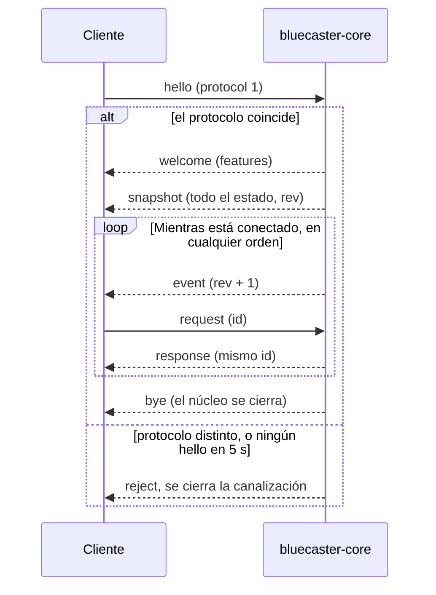

# Integración (IPC)
{: .no_toc }

Cómo se comunica una herramienta de terceros con el núcleo de BlueCaster: mostrar el estado de la transmisión, iniciar y detener perfiles, ajustar el volumen o acceder a los servicios propios de los auriculares a través del enlace Bluetooth de BlueCaster. Las herramientas que lo hacen aparecen en [Funciona con](works-with).

{: .warning }
> El protocolo aún puede cambiar durante las betas de 2.0.2. La fuente de referencia es [`app/src/crates/ipc/src/protocol.rs`](https://github.com/SeiyaFunaokaJP/BlueCaster/blob/main/app/src/crates/ipc/src/protocol.rs) y los tipos de TypeScript generados a partir de él en [`app/src/ui/src/ipc/bindings`](https://github.com/SeiyaFunaokaJP/BlueCaster/tree/main/app/src/ui/src/ipc/bindings). Esta página explica cómo usarlos; no enumera todos los campos.

## Contenido
{: .no_toc .text-delta }

1. TOC
{:toc}

## Conexión {#connecting}

El núcleo (`bluecaster-core.exe`) se ejecuta siempre que BlueCaster está en ejecución, con o sin la ventana. Escucha en una canalización con nombre propia del usuario con el que se ejecuta:

```
\\.\pipe\bluecaster-<user SID>
```

- `<user SID>` es la cadena del SID del usuario que ha iniciado sesión (`S-1-5-21-...`), que puede obtener por ejemplo con `whoami /user`. Cada usuario tiene su propio núcleo y su propia canalización; la DACL de la canalización solo admite a ese usuario, y los clientes remotos se rechazan.
- La canalización está en modo de bytes. Pueden conectarse varios clientes a la vez (la ventana de BlueCaster es uno de ellos); todos reciben el mismo estado y los mismos eventos.
- Hasta la 2.0.x, la canalización se llamaba `\\.\pipe\a2dpwb-<user SID>`. BlueCaster 3.0.0 atiende **ambos** nombres y seguirá atendiendo el antiguo durante al menos 6 meses después de la 3.0.0. Un cliente debe probar primero `bluecaster-<user SID>` y, si no existe, el nombre antiguo. La versión del protocolo sigue siendo 1.
- Para saber si el núcleo está en ejecución, busque la canalización, no el mutex del núcleo: si la canalización no existe, el núcleo no está en ejecución.
- Las compilaciones de desarrollo iniciadas con `BLUECASTER_INSTANCE=<name>` escuchan en `\\.\pipe\bluecaster-<SID>-<name>`, para poder ejecutarse junto a la versión instalada.

### La canalización del servicio {#the-service-pipe}

El servicio de BlueCaster es un prototipo del modo de desarrollador. Permite usar teclados y ratones Bluetooth en la pantalla de inicio de sesión. En un equipo con el servicio instalado, el núcleo se ejecuta como servicio de Windows. En ese caso no existe la canalización de cada usuario. En su lugar, el núcleo atiende una sola canalización común a todos los usuarios:

```
\\.\pipe\bluecaster-service
```

- Pruebe primero `bluecaster-<user SID>` y después `bluecaster-service`. El servicio no atiende ninguna canalización con el nombre antiguo. Las tramas, la negociación inicial y las solicitudes son iguales en ambas canalizaciones.
- Abra la canalización solo con `GENERIC_READ | FILE_WRITE_DATA`. Para cambiar el modo de la canalización, agregue `FILE_WRITE_ATTRIBUTES`. La canalización rechaza a los clientes que piden `GENERIC_WRITE`, porque ese acceso incluye crear otra instancia de la canalización (`FILE_CREATE_PIPE_INSTANCE`). En Python, `open(..., "r+b")` pide `GENERIC_WRITE`. Use `CreateFileW` en su lugar, por ejemplo mediante `ctypes`.
- Para comprobar que el servidor es realmente BlueCaster, compare el id. de proceso del servidor de la canalización (`GetNamedPipeServerProcessId`) con el id. de proceso del servicio `BlueCaster` (`QueryServiceStatusEx`). Mientras el servicio está detenido, otro programa podría crear una canalización con ese nombre.
- Las solicitudes que cambian todo el equipo devuelven el error `ipc.needs_admin`. Por ejemplo, las que cambian el modo de desarrollador o los controladores del adaptador, o las que agregan teclados y ratones. Una herramienta no puede conceder la aprobación de administrador. Pida al usuario que haga el cambio en la ventana de BlueCaster. La ventana solicita la aprobación a Windows.
- Cuando el núcleo se ejecuta como servicio, algunas solicitudes devuelven `ipc.not_in_service`. Una de ellas es `app.quit`, porque el servicio debe seguir en ejecución para los teclados y ratones. Use `app.close` en su lugar. Este método detiene la transmisión y cierra la ventana de BlueCaster y el icono de la bandeja.

### Tramas {#frames}

Cada mensaje, en ambos sentidos, es una trama: la longitud del JSON como **u32 little-endian** y, a continuación, el JSON (UTF-8). Las tramas de más de 4 MiB se rechazan.

### Negociación inicial {#handshake}

1. El cliente envía `hello` en los 5 segundos siguientes a conectarse:
   ```json
   {"type": "hello", "protocol": 1, "client": "mytool/1.2.0"}
   ```
   `client` es el nombre y la versión que usted elija; aparece en el registro del núcleo.
2. El núcleo responde con `welcome`, o con `reject` y cierra la canalización (versión de protocolo incorrecta, o sin hello):
   ```json
   {"type": "welcome", "protocol": 1, "server": "bluecaster-core/2.0.2-beta.12", "features": ["rfcomm"]}
   {"type": "reject", "reason": "protocol 2 not supported (core speaks 1)"}
   ```
3. El núcleo envía un `snapshot` con todo su estado y, después, `event`s.

La versión del protocolo debe coincidir exactamente. Las ampliaciones compatibles con versiones anteriores se anuncian en `features` (consulte [Compatibilidad](#compatibility)).



## Estado y eventos {#state-and-events}

```json
{"type": "snapshot", "rev": 41, "state": {"adapter": {...}, "devices": [...], "stream": {...}, "profiles": [...], "active_profile": "WH-1000XM5", "settings": {...}, ...}}
{"type": "event", "rev": 42, "event": {"kind": "stream", "value": {"state": "streaming", "profile": "WH-1000XM5", "info": {"codec": "ldac", "bitrate_kbps": 990, ...}, "volume": 80, ...}}}
```

El cliente no necesita un estado propio: conserva la última instantánea y le aplica cada evento. Cada evento de estado **reemplaza una parte completa** de la instantánea:

| `kind` del evento | Reemplaza |
|:--|:--|
| `adapter` | `adapter` |
| `devices` | `devices` |
| `scanning`, `le_scanning` | `scanning`, `le_scanning` |
| `stream` | `stream` (estado, mensaje, perfil, información del códec, volumen, batería) |
| `profiles` | `profiles` y `active_profile` |
| `settings` | `settings` |
| `update` | `update` |
| `capture` | `capture` |
| `v1_running`, `verbose`, `crashes` | el campo de ese nombre |

`stream.state` es uno de `idle`, `connecting`, `streaming`, `reconnecting`, `error`; `stream.message` indica el motivo, como una [clave de mensaje](#errors-and-messages).

`adapter.active` es el adaptador USB que BlueCaster está usando. Vale `null` mientras no hay ningún adaptador abierto: antes de la primera búsqueda o conexión, y mientras Bluetooth se reinicia.

```json
"active": {"display_name": "RTL8761BU (0x2357:0x0604)", "windows_name": "TP-Link UB500 Adapter", "vid": 9047, "pid": 1540, "vendor": "Realtek", "chip": "RTL8761BU", "bt_version": "5.1"}
```

`vid` y `pid` son números. `windows_name`, `chip` y `bt_version` pueden ser `null`. `chip` solo se conoce en los adaptadores Realtek.

Todos los clientes reciben los eventos de estado sin suscribirse a ellos. Un evento solo llega cuando algo cambia, así que una conexión puede pasar mucho tiempo sin recibir nada.

**Revisiones.** Cada evento de estado lleva la revisión siguiente (`rev` + 1). Un salto significa que se perdió un evento: envíe `state.snapshot` para obtener una instantánea nueva. Si un cliente lee demasiado despacio, el núcleo también le envía un `snapshot` nuevo sin que lo pida. Los eventos que no son de estado (`link`, `log`, `receiver`, `rfcomm_data`, `rfcomm_closed`, `media_button`) llevan la revisión actual y no la hacen avanzar.

Cuando el núcleo se cierra, envía el evento `bye` y cierra la canalización.

## Solicitudes {#requests}

```json
{"type": "request", "id": 7, "method": "stream.start", "params": {"profile": "WH-1000XM5"}}
{"type": "response", "id": 7, "result": null, "error": null}
```

- `id` es cualquier número que elija el cliente; la respuesta lo devuelve. Las solicitudes se ejecutan de forma concurrente, así que las respuestas pueden llegar en otro orden.
- `params` se omite en los métodos sin parámetros.
- Una solicitud que cambia el estado recibe respuesta cuando el cambio ha terminado, y el cambio llega también como evento. Los clientes deben mostrar el estado a partir de los eventos, no de la respuesta.

### Errores y mensajes {#errors-and-messages}

```json
{"type": "response", "id": 8, "result": null, "error": {"code": "rfcomm.not_connected", "message": {"key": "ipc.error.rfcomm_not_connected", "args": []}}}
```

`code` está pensado para los programas (`adapter.driver_missing`, `app.streaming`, ...). `message` es una clave de traducción de los archivos de idioma de BlueCaster ([`app/lang`](https://github.com/SeiyaFunaokaJP/BlueCaster/tree/main/app/lang)) con argumentos al estilo de printf, como los textos de estado incluidos en el estado; una herramienta puede buscar ahí la clave o mostrar su propio texto para el código.

### Métodos {#methods}

Métodos para herramientas:

| Método | Parámetros | Resultado |
|:--|:--|:--|
| `state.snapshot` | -- | `Snapshot` |
| `stream.start` | `profile` | `null`; primero detiene la transmisión en curso |
| `stream.stop` | -- | `null` |
| `stream.set_volume` | `volume` (volumen absoluto AVRCP 0-127) | `null` |
| `stream.volume_step` | `delta` (de -127 a 127) | el nuevo volumen; consulte [Controles rápidos](#quick-controls) |
| `profile.set_active` | `name` | `null` |
| `profile.set_headset_mic` | `name` (opcional), `mode` (`off`, `auto`, `on`) | `null`; consulte [Controles rápidos](#quick-controls) |
| `profile.set_mic_muted` | `name` (opcional), `muted` (bool) | `null`; consulte [Controles rápidos](#quick-controls) |
| `profile.set_media_eq` | `name` (opcional), `enabled` (bool) | `null`; consulte [Controles rápidos](#quick-controls) |
| `device.scan` | `seconds` (3-600) | `Device[]`, también como evento `devices` |
| `device.scan_stop` | -- | `null`; el `device.scan` en curso devuelve entonces su resultado |
| `audio.devices` | -- | `AudioDevice[]` (orígenes de captura) |
| `diag.subscribe` | `logs` (nivel o `null`), `link` (bool), `receiver` (bool, opcional) | `null`; inicia o detiene los eventos `log` / `link` / `receiver` para esta conexión |
| `diag.info` | `{"mask": bool}` (opcional) | `DiagInfo` (el texto de «Copiar diagnóstico») |
| `rfcomm.open`, `rfcomm.send`, `rfcomm.close` | consulte [Paso directo RFCOMM](#rfcomm-passthrough) | |

Envíe `logs` y `link` en cada `diag.subscribe`. Cada llamada fija los dos valores, así que si falta `logs` se desactivan los eventos de registro.

Para cambiar un solo ajuste, use los [controles rápidos](#quick-controls) en lugar de `profile.save` o `settings.set`.

Métodos que usa la ventana de BlueCaster y que una herramienta debe usar con cuidado: `profile.save` / `profile.delete`, `settings.set` (reemplaza **toda** la configuración: envíe el `settings` más reciente con su cambio, nunca un objeto parcial), `device.forget` / `device.rename`, `adapter.*` (`adapter.assign_winusb` y `adapter.restore_driver` muestran una solicitud de UAC; `adapter.probe` y `adapter.run_script`, las herramientas de chip del modo de desarrollador, detienen la pila Bluetooth), `app.quit`. Los demás sirven a las pantallas propias de la ventana y pueden cambiar sin previo aviso: `stream.start_custom`, el resto de métodos `device.*` (`device.import_windows_pairings` muestra una solicitud de UAC), `audio.apps`, `audio.mixer` / `audio.mixer_set`, los `diag.*` aparte de los dos anteriores, `receiver.*` y `app.*`. La lista completa con parámetros y resultados es el enum `Method` de `protocol.rs`.

## Paso directo RFCOMM {#rfcomm-passthrough}

Disponible cuando `welcome.features` contiene `"rfcomm"` (2.0.2-beta.10 y posteriores). Permite a una herramienta acceder a los servicios RFCOMM propios de los auriculares (apps de control del fabricante: batería, control de ruido, EQ) a través del enlace que BlueCaster ya tiene abierto; Windows no ve los auriculares conectados mediante BlueCaster.

- `rfcomm.open {address, uuid}` → `{channel_id, mtu}`. `address` debe ser el dispositivo al que se está transmitiendo; el núcleo nunca conecta ni empareja para esto (`rfcomm.not_connected`). `uuid` es un UUID completo de 128 bits o un `"xxxx"` de 16 bits sobre el UUID base de Bluetooth. La respuesta llega en 20 s, incluso si la solicitud espera en cola detrás de otras aperturas, así que espere al menos 25 s. Errores: `rfcomm.not_connected`, `rfcomm.service_not_found`, `rfcomm.service_reserved`, `rfcomm.open_failed`, `rfcomm.busy`.
- Los servicios de auriculares y manos libres (`1108`, `1112`, `111E`, `111F`) se rechazan con `rfcomm.service_reserved`, en cualquiera de las dos formas de UUID. BlueCaster los usa para el micrófono del auricular.
- El paso directo necesita una conexión Classic (A2DP). Con un dispositivo conectado por LE Audio, `rfcomm.open` siempre devuelve `rfcomm.not_connected`.
- `rfcomm.send {channel_id, data}` → `null`. `data` va en base64 (estándar, con relleno), como máximo 64 KiB por solicitud, y se envía en tramas de como máximo `mtu`, en el orden de las solicitudes. Errores: `rfcomm.no_channel`, `rfcomm.busy` (cola llena, no se envió), `rfcomm.timeout` (no se sabe si se envió: no lo repita, vuelva a abrir el canal).
- Envíe los grandes volúmenes de datos despacio, por ejemplo durante una actualización de firmware. El canal comparte el enlace de radio con el audio, y los envíos masivos rápidos pueden provocar cortes.
- Los datos recibidos llegan como eventos `rfcomm_data` `{channel_id, data}`, solo a la conexión que abrió el canal.
- `rfcomm.close {channel_id}` → `null`, una vez enviados los datos anteriores; no le sigue ningún `rfcomm_closed`.
- Un canal también se cierra cuando termina la conexión con la canalización, o con un evento `rfcomm_closed` `{channel_id, reason}`: `remote` (el dispositivo lo cerró o el enlace se cayó), `disconnected` (terminó la conexión A2DP), `stopped` (se detuvo la pila Bluetooth), `overflow` (el cliente dejó sin leer más de 1 MiB de datos recibidos).

## Botones de los auriculares {#headphone-buttons}

Disponible cuando `welcome.features` contiene `"media_button"`. Cada vez que se pulsa o se suelta un botón de los auriculares, todos los clientes reciben un evento `media_button`. No hace falta suscribirse.

```json
{"type": "event", "rev": 42, "event": {"kind": "media_button", "value": {"button": "play", "pressed": true, "le_audio": false}}}
```

- `button` es uno de `play`, `pause`, `stop`, `next`, `previous`, `fast_forward`, `rewind`, `volume_up`, `volume_down`, `mute`. Los demás botones no se notifican.
- `pressed` es `true` al pulsar el botón y `false` al soltarlo. Los auriculares LE Audio solo notifican la pulsación.
- `le_audio` es `true` si el evento llegó de unos auriculares LE Audio.
- Los auriculares envían `play` o `pause` según crean que hay algo en reproducción. Esa suposición puede estar desactualizada. Para alternar la reproducción, trate ambos igual.
- BlueCaster sigue pasando a Windows reproducir/pausa, siguiente, anterior y detener como teclas multimedia. Si su herramienta gestiona los botones por su cuenta, pida al usuario que desactive **Dispositivos de audio > Controlar la reproducción con los botones del dispositivo de audio**. Los eventos siguen llegando con esa opción desactivada.

## Controles rápidos {#quick-controls}

Disponibles cuando `welcome.features` contiene `"tool_controls"`. Cada método cambia un solo ajuste, así que una herramienta nunca tiene que enviar un perfil completo.

**Experimental hasta BlueCaster 3.1.** Los nombres de los métodos y sus parámetros aún pueden cambiar según los comentarios recibidos. Un cambio incompatible sustituirá `"tool_controls"` por un nombre de función nuevo, para que una herramienta pueda saber qué versión admite el núcleo.

- `name` es el nombre de un perfil guardado. Si se omite, se usa el perfil que está transmitiendo, o el perfil activo cuando no se transmite nada. Un nombre desconocido devuelve `profile.not_found`.
- El cambio se guarda en el perfil y se aplica a la transmisión, igual que un cambio hecho en la ventana de BlueCaster. Todos los clientes reciben un evento `profiles`.
- Enviar el valor actual no cambia nada.
- `profile.set_headset_mic` funciona como los botones de modo del micrófono en la ventana. `off` silencia el micrófono, pero conserva el modo actual. `auto` y `on` cambian a ese modo y activan el micrófono. Sin el modo de desarrollador, `on` devuelve `developer.off`.
- `profile.set_mic_muted` silencia o activa el micrófono del auricular sin cambiar el modo.
- Los dos métodos del micrófono devuelven `profile.no_mic_output` mientras el micrófono del auricular no esté configurado para el dispositivo. Mientras el dispositivo se conecta, devuelven `stream.busy`.
- `profile.set_media_eq` activa o desactiva el ecualizador de reproducción sin volver a conectar la transmisión. Los puntos del ecualizador se conservan.
- `stream.volume_step` cambia el volumen de los auriculares en `delta` y devuelve el nuevo volumen (0-127). El paso parte del último volumen que indicaron los auriculares. Si no se transmite nada, o los auriculares aún no han indicado un volumen, el método devuelve `stream.volume_unknown`. Un `delta` fuera del rango de -127 a 127 devuelve `stream.bad_volume_step`.

## Compatibilidad {#compatibility}

- **Funciones.** Compruebe `welcome.features` antes de usar una ampliación. Los núcleos anteriores a 2.0.2-beta.10 omiten el campo.
- **Solicitudes desconocidas.** Una solicitud que el núcleo no puede leer (un método desconocido, parámetros incorrectos) recibe como respuesta el error `ipc.bad_request`; la conexión sigue abierta. Los núcleos anteriores a 2.0.2-beta.10 cierran la conexión en ese caso. Cualquier otra trama ilegible la cierra.
- **Campos nuevos.** El núcleo añade campos al estado y a los eventos con el tiempo. Ignore los campos que no conozca; no rechace un mensaje por ellos. También se añaden tipos de evento nuevos: omita los eventos cuyo `kind` no conozca.
- **Cambio de nombre en 3.0.0** ([#193](https://github.com/SeiyaFunaokaJP/BlueCaster/issues/193)): la canalización pasa a ser `\\.\pipe\bluecaster-<SID>`. El núcleo sigue escuchando también en `\\.\pipe\a2dpwb-<SID>`, con el mismo protocolo, durante al menos 6 meses después de la 3.0.0; su retirada se anunciará antes en las notas de la versión. Pruebe primero `bluecaster-<SID>` y, si no existe, `a2dpwb-<SID>`. El mutex del núcleo pasa a ser `Local\BlueCaster_Core`; durante el mismo periodo, el núcleo mantiene también `Local\A2DPWB_v2_Core`, y ambas retiradas se anunciarán juntas.

## Ejemplo {#example}

Un cliente mínimo en Python (solo con la biblioteca estándar) que muestra el estado de la transmisión y va siguiendo sus cambios:

```python
import json, struct, subprocess

sid = subprocess.run(["whoami", "/user", "/fo", "csv", "/nh"],
                     capture_output=True, text=True).stdout.strip().split(",")[1].strip('"')
pipe = open(rf"\\.\pipe\bluecaster-{sid}", "r+b", buffering=0)

def send(msg):
    b = json.dumps(msg).encode()
    pipe.write(struct.pack("<I", len(b)) + b)

def read_exact(n):
    buf = b""
    while len(buf) < n:
        chunk = pipe.read(n - len(buf))
        if not chunk:
            raise EOFError
        buf += chunk
    return buf

def recv():
    (n,) = struct.unpack("<I", read_exact(4))
    return json.loads(read_exact(n))

send({"type": "hello", "protocol": 1, "client": "example/0.1"})
welcome = recv()
assert welcome["type"] == "welcome", welcome
snap = recv()
print("stream:", snap["state"]["stream"]["state"])
while True:
    m = recv()
    if m["type"] == "event" and m["event"]["kind"] == "stream":
        s = m["event"]["value"]
        print("stream:", s["state"], (s.get("info") or {}).get("codec"))
    elif m["type"] == "event" and m["event"]["kind"] == "bye":
        break
```

Para probar una herramienta sin tocar el BlueCaster instalado, ejecute una compilación de desarrollo con `BLUECASTER_INSTANCE` y `BLUECASTER_CONFIG_DIR` definidas (consulte [Compilación](building)) y conéctese a su canalización.
