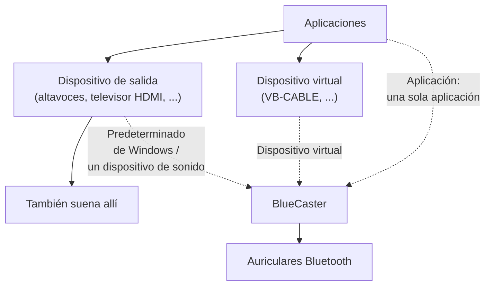
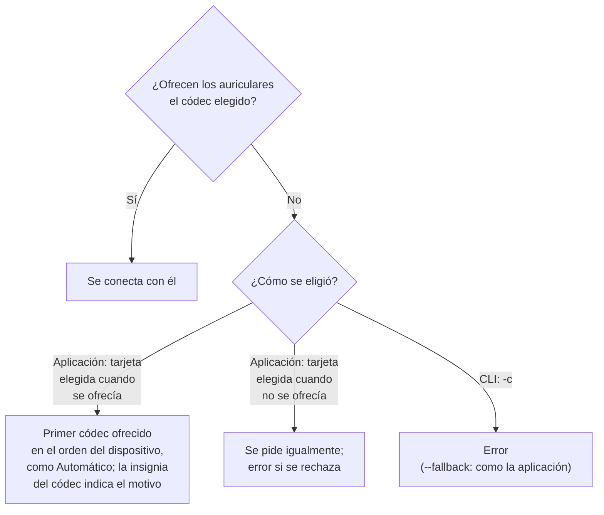

# Uso
{: .no_toc }

## Contenido
{: .no_toc .text-delta }

1. TOC
{:toc}

---

## La ventana

Inicie **BlueCaster** desde el menú Inicio (o ejecute `bluecaster.exe`). El menú de la izquierda lleva a las pantallas que se describen a continuación: Inicio, Códecs, Dispositivos de audio, Adaptador, Diagnóstico, Configuración y Acerca de. En el modo de desarrollador se añade Desarrollador, y también Mezclador de volumen si lo activa allí. Si la ventana es estrecha, el menú muestra solo iconos. La ventana es solo una vista de `bluecaster-core.exe`, que sigue ejecutándose en segundo plano, así que cerrarla no detiene la transmisión (consulte [Bandeja y panel desplegable](#tray)).

### Inicio

- Una tarjeta por cada dispositivo de audio guardado, una junto a otra, con su estado y su batería. La tarjeta del dispositivo conectado muestra además el códec en uso, en forma de lista (véase más abajo), y su tasa de bits. Si se usa un códec distinto del que eligió, la línea del códec indica brevemente el motivo, p. ej. **aptX Adaptive (Opus no compatible)** (o *en uso*). Pasados unos segundos solo queda una marca de advertencia (pase el puntero por encima para ver el motivo), y la línea de estado indica simplemente **Conectado**
- **Conectar** / **Desconectar** bajo cada tarjeta. Solo puede haber un dispositivo conectado a la vez: **Conectar** en otro dispositivo desconecta el actual y conecta el nuevo
- **Volumen**: el volumen de los auriculares (consulte [Volumen](#volume)). Haga clic en el altavoz para silenciar (BlueCaster envía silencio) y vuelva a hacer clic para quitar el silencio. En las tarjetas de los demás dispositivos, el control deslizante aparece desactivado
- Una lista de códecs en la tarjeta del dispositivo conectado, para cambiar de códec rápidamente (por ejemplo, uno para juegos y otro para música). Contiene los códecs que admite el dispositivo, solo por su nombre, como en [Códecs](#codecs), y muestra el códec en uso, también con la selección automática activada. Al elegir un códec se desactiva la selección automática (puede volver a activarla en Códecs). La elección se aplica al instante: el dispositivo se reconecta con el nuevo códec y, como en Códecs, la siguiente elección espera a que termine de reconectarse
- Un pequeño gráfico de la calidad del enlace en la tarjeta del dispositivo conectado mientras transmite. El origen de salida se elige en **Dispositivos de audio**. Si ese origen es una aplicación que aún no se está ejecutando, la tarjeta lo indica
- Los errores muestran su causa y, cuando existe, un botón que soluciona el problema (**Reemplazar por el controlador WinUSB**, **Abrir página de descarga**, **Reiniciar Bluetooth**, **Reintentar**, **Códecs**, **Dispositivos de audio**, ...)
- Encima de las tarjetas, hasta que los cierre: un aviso si hay otro adaptador Bluetooth activo en Windows, y otro cuando unos auriculares OPPO han activado Hi-Res (consulte [Códecs](#codecs))

La barra lateral muestra la misma información de todos los dispositivos en todas las pantallas; el panel desplegable de la bandeja la muestra del dispositivo conectado.

### Códecs {#codecs}

Cada dispositivo de audio guardado tiene su propia sección. La encabezan un punto (verde mientras el dispositivo está conectado), su nombre y las etiquetas **Emparejado** / **Audio**; la dirección se ve en **Dispositivos de audio**. Debajo están sus tarjetas de códec, de mayor a menor calidad de sonido, salvo que cambie el orden. Cada tarjeta tiene tres barras (calidad de sonido, baja latencia y estabilidad) e indica si el dispositivo ofreció el códec en su última conexión: **Compatible** (marca verde) o **No compatible** (marca roja). Con **Mostrar solo los códecs compatibles** activado (el valor predeterminado), todas las tarjetas visibles son compatibles, así que ninguna lleva la etiqueta **Compatible**. Un dispositivo que nunca se ha conectado (por ejemplo, uno importado de Windows) muestra entonces solo la tarjeta **SBC**, que tienen todos los dispositivos de audio Bluetooth, más el códec que haya elegido para él. Sus demás tarjetas aparecen tras la primera conexión o al desactivar el interruptor. Los auriculares Huawei y Honor conservan su tarjeta **LDAC**, marcada como **Sin confirmar**, hasta que anuncian LDAC, ya que puede que solo lo anuncien una vez elegido. Cuando se transmite con LHDC V5 (elegido por usted o por la selección automática, pero no con la calidad **Baja** ni con ABR), BlueCaster pide una vez que activen Hi-Res a los auriculares OPPO que anuncian una tasa de bits máxima para LHDC V5. Para ello se reconectan una vez, e Inicio le avisa si eso elevó su tasa de bits. A partir de entonces, Hi-Res sigue activado en los auriculares; a los que no ganaron nada se les devuelve al estado anterior. En el modo de desarrollador, **Volver a pedir Hi-Res**, en los ajustes de LHDC V5, olvida lo que anunció el dispositivo y que ya se le pidió, así que la siguiente conexión vuelve a pedirlo.
- **Seleccionar automáticamente el códec compatible de mayor calidad** (un único ajuste para todos los dispositivos, en la parte superior de la página; activado de forma predeterminada): cada dispositivo usa el códec de mayor calidad que admite, en este orden: LHDC V5 > LDAC > aptX Adaptive > Opus > aptX HD > aptX > aptX LL > AAC > SBC XQ > SBC. Usa los ajustes predeterminados, igual que **Automático** en los ajustes de un códec: calidad alta, 24 bits si el códec los admite y 48 kHz (si el dispositivo no tiene 48 kHz, otra frecuencia que anuncie, primero 44,1 kHz; la frecuencia de Windows se remuestrea). Las tarjetas son de solo lectura, salvo su orden (arrástrelas como se indica más abajo; la selección automática toma la primera tarjeta que admite el dispositivo). El códec en uso, o el que elegirá la selección automática, aparece resaltado. Al hacer clic en una tarjeta o en su **...**, BlueCaster pregunta si desea desactivar la selección automática (**Desactivar la selección automática** / **Cancelar**). Una vez desactivada, se elige la tarjeta en la que hizo clic (y su **...** abre sus ajustes). Desactive la selección automática para elegir usted mismo el códec y los ajustes de cada dispositivo; un dispositivo sin códec elegido conserva el de la selección automática. Mientras la selección automática está activada, se conserva el códec elegido de cada dispositivo para más adelante. Si la configuración anterior a la versión 2.0.2 elegía un códec para algún dispositivo, la selección automática empieza desactivada
- Con la selección automática desactivada, haga clic en una tarjeta para elegir el códec de ese dispositivo. La elección se guarda al instante, y un dispositivo que está transmitiendo se reconecta con ella. También puede elegir una tarjeta que el dispositivo no admite (visible con **Mostrar solo los códecs compatibles** desactivado): BlueCaster pide ese códec al dispositivo de todos modos y, si el dispositivo lo rechaza, la conexión se detiene con un error que lo indica (elija otra tarjeta o active la selección automática). Inicio, la barra lateral, el panel desplegable de la bandeja y la información sobre herramientas del icono de la bandeja indican entonces la causa en pocas palabras (p. ej., *LDAC no compatible*). Lo mismo ocurre siempre que el códec detiene una conexión: porque el dispositivo no lo admite, lo rechaza o lo usa para otra fuente. Si elige otra tarjeta u otros ajustes para ese dispositivo, o activa la selección automática, el dispositivo se reconecta. Si eligió un códec que el dispositivo ofrecía y después deja de ofrecerlo (por ejemplo, porque los auriculares cambiaron a otro códec), BlueCaster pasa a la primera tarjeta del orden del dispositivo que este admita: el mejor códec compatible, salvo que haya cambiado el orden (consulte [El códec seleccionado no está disponible](#codec-fallback))
- Arrastre las tarjetas de un dispositivo para ordenar sus códecs a su gusto (el cursor muestra una mano mientras mantiene pulsado el botón; con la selección automática desactivada, también puede pulsar Alt y una tecla de flecha sobre una tarjeta). Cada dispositivo conserva su propio orden. La selección automática, un dispositivo sin códec elegido y un códec elegido que el dispositivo no admite usan la primera tarjeta compatible. FastStream y Opus 05 (la tarjeta **Opus (PipeWire)**, solo en el modo de desarrollador; sin él no se usa aunque esté elegida) solo se usan si los elige, estén donde estén. **Restablecer el orden de los códecs** vuelve al orden predeterminado. Solo aparece mientras las tarjetas visibles no están en el orden predeterminado (si las vuelve a colocar a mano, también se restablece). Si el cambio afecta al códec con el que transmite un dispositivo, este se reconecta
- Si elige otro códec para el dispositivo que está transmitiendo, este se reconecta con ese códec. Mientras tanto, las tarjetas (y la lista de códecs de Inicio y del panel desplegable) esperan a que el dispositivo termine de reconectarse antes de aceptar otra elección. Así, varios clics seguidos no interrumpen una conexión que aún se está estableciendo. Cambiar de códec no muestra ninguna notificación de conexión; conectar un dispositivo, sí
- **Mostrar solo los códecs compatibles** (activado de forma predeterminada; desactívelo para ver tanto los códecs compatibles como los no compatibles): oculta los códecs que el dispositivo no ofreció. Antes de la primera conexión de un dispositivo solo se muestra **SBC** (y el códec que haya elegido para él)
- **...** en una tarjeta abre los ajustes de ese códec. Los cambios se aplican al instante. Para el códec en uso, el cambio se guarda y el dispositivo se reconecta con él. Las excepciones son el **Bitpool**, que cambia mientras escucha, y el interruptor de abajo cuando la transmisión se establecería igual en ambos casos. Para otro códec, el cambio se guarda hasta que elija ese códec. Cada códec conserva sus propios ajustes (también aptX Adaptive y aptX Adaptive LL por separado), así que, si cambia a otro códec y vuelve, se recuperan. Solo se ofrecen las opciones que admite el códec y que el dispositivo anunció en su última conexión. En la parte superior, desactive **Mostrar solo opciones que admite *dispositivo*** (activado de forma predeterminada; aparece cuando el dispositivo ha anunciado sus opciones) para ver todo lo que ofrece el códec, como una frecuencia de muestreo, profundidad de bits, calidad o bitpool que el dispositivo no anunció (marcados *(no compatible)*). El dispositivo puede rechazarlos, y entonces la conexión se detiene con un error que lo indica. Al volver a activar el interruptor, todo lo que el dispositivo no anunció vuelve a Automático. Los ajustes de cada códec (la selección automática nunca los usa):
  - **Calidad**: LDAC **Alta** / **Media** / **Baja** (990 / 660 / 330 kbps); LHDC V5 **Alta** / **Media-alta** / **Media** / **Baja** (1000 / 900 / 500 / 400 kbps, los cuatro niveles de Android); aptX Adaptive **Alta** (su modo de baja latencia tiene su propia tarjeta, **aptX Adaptive LL**: 265 kbps, 48 kHz, sin ABR; consulte [aptX Adaptive](#aptx-adaptive)). Con el ABR de LHDC V5 activado, la calidad aparece atenuada (ABR se mantiene en 400 kbps o menos). AAC, Opus, Opus 05, SBC y SBC XQ tienen un solo nivel, **Alta**, que se muestra pero no se elige: la tasa de bits más alta que acepta el dispositivo (ABR o VBR, si están disponibles, la siguen variando; SBC y SBC XQ muestran la tasa de bits que resulta de su bitpool y de la estructura de las tramas). aptX, aptX HD, aptX LL y FastStream tienen una tasa de bits fija, determinada por el códec. Una calidad guardada por una versión anterior que el códec ya no tiene (Estándar / Móvil de aptX Adaptive, los niveles inferiores de AAC, ...) se carga como Alta
  - **Tasa de bits adaptativa (ABR)**: para LDAC, LHDC V5, aptX Adaptive, SBC y SBC XQ (consulte [ABR](#abr)); **VBR** para AAC
  - **Baja latencia** (LHDC V5, en dispositivos que la anuncian): el sonido llega antes a los auriculares. Con ABR desactivado, la tasa de bits baja mientras la conexión no da abasto (1000, 900 y después 500 kbps) y vuelve a subir tras un minuto sin problemas. Los paquetes se descartan tras 100 ms en la cola de envío en lugar de 350 ms, así que una conexión débil provoca un corte breve en vez de un retardo duradero
  - **Frecuencia de muestreo**: Automático es 48 kHz o, si el dispositivo no tiene 48 kHz, otra frecuencia que anuncie (primero 44,1 kHz), y muestra la frecuencia resultante (p. ej., *Automático (48000 Hz)*). Automático nunca elige 96 kHz, que añade latencia y es menos compatible sin una mejora audible (Windows mezcla a 48 kHz); si quiere usarlo, elíjalo aquí. Solo se ofrecen las frecuencias que anuncia el dispositivo (LHDC V5 no tiene 88,2 kHz; aptX Adaptive solo ofrece 96 kHz a un dispositivo que lo anuncie, consulte [aptX Adaptive](#aptx-adaptive)). Un dispositivo que anuncia una sola frecuencia muestra esa frecuencia, sin Automático
  - **Profundidad de bits**: 16 o 24 bits para LDAC y LHDC V5, según lo que anuncie el dispositivo (Automático: 24 bits; para LHDC V5, solo si el dispositivo los anuncia); 24 bits para aptX HD y aptX Adaptive; 16 bits para los demás. Los 24 bits de LDAC llegan al codificador como muestras de 32 bits, igual que con la opción de 32 bits de Android. La profundidad de bits no forma parte de la configuración de LDAC, así que los auriculares reciben el mismo flujo en ambos casos
  - **Bitpool** (SBC, SBC XQ): un control deslizante con dos tiradores para el bitpool mínimo y el máximo, dentro del rango que anuncia el dispositivo. El máximo es el bitpool en uso; el mínimo es el más bajo que se usa (el extremo inferior del rango con el que se establece la conexión y el límite hasta el que puede bajar ABR). **Automático** restablece ambos: el máximo según la calidad y el mínimo según el dispositivo y ABR. La línea de debajo muestra el modo de canal, que es fijo para cada códec: joint stereo para SBC y canal dual para SBC XQ. El bitpool de SBC XQ llega hasta 47 a 44,1 kHz y hasta 43 a 48 kHz, o hasta 53 con **Mostrar solo opciones que admite *dispositivo*** desactivado.
  - **Estructura de las tramas** (SBC y SBC XQ, solo en el modo de desarrollador): bloques, subbandas, asignación de bits y, para SBC, el modo de canal. Automático mantiene 16 bloques, 8 subbandas, Loudness y Joint stereo. Si el dispositivo no acepta un valor, se usa Automático al conectar. En un dispositivo Sony que probó un usuario, 12 bloques distorsionan el sonido y pueden provocar una desconexión (la salida del codificador se decodifica correctamente, y los demás números de bloques suenan bien). Sus elecciones quedan guardadas, pero no se usan mientras el modo de desarrollador está desactivado. Las tasas de bits de AAC y LHDC V5 no superan el máximo que anuncia el dispositivo

Los valores predeterminados ofrecen el mejor sonido; a la mayoría de los dispositivos les basta con **Automático**. Un dispositivo LE Audio (experimental) tiene dos tarjetas, **LC3** y **LC3 LL** (consulte [LE Audio](#le-audio)). Su **...**, igual que el de los códecs de llamada, muestra los mismos campos que un códec A2DP, en solo lectura. El modo de baja latencia de aptX Adaptive tiene su propia tarjeta, **aptX Adaptive LL**, junto a **aptX Adaptive**. La selección automática nunca la elige, y un aptX Adaptive configurado en baja latencia por una versión anterior aparece en esta tarjeta.

Mientras el micrófono de un dispositivo clásico está abierto (consulte [Dispositivos de audio](#audio-devices)), sus tarjetas de música se sustituyen por los códecs de llamada que puede usar: LC3 (32 kHz), mSBC (16 kHz) y CVSD (8 kHz), con el activo seleccionado. Con la selección automática activada, el enlace de llamada elige el mejor códec que admiten ambos lados, y al hacer clic en una tarjeta BlueCaster pregunta si desea desactivarla. Con la selección automática desactivada, haga clic en una tarjeta para elegir el códec de llamada: el micrófono se vuelve a abrir con ese códec o, si los auriculares no lo admiten, con el siguiente inferior. **...** muestra sus ajustes en solo lectura. Al cerrarse el micrófono, vuelven las tarjetas de música. Mientras la selección automática está activada, se conserva el códec de llamada elegido para más adelante. Con **Mostrar solo los códecs compatibles** activado, se ocultan los códecs que los auriculares no admiten.

Mientras el micrófono de un dispositivo LE Audio está abierto, aparece una tarjeta **Micrófono** (LC3, mono) después de sus tarjetas de música. Con la selección automática desactivada, su **...** permite elegir la frecuencia de muestreo del micrófono entre las que admiten los auriculares (**Automático** toma la primera; al cambiarla, el dispositivo se reconecta). Con la selección automática activada, muestra la frecuencia en uso.

Internamente, BlueCaster guarda una entrada por dispositivo en `profiles.json` (su códec, los ajustes de cada códec y su orden de códecs), con el nombre «*dispositivo* | *códec*»; la ventana y el menú de la bandeja muestran solo el nombre del dispositivo. Las versiones anteriores permitían crear varios perfiles para un mismo dispositivo. El primer inicio de una versión con la pantalla Códecs conserva el perfil usado más recientemente (o, si no, el primero) e integra en él los demás, con sus ajustes de códec (calidad, frecuencia de muestreo, profundidad de bits, ABR, configuración de SBC) para sus códecs. No se conservan sus nombres, orígenes de salida ni tamaños de paquete; el `profiles.json` original se guarda una vez como `profiles-before-codecs.json` en la carpeta de configuración. El **Orden de la selección automática…** de las versiones preliminares de 2.0.2 (un único orden para todos los dispositivos, en el modo de desarrollador) ya no se usa: ahora cada dispositivo tiene su propio orden.

### Dispositivos de audio {#audio-devices}

Los auriculares y altavoces a los que BlueCaster puede transmitir, cada uno con sus propios ajustes. Debajo, en **Añadir un dispositivo de audio**, **Buscar dispositivos** busca dispositivos cercanos con el adaptador USB durante 30 segundos y los muestra a medida que responden; **Detener búsqueda** termina la búsqueda. Ponga antes los auriculares en modo de emparejamiento. Si hay un dispositivo conectado, BlueCaster le pide desconectarlo antes de buscar. **Añadir** guarda un dispositivo encontrado y lo conecta. Los dispositivos con los que BlueCaster ya se emparejó llevan la etiqueta **Emparejado**. Si la búsqueda no encuentra un dispositivo, escriba su dirección en **Manual:** y haga clic en **Añadir**. La dirección se formatea mientras la escribe o la pega (`aa-bb-cc-dd-ee-ff`, `AABBCCDDEEFF` y `AA BB CC DD EE FF` se convierten en `AA:BB:CC:DD:EE:FF`). Los auriculares ven el adaptador con el nombre de su equipo seguido de BlueCaster, p. ej. *Taro-PC (BlueCaster)*, para que pueda distinguirlo del Bluetooth de Windows. Si Windows emparejó un dispositivo a través de otro adaptador, como el Bluetooth integrado del PC, BlueCaster pregunta antes (**Emparejado en Windows**: quítelo allí o elija **Añadir de todos modos**). También pregunta antes por un dispositivo que Windows emparejó a través de este adaptador (la configuración inicial puede importar ese emparejamiento, consulte [Servicios y claves de emparejamiento](#shared-pairing)). Puede cambiar el nombre de un dispositivo guardado o quitarlo. Al quitarlo se borran también sus ajustes y su emparejamiento, así que tendrá que volver a emparejarlo para conectarlo. Cada dispositivo guardado tiene:

- **Origen de salida**: **Predeterminado de Windows** (el primero de la lista, aparte: la salida predeterminada de Windows, nombrada entre paréntesis, que también puede ser un dispositivo virtual; es el valor predeterminado de un dispositivo nuevo), un dispositivo de salida en **Dispositivos de sonido**, un dispositivo virtual o una aplicación (consulte [Modos de captura](#capture-modes)). Al lado se muestra el formato en que Windows mezcla el dispositivo capturado (frecuencia de muestreo y profundidad de bits, en solo lectura). Se vuelve ámbar cuando el dispositivo transmite en otro formato (o, sin conexión, cuando sus ajustes de códec piden otro), y una línea debajo indica ambos formatos (la transmisión funciona igualmente, con conversión). Debajo se describe lo que hace el origen
- **Usar como salida predeterminada de Windows mientras hay conexión** (en el modo de desarrollador, con un dispositivo virtual o un dispositivo de sonido)
- **Origen de entrada**: el micrófono de los auriculares, y **Usar como entrada predeterminada de Windows mientras hay conexión** en el modo de desarrollador (véase más abajo)

**Origen de entrada**, en cada dispositivo, envía el micrófono de los auriculares a Windows para llamadas y chat de voz. BlueCaster no tiene un controlador de audio propio, así que reproduce el micrófono en un cable de audio virtual como VB-CABLE. La lista nombra cada cable por el lado desde el que graban las aplicaciones (*CABLE Output* en VB-CABLE); elija ese como micrófono en sus aplicaciones. Junto a la lista, elija **Desactivado** o **Auto**. **Auto** abre el micrófono solo mientras una aplicación graba desde él, así que el resto del tiempo la reproducción mantiene su calidad completa. En el modo de desarrollador también puede elegir **Activado**, que mantiene el micrófono siempre abierto. Si el modo de desarrollador está desactivado, un dispositivo en **Activado** funciona como en **Auto**. Con **Desactivado**, la lista sigue visible pero atenuada. **Desactivado** y el botón de micrófono de Inicio y del panel desplegable son el mismo ajuste: en un dispositivo en **Auto** o **Activado**, **Desactivado** desactiva el micrófono igual que el botón y recuerda el modo, que el botón restaura. **Usar como entrada predeterminada de Windows mientras hay conexión** (en el modo de desarrollador; siempre activado si el modo de desarrollador está desactivado) convierte el lado de grabación del cable (*CABLE Output*) en el micrófono predeterminado de Windows mientras el dispositivo está conectado. Así, las aplicaciones que graban desde el micrófono predeterminado reciben el micrófono de los auriculares, y **Auto** lo abre para ellas. Cuando el dispositivo se desconecta, vuelve el micrófono predeterminado anterior, salvo que haya elegido otro entretanto.

**Ajustes del micrófono**, al final, abre los controles que procesan el micrófono antes de que llegue a las apps. Mientras **Origen de entrada** esté en **Desactivado**, la línea aparece atenuada. **Usar los ajustes del micrófono** activa o desactiva el procesamiento. Mientras está desactivado, el micrófono pasa sin cambios y los controles deslizantes conservan sus valores. **Ganancia** sube o baja el volumen del micrófono (de -12 a +24 dB). **Supresión de ruido** elimina el ruido de fondo constante, como un ventilador o un zumbido. Cuanto más a la derecha, más intensa; cuanto más a la izquierda, más se conserva del sonido original. Del todo a la izquierda queda **Desactivada**. **Puerta de ruido** silencia el micrófono mientras se mantiene por debajo del nivel elegido (del todo a la izquierda: **Desactivada**). Un limitador evita que un micrófono amplificado sature. Los cambios se aplican al momento, sin reconectar. La supresión de ruido retrasa el micrófono unos 20 ms; con todo desactivado, el micrófono pasa sin cambios. La prueba de **Micrófono** en **Diagnóstico** lo graba tal como lo oyen las apps.

Los dispositivos nuevos empiezan con VB-CABLE si está instalado y, si no, con el Hi-Fi Cable, salvo que ese cable sea su **Origen de salida**: un dispositivo clásico en **Auto** y uno LE Audio en **Desactivado** (en LE Audio, **Auto** mantiene el micrófono abierto). Un dispositivo con el micrófono activado pero sin cable recibe uno en cuanto Windows muestra alguno. **Dispositivos de audio** y la configuración inicial sugieren los cables que faltan (consulte [Modos de captura](#capture-modes)). Si instala uno más tarde, BlueCaster vuelve a configurar, como lo haría la configuración inicial, los dispositivos que configuró automáticamente y los que están en **Predeterminado de Windows** con un micrófono así. Con ambos cables, el Hi-Fi Cable lleva el sonido y VB-CABLE el micrófono. Con un solo cable, ese cable lleva el micrófono y el sonido viene de un dispositivo de salida de **Dispositivos de sonido** (el audio de un monitor o un televisor si lo hay, y entre varios, el que sea la salida predeterminada de Windows; si no, la salida predeterminada de Windows), sea cual sea la salida predeterminada de Windows. Un origen de salida o un micrófono que haya elegido usted no se modifica. Sin ningún cable, si Windows tiene tanto el audio de un monitor o televisor como una tarjeta de sonido, el sonido viene del monitor o televisor y el micrófono se reproduce en la tarjeta de sonido, en **Desactivado**. En el modo de desarrollador, si pone el micrófono en **Activado**, una aplicación que graba un dispositivo de salida (la captura de salida de audio de OBS) puede tomarlo de ahí; **Auto** no puede saber quién escucha una tarjeta de sonido. Un dispositivo añadido en **Dispositivos de audio** empieza de la misma forma. Un dispositivo en **Predeterminado de Windows** cuyo micrófono se reproduce en el cable que es la salida predeterminada de Windows también pasa a ese origen de sonido, porque si no el micrófono se oiría en los auriculares.

Si el micrófono se reproduce en el Hi-Fi Cable y los lados de reproducción y de grabación del cable funcionan a frecuencias de muestreo distintas en la configuración de sonido de Windows, aparece una advertencia: si las aplicaciones no oyen nada, ponga ambos a la misma frecuencia. La lista solo muestra los cables desde los que las aplicaciones pueden grabar. Deja fuera el cable que captura el propio BlueCaster (el **Origen de salida**, o la salida predeterminada de Windows con **Predeterminado de Windows**, pero no el origen de salida de otro dispositivo convertido en predeterminado mientras ese dispositivo está conectado). También deja fuera el otro lado de ese cable (*CABLE In 16ch* de VB-CABLE graba en el mismo *CABLE Output* que *CABLE Input*), porque el micrófono se mezclaría con la reproducción. Del mismo modo, mientras **Origen de entrada** no está en **Desactivado**, la lista **Origen de salida** deja fuera el cable en el que se reproduce el micrófono. Con **Mostrar todos los dispositivos de audio en las listas de fuentes** activado (**Desarrollador** > **Ajustes de la app**), ambas listas ofrecen todos los dispositivos. Las salidas sin lado de grabación (altavoces, etc.) aparecen en **Monitorización**, ya que solo reproducen el micrófono. El cable de 16 canales de VB-CABLE aparece como *CABLE Output · CABLE In 16ch* (primero el lado de grabación que comparte y después su propio nombre). El cable del origen de salida aparece atenuado, con *(en uso como origen de salida)* tras su nombre. *CABLE Input* y *CABLE Output* son los dos extremos de un mismo cable, así que un origen de salida virtual y el micrófono a la vez necesitan dos cables. Recomendación: el **Hi-Fi Cable** de VB-Audio (*HiFi-Cable & ASIO-Bridge* en [la página de VB-Audio](https://vb-audio.com/Cable/)) para el sonido, porque es el que menos retardo añade, y VB-CABLE para el micrófono. El dispositivo del micrófono tampoco debe ser la salida predeterminada de Windows: las aplicaciones oirían la reproducción mezclada con el micrófono, y un origen de salida en otro dispositivo no recibiría nada. Una advertencia bajo **Origen de entrada** lo indica.

Mientras el micrófono está abierto, un dispositivo Bluetooth clásico reproduce por su conexión de llamada: en mono y con calidad de llamada (CVSD, mSBC o LC3, el mejor que admiten ambos lados). Mientras tanto, su códec aparece atenuado, y al cerrarse el micrófono el dispositivo vuelve a ese códec sin reconectarse. Un dispositivo LE Audio sigue reproduciendo LC3 con su calidad habitual y envía el micrófono a la vez; al cambiar el modo, se reconecta (en LE Audio, Auto mantiene el micrófono abierto). Algunos auriculares pueden rechazar el micrófono o mostrar una llamada en curso sin que la haya. Con **Auto** o **Activado** y un dispositivo seleccionado, una línea **Micro:** bajo el códec (en la barra lateral, en Inicio y en el panel desplegable) muestra el micrófono mientras el dispositivo está conectado o conectándose. Mientras el micrófono está abierto, muestra su códec y su frecuencia con un punto rojo (*Micro: mSBC 16 kHz*); mientras está cerrado, muestra su modo, atenuado. En Inicio y en el panel desplegable, el botón de micrófono que hay al lado desactiva el micrófono: el botón aparece tachado, el micrófono se cierra, un dispositivo clásico vuelve a su códec y **Origen de entrada** muestra **Desactivado**. Al hacer clic de nuevo, el micrófono se activa en su modo anterior, igual que al elegir **Auto** o **Activado** en **Origen de entrada**. El botón tiene un borde discontinuo mientras Auto espera a una aplicación, y muestra un signo de advertencia, con el motivo en su información sobre herramientas, si el micrófono no se pudo abrir.

**Todos los dispositivos de audio**, encima de la lista, reúne los interruptores que se aplican a todos los dispositivos: **Sincronizar volumen de Windows** (consulte [Volumen](#volume)), **Controlar la reproducción con los botones del dispositivo de audio** y **Reconectar automáticamente**. El **Tamaño máx. de paquete multimedia** de cada dispositivo está en la pantalla **Desarrollador** (consulte [Tamaño máximo del paquete multimedia](#max-packet)).

### Diagnóstico

- **Calidad del enlace** durante la transmisión: tasa de bits real, paquetes, paquetes descartados antes del envío, audio perdido en la captura, cola de envío, el retardo que informa el dispositivo (consulte [Latencia](#latency)), tiempo de radio usado, señal (RSSI) y los canales AFH (consulte [Calidad del enlace y AFH](#link-quality)). Mientras el micrófono de los auriculares está abierto, el enlace de llamada de un dispositivo clásico se mide de la misma forma (su códec, p. ej. mSBC, y lo que envía), y una tarjeta **Micrófono** muestra los paquetes que llegan de vuelta: recibidos, dañados en el aire y ocultados
- **Radio**: los 79 canales Bluetooth de la banda de 2,4 GHz, con los que usa el enlace y los que evita el adaptador, los canales Wi-Fi debajo y algunos consejos para mejorar el enlace. En el modo de desarrollador, **Escanear** añade las redes Wi-Fi de 2,4 GHz cercanas (consulte [La pestaña Radio](#radio-tab))
- **Detalles del códec** durante la transmisión: la carga útil multimedia, los encabezados, la trama del códec y las tramas por paquete, y lo que anuncia el endpoint del dispositivo junto a lo que está en uso. Para SBC, el bitpool, las frecuencias de muestreo, los modos de canal, los bloques, las subbandas y la asignación de bits; para AAC, los tipos de objeto, las frecuencias de muestreo, los canales, la tasa de bits máxima y VBR; para los demás códecs, las frecuencias de muestreo, las profundidades de bits y la tasa de bits máxima
- **Micrófono**: prueba el micrófono de los auriculares de un dispositivo Bluetooth clásico mientras transmite. **Grabar** abre el micrófono y graba hasta 10 segundos, con el nivel en la barra (mientras tanto, el dispositivo suena con calidad de llamada; si el micrófono aún no se ha abierto en esta conexión, el dispositivo se reconecta primero). **Reproducir** reproduce la grabación en los auriculares. Al salir de la pestaña termina la prueba, y la reproducción vuelve a su códec. Los dispositivos LE Audio aún no son compatibles
- **Flujo de conexión**: las once etapas del último intento de conexión (inicio, adaptador Bluetooth, conexión ACL / AVDTP, detección de capacidades, selección de códec, captura de audio, configuración de la transmisión, codificador, inicio de la transmisión, envío de audio y mantenimiento de la conexión con desconexiones / reconexiones). Cada etapa se marca como OK, Advertencia o Error, con el tiempo que tardó. **Copiar flujo** copia el flujo
- **Registro**: el registro en directo, filtrado por nivel (todos, info y superiores, advertencias y errores, solo errores), por texto y por el intento de conexión actual (**Solo el intento actual**). **Copiar registro visible** copia lo que se muestra. **Abrir la carpeta de registros** abre la carpeta con los archivos de registro. A diferencia de **Copiar diagnóstico**, estos archivos no ocultan nada (incluyen direcciones Bluetooth y su nombre de usuario de Windows)
- **Iniciar captura HCI** / **Detener captura HCI** (consulte [Verificar el flujo multimedia](#verify-stream))
- **Copiar diagnóstico**: copia al portapapeles la versión, el sistema operativo, el adaptador, el dispositivo de audio (códec, sus ajustes y su orden), el flujo, las advertencias / errores y el registro reciente, listos para pegar en un informe de errores. **Ocultar direcciones Bluetooth** (activado de forma predeterminada) sustituye las direcciones por `<addr-1>`, `<addr-2>`... (la del adaptador, por `<adapter>`) y los nombres de dispositivo por `<device-1>`, `<device-2>`.... También oculta los números de serie USB, las rutas de archivo por encima de la carpeta de la aplicación (`<path>\BlueCaster\logs\...`) y su cuenta de Windows (nombre de usuario y SID). Lo mismo se oculta en el informe de fallos y en los textos de error copiados para un informe de errores
- **Informar de un problema**:
  - **Registro detallado**: **Detallado (debug)** o **Todo (trace, 1 hora)** registra mucha más información sobre Bluetooth, USB, la captura de audio y la codificación. El nivel debug permanece activado 24 horas, también tras reiniciar (para problemas al iniciar), y después se desactiva automáticamente. Actívelo, reproduzca el problema y guarde un paquete de diagnóstico
  - **Paquete de diagnóstico** > **Guardar…**: elija si desea incluir las capturas HCI (déjelo desactivado salvo que se las hayan pedido: contienen direcciones y nombres de dispositivo) y si desea ocultar las direcciones Bluetooth en los archivos de texto. Después, guarde un único `.zip` (en `logs\bundles\` de la carpeta de configuración; se conservan los 3 más recientes). Contiene la información de diagnóstico, los archivos de registro del núcleo, de la ventana y del asistente de controladores, los informes de fallos, información del sistema (adaptadores Bluetooth USB y sus controladores, dispositivos emparejados en Windows, dispositivos de audio), la configuración y los ajustes de códec de cada dispositivo (nunca las claves de enlace), y el registrador de vuelo HCI. Las capturas HCI conservan las direcciones (pero no las claves de emparejamiento). Si es posible, BlueCaster mantiene el paquete por debajo del límite de 25 MB de los adjuntos de GitHub (primero los registros más recientes, hasta 48 MB de texto, las 5 grabaciones y los 2 minivolcados más recientes)
  - **Informar en GitHub** (después de guardar): abre un nuevo informe de errores con la versión, la compilación de Windows, el adaptador, los auriculares, el códec, el modo de captura y la información de diagnóstico (con las direcciones ocultas) ya rellenados, y muestra el paquete en el Explorador para que pueda arrastrarlo

BlueCaster también registra algunos datos de forma continua, para que se pueda investigar incluso un problema que ocurrió una sola vez:

- **Registrador de vuelo HCI**: los últimos minutos de tráfico Bluetooth se guardan en memoria (con las cargas útiles multimedia recortadas y sin las claves de emparejamiento) y se escriben en `logs\hci\` cada vez que falla una transmisión o se pierde una conexión (se conservan los 10 archivos más recientes)
- **Informes de fallos**: si BlueCaster se bloquea, se guardan un minivolcado `.dmp` y un archivo `.txt` en `logs\crash\` (los 5 más recientes de cada programa)

El uso del disco es limitado: el registro de un día normal ocupa bastante menos de 1 MB, y se conservan 7 días. Con el registro detallado, el archivo de un día contiene como máximo 100 MB de líneas debug y trace (después, solo info y superiores hasta el día siguiente). Los archivos del registrador de vuelo ocupan unos pocos MB como máximo, y se conservan 10.

### Desarrollador {#developer}

Aparece mientras **Configuración** > **Modo de desarrollador** está activado; la mayoría de los usuarios nunca la necesita. Sirve para probar dispositivos y resolver problemas, y algunos de sus ajustes solo funcionan con ciertos dispositivos. Tiene siete pestañas:

- **Ajustes de la app**: **Usar el mezclador de volumen** (desactivado de forma predeterminada) activa la pantalla **Mezclador de volumen**, la lista de aplicaciones del panel desplegable y el silencio de la salida (consulte [Modos de captura](#capture-modes)). No se recomienda; VB-CABLE es una forma mejor de mantener el PC en silencio. **Mostrar todos los dispositivos de audio en las listas de fuentes** (desactivado de forma predeterminada) hace que **Origen de salida** y **Origen de entrada**, en **Dispositivos de audio**, ofrezcan todos los dispositivos, incluso los que no son adecuados (consulte [Dispositivos de audio](#audio-devices)). **Ocultar el aviso de dispositivos de audio virtuales** (desactivado de forma predeterminada) quita el aviso de que falta un cable de VB-Audio (consulte [Modos de captura](#capture-modes)). **Incluir versiones alfa al buscar actualizaciones** (activado de forma predeterminada en las versiones alfa) ofrece también versiones alfa (consulte [Actualizaciones](#updates))
- **Ajustes de códec**: interruptores para averiguar por qué un dispositivo no suena (bit marcador RTP, registro de los primeros paquetes multimedia, configuración de AAC y opciones del codificador), y el **Tamaño máx. de paquete multimedia** de cada dispositivo guardado (consulte [Tamaño máximo del paquete multimedia](#max-packet)). **Usar los ajustes de cada códec al elegir el códec automáticamente**: con la selección automática activada, el **…** de una tarjeta de códec se abre sin desactivarla, y el códec que elige la selección automática se conecta con esos ajustes en lugar de los predeterminados. **Igualar la frecuencia y la profundidad de bits a la salida del PC**: una frecuencia de muestreo o profundidad de bits en Automático sigue el formato del dispositivo de salida en la configuración de sonido de Windows, en lugar de usar 48 kHz. De las frecuencias que el dispositivo anuncia para el códec, BlueCaster toma la del PC; si no está, la más cercana de la misma familia (múltiplos de 44,1 o 48 kHz), y si no, la más cercana por encima. Una salida de 16 bits transmite a 16 bits. **Ignorar la tasa de bits máxima del dispositivo**: todos los códecs funcionan a la tasa de bits de la calidad elegida aunque el dispositivo anuncie un máximo inferior (la tasa de bits de LHDC V5, AAC u Opus 05, o el bitpool de SBC), y la pantalla **Códecs** ofrece todas las calidades y bitpools. Por encima de su máximo, un dispositivo puede cortarse o quedarse en silencio. **Límite de la cola de envío**: cuánto tiempo puede esperar un paquete multimedia en la cola de envío antes de descartarse, de 50 a 2000 ms (vacío = 350 ms). No reduce el retardo con un buen enlace (consulte [Latencia](#latency)). **Codificar al enviar**: mientras el enlace está atascado, el audio espera sin codificar en lugar de como paquetes ya codificados. Con ABR activado (SBC, SBC XQ, LDAC, LHDC V5 y aptX Adaptive), ese audio se envía después a la tasa de bits a la que ABR haya bajado entretanto, no a la que estaba en uso cuando empezó el atasco. No acorta el atasco en sí: no se envía nada hasta que la radio se recupera, y solo la recuperación posterior necesita menos datos. En ambos casos, el audio que espera más que el límite de la cola de envío se descarta; Diagnóstico cuenta el audio en espera como tiempo de espera en la cola de envío. Todos estos ajustes están desactivados de forma predeterminada y se aplican al iniciarse la siguiente transmisión; mientras alguno está activado, un aviso lo indica. **Desactivar todo** los restablece
- **Fabricantes**: si BlueCaster usa los protocolos propios de los auriculares (Huawei: LDAC, OPPO: Hi-Res; consulte [Códecs](#codecs)). Cada fabricante tiene **Protocolo del fabricante**: **Automático** (auriculares cuyo nombre indica ese fabricante; el valor predeterminado), **Siempre** (cualquier dispositivo) o **Nunca**. OPPO tiene además **Pedir Hi-Res en cada conexión (se reconecta cada vez)**. Los cambios se aplican al iniciarse la siguiente transmisión; mientras haya alguno, un aviso lo indica, y **Desactivar todo** los restablece. No se usan mientras el modo de desarrollador está desactivado
- **Registro**: cuánto tiempo se conservan los archivos de registro (7 días de forma predeterminada), el límite de tamaño diario (100 MB de forma predeterminada), un registro detallado permanente (sin el límite de 24 horas o 1 hora, y activo desde que se inicia el núcleo), la línea de estado de la transmisión cada 10 segundos y **Añadir marcador** (escribe una línea numerada en el registro para que pueda encontrar ese momento más tarde). Al desactivar el modo de desarrollador se restablecen los valores predeterminados
- **Prueba con receptor par**: transmite al receptor de medición de otro PC y compara lo que se envió con lo que llegó (consulte [Prueba con receptor par](#receiver))
- **Chip**: ejecuta un script de chip en un adaptador con WinUSB: solicitudes al chip, escritas o cargadas desde un archivo, para quien quiera añadir compatibilidad con un chip (consulte [Añadir compatibilidad con chips](chip-support#chip-scripts)). Las líneas que pueden cambiar el chip solo se ejecutan después de hacer clic en **Permitir ejecutarlas**. Para ello, Bluetooth se detiene y se vuelve a iniciar la próxima vez que se necesite
- **Depuración**: experimentos, todos desactivados de forma predeterminada. **Claves de emparejamiento y Windows**: **Copiar también las claves LE a Windows al restaurar el controlador original** escribe en Windows las claves LE de BlueCaster (Long Term Key, EDIV, Rand, tamaño de clave, Identity Resolving Key) al hacer clic en **Restaurar el controlador original**, pero solo para los dispositivos de los que Windows ya guarda claves LE en ese adaptador. Las claves antiguas de Windows se guardan en `pairing\replaced_windows_keys.json`, que solo puede leer su usuario de Windows. **Comparar con Windows** (requiere permiso de administrador) cuenta, para un adaptador, los dispositivos cuyas claves de enlace y claves LE coinciden en BlueCaster y Windows, son distintas o solo existen en uno de los dos. Solo muestra y registra números, nunca una dirección ni una clave, así que el resultado se puede compartir sin riesgo. También enumera los nombres, tipos y tamaños de los valores que Windows guarda para el adaptador y sus dispositivos LE, nunca su contenido

### Adaptador

- Los adaptadores Bluetooth USB detectados, con su chip, dirección, ID USB, versión de Bluetooth, **Controlador** y **Firmware**. La lista se actualiza automáticamente al conectar o desconectar un adaptador. El controlador es **Controlador original** (el que instaló Windows o el fabricante; pase el puntero por encima para ver su nombre) o **Controlador WinUSB** (el que usa BlueCaster). Un adaptador Realtek muestra su dirección, tomada de su número de serie USB, incluso antes de usarse. En los demás adaptadores, la dirección y la versión de Bluetooth aparecen cuando el Bluetooth de Windows o BlueCaster ya ha usado el adaptador (pase el puntero por encima de la línea para ver el motivo). Un adaptador que BlueCaster no puede usar (algunos modelos de MediaTek y Qualcomm) conserva su controlador, y sus botones de WinUSB y de firmware aparecen desactivados. En el modo de desarrollador puede asignarle WinUSB de todos modos. **Leer datos del chip**, en un adaptador con WinUSB, guarda en `logs\probe\` las respuestas del chip a unos comandos de lectura, para quien quiera añadirle compatibilidad (Bluetooth se detiene para ello y se vuelve a iniciar la próxima vez que se necesite). Después, **Informar en GitHub** abre una incidencia con esos datos ya rellenados. Mientras se inicia un adaptador cuyo firmware carga el propio BlueCaster (Intel, MediaTek, Qualcomm), la pantalla muestra el progreso de la carga y si ha fallado
- **Reemplazar por el controlador WinUSB** / **Restaurar el controlador original** (consulte [Instalación](setup#winusb)). Windows pide permiso de administrador cada vez, como con todos los botones que llevan un escudo. Al restaurar, BlueCaster pasa también a Windows sus emparejamientos más recientes de los dispositivos que Windows había emparejado a través de este adaptador, así que se conectan en Windows sin volver a emparejarlos. **Limitación:** las claves LE no se pasan, así que un dispositivo que Windows usa por LE (LE Audio) tendrá que volver a emparejarse en Windows (el modo de desarrollador permite probarlo en **Desarrollador** > **Depuración**)
- **Chip Bluetooth** para el firmware, con **Descargar firmware**, **Abrir página de descarga** y **Abrir carpeta de firmware** (consulte [Firmware](setup#firmware)). Un adaptador de otro fabricante muestra en su lugar de dónde viene su firmware, como **Del controlador de MediaTek**, **De la carpeta de firmware** o **No necesario**, y **Cargado** cuando BlueCaster lo ha cargado. Un adaptador Realtek cuyo firmware procede del controlador de Windows de Realtek muestra en su lugar **Usar firmware personalizado**, y **Usar el firmware del controlador** deshace el cambio
- **Evitar canales Wi-Fi**: Automático, Desactivado o Manual, con los canales Wi-Fi al lado: los que Automático evita en ese momento, ninguno con Desactivado (ambos en solo lectura) o los que escriba usted con Manual (consulte [Calidad del enlace y AFH](#link-quality))
- **Pila Bluetooth**: detenida (se inicia con la primera búsqueda o conexión), iniciando, lista o error, y **Reiniciar Bluetooth**
- **Usar este adaptador** (en la tarjeta de cada adaptador cuando dos tienen WinUSB): BlueCaster abre ese adaptador en lugar del primero encontrado. Bluetooth se reinicia en él y la transmisión se vuelve a conectar. **Elegir automáticamente** en la tarjeta del elegido vuelve al primero encontrado. El adaptador en uso aparece como **En uso** y se nombra junto a **Pila Bluetooth**; uno elegido que aún no se usa (Bluetooth lo abre en su próximo inicio, o lo tiene otro programa) aparece como **Elegido**

### Configuración

| Sección | Ajustes |
|:--------|:---------|
| Apariencia | Idioma, tema (Sistema / Claro / Oscuro) |
| Inicio | **Iniciar con Windows** e **Iniciar en la bandeja** (consulte [Iniciar con Windows](#autostart)), **Minimizar en la bandeja del sistema** y **Abrir la ventana de la bandeja desde** (consulte [Bandeja y panel desplegable](#tray)) |
| Notificaciones | **Notificar cuando se conecta un dispositivo** (el dispositivo, su batería, el códec y sus ajustes; activado de forma predeterminada), **Avisar cuando la batería esté baja**: **Por debajo del 20%** (el valor predeterminado), **Por debajo del 10%**, **Por debajo del 5%** o **Nunca**, una vez por conexión (y solo de nuevo después de que la batería haya subido 5 puntos por encima del umbral) |
| Actualizaciones | **Buscar actualizaciones**, **Buscar actualizaciones al iniciar**, **Incluir versiones preliminares al buscar actualizaciones** (también ofrece versiones beta), **Actualizar ahora** (consulte [Actualizaciones](#updates)) |
| Avanzado | **Modo de desarrollador** (añade la pantalla [Desarrollador](#developer), la **Estructura de las tramas** de SBC en los ajustes del códec, las claves de emparejamiento en la etiqueta **Servicios** de **Dispositivos de audio** (consulte [Servicios y claves de emparejamiento](#shared-pairing)), el códec **Opus (PipeWire)**, **Leer datos del chip** en **Adaptador** y más detalles en el registro; no requiere reiniciar), **Carpeta de configuración** con **Abrir la carpeta de configuración**, **Ejecutar la configuración inicial** |

**Salir de BlueCaster** está al final de la página. La pantalla **Acerca de** muestra la versión y la licencia de BlueCaster. En **Software de terceros** se enumeran las bibliotecas, **Licencias de terceros**, una nota de que los cables de VB-Audio son donationware de VB-Audio y el diálogo de los cables (**Dispositivos de audio virtuales**).

### Configuración inicial

En el primer inicio (sin dispositivo de audio o sin ningún adaptador con WinUSB) se abre el **Asistente de configuración**, que se sigue abriendo hasta que lo termine u omita una vez. Primero, elija el adaptador, el controlador y el firmware (los dispositivos que Windows emparejó a través del adaptador aparecen primero, porque dejarán de funcionar con Windows). Después, busque sus dispositivos de audio: Conectar guarda el dispositivo con los mejores ajustes para él y lo conecta; un dispositivo que emparejó Windows pregunta antes; **Importar emparejamientos de Windows** muestra los dispositivos que Windows emparejó a través de este adaptador (consulte [Servicios y claves de emparejamiento](#shared-pairing)); **Siguiente** funciona sin dispositivo, y puede añadir uno más tarde en **Dispositivos de audio**. Por último, **Configuración general**: tema, **Iniciar con Windows** e **Iniciar en la bandeja** (la primera configuración activa ambos), notificaciones y **Buscar actualizaciones al iniciar**. Consulte [Instalación](setup#first-run). **Configuración** > **Ejecutar la configuración inicial** vuelve a abrir el asistente.

## Bandeja y panel desplegable {#tray}

BlueCaster sigue ejecutándose en la bandeja del sistema, con o sin la ventana:

- **Haga clic con el botón izquierdo** en el icono de la bandeja para abrir el panel desplegable: el dispositivo y su estado, **Conectar** / **Desconectar**, el volumen, el selector de dispositivos, el códec (una lista para elegirlo, como en Inicio), la calidad del enlace y **Abrir BlueCaster**. La altura del panel se ajusta a su contenido. Pulse Esc o haga clic fuera para ocultarlo. Si un error necesita una pantalla de la ventana principal (Códecs, Dispositivos de audio, el adaptador), su botón abre la ventana en esa pantalla
- **Configuración** > **Abrir la ventana de la bandeja desde** (**Icono de la bandeja** de forma predeterminada): en Windows 11, con **Configuración rápida (botón de volumen)**, el icono de la bandeja abre la ventana principal, y el panel desplegable se abre junto con la Configuración rápida, encima de sus paneles, y se cierra con ellos. Puede usar el panel ahí sin cerrarlos. Si la pantalla no es lo bastante alta, se abre a su izquierda. Con **Ningún sitio** no se abre ningún panel desplegable, y el icono de la bandeja abre la ventana principal.
- **Haga clic con el botón derecho** para abrir el menú: **Abrir BlueCaster**, los 10 primeros dispositivos por nombre (las entradas LE Audio llevan «(LE Audio)» y el dispositivo que transmite aparece marcado; haga clic en uno para conectarlo), **Desconectar** y **Salir**. El menú se abre al instante, sin iniciar la ventana
- La información sobre herramientas indica si BlueCaster está inactivo o conectado

Con **Configuración** > **Minimizar en la bandeja del sistema** activado (el valor predeterminado), al minimizar o cerrar la ventana solo se oculta en la bandeja, y la transmisión continúa. Si está desactivado, la ventana se minimiza en la barra de tareas, y al cerrarla se cierra BlueCaster. **Salir** en el menú de la bandeja o **Configuración** > **Salir de BlueCaster** detiene la transmisión, libera el adaptador y cierra BlueCaster por completo.

## Iniciar con Windows {#autostart}

**Configuración** > **Iniciar con Windows** inicia BlueCaster al iniciar sesión. Con **Iniciar en la bandeja** activado, se inicia en segundo plano: solo aparece el icono de la bandeja, desde el que puede abrir la ventana. Si está desactivado (el valor predeterminado), se abre la ventana principal. El ajuste se guarda como el valor `BlueCaster` en `HKEY_CURRENT_USER\Software\Microsoft\Windows\CurrentVersion\Run`, con los datos `"<folder>\bluecaster-core.exe"`, seguidos de `--background` si **Iniciar en la bandeja** está activado. Para desactivarlo manualmente, elimine ese valor. Al instalar la v2 sobre la v1 se activa **Iniciar en la bandeja**, porque la v1 siempre se iniciaba en la bandeja.

## Modo CLI

`bluecaster-core.exe --cli` transmite desde una consola con el mismo núcleo que la ventana. Cierre antes BlueCaster (bandeja > **Salir**), porque solo un programa a la vez puede usar el adaptador. La CLI no lee los ajustes de los dispositivos guardados; todo se indica mediante opciones.

### Básico

```bash
# Seleccionar automáticamente el mejor códec
bluecaster-core.exe --cli -d AA:BB:CC:DD:EE:FF
```

Ctrl+C detiene la transmisión. La CLI muestra el estado, el códec y la tasa de bits y, al final, el número de paquetes enviados y descartados.

### Selección de códec

```bash
bluecaster-core.exe --cli -d AA:BB:CC:DD:EE:FF -c ldac      # LDAC
bluecaster-core.exe --cli -d AA:BB:CC:DD:EE:FF -c aptxhd    # aptX HD
bluecaster-core.exe --cli -d AA:BB:CC:DD:EE:FF -c aptxll    # aptX Low Latency
bluecaster-core.exe --cli -d AA:BB:CC:DD:EE:FF -c aptx      # aptX
bluecaster-core.exe --cli -d AA:BB:CC:DD:EE:FF -c aac       # AAC
bluecaster-core.exe --cli -d AA:BB:CC:DD:EE:FF -c sbc       # SBC
bluecaster-core.exe --cli -d AA:BB:CC:DD:EE:FF -c lhdcv5    # LHDC V5
bluecaster-core.exe --cli -d AA:BB:CC:DD:EE:FF -c opus      # Opus (48 kHz, 256 kbps)
bluecaster-core.exe --cli -d AA:BB:CC:DD:EE:FF -c opus05    # Opus 05 de PipeWire (hacia receptores PipeWire)
bluecaster-core.exe --cli -d AA:BB:CC:DD:EE:FF -c aptxad    # aptX Adaptive (48 kHz; --rate 96000 para 96 kHz)
```

Prioridad de la selección automática: LHDC V5 > LDAC > aptX Adaptive > Opus > aptX HD > aptX > aptX LL > AAC > SBC XQ > SBC (FastStream y Opus 05 solo si se eligen)

Si los auriculares no ofrecen el códec solicitado, la CLI se detiene con un error que explica el motivo. Use `-c auto` (el valor predeterminado) para usar el mejor códec que ofrezcan, o `--fallback` para pasar al mejor códec que ofrezcan en lugar del solicitado, como hace la aplicación (consulte [Familia aptX y aptX Adaptive](#aptx-compatibility)).

### Calidad

```bash
bluecaster-core.exe --cli -d AA:BB:CC:DD:EE:FF -c ldac -q hq   # Alta, 990 kbps (predeterminado)
bluecaster-core.exe --cli -d AA:BB:CC:DD:EE:FF -c ldac -q sq   # Media, 660 kbps
bluecaster-core.exe --cli -d AA:BB:CC:DD:EE:FF -c ldac -q mq   # Baja, 330 kbps

# LHDC V5: hq 1000 / mhq 900 / sq 500 / mq 400 kbps
bluecaster-core.exe --cli -d AA:BB:CC:DD:EE:FF -c lhdcv5 -q sq   # Media, 500 kbps

# aptX Adaptive: hq 427 / ll 265 kbps
bluecaster-core.exe --cli -d AA:BB:CC:DD:EE:FF -c aptxad -q ll   # Baja latencia
```

Los demás códecs no tienen ajuste de calidad: funcionan como `hq`, con la tasa de bits más alta que aceptan los auriculares (en aptX, aptX HD, aptX LL y FastStream, la tasa de bits la fija el códec). Un nivel que el códec no tiene (`mhq` en cualquier códec salvo LHDC V5, `sq` / `mq` en aptX Adaptive, `ll` en cualquier códec salvo aptX Adaptive) funciona como `hq`.

### ABR (tasa de bits adaptativa) {#abr}

```bash
bluecaster-core.exe --cli -d AA:BB:CC:DD:EE:FF -c ldac -a
bluecaster-core.exe --cli -d AA:BB:CC:DD:EE:FF -c lhdcv5 -a
bluecaster-core.exe --cli -d AA:BB:CC:DD:EE:FF -c aptxad -a
```

ABR reduce automáticamente la tasa de bits cuando la conexión Bluetooth es inestable y la vuelve a subir cuando las condiciones mejoran. LDAC cambia entre sus modos de calidad; LHDC V5 sigue la política de Android y se mantiene entre 160 y 400 kbps; aptX Adaptive cambia entre sus niveles dentro de Alta (consulte [aptX Adaptive](#aptx-adaptive)); SBC y SBC XQ bajan el bitpool en 2 y lo suben en 1 cada segundo. Con SBC, SBC XQ y aptX Adaptive, si la conexión ha tenido que bajar desde un bitpool o nivel, ese paso solo se vuelve a probar al cabo de 10 s. La espera se duplica cada vez que tiene que volver a bajar desde ahí (hasta 2 minutos), así que un dispositivo que funciona bien un paso más abajo se queda en ese paso. Tras un minuto sin problemas en ese paso, la espera vuelve a empezar desde el principio. En la ventana, ABR está en los ajustes de cada códec (**...** en su tarjeta de **Códecs**).

### Detección de dispositivos

```bash
# Dispositivos cercanos, encontrados con el adaptador USB (10 segundos; --scan 20 para más tiempo)
bluecaster-core.exe --cli --scan
```

Ponga antes los auriculares en modo de emparejamiento.

### Todas las opciones {#all-options}

| Opción | Descripción |
|:-------|:------------|
| `-d <addr>` | Dirección Bluetooth de los auriculares / del receptor (`AA:BB:CC:DD:EE:FF`; predeterminado: el primer dispositivo de audio emparejado con Windows) |
| `--device-name <name>` | El nombre del dispositivo, con `-d`, como en un dispositivo guardado (los auriculares Huawei se reconocen por él) |
| `-l` | Mostrar los dispositivos Bluetooth emparejados con Windows y salir |
| `-u <adapter>` | El adaptador USB que se usa cuando varios tienen WinUSB: ID de instancia, ruta de dispositivo o `VID:PID` (p. ej. `0bda:8771`) |
| `-c <codec>` | `ldac`, `aptxhd`, `aptxll`, `aptx`, `aptxad`, `aac`, `sbcxq`, `sbc`, `lhdcv5`, `opus`, `opus05`, `faststream`, `auto` (predeterminado: `auto`) |
| `-q <mode>` | Calidad: `hq` (Alta, predeterminado); LDAC y LHDC V5 también `sq` (Media) y `mq` (Baja); LHDC V5 también `mhq` (Media-alta); aptX Adaptive también `ll` (Baja latencia). Los demás códecs funcionan como `hq` con cualquier nivel |
| `-a` | ABR (LDAC, LHDC V5 y aptX Adaptive; SBC / SBC XQ: bitpool adaptativo) |
| `--fallback` | Si los auriculares no ofrecen el códec de `-c`, pasar al mejor que ofrezcan, como hace la aplicación, en lugar de detenerse con un error |
| `-m <mode>` | Modo de captura: `loopback` (predeterminado), `virtual`, `app` |
| `--audio-device <id>` | Dispositivo de reproducción para `-m virtual` |
| `--app <exe>` | Ejecutable para `-m app` (p. ej. `spotify.exe`) |
| `--headset-mic` | Micrófono del auricular (consulte [Dispositivos de audio](#audio-devices)): reproduce el micrófono de los auriculares en `--mic-output`; mientras tanto, un dispositivo clásico suena con calidad de llamada. Con `--le-audio`, usa la configuración de LE Audio que también transporta el micrófono |
| `--mic-output <nombre>` | El dispositivo de salida en el que se reproduce el micrófono, indicado por parte de su nombre (p. ej. `"CABLE Input"`; predeterminado: la salida predeterminada de Windows), o un archivo `.wav` en el que escribir |
| `--voice-codec <cvsd\|msbc\|lc3_swb>` | Con `--headset-mic` y un dispositivo clásico: el mejor códec de llamada que se usará (el siguiente inferior si los auriculares no lo admiten; predeterminado: el mejor que admiten ambos lados) |
| `--mic-rate <Hz>` | Con `--headset-mic --le-audio`: la frecuencia de muestreo del micrófono (p. ej. `16000`; si los auriculares no la admiten, se usa la primera que admitan) |
| `--mic-gain <dB>` | Con `--headset-mic`: la ganancia del micrófono (de -12 a 24; por defecto 0) |
| `--mic-noise-suppression` | Con `--headset-mic`: suprime el ruido del micrófono |
| `--rate <hz>` | Frecuencia de muestreo de captura (predeterminado: 48 kHz, u otra frecuencia que anuncie el dispositivo si no tiene 48 kHz) |
| `--bits <16\|24>` | Profundidad de bits (predeterminado: 24 si el códec la transporta) |
| `--max-packet <bytes>` | Tamaño máximo del paquete multimedia, 679-1679, predeterminado 1023 (consulte [Tamaño máximo del paquete multimedia](#max-packet)) |
| `--sbc-blocks <n>`, `--sbc-subbands <n>`, `--sbc-alloc <method>`, `--sbc-bitpool <n>` | Estructura de las tramas de SBC / SBC XQ: bloques 4/8/12/16 (predeterminado 16), subbandas 4/8 (predeterminado 8), asignación `loudness` (predeterminado) o `snr`, bitpool (predeterminado: según la calidad) |
| `--sbc-mode <mode>` | Modo de canal de SBC: `joint_stereo` (predeterminado), `stereo`, `mono` (el canal dual es `-c sbcxq`) |
| `--afh <auto\|off\|6,11>` | Clasificación de canales AFH del host (consulte [Calidad del enlace y AFH](#link-quality)) |
| `--remote-sink <host[:port]\|auto>` | Mostrar lo que recibe el receptor par; sin `-d`, transmitir a ese receptor (consulte [Prueba con receptor par](#receiver)) |
| `--scan [seconds]` | Mostrar los dispositivos cercanos y salir (predeterminado: 10 segundos) |
| `--probe` | Guardar en `logs\probe\` las respuestas del adaptador a comandos de lectura y salir, para adaptadores que BlueCaster aún no puede usar (consulte [Añadir compatibilidad con chips](chip-support)) |
| `--script <file>`, `--allow-writes` | Ejecutar un script de chip en el adaptador, guardar su informe y salir; `--allow-writes` permite ejecutar las líneas que pueden cambiar el chip (consulte [Añadir compatibilidad con chips](chip-support#chip-scripts)) |
| `-h` | Mostrar la ayuda |

Para desarrollo y pruebas también existen `--hci-tcp <host:port>` (un controlador virtual por TCP en lugar del adaptador WinUSB), `--test-tone` (1 kHz a la izquierda / 1,5 kHz a la derecha en lugar del audio capturado), `--duration <s>` (detenerse tras ese número de segundos), `--sessions <n>` (transmitir n veces seguidas, como Desconectar / Conectar en la aplicación), `--restart` (con `--sessions`: reiniciar Bluetooth entre sesiones), `--restart-on-link` (reiniciar la sesión en cuanto su enlace está activo, como ocurre al cambiar un ajuste durante la conexión), `--wait-off` (apagar los auriculares no termina la ejecución) y `--hci-capture <file.pklg>` (captura HCI de toda la ejecución); consulte [Compilación](building#emu). `-h` muestra las opciones de LE Audio (consulte [LE Audio](#le-audio)). `--services` muestra los servicios que el dispositivo anuncia por SDP una vez iniciada la transmisión.

Sin `--cli`, `bluecaster-core.exe` se ejecuta como programa residente y también inicia la ventana, salvo con `--background` (solo el icono de la bandeja; lo usa **Iniciar con Windows** cuando **Iniciar en la bandeja** está activado). `bluecaster-core.exe --quit` pide a un BlueCaster en ejecución que detenga la transmisión y se cierre (lo usa el instalador).

## Modos de captura {#capture-modes}

BlueCaster admite cuatro modos de captura de audio: **Predeterminado de Windows** (el primero, aparte) y los que aparecen en **Dispositivos de sonido**, **Dispositivo virtual** y **Aplicación**. Cada uno captura el audio en un punto distinto de su recorrido:

| Modo | Qué graba |
|:-----|:----------------|
| Predeterminado de Windows | Lo que reproduce el dispositivo de salida predeterminado de Windows: todas las aplicaciones mezcladas |
| Dispositivo virtual | Lo que las aplicaciones reproducen en el dispositivo seleccionado (p. ej., VB-CABLE) |
| Un dispositivo de sonido | Lo que reproduce un dispositivo de salida (altavoces, unos auriculares USB, un televisor, ...) |
| Aplicación | Solo lo que reproduce una aplicación (y sus procesos secundarios), después del procesamiento propio de la aplicación. Requiere Windows 11 o Windows 10 versión 2004 (compilación 19041) o posterior |



**Dispositivos de audio** muestra la misma explicación en **Origen de salida**. Un dispositivo nuevo captura **Predeterminado de Windows**, que funciona sin instalar nada más (si hay un cable virtual instalado, consulte **Origen de entrada** más arriba para ver con qué empieza un dispositivo nuevo). Puede elegir otro origen allí.

Capturar **Predeterminado de Windows** copia el audio, pero no lo quita del dispositivo de salida predeterminado, así que el audio también suena allí (altavoces, auriculares con cable, un televisor HDMI, ...). Para oírlo solo en los auriculares Bluetooth, use un dispositivo virtual como VB-CABLE.

En el modo de desarrollador, con **Usar el mezclador de volumen** activado (**Desarrollador** > **Ajustes de la app**), **Silenciar la salida predeterminada de Windows mientras hay conexión** (en la pantalla **Mezclador de volumen**; desactivado de forma predeterminada) silencia ese dispositivo durante la transmisión y le quita el silencio al terminar, con todos los orígenes de captura salvo el tono de prueba. Esto no afecta a lo que captura BlueCaster. La tecla de silencio de Windows silencia entonces los auriculares (BlueCaster envía silencio; vuelva a pulsarla para reanudar), y el dispositivo sigue silenciado. Las teclas de volumen, que en Windows también quitan el silencio, mantienen el dispositivo silenciado y los auriculares sonando. Con un dispositivo LE Audio, la tecla de silencio solo mantiene silenciado el dispositivo. Un dispositivo que silenció usted sigue silenciado. Si BlueCaster se cierra de forma inesperada, el dispositivo queda silenciado: quite el silencio en Windows. Con el modo de desarrollador desactivado, nunca se silencia, diga lo que diga este ajuste.

Con ese interruptor activado, la pantalla **Mezclador de volumen** y el panel desplegable ajustan el volumen de cada aplicación, con o sin el silencio. Siguen funcionando con la salida silenciada, cuando el mezclador de Windows puede cortar el sonido. Si la salida predeterminada de Windows es un dispositivo virtual, silenciarla también puede dejar sin sonido la transmisión: en ese caso, desactive el silencio.

Con un dispositivo virtual o un dispositivo de sonido, **Usar como salida predeterminada de Windows mientras hay conexión** convierte el dispositivo seleccionado en la salida predeterminada de Windows durante la transmisión, para que las aplicaciones reproduzcan en él sin cambiar la configuración de Windows. Al detenerse la transmisión, BlueCaster vuelve al dispositivo predeterminado anterior. El interruptor está disponible en el modo de desarrollador; con el modo de desarrollador desactivado, siempre está activado, diga lo que diga el ajuste.

- En Dispositivo virtual, la lista **Origen de salida** solo muestra los dispositivos que BlueCaster detecta como dispositivos de audio virtuales.
- **Cables virtuales**: se recomienda el **Hi-Fi Cable** de VB-Audio para el sonido (es el que menos retardo añade) y **VB-CABLE** para el micrófono de los auriculares. Mientras falte alguno, **Dispositivos de audio** y la configuración inicial muestran un aviso que no se puede cerrar; cuando ambos están instalados, una línea verde lo confirma (**Ocultar el aviso de dispositivos de audio virtuales**, en **Desarrollador** > **Ajustes de la app**, oculta ambos). Su enlace **Más información** muestra los dos cables y también se puede abrir desde **Acerca de**. **Instalar**, en VB-CABLE, descarga de VB-Audio su paquete de VB-CABLE (1,3 MB) y lo instala sin modificarlo (con una solicitud de permiso de administrador). Si la descarga falla, **Descargar** abre en su lugar la página de VB-Audio; si el cable no aparece, reinicie Windows. **Descargar**, en el Hi-Fi Cable, abre la página de VB-Audio. Un cable instalado tiene **Desinstalar**, que ejecuta el propio instalador de VB-Audio para quitarlo y después busca cambios de hardware, como el Administrador de dispositivos (una sola solicitud de permiso de administrador); si el cable sigue apareciendo después, reinicie Windows. El Hi-Fi Cable incluye ASIO Bridge, el programa con el que se instala. Un dispositivo que usaba un cable eliminado se vuelve a configurar con los que quedan, como si fuera nuevo. Ambos cables son donationware de VB-Audio ([vb-cable.com](https://vb-cable.com/)), como indica **Acerca de**, y las donaciones van a VB-Audio. En una empresa u otra organización, VB-Audio pide una licencia por instalación ([licencias](https://vb-audio.com/Services/licensing.htm)).
- El dispositivo de comunicación predeterminado (el que usan las aplicaciones de llamadas) no se cambia.
- Algunas aplicaciones siguen reproduciendo en el dispositivo anterior hasta que se reinician.
- Si BlueCaster se cierra inesperadamente, el dispositivo predeterminado no se restaura. Cámbielo en la configuración de Sonido de Windows.

En **Dispositivos de sonido**, la lista **Origen de salida** muestra cada dispositivo de salida de Windows una sola vez (el cable de 16 canales de VB-CABLE solo aparece con **Mostrar todos los dispositivos de audio en las listas de fuentes**, en **Desarrollador** > **Ajustes de la app**). BlueCaster graba lo que reproduce el dispositivo elegido y, como con un dispositivo virtual, lo convierte en la salida predeterminada de Windows durante la transmisión (consulte **Usar como salida predeterminada de Windows mientras hay conexión** más arriba). Así, una salida que no usa, como el audio HDMI de un monitor, puede sustituir a un cable virtual; **Sincronizar volumen de Windows** sincroniza el volumen de ese dispositivo. Si el dispositivo no está disponible al conectar (desenchufado o deshabilitado), BlueCaster envía **Predeterminado de Windows** en su lugar, y el estado de la conexión lo indica; **Dispositivos de audio** muestra el dispositivo como no conectado.

### Modo Aplicación {#application-mode}

El modo Aplicación envía el audio de una sola aplicación, por ejemplo un reproductor de música, un navegador o una aplicación de efectos. Elija la aplicación en la lista **Origen de salida**, en Aplicación. La lista muestra las aplicaciones que están reproduciendo audio en ese momento; si la suya no aparece, inicie la reproducción en ella y haga clic en **Actualizar** junto a la lista. Se incluyen los procesos secundarios de la aplicación, así que también funciona un navegador que reproduce el audio desde un proceso aparte.

- No es necesario que la aplicación esté en ejecución. BlueCaster se conecta igualmente a los auriculares y empieza a enviar audio en cuanto se inicia la aplicación. Si la aplicación se cierra durante la transmisión, BlueCaster sigue conectado y la vuelve a capturar cuando se reinicia.
- La aplicación también sigue sonando en su propio dispositivo de salida. Para oírla solo en los auriculares, silencie ese dispositivo de salida (su volumen general); esto no afecta a lo que captura BlueCaster. Pero no silencie la aplicación en el Mezclador de volumen de Windows, porque los auriculares también recibirían silencio.
- El control deslizante de la aplicación en el Mezclador de volumen de Windows cambia el nivel que se envía a los auriculares (y el de su dispositivo de salida). El volumen general y las teclas de volumen no cambian el audio enviado; con **Sincronizar volumen de Windows** activado, cambian el volumen de los auriculares (consulte [Volumen](#volume)).
- Windows convierte el audio a la frecuencia de muestreo que pide BlueCaster, así que el formato del dispositivo en la configuración de Sonido no lo limita.
- Windows 10 anterior a la versión 2004 (compilación 19041) no permite capturar por aplicación. En esas versiones, al conectar un dispositivo configurado con captura de Aplicación aparece un error que le pide elegir otro origen de salida.

### Volumen {#volume}

Durante la transmisión, el control deslizante **Volumen** de Inicio y del panel desplegable de la bandeja funciona si los auriculares admiten el volumen absoluto de AVRCP (si no, aparece desactivado). Ajusta el volumen en los propios auriculares, así que el audio enviado conserva toda su resolución. El altavoz de al lado silencia (volumen 0 en los auriculares) y quita el silencio (restaura el volumen anterior). Con el volumen a 0, sea cual sea la forma en que se ajustó (el altavoz, el control deslizante, Windows o los botones de los auriculares), BlueCaster envía silencio, porque muchos auriculares siguen sonando débilmente a su volumen más bajo. El control deslizante también sigue los botones de volumen y los controles táctiles de los auriculares.

**Sincronizar volumen de Windows** (en **Dispositivos de audio**, para todos los dispositivos; activado de forma predeterminada) vincula un volumen de Windows con el volumen de los auriculares durante la transmisión, de modo que ambos cambian a la vez. El volumen de Windows sincronizado es el del dispositivo que captura BlueCaster: el dispositivo de salida predeterminado con **Predeterminado de Windows** y con una aplicación, y el dispositivo seleccionado con un dispositivo virtual o un dispositivo de sonido. Con la sincronización desactivada, el volumen de Windows y el de los auriculares son independientes.

- Los botones y gestos de volumen de los auriculares y el control deslizante **Volumen** cambian el volumen de Windows sincronizado; el control deslizante de ese volumen en la configuración de sonido cambia el volumen de los auriculares.
- Las teclas de volumen y el control de volumen de Windows siempre actúan sobre el dispositivo de salida predeterminado. Por eso solo cambian el volumen de los auriculares cuando el dispositivo de salida predeterminado es el sincronizado (siempre, salvo con un dispositivo virtual o un dispositivo de sonido sin **Usar como salida predeterminada de Windows mientras hay conexión**).
- Al iniciarse la transmisión, los auriculares toman el volumen de Windows; al detenerse, el dispositivo recupera el volumen que tenía antes.
- El audio se captura antes de aplicar el volumen de Windows, así que se reduce una sola vez, en los auriculares. Si el volumen sincronizado también cambia el audio capturado, el volumen se aplica dos veces: en ese caso, desactive la sincronización (consulte [Aplicaciones de efectos para todo el sistema](#effects-apps)).
- El silencio no se sincroniza: silenciar el dispositivo de salida deja el PC en silencio, pero no silencia los auriculares.

Las versiones anteriores permitían que un dispositivo siguiera el volumen de otro dispositivo de salida (en el modo de desarrollador); esa opción ya no se usa.

BlueCaster guarda el volumen de cada dispositivo de audio y lo restaura en cuanto el dispositivo se conecta, antes de enviar audio, así que el volumen de un dispositivo no se traslada a otro.

### Botones de los auriculares {#headphone-buttons}

Los controles de reproducir/pausar, pista siguiente y pista anterior de los auriculares (botones o gestos táctiles, p. ej. un doble toque en los WH-1000XM4) controlan la reproducción en el PC durante la transmisión. BlueCaster los pasa a Windows como teclas multimedia, que llegan a la aplicación que aparece en los controles multimedia de Windows (Spotify, un navegador, un reproductor...). También se pasa el control de detener.

- Reproducir y pausar actúan como la tecla Reproducir/Pausar de Windows, así que un toque siempre alterna entre reproducir y pausar, aunque los auriculares tengan un estado desactualizado.
- BlueCaster indica a los auriculares si se está reproduciendo audio (según haya o no audio que capturar), para que los auriculares que se pausan al quitárselos envíen el comando correcto.
- El avance y el retroceso rápidos (mantener pulsado un botón) no tienen tecla multimedia en Windows y se ignoran.
- Los gestos de volumen cambian el volumen de los propios auriculares; con **Sincronizar volumen de Windows**, el volumen de Windows sincronizado cambia con ellos (consulte [Volumen](#volume)).
- Para desactivar esta función, use **Dispositivos de audio** > **Controlar la reproducción con los botones del dispositivo de audio** (un interruptor para todos los dispositivos), p. ej. si otro programa también responde a las teclas multimedia y estas actúan dos veces.

Para ello, los auriculares necesitan AVRCP, que tienen casi todos. Sin AVRCP, la transmisión funciona con normalidad, pero sin los botones.

### Aplicaciones de efectos para todo el sistema {#effects-apps}

Una aplicación de efectos para todo el sistema (un ecualizador, un potenciador de sonido, una aplicación de sonido envolvente virtual, ...) suele instalar su propio dispositivo de salida virtual. Las demás aplicaciones reproducen en ese dispositivo; la aplicación de efectos procesa el audio y reproduce el resultado en el dispositivo de salida que elija en ella. El modo de BlueCaster que elija determina si los auriculares reciben los efectos:

| Configuración | Qué llega a los auriculares |
|:--------|:----------------------------|
| Dispositivo virtual: el dispositivo virtual propio de la aplicación de efectos | El audio **antes** de los efectos: lo que las aplicaciones envían a la aplicación de efectos |
| Aplicación: la aplicación de efectos | El audio **después** de los efectos: lo que reproduce la aplicación de efectos (recomendado) |
| Dispositivo virtual: el dispositivo de salida de la aplicación de efectos (p. ej., VB-CABLE configurado como su salida) | El audio después de los efectos (para versiones de Windows sin modo Aplicación) |

En el modo Aplicación, el dispositivo de salida de la aplicación de efectos puede ser cualquiera: BlueCaster toma lo que reproduce la aplicación, no lo que reproduce el dispositivo, así que el dispositivo solo sirve de destino para el audio. Para que el PC no reproduzca el audio al mismo tiempo, elija una salida que nadie escuche (p. ej., el audio HDMI de un monitor) o silencie el volumen general de ese dispositivo. Un dispositivo virtual como VB-CABLE también sirve como destino silencioso, pero no es imprescindible. El dispositivo debe estar habilitado y conectado.

Si el dispositivo virtual propio de la aplicación de efectos es el dispositivo de salida predeterminado de Windows, su volumen también reduce lo que recibe la aplicación de efectos. Con **Sincronizar volumen de Windows** activado, un cambio de volumen se aplica entonces dos veces (en la entrada de la aplicación de efectos y en los auriculares). Desactive la sincronización y use el volumen de los auriculares o el control deslizante **Volumen**.

#### Por qué BlueCaster no tiene su propio dispositivo de salida virtual {#no-virtual-device}

Para que los auriculares Bluetooth aparezcan en la lista de dispositivos de salida de Windows, donde una aplicación de efectos podría seleccionarlos directamente, haría falta un controlador de audio en modo kernel. BlueCaster no incluye ninguno:

- Escribir y mantener un controlador de audio de kernel es un trabajo enorme, y un error en él puede bloquear Windows (pantalla azul).
- Windows 10 y 11 solo cargan controladores firmados por Microsoft. Esa firma requiere un certificado de firma de código EV (varios cientos de dólares estadounidenses al año) y una cuenta de Microsoft Partner Center, que normalmente se registra a nombre de una empresa.
- La única forma de evitar la firma es el modo de firma de prueba de Windows, que reduce la seguridad del sistema y hace que fallen algunos programas (p. ej., juegos con antitrampas). BlueCaster no va a depender de él.

El modo Aplicación, o un dispositivo virtual gratuito como VB-CABLE, cubre el mismo caso.

- Windows no tiene una API pública para cambiar el dispositivo predeterminado. BlueCaster usa la interfaz no documentada IPolicyConfig, igual que otras herramientas para cambiar de dispositivo de audio (Windows 10 y 11).

{: .warning }
Los dispositivos de sonido y los dispositivos virtuales usan el modo compartido de WASAPI. Con la frecuencia de muestreo en Automático (también con la selección automática), BlueCaster pide 48 kHz o, si los auriculares no tienen 48 kHz, otra frecuencia que anuncien (primero 44,1 kHz), y WASAPI remuestrea a esa frecuencia el **Formato predeterminado** del dispositivo. Para usar LDAC a 96 kHz, elija 96 kHz en los ajustes del códec; no hace falta cambiar el **Formato predeterminado** en **Configuración de sonido > Propiedades del dispositivo > Opciones avanzadas**.

## Comparación de códecs

| Códec | Ideal para | Inconveniente |
|:------|:---------|:----------|
| LHDC V5 | La tasa de bits y la frecuencia de muestreo más altas (hasta 1000 kbps, 192 kHz) | Pocos dispositivos; necesita una conexión estable |
| LDAC (HQ) | Máxima calidad de audio en muchos dispositivos Sony y orientados a Android | Mayor latencia; necesita una conexión estable |
| LDAC (ABR) | Calidad + estabilidad | La tasa de bits varía con la conexión |
| aptX Adaptive | Alta calidad con un modo de baja latencia, en dispositivos con chip Qualcomm | La tasa de bits varía con el enlace |
| Opus | Eficiente, buena calidad a 256 kbps | Pocos receptores (Opus A2DP de Android, PipeWire) |
| aptX HD | Alta calidad, compatible con más dispositivos | 576 kbps fijos |
| aptX | La mayor compatibilidad entre dispositivos aptX | 16 bits, 352/384 kbps |
| aptX LL | Juegos, vídeo (baja latencia) | Menor calidad de audio (16 bits) |
| AAC | Dispositivos Apple, buena eficiencia | Calidad moderada |
| SBC XQ | Mucho mejor que SBC en cualquier dispositivo cuyo SBC lo permita | Necesita canal dual y bitpool ≥ 29; ~385-552 kbps |
| SBC | Máxima compatibilidad | La menor calidad de audio |

La pantalla **Códecs** muestra esta misma comparación con tres barras en cada tarjeta de códec.

## Familia aptX y aptX Adaptive {#aptx-compatibility}

BlueCaster admite tres códecs aptX codificados con [libopenaptx](https://github.com/pali/libopenaptx) y aptX Adaptive, codificado con el codificador de [AKS-Logic/aptx-adaptive-linux](https://github.com/AKS-Logic/aptx-adaptive-linux).

{: .warning }
**aptX HD y aptX Low Latency** siguen las implementaciones de Android / PipeWire y superan las pruebas de ida y vuelta de codificación/decodificación, pero aún no se han verificado con auriculares reales.

{: .note }
**¿Solo necesita aptX clásico?** Windows 10 ya admite aptX clásico en su pila Bluetooth integrada (pero no aptX HD, aptX LL ni aptX Adaptive), así que para ese códec no necesita BlueCaster. BlueCaster es útil sobre todo para LDAC, aptX HD y aptX Low Latency.

| Códec | Vendor ID / Codec ID | Encabezado RTP | Estado |
|:------|:---------------------|:-----------|:-------|
| aptX Adaptive | 0x000000D7 / 0x00AD | Sí | Compatible (265-427 kbps, 48 / 96 kHz, 24 bits) |
| aptX HD | 0x000000D7 / 0x0024 | Sí | Compatible (576 kbps, entrada de 24 bits) |
| aptX | 0x0000004F / 0x0001 | No | Compatible (352/384 kbps a 44,1/48 kHz) |
| aptX Low Latency | 0x0000000A o 0x000000D7 / 0x0002 | No | Compatible (352 kbps) |

### aptX Adaptive {#aptx-adaptive}

{: .note }
**aptX Adaptive está confirmado con auriculares reales a 48 kHz:** un usuario transmitió a unos EarFun Air Pro 4+ con la versión 2.0.2-beta.6 sin cortes ni tirones, con la misma estabilidad que el aptX clásico ([#86](https://github.com/SeiyaFunaokaJP/BlueCaster/issues/86)). Además, supera las pruebas unitarias, el conjunto de pruebas bit a bit del proyecto original y la prueba de extremo a extremo con el receptor Bluetooth virtual (`tools/emu`, que comprueba el encabezado RTP, el tamaño de los paquetes y los tipos de trama; el audio no se decodifica, porque no existe ningún decodificador abierto). Según el proyecto original, funciona en Linux / PipeWire con Bose QuietComfort Ultra (1.ª generación) y B&W Px7 S2e a 48 kHz, en Alta y en Baja latencia. 96 kHz (Alta, 646 kbps) también está confirmado con auriculares reales ([#86](https://github.com/SeiyaFunaokaJP/BlueCaster/issues/86)). BlueCaster lo usa si lo elige en los ajustes del códec (CLI `--rate 96000`) y los auriculares son un receptor R2 que lo anuncia (solo entonces lo ofrecen los ajustes), pero nunca en Baja latencia. Automático, también con la selección automática, transmite a 48 kHz. [Se agradecen los informes](https://github.com/SeiyaFunaokaJP/BlueCaster/issues/11).

El codificador es el codificador aptX Adaptive escrito íntegramente en Rust de [AKS-Logic/aptx-adaptive-linux](https://github.com/AKS-Logic/aptx-adaptive-linux) (MIT). El proyecto original lo describe como una reimplementación en sala limpia cuyas tablas numéricas se reconstruyeron a partir de binarios de Qualcomm distribuidos y obtenidos legalmente, y de capturas por aire. No incluye código, SDK ni binarios de Qualcomm (consulte [Licencias](licenses)).

- **Cómo elegirlo**: Automático lo elige cuando los auriculares no ofrecen LHDC V5 ni LDAC. También puede elegir **aptX Adaptive** en **Códecs** o usar `-c aptxad`.
- **Formato**: 48 kHz estéreo, 24 bits; 96 kHz en Alta si lo elige, para un dispositivo que lo anuncie (aptX Adaptive R2). Una solicitud de 44,1 kHz se captura a 48 kHz.
- **Auriculares**: receptores R1 (sin extensión de capacidades, p. ej. B&W Px7 S2e) y receptores R2 (flujo de bits R2).

| Calidad (**...** / `-q`) | Receptores R1 | Receptores R2 | Paquetes |
|:-------------------------|:---------|:---------|:--------|
| Alta (`hq`) | 427 kbps | 427 kbps | 12 ms, 656 bytes |
| Baja latencia (`ll`) | 265 kbps | 270 kbps | 10 ms, 348 bytes |

`ll` solo lo usa aptX Adaptive; los demás códecs lo tratan como Alta. Los niveles Estándar y Móvil (R1 364 / 318 kbps, R2 270 / 204 kbps) ya no se ofrecen como calidades: un dispositivo guardado con uno de ellos, y `-q sq` / `-q mq`, funcionan en Alta. ABR sigue pasando por ellos.

**ABR** (ajuste **ABR** del códec, CLI `-a`): en Alta, la tasa de bits baja un nivel (a Estándar y después a Móvil, no más abajo) mientras la cola de envío tiene 3 o más paquetes, como máximo cada ~0,5 s. Vuelve a subir un nivel (hasta Alta) tras ~3 s con un paquete en cola como máximo. Baja latencia no tiene ABR.

### No hay «recurso» de aptX Adaptive a aptX

Cuando BlueCaster se conecta, los auriculares anuncian una **lista de códecs** (extremos de transmisión AVDTP). BlueCaster elige un códec de esa lista. aptX Adaptive y aptX clásico son entradas distintas de la lista, así que dentro del códec no hay ningún «recurso» de uno a otro:

- **Los auriculares también ofrecen aptX clásico** -- Muchos auriculares aptX Adaptive lo ofrecen, porque Qualcomm promociona aptX Adaptive como compatible con aptX / aptX HD. Automático elige aptX Adaptive (está por encima de aptX HD y aptX). aptX clásico se usa si usted lo elige, como un códec independiente de la lista de los auriculares, no como un modo reducido de aptX Adaptive.
- **Los auriculares solo ofrecen aptX Adaptive** (sin aptX clásico, aptX HD ni aptX LL) -- si elige aptX, BlueCaster pasa al mejor códec que ofrezcan (según el orden del dispositivo en la pantalla **Códecs**), normalmente el propio aptX Adaptive.

Prioridad de la selección automática: LHDC V5 > LDAC > aptX Adaptive > Opus > aptX HD > aptX > aptX LL > AAC > SBC XQ > SBC (FastStream y Opus 05 solo si se eligen)

### El códec seleccionado no está disponible {#codec-fallback}

Cuando solicita un códec concreto que los auriculares no ofrecen:

| Dónde | Comportamiento |
|:------|:---------|
| Aplicación (**Códecs**, selección automática desactivada) | Se conecta con el primer códec del orden del dispositivo que ofrezcan los auriculares (el orden de prioridad de Automático, salvo que haya arrastrado las tarjetas), como haría Automático. Por ejemplo, si eligió Opus y los auriculares ofrecen aptX Adaptive, aptX, AAC y SBC, usa aptX Adaptive, no aptX (el siguiente por debajo de Opus); si arrastró SBC XQ al primer puesto, usa SBC XQ. La insignia del códec indica brevemente qué códec se usa en su lugar y por qué. Esto se aplica a un códec elegido mientras los auriculares lo ofrecían; la pantalla **Códecs** muestra entonces como elegido el códec en uso. Una tarjeta elegida cuando no lo ofrecían (en su última conexión) se pide de todos modos, sin recurrir a otro códec: si la rechazan, la conexión se detiene con un error. |
| CLI (`-c <codec>`) | Se detiene con un error («El dispositivo no admite ...»). Si solicitó aptX, aptX HD o aptX LL y los auriculares solo ofrecen aptX Adaptive, el mensaje lo indica. Añada `--fallback` para recurrir a otro códec como hace la aplicación, o use `-c auto`. |



Las versiones anteriores tenían en su lugar la opción **Usar otro códec compatible si este no está disponible**; ahora BlueCaster siempre recurre a otro códec. Algunas versiones preliminares de 2.0.2 pasaban al códec siguiente por debajo del elegido, en lugar de al mejor.

### Falta un códec mientras los auriculares están conectados a otro dispositivo {#sep-in-use}

Los auriculares ofrecen cada códec en un extremo de transmisión (SEP). En una conexión doble (multipunto), un extremo que está transmitiendo al teléfono o al PC aparece como **en uso**, y su códec no se puede usar hasta que esa transmisión se detenga. Además, algunos auriculares solo ofrecen códecs de alta resolución (LDAC, L2HC, ...) mientras hay un único dispositivo conectado. En ese caso, BlueCaster registra:

```
remote SEP 6: sink audio, IN USE (codec not queried)
remote SEPs in use by another connection: 1 of 6 audio sink SEP(s); ...
capability discovery complete (LDAC=false ... , 1 of 6 audio sink SEP(s) in use)
```

y el error indica que hay extremos en uso por otro dispositivo. Desconecte los auriculares del teléfono o del PC (o desactive la conexión doble en la aplicación de los auriculares) y vuelva a conectarlos. Un PC cuyo Bluetooth integrado siga emparejado con los auriculares también cuenta como otro dispositivo.

Los auriculares Sony como los WH-1000XM4 no ofrecen LDAC mientras **Conectar a 2 dispositivos simultáneamente** (multipunto) está activado: desactívelo en la aplicación Sony Sound Connect y vuelva a conectar los auriculares. Algunos modelos, como los WH-1000XM6, admiten LDAC junto con multipunto.

La aplicación de los auriculares (batería, cancelación de ruido, ecualizador) necesita su propio enlace con los auriculares, desde el teléfono o desde el Bluetooth integrado de este PC. Mientras ese enlace está activo, los auriculares están en conexión doble, y los cambios de códec en BlueCaster pueden tardar más o fallar. Desconecte el teléfono o cierre la aplicación antes de cambiar de códec. [EncoDeck](works-with), en cambio, controla los auriculares a través del propio enlace de BlueCaster, así que no añade una segunda conexión.

### Frecuencia de muestreo

aptX, aptX HD y aptX LL solo admiten 44,1 kHz y 48 kHz (aptX Adaptive: 48 kHz, o 96 kHz si lo elige y los auriculares lo anuncian). BlueCaster elige una de las frecuencias que anuncian los auriculares (48 kHz en Automático; si no, 44,1 kHz) y deja que WASAPI remuestree la captura. No necesita cambiar la configuración de sonido de Windows para aptX.

### Comprobar qué ofrecen sus auriculares

1. Conecte los auriculares.
2. Abra **Diagnóstico** y escriba `remote` en el filtro del registro.

Las mismas líneas están en los archivos de registro de la carpeta de configuración (`%APPDATA%\BlueCaster\logs\<YYYY-MM-DD>\core.log`; no ocultan nada, así que revíselos antes de adjuntar uno a un informe). En el modo CLI se muestran en la consola. Las líneas de capacidades muestran exactamente qué códecs anuncian los auriculares:

```
remote supports aptX (SEID ..., [...])
remote supports aptX Adaptive (SEID ..., [...])
remote vendor codec 0x........./0x.... (SEID ...) - unsupported
capability discovery complete (LDAC=false aptX HD=false aptX LL=false aptX=true aptX Adaptive=true SBC=true SBC XQ=true AAC=true LHDC V5=false Opus=false Opus 05=false FastStream=false)
```

- `aptX=true` -- aptX clásico está disponible (aunque también aparezca `aptX Adaptive=true`); Automático lo usa.
- `aptX=false`, `aptX HD=false`, `aptX LL=false` con `aptX Adaptive=true` -- los auriculares solo ofrecen aptX Adaptive; elija aptX Adaptive, o Automático, AAC o SBC.
- `aptX Adaptive=true [not usable]` -- los auriculares ofrecen aptX Adaptive sin 48 kHz estéreo, que BlueCaster necesita.
- `remote vendor codec ... - unsupported` -- otro códec de fabricante que BlueCaster no implementa.

## Tamaño máximo del paquete multimedia (por dispositivo) {#max-packet}

El **Tamaño máx. de paquete multimedia** de cada dispositivo (pantalla **Desarrollador**, un campo por dispositivo guardado; CLI: `--max-packet <bytes>`) fija el límite de datos de audio de cada paquete Bluetooth, de 679 a 1679 bytes, para que los dispositivos de audio que necesitan otro valor puedan tener el suyo. La pantalla Desarrollador aparece en el modo de desarrollador (**Configuración** > **Modo de desarrollador**); la mayoría de los usuarios nunca la necesita. El límite propio del dispositivo de audio (MTU) también se aplica siempre, y BlueCaster usa el menor de los dos. Los cambios se aplican a partir de la siguiente conexión. Antes era un ajuste del perfil (en **Avanzado**): cada dispositivo conserva el valor del perfil que se mantuvo para él (consulte [Códecs](#codecs)); los perfiles guardados por la v1 anterior a la 1.1 toman el valor global que estaba configurado entonces.

**Se recomienda 1023 (predeterminado).** Cabe en un paquete de banda base Bluetooth (3-DH5). Los valores mayores solo ahorran un 1-2 % de sobrecarga, y cada paquete perdido se lleva entonces más audio. 679 cabe en un paquete 2-DH5 y es el mínimo que acepta LDAC.

## Verificar el flujo multimedia (bluecaster_decode) {#verify-stream}

La mayoría de los auriculares no pueden mostrar qué códec está en uso. **Diagnóstico** > **Iniciar captura HCI** / **Detener captura HCI** graba un registro de paquetes HCI (`logs\hci\hci_<date>_<time>.pklg` en la carpeta de configuración) con la negociación del códec y todos los paquetes multimedia enviados. Con LDAC a 990 kbps crece unos 0,5 GB por hora, así que capture solo el tiempo que necesite. En el modo CLI, `--hci-capture <file.pklg>` graba toda la ejecución.

Puede iniciar una captura antes de conectar o durante la transmisión. Si la inicia durante una conexión, BlueCaster escribe primero los paquetes de establecimiento de la conexión que tiene guardados (establecimiento del canal L2CAP y señalización AVDTP, incluida la negociación del códec), para que el archivo se pueda analizar igualmente. Diagnóstico muestra la ruta del archivo mientras graba y después de detener la captura.

Abra la captura en Wireshark o compruébela con la herramienta para desarrolladores `bluecaster_decode` (se compila desde el código fuente; consulte [Compilación](building)):

```
bluecaster_decode "%APPDATA%\BlueCaster\logs\hci\hci_20260925_120000.pklg" -o C:\temp\check
```

La herramienta sigue la señalización AVDTP (SET_CONFIGURATION / RECONFIGURE y si los auriculares la aceptaron), extrae los paquetes multimedia que envió BlueCaster y los compara con la configuración negociada:

| Códec | Qué se comprueba | Salida |
|:------|:----------------|:-------|
| SBC, SBC XQ, FastStream, AAC, aptX, aptX HD, aptX LL, Opus, Opus 05 | Decodificación completa con los decodificadores de referencia; parámetros de trama frente a la configuración; número de tramas en el encabezado de la carga útil multimedia | `<prefix>.<n>.<codec>.wav` para escuchar |
| LDAC | Solo los encabezados de trama (palabra de sincronización, frecuencia de muestreo, modo de canal, longitud de trama), número de tramas, tasa de bits. No existe ningún decodificador LDAC de código abierto | Solo informe |
| LHDC V5 | Solo los encabezados de trama (número de tramas en el encabezado de la carga útil multimedia, números de secuencia), tasa de bits. No existe ningún decodificador de código abierto | Solo informe |
| aptX Adaptive | Solo su propio encabezado RTP (marca de tiempo por número de muestras, modo de latencia) y el encabezado de paquete del códec. No existe ningún decodificador de código abierto | Solo informe |

`bluecaster_decode --le-audio` hace lo mismo con una captura de LE Audio (LC3 sobre CIS).

Para cada flujo también informa de los saltos en la secuencia RTP, de la velocidad a la que avanza la marca de tiempo RTP, de la tasa de bits y de cuántos paquetes ACL indicó el controlador Bluetooth como completados. La última línea es `RESULT: OK` o `RESULT: PROBLEMS FOUND` (código de salida 0 o 1).

{: .note }
Esto muestra lo que envió BlueCaster y que es válido para el códec negociado. Como un receptor solo puede decodificar el códec negociado, si los auriculares suenan bien y el informe no tiene errores, es una prueba sólida de que el códec se está usando de verdad.

## Calidad del enlace y AFH {#link-quality}

**Diagnóstico** > **Calidad del enlace** muestra lo que envía BlueCaster durante la transmisión: la tasa de bits real, los paquetes enviados, los paquetes descartados antes del envío (esperaron demasiado en la cola de envío porque el enlace de radio no daba abasto), el audio perdido en la captura (el PC se quedó atrás), la cola de envío, el tiempo de radio usado, la **Señal respecto al ideal** y en cuántos de los 79 canales Bluetooth salta el enlace (AFH). La **Señal respecto al ideal** es el RSSI de la conexión respecto al rango de recepción óptimo del controlador: 0 = bien, negativo = demasiado débil. No es un nivel absoluto; por debajo del rango, se añade el valor máximo que puede tener el nivel real, en dBm. Inicio y el panel desplegable de la bandeja lo resumen como Buena, Aceptable o Mala, o como PC ocupado cuando el enlace está bien pero el PC ha perdido audio.

El propio Windows también puede saltarse audio antes de que lo reciba BlueCaster, cuando su motor de audio sufre un fallo puntual (mucha carga, u otro software de audio que lo retrasa). **Copiar diagnóstico** cuenta esos huecos, y el audio que se perdió en ellos, aparte de PC ocupado y de la radio: un corte contado ahí no es culpa del enlace.

Bluetooth evita automáticamente los canales ocupados (AFH), pero solo detecta el Wi-Fi a través de los errores. Además, en cada conexión, BlueCaster indica a su controlador qué canales debe evitar (clasificación de canales AFH del host):

| AFH | |
|:--|:--|
| Automático (predeterminado) | Solo el canal Wi-Fi de 2,4 GHz al que está conectado este PC (se vuelve a comprobar cada 30 segundos mientras hay conexión). Ninguno si el PC no está en una red Wi-Fi de 2,4 GHz (desconectado, en 5 GHz o por cable). Solo lee el número de canal, que no requiere permiso de ubicación; un canal de 6 GHz numerado del 1 al 14 cuenta como de 2,4 GHz |
| Desactivado | Ninguno: el controlador decide por su cuenta |
| Manual, p. ej. `6,11` | Estos canales Wi-Fi (1 a 14) |

Automático deja al AFH del controlador las redes que el PC solo detecta: evitar el canal ocupado de un vecino resta 22 MHz a los saltos de frecuencia y puede empeorar el enlace en lugar de mejorarlo. Si aun así quiere evitar un canal así, introdúzcalo en Manual.

Siempre quedan en uso al menos 20 canales Bluetooth. Puede configurarlo en la pantalla **Adaptador**, con `"afh"` en `settings.json` (carpeta de configuración) o con `--afh` en el modo CLI. La línea de radio muestra qué canales Wi-Fi se evitan. Si ayuda o no depende de su entorno: mídalo con la prueba con receptor par.

### La pestaña Radio {#radio-tab}

**Diagnóstico** > **Radio** dibuja el mapa de canales que el adaptador indica para el enlace (Read AFH Channel Map), para que vea dónde encuentra interferencias el enlace, incluso en un PC sin Wi-Fi. Los canales en rojo son los que el AFH del propio adaptador ha dejado fuera; cuando la mayor parte de un canal Wi-Fi está en rojo, la pestaña indica ese canal. Los canales que BlueCaster pidió al adaptador que evitara (con Automático o Manual, véase más arriba) aparecen con un contorno.

En el modo de desarrollador, **Escanear** pide a Windows un nuevo escaneo Wi-Fi y dibuja cada red de 2,4 GHz sobre la banda, más alta cuanto más fuerte es. En Windows 11 24H2 y versiones posteriores, la lista cuenta como datos de ubicación: Windows puede pedir acceso a la ubicación y, si **Permitir que las aplicaciones de escritorio accedan a la ubicación** está desactivado, no devuelve ninguna lista. El escaneo no cambia AFH: Automático sigue evitando solo el canal del propio PC (el motivo se explica más arriba).

### Combinado {#afh-blend}

En el modo de desarrollador, **Evitar canales Wi-Fi** ofrece además **Combinado**, con **Suave**, **Medio** o **Estricto**. Evita lo mismo que Automático y, además, los canales Bluetooth en los que dos señales indican interferencias: las redes Wi-Fi que se detectan a menos de 11 MHz (cuentan a partir de -90 dBm, y por completo a -50 dBm) y la frecuencia con la que el propio adaptador ha dejado fuera el canal en sus mapas de canales recientes. Con Suave o Medio, una red fuerte que el adaptador sigue usando sin problemas no basta por sí sola. Cuanto más estricto es el ajuste, antes se evita un canal y menos canales quedan siempre en uso: 56 (Suave), 48 (Medio) o 40 (Estricto) de 79.

Mientras Combinado está activo, BlueCaster busca redes Wi-Fi cada 2 minutos, lo que requiere acceso a la ubicación, igual que **Escanear**; sin ese acceso, decide solo el mapa del adaptador. Combinado aún no se ha medido con adaptadores reales y puede empeorar el enlace respecto a Automático: compárelo con la [prueba con receptor par](#receiver) antes de quedarse con él. Sin el modo de desarrollador funciona como Automático. En `settings.json` y con `--afh` se indica como `blend-mild`, `blend-medium` o `blend-strong`.

## Latencia {#latency}

El sonido que oye va por detrás del PC según la suma de varios retardos. En el PC: el período de 10 ms del motor de audio, las rondas de 10 ms del codificador, las tramas propias del códec (las 1024 muestras de AAC son 21 ms; los paquetes de LDAC, unos 5 ms) y la cola de envío, que se mantiene casi vacía con un buen enlace (**Diagnóstico** > **Calidad del enlace** la muestra). La mayor parte del retardo está en el dispositivo de audio: almacena el flujo en un búfer antes de reproducirlo, para superar los cortes de radio, y almacena más con las tasas de bits de LDAC y LHDC V5. Esa parte es la misma sea cual sea el emisor del audio, incluido un teléfono.

Si un dispositivo admite Delay Reporting, comunica su retardo a BlueCaster una vez establecido el flujo y de nuevo cada vez que cambia. **Diagnóstico** > **Calidad del enlace** lo muestra como **Retardo del dispositivo (informado)** (y **Copiar diagnóstico** lo incluye). Un dispositivo sin Delay Reporting muestra un guion. Android usa ese mismo informe para retrasar el vídeo y mantenerlo sincronizado con el sonido. Windows no tiene ningún mecanismo así, por lo que un reproductor de vídeo muestra la imagen adelantada respecto al sonido en ese retardo. La mayoría de los reproductores pueden retrasar el audio o el vídeo una cantidad fija (un ajuste de desfase o retardo de audio): ajústelo al retardo informado, o pruebe valores hasta que la sincronización labial sea correcta. Con los juegos no se puede corregir así, pero una tasa de bits más baja (LDAC Media o Baja, un códec con tramas más pequeñas, aptX Adaptive LL, aptX LL) permite que algunos dispositivos almacenen menos.

El **Límite de la cola de envío** del modo de desarrollador (**Desarrollador** > **Ajustes de códec**) limita cuánto tiempo puede esperar un paquete antes de descartarse. No añade retardo por sí mismo, y con un buen enlace ningún paquete se acerca a ese límite. Solo importa cuando la radio se detiene: entonces, un límite más corto cambia un corte en el sonido por menos retardo después.

## Prueba con receptor par (tools/linux_sink) {#receiver}

La vista de calidad del enlace muestra lo que envía BlueCaster. Para ver lo que llega realmente, ejecute `tools/linux_sink/bluecaster_sink.py` en un segundo PC con Linux. La herramienta controla directamente el adaptador Bluetooth normal de ese PC (sirve el integrado; usa Bumble sobre el canal de usuario HCI) como receptor A2DP para todos los códecs, LDAC incluido. Mide cada paquete multimedia que llega y ofrece las estadísticas por la red.

Copie la carpeta `tools/linux_sink` al PC con Linux (basta con esa carpeta) y después ejecute:

```bash
sh setup.sh      # una vez: bibliotecas de decodificación, entorno de Python (Ubuntu / Debian, Python 3.11+)
sudo sh run.sh   # iniciar el receptor (root: toma el control del adaptador Bluetooth)
```

En el PC con Windows, cierre BlueCaster (bandeja > **Salir**) y ejecute:

```bash
bluecaster-core.exe --cli --remote-sink auto -c ldac --test-tone
```

`--remote-sink auto` busca el receptor en la red local, transmite a su adaptador Bluetooth salvo que `-d` indique otro dispositivo y muestra las estadísticas del receptor cada 5 segundos y al final: tasa de bits, paquetes perdidos y tardíos (números de secuencia RTP), jitter y huecos, cortes y saltos de un búfer de reproducción simulado, errores de flujo / decodificación y el RSSI en el receptor (respecto a su rango de recepción óptimo: 0 = bien, negativo = demasiado débil). Sin `--test-tone`, envía el audio del sistema. `--remote-sink <host[:port]>` indica el receptor en lugar de buscarlo.

La misma prueba funciona en la ventana: con **Configuración** > **Modo de desarrollador** activado, abra **Desarrollador** > **Prueba con receptor par**. Deje **Receptor** vacío para buscar el receptor en la red local (o escriba su dirección); **Conectar** se conecta a sus estadísticas. Elija el códec, sus ajustes, la fuente (**Tono de prueba** o **Audio del sistema**) y, si hace falta, la MTU de L2CAP y el búfer de reproducción que ofrece el receptor, y haga clic en **Iniciar**. La prueba comprueba cada paso y muestra lo que envió este PC junto a lo que contó el receptor. No hace falta cerrar nada antes: la ventana usa el BlueCaster que ya está en ejecución.

Ambos lados cuentan los paquetes de un flujo desde su primer paquete, así que se pueden comparar los paquetes enviados y los recibidos: los recuentos deberían coincidir. Bluetooth retransmite dentro de los controladores los paquetes de radio perdidos, y BlueCaster no abandona un paquete mientras el enlace está activo. Por eso, un enlace de radio deficiente se manifiesta como huecos, jitter y cortes en el receptor, no como paquetes perdidos. Cuando el enlace no da abasto, el lado emisor descarta paquetes antes de enviarlos. Ninguno de los dos lados ve con qué frecuencia retransmiten los controladores. Los contactos fallidos del adaptador solo cuentan los paquetes que abandonó, así que normalmente se quedan en 0, porque BlueCaster no abandona paquetes.

Mientras la herramienta se ejecuta, la pila Bluetooth de ese PC no puede usar su adaptador. La búsqueda usa una difusión UDP en el puerto 51201, así que ambos PC deben estar en el mismo segmento de red (si no, escriba la dirección). Consulte `tools/linux_sink/README.md` para ver todas las opciones y el protocolo de estadísticas.

## Servicios y claves de emparejamiento {#shared-pairing}

Un dispositivo guardado tiene una etiqueta **Servicios** en **Dispositivos de audio**. En una entrada LE Audio, la etiqueta muestra los servicios GATT que tenía en su última conexión, sin claves. En un dispositivo clásico, abre:

- en el modo de desarrollador, primero **Claves de emparejamiento**, plegadas hasta que haga clic en ellas, en una tabla de **Nombre** / **Valor** como la de los servicios: **Link Key**, la clave de enlace que BlueCaster guarda para el dispositivo, y su tipo; **Long Term Key (LTK)** (con su tamaño, p. ej. *Tamaño de clave 16*) e **Identity Resolving Key (IRK)**, las claves LE del dispositivo. Las claves LE se obtienen a partir de la clave de enlace: BlueCaster se las pide al dispositivo justo después de emparejarlo, o en la siguiente conexión si se emparejó antes (una vez por dispositivo cada vez que se inicia Bluetooth). Ambos lados derivan la Long Term Key de la clave de enlace (derivación de claves entre transportes), y el dispositivo envía su Identity Resolving Key. Solo las proporcionan los dispositivos compatibles, y solo en una conexión que dirige BlueCaster (normalmente una que abrió él); no hace falta que LE Audio esté activado. Una clave que BlueCaster no tiene aparece como **No disponible**, nunca con un valor inventado. Si faltan las claves LE, una línea debajo de las claves explica el motivo: aún no se han pedido (BlueCaster solo las pide en una conexión que abre él) o la respuesta del dispositivo (no puede proporcionarlas, las rechazó, no respondió). Las claves se muestran en el orden de bytes en que las envía Bluetooth (primero el byte menos significativo). El botón de copiar que hay junto a una clave la copia, por ejemplo para dar a otro sistema del mismo PC el mismo emparejamiento con el mismo adaptador. Cualquiera que tenga estas claves puede hacerse pasar por el dispositivo: no las comparta
- debajo (solos, fuera del modo de desarrollador), los servicios que anuncia el dispositivo, en una tabla de **Nombre** / **GUID**. **Nombre** es el nombre Bluetooth o, si no lo hay, el del propio dispositivo o, si no, el nombre conocido de un fabricante, como Qualcomm GAIA o Google Fast Pair (**Servicio desconocido** si no hay ninguno). La lista se consulta mientras el dispositivo está conectado; si no lo está, se muestra la de su última conexión

**Importar emparejamientos de Windows**, en el paso de dispositivos de la configuración inicial (para un adaptador con WinUSB; aparece cuando Windows emparejó a través de él un dispositivo que BlueCaster no ha guardado), muestra esos dispositivos, todos marcados, y toma las claves de enlace que el Bluetooth de Windows guardó para ese adaptador antes de pasarlo a WinUSB. Así, los auriculares emparejados con Windows a través de ese adaptador se conectan a BlueCaster sin volver a emparejarlos. Windows pide permiso de administrador, porque solo el sistema puede leer esas claves. Un dispositivo para el que BlueCaster ya tiene clave conserva la suya (se emparejó con BlueCaster más tarde, así que la clave de Windows es la antigua). Las claves que Windows creó con otro adaptador, como el Bluetooth integrado del PC, no sirven, porque cada emparejamiento pertenece a la dirección del adaptador. Windows no guarda el tipo de las claves, así que una clave importada recibe el tipo 4. Las claves LE de un dispositivo (Long Term Key e Identity Resolving Key) se importan junto con su clave de enlace, para LE Audio. Los auriculares importados se añaden a los dispositivos guardados con los nombres que conoce Windows, listos para conectarse. Un dispositivo que emparejó Windows no suele estar en modo de emparejamiento, así que la búsqueda no lo muestra; la importación lo toma sin necesidad del modo de emparejamiento. Si la búsqueda sí lo muestra, o escribe su dirección, **Añadir** (**Conectar** en la configuración inicial) avisa antes de que Windows lo emparejó; **Añadir de todos modos** lo vuelve a emparejar como un dispositivo nuevo.

## LE Audio (experimental) {#le-audio}

BlueCaster también puede transmitir a auriculares LE Audio (LC3 sobre flujos isócronos conectados, BAP unicast), con el volumen de los auriculares (VCP), los botones multimedia (MCP), los dos auriculares de un par (CSIP) y un modo de baja latencia para auriculares gaming (GMAP). Esta función es **experimental** y se elige por dispositivo: solo se usa en la entrada LE Audio de un dispositivo. Se ha probado en un adaptador (MediaTek MT7925), con problemas conocidos, y con un emulador de Bluetooth, así que puede que no funcione con el suyo. Para el uso diario, use el A2DP clásico.

Qué se necesita:

- Un adaptador Bluetooth USB con **Bluetooth 5.2 o posterior que admita canales isócronos (ISO)**, con WinUSB asignado como para A2DP. Un adaptador sin ISO se rechaza con «adapter does not support LE Audio (no ISO buffers)».
- Auriculares compatibles con LE Audio (LC3); algunos necesitan que se active antes LE Audio en su propia aplicación.

Cómo usarlo:

1. Ponga los auriculares en modo de emparejamiento y busque dispositivos en **Dispositivos de audio**. Los dispositivos LE Audio llevan la etiqueta **LE Audio**, y un par de auriculares aparece como **Conjunto LE Audio** (elija cualquiera de los dos; BlueCaster encuentra el otro). Los auriculares que también admiten A2DP aparecen una sola vez: **Añadir** los guarda para ambos, y **Usar LE Audio cuando esté disponible (experimental)** decide cuál se conecta. Si los auriculares lo admiten, basta con emparejarlos por uno de los dos (BlueCaster les pide sus claves LE tras un emparejamiento clásico).
2. En **Códecs**, el dispositivo tiene dos tarjetas: **LC3** (la predeterminada), la mejor configuración LC3 que aceptan los auriculares, y **LC3 LL**, que usa tramas LC3 más cortas con los auriculares que admiten el rol de juego de GMAP; los demás auriculares reciben la configuración multimedia en ambos casos. **...** muestra la frecuencia y la tasa de bits durante la reproducción. Las versiones anteriores usaban LC3 LL de forma predeterminada y no lo guardaban al elegirlo, así que un dispositivo que lo tenía empieza ahora con LC3; uno configurado en LC3 lo conserva. Solo se pueden capturar dispositivos de sonido y dispositivos virtuales.
3. **Origen de entrada**, en **Dispositivos de audio**, envía también el micrófono de los auriculares al PC, mientras la reproducción mantiene su calidad LC3 (consulte [Dispositivos de audio](#audio-devices); `--headset-mic` en el modo CLI).

LE Audio está desactivado de forma predeterminada y, por ahora, solo está disponible en el modo de desarrollador. Para usarlo, active **Usar LE Audio cuando esté disponible (experimental)** en **Adaptador**. El interruptor solo aparece si el adaptador admite LE Audio, y Bluetooth se reinicia al cambiarlo. Un dispositivo conectado se reconecta entonces al instante, por LE Audio o por su conexión clásica.

En el modo CLI, `--le-audio -d <dirección>` transmite a un dispositivo LE Audio, `--le-device <dirección>` añade otro dispositivo del grupo (el segundo auricular), `--le-scan` muestra los dispositivos LE Audio cercanos y `--le-low-latency` / `--le-preset <nombre>` eligen la configuración (`bluecaster-core.exe --cli -h` muestra todas las opciones de LE).

## Actualizaciones {#updates}

BlueCaster consulta GitHub Releases como máximo una vez al día (**Configuración** > **Buscar actualizaciones al iniciar**; **Incluir versiones preliminares al buscar actualizaciones** ofrece también versiones beta). Cuando hay una versión nueva, un cuadro de diálogo muestra unas líneas sobre las novedades (con un enlace a las notas completas), con **Actualizar ahora** (**Abrir la página de descarga** en una copia portable) y **Más tarde**. **Más tarde** deja la actualización en Configuración hasta que salga la siguiente versión. Configuración también la ofrece:

- **Copia instalada**: **Actualizar ahora** descarga la actualización firmada. Si hay un dispositivo de audio conectado, espera y la instala cuando el dispositivo se desconecta, así que una actualización nunca corta el audio. Después, BlueCaster se cierra, instala la nueva versión y se reinicia automáticamente.
- **Copia portable** (o una compilación sin firma de actualizaciones): **Abrir la página de descarga** abre la página de la versión.

En el modo de desarrollador, **Incluir versiones alfa al buscar actualizaciones** (**Desarrollador** > **Ajustes de la app**) ofrece también versiones alfa: compilaciones entre dos betas, por ejemplo con compatibilidad con chips nuevos, que salen más a menudo y se prueban menos. Fuera del modo de desarrollador no se ofrecen.

## Solución de problemas

Si el sonido se corta o se entrecorta, una conexión falla o la tasa de bits es menor de lo esperado, consulte **[Cortes y problemas de conexión](wireless)**, que resume las causas que se encontraron en los informes recibidos hasta ahora y qué comprobar primero.

### La ventana indica que el núcleo no se está ejecutando

La ventana necesita `bluecaster-core.exe` en la misma carpeta y lo inicia automáticamente. «BlueCaster no pudo iniciarse» significa que no se pudo iniciar el núcleo: reinstale BlueCaster (o vuelva a extraer el zip portable). «Versiones distintas» significa que los dos programas proceden de versiones distintas: instale la misma versión de ambos (la última versión publicada lo consigue).

### Falla la asignación o la restauración del controlador

- «Se rechazó la solicitud de administrador»: no se cambió el controlador. Vuelva a hacer clic en el botón y acepte la solicitud.
- «Error al cambiar el controlador»: consulte **Diagnóstico** > **Registro** para ver los detalles.
- «El adaptador no volvió a su controlador anterior»: si el adaptador se configuró con Zadig, es posible que Windows vuelva a elegir el paquete de controlador WinUSB de Zadig. Elimine ese paquete de controlador en el Administrador de dispositivos (adaptador > Desinstalar el dispositivo, con «Intentar quitar el controlador de este dispositivo»), y después desconecte y vuelva a conectar el adaptador.
- «El controlador se restauró, pero Windows usa un solo adaptador Bluetooth a la vez»: otro adaptador Bluetooth (como el integrado del PC) está en uso en Windows. Para usar este en Windows en su lugar, deshabilite el otro en el Administrador de dispositivos y, después, desconecte y vuelva a conectar este.
- Un dispositivo no se conecta en Windows después de que el adaptador vuelva a su controlador: quítelo en la configuración de Windows y vuelva a emparejarlo. BlueCaster solo pasa a Windows los emparejamientos de los dispositivos que Windows había emparejado a través de este adaptador, sin sus claves LE.

### El adaptador Bluetooth no responde {#adapter-no-answer}

Si el adaptador no devuelve nada después de abrirlo (no responde a HCI Reset), BlueCaster deja de esperar a los 5 segundos, lo abre una vez más y, si sigue sin responder, muestra «El adaptador Bluetooth no responde». Desconecte el adaptador, vuelva a conectarlo e inténtelo de nuevo (o haga clic en **Reiniciar Bluetooth**). No hace falta reiniciar BlueCaster: un inicio fallido libera el adaptador, y cada nuevo inicio lo vuelve a inicializar.

Para evitar que un adaptador se quede bloqueado, BlueCaster restablece sus canalizaciones USB al abrirlo y envía HCI Reset al cerrarlo.

### Windows no puede leer el adaptador Bluetooth {#adapter-hung}

Si BlueCaster se detiene inesperadamente mientras el adaptador está en uso, el chip del adaptador puede bloquearse. Windows lo muestra entonces en el Administrador de dispositivos como «Dispositivo USB desconocido (error de solicitud de descriptor de dispositivo)», y BlueCaster muestra «Windows no puede leer el adaptador Bluetooth».

El chip solo se recupera cuando se queda sin alimentación:

- Un adaptador USB: desconéctelo y vuelva a conectarlo.
- Un adaptador integrado: mantenga pulsada **Mayús** mientras elige **Apagar** y vuelva a encender el PC. Al reiniciar, o al apagar con el Inicio rápido activado, el chip sigue recibiendo alimentación.

### Problemas de emparejamiento tras actualizar

BlueCaster empareja mediante SSP (Just Works) con **General Bonding**, y guarda las claves de enlace para que los auriculares puedan reconectarse sin volver a emparejarlos (la v2 lee las claves de enlace de la v1). Si emparejó los auriculares con una compilación antigua de BlueCaster y ya no se conectan, elimine el emparejamiento de BlueCaster en los auriculares (consulte en el manual de los auriculares cómo borrar la lista de emparejamientos) y vuelva a emparejarlos.

### Tiempos de espera de conexión {#connection-timeouts}

BlueCaster registra registros SDP (A2DP Source, AVRCP Controller / Target) para que los auriculares lo identifiquen como fuente de audio. Si un intento de conexión agota el tiempo de espera, la conexión a medio abrir se cierra, así que puede volver a intentarlo sin reiniciar BlueCaster. Asegúrese de que los auriculares estén encendidos, dentro del alcance y no conectados a otro dispositivo.

Una conexión fallida se reintenta automáticamente (hasta 3 intentos) cuando el enlace se estableció pero no transmitió nada, o cuando los auriculares no respondieron. Si los auriculares ya no reconocen el emparejamiento (se restablecieron o se emparejaron con otro PC), se descarta la clave guardada y se vuelve a emparejar. El error indica entonces qué ha ocurrido:

| Mensaje | Significado |
|:--|:--|
| El dispositivo no respondió | Apagado, fuera de alcance o no disponible para conexión (si es nuevo: modo de emparejamiento) |
| La conexión se estableció, pero no transmitió nada | Condiciones de radio: vuelva a intentarlo o cambie de sitio el adaptador / el dispositivo |
| El dispositivo respondió, pero luego cerró la conexión por sí mismo | Ahora no acepta conexiones: se está apagando, se está cargando o está conectado a otro dispositivo |
| Error de autenticación, también tras volver a emparejar | Ponga el dispositivo en modo de emparejamiento, o elimine su entrada de la lista de emparejamientos, y vuelva a intentarlo |

**La primera conexión** con unos auriculares necesita el modo de emparejamiento; las siguientes se reconectan con la clave de enlace guardada. Si falla aunque los auriculares estén en modo de emparejamiento, puede que sigan conectados a un teléfono u otro PC (quizá mediante LE Audio): desconéctelos allí, desactive LE Audio en la aplicación de los auriculares si tiene esa opción, póngalos en modo de emparejamiento y vuelva a conectar. El registro muestra entonces `signaling connection failed (0x66)` (rechazado por seguridad: los auriculares conservan la clave de un emparejamiento anterior, por ejemplo con el Bluetooth de Windows de este PC) o `(0x67)` (rechazado por falta de recursos: ocupados con otro dispositivo).

Una conexión perdida se restablece automáticamente (hasta 10 intentos). Si el PC entra en suspensión durante la transmisión, BlueCaster vuelve a conectar al reanudarse; estos intentos no cuentan.

Desactive **Dispositivos de audio** > **Reconectar automáticamente** si cambia los auriculares entre el PC y un teléfono apagándolos y encendiéndolos. Así, una conexión perdida queda desconectada y BlueCaster libera el adaptador Bluetooth para que los auriculares puedan conectarse al teléfono. Vuelva a conectarlos al PC con **Conectar** en Inicio.
