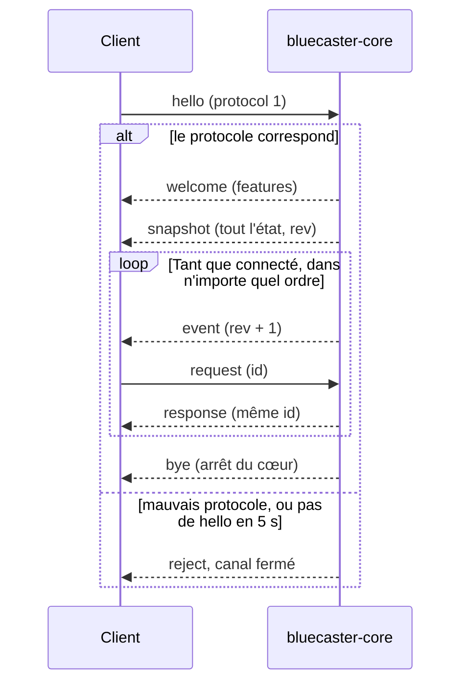

# Intégration (IPC)
{: .no_toc }

Cette page explique comment un outil tiers communique avec le cœur de BlueCaster pour afficher l'état du flux, démarrer et arrêter des profils, régler le volume ou accéder aux services propres du casque par la liaison Bluetooth de BlueCaster. Les outils qui le font sont listés sur la page [Compatible avec](works-with).

{: .warning }
> Le protocole peut encore changer pendant les bêtas 2.0.2. La référence fait foi dans [`app/src/crates/ipc/src/protocol.rs`](https://github.com/SeiyaFunaokaJP/BlueCaster/blob/main/app/src/crates/ipc/src/protocol.rs) et les types TypeScript qui en sont générés dans [`app/src/ui/src/ipc/bindings`](https://github.com/SeiyaFunaokaJP/BlueCaster/tree/main/app/src/ui/src/ipc/bindings). Cette page explique comment les utiliser ; elle ne liste pas tous les champs.

## Table des matières
{: .no_toc .text-delta }

1. TOC
{:toc}

## Connexion {#connecting}

Le cœur (`bluecaster-core.exe`) s'exécute dès que BlueCaster fonctionne, avec ou sans sa fenêtre. Il écoute sur un canal nommé propre à l'utilisateur sous lequel il s'exécute :

```
\\.\pipe\bluecaster-<user SID>
```

- `<user SID>` est la chaîne SID de l'utilisateur connecté (`S-1-5-21-...`), obtenue par exemple avec `whoami /user`. Chaque utilisateur a son propre cœur et son propre canal ; la DACL du canal n'admet que cet utilisateur, et les clients distants sont refusés.
- Le canal est en mode octet. Plusieurs clients peuvent être connectés à la fois (la fenêtre de BlueCaster en est un) ; chacun reçoit le même état et les mêmes événements.
- Jusqu'à la 2.0.x, le canal s'appelait `\\.\pipe\a2dpwb-<user SID>`. BlueCaster 3.0.0 sert **les deux** noms, et continue de servir l'ancien pendant au moins 6 mois après la 3.0.0. Un client doit d'abord essayer `bluecaster-<user SID>`, puis revenir à l'ancien nom. La version du protocole reste 1.
- Pour savoir si le cœur s'exécute, vérifiez la présence du canal, et non le mutex du cœur : si le canal n'existe pas, le cœur ne s'exécute pas.
- Les versions de développement lancées avec `BLUECASTER_INSTANCE=<name>` écoutent plutôt sur `\\.\pipe\bluecaster-<SID>-<name>`, afin de pouvoir s'exécuter à côté de la version installée.

### Le canal du service {#the-service-pipe}

Le service BlueCaster est un prototype du mode développeur. Il permet d'utiliser des claviers et souris Bluetooth sur l'écran de connexion. Sur un PC où le service est installé, le cœur s'exécute en tant que service Windows. Le canal propre à chaque utilisateur n'existe alors pas. À la place, le cœur sert un seul canal commun à tous les utilisateurs :

```
\\.\pipe\bluecaster-service
```

- Essayez d'abord `bluecaster-<user SID>`, puis `bluecaster-service`. Le service ne sert aucun canal sous l'ancien nom. Les trames, la poignée de main et les requêtes sont identiques sur les deux canaux.
- Ouvrez le canal uniquement avec `GENERIC_READ | FILE_WRITE_DATA`. Pour changer le mode du canal, ajoutez `FILE_WRITE_ATTRIBUTES`. Le canal refuse les clients qui demandent `GENERIC_WRITE`, car ce droit inclut la création d'une autre instance du canal (`FILE_CREATE_PIPE_INSTANCE`). En Python, `open(..., "r+b")` demande `GENERIC_WRITE`. Utilisez plutôt `CreateFileW`, par exemple via `ctypes`.
- Pour vérifier que le serveur est bien BlueCaster, comparez l'ID de processus du serveur du canal (`GetNamedPipeServerProcessId`) avec l'ID de processus du service `BlueCaster` (`QueryServiceStatusEx`). Tant que le service est arrêté, un autre programme peut créer un canal portant ce nom.
- Les requêtes qui s'appliquent à tout le PC renvoient l'erreur `ipc.needs_admin`. C'est le cas du mode développeur, des pilotes d'adaptateur ou de l'ajout de claviers et souris. Un outil ne peut pas accorder l'autorisation d'administrateur. Demandez plutôt à l'utilisateur d'effectuer la modification dans la fenêtre de BlueCaster. La fenêtre demande alors l'autorisation à Windows.
- Quand le cœur s'exécute en tant que service, certaines requêtes renvoient `ipc.not_in_service`. C'est le cas de `app.quit`, car le service doit continuer à s'exécuter pour les claviers et souris. Utilisez plutôt `app.close`. Cette méthode arrête la diffusion et ferme la fenêtre de BlueCaster ainsi que l'icône de la zone de notification.

### Trames {#frames}

Chaque message, dans les deux sens, est une trame : la longueur du JSON en **u32 little-endian**, puis le JSON (UTF-8). Les trames de plus de 4 Mio sont refusées.

### Poignée de main {#handshake}

1. Le client envoie `hello` dans les 5 secondes qui suivent la connexion :
   ```json
   {"type": "hello", "protocol": 1, "client": "mytool/1.2.0"}
   ```
   `client` contient le nom et la version de votre choix ; ils apparaissent dans le journal du cœur.
2. Le cœur répond par `welcome`, ou par `reject` et ferme le canal (mauvaise version du protocole, ou pas de hello) :
   ```json
   {"type": "welcome", "protocol": 1, "server": "bluecaster-core/2.0.2-beta.12", "features": ["rfcomm"]}
   {"type": "reject", "reason": "protocol 2 not supported (core speaks 1)"}
   ```
3. Le cœur envoie un `snapshot` avec tout son état, puis des `event`.

La version du protocole doit correspondre exactement. Les ajouts rétrocompatibles sont annoncés dans `features` à la place (voir [Compatibilité](#compatibility)).



## État et événements {#state-and-events}

```json
{"type": "snapshot", "rev": 41, "state": {"adapter": {...}, "devices": [...], "stream": {...}, "profiles": [...], "active_profile": "WH-1000XM5", "settings": {...}, ...}}
{"type": "event", "rev": 42, "event": {"kind": "stream", "value": {"state": "streaming", "profile": "WH-1000XM5", "info": {"codec": "ldac", "bitrate_kbps": 990, ...}, "volume": 80, ...}}}
```

Un client n'a pas besoin de gérer son propre état : il garde le dernier snapshot et y applique chaque événement. Chaque événement d'état **remplace une partie entière** du snapshot :

| `kind` de l'événement | Remplace |
|:--|:--|
| `adapter` | `adapter` |
| `devices` | `devices` |
| `scanning`, `le_scanning` | `scanning`, `le_scanning` |
| `stream` | `stream` (état, message, profil, informations sur le codec, volume, batterie) |
| `profiles` | `profiles` et `active_profile` |
| `settings` | `settings` |
| `update` | `update` |
| `capture` | `capture` |
| `v1_running`, `verbose`, `crashes` | le champ du même nom |

`stream.state` vaut `idle`, `connecting`, `streaming`, `reconnecting` ou `error` ; `stream.message` en donne la raison, sous forme de [clé de message](#errors-and-messages).

`adapter.active` est l'adaptateur USB qu'utilise BlueCaster. Ce champ vaut `null` tant qu'aucun adaptateur n'est ouvert : avant la première recherche ou connexion, et pendant le redémarrage du Bluetooth.

```json
"active": {"display_name": "RTL8761BU (0x2357:0x0604)", "windows_name": "TP-Link UB500 Adapter", "vid": 9047, "pid": 1540, "vendor": "Realtek", "chip": "RTL8761BU", "bt_version": "5.1"}
```

`vid` et `pid` sont des nombres. `windows_name`, `chip` et `bt_version` peuvent valoir `null`. `chip` n'est connu que pour les adaptateurs Realtek.

Chaque client reçoit les événements d'état sans s'y abonner. Un événement n'arrive que lorsque quelque chose change : une connexion peut donc rester longtemps sans rien recevoir.

**Révisions.** Chaque événement d'état porte la révision suivante (`rev` + 1). Un écart signifie qu'un événement a été perdu : envoyez `state.snapshot` pour en obtenir un nouveau. Si un client lit trop lentement, le cœur lui envoie aussi de lui-même un nouveau `snapshot`. Les événements qui ne sont pas des états (`link`, `log`, `receiver`, `rfcomm_data`, `rfcomm_closed`, `media_button`) portent la révision actuelle et ne la font pas avancer.

Quand le cœur s'arrête, il envoie l'événement `bye` et ferme le canal.

## Requêtes {#requests}

```json
{"type": "request", "id": 7, "method": "stream.start", "params": {"profile": "WH-1000XM5"}}
{"type": "response", "id": 7, "result": null, "error": null}
```

- `id` est un nombre quelconque choisi par le client ; la réponse le renvoie. Les requêtes s'exécutent en parallèle : les réponses peuvent donc arriver dans un autre ordre.
- `params` est omis pour les méthodes sans paramètres.
- Une requête qui modifie l'état reçoit sa réponse une fois la modification terminée, et la modification arrive aussi sous forme d'événement. Les clients doivent afficher l'état d'après les événements, et non d'après la réponse.

### Erreurs et messages {#errors-and-messages}

```json
{"type": "response", "id": 8, "result": null, "error": {"code": "rfcomm.not_connected", "message": {"key": "ipc.error.rfcomm_not_connected", "args": []}}}
```

`code` est destiné aux programmes (`adapter.driver_missing`, `app.streaming`, ...). `message` est une clé de traduction des fichiers de langue de BlueCaster ([`app/lang`](https://github.com/SeiyaFunaokaJP/BlueCaster/tree/main/app/lang)) avec des arguments de style printf, comme les textes d'état contenus dans l'état. Un outil peut chercher la clé dans ces fichiers ou afficher son propre texte selon le code.

### Méthodes {#methods}

Méthodes destinées aux outils :

| Méthode | Paramètres | Résultat |
|:--|:--|:--|
| `state.snapshot` | -- | `Snapshot` |
| `stream.start` | `profile` | `null` ; arrête d'abord un flux en cours |
| `stream.stop` | -- | `null` |
| `stream.set_volume` | `volume` (volume absolu AVRCP 0-127) | `null` |
| `stream.volume_step` | `delta` (de -127 à 127) | le nouveau volume ; voir [Commandes rapides](#quick-controls) |
| `profile.set_active` | `name` | `null` |
| `profile.set_headset_mic` | `name` (facultatif), `mode` (`off`, `auto`, `on`) | `null` ; voir [Commandes rapides](#quick-controls) |
| `profile.set_mic_muted` | `name` (facultatif), `muted` (bool) | `null` ; voir [Commandes rapides](#quick-controls) |
| `profile.set_media_eq` | `name` (facultatif), `enabled` (bool) | `null` ; voir [Commandes rapides](#quick-controls) |
| `device.scan` | `seconds` (3-600) | `Device[]`, aussi sous forme d'événement `devices` |
| `device.scan_stop` | -- | `null` ; le `device.scan` en cours se termine alors |
| `audio.devices` | -- | `AudioDevice[]` (sources de capture) |
| `diag.subscribe` | `logs` (niveau ou `null`), `link` (bool), `receiver` (bool, facultatif) | `null` ; démarre ou arrête les événements `log` / `link` / `receiver` pour cette connexion |
| `diag.info` | `{"mask": bool}` (facultatif) | `DiagInfo` (le texte de « Copier le diagnostic ») |
| `rfcomm.open`, `rfcomm.send`, `rfcomm.close` | voir [Relais RFCOMM](#rfcomm-passthrough) | |

Envoyez `logs` et `link` à chaque `diag.subscribe`. Chaque appel définit les deux valeurs : sans `logs`, les événements de journal sont désactivés.

Pour modifier un seul réglage, utilisez les [commandes rapides](#quick-controls) plutôt que `profile.save` ou `settings.set`.

Méthodes qu'utilise la fenêtre de BlueCaster et qu'un outil ne doit utiliser qu'avec précaution : `profile.save` / `profile.delete`, `settings.set` (remplace **tous** les paramètres : envoyez les derniers `settings` avec votre modification, jamais un objet partiel), `device.forget` / `device.rename`, `adapter.*` (`adapter.assign_winusb` et `adapter.restore_driver` affichent une invite UAC ; `adapter.probe` et `adapter.run_script`, les outils de puce du mode développeur, arrêtent la pile Bluetooth), `app.quit`. Les autres méthodes servent aux écrans de la fenêtre et peuvent changer sans préavis : `stream.start_custom`, les autres méthodes `device.*` (`device.import_windows_pairings` affiche une invite UAC), `audio.apps`, `audio.mixer` / `audio.mixer_set`, les `diag.*` autres que les deux ci-dessus, `receiver.*` et `app.*`. La liste complète, avec les paramètres et les résultats, se trouve dans l'enum `Method` de `protocol.rs`.

## Relais RFCOMM {#rfcomm-passthrough}

Disponible quand `welcome.features` contient `"rfcomm"` (2.0.2-beta.10 et ultérieur). Le relais permet à un outil d'accéder aux services RFCOMM propres du casque (applications de contrôle des fabricants : batterie, contrôle du bruit, EQ) par la liaison déjà établie par BlueCaster. Windows lui-même ne voit pas les casques connectés via BlueCaster.

- `rfcomm.open {address, uuid}` → `{channel_id, mtu}`. `address` doit être l'appareil vers lequel le flux est diffusé ; le cœur ne se connecte et ne s'associe jamais pour cette requête (`rfcomm.not_connected`). `uuid` est un UUID complet de 128 bits ou un `"xxxx"` de 16 bits basé sur l'UUID de base Bluetooth. La réponse arrive dans les 20 s, même quand la requête attend derrière d'autres ouvertures : attendez donc au moins 25 s. Erreurs : `rfcomm.not_connected`, `rfcomm.service_not_found`, `rfcomm.service_reserved`, `rfcomm.open_failed`, `rfcomm.busy`.
- Les services casque et mains libres (`1108`, `1112`, `111E`, `111F`) sont refusés avec `rfcomm.service_reserved`, sous les deux formes d'UUID. BlueCaster les utilise pour le micro du casque.
- Le relais nécessite une connexion Classic (A2DP). Pour un appareil connecté en LE Audio, `rfcomm.open` renvoie toujours `rfcomm.not_connected`.
- `rfcomm.send {channel_id, data}` → `null`. `data` est en base64 (standard, avec remplissage), au plus 64 Kio par requête, envoyé en trames d'au plus `mtu` dans l'ordre des requêtes. Erreurs : `rfcomm.no_channel`, `rfcomm.busy` (file pleine, non envoyé), `rfcomm.timeout` (impossible de savoir si les données sont parties : ne renvoyez pas, rouvrez le canal).
- Envoyez les gros volumes de données lentement, par exemple pendant une mise à jour du firmware. Le canal partage la liaison radio avec l'audio, et des envois massifs rapides peuvent provoquer des coupures.
- Les données reçues arrivent sous forme d'événements `rfcomm_data` `{channel_id, data}`, uniquement à la connexion qui a ouvert le canal.
- `rfcomm.close {channel_id}` → `null`, une fois parties les données envoyées avant cette requête ; aucun `rfcomm_closed` ne suit.
- Un canal se ferme aussi quand la connexion au canal nommé prend fin, ou avec un événement `rfcomm_closed` `{channel_id, reason}` : `remote` (l'appareil l'a fermé ou la liaison est tombée), `disconnected` (la connexion A2DP a pris fin), `stopped` (la pile Bluetooth s'est arrêtée), `overflow` (le client a laissé plus de 1 Mio de données reçues non lues).

## Boutons du casque {#headphone-buttons}

Disponible quand `welcome.features` contient `"media_button"`. Chaque fois qu'un bouton du casque est enfoncé ou relâché, tous les clients reçoivent un événement `media_button`. Aucun abonnement n'est nécessaire.

```json
{"type": "event", "rev": 42, "event": {"kind": "media_button", "value": {"button": "play", "pressed": true, "le_audio": false}}}
```

- `button` vaut `play`, `pause`, `stop`, `next`, `previous`, `fast_forward`, `rewind`, `volume_up`, `volume_down` ou `mute`. Les autres boutons ne sont pas signalés.
- `pressed` vaut `true` quand le bouton est enfoncé et `false` quand il est relâché. Les casques LE Audio ne signalent que l'appui.
- `le_audio` vaut `true` quand l'événement vient d'un casque LE Audio.
- Les casques envoient `play` ou `pause` selon qu'ils pensent ou non qu'une lecture est en cours. Cette information peut être périmée. Pour basculer la lecture, traitez les deux de la même façon.
- BlueCaster continue de transmettre lecture/pause, suivant, précédent et arrêt à Windows sous forme de touches multimédias. Si votre outil gère lui-même les boutons, demandez à l'utilisateur de désactiver **Périphériques audio > Contrôler la lecture avec les boutons de l'appareil audio**. Les événements arrivent aussi quand ce réglage est désactivé.

## Commandes rapides {#quick-controls}

Disponibles quand `welcome.features` contient `"tool_controls"`. Chaque méthode modifie un seul réglage : un outil n'a donc jamais besoin d'envoyer un profil complet.

**Expérimental jusqu'à BlueCaster 3.1.** Les noms des méthodes et leurs paramètres peuvent encore changer selon les retours. Une modification incompatible remplacera `"tool_controls"` par un nouveau nom de fonctionnalité : un outil peut ainsi savoir quelle version le cœur prend en charge.

- `name` est le nom d'un profil enregistré. Sans `name`, c'est le profil en cours de diffusion qui est utilisé, ou le profil actif si rien n'est diffusé. Un nom inconnu renvoie `profile.not_found`.
- La modification est enregistrée dans le profil et appliquée au flux, comme une modification faite dans la fenêtre de BlueCaster. Tous les clients reçoivent un événement `profiles`.
- Envoyer la valeur actuelle ne change rien.
- `profile.set_headset_mic` fonctionne comme les boutons de mode du micro dans la fenêtre. `off` coupe le micro mais garde le mode actuel. `auto` et `on` passent à ce mode et réactivent le micro. Sans le mode développeur, `on` renvoie `developer.off`.
- `profile.set_mic_muted` coupe ou réactive le micro du casque sans changer le mode.
- Les deux méthodes du micro renvoient `profile.no_mic_output` tant que le micro du casque n'est pas configuré pour l'appareil. Pendant la connexion de l'appareil, elles renvoient `stream.busy`.
- `profile.set_media_eq` active ou désactive l'égaliseur de lecture sans reconnecter le flux. Les points de l'égaliseur sont conservés.
- `stream.volume_step` modifie le volume du casque de `delta` et renvoie le nouveau volume (0-127). Le pas part du dernier volume indiqué par le casque. Si rien n'est diffusé, ou si le casque n'a pas encore indiqué de volume, la méthode renvoie `stream.volume_unknown`. Un `delta` hors de la plage -127 à 127 renvoie `stream.bad_volume_step`.

## Compatibilité {#compatibility}

- **Fonctionnalités.** Vérifiez `welcome.features` avant d'utiliser un ajout. Les cœurs antérieurs à 2.0.2-beta.10 omettent ce champ.
- **Requêtes inconnues.** Une requête que le cœur ne peut pas lire (méthode inconnue, paramètres incorrects) reçoit l'erreur `ipc.bad_request` ; la connexion reste ouverte. Les cœurs antérieurs à 2.0.2-beta.10 ferment plutôt la connexion. Toute autre trame illisible la ferme.
- **Nouveaux champs.** Le cœur ajoute au fil du temps des champs à l'état et aux événements. Ignorez les champs que vous ne connaissez pas ; ne rejetez pas un message à cause d'eux. De nouveaux types d'événement s'ajoutent aussi : ignorez un événement dont vous ne connaissez pas le `kind`.
- **Changement de nom en 3.0.0** ([#193](https://github.com/SeiyaFunaokaJP/BlueCaster/issues/193)) : le canal devient `\\.\pipe\bluecaster-<SID>`. Le cœur continue d'écouter aussi sur `\\.\pipe\a2dpwb-<SID>`, avec le même protocole, pendant au moins 6 mois après la 3.0.0 ; sa suppression sera annoncée au préalable dans les notes de version. Essayez d'abord `bluecaster-<SID>`, puis revenez à `a2dpwb-<SID>`. Le mutex du cœur devient `Local\BlueCaster_Core` ; le cœur détient aussi `Local\A2DPWB_v2_Core` pendant la même période, et les deux suppressions seront annoncées ensemble.

## Exemple {#example}

Un client Python minimal (bibliothèque standard uniquement) qui affiche l'état du flux et suit ses changements :

```python
import json, struct, subprocess

sid = subprocess.run(["whoami", "/user", "/fo", "csv", "/nh"],
                     capture_output=True, text=True).stdout.strip().split(",")[1].strip('"')
pipe = open(rf"\\.\pipe\bluecaster-{sid}", "r+b", buffering=0)

def send(msg):
    b = json.dumps(msg).encode()
    pipe.write(struct.pack("<I", len(b)) + b)

def read_exact(n):
    buf = b""
    while len(buf) < n:
        chunk = pipe.read(n - len(buf))
        if not chunk:
            raise EOFError
        buf += chunk
    return buf

def recv():
    (n,) = struct.unpack("<I", read_exact(4))
    return json.loads(read_exact(n))

send({"type": "hello", "protocol": 1, "client": "example/0.1"})
welcome = recv()
assert welcome["type"] == "welcome", welcome
snap = recv()
print("stream:", snap["state"]["stream"]["state"])
while True:
    m = recv()
    if m["type"] == "event" and m["event"]["kind"] == "stream":
        s = m["event"]["value"]
        print("stream:", s["state"], (s.get("info") or {}).get("codec"))
    elif m["type"] == "event" and m["event"]["kind"] == "bye":
        break
```

Pour essayer un outil sans toucher au BlueCaster installé, lancez une version de développement avec `BLUECASTER_INSTANCE` et `BLUECASTER_CONFIG_DIR` définis (voir [Compilation](building)) et connectez-vous à son canal.
