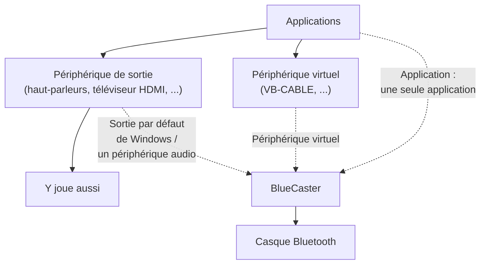
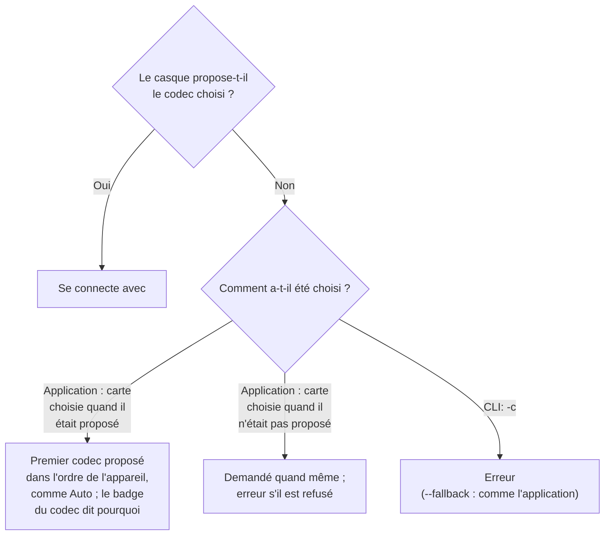

# Utilisation
{: .no_toc }

## Table des matières
{: .no_toc .text-delta }

1. TOC
{:toc}

---

## La fenêtre

Lancez **BlueCaster** depuis le menu Démarrer (ou exécutez `bluecaster.exe`). Le menu de gauche mène aux écrans décrits ci-dessous : Accueil, Codecs, Périphériques audio, Adaptateur, Diagnostic, Paramètres et À propos. En mode développeur s'y ajoutent Développeur et, si vous l'y activez, Mélangeur de volume. Quand la fenêtre est étroite, le menu se réduit à des icônes. La fenêtre n'est qu'une vue de `bluecaster-core.exe`, qui continue de s'exécuter en arrière-plan : fermer la fenêtre n'arrête donc pas la diffusion (voir [Zone de notification et volet](#tray)).

### Accueil

- Une carte par appareil audio enregistré, côte à côte, avec son état et sa batterie. La carte de l'appareil connecté affiche aussi le codec utilisé, sous forme de liste (voir plus bas), et son débit. Si un autre codec que celui que vous avez choisi est utilisé, la ligne du codec en donne brièvement la raison, p. ex. **aptX Adaptive (Opus non pris en charge)** (ou *déjà utilisé*). Au bout de quelques secondes, il ne reste qu'un signe d'avertissement (survolez-le pour voir la raison), et la ligne d'état indique simplement **Connecté**
- **Connecter** / **Déconnecter** sous chaque carte. Un seul appareil peut être connecté à la fois : **Connecter** sur un autre appareil déconnecte l'appareil actuel et connecte le nouveau
- **Volume** : le volume du casque (voir [Volume](#volume)). Cliquez sur le haut-parleur pour couper le son (BlueCaster envoie du silence), puis de nouveau pour le rétablir. Sur les cartes des autres appareils, le curseur est désactivé
- Une liste de codecs sur la carte de l'appareil connecté, pour en changer rapidement (par exemple un codec pour les jeux, un autre pour la musique). Elle contient les codecs que l'appareil prend en charge, par leur nom seulement, comme dans [Codecs](#codecs), et affiche le codec utilisé, y compris en sélection automatique. Choisir un codec désactive la sélection automatique (réactivez-la dans Codecs). Le choix s'applique aussitôt : l'appareil se reconnecte avec le nouveau codec, et le choix suivant attend la fin de la reconnexion, comme dans Codecs
- Un petit graphique de la qualité de liaison sur la carte de l'appareil connecté, pendant la diffusion. La source de sortie se choisit dans **Périphériques audio** ; si cette source est une application qui n'est pas encore lancée, la carte l'indique
- Les erreurs affichent leur cause et, s'il existe, un bouton qui corrige le problème (**Remplacer par le pilote WinUSB**, **Ouvrir la page de téléchargement**, **Redémarrer le Bluetooth**, **Réessayer**, **Codecs**, **Périphériques audio**, ...)
- Au-dessus des cartes, jusqu'à ce que vous les fermiez : un avertissement quand un autre adaptateur Bluetooth est actif dans Windows, et un message quand des écouteurs OPPO ont activé le Hi-Res (voir [Codecs](#codecs))

La barre latérale affiche les mêmes informations pour chaque appareil, sur tous les écrans ; le volet de la zone de notification les affiche pour l'appareil connecté.

### Codecs {#codecs}

Chaque appareil audio enregistré a sa propre section. Son en-tête montre un point (vert tant que l'appareil est connecté), le nom de l'appareil et les étiquettes **Associé** / **Audio** ; l'adresse figure dans **Périphériques audio**. Viennent ensuite ses cartes de codec, de la meilleure qualité sonore à la moins bonne, sauf si vous changez leur ordre. Chaque carte a trois barres (qualité sonore, faible latence, stabilité) et indique si l'appareil a proposé le codec lors de sa dernière connexion : **Pris en charge** (marque verte) ou **Non pris en charge** (marque rouge). Avec **Afficher uniquement les codecs pris en charge** activé (par défaut), toutes les cartes affichées sont prises en charge, et aucune ne porte donc l'étiquette **Pris en charge**. Un appareil qui ne s'est jamais connecté (par exemple un appareil importé de Windows) n'affiche alors que la carte **SBC**, que tout appareil audio Bluetooth possède, plus un éventuel codec choisi pour lui. Ses autres cartes apparaissent après la première connexion, ou quand vous désactivez l'interrupteur. Les écouteurs Huawei et Honor gardent leur carte **LDAC**, marquée **Non confirmé**, jusqu'à ce qu'ils annoncent LDAC, car ils peuvent ne l'annoncer qu'une fois LDAC choisi. Quand LHDC V5 diffuse (choisi par vous ou par la sélection automatique, mais pas avec la qualité **Basse** ni avec l'ABR), BlueCaster demande une fois le Hi-Res aux écouteurs OPPO qui annoncent un débit maximal pour LHDC V5. Ils se reconnectent une fois pour cela, et l'Accueil vous signale si leur débit a augmenté. Le Hi-Res reste ensuite activé dans les écouteurs ; ceux à qui il n'a rien apporté sont remis comme avant. En mode développeur, **Redemander le Hi-Res**, dans les réglages de LHDC V5, oublie ce que l'appareil a annoncé et le fait que la demande a été faite : la connexion suivante la refait.

- **Sélectionner automatiquement le codec pris en charge de meilleure qualité** (un réglage pour tous les appareils, en haut de la page ; activé par défaut) : chaque appareil utilise le codec de meilleure qualité qu'il prend en charge, dans cet ordre : LHDC V5 > LDAC > aptX Adaptive > Opus > aptX HD > aptX > aptX LL > AAC > SBC XQ > SBC. Les réglages sont ceux par défaut, comme **Auto** dans les réglages d'un codec : haute qualité, 24 bits si le codec le permet, et 48 kHz (si l'appareil n'a pas 48 kHz, une autre fréquence qu'il annonce, 44,1 kHz en premier ; la fréquence de Windows est rééchantillonnée). Les cartes sont en lecture seule, sauf leur ordre (faites-les glisser comme décrit plus bas ; la sélection automatique prend la première carte que l'appareil prend en charge). Le codec utilisé, ou celui que la sélection automatique choisira, est mis en évidence. Un clic sur une carte ou sur son **...** demande s'il faut désactiver la sélection automatique (**Désactiver la sélection automatique** / **Annuler**) ; une fois celle-ci désactivée, la carte cliquée est choisie (et son **...** ouvre ses réglages). Désactivez la sélection automatique pour choisir vous-même le codec et les réglages de chaque appareil ; un appareil sans codec choisi garde le choix de la sélection automatique. Tant que la sélection automatique est activée, le codec choisi pour chaque appareil est conservé pour plus tard. Si vos réglages d'avant la 2.0.2 choisissaient un codec pour un appareil, la sélection automatique démarre désactivée
- Sélection automatique désactivée, cliquez sur une carte pour choisir le codec de cet appareil. Le choix est enregistré aussitôt, et un appareil en cours de diffusion se reconnecte avec ce codec. Vous pouvez aussi choisir une carte que l'appareil ne prend pas en charge (affichée quand **Afficher uniquement les codecs pris en charge** est désactivé) : BlueCaster demande quand même ce codec à l'appareil, et si l'appareil le refuse, la connexion s'arrête avec une erreur qui le signale (choisissez une autre carte ou activez la sélection automatique). L'Accueil, la barre latérale, le volet de la zone de notification et l'info-bulle de l'icône en donnent alors la cause en quelques mots (p. ex. *LDAC non pris en charge*), comme chaque fois que le codec arrête une connexion (parce que l'appareil ne le prend pas en charge, le refuse ou l'utilise pour une autre source). Choisir une autre carte ou d'autres réglages pour cet appareil, ou activer la sélection automatique, le reconnecte. Si vous avez choisi un codec que l'appareil proposait et que l'appareil cesse ensuite de le proposer (par exemple des écouteurs passés à un autre codec), BlueCaster se replie sur la première carte, dans l'ordre de l'appareil, que celui-ci prend en charge : le meilleur codec pris en charge, sauf si vous avez changé l'ordre (voir [Codec choisi explicitement mais non proposé](#codec-fallback))
- Faites glisser les cartes d'un appareil pour classer ses codecs dans votre propre ordre (le curseur en forme de main s'affiche tant que le bouton est maintenu ; sélection automatique désactivée, vous pouvez aussi appuyer sur Alt et une touche fléchée sur une carte). Chaque appareil garde son propre ordre. La sélection automatique, un appareil sans codec choisi et un codec choisi que l'appareil ne prend pas en charge utilisent tous la première carte prise en charge. FastStream et Opus 05 (la carte **Opus (PipeWire)**, uniquement en mode développeur ; sans le mode développeur, il n'est pas utilisé même s'il est choisi) ne servent que si vous les choisissez, quelle que soit leur place. **Réinitialiser l'ordre des codecs** rétablit l'ordre par défaut. Ce bouton n'apparaît que lorsque les cartes affichées ne sont pas dans l'ordre par défaut (les remettre en place à la main rétablit aussi cet ordre). Un appareil qui diffuse avec un codec concerné se reconnecte
- Choisir un autre codec pour l'appareil qui diffuse le reconnecte avec ce codec. Les cartes (ainsi que la liste des codecs de l'Accueil et du volet de la zone de notification) attendent ensuite la fin de la reconnexion avant d'accepter un nouveau choix : une série de clics rapides n'interrompt donc pas une connexion en cours d'établissement. Un changement de codec n'affiche pas de notification de connexion, contrairement à la connexion d'un appareil
- **Afficher uniquement les codecs pris en charge** (activé par défaut ; désactivez-le pour afficher les codecs pris en charge et non pris en charge) : masque les codecs qu'un appareil n'a pas proposés. Avant la première connexion d'un appareil, seul **SBC** est affiché (avec un éventuel codec choisi pour lui)
- **...** sur une carte ouvre les réglages de ce codec. Les modifications s'appliquent aussitôt. Pour le codec utilisé, la modification est enregistrée et l'appareil se reconnecte avec elle. Font exception le **Bitpool**, qui change pendant l'écoute, et l'interrupteur ci-dessous quand le flux serait établi de la même façon dans les deux cas. Pour un autre codec, la modification est conservée jusqu'à ce que ce codec soit choisi. Chaque codec garde ses propres réglages, de même qu'aptX Adaptive et aptX Adaptive LL : si vous passez à un autre codec puis revenez, vous les retrouvez. Seules sont proposées les options que le codec prend en charge et que l'appareil a annoncées lors de sa dernière connexion. En haut, désactivez **Afficher seulement les options prises en charge par *appareil*** (activé par défaut ; affiché une fois que l'appareil a annoncé ses options) pour voir tout ce que le codec permet, comme une fréquence d'échantillonnage, une profondeur de bits, une qualité ou un bitpool que l'appareil n'a pas annoncés (marqués *(non pris en charge)*). L'appareil peut les refuser, et la connexion s'arrête alors avec une erreur qui le signale. Quand vous réactivez l'interrupteur, tout ce que l'appareil n'a pas annoncé revient à Auto. Les réglages, par codec (la sélection automatique ne les utilise jamais) :
  - **Qualité** : LDAC **Haute** / **Moyenne** / **Basse** (990 / 660 / 330 kbps) ; LHDC V5 **Haute** / **Moyenne-haute** / **Moyenne** / **Basse** (1000 / 900 / 500 / 400 kbps, les quatre niveaux d'Android) ; aptX Adaptive **Haute** (son mode faible latence a sa propre carte, **aptX Adaptive LL** : 265 kbps, 48 kHz, sans ABR ; voir [aptX Adaptive](#aptx-adaptive)). Quand l'ABR de LHDC V5 est activé, la qualité est grisée (l'ABR reste à 400 kbps ou moins). AAC, Opus, Opus 05, SBC et SBC XQ n'ont qu'un niveau, **Haute**, affiché et non choisi : le débit le plus élevé que l'appareil accepte (l'ABR ou le VBR, s'ils existent, le font encore varier ; SBC et SBC XQ affichent le débit qui découle de leur bitpool et de leur structure de trames). Pour aptX, aptX HD, aptX LL et FastStream, le débit est fixé par le codec. Une qualité enregistrée par une version précédente et que le codec n'a plus (Standard / Mobile d'aptX Adaptive, niveaux inférieurs d'AAC, ...) est chargée comme Haute
  - **Débit adaptatif (ABR)** : pour LDAC, LHDC V5, aptX Adaptive, SBC et SBC XQ (voir [ABR](#abr)) ; **VBR** pour AAC
  - **Faible latence** (LHDC V5, sur les appareils qui l'annoncent) : le son arrive plus tôt au casque. Avec ABR désactivé, le débit descend tant que la connexion ne suit pas (1000, 900, puis 500 kbps) et remonte après une minute sans problème. Les paquets sont abandonnés après 100 ms dans la file d'envoi au lieu de 350 ms : une connexion faible provoque ainsi une courte coupure plutôt qu'un délai durable
  - **Fréquence d'échantillonnage** : Auto vaut 48 kHz ou, si l'appareil n'a pas 48 kHz, une autre fréquence qu'il annonce (44,1 kHz en premier), et affiche la fréquence obtenue (p. ex. *Auto (48000 Hz)*). Auto ne choisit jamais 96 kHz, qui ajoute de la latence et pose plus de problèmes de compatibilité sans gain audible (Windows mixe en 48 kHz) ; pour l'utiliser, choisissez-le ici. Seules les fréquences annoncées par l'appareil sont proposées (LHDC V5 n'a pas de 88,2 kHz ; aptX Adaptive ne propose 96 kHz qu'à un appareil qui l'annonce, voir [aptX Adaptive](#aptx-adaptive)). Un appareil qui n'annonce qu'une fréquence affiche celle-ci, sans Auto
  - **Profondeur de bits** : 16 ou 24 bits pour LDAC et LHDC V5, selon ce que l'appareil annonce (Auto : 24 bits ; pour LHDC V5, seulement si l'appareil l'annonce) ; 24 bits pour aptX HD et aptX Adaptive ; 16 bits pour les autres. En LDAC, les 24 bits parviennent à l'encodeur sous forme d'échantillons 32 bits, comme avec l'option 32 bits d'Android. La profondeur de bits ne fait pas partie de la configuration LDAC : le casque reçoit donc le même flux dans les deux cas
  - **Bitpool** (SBC, SBC XQ) : un curseur à deux poignées pour le bitpool minimal et le bitpool maximal, dans la plage annoncée par l'appareil. Le maximum est le bitpool utilisé ; le minimum est le plus bas qui sera utilisé (le bas de la plage avec laquelle la connexion est établie, et la limite jusqu'où l'ABR peut descendre). **Auto** rétablit les deux : le maximum selon la qualité, le minimum selon l'appareil et l'ABR. La ligne en dessous indique le mode de canal, fixe pour chaque codec : joint stereo pour SBC, double canal pour SBC XQ. Le bitpool de SBC XQ va jusqu'à 47 à 44,1 kHz et 43 à 48 kHz, ou jusqu'à 53 avec **Afficher seulement les options prises en charge par *appareil*** désactivé.
  - **Structure des trames** (SBC et SBC XQ, en mode développeur uniquement) : blocs, sous-bandes, allocation des bits et, pour SBC, mode de canal. Auto garde 16 blocs, 8 sous-bandes, Loudness et Joint stereo. Une valeur que l'appareil n'accepte pas revient à Auto à la connexion. Sur un appareil Sony testé par un utilisateur, 12 blocs déforment le son et peuvent provoquer une déconnexion (la sortie de l'encodeur se décode pourtant correctement, et les autres nombres de blocs fonctionnent bien). Vos choix restent enregistrés, mais ne sont pas utilisés tant que le mode développeur est désactivé. Les débits d'AAC et de LHDC V5 restent dans le maximum annoncé par l'appareil

Les valeurs par défaut donnent le meilleur son ; la plupart des appareils n'ont besoin de rien d'autre que **Auto**. Un appareil LE Audio (expérimental) a deux cartes, **LC3** et **LC3 LL** (voir [LE Audio](#le-audio)). Leur **...**, comme celui des codecs d'appel, affiche les mêmes champs que pour un codec A2DP, en lecture seule. Le mode faible latence d'aptX Adaptive a sa propre carte, **aptX Adaptive LL**, à côté d'**aptX Adaptive**. Auto ne la choisit jamais, et un aptX Adaptive réglé sur Faible latence par une version précédente apparaît sur cette carte.

Tant que le micro d'un appareil classique est ouvert (voir [Périphériques audio](#audio-devices)), ses cartes de musique sont remplacées par les codecs d'appel qu'il peut utiliser : LC3 (32 kHz), mSBC (16 kHz) et CVSD (8 kHz). Le codec actif est sélectionné. En sélection automatique, la liaison d'appel choisit le meilleur codec pris en charge des deux côtés, et un clic sur une carte demande s'il faut désactiver la sélection automatique. Sélection automatique désactivée, cliquez sur une carte pour choisir le codec d'appel : le micro se rouvre avec ce codec, ou avec le codec inférieur suivant si le casque ne le prend pas en charge. **...** affiche leurs réglages, en lecture seule. Quand le micro se ferme, les cartes de musique reviennent. Tant que la sélection automatique est activée, le codec d'appel choisi est conservé pour plus tard. Avec **Afficher uniquement les codecs pris en charge**, les codecs que le casque ne prend pas en charge sont masqués.

Tant que le micro d'un appareil LE Audio est ouvert, une carte **Micro** (LC3, mono) apparaît après ses cartes de musique. Sélection automatique désactivée, son **...** règle la fréquence d'échantillonnage du micro parmi celles que le casque prend en charge (**Auto** prend la première ; un changement reconnecte l'appareil). En sélection automatique, elle affiche la fréquence utilisée.

En coulisses, BlueCaster garde une entrée par appareil dans `profiles.json` (son codec, les réglages de chaque codec et son ordre des codecs). Dans ce fichier, l'entrée s'appelle « *appareil* | *codec* » ; la fenêtre et le menu de la zone de notification n'affichent que le nom de l'appareil. Les versions précédentes permettaient de créer plusieurs profils pour un même appareil. Au premier démarrage d'une version dotée de l'écran Codecs, BlueCaster garde le profil utilisé en dernier (sinon le premier) et y fusionne les autres, en conservant leurs réglages de codec (qualité, fréquence d'échantillonnage, profondeur de bits, ABR, configuration SBC) pour leurs codecs. Leurs noms, sources de sortie et tailles de paquets ne sont pas conservés ; le `profiles.json` d'origine est enregistré une fois sous `profiles-before-codecs.json` dans le dossier des paramètres. L'**Ordre de la sélection automatique…** des préversions 2.0.2 (un ordre pour tous les appareils, en mode développeur) n'est plus utilisé : chaque appareil a désormais son propre ordre.

### Périphériques audio {#audio-devices}

Les casques et enceintes vers lesquels BlueCaster peut diffuser, chacun avec ses propres réglages. En dessous, sous **Ajouter un appareil audio**, **Rechercher** cherche pendant 30 secondes les appareils à proximité avec l'adaptateur USB et les affiche au fur et à mesure de leurs réponses ; **Arrêter la recherche** met fin à la recherche. Mettez d'abord le casque en mode d'association. Si un appareil est connecté, BlueCaster propose de le déconnecter avant la recherche. **Ajouter** enregistre un appareil trouvé et le connecte. Les appareils déjà associés à BlueCaster portent l'étiquette **Associé**. Si la recherche ne trouve pas un appareil, saisissez son adresse sous **Manuel :** et cliquez sur **Ajouter**. Les adresses sont mises en forme pendant la saisie ou le collage (`aa-bb-cc-dd-ee-ff`, `AABBCCDDEEFF` et `AA BB CC DD EE FF` deviennent toutes `AA:BB:CC:DD:EE:FF`). Le casque voit l'adaptateur sous le nom de votre ordinateur suivi de BlueCaster, p. ex. *Taro-PC (BlueCaster)*, ce qui permet de le distinguer du Bluetooth de Windows. Si Windows a associé un appareil via un autre adaptateur, comme le Bluetooth intégré du PC, BlueCaster vous le signale d'abord (**Associé dans Windows** : supprimez-le dans Windows, ou cliquez sur **Ajouter quand même**). Il le signale aussi pour un appareil que Windows a associé via cet adaptateur (la configuration peut importer cette association, voir [Services et clés d'association](#shared-pairing)). Vous pouvez renommer ou supprimer un appareil enregistré. La suppression efface aussi ses réglages et son association : il faudra l'associer de nouveau pour qu'il puisse se connecter. Chaque appareil enregistré dispose de :

- **Source de sortie** : **Sortie par défaut de Windows** (en tête de liste, à part : la sortie par défaut de Windows, nommée entre parenthèses, qui peut aussi être un périphérique virtuel ; c'est le choix par défaut pour un nouvel appareil), un périphérique de sortie sous **Sorties audio**, un périphérique virtuel ou une application (voir [Modes de capture](#capture-modes)). À côté figure le format dans lequel Windows mixe le périphérique capturé (fréquence d'échantillonnage et profondeur de bits, en lecture seule). Il passe en ambre quand l'appareil diffuse dans un autre format (ou, s'il n'est pas connecté, quand ses réglages de codec en demandent un autre), et une ligne en dessous indique les deux formats (la diffusion fonctionne quand même, avec une conversion). En dessous encore, une description de ce que fait la source
- **Définir comme sortie par défaut de Windows pendant la connexion** (en mode développeur, avec un périphérique virtuel ou un périphérique audio)
- **Source d'entrée** : le micro du casque, et **Définir comme entrée par défaut de Windows pendant la connexion** en mode développeur (voir ci-dessous)

**Source d'entrée**, sur chaque appareil, envoie le micro du casque vers Windows pour les appels et le chat vocal. BlueCaster n'a pas de pilote audio propre : il joue donc le micro dans un câble audio virtuel comme VB-CABLE. La liste nomme chaque câble d'après le côté depuis lequel les applications enregistrent (*CABLE Output* pour VB-CABLE) ; choisissez ce côté comme micro dans vos applications. À côté de la liste, choisissez **Désactivé** ou **Auto**. **Auto** n'ouvre le micro que lorsqu'une application enregistre depuis le câble : le reste du temps, la lecture garde toute sa qualité. En mode développeur, vous pouvez aussi choisir **Activé**, qui garde le micro ouvert en permanence. Quand le mode développeur est désactivé, un appareil réglé sur **Activé** se comporte comme sur **Auto**. Sur **Désactivé**, la liste reste visible mais grisée. **Désactivé** et le bouton micro de l'Accueil et du volet sont un seul et même réglage : pour un appareil sur **Auto** ou **Activé**, **Désactivé** coupe le micro comme le bouton et mémorise le mode, que le bouton rétablit. **Définir comme entrée par défaut de Windows pendant la connexion** (en mode développeur ; toujours activé quand le mode développeur est désactivé) fait du côté enregistrement du câble (*CABLE Output*) le micro par défaut de Windows tant que l'appareil est connecté. Les applications qui enregistrent depuis le micro par défaut reçoivent alors le micro du casque, et **Auto** l'ouvre pour elles. À la déconnexion, l'ancien micro par défaut revient, sauf si vous en avez choisi un autre entre-temps.

**Réglages du micro**, tout en bas, ouvre les réglages qui traitent le micro avant qu'il n'arrive aux applis. Quand **Source d'entrée** est sur **Désactivé**, la ligne est grisée. **Utiliser les réglages du micro** active ou désactive le traitement. Quand le traitement est désactivé, le micro passe sans modification et les curseurs gardent leurs valeurs. **Gain** le rend plus fort ou plus faible (de -12 à +24 dB). **Réduction du bruit** supprime les bruits de fond constants, comme un ventilateur ou un ronflement. Plus le curseur est à droite, plus elle est forte ; plus il est à gauche, mieux le son d'origine est conservé. Tout à gauche, elle est **Désactivée**. **Noise gate** coupe le micro tant qu'il reste sous le niveau choisi (tout à gauche : **Désactivé**). Un limiteur empêche un micro amplifié de saturer. Les changements s'appliquent aussitôt, sans reconnexion. La réduction du bruit retarde le micro d'environ 20 ms ; tout désactivé, le micro passe sans modification. Le test **Micro** de **Diagnostic** l'enregistre tel que les applis l'entendent.

Un nouvel appareil démarre avec VB-CABLE s'il est installé, sinon avec le Hi-Fi Cable, sauf si ce câble est sa **Source de sortie** : un appareil classique sur **Auto**, un appareil LE Audio sur **Désactivé** (pour ce type d'appareil, **Auto** garde le micro ouvert). Un appareil dont le micro est activé mais qui n'a pas de câble en reçoit un dès que Windows en liste un. **Périphériques audio** et l'assistant de configuration suggèrent les câbles manquants (voir [Modes de capture](#capture-modes)). Quand vous en installez un plus tard, BlueCaster configure de nouveau, comme le ferait l'assistant, les appareils qu'il a configurés automatiquement et ceux sur **Sortie par défaut de Windows** qui ont un tel micro. Avec les deux câbles, le Hi-Fi Cable transporte le son et VB-CABLE le micro. Avec un seul câble, celui-ci transporte le micro, et le son vient d'un périphérique de sortie sous **Sorties audio** (l'audio d'un écran ou d'un téléviseur s'il y en a un, la sortie par défaut de Windows s'il y en a plusieurs ; sinon la sortie par défaut de Windows), quel que soit le périphérique de sortie par défaut de Windows. Une source de sortie ou un micro que vous avez choisis vous-même restent tels quels. Sans câble, si Windows dispose à la fois de l'audio d'un écran ou d'un téléviseur et d'une carte son, le son vient de l'écran ou du téléviseur, et le micro est joué dans la carte son, réglé sur **Désactivé**. En mode développeur, si vous réglez le micro sur **Activé**, une application qui enregistre un périphérique de sortie (la capture de sortie audio d'OBS) peut le récupérer à cet endroit ; **Auto** ne peut pas savoir qui écoute une carte son. Un appareil ajouté dans **Périphériques audio** démarre de la même façon. Un appareil sur **Sortie par défaut de Windows** dont le micro joue dans le câble qui est la sortie par défaut de Windows passe lui aussi sur cette source de son, sinon le micro s'entendrait dans le casque.

Si le micro joue dans le Hi-Fi Cable et que les côtés lecture et enregistrement du câble tournent à des fréquences d'échantillonnage différentes dans les paramètres de son de Windows, un avertissement s'affiche : si les applications n'entendent rien, réglez les deux sur la même fréquence. La liste ne contient que les câbles depuis lesquels les applications peuvent enregistrer. Elle exclut le câble que BlueCaster capture lui-même (la **Source de sortie**, ou la sortie par défaut de Windows avec **Sortie par défaut de Windows**, mais pas la source de sortie d'un autre appareil devenue sortie par défaut pendant que cet appareil est connecté). Elle exclut aussi l'autre côté de ce câble (*CABLE In 16ch* de VB-CABLE enregistre dans le même *CABLE Output* que *CABLE Input*), car le micro serait mixé avec la lecture. De même, tant que **Source d'entrée** n'est pas sur **Désactivé**, la liste **Source de sortie** exclut le câble dans lequel joue le micro. Avec **Développeur > Réglages de l'app > Afficher tous les appareils audio dans les listes de sources** activé, les deux listes proposent tous les périphériques. Les sorties sans côté enregistrement (haut-parleurs, etc.) apparaissent sous **Écoute de contrôle**, puisqu'elles ne font que jouer le micro. Le câble 16 canaux de VB-CABLE apparaît sous le nom *CABLE Output · CABLE In 16ch* (le côté enregistrement qu'il partage, puis son propre nom). Le câble de la source de sortie apparaît grisé, suivi de *(utilisée comme source de sortie)*. *CABLE Input* et *CABLE Output* sont les deux extrémités d'un même câble : pour une source de sortie virtuelle et le micro à la fois, il faut donc deux câbles. Nous recommandons le **Hi-Fi Cable** de VB-Audio (*HiFi-Cable & ASIO-Bridge* sur [la page de VB-Audio](https://vb-audio.com/Cable/)) pour le son, car c'est lui qui ajoute le moins de latence, et VB-CABLE pour le micro. Le périphérique du micro ne doit pas non plus être la sortie par défaut de Windows : les applications entendraient la lecture mélangée au micro, et une source de sortie située sur un autre périphérique ne recevrait rien. Un avertissement sous **Source d'entrée** vous le signale.

Tant que le micro est ouvert, un appareil Bluetooth classique joue par sa connexion d'appel : en mono, en qualité d'appel (CVSD, mSBC ou LC3, le meilleur que les deux côtés prennent en charge). Son codec est grisé pendant ce temps ; quand le micro se ferme, l'appareil revient à ce codec sans se reconnecter. Un appareil LE Audio continue de jouer en LC3 à sa qualité habituelle et envoie le micro en parallèle ; un changement de mode le reconnecte (pour ce type d'appareil, Auto garde le micro ouvert). Certains casques peuvent refuser le micro, ou afficher un appel en cours alors qu'il n'y en a pas. Avec **Auto** ou **Activé** et un périphérique choisi, une ligne **Micro :** sous le codec (dans la barre latérale, sur l'Accueil et dans le volet) montre l'état du micro tant que l'appareil est connecté ou en cours de connexion. Micro ouvert, elle affiche son codec et sa fréquence avec un point rouge (*Micro : mSBC 16 kHz*) ; micro fermé, elle affiche son mode, grisé. Sur l'Accueil et dans le volet, le bouton micro à côté désactive le micro : le bouton apparaît barré, le micro se ferme, un appareil classique revient à son codec et **Source d'entrée** affiche **Désactivé**. Un nouveau clic réactive le micro dans son mode précédent, tout comme choisir **Auto** ou **Activé** sous **Source d'entrée**. Le bouton est en pointillés tant qu'Auto attend une application, et affiche un signe d'avertissement, avec la raison dans son info-bulle, si le micro n'a pas pu s'ouvrir.

**Tous les appareils audio**, au-dessus de la liste, regroupe les interrupteurs qui s'appliquent à tous les appareils : **Synchro du volume Windows** (voir [Volume](#volume)), **Contrôler la lecture avec les boutons de l'appareil audio** et **Reconnecter automatiquement**. La **Taille max. des paquets média** de chaque appareil se trouve sur l'écran **Développeur** (voir [Taille max. des paquets média](#max-packet)).

### Diagnostic

- **Qualité de liaison** pendant la diffusion : débit réel, paquets, paquets abandonnés avant envoi, audio perdu à la capture, file d'envoi, délai signalé par l'appareil (voir [Latence](#latency)), temps radio utilisé, signal (RSSI) et canaux AFH (voir [Qualité de liaison et AFH](#link-quality)). Tant que le micro du casque est ouvert, la liaison d'appel d'un appareil classique est mesurée de la même façon (son codec, p. ex. mSBC, et ce qu'elle envoie), et une carte **Micro** montre les paquets qui reviennent : reçus, abîmés en transmission et masqués
- **Radio** : les 79 canaux Bluetooth de la bande 2,4 GHz. Elle montre ceux que la liaison utilise et ceux que l'adaptateur évite, avec les canaux Wi-Fi en dessous et quelques conseils pour une liaison plus propre. En mode développeur, **Analyser** ajoute les réseaux Wi-Fi 2,4 GHz à proximité (voir [L'onglet Radio](#radio-tab))
- **Détails du codec** pendant la diffusion : la charge utile média, les en-têtes, la trame du codec et le nombre de trames par paquet. À côté de ce qui est utilisé figure ce qu'annonce le point de terminaison de l'appareil : pour SBC le bitpool, les fréquences d'échantillonnage, les modes de canal, les blocs, les sous-bandes et l'allocation des bits ; pour AAC les types d'objet, les fréquences d'échantillonnage, les canaux, le débit maximal et le VBR ; pour les autres codecs les fréquences d'échantillonnage, les profondeurs de bits et le débit maximal
- **Micro** : teste le micro du casque d'un appareil Bluetooth classique pendant la diffusion. **Enregistrer** ouvre le micro et enregistre jusqu'à 10 secondes, en affichant le niveau sur la barre. Pendant ce temps, l'appareil joue en qualité d'appel ; si le micro n'a encore jamais été ouvert sur cette connexion, l'appareil se reconnecte d'abord. **Écouter** lit l'enregistrement dans le casque. Quitter l'onglet met fin au test, et la lecture revient à son codec. Les appareils LE Audio ne sont pas encore pris en charge
- **Déroulement de la connexion** : les onze étapes de la dernière tentative de connexion (démarrage, adaptateur Bluetooth, connexion ACL / AVDTP, découverte des capacités, sélection du codec, capture audio, configuration du flux, encodeur, démarrage du flux, envoi audio, maintien de la connexion avec déconnexions / reconnexions), chacune marquée OK, Avertissement ou Échec, avec sa durée. **Copier le déroulement** copie ces étapes
- **Journal** : le journal en direct, filtrable par niveau (tous les niveaux, info et plus, avertissements et erreurs, erreurs uniquement), par texte et sur la tentative de connexion en cours (**Tentative actuelle uniquement**). **Copier le journal affiché** copie ce qui est affiché. **Ouvrir le dossier des journaux** ouvre le dossier des fichiers journaux. Contrairement à **Copier le diagnostic**, ces fichiers ne sont pas masqués : ils contiennent les adresses Bluetooth et votre nom d'utilisateur Windows
- **Démarrer la capture HCI** / **Arrêter la capture HCI** (voir [Vérifier le flux média](#verify-stream))
- **Copier le diagnostic** : copie dans le presse-papiers la version, le système, l'adaptateur, l'appareil audio (codec, ses réglages et son ordre), le déroulement, les avertissements / erreurs et le journal récent, prêts à être collés dans un rapport de bogue. **Masquer les adresses Bluetooth** (activé par défaut) remplace les adresses par `<addr-1>`, `<addr-2>`... (celle de l'adaptateur par `<adapter>`) et les noms d'appareils par `<device-1>`, `<device-2>`... Il masque aussi les numéros de série USB, les chemins de fichiers au-dessus du dossier de l'application (`<path>\BlueCaster\logs\...`) et votre compte Windows (nom d'utilisateur et SID). Le même masquage s'applique au rapport de plantage et aux textes d'erreur copiés pour un rapport de bogue
- **Signaler un problème** :
  - **Journalisation détaillée** : **Détaillée (debug)** ou **Tout (trace, 1 heure)** enregistre bien davantage d'informations sur le Bluetooth, l'USB, la capture audio et l'encodage. Le niveau debug reste actif 24 heures, même après un redémarrage (utile pour les problèmes au démarrage), puis se désactive automatiquement. Activez-la, reproduisez le problème, puis enregistrez un paquet de diagnostic
  - **Paquet de diagnostic > Enregistrer…** : choisissez d'inclure ou non les captures HCI (laissez cette option désactivée sauf si on vous les a demandées : elles contiennent les adresses et les noms d'appareils) et de masquer ou non les adresses Bluetooth dans les fichiers texte, puis enregistrez un seul `.zip` (dans `logs\bundles\` du dossier des paramètres ; les 3 plus récents sont conservés). Il contient les informations de diagnostic, les fichiers journaux du cœur, de la fenêtre et de l'assistant de pilote, les rapports de plantage, les informations système (adaptateurs Bluetooth USB et leurs pilotes, appareils associés à Windows, périphériques audio), les paramètres et les réglages de codec de chaque appareil (jamais les clés de liaison), ainsi que l'enregistreur HCI permanent. Les captures HCI conservent les adresses (mais pas les clés d'association). Dans la mesure du possible, BlueCaster garde le paquet sous la limite de 25 Mo des pièces jointes GitHub (journaux les plus récents en premier, jusqu'à 48 Mo de texte, les 5 enregistrements et les 2 minidumps les plus récents)
  - **Signaler sur GitHub** (après l'enregistrement) : ouvre un nouveau rapport de bogue prérempli avec la version, le build de Windows, l'adaptateur, le casque, le codec, le mode de capture et les informations de diagnostic (adresses masquées), et affiche le paquet dans l'Explorateur pour que vous puissiez le glisser dans le rapport

BlueCaster enregistre aussi certaines données en permanence, pour qu'un problème survenu une seule fois puisse quand même être analysé :

- **Enregistreur HCI permanent** : les dernières minutes de trafic Bluetooth sont gardées en mémoire (charges utiles média tronquées, clés d'association retirées) et enregistrées dans `logs\hci\` chaque fois qu'un flux échoue ou qu'une connexion est perdue (les 10 fichiers les plus récents sont conservés)
- **Rapports de plantage** : si BlueCaster plante, un minidump `.dmp` et un fichier `.txt` sont écrits dans `logs\crash\` (les 5 plus récents par programme)

L'espace disque utilisé reste limité : le journal d'une journée normale fait bien moins de 1 Mo, et 7 jours sont conservés. Avec la journalisation détaillée, le fichier d'une journée contient au plus 100 Mo de lignes debug et trace (au-delà, seuls les niveaux info et plus sont écrits jusqu'au lendemain). Les fichiers de l'enregistreur HCI font au plus quelques Mo, et 10 sont conservés.

### Développeur {#developer}

Affiché tant que **Paramètres > Mode développeur** est activé ; la plupart des utilisateurs n'en ont jamais besoin. Cet écran sert à tester des appareils et à résoudre des problèmes, et certains de ses réglages ne fonctionnent qu'avec certains appareils. Il a sept onglets :

- **Réglages de l'app** : **Utiliser le mélangeur de volume** (désactivé par défaut) active l'écran **Mélangeur de volume**, la liste des applications du volet et la coupure de la sortie (voir [Modes de capture](#capture-modes)). Déconseillé : VB-CABLE est un meilleur moyen de garder le PC silencieux. **Afficher tous les appareils audio dans les listes de sources** (désactivé par défaut) fait proposer tous les périphériques par **Source de sortie** et **Source d'entrée** dans **Périphériques audio**, y compris ceux qui ne conviennent pas (voir [Périphériques audio](#audio-devices)). **Masquer l'avertissement sur les périphériques audio virtuels** (désactivé par défaut) retire l'avertissement signalant qu'un câble de VB-Audio manque (voir [Modes de capture](#capture-modes)). **Inclure les versions alpha dans les mises à jour** (activé par défaut dans les versions alpha) propose aussi les versions alpha (voir [Mises à jour](#updates))
- **Réglages des codecs** : des interrupteurs pour comprendre pourquoi un appareil reste muet (bit marqueur RTP, journalisation des premiers paquets média, configuration AAC et options de l'encodeur), et la **Taille max. des paquets média** de chaque appareil enregistré (voir [Taille max. des paquets média](#max-packet)). **Utiliser les réglages de chaque codec quand il est choisi automatiquement** : avec la sélection automatique activée, le **…** d'une carte de codec s'ouvre sans désactiver la sélection automatique, et le codec choisi automatiquement se connecte avec ces réglages au lieu de ceux d'Auto. **Adapter la fréquence et la profondeur de bits à la sortie du PC** : une fréquence d'échantillonnage ou une profondeur de bits réglée sur Auto suit le format du périphérique de sortie dans les paramètres de son de Windows, au lieu de 48 kHz. Parmi les fréquences que l'appareil annonce pour le codec, BlueCaster prend celle du PC, sinon la plus proche de la même famille (multiples de 44,1 ou de 48 kHz), sinon la plus proche au-dessus ; une sortie 16 bits diffuse en 16 bits. **Ignorer le débit maximal de l'appareil** : chaque codec fonctionne au débit de la qualité choisie, même si l'appareil annonce un maximum plus bas (le débit de LHDC V5, d'AAC ou d'Opus 05, ou le bitpool SBC), et l'écran **Codecs** propose toutes les qualités et tous les bitpools. Au-delà de son maximum, un appareil peut décrocher ou devenir muet. **Limite de la file d'envoi** : la durée pendant laquelle un paquet média peut attendre dans la file d'envoi avant d'être abandonné, de 50 à 2000 ms (vide = 350 ms). Elle ne réduit pas le délai sur une bonne liaison (voir [Latence](#latency)). **Encoder à l'envoi** : quand la liaison est bloquée, l'audio attend non encodé, et non sous forme de paquets déjà encodés. Avec l'ABR activé (SBC, SBC XQ, LDAC, LHDC V5 et aptX Adaptive), il part alors au débit auquel l'ABR est descendu entre-temps, et non à celui du début du blocage. Le blocage lui-même n'est pas raccourci : rien ne part avant que la radio reprenne, seul le rattrapage qui suit demande moins de données. L'audio qui attend plus longtemps que la limite de la file d'envoi est abandonné dans les deux cas ; Diagnostic compte l'audio en attente dans l'attente de la file d'envoi. Tous ces réglages sont désactivés par défaut et s'appliquent au démarrage du flux suivant ; tant que l'un d'eux est activé, un bandeau le signale. **Tout désactiver** les réinitialise
- **Fabricants** : indique si BlueCaster utilise les protocoles propres des écouteurs (Huawei : LDAC, OPPO : Hi-Res ; voir [Codecs](#codecs)). Chacun a un **Protocole du fabricant** : **Automatique** (les écouteurs dont le nom désigne ce fabricant ; par défaut), **Toujours** (n'importe quel appareil) ou **Jamais**. OPPO propose aussi **Demander Hi-Res à chaque connexion (reconnexion à chaque fois)**. Les modifications s'appliquent au démarrage du flux suivant ; tant que l'un de ces réglages est modifié, un bandeau le signale, et **Tout désactiver** les réinitialise. Ils ne sont pas utilisés tant que le mode développeur est désactivé
- **Journalisation** : la durée de conservation des fichiers journaux (7 jours par défaut), la limite de taille quotidienne (100 Mo par défaut), une journalisation détaillée permanente (sans limite de 24 heures ou d'1 heure, et active dès le démarrage du cœur), la ligne d'état du flux toutes les 10 secondes, et **Ajouter un marqueur** (écrit une ligne numérotée dans le journal pour retrouver ce moment plus tard). Désactiver le mode développeur rétablit les valeurs par défaut
- **Test avec récepteur pair** : diffuse vers le récepteur de mesure sur un autre PC et compare ce qui a été envoyé avec ce qui est arrivé (voir [Test avec récepteur pair](#receiver))
- **Puce** : exécute un script de puce sur un adaptateur sous WinUSB, c'est-à-dire des requêtes à la puce, saisies ou chargées depuis un fichier. Il s'adresse à ceux qui ajoutent la prise en charge d'une puce (voir [Ajouter la prise en charge d'une puce](chip-support#chip-scripts)). Les lignes susceptibles de modifier la puce ne s'exécutent qu'après un clic sur **Les exécuter** ; le Bluetooth s'arrête pour cela et redémarre à la prochaine utilisation
- **Débogage** : des expériences, toutes désactivées par défaut. **Clés d'association et Windows** : **Copier aussi les clés LE dans Windows lors de la restauration du pilote d'origine** écrit les clés LE de BlueCaster (Long Term Key, EDIV, Rand, taille de clé, Identity Resolving Key) dans Windows lors de **Restaurer le pilote d'origine**. Cela ne concerne que les appareils dont Windows garde déjà des clés LE pour cet adaptateur. Les anciennes clés de Windows sont sauvegardées dans `pairing\replaced_windows_keys.json`, lisible uniquement par votre utilisateur Windows. **Comparer avec Windows** (autorisation de l'administrateur) compte, pour un adaptateur, les appareils dont les clés de liaison et les clés LE sont identiques dans BlueCaster et dans Windows, différentes, ou présentes d'un seul côté. Seuls des nombres sont affichés et journalisés, jamais une adresse ni une clé : le résultat peut donc être partagé sans risque. La fonction liste aussi les noms, types et tailles des valeurs que Windows garde pour l'adaptateur et ses appareils LE, jamais leur contenu

### Adaptateur

- Les adaptateurs Bluetooth USB détectés, avec leur puce, leur adresse, leur ID USB, leur version Bluetooth, leur **Pilote** et leur **Firmware**. La liste se met à jour automatiquement quand vous branchez ou débranchez un adaptateur. Le pilote est **Pilote d'origine** (celui installé par Windows ou le fabricant ; survolez-le pour voir son nom) ou **Pilote WinUSB** (celui qu'utilise BlueCaster). Un adaptateur Realtek affiche son adresse, tirée de son numéro de série USB, avant même d'avoir été utilisé. Pour les autres adaptateurs, l'adresse et la version Bluetooth apparaissent une fois que le Bluetooth de Windows ou BlueCaster a utilisé l'adaptateur (survolez la ligne pour savoir pourquoi). Un adaptateur que BlueCaster ne peut pas utiliser (certains modèles MediaTek et Qualcomm) garde son pilote, et ses boutons WinUSB et firmware sont désactivés. En mode développeur, vous pouvez quand même lui attribuer WinUSB. **Lire les infos de la puce**, sur un adaptateur sous WinUSB, enregistre alors dans `logs\probe\` les réponses de la puce à quelques commandes de lecture, pour ceux qui voudraient en ajouter la prise en charge (le Bluetooth s'arrête pour cela et redémarre à la prochaine utilisation). **Signaler sur GitHub** ouvre ensuite une issue préremplie avec ces informations. Pendant le démarrage d'un adaptateur dont BlueCaster charge lui-même le firmware (Intel, MediaTek, Qualcomm), l'écran affiche la progression du chargement et signale un éventuel échec
- **Remplacer par le pilote WinUSB** / **Restaurer le pilote d'origine** (voir [Installation](setup#winusb)). Windows demande chaque fois l'autorisation de l'administrateur, comme pour tout bouton marqué d'un bouclier. La restauration transmet aussi à Windows les associations plus récentes de BlueCaster pour les appareils que Windows avait associés via cet adaptateur : ils se connectent alors dans Windows sans nouvelle association. **Limitation :** les clés LE ne sont pas transmises. Un appareil que Windows utilise en LE (LE Audio) doit donc être associé de nouveau dans Windows (le mode développeur permet d'essayer de les transmettre : **Développeur > Débogage**)
- **Puce Bluetooth** pour le firmware, avec **Télécharger le firmware**, **Ouvrir la page de téléchargement** et **Ouvrir le dossier du firmware** (voir [Firmware](setup#firmware)). Un adaptateur d'un autre fabricant indique à la place l'origine de son firmware, comme **Du pilote de MediaTek**, **Du dossier du firmware** ou **Inutile**, puis **Chargé** une fois que BlueCaster l'a chargé. Un adaptateur Realtek dont le firmware vient du pilote Windows de Realtek affiche à la place **Utiliser un firmware personnalisé**, et **Utiliser le firmware du pilote** permet de revenir en arrière
- **Éviter les canaux Wi-Fi** : Auto, Désactivé ou Manuel, avec les canaux Wi-Fi à côté : ceux qu'Auto évite actuellement, aucun pour Désactivé (tous deux en lecture seule), ou ceux que vous saisissez pour Manuel (voir [Qualité de liaison et AFH](#link-quality))
- **Pile Bluetooth** : arrêtée (elle démarre à la première recherche ou connexion), en démarrage, prête ou en erreur, et **Redémarrer le Bluetooth**
- **Utiliser cet adaptateur** (sur la carte de chaque adaptateur dès que deux ont WinUSB) : BlueCaster ouvre cet adaptateur au lieu du premier trouvé. Bluetooth redémarre sur celui-ci et le flux se reconnecte. **Choisir automatiquement** sur la carte de l'adaptateur choisi revient au premier trouvé. L'adaptateur utilisé est marqué **Utilisé** et nommé à côté de **Pile Bluetooth** ; un adaptateur choisi pas encore utilisé (Bluetooth l'ouvre au prochain démarrage, ou un autre programme l'occupe) est marqué **Choisi**

### Paramètres

| Section | Paramètres |
|:--------|:---------|
| Apparence | Langue, thème (Système / Clair / Sombre) |
| Démarrage | **Démarrer avec Windows** et **Démarrer dans la zone de notification** (voir [Démarrer avec Windows](#autostart)), **Réduire dans la zone de notification** et **Ouvrir la petite fenêtre depuis** (voir [Zone de notification et volet](#tray)) |
| Notifications | **Notifier lorsqu'un appareil se connecte** (l'appareil, sa batterie, le codec et ses paramètres ; activé par défaut), **Prévenir quand la batterie est faible** : **Sous 20%** (par défaut), **Sous 10%**, **Sous 5%** ou **Jamais**, une fois par connexion (et de nouveau seulement une fois la batterie remontée de 5 points au-dessus du seuil) |
| Mises à jour | **Rechercher des mises à jour**, **Rechercher les mises à jour au démarrage**, **Inclure les préversions dans les mises à jour** (propose aussi les versions bêta), **Mettre à jour maintenant** (voir [Mises à jour](#updates)) |
| Avancé | **Mode développeur** (ajoute l'écran [Développeur](#developer), la **Structure des trames** SBC dans les réglages du codec, les clés d'association de l'étiquette **Services** dans **Périphériques audio** (voir [Services et clés d'association](#shared-pairing)), le codec **Opus (PipeWire)**, **Lire les infos de la puce** dans **Adaptateur**, et plus de détails au journal ; aucun redémarrage nécessaire), **Dossier des paramètres** avec **Ouvrir le dossier des paramètres**, **Lancer la configuration** |

**Quitter BlueCaster** se trouve en bas. L'écran **À propos** affiche la version et la licence de BlueCaster. Sous **Logiciels tiers**, il liste les bibliothèques, les **Licences tierces**, une mention indiquant que les câbles de VB-Audio sont des donationwares de VB-Audio, et la fenêtre des câbles (**Périphériques audio virtuels**).

### Configuration au premier lancement

Au premier démarrage (aucun appareil audio pour l'instant, ou aucun adaptateur avec WinUSB), l'**Assistant de configuration** s'ouvre. Il s'ouvre à chaque démarrage jusqu'à ce que vous l'ayez terminé ou ignoré une fois. Choisissez d'abord l'adaptateur, le pilote et le firmware (les appareils que Windows a associés via l'adaptateur sont indiqués en premier, car ils cesseront de fonctionner avec Windows). Cherchez ensuite vos appareils audio : **Connecter** enregistre un appareil avec les meilleurs réglages pour lui et le connecte ; pour un appareil associé dans Windows, l'assistant vous demande d'abord confirmation ; **Importer les associations de Windows** liste les appareils que Windows a associés via cet adaptateur (voir [Services et clés d'association](#shared-pairing)). **Suivant** fonctionne aussi sans appareil : vous pourrez en ajouter un plus tard dans **Périphériques audio**. Enfin, **Paramètres généraux** : thème, **Démarrer avec Windows** et **Démarrer dans la zone de notification** (une première configuration active les deux), notifications et **Rechercher les mises à jour au démarrage**. Voir [Installation](setup#first-run). **Paramètres > Lancer la configuration** rouvre l'assistant.

## Zone de notification et volet {#tray}

BlueCaster continue de s'exécuter dans la zone de notification, avec ou sans la fenêtre :

- **Clic gauche** sur l'icône pour ouvrir le volet : l'appareil et son état, **Connecter** / **Déconnecter**, le volume, le sélecteur d'appareil, le codec (une liste pour le choisir, comme dans l'Accueil), la qualité de liaison et **Ouvrir BlueCaster**. Le volet n'est pas plus haut que son contenu. Appuyez sur Échap ou cliquez ailleurs pour le masquer. Si une erreur nécessite un écran de la fenêtre principale (Codecs, Périphériques audio, l'adaptateur), son bouton ouvre la fenêtre sur cet écran
- **Paramètres > Ouvrir la petite fenêtre depuis** (**Icône de la zone de notification** par défaut) : sous Windows 11, avec **Paramètres rapides (bouton de volume)**, l'icône de la zone de notification ouvre la fenêtre principale, et le volet s'ouvre plutôt avec les Paramètres rapides, par-dessus leurs panneaux, et se ferme avec eux. Vous pouvez y utiliser le volet sans fermer les panneaux. Si l'écran n'est pas assez haut, le volet s'ouvre à leur gauche. Avec **Nulle part**, aucun volet ne s'ouvre et l'icône ouvre la fenêtre principale.
- **Clic droit** pour le menu : **Ouvrir BlueCaster**, les 10 premiers appareils par ordre de nom (une entrée LE Audio porte la mention « (LE Audio) » et l'appareil qui diffuse est coché ; cliquez sur un appareil pour le connecter), **Déconnecter** et **Quitter**. Le menu s'ouvre immédiatement, sans lancer la fenêtre
- L'info-bulle indique si BlueCaster est inactif ou connecté

Avec **Paramètres > Réduire dans la zone de notification** activé (par défaut), réduire ou fermer la fenêtre ne fait que la masquer dans la zone de notification, et la diffusion continue. Si ce réglage est désactivé, la fenêtre se réduit dans la barre des tâches, et la fermer quitte BlueCaster. **Quitter** dans le menu de la zone de notification ou **Paramètres > Quitter BlueCaster** arrête la diffusion, libère l'adaptateur et ferme complètement BlueCaster.

## Démarrer avec Windows {#autostart}

**Paramètres > Démarrer avec Windows** lance BlueCaster à l'ouverture de votre session. Avec **Démarrer dans la zone de notification** activé, il démarre en arrière-plan : seule l'icône de la zone de notification apparaît, et vous ouvrez la fenêtre depuis cette icône. S'il est désactivé (par défaut), la fenêtre principale s'ouvre. Le réglage est enregistré sous forme de la valeur `BlueCaster` sous `HKEY_CURRENT_USER\Software\Microsoft\Windows\CurrentVersion\Run`, avec la donnée `"<folder>\bluecaster-core.exe"`, suivie de `--background` lorsque **Démarrer dans la zone de notification** est activé. Pour le désactiver à la main, supprimez cette valeur. L'installation de la v2 par-dessus la v1 active **Démarrer dans la zone de notification**, car la v1 démarrait toujours dans la zone de notification.

## Mode CLI

`bluecaster-core.exe --cli` diffuse depuis une console, avec le même cœur que la fenêtre. Quittez d'abord BlueCaster (zone de notification > **Quitter**), car un seul programme à la fois peut utiliser l'adaptateur. La CLI ne lit pas les réglages des appareils enregistrés : vous passez tout en options.

### Utilisation de base

```bash
# Choisir automatiquement le meilleur codec
bluecaster-core.exe --cli -d AA:BB:CC:DD:EE:FF
```

Ctrl+C arrête la diffusion. La CLI affiche l'état, le codec et le débit, et à la fin le nombre de paquets envoyés et abandonnés.

### Choix du codec

```bash
bluecaster-core.exe --cli -d AA:BB:CC:DD:EE:FF -c ldac      # LDAC
bluecaster-core.exe --cli -d AA:BB:CC:DD:EE:FF -c aptxhd    # aptX HD
bluecaster-core.exe --cli -d AA:BB:CC:DD:EE:FF -c aptxll    # aptX Low Latency
bluecaster-core.exe --cli -d AA:BB:CC:DD:EE:FF -c aptx      # aptX
bluecaster-core.exe --cli -d AA:BB:CC:DD:EE:FF -c aac       # AAC
bluecaster-core.exe --cli -d AA:BB:CC:DD:EE:FF -c sbc       # SBC
bluecaster-core.exe --cli -d AA:BB:CC:DD:EE:FF -c lhdcv5    # LHDC V5
bluecaster-core.exe --cli -d AA:BB:CC:DD:EE:FF -c opus      # Opus (48 kHz, 256 kbps)
bluecaster-core.exe --cli -d AA:BB:CC:DD:EE:FF -c opus05    # Opus 05 de PipeWire (vers des récepteurs PipeWire)
bluecaster-core.exe --cli -d AA:BB:CC:DD:EE:FF -c aptxad    # aptX Adaptive (48 kHz ; --rate 96000 pour 96 kHz)
```

Priorité du choix automatique : LHDC V5 > LDAC > aptX Adaptive > Opus > aptX HD > aptX > aptX LL > AAC > SBC XQ > SBC (FastStream et Opus 05 uniquement s'ils sont choisis)

Si le casque ne propose pas le codec demandé, la CLI s'arrête avec une erreur qui en explique la raison. Utilisez `-c auto` (par défaut) pour prendre le meilleur codec proposé, ou `--fallback` pour se replier sur le meilleur codec proposé au lieu de celui demandé, comme le fait l'application (voir [Famille aptX et aptX Adaptive](#aptx-compatibility)).

### Qualité

```bash
bluecaster-core.exe --cli -d AA:BB:CC:DD:EE:FF -c ldac -q hq   # Haute, 990 kbps (par défaut)
bluecaster-core.exe --cli -d AA:BB:CC:DD:EE:FF -c ldac -q sq   # Moyenne, 660 kbps
bluecaster-core.exe --cli -d AA:BB:CC:DD:EE:FF -c ldac -q mq   # Basse, 330 kbps

# LHDC V5 : hq 1000 / mhq 900 / sq 500 / mq 400 kbps
bluecaster-core.exe --cli -d AA:BB:CC:DD:EE:FF -c lhdcv5 -q sq   # Moyenne, 500 kbps

# aptX Adaptive : hq 427 / ll 265 kbps
bluecaster-core.exe --cli -d AA:BB:CC:DD:EE:FF -c aptxad -q ll   # Faible latence
```

Les autres codecs n'ont pas de réglage de qualité : ils fonctionnent en `hq`, au débit le plus élevé que le casque accepte (pour aptX, aptX HD, aptX LL et FastStream, le débit est fixé par le codec). Un niveau qu'un codec n'a pas (`mhq` pour tout codec autre que LHDC V5, `sq` / `mq` pour aptX Adaptive, `ll` pour tout codec autre qu'aptX Adaptive) fonctionne en `hq`.

### ABR (débit adaptatif) {#abr}

```bash
bluecaster-core.exe --cli -d AA:BB:CC:DD:EE:FF -c ldac -a
bluecaster-core.exe --cli -d AA:BB:CC:DD:EE:FF -c lhdcv5 -a
bluecaster-core.exe --cli -d AA:BB:CC:DD:EE:FF -c aptxad -a
```

L'ABR baisse automatiquement le débit quand la connexion Bluetooth est instable, et le remonte quand les conditions s'améliorent. LDAC passe d'un mode de qualité à l'autre ; LHDC V5 suit la politique d'Android et reste entre 160 et 400 kbps ; aptX Adaptive passe d'un niveau à l'autre en Haute (voir [aptX Adaptive](#aptx-adaptive)) ; SBC et SBC XQ baissent le bitpool de 2 et le remontent de 1 chaque seconde. Avec SBC, SBC XQ et aptX Adaptive, quand la connexion a dû redescendre d'un bitpool ou d'un niveau, BlueCaster ne réessaie ce palier qu'après 10 s. Ce délai double à chaque nouvel échec à ce palier (jusqu'à 2 minutes) : un appareil qui tient un cran plus bas s'y stabilise donc. Après une minute sans problème à ce palier, le délai repart de zéro. Dans la fenêtre, l'ABR se trouve dans les réglages d'un codec (**...** sur sa carte dans **Codecs**).

### Découverte des appareils

```bash
# Appareils à proximité, trouvés avec l'adaptateur USB (10 secondes ; --scan 20 pour plus longtemps)
bluecaster-core.exe --cli --scan
```

Mettez d'abord le casque en mode d'association.

### Toutes les options {#all-options}

| Option | Description |
|:-------|:------------|
| `-d <addr>` | Adresse Bluetooth du casque / du récepteur (`AA:BB:CC:DD:EE:FF` ; par défaut : le premier appareil audio associé à Windows) |
| `--device-name <name>` | Le nom de l'appareil, avec `-d`, comme pour un appareil enregistré (il permet de reconnaître les écouteurs Huawei) |
| `-l` | Lister les appareils Bluetooth associés à Windows et quitter |
| `-u <adapter>` | L'adaptateur USB à utiliser lorsque plusieurs ont WinUSB : ID d'instance, chemin du périphérique ou `VID:PID` (p. ex. `0bda:8771`) |
| `-c <codec>` | `ldac`, `aptxhd`, `aptxll`, `aptx`, `aptxad`, `aac`, `sbcxq`, `sbc`, `lhdcv5`, `opus`, `opus05`, `faststream`, `auto` (par défaut : `auto`) |
| `-q <mode>` | Qualité : `hq` (Haute, par défaut) ; LDAC et LHDC V5 aussi `sq` (Moyenne) et `mq` (Basse), LHDC V5 aussi `mhq` (Moyenne-haute) ; aptX Adaptive aussi `ll` (Faible latence). Les autres codecs traitent tout niveau comme `hq` |
| `-a` | ABR (LDAC, LHDC V5 et aptX Adaptive ; SBC / SBC XQ : bitpool adaptatif) |
| `--fallback` | Si le casque ne propose pas le codec `-c`, se replier sur le meilleur codec qu'il propose, comme l'application, au lieu de s'arrêter avec une erreur |
| `-m <mode>` | Mode de capture : `loopback` (par défaut), `virtual`, `app` |
| `--audio-device <id>` | Périphérique de rendu pour `-m virtual` |
| `--app <exe>` | Exécutable pour `-m app` (p. ex. `spotify.exe`) |
| `--headset-mic` | Micro du casque (voir [Périphériques audio](#audio-devices)) : joue le micro du casque dans `--mic-output` ; pendant ce temps, un appareil classique joue en qualité d'appel. Avec `--le-audio`, utilise la configuration LE Audio qui transporte aussi le micro |
| `--mic-output <nom>` | Le périphérique de sortie dans lequel le micro est joué, par une partie de son nom (p. ex. `"CABLE Input"` ; par défaut : la sortie par défaut de Windows), ou un fichier `.wav` à écrire |
| `--voice-codec <cvsd\|msbc\|lc3_swb>` | Avec `--headset-mic`, un appareil classique : le meilleur codec d'appel à utiliser (le suivant de moindre qualité si le casque ne le prend pas en charge ; par défaut : le meilleur pris en charge des deux côtés) |
| `--mic-rate <Hz>` | Avec `--headset-mic --le-audio` : la fréquence d'échantillonnage du micro (p. ex. `16000` ; si le casque ne la prend pas en charge, la première fréquence qu'il prend en charge est utilisée) |
| `--mic-gain <dB>` | Avec `--headset-mic` : le gain du micro (de -12 à 24 ; 0 par défaut) |
| `--mic-noise-suppression` | Avec `--headset-mic` : réduit le bruit du micro |
| `--rate <hz>` | Fréquence d'échantillonnage de la capture (par défaut : 48 kHz, ou une autre fréquence annoncée par l'appareil s'il n'a pas 48 kHz) |
| `--bits <16\|24>` | Profondeur de bits (par défaut : 24 lorsque le codec le permet) |
| `--max-packet <bytes>` | Taille max. des paquets média, 679-1679, 1023 par défaut (voir [Taille max. des paquets média](#max-packet)) |
| `--sbc-blocks <n>`, `--sbc-subbands <n>`, `--sbc-alloc <method>`, `--sbc-bitpool <n>` | Structure des trames SBC / SBC XQ : blocs 4/8/12/16 (16 par défaut), sous-bandes 4/8 (8 par défaut), allocation `loudness` (par défaut) ou `snr`, bitpool (par défaut : selon la qualité) |
| `--sbc-mode <mode>` | Mode de canal SBC : `joint_stereo` (par défaut), `stereo`, `mono` (le double canal est `-c sbcxq`) |
| `--afh <auto\|off\|6,11>` | Classification des canaux AFH par l'hôte (voir [Qualité de liaison et AFH](#link-quality)) |
| `--remote-sink <host[:port]\|auto>` | Afficher ce que reçoit le récepteur pair ; sans `-d`, diffuser vers ce récepteur (voir [Test avec récepteur pair](#receiver)) |
| `--scan [seconds]` | Lister les appareils à proximité et quitter (10 secondes par défaut) |
| `--probe` | Enregistrer dans `logs\probe\` ce que l'adaptateur répond aux commandes de lecture et quitter, pour les adaptateurs que BlueCaster ne peut pas encore utiliser (voir [Ajouter la prise en charge d'une puce](chip-support)) |
| `--script <file>`, `--allow-writes` | Exécuter un script de puce sur l'adaptateur, enregistrer son rapport et quitter ; `--allow-writes` laisse s'exécuter les lignes susceptibles de modifier la puce (voir [Ajouter la prise en charge d'une puce](chip-support#chip-scripts)) |
| `-h` | Afficher l'aide |

Pour le développement et les tests, il existe aussi `--hci-tcp <host:port>` (un contrôleur virtuel via TCP au lieu de l'adaptateur WinUSB), `--test-tone` (1 kHz à gauche / 1,5 kHz à droite au lieu de l'audio capturé), `--duration <s>` (arrêt après ce nombre de secondes), `--sessions <n>` (diffuser n fois de suite, comme Déconnecter / Connecter dans l'application), `--restart` (avec `--sessions` : redémarrer le Bluetooth entre les sessions), `--restart-on-link` (relancer la session dès que sa liaison est établie, comme lorsqu'un réglage change pendant la connexion), `--wait-off` (éteindre le casque ne met pas fin à l'exécution) et `--hci-capture <file.pklg>` (capture HCI de toute l'exécution) ; voir [Compilation](building#emu). Les options LE Audio sont listées par `-h` (voir [LE Audio](#le-audio)). `--services` liste, une fois le flux lancé, les services que l'appareil indique en SDP.

Sans `--cli`, `bluecaster-core.exe` s'exécute comme programme résident et lance aussi la fenêtre, sauf avec `--background` (icône de la zone de notification uniquement ; utilisé par **Démarrer avec Windows** lorsque **Démarrer dans la zone de notification** est activé). `bluecaster-core.exe --quit` demande à un BlueCaster en cours d'exécution d'arrêter la diffusion et de quitter (le programme d'installation l'utilise).

## Modes de capture {#capture-modes}

BlueCaster propose quatre modes de capture audio : **Sortie par défaut de Windows** (en premier, à part), puis **Sorties audio**, **Périphérique virtuel** et **Application**. Chacun capture l'audio à un endroit différent du trajet audio :

| Mode | Ce qui est enregistré |
|:-----|:----------------|
| Sortie par défaut de Windows | Ce que joue le périphérique de sortie par défaut de Windows : toutes les applications mixées |
| Périphérique virtuel | Ce que les applications envoient vers le périphérique choisi (p. ex. VB-CABLE) |
| Un périphérique audio | Ce que joue un périphérique de sortie (haut-parleurs, casque USB, téléviseur, ...) |
| Application | Uniquement ce que joue une application (et ses processus enfants), après son propre traitement. Nécessite Windows 11 ou Windows 10 version 2004 (build 19041) ou ultérieure |



**Périphériques audio** affiche la même explication sous **Source de sortie**. Un nouvel appareil capture la **Sortie par défaut de Windows**, ce qui fonctionne sans rien installer d'autre (si un câble virtuel est installé, voir **Source d'entrée** plus haut pour savoir avec quoi démarre un nouvel appareil). Vous pouvez y choisir une autre source.

Capturer la **Sortie par défaut de Windows** copie l'audio sans le retirer du périphérique de sortie par défaut : l'audio y est donc aussi joué (haut-parleurs, casque filaire, téléviseur HDMI, ...). Pour ne l'entendre que dans le casque Bluetooth, utilisez un périphérique virtuel comme VB-CABLE.

En mode développeur avec **Développeur > Réglages de l'app > Utiliser le mélangeur de volume** activé, **Couper le son de la sortie par défaut de Windows pendant la connexion** (sur l'écran **Mélangeur de volume** ; désactivé par défaut) coupe ce périphérique pendant la diffusion et rétablit son son quand la diffusion s'arrête, pour toutes les sources de capture sauf le signal de test. Cela ne change rien à ce que capture BlueCaster. La touche de coupure du son de Windows coupe alors plutôt le casque (BlueCaster envoie du silence ; appuyez de nouveau sur la touche pour reprendre), et le périphérique reste coupé. Les touches de volume, qui rétablissent aussi le son dans Windows, laissent le périphérique coupé et le casque continue de jouer. Avec un appareil LE Audio, la touche de coupure du son ne fait que maintenir le périphérique coupé. Un périphérique que vous aviez coupé vous-même reste coupé. Si BlueCaster se ferme de manière inattendue, le périphérique reste coupé : rétablissez le son dans Windows. Quand le mode développeur est désactivé, la coupure ne s'applique jamais, quel que soit ce réglage.

Avec cet interrupteur activé, l'écran **Mélangeur de volume** et le volet règlent le volume de chaque application, avec ou sans la coupure. Ils continuent de fonctionner quand la sortie est coupée, alors que le mélangeur de Windows peut couper le son dans ce cas. Si la sortie par défaut de Windows est un périphérique virtuel, la couper peut aussi rendre le flux muet : désactivez alors la coupure.

Avec un périphérique virtuel ou un périphérique audio, **Définir comme sortie par défaut de Windows pendant la connexion** fait du périphérique choisi la sortie par défaut de Windows pendant la diffusion : les applications jouent alors vers lui sans que vous changiez les paramètres de Windows. Quand la diffusion s'arrête, BlueCaster rétablit le périphérique par défaut précédent. L'interrupteur n'est disponible qu'en mode développeur ; quand le mode développeur est désactivé, il est toujours activé, quel que soit son réglage.

- Sous Périphérique virtuel, la liste **Source de sortie** ne propose que les périphériques que BlueCaster détecte comme périphériques audio virtuels.
- **Câbles virtuels** : nous recommandons le **Hi-Fi Cable** de VB-Audio pour le son (c'est lui qui ajoute le moins de latence) et **VB-CABLE** pour le micro du casque. Tant que l'un d'eux manque, **Périphériques audio** et l'assistant de configuration affichent un avertissement qui ne peut pas être fermé ; une fois les deux installés, une ligne verte le confirme (**Développeur > Réglages de l'app > Masquer l'avertissement sur les périphériques audio virtuels** masque l'un comme l'autre). Son lien **En savoir plus** présente les deux câbles et s'ouvre aussi depuis **À propos**. **Installer**, pour VB-CABLE, télécharge le paquet VB-CABLE depuis le site de VB-Audio (1,3 Mo) et l'installe tel quel (avec une demande d'autorisation administrateur). Si le téléchargement échoue, **Télécharger** ouvre à la place la page de VB-Audio ; si le câble n'apparaît pas, redémarrez Windows. Pour le Hi-Fi Cable, **Télécharger** ouvre la page de VB-Audio. Un câble installé propose **Désinstaller**, qui lance le programme d'installation de VB-Audio pour le supprimer, puis recherche les modifications matérielles comme le Gestionnaire de périphériques (une seule demande d'autorisation administrateur). Si le câble figure encore dans la liste ensuite, redémarrez Windows. Le Hi-Fi Cable est installé avec ASIO Bridge, le programme qui l'accompagne. Un appareil qui utilisait un câble supprimé est configuré de nouveau avec les câbles restants, comme un nouvel appareil. Les deux câbles sont des donationwares de VB-Audio ([vb-cable.com](https://vb-cable.com/)), comme l'indique **À propos**, et les dons vont à VB-Audio ; dans une entreprise ou une autre organisation, VB-Audio demande une licence par installation ([licences](https://vb-audio.com/Services/licensing.htm)).
- Le périphérique de communication par défaut (utilisé par les applications d'appel) n'est pas modifié.
- Certaines applications continuent de jouer sur le périphérique précédent jusqu'à leur redémarrage.
- Si BlueCaster se ferme de manière inattendue, le périphérique par défaut n'est pas rétabli. Modifiez-le dans les paramètres de son de Windows.

Sous **Sorties audio**, la liste **Source de sortie** propose chaque périphérique de sortie de Windows une seule fois (le câble 16 canaux de VB-CABLE uniquement avec **Développeur > Réglages de l'app > Afficher tous les appareils audio dans les listes de sources**). BlueCaster enregistre ce que joue le périphérique choisi et, comme pour un périphérique virtuel, en fait la sortie par défaut de Windows pendant la diffusion (voir **Définir comme sortie par défaut de Windows pendant la connexion** plus haut). Une sortie inutilisée, comme l'audio HDMI d'un écran, peut ainsi remplacer un câble virtuel ; **Synchro du volume Windows** synchronise le volume de ce périphérique. Si le périphérique est absent à la connexion (débranché ou désactivé), BlueCaster envoie la **Sortie par défaut de Windows** à la place, et l'état de la connexion le signale ; **Périphériques audio** affiche le périphérique comme non connecté.

### Mode Application {#application-mode}

Le mode Application envoie l'audio d'une seule application, par exemple un lecteur de musique, un navigateur ou une application d'effets. Choisissez l'application dans la liste **Source de sortie**, sous Application. La liste affiche les applications qui lisent de l'audio en ce moment ; si la vôtre n'y est pas, lancez-y une lecture et cliquez sur **Actualiser** à côté de la liste. Les processus enfants de l'application sont inclus : un navigateur qui lit l'audio depuis un processus séparé fonctionne donc aussi.

- L'application n'a pas besoin d'être lancée. BlueCaster se connecte quand même au casque et commence l'envoi dès que l'application démarre. Si l'application se ferme pendant la diffusion, BlueCaster reste connecté et la reprend lorsqu'elle redémarre.
- L'application continue aussi de jouer sur son propre périphérique de sortie. Pour ne l'entendre que dans le casque, coupez le son de ce périphérique de sortie (son volume principal) ; cela ne change rien à ce que capture BlueCaster. En revanche, ne coupez pas le son de l'application dans le mélangeur de volume de Windows, sinon le casque ne reçoit que du silence.
- Le curseur de l'application dans le mélangeur de volume de Windows règle le niveau envoyé au casque (et celui de son périphérique de sortie). Le volume principal et les touches de volume ne modifient pas l'audio envoyé ; avec **Synchro du volume Windows** activée, ils règlent plutôt le volume du casque (voir [Volume](#volume)).
- Windows convertit l'audio à la fréquence d'échantillonnage demandée par BlueCaster : le format du périphérique dans les paramètres de son ne la limite donc pas.
- Windows 10 avant la version 2004 (build 19041) ne permet pas la capture par application. Sur ces versions, la connexion d'un appareil réglé sur la capture Application affiche une erreur qui vous demande de choisir une autre source de sortie.

### Volume {#volume}

Pendant la diffusion, le curseur **Volume** de l'Accueil et du volet de la zone de notification fonctionne lorsque le casque prend en charge le volume absolu AVRCP (sinon il reste désactivé). Il règle le volume du casque lui-même : l'audio envoyé garde donc toute sa résolution. Le haut-parleur à côté coupe le son (volume 0 sur le casque) et le rétablit (au volume précédent). Au volume 0, quelle que soit la façon dont il a été réglé (le haut-parleur, le curseur, Windows ou les boutons du casque), BlueCaster envoie du silence, car de nombreux casques jouent encore faiblement à leur volume le plus bas. Le curseur suit aussi les boutons de volume et les commandes tactiles du casque.

**Synchro du volume Windows** (dans **Périphériques audio**, pour tous les appareils ; activée par défaut) lie un volume Windows au volume du casque pendant la diffusion : les deux bougent ensemble. Le volume Windows synchronisé est celui du périphérique que BlueCaster capture : le périphérique de sortie par défaut avec **Sortie par défaut de Windows** et avec une application ; le périphérique choisi avec un périphérique virtuel ou un périphérique audio. Quand la synchronisation est désactivée, le volume Windows et le volume du casque sont indépendants.

- Les boutons et gestes de volume du casque, ainsi que le curseur **Volume**, modifient le volume Windows synchronisé ; déplacer le curseur de ce volume dans les paramètres de son modifie le volume du casque.
- Les touches de volume et le menu volant de volume de Windows agissent toujours sur le périphérique de sortie par défaut. Ils ne modifient donc le volume du casque que si le périphérique de sortie par défaut est celui qui est synchronisé (c'est toujours le cas, sauf avec un périphérique virtuel ou un périphérique audio sans **Définir comme sortie par défaut de Windows pendant la connexion**).
- Au début de la diffusion, le casque prend le volume Windows ; à l'arrêt de la diffusion, le périphérique retrouve son volume précédent.
- L'audio est capturé avant l'application du volume Windows : il n'est donc atténué qu'une seule fois, sur le casque. Si le volume synchronisé modifie aussi l'audio capturé, le volume s'applique deux fois : désactivez alors la synchronisation (voir [Applications d'effets à l'échelle du système](#effects-apps)).
- La coupure du son n'est pas synchronisée : couper le son du périphérique de sortie rend le PC silencieux sans couper le son du casque.

Les versions précédentes permettaient à un appareil de suivre le volume d'un autre périphérique de sortie (en mode développeur) ; ce choix n'est plus utilisé.

BlueCaster enregistre le volume de chaque appareil audio et le rétablit dès que l'appareil se connecte, avant tout envoi d'audio : le volume d'un appareil ne se reporte donc pas sur un autre.

### Boutons du casque {#headphone-buttons}

Les commandes lecture/pause, piste suivante et piste précédente du casque (boutons ou gestes tactiles, p. ex. un double appui sur le WH-1000XM4) contrôlent la lecture sur le PC pendant la diffusion : BlueCaster les transmet à Windows sous forme de touches multimédias, qui vont à l'application affichée dans les contrôles multimédias de Windows (Spotify, un navigateur, un lecteur multimédia...). La commande Stop est transmise elle aussi.

- Lecture et pause agissent toutes deux comme la touche Lecture/Pause de Windows : un appui bascule donc toujours entre lecture et pause, même si le casque se trompe sur l'état actuel.
- BlueCaster indique au casque si de l'audio est en cours de lecture (selon qu'il y a de l'audio à capturer) : les casques qui se mettent en pause quand vous les retirez envoient ainsi la bonne commande.
- L'avance et le retour rapides (bouton maintenu) n'ont pas de touche multimédia Windows et sont ignorés.
- Les gestes de volume modifient le volume propre du casque ; avec **Synchro du volume Windows**, le volume Windows synchronisé suit (voir [Volume](#volume)).
- Désactivez cette fonction avec **Périphériques audio > Contrôler la lecture avec les boutons de l'appareil audio** (un seul interrupteur pour tous les appareils), p. ex. si un autre programme réagit aussi aux touches multimédias et qu'elles agissent deux fois.

Cette fonction nécessite que le casque prenne en charge AVRCP, ce qui est le cas de presque tous. Sinon, la diffusion fonctionne normalement, simplement sans les boutons.

### Applications d'effets à l'échelle du système {#effects-apps}

Une application d'effets à l'échelle du système (égaliseur, amélioration du son, son surround virtuel, ...) installe généralement son propre périphérique de sortie virtuel. Les autres applications jouent vers ce périphérique ; l'application d'effets traite l'audio et envoie le résultat vers le périphérique de sortie que vous choisissez dans l'application d'effets. Le mode choisi dans BlueCaster détermine si le casque reçoit les effets :

| Réglage | Ce qui arrive au casque |
|:--------|:----------------------------|
| Périphérique virtuel : le périphérique virtuel propre à l'application d'effets | L'audio **avant** les effets : ce que les applications envoient à l'application d'effets |
| Application : l'application d'effets | L'audio **après** les effets : ce que joue l'application d'effets (recommandé) |
| Périphérique virtuel : le périphérique de sortie de l'application d'effets (p. ex. VB-CABLE défini comme sa sortie) | L'audio après les effets (pour les versions de Windows sans mode Application) |

En mode Application, le périphérique de sortie de l'application d'effets peut être n'importe lequel : BlueCaster prend ce que joue l'application, et non ce que joue le périphérique, qui ne sert donc qu'à donner une destination à l'audio. Pour que le PC ne joue pas le son en même temps, choisissez une sortie que personne n'écoute (p. ex. l'audio HDMI d'un écran) ou coupez le volume principal de ce périphérique. Un périphérique virtuel comme VB-CABLE convient aussi comme destination silencieuse, mais il n'est pas nécessaire. Le périphérique doit être activé et connecté.

Si le périphérique virtuel propre à l'application d'effets est le périphérique de sortie par défaut de Windows, son volume atténue aussi ce que reçoit l'application d'effets. Avec **Synchro du volume Windows** activée, un changement de volume s'applique alors deux fois (à l'entrée de l'application d'effets et sur le casque). Désactivez la synchronisation, et utilisez plutôt le volume du casque ou le curseur **Volume**.

#### Pourquoi BlueCaster n'a pas son propre périphérique de sortie virtuel {#no-virtual-device}

Une entrée « casque Bluetooth » dans la liste des périphériques de sortie de Windows, qu'une application d'effets pourrait choisir directement, nécessiterait un pilote audio en mode noyau. BlueCaster n'en inclut pas :

- Écrire et maintenir un pilote audio noyau est un travail considérable, et un bogue dans celui-ci peut faire planter Windows (écran bleu).
- Windows 10 et 11 ne chargent que des pilotes signés par Microsoft. Obtenir cette signature nécessite un certificat de signature de code EV (plusieurs centaines de dollars US par an) et un compte Microsoft Partner Center, normalement enregistré au nom d'une entreprise.
- Le seul moyen de se passer de la signature est le mode de signature de test de Windows, qui réduit la sécurité du système et empêche certains logiciels de fonctionner (p. ex. les jeux avec anti-triche). BlueCaster ne s'appuiera pas dessus.

Le mode Application, ou un périphérique virtuel gratuit comme VB-CABLE, couvre le même besoin.

- Windows n'a pas d'API publique pour changer le périphérique par défaut. BlueCaster utilise l'interface non documentée IPolicyConfig, comme d'autres outils de changement de périphérique audio (Windows 10 et 11).

{: .warning }
Les périphériques audio et les périphériques virtuels utilisent le mode partagé de WASAPI : avec la fréquence d'échantillonnage sur Auto (sélection automatique comprise), BlueCaster demande 48 kHz, ou une autre fréquence annoncée par le casque s'il n'a pas 48 kHz (44,1 kHz en premier), et WASAPI y rééchantillonne le **format par défaut** du périphérique. Pour utiliser LDAC à 96 kHz, choisissez 96 kHz dans les réglages du codec ; inutile de changer le format par défaut dans **Paramètres Son > Propriétés du périphérique > Avancé**.

## Comparaison des codecs

| Codec | Idéal pour | Contrepartie |
|:------|:---------|:----------|
| LHDC V5 | Débit et fréquence d'échantillonnage les plus élevés (jusqu'à 1000 kbps, 192 kHz) | Peu d'appareils ; nécessite une connexion stable |
| LDAC (HQ) | La meilleure qualité audio sur de nombreux appareils Sony et orientés Android | Latence plus élevée, nécessite une connexion stable |
| LDAC (ABR) | Qualité + stabilité | Le débit varie selon la connexion |
| aptX Adaptive | Haute qualité avec un mode faible latence, sur les appareils à base de Qualcomm | Le débit varie selon la liaison |
| Opus | Efficace, bonne qualité à 256 kbps | Peu de récepteurs (Opus A2DP d'Android, PipeWire) |
| aptX HD | Haute qualité, plus large compatibilité | 576 kbps fixe |
| aptX | La plus large compatibilité aptX | 16 bits, 352/384 kbps |
| aptX LL | Jeux, vidéo (faible latence) | Qualité audio moindre (16 bits) |
| AAC | Appareils Apple, bonne efficacité | Qualité moyenne |
| SBC XQ | Bien meilleur que SBC sur tout appareil dont le SBC le permet | Nécessite le double canal et un bitpool ≥ 29 ; ~385-552 kbps |
| SBC | Compatibilité maximale | Qualité audio la plus faible |

L'écran **Codecs** présente la même comparaison sous forme de trois barres sur chaque carte de codec.

## Famille aptX et aptX Adaptive {#aptx-compatibility}

BlueCaster prend en charge trois codecs aptX encodés avec [libopenaptx](https://github.com/pali/libopenaptx), ainsi que l'aptX Adaptive, encodé avec l'encodeur d'[AKS-Logic/aptx-adaptive-linux](https://github.com/AKS-Logic/aptx-adaptive-linux).

{: .warning }
**aptX HD et aptX Low Latency** suivent les implémentations d'Android / PipeWire et réussissent les tests d'aller-retour encodage/décodage, mais n'ont pas encore été vérifiés avec un vrai casque.

{: .note }
**Seul l'aptX classique vous intéresse ?** Windows 10 prend déjà en charge l'aptX classique dans sa pile Bluetooth intégrée (pas aptX HD, aptX LL ni aptX Adaptive) : BlueCaster n'est donc pas nécessaire pour cela. BlueCaster sert surtout pour LDAC, aptX HD et aptX Low Latency.

| Codec | Vendor ID / Codec ID | En-tête RTP | État |
|:------|:---------------------|:-----------|:-------|
| aptX Adaptive | 0x000000D7 / 0x00AD | Oui | Pris en charge (265-427 kbps, 48 / 96 kHz, 24 bits) |
| aptX HD | 0x000000D7 / 0x0024 | Oui | Pris en charge (576 kbps, entrée 24 bits) |
| aptX | 0x0000004F / 0x0001 | Non | Pris en charge (352/384 kbps à 44.1/48 kHz) |
| aptX Low Latency | 0x0000000A ou 0x000000D7 / 0x0002 | Non | Pris en charge (352 kbps) |

### aptX Adaptive {#aptx-adaptive}

{: .note }
**L'aptX Adaptive est confirmé avec un vrai casque en 48 kHz :** un utilisateur l'a diffusé vers des EarFun Air Pro 4+ sur la 2.0.2-beta.6 sans coupure ni saccade, aussi stable que l'aptX classique ([#86](https://github.com/SeiyaFunaokaJP/BlueCaster/issues/86)). Il réussit aussi les tests unitaires, la suite de tests bit à bit de l'amont et le test de bout en bout avec le récepteur Bluetooth virtuel (`tools/emu`, qui vérifie l'en-tête RTP, la taille des paquets et les types de trames ; l'audio n'est pas décodé, faute de décodeur ouvert). L'amont indique qu'il fonctionne sous Linux / PipeWire avec les Bose QuietComfort Ultra (1re génération) et B&W Px7 S2e à 48 kHz en Haute et en Faible latence. Le 96 kHz (Haute, 646 kbps) est lui aussi confirmé avec un vrai casque ([#86](https://github.com/SeiyaFunaokaJP/BlueCaster/issues/86)). BlueCaster l'utilise quand vous le choisissez dans les réglages du codec (CLI `--rate 96000`) et que le casque est un récepteur R2 qui l'annonce (les réglages ne le proposent que dans ce cas), mais jamais en Faible latence. Auto, sélection automatique comprise, diffuse en 48 kHz. [Vos retours sont les bienvenus](https://github.com/SeiyaFunaokaJP/BlueCaster/issues/11).

L'encodeur est l'encodeur aptX Adaptive en Rust pur d'[AKS-Logic/aptx-adaptive-linux](https://github.com/AKS-Logic/aptx-adaptive-linux) (MIT). L'amont le décrit comme une réimplémentation en salle blanche dont les tables numériques ont été reconstituées à partir de binaires Qualcomm distribués, obtenus légalement, et de captures radio ; aucun code, SDK ni binaire de Qualcomm n'est inclus (voir [Licences](licenses)).

- **Le choisir** : Auto le choisit quand le casque ne propose ni LHDC V5 ni LDAC. Vous pouvez aussi choisir **aptX Adaptive** dans **Codecs**, ou utiliser `-c aptxad`.
- **Format** : 48 kHz stéréo, 24 bits ; 96 kHz en Haute si vous le choisissez, pour un appareil qui l'annonce (aptX Adaptive R2). Une demande en 44,1 kHz est capturée en 48 kHz.
- **Casques** : récepteurs R1 (sans extension de capacités, p. ex. B&W Px7 S2e) et récepteurs R2 (flux binaire R2).

| Qualité (**...** / `-q`) | Récepteurs R1 | Récepteurs R2 | Paquets |
|:-------------------------|:---------|:---------|:--------|
| Haute (`hq`) | 427 kbps | 427 kbps | 12 ms, 656 octets |
| Faible latence (`ll`) | 265 kbps | 270 kbps | 10 ms, 348 octets |

`ll` n'est utilisé que par aptX Adaptive ; les autres codecs le traitent comme Haute. Les niveaux Standard et Mobile (R1 364 / 318 kbps, R2 270 / 204 kbps) ne sont plus proposés comme qualités : un appareil enregistré avec l'un d'eux, ainsi que `-q sq` / `-q mq`, fonctionnent en Haute ; l'ABR continue de passer par ces niveaux.

**ABR** (réglage **ABR** du codec, `-a` en CLI) : en Haute, le débit descend d'un niveau (Standard, puis Mobile, pas en dessous) tant que la file d'envoi contient 3 paquets ou plus, au plus toutes les ~0,5 s, et remonte d'un niveau (jusqu'à Haute) après ~3 s avec au plus un paquet en file. Faible latence n'a pas d'ABR.

### Il n'y a pas de « repli » de l'aptX Adaptive vers l'aptX

Lorsque BlueCaster se connecte, le casque annonce une **liste de codecs** (stream endpoints AVDTP). BlueCaster choisit un codec dans cette liste. L'aptX Adaptive et l'aptX classique y sont des entrées distinctes : le codec ne peut donc pas se « replier » de l'un vers l'autre :

- **Le casque propose aussi l'aptX classique** -- C'est le cas de nombreux casques aptX Adaptive, car Qualcomm présente l'aptX Adaptive comme rétrocompatible avec l'aptX / aptX HD. Auto choisit l'aptX Adaptive (classé au-dessus de l'aptX HD et de l'aptX). L'aptX classique est utilisé si vous le choisissez, en tant que codec distinct de la liste du casque, et non comme un mode réduit de l'aptX Adaptive.
- **Le casque ne propose que l'aptX Adaptive** (ni aptX classique, ni aptX HD, ni aptX LL) -- si vous choisissez l'aptX, BlueCaster se replie sur le meilleur codec proposé (dans l'ordre de l'appareil sur l'écran **Codecs**), en général l'aptX Adaptive lui-même.

Priorité du choix automatique : LHDC V5 > LDAC > aptX Adaptive > Opus > aptX HD > aptX > aptX LL > AAC > SBC XQ > SBC (FastStream et Opus 05 uniquement s'ils sont choisis)

### Codec choisi explicitement mais non proposé {#codec-fallback}

Lorsque vous demandez un codec précis que le casque ne propose pas :

| Où | Comportement |
|:------|:---------|
| Application (**Codecs**, Auto désactivé) | Se connecte, comme le ferait Auto, avec le premier codec proposé par le casque dans l'ordre de l'appareil (l'ordre de priorité d'Auto, sauf si vous avez fait glisser les cartes). Par exemple, avec Opus choisi et un casque qui propose aptX Adaptive, aptX, AAC et SBC, BlueCaster utilise aptX Adaptive, et non aptX (le codec situé juste sous Opus) ; avec SBC XQ placé en premier, il utilise SBC XQ. Le badge du codec indique brièvement quel codec est utilisé à la place, et pourquoi. Cela vaut pour un codec choisi pendant que le casque le proposait ; l'écran **Codecs** affiche alors comme choisi le codec utilisé. Une carte choisie alors que le casque ne proposait pas ce codec (lors de sa dernière connexion) est demandée quand même, sans repli : si le casque la refuse, la connexion s'arrête avec une erreur. |
| CLI (`-c <codec>`) | S'arrête avec une erreur (« Device does not support ... ») ; si vous avez demandé aptX, aptX HD ou aptX LL et que le casque ne propose que l'aptX Adaptive, le message le précise. Ajoutez `--fallback` pour vous replier comme l'application, ou utilisez `-c auto`. |



Les versions précédentes avaient à la place l'option **Utiliser un autre codec pris en charge si celui-ci n'est pas disponible** ; le repli est désormais toujours actif. Certaines préversions de la 2.0.2 se repliaient sur le codec situé juste sous celui choisi, plutôt que sur le meilleur.

### Codec absent quand le casque est connecté à un autre appareil {#sep-in-use}

Le casque propose chaque codec sur un stream endpoint (SEP). Lors d'une double connexion (multipoint), un endpoint qui diffuse vers le téléphone ou le PC est signalé comme **en cours d'utilisation**, et son codec reste inutilisable tant que ce flux n'est pas arrêté. Certains casques ne proposent en outre les codecs haute résolution (LDAC, L2HC, ...) que lorsqu'un seul appareil est connecté. BlueCaster écrit alors dans le journal :

```
remote SEP 6: sink audio, IN USE (codec not queried)
remote SEPs in use by another connection: 1 of 6 audio sink SEP(s); ...
capability discovery complete (LDAC=false ... , 1 of 6 audio sink SEP(s) in use)
```

et l'erreur indique que des endpoints sont utilisés par un autre appareil. Déconnectez le casque du téléphone / PC (ou désactivez la double connexion dans l'application du casque) et reconnectez-vous. Un PC dont le Bluetooth intégré est encore associé au casque compte aussi comme un autre appareil.

Les casques Sony comme le WH-1000XM4 ne proposent pas LDAC lorsque **Connexion simultanée à 2 appareils** (multipoint) est activée : désactivez-la dans l'application Sony Sound Connect, puis reconnectez-vous. Certains modèles, comme le WH-1000XM6, prennent en charge LDAC avec le multipoint.

L'application des écouteurs (batterie, réduction de bruit, EQ) a besoin de sa propre liaison avec les écouteurs, depuis le téléphone ou depuis le Bluetooth intégré de ce PC. Tant que cette liaison est active, les écouteurs sont en connexion double, et les changements de codec dans BlueCaster peuvent prendre plus de temps ou échouer. Déconnectez le téléphone, ou fermez l'application, avant de changer de codec. [EncoDeck](works-with), lui, pilote les écouteurs par la liaison de BlueCaster et n'ajoute donc pas de seconde connexion.

### Fréquence d'échantillonnage

aptX, aptX HD et aptX LL ne prennent en charge que 44,1 kHz et 48 kHz (aptX Adaptive : 48 kHz, ou 96 kHz si vous le choisissez et que le casque l'annonce). BlueCaster choisit l'une des fréquences annoncées par le casque (48 kHz sur Auto, sinon 44,1 kHz) et laisse WASAPI rééchantillonner la capture. Vous n'avez pas besoin de modifier les paramètres de son de Windows pour l'aptX.

### Vérifier ce que propose votre casque

1. Connectez-vous au casque.
2. Ouvrez **Diagnostic** et tapez `remote` dans le filtre du journal.

Les mêmes lignes figurent dans les fichiers journaux du dossier de configuration (`%APPDATA%\BlueCaster\logs\<YYYY-MM-DD>\core.log` ; ces fichiers ne sont pas masqués, vérifiez-les donc avant d'en joindre un à un rapport). En mode CLI, elles s'affichent dans la console. Les lignes de capacités montrent exactement quels codecs le casque propose :

```
remote supports aptX (SEID ..., [...])
remote supports aptX Adaptive (SEID ..., [...])
remote vendor codec 0x........./0x.... (SEID ...) - unsupported
capability discovery complete (LDAC=false aptX HD=false aptX LL=false aptX=true aptX Adaptive=true SBC=true SBC XQ=true AAC=true LHDC V5=false Opus=false Opus 05=false FastStream=false)
```

- `aptX=true` -- l'aptX classique est disponible (même si `aptX Adaptive=true` aussi) ; Auto l'utilise.
- `aptX=false`, `aptX HD=false`, `aptX LL=false` avec `aptX Adaptive=true` -- le casque ne propose que l'aptX Adaptive ; choisissez aptX Adaptive, ou Auto, AAC ou SBC.
- `aptX Adaptive=true [not usable]` -- le casque propose l'aptX Adaptive sans le 48 kHz stéréo dont BlueCaster a besoin.
- `remote vendor codec ... - unsupported` -- un autre codec propriétaire que BlueCaster n'implémente pas.

## Taille max. des paquets média (par appareil) {#max-packet}

**Taille max. des paquets média** de chaque appareil (écran **Développeur**, un champ par appareil enregistré ; CLI : `--max-packet <bytes>`) fixe la quantité maximale de données audio dans chaque paquet Bluetooth, de 679 à 1679 octets, pour que les appareils audio qui ont besoin d'une autre valeur puissent avoir la leur. L'écran Développeur s'affiche en mode développeur (**Paramètres > Mode développeur**) ; la plupart des utilisateurs n'en ont jamais besoin. La limite propre à l'appareil audio (MTU) s'applique toujours elle aussi, et BlueCaster utilise la plus petite des deux. Les modifications s'appliquent à partir de la connexion suivante. C'était auparavant un réglage du profil (sous **Avancé**) : un appareil garde la valeur du profil conservé pour lui (voir [Codecs](#codecs)) ; les profils enregistrés par une v1 antérieure à la 1.1 reprennent la valeur qui était alors définie globalement.

**1023 (par défaut) est recommandé.** Cette valeur tient dans un paquet de bande de base Bluetooth (3-DH5). Des valeurs plus grandes ne réduisent la surcharge que de 1 à 2 %, et chaque paquet perdu fait alors perdre davantage d'audio. 679 tient dans un paquet 2-DH5 ; c'est le minimum accepté par LDAC.

## Vérifier le flux média (bluecaster_decode) {#verify-stream}

La plupart des casques ne peuvent pas indiquer quel codec est utilisé. **Diagnostic > Démarrer la capture HCI** / **Arrêter la capture HCI** enregistre un journal de paquets HCI (`logs\hci\hci_<date>_<time>.pklg` dans le dossier de configuration) contenant la négociation du codec et chaque paquet média envoyé. En LDAC 990 kbps, il grossit d'environ 0,5 Go par heure : ne capturez donc que le temps nécessaire. En mode CLI, `--hci-capture <file.pklg>` enregistre toute l'exécution.

Vous pouvez démarrer une capture avant la connexion ou pendant une diffusion. Si vous la démarrez pendant une connexion, BlueCaster écrit d'abord les paquets d'établissement de connexion qu'il a mémorisés (établissement des canaux L2CAP et signalisation AVDTP, y compris la négociation du codec) : le fichier reste ainsi analysable. Diagnostic affiche le chemin du fichier pendant l'enregistrement et après son arrêt.

Ouvrez la capture dans Wireshark, ou vérifiez-la avec l'outil de développement `bluecaster_decode` (compilé depuis les sources, voir [Compilation](building)) :

```
bluecaster_decode "%APPDATA%\BlueCaster\logs\hci\hci_20260925_120000.pklg" -o C:\temp\check
```

L'outil suit la signalisation AVDTP (SET_CONFIGURATION / RECONFIGURE et son acceptation par le casque), extrait les paquets média envoyés par BlueCaster et les vérifie par rapport à la configuration négociée :

| Codec | Ce qui est vérifié | Sortie |
|:------|:----------------|:-------|
| SBC, SBC XQ, FastStream, AAC, aptX, aptX HD, aptX LL, Opus, Opus 05 | Décodage complet avec les décodeurs de référence ; paramètres des trames par rapport à la configuration ; nombre de trames dans l'en-tête de charge utile média | `<prefix>.<n>.<codec>.wav` à écouter |
| LDAC | En-têtes de trame uniquement (mot de synchronisation, fréquence d'échantillonnage, mode de canal, longueur de trame), nombre de trames, débit. Il n'existe aucun décodeur LDAC open source | Rapport uniquement |
| LHDC V5 | En-têtes de trame uniquement (nombre de trames dans l'en-tête de charge utile média, numéros de séquence), débit. Il n'existe aucun décodeur open source | Rapport uniquement |
| aptX Adaptive | Son propre en-tête RTP (horodatage en nombre d'échantillons, mode de latence) et l'en-tête de paquet du codec uniquement. Il n'existe aucun décodeur open source | Rapport uniquement |

`bluecaster_decode --le-audio` fait de même pour une capture LE Audio (LC3 sur CIS).

Pour chaque flux, l'outil signale aussi les trous dans les numéros de séquence RTP, la vitesse d'avancement de l'horodatage RTP, le débit, et le nombre de paquets ACL que le contrôleur Bluetooth a signalés comme terminés. La dernière ligne est `RESULT: OK` ou `RESULT: PROBLEMS FOUND` (code de sortie 0 ou 1).

{: .note }
Cela montre ce que BlueCaster a envoyé, et que ces données sont valides pour le codec négocié. Comme un récepteur ne peut décoder que le codec négocié, un son correct dans le casque et un rapport sans erreur montrent de façon solide que le codec est réellement utilisé.

## Qualité de liaison et AFH {#link-quality}

**Diagnostic > Qualité de liaison** affiche ce que BlueCaster envoie pendant la diffusion : le débit réel, les paquets envoyés, les paquets abandonnés avant envoi (ils ont attendu trop longtemps dans la file d'envoi, car la liaison radio ne suivait pas), l'audio perdu à la capture (le PC a pris du retard), la file d'envoi, le temps radio utilisé, le **Signal par rapport à l'idéal** et le nombre de canaux Bluetooth, sur 79, entre lesquels la liaison saute (AFH). Le **Signal par rapport à l'idéal** est le RSSI de la connexion, rapporté à la plage de réception idéale (golden receive range) du contrôleur : 0 = correct, négatif = trop faible. Ce n'est pas un niveau absolu ; en dessous de la plage, il indique en plus le niveau réel maximal possible, en dBm. L'Accueil et le volet de la zone de notification résument tout cela par Bonne, Moyenne ou Faible, ou par PC occupé quand la liaison est bonne mais que le PC a perdu de l'audio.

Windows peut aussi perdre de l'audio avant que BlueCaster ne le reçoive, quand son moteur audio a des ratés (forte charge, ou un autre logiciel audio qui le ralentit). **Copier le diagnostic** compte ces trous, et l'audio perdu, séparément de PC occupé et de la radio : une coupure comptée là n'est pas due à la liaison.

Le Bluetooth évite automatiquement les canaux encombrés (AFH), mais il ne détecte le Wi-Fi qu'à travers les erreurs. BlueCaster indique donc en plus à son contrôleur quels canaux éviter (classification des canaux AFH par l'hôte), à chaque connexion :

| AFH | |
|:--|:--|
| Auto (par défaut) | Uniquement le canal Wi-Fi 2,4 GHz auquel ce PC est connecté (vérifié de nouveau toutes les 30 secondes pendant la connexion). Rien si le PC n'est pas connecté en Wi-Fi 2,4 GHz : déconnecté, en 5 GHz, ou en filaire. Seul le numéro du canal est lu, ce qui ne nécessite aucune autorisation de localisation ; un canal 6 GHz numéroté de 1 à 14 compte comme un canal 2,4 GHz |
| Désactivé | Rien : le contrôleur décide seul |
| Manuel, p. ex. `6,11` | Ces canaux Wi-Fi (1 à 14) |

Auto laisse à l'AFH du contrôleur les réseaux que le PC ne fait que capter : éviter le canal encombré d'un voisin retire 22 MHz aux sauts de fréquence et peut dégrader la liaison au lieu de l'améliorer. Pour éviter malgré tout un tel canal, saisissez-le en Manuel.

Au moins 20 canaux Bluetooth restent toujours utilisés. Réglez ce choix sur l'écran **Adaptateur**, avec `"afh"` dans `settings.json` (dossier de configuration), ou avec `--afh` en mode CLI. La ligne radio indique quels canaux Wi-Fi sont évités. L'efficacité dépend de votre environnement : mesurez-la avec le test avec récepteur pair.

### L'onglet Radio {#radio-tab}

**Diagnostic > Radio** dessine la carte des canaux que l'adaptateur indique pour la liaison (Read AFH Channel Map), pour que vous voyiez où la liaison rencontre des interférences, même sur un PC sans Wi-Fi. Les canaux en rouge sont ceux que l'AFH de l'adaptateur a écartés ; quand la plus grande partie d'un canal Wi-Fi est rouge, l'onglet indique ce canal. Les canaux que BlueCaster a demandé à l'adaptateur d'éviter (Auto ou Manuel, voir ci-dessus) sont encadrés.

En mode développeur, **Analyser** demande à Windows une nouvelle analyse Wi-Fi et dessine chaque réseau 2,4 GHz au-dessus de la bande, d'autant plus haut que son signal est fort. Depuis Windows 11 24H2, cette liste compte comme une donnée de localisation : Windows peut demander l'accès à la position et, si **Autoriser les applications de bureau à accéder à votre position** est désactivé, ne renvoie aucune liste. L'analyse ne change pas l'AFH : Auto n'évite toujours que le canal du PC lui-même (voir plus haut pourquoi).

### Combiné {#afh-blend}

En mode développeur, **Éviter les canaux Wi-Fi** propose aussi **Combiné**, avec **Légère**, **Moyenne** ou **Forte**. Ce mode évite ce qu'Auto évite, plus les canaux Bluetooth où deux indices signalent des interférences : les réseaux Wi-Fi captés à moins de 11 MHz (pris en compte à partir de -90 dBm, et pleinement à -50 dBm), et la fréquence à laquelle l'adaptateur lui-même a écarté le canal dans ses cartes de canaux récentes. Avec Légère ou Moyenne, un réseau fort que l'adaptateur continue d'utiliser sans problème ne suffit pas à lui seul. Plus le réglage est strict, plus un canal est vite évité, et moins il reste de canaux toujours utilisés : 56 (Légère), 48 (Moyenne) ou 40 (Forte) sur 79.

Tant que Combiné est actif, BlueCaster recherche les réseaux Wi-Fi toutes les 2 minutes, ce qui nécessite l'accès à la position, comme **Analyser** ; sans cet accès, seule la carte de l'adaptateur décide. Combiné n'a pas encore été mesuré avec de vrais adaptateurs et peut rendre la liaison moins bonne qu'Auto : comparez-le avec le [test avec récepteur pair](#receiver) avant de le garder. Sans le mode développeur, il fonctionne comme Auto. Dans `settings.json` et avec `--afh`, c'est `blend-mild`, `blend-medium` ou `blend-strong`.

## Latence {#latency}

Ce que vous entendez est en retard sur le PC de la somme de plusieurs délais. Côté PC : la période de 10 ms du moteur audio, les passes de 10 ms de l'encodeur, les trames propres au codec (les 1024 échantillons de l'AAC font 21 ms, les paquets LDAC environ 5 ms) et la file d'envoi, qui reste presque vide sur une bonne liaison (**Diagnostic > Qualité de liaison** l'affiche). La plus grande part se trouve dans l'appareil audio : il met le flux en mémoire tampon avant de le lire, pour absorber les coupures radio, et en met davantage aux débits du LDAC et du LHDC V5. Cette part est la même quel que soit l'émetteur de l'audio, y compris un téléphone.

Si un appareil prend en charge le Delay Reporting, il indique son délai à BlueCaster une fois le flux configuré, puis à chaque changement. **Diagnostic > Qualité de liaison** l'affiche sous **Délai de l'appareil (signalé)** (et **Copier le diagnostic** l'inclut). Un appareil sans Delay Reporting affiche un tiret. Android utilise ce même rapport pour retarder la vidéo afin qu'elle reste synchronisée avec le son. Windows n'a pas de tel mécanisme : un lecteur vidéo affiche donc l'image en avance sur le son, de la valeur de ce délai. La plupart des lecteurs peuvent retarder l'audio ou la vidéo d'une valeur fixe (un réglage de décalage ou de retard audio) : réglez-le sur le délai signalé, ou essayez des valeurs jusqu'à ce que la synchronisation labiale soit bonne. Pour les jeux, cette solution ne marche pas, mais un débit plus bas (LDAC Moyenne ou Basse, un codec aux trames plus petites, aptX Adaptive LL, aptX LL) permet à certains appareils de réduire leur mémoire tampon.

La **Limite de la file d'envoi** du mode développeur (**Développeur > Réglages des codecs**) limite le temps pendant lequel un paquet peut attendre avant d'être abandonné. Elle n'ajoute elle-même aucun délai, et sur une bonne liaison, aucun paquet ne s'en approche. Elle ne compte que lorsque la radio se bloque : une limite plus courte échange alors une coupure dans le son contre moins de délai ensuite.

## Test avec récepteur pair (tools/linux_sink) {#receiver}

La vue de qualité de liaison montre ce que BlueCaster envoie. Pour voir ce qui arrive réellement, lancez `tools/linux_sink/bluecaster_sink.py` sur un second PC sous Linux. Le script pilote directement l'adaptateur Bluetooth ordinaire de ce PC (l'adaptateur intégré convient ; Bumble via le canal utilisateur HCI) comme récepteur A2DP pour tous les codecs, LDAC compris. Il mesure chaque paquet média qui arrive et fournit les statistiques sur le réseau.

Copiez le dossier `tools/linux_sink` sur le PC Linux (le dossier seul suffit), puis :

```bash
sh setup.sh      # une fois : bibliothèques de décodage, environnement Python (Ubuntu / Debian, Python 3.11+)
sudo sh run.sh   # démarrer le récepteur (root : il prend l'adaptateur Bluetooth)
```

Sur le PC Windows, quittez BlueCaster (zone de notification > **Quitter**) et lancez :

```bash
bluecaster-core.exe --cli --remote-sink auto -c ldac --test-tone
```

`--remote-sink auto` trouve le récepteur sur le réseau local, diffuse vers son adaptateur Bluetooth sauf si `-d` désigne un autre appareil, et affiche les statistiques du récepteur toutes les 5 secondes et à la fin : débit, paquets perdus et en retard (numéros de séquence RTP), gigue et trous, coupures et sauts d'un tampon de lecture modélisé, erreurs de flux / de décodage et RSSI au niveau du récepteur (relatif à sa plage de réception idéale : 0 = correct, négatif = trop faible). Sans `--test-tone`, il envoie l'audio du système. `--remote-sink <host[:port]>` désigne le récepteur au lieu de le rechercher.

Le même test fonctionne dans la fenêtre : avec **Paramètres > Mode développeur** activé, ouvrez **Développeur > Test avec récepteur pair**. Laissez **Récepteur** vide pour trouver le récepteur sur le réseau local (ou saisissez son adresse) ; **Connecter** se connecte à ses statistiques. Choisissez le codec, ses réglages, la source (**Signal de test** ou **Audio système**) et, si nécessaire, le MTU L2CAP et le tampon de lecture que propose le récepteur, puis cliquez sur **Démarrer**. Le test vérifie chaque étape et affiche ce que ce PC a envoyé à côté de ce que le récepteur a compté. Inutile de quitter quoi que ce soit au préalable : la fenêtre utilise le BlueCaster en cours d'exécution.

Les deux côtés comptent les paquets d'un flux à partir de son premier paquet, ce qui permet de comparer les paquets envoyés et reçus : les deux nombres doivent être égaux. Le Bluetooth retransmet les paquets radio perdus à l'intérieur des contrôleurs, et BlueCaster n'abandonne pas un paquet tant que la liaison est active. Une mauvaise liaison radio se traduit donc par des trous, de la gigue et des coupures au niveau du récepteur, plutôt que par des paquets perdus. Lorsque la liaison ne suit pas, le côté émetteur abandonne des paquets avant l'envoi. Aucun des deux côtés ne voit combien de fois les contrôleurs retransmettent. Les transmissions abandonnées de l'adaptateur ne comptent que les paquets qu'il a abandonnés : elles restent donc normalement à 0, puisque BlueCaster n'abandonne pas de paquets.

Tant que l'outil fonctionne, l'adaptateur du récepteur n'est pas disponible pour la pile Bluetooth de ce PC. La découverte utilise une diffusion UDP sur le port 51201 : les deux PC doivent donc être sur le même segment réseau (sinon, saisissez l'adresse). Voir `tools/linux_sink/README.md` pour toutes les options et le protocole des statistiques.

## Services et clés d'association {#shared-pairing}

Un appareil enregistré a une étiquette **Services** dans **Périphériques audio**. Pour une entrée LE Audio, elle liste les services GATT de la dernière connexion, sans clés. Pour un appareil classique, elle affiche :

- en mode développeur, d'abord la section **Clés d'association**, repliée jusqu'à ce que vous cliquiez dessus, sous forme de tableau **Nom** / **Valeur** comme les services : **Link Key**, la clé de liaison que BlueCaster garde pour l'appareil, avec son type ; **Long Term Key (LTK)** (avec sa taille, p. ex. *Taille de clé 16*) et **Identity Resolving Key (IRK)**, les clés LE de l'appareil. Les clés LE découlent de la clé de liaison : BlueCaster les demande à l'appareil juste après l'association, ou à la connexion suivante s'il était associé auparavant (une fois par appareil à chaque démarrage du Bluetooth). Les deux côtés dérivent la Long Term Key de la clé de liaison (dérivation de clés entre transports), et l'appareil envoie son Identity Resolving Key. Seuls les appareils compatibles les fournissent, et uniquement sur une connexion que BlueCaster dirige (en général une connexion qu'il a ouverte) ; LE Audio n'a pas besoin d'être activé. Une clé que BlueCaster n'a pas affiche **Non disponible**, jamais une valeur inventée. S'il manque les clés LE, une ligne sous les clés en donne la raison : pas encore demandées (BlueCaster ne les demande que sur une connexion qu'il ouvre), ou la réponse de l'appareil (ne peut pas les fournir, refus, pas de réponse). Les clés sont affichées dans l'ordre d'envoi de Bluetooth (octet de poids faible en premier). Le bouton de copie à côté d'une clé la copie, par exemple pour donner à un autre système du même PC la même association avec le même adaptateur. Toute personne qui possède ces clés peut se faire passer pour l'appareil : ne les partagez pas
- en dessous (seuls, hors du mode développeur), les services que l'appareil annonce, sous forme de tableau **Nom** / **GUID**. **Nom** est le nom Bluetooth, sinon celui que donne l'appareil, sinon le nom d'un fabricant connu, comme Qualcomm GAIA ou Google Fast Pair (**Service inconnu** s'il n'y en a aucun). La liste est demandée pendant que l'appareil est connecté ; sinon, c'est la liste de sa dernière connexion qui s'affiche

**Importer les associations de Windows**, à l'étape des appareils de la configuration (pour un adaptateur sous WinUSB ; affiché quand Windows a associé via cet adaptateur un appareil que BlueCaster n'a pas enregistré), liste ces appareils, tous cochés. Il reprend les clés de liaison que le Bluetooth de Windows a gardées pour cet adaptateur avant son passage à WinUSB. Les casques associés à Windows via cet adaptateur se connectent alors à BlueCaster sans nouvelle association. Windows demande l'autorisation d'administrateur, car seul le système peut lire ces clés. Un appareil pour lequel BlueCaster a déjà une clé garde la sienne (il a été associé à BlueCaster plus tard, donc la clé de Windows est la plus ancienne). Les clés que Windows a créées avec un autre adaptateur, comme le Bluetooth intégré du PC, ne fonctionnent pas, car une association est liée à l'adresse de l'adaptateur. Windows n'enregistre pas le type d'une clé : une clé importée reçoit donc le type 4. Les clés LE d'un appareil (Long Term Key et Identity Resolving Key) sont importées avec sa clé de liaison, pour LE Audio. Les casques importés sont ajoutés aux appareils enregistrés sous les noms que Windows leur connaît, prêts à se connecter. Un appareil associé dans Windows n'est généralement pas en mode d'association, et la recherche ne l'affiche donc pas ; l'importation le reprend sans mode d'association. Si la recherche l'affiche, ou si vous saisissez son adresse, **Ajouter** (**Connecter** dans la configuration) vous avertit d'abord que Windows l'a associé ; **Ajouter quand même** l'associe de nouveau comme un nouvel appareil.

## LE Audio (expérimental) {#le-audio}

BlueCaster peut aussi diffuser vers des casques et écouteurs LE Audio (LC3 sur des flux isochrones connectés, BAP unicast), avec le volume du casque (VCP), les boutons multimédia (MCP), les deux écouteurs d'une paire (CSIP) et un mode faible latence pour les casques gaming (GMAP). Cette fonction est **expérimentale** et se choisit par appareil : seule l'entrée LE Audio d'un appareil l'utilise. Elle n'a été testée que sur un adaptateur (MediaTek MT7925), avec des problèmes connus, et avec un émulateur Bluetooth : elle peut donc ne pas fonctionner avec le vôtre. Pour l'écoute au quotidien, utilisez l'A2DP classique.

Ce qu'il faut :

- Un adaptateur Bluetooth USB **Bluetooth 5.2 ou plus récent prenant en charge les canaux isochrones (ISO)**, avec WinUSB comme pour A2DP. Un adaptateur sans ISO est refusé avec « adapter does not support LE Audio (no ISO buffers) ».
- Un casque ou des écouteurs compatibles LE Audio (LC3) ; certains demandent d'activer d'abord LE Audio dans leur propre application.

Utilisation :

1. Mettez le casque en mode d'association et lancez la recherche dans **Périphériques audio**. Les appareils LE Audio portent l'étiquette **LE Audio**, et une paire d'écouteurs l'étiquette **Ensemble LE Audio** (choisissez l'un des deux : BlueCaster trouve l'autre). Un casque qui prend aussi en charge A2DP n'apparaît qu'une fois : **Ajouter** l'enregistre pour les deux, et **Utiliser LE Audio si disponible (expérimental)** détermine lequel se connecte. Si le casque le permet, une association par l'un suffit pour les deux (BlueCaster lui demande ses clés LE après une association classique).
2. Dans **Codecs**, l'appareil a deux cartes : **LC3** (par défaut), la meilleure configuration LC3 acceptée par le casque, et **LC3 LL**, qui utilise des trames LC3 plus courtes avec les casques prenant en charge le rôle jeu de GMAP ; les autres casques reçoivent la configuration média dans les deux cas. **...** affiche la fréquence et le débit pendant la lecture. Les versions précédentes utilisaient LC3 LL par défaut et ne l'enregistraient pas quand il était choisi : un appareil qui l'utilisait démarre donc maintenant avec LC3, et un appareil réglé sur LC3 le garde. Seuls les périphériques audio et les périphériques virtuels peuvent être capturés.
3. **Source d'entrée**, sur **Périphériques audio**, envoie aussi le micro des écouteurs au PC, tandis que la lecture garde sa qualité LC3 (voir [Périphériques audio](#audio-devices) ; `--headset-mic` en mode CLI).

LE Audio est désactivé par défaut et n'est pour l'instant disponible qu'en mode développeur. Pour l'utiliser, activez alors **Utiliser LE Audio si disponible (expérimental)** dans **Adaptateur**. L'interrupteur n'apparaît que si l'adaptateur prend en charge LE Audio, et le Bluetooth redémarre quand vous le modifiez. Un appareil connecté se reconnecte alors aussitôt, en LE Audio ou par sa connexion classique.

En mode CLI, `--le-audio -d <adresse>` diffuse vers un appareil LE Audio, `--le-device <adresse>` ajoute un autre appareil du groupe (le second écouteur), `--le-scan` liste les appareils LE Audio à proximité, et `--le-low-latency` / `--le-preset <nom>` choisissent la configuration (`bluecaster-core.exe --cli -h` liste toutes les options LE).

## Mises à jour {#updates}

BlueCaster consulte les GitHub Releases au plus une fois par jour (**Paramètres > Rechercher les mises à jour au démarrage** ; **Inclure les préversions dans les mises à jour** propose aussi les versions bêta). Lorsqu'une nouvelle version est disponible, une boîte de dialogue résume les nouveautés en quelques lignes (avec un lien vers les notes complètes) et propose **Mettre à jour maintenant** (**Ouvrir la page de téléchargement** pour une copie portable) et **Plus tard**. **Plus tard** laisse la mise à jour dans les Paramètres jusqu'à la sortie de la version suivante. Les Paramètres la proposent aussi :

- **Copie installée** : **Mettre à jour maintenant** télécharge la mise à jour signée. Si un appareil audio est connecté, elle attend sa déconnexion pour s'installer : une mise à jour ne coupe donc jamais l'audio. BlueCaster se ferme ensuite, installe la nouvelle version et redémarre automatiquement.
- **Copie portable** (ou version sans signature des mises à jour) : **Ouvrir la page de téléchargement** ouvre la page de la version.

En mode développeur, **Développeur > Réglages de l'app > Inclure les versions alpha dans les mises à jour** propose aussi les versions alpha : des builds publiées entre deux bêtas, par exemple avec la prise en charge d'une nouvelle puce, plus fréquentes et moins testées. Hors du mode développeur, elles ne sont pas proposées.

## Dépannage

Pour un son qui se coupe ou saccade, une connexion qui échoue ou un débit plus bas que prévu, voir **[Coupures et problèmes de connexion](wireless)**, qui résume les causes trouvées dans les rapports passés et ce qu'il faut vérifier en premier.

### La fenêtre indique que le cœur ne fonctionne pas

La fenêtre a besoin de `bluecaster-core.exe` dans le même dossier et le démarre automatiquement. « Le cœur de BlueCaster n'est pas en cours d'exécution » signifie qu'il n'a pas pu être démarré : réinstallez BlueCaster (ou extrayez de nouveau le zip portable). « Le cœur est d'une autre version » signifie que les deux programmes proviennent de versions différentes : installez la même version des deux (la dernière version publiée le fait).

### L'attribution ou la restauration du pilote échoue

- « L'invite d'administrateur a été refusée » : le pilote n'a pas été modifié. Cliquez de nouveau sur le bouton et acceptez l'invite.
- « La modification du pilote a échoué » : consultez **Diagnostic > Journal** pour plus de détails.
- « L'adaptateur n'est pas revenu à son pilote précédent » : si l'adaptateur a été configuré avec Zadig, Windows peut choisir de nouveau le paquet de pilote WinUSB de Zadig. Supprimez ce paquet de pilote dans le Gestionnaire de périphériques (adaptateur > Désinstaller l'appareil, avec « Tenter de supprimer le pilote de cet appareil »), puis débranchez et rebranchez l'adaptateur.
- « Le pilote est restauré, mais Windows n'utilise qu'un adaptateur Bluetooth à la fois » : un autre adaptateur Bluetooth (comme celui intégré au PC) est en service dans Windows. Pour utiliser plutôt celui-ci dans Windows, désactivez l'autre dans le Gestionnaire de périphériques, puis débranchez et rebranchez celui-ci.
- Un appareil ne se connecte pas dans Windows une fois l'adaptateur revenu à son pilote : supprimez-le dans les paramètres de Windows et associez-le de nouveau. BlueCaster ne donne à Windows que les associations des appareils que Windows avait associés par cet adaptateur, sans leurs clés LE.

### L'adaptateur Bluetooth ne répond pas {#adapter-no-answer}

Si l'adaptateur ne renvoie rien après son ouverture (il ne répond pas à HCI Reset), BlueCaster abandonne au bout de 5 secondes, l'ouvre une nouvelle fois et, s'il ne répond toujours pas, affiche « L'adaptateur Bluetooth ne répond pas ». Débranchez l'adaptateur, rebranchez-le et réessayez (ou **Redémarrer le Bluetooth**). Il n'est pas nécessaire de redémarrer BlueCaster : un démarrage échoué libère l'adaptateur et chaque nouveau démarrage le réinitialise.

Pour éviter qu'un adaptateur ne reste bloqué, BlueCaster réinitialise ses pipes USB à l'ouverture et envoie HCI Reset à la fermeture.

### Windows ne peut pas lire l'adaptateur Bluetooth {#adapter-hung}

Si BlueCaster s'arrête de façon inattendue pendant que l'adaptateur travaille, la puce de l'adaptateur peut rester bloquée. Windows l'affiche alors dans le Gestionnaire de périphériques comme « Périphérique USB inconnu (échec de la demande de descripteur de périphérique) », et BlueCaster affiche « Windows ne peut pas lire l'adaptateur Bluetooth ».

La puce ne se rétablit qu'après une coupure d'alimentation :

- Un adaptateur USB : débranchez-le et rebranchez-le.
- Un adaptateur intégré : maintenez **Maj** en choisissant **Arrêter**, puis rallumez le PC. Un redémarrage, ou un arrêt avec le Démarrage rapide, laisse la puce alimentée.

### Problèmes d'association après une mise à jour

BlueCaster s'associe en SSP (Just Works) avec **General Bonding**, et les clés de liaison sont enregistrées pour que le casque puisse se reconnecter sans nouvelle association (la v2 lit les clés de liaison de la v1). Si vous avez associé le casque avec une ancienne version de BlueCaster et qu'il ne se connecte plus, supprimez l'association BlueCaster sur le casque (voir le manuel du casque pour effacer la liste d'association) et associez-le de nouveau.

### Délais de connexion dépassés {#connection-timeouts}

BlueCaster publie des enregistrements SDP (A2DP Source, AVRCP Controller / Target) pour que le casque puisse l'identifier comme source audio. Si une tentative de connexion dépasse le délai, la connexion à moitié ouverte est fermée : vous pouvez donc simplement réessayer, sans redémarrer BlueCaster. Vérifiez que le casque est allumé, à portée et non connecté à un autre appareil.

Une connexion échouée est retentée automatiquement (jusqu'à 3 tentatives) lorsque la liaison s'est établie puis n'a rien transmis, ou lorsque le casque n'a pas répondu. Si le casque ne reconnaît plus l'association (réinitialisation, ou association avec un autre PC), la clé enregistrée est supprimée et l'association est refaite. L'erreur indique alors ce qui s'est passé :

| Message | Signification |
|:--|:--|
| L'appareil n'a pas répondu | Éteint, hors de portée ou non connectable (un nouvel appareil : mode d'association) |
| La connexion s'est établie mais n'a rien transmis | Conditions radio : réessayez, ou déplacez l'adaptateur / l'appareil |
| L'appareil a répondu puis a lui-même mis fin à la connexion | Il n'accepte pas de connexion pour le moment : en cours d'extinction, en charge, ou connecté à un autre appareil |
| Échec de l'authentification, même après une nouvelle association | Mettez l'appareil en mode d'association, ou supprimez son entrée dans la liste d'association, et réessayez |

**La première connexion** à un casque nécessite le mode d'association ; les suivantes se reconnectent avec la clé de liaison enregistrée. Si elle échoue alors que le casque est en mode d'association, il est peut-être encore connecté à un téléphone ou à un autre PC (y compris via LE Audio) : déconnectez-le là-bas, désactivez LE Audio dans l'application du casque si elle le propose, mettez-le en mode d'association et reconnectez-vous. Le journal indique alors `signaling connection failed (0x66)` (refusé pour raison de sécurité : le casque a gardé la clé d'une association précédente, par exemple avec le Bluetooth Windows de ce PC) ou `(0x67)` (refusé faute de ressources : occupé avec un autre appareil).

Une connexion perdue est rétablie automatiquement (jusqu'à 10 tentatives). Si le PC se met en veille pendant la diffusion, BlueCaster se reconnecte à la sortie de veille ; ces tentatives ne sont pas comptées.

Désactivez **Périphériques audio > Reconnecter automatiquement** si vous faites passer le casque du PC à un téléphone en l'éteignant puis en le rallumant. Une connexion perdue n'est alors pas rétablie, et BlueCaster libère l'adaptateur Bluetooth pour que le casque puisse se connecter au téléphone. Pour reconnecter le casque au PC, cliquez sur **Connecter** dans l'Accueil.
