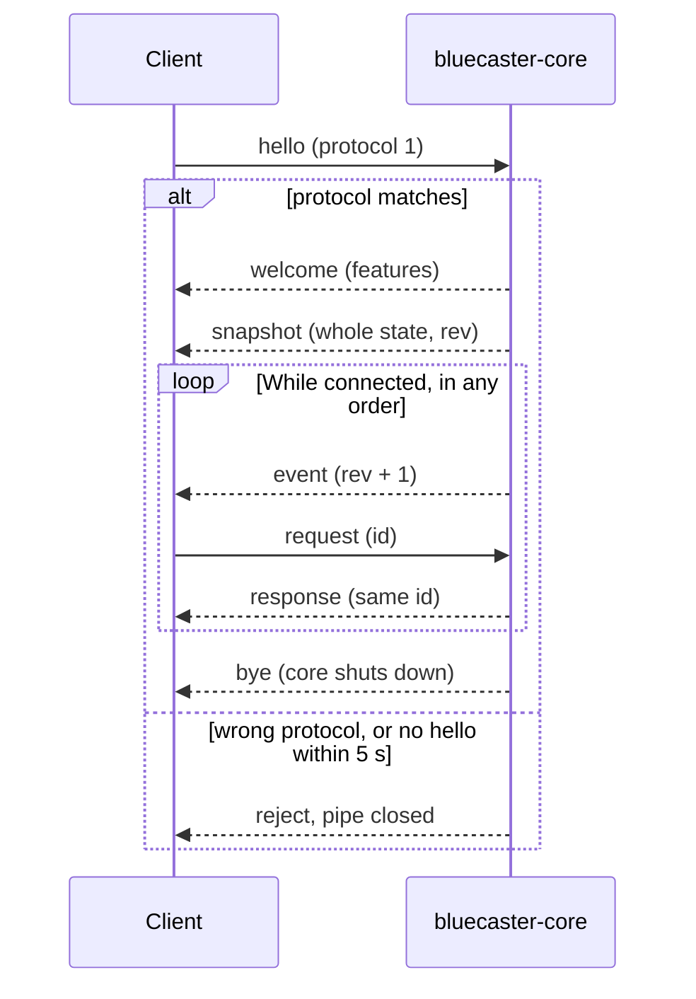

# Integration (IPC)
{: .no_toc }

How a third-party tool talks to the BlueCaster core: show the stream state, start and stop profiles, set the volume, or reach the headphones' own services over BlueCaster's Bluetooth link. Tools that do this are listed on [Works With](works-with).

{: .warning }
> The protocol may still change during the 2.0.2 betas. The source of truth is [`app/src/crates/ipc/src/protocol.rs`](https://github.com/SeiyaFunaokaJP/BlueCaster/blob/main/app/src/crates/ipc/src/protocol.rs) and the TypeScript types generated from it in [`app/src/ui/src/ipc/bindings`](https://github.com/SeiyaFunaokaJP/BlueCaster/tree/main/app/src/ui/src/ipc/bindings). This page explains how to use them; it does not list every field.

## Table of contents
{: .no_toc .text-delta }

1. TOC
{:toc}

## Connecting

The core (`bluecaster-core.exe`) runs whenever BlueCaster runs, with or without the window. It listens on a named pipe for the user it runs as:

```
\\.\pipe\bluecaster-<user SID>
```

- `<user SID>` is the logged-on user's SID string (`S-1-5-21-...`), for example from `whoami /user`. Each user has their own core and pipe; the pipe's DACL admits only that user, and remote clients are refused.
- The pipe is in byte mode. Several clients can be connected at once (the BlueCaster window is one of them); each gets the same state and events.
- Through 2.0.x the pipe was named `\\.\pipe\a2dpwb-<user SID>`. BlueCaster 3.0.0 serves **both** names, and keeps serving the old one for at least 6 months after 3.0.0. A client should try `bluecaster-<user SID>` first and fall back to the old name. The protocol version stays 1.
- To check whether the core is running, look for the pipe, not the core's mutex: if the pipe does not exist, the core is not running.
- Development builds started with `BLUECASTER_INSTANCE=<name>` listen on `\\.\pipe\bluecaster-<SID>-<name>` instead, so they can run alongside the installed version.

### The service pipe

The BlueCaster service is a developer-mode prototype that lets Bluetooth keyboards and mice work on the sign-in screen. On a PC with the service installed, the core runs as a Windows service. The per-user pipe does not exist then; instead, the core serves one pipe for all users:

```
\\.\pipe\bluecaster-service
```

- Try `bluecaster-<user SID>` first, then `bluecaster-service`. The service serves no pipe under the old name. Frames, the handshake and requests are the same on both pipes.
- Open the pipe with `GENERIC_READ | FILE_WRITE_DATA` only (add `FILE_WRITE_ATTRIBUTES` to change the pipe's mode). The pipe refuses clients that ask for `GENERIC_WRITE`, because that access includes creating another instance of the pipe (`FILE_CREATE_PIPE_INSTANCE`). Python's `open(..., "r+b")` asks for `GENERIC_WRITE`, so use `CreateFileW` instead (for example through `ctypes`).
- To check that the server really is BlueCaster, compare the pipe's server process ID (`GetNamedPipeServerProcessId`) with the process ID of the `BlueCaster` service (`QueryServiceStatusEx`). While the service is stopped, another program could create a pipe with that name.
- Requests that change the whole PC, such as developer mode, adapter drivers or adding keyboards and mice, return the error `ipc.needs_admin`. A tool cannot grant administrator approval. Ask the user to make the change in the BlueCaster window instead; the window asks Windows for approval.
- Some requests return `ipc.not_in_service` when the core runs as a service. `app.quit` is one of them, because the service must keep running for keyboards and mice. Use `app.close` instead: it stops streaming and closes the BlueCaster window and tray icon.

### Frames

Every message in both directions is one frame: the length of the JSON as a **u32 little-endian**, then the JSON (UTF-8). Frames over 4 MiB are refused.

### Handshake

1. The client sends `hello` within 5 seconds of connecting:
   ```json
   {"type": "hello", "protocol": 1, "client": "mytool/1.2.0"}
   ```
   `client` is any name and version you choose; it appears in the core's log.
2. The core answers with `welcome`, or with `reject` and closes the pipe (wrong protocol version, or no hello):
   ```json
   {"type": "welcome", "protocol": 1, "server": "bluecaster-core/2.0.2-beta.12", "features": ["rfcomm"]}
   {"type": "reject", "reason": "protocol 2 not supported (core speaks 1)"}
   ```
3. The core sends a `snapshot` with its whole state, then `event`s.

The protocol version must match exactly. Backward-compatible additions are announced in `features` instead (see [Compatibility](#compatibility)).



## State and events

```json
{"type": "snapshot", "rev": 41, "state": {"adapter": {...}, "devices": [...], "stream": {...}, "profiles": [...], "active_profile": "WH-1000XM5", "settings": {...}, ...}}
{"type": "event", "rev": 42, "event": {"kind": "stream", "value": {"state": "streaming", "profile": "WH-1000XM5", "info": {"codec": "ldac", "bitrate_kbps": 990, ...}, "volume": 80, ...}}}
```

A client needs no state of its own: it keeps the last snapshot and applies each event to it. Each state event **replaces one whole part** of the snapshot:

| Event `kind` | Replaces |
|:--|:--|
| `adapter` | `adapter` |
| `devices` | `devices` |
| `scanning`, `le_scanning` | `scanning`, `le_scanning` |
| `stream` | `stream` (state, message, profile, codec info, volume, battery) |
| `profiles` | `profiles` and `active_profile` |
| `settings` | `settings` |
| `update` | `update` |
| `capture` | `capture` |
| `v1_running`, `verbose`, `crashes` | the field of that name |

`stream.state` is one of `idle`, `connecting`, `streaming`, `reconnecting`, `error`; `stream.message` says why, as a [message key](#errors-and-messages).

`adapter.active` is the USB adapter BlueCaster is using. The field is `null` while no adapter is open: before the first scan or connection, and while Bluetooth restarts.

```json
"active": {"display_name": "RTL8761BU (0x2357:0x0604)", "windows_name": "TP-Link UB500 Adapter", "vid": 9047, "pid": 1540, "vendor": "Realtek", "chip": "RTL8761BU", "bt_version": "5.1"}
```

`vid` and `pid` are numbers. `windows_name`, `chip` and `bt_version` can be `null`. `chip` is known only for Realtek adapters.

Every client receives the state events without subscribing to them. An event is sent only when something changes, so a connection can stay quiet for a long time.

**Revisions.** Every state event carries the next revision (`rev` + 1). A gap means an event was lost: send `state.snapshot` for a new one. If a client reads too slowly, the core also sends it a new `snapshot` unprompted. Non-state events (`link`, `log`, `receiver`, `rfcomm_data`, `rfcomm_closed`, `media_button`) carry the current revision and do not advance it.

When the core shuts down it sends the event `bye` and closes the pipe.

## Requests

```json
{"type": "request", "id": 7, "method": "stream.start", "params": {"profile": "WH-1000XM5"}}
{"type": "response", "id": 7, "result": null, "error": null}
```

- `id` is any number the client chooses; the response carries it back. Requests run concurrently, so responses may arrive in a different order.
- `params` is left out for methods without parameters.
- A request that changes state is answered once the change is done, and the change also arrives as an event. Clients should show the state from the events, not from the response.

### Errors and messages

```json
{"type": "response", "id": 8, "result": null, "error": {"code": "rfcomm.not_connected", "message": {"key": "ipc.error.rfcomm_not_connected", "args": []}}}
```

`code` is meant for programs (`adapter.driver_missing`, `app.streaming`, ...). `message` is a translation key from BlueCaster's language files ([`app/lang`](https://github.com/SeiyaFunaokaJP/BlueCaster/tree/main/app/lang)) with printf-style arguments, like the status texts in the state; a tool can look up the key there or show its own text for the code.

### Methods

Methods for tools:

| Method | Params | Result |
|:--|:--|:--|
| `state.snapshot` | -- | `Snapshot` |
| `stream.start` | `profile` | `null`; stops any running stream first |
| `stream.stop` | -- | `null` |
| `stream.set_volume` | `volume` (AVRCP absolute volume 0-127) | `null` |
| `stream.volume_step` | `delta` (-127 to 127) | the new volume; see [Quick controls](#quick-controls) |
| `profile.set_active` | `name` | `null` |
| `profile.set_headset_mic` | `name` (optional), `mode` (`off`, `auto`, `on`) | `null`; see [Quick controls](#quick-controls) |
| `profile.set_mic_muted` | `name` (optional), `muted` (bool) | `null`; see [Quick controls](#quick-controls) |
| `profile.set_media_eq` | `name` (optional), `enabled` (bool) | `null`; see [Quick controls](#quick-controls) |
| `device.scan` | `seconds` (3-600) | `Device[]`, also as the `devices` event |
| `device.scan_stop` | -- | `null`; the running `device.scan` then returns |
| `audio.devices` | -- | `AudioDevice[]` (capture sources) |
| `diag.subscribe` | `logs` (level or `null`), `link` (bool), `receiver` (bool, optional) | `null`; starts or stops `log` / `link` / `receiver` events for this connection |
| `diag.info` | `{"mask": bool}` (optional) | `DiagInfo` (the "copy diagnostic info" text) |
| `rfcomm.open`, `rfcomm.send`, `rfcomm.close` | see [RFCOMM passthrough](#rfcomm-passthrough) | |

Send both `logs` and `link` with every `diag.subscribe`. Each call sets both, so leaving out `logs` turns log events off.

To change a single setting, use the [quick controls](#quick-controls) instead of `profile.save` or `settings.set`.

Methods the BlueCaster window uses that a tool should use only with care: `profile.save` / `profile.delete`, `settings.set` (replaces **all** settings: send the latest `settings` with your change, never a partial object), `device.forget` / `device.rename`, `adapter.*` (`adapter.assign_winusb` and `adapter.restore_driver` show a UAC prompt; `adapter.probe` and `adapter.run_script`, developer mode's chip tools, stop the Bluetooth stack), `app.quit`. The others serve the window's own screens and may change without notice: `stream.start_custom`, the other `device.*` methods (`device.import_windows_pairings` shows a UAC prompt), `audio.apps`, `audio.mixer` / `audio.mixer_set`, `diag.*` beyond the two above, `receiver.*` and `app.*`. The full list with parameters and results is the `Method` enum in `protocol.rs`.

## RFCOMM passthrough

Available when `welcome.features` contains `"rfcomm"` (2.0.2-beta.10 and later). It lets a tool reach the headphones' own RFCOMM services (vendor control apps: battery, noise control, EQ) over BlueCaster's existing link; Windows itself does not see headphones connected through BlueCaster.

- `rfcomm.open {address, uuid}` → `{channel_id, mtu}`. `address` must be the device being streamed to; the core never connects or pairs for this (`rfcomm.not_connected`). `uuid` is a full 128-bit UUID or a 16-bit `"xxxx"` on the Bluetooth base UUID. The answer comes within 20 s, even when queued behind other opens, so wait at least 25 s. Errors: `rfcomm.not_connected`, `rfcomm.service_not_found`, `rfcomm.service_reserved`, `rfcomm.open_failed`, `rfcomm.busy`.
- The headset and hands-free services (`1108`, `1112`, `111E`, `111F`) are refused with `rfcomm.service_reserved`, in either UUID form. BlueCaster uses them for the headset microphone.
- The passthrough needs a Classic (A2DP) connection. For a device connected over LE Audio, `rfcomm.open` always returns `rfcomm.not_connected`.
- `rfcomm.send {channel_id, data}` → `null`. `data` is base64 (standard, padded), at most 64 KiB per request, sent in frames of at most `mtu` in request order. Errors: `rfcomm.no_channel`, `rfcomm.busy` (queue full, not sent), `rfcomm.timeout` (unknown whether sent: do not repeat, reopen the channel).
- Send large amounts of data slowly, for example during a firmware update. The channel shares the radio link with the audio, and fast bulk writes can cause dropouts.
- Received data arrives as `rfcomm_data` events `{channel_id, data}`, only on the connection that opened the channel.
- `rfcomm.close {channel_id}` → `null`, once the data sent before it has gone out; no `rfcomm_closed` follows.
- A channel also closes when the pipe connection ends, or with an `rfcomm_closed` event `{channel_id, reason}`: `remote` (the device closed it or the link went down), `disconnected` (the A2DP connection ended), `stopped` (the Bluetooth stack stopped), `overflow` (the client left more than 1 MiB of received data unread).

## Headphone buttons

Available when `welcome.features` contains `"media_button"`. Every client receives a `media_button` event when a button on the headphones is pressed or released. No subscription is needed.

```json
{"type": "event", "rev": 42, "event": {"kind": "media_button", "value": {"button": "play", "pressed": true, "le_audio": false}}}
```

- `button` is one of `play`, `pause`, `stop`, `next`, `previous`, `fast_forward`, `rewind`, `volume_up`, `volume_down`, `mute`. Other buttons are not reported.
- `pressed` is `true` when the button is pressed and `false` when it is released. LE Audio headphones report only the press.
- `le_audio` is `true` when the event came from LE Audio headphones.
- Headphones send `play` or `pause` depending on whether they think audio is playing. That guess can be out of date. To toggle playback, treat both the same.
- BlueCaster still passes play/pause, next, previous and stop to Windows as media keys. If your tool handles the buttons itself, ask the user to turn off **Audio Devices > Control playback with the audio device's buttons**. The events still arrive when that setting is off.

## Quick controls

Available when `welcome.features` contains `"tool_controls"`. Each method changes one setting, so a tool never has to send a whole profile.

**Experimental until BlueCaster 3.1.** The method names and parameters may still change based on feedback. An incompatible change replaces `"tool_controls"` with a new feature name, so a tool can tell which version the core supports.

- `name` is the name of a saved profile. Leave it out to use the profile that is streaming, or the active profile when nothing is streaming. An unknown name returns `profile.not_found`.
- The change is saved to the profile and applied to the stream, just like a change made in the BlueCaster window. Every client receives a `profiles` event.
- Sending the current value changes nothing.
- `profile.set_headset_mic` works like the microphone mode buttons in the window. `off` mutes the microphone but keeps the current mode. `auto` and `on` switch to that mode and unmute the microphone. Without developer mode, `on` returns `developer.off`.
- `profile.set_mic_muted` mutes or unmutes the headset microphone without changing the mode.
- Both microphone methods return `profile.no_mic_output` until the headset microphone is set up for the device. While the device is connecting, they return `stream.busy`.
- `profile.set_media_eq` turns the playback EQ on or off without reconnecting the stream. The EQ points are kept.
- `stream.volume_step` changes the headphone volume by `delta` and returns the new volume (0-127). The step starts from the volume the headphones last reported. If nothing is streaming, or the headphones have not reported a volume yet, the method returns `stream.volume_unknown`. A `delta` outside -127 to 127 returns `stream.bad_volume_step`.

## Compatibility

- **Features.** Check `welcome.features` before using an addition. Cores before 2.0.2-beta.10 leave the field out.
- **Unknown requests.** A request the core cannot read (an unknown method, bad parameters) is answered with the error `ipc.bad_request`; the connection stays open. Cores before 2.0.2-beta.10 close the connection instead. Any other unreadable frame closes it.
- **New fields.** The core adds fields to the state and to events over time. Ignore unknown fields; do not reject a message because of them. New event kinds are added the same way: skip an event whose `kind` you do not know.
- **Rename in 3.0.0** ([#193](https://github.com/SeiyaFunaokaJP/BlueCaster/issues/193)): the pipe becomes `\\.\pipe\bluecaster-<SID>`. The core keeps listening on `\\.\pipe\a2dpwb-<SID>` as well, with the same protocol, for at least 6 months after 3.0.0; its removal is announced in the release notes first. Try `bluecaster-<SID>` first and fall back to `a2dpwb-<SID>`. The core's mutex becomes `Local\BlueCaster_Core`; it keeps holding `Local\A2DPWB_v2_Core` as well for the same period, and both removals are announced together.

## Example

A minimal Python client (standard library only) that prints the stream state and follows its changes:

```python
import json, struct, subprocess

sid = subprocess.run(["whoami", "/user", "/fo", "csv", "/nh"],
                     capture_output=True, text=True).stdout.strip().split(",")[1].strip('"')
pipe = open(rf"\\.\pipe\bluecaster-{sid}", "r+b", buffering=0)

def send(msg):
    b = json.dumps(msg).encode()
    pipe.write(struct.pack("<I", len(b)) + b)

def read_exact(n):
    buf = b""
    while len(buf) < n:
        chunk = pipe.read(n - len(buf))
        if not chunk:
            raise EOFError
        buf += chunk
    return buf

def recv():
    (n,) = struct.unpack("<I", read_exact(4))
    return json.loads(read_exact(n))

send({"type": "hello", "protocol": 1, "client": "example/0.1"})
welcome = recv()
assert welcome["type"] == "welcome", welcome
snap = recv()
print("stream:", snap["state"]["stream"]["state"])
while True:
    m = recv()
    if m["type"] == "event" and m["event"]["kind"] == "stream":
        s = m["event"]["value"]
        print("stream:", s["state"], (s.get("info") or {}).get("codec"))
    elif m["type"] == "event" and m["event"]["kind"] == "bye":
        break
```

To try a tool without touching the installed BlueCaster, run a development build with `BLUECASTER_INSTANCE` and `BLUECASTER_CONFIG_DIR` set (see [Building](building)) and connect to its pipe.
