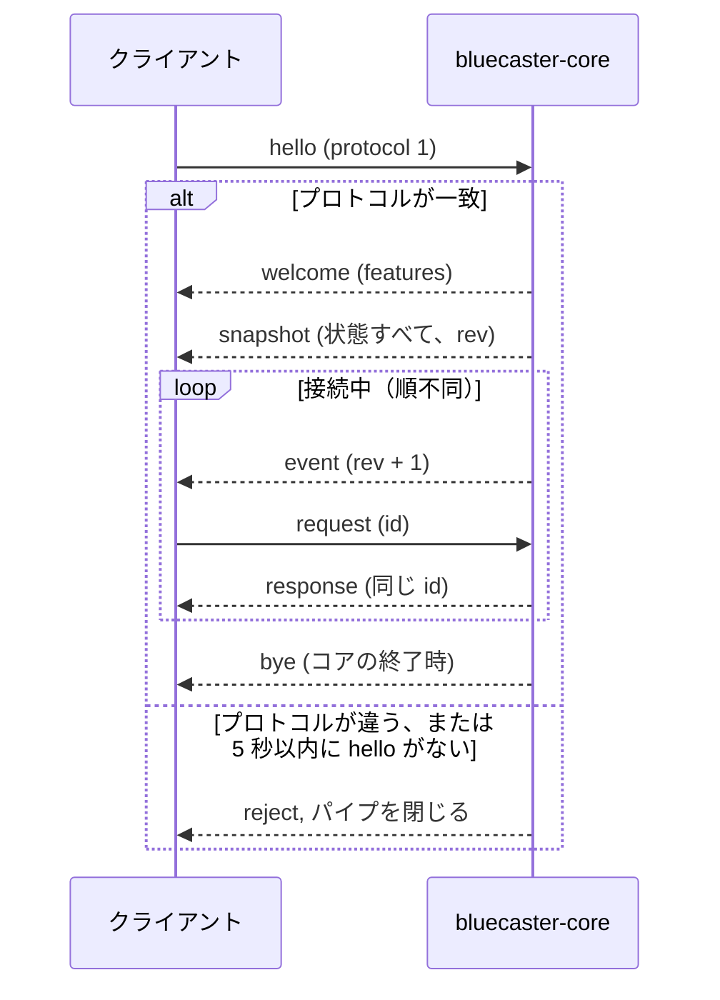

# 連携（IPC）
{: .no_toc }

サードパーティのツールが BlueCaster のコアと通信する方法を説明します。ツールは、ストリームの状態の表示、プロファイルの開始と停止、音量の設定を行えるほか、BlueCaster の Bluetooth リンクを通してヘッドホン自身のサービスも利用できます。こうしたツールは[連携するツール](works-with)に載せています。

{: .warning }
> 2.0.2 のベータ期間中は、プロトコルが変わる可能性があります。仕様の正となるのは [`app/src/crates/ipc/src/protocol.rs`](https://github.com/SeiyaFunaokaJP/BlueCaster/blob/main/app/src/crates/ipc/src/protocol.rs) と、そこから生成した [`app/src/ui/src/ipc/bindings`](https://github.com/SeiyaFunaokaJP/BlueCaster/tree/main/app/src/ui/src/ipc/bindings) の TypeScript の型です。このページではその使い方を説明しており、すべてのフィールドは挙げていません。

## 目次
{: .no_toc .text-delta }

1. TOC
{:toc}

## 接続 {#connecting}

コア（`bluecaster-core.exe`）は、ウィンドウを開いているかどうかにかかわらず、BlueCaster の実行中は常に動いています。コアは、実行しているユーザー用の名前付きパイプで待ち受けます。

```
\\.\pipe\bluecaster-<user SID>
```

- `<user SID>` はログオンしているユーザーの SID 文字列（`S-1-5-21-...`）で、`whoami /user` などで確認できます。コアとパイプはユーザーごとにあります。パイプの DACL はそのユーザーだけを許可し、リモートのクライアントは拒否します。
- パイプはバイトモードです。複数のクライアントが同時に接続でき（BlueCaster のウィンドウもその 1 つです）、どのクライアントも同じ状態とイベントを受け取ります。
- 2.0.x までは、パイプの名前は `\\.\pipe\a2dpwb-<user SID>` でした。BlueCaster 3.0.0 は **両方** の名前で待ち受け、古い名前でも 3.0.0 のリリース後少なくとも 6 か月は待ち受けます。クライアントはまず `bluecaster-<user SID>` を試し、見つからなければ古い名前を使ってください。プロトコルのバージョンは 1 のままです。
- コアが動いているかどうかは、コアの mutex ではなくパイプで確認してください。パイプがなければ、コアは動いていません。
- `BLUECASTER_INSTANCE=<name>` を付けて起動した開発ビルドは、代わりに `\\.\pipe\bluecaster-<SID>-<name>` で待ち受けます。そのため、インストール済みの BlueCaster と同時に動かせます。

### サービスのパイプ {#the-service-pipe}

BlueCaster サービスは、サインイン画面で Bluetooth のキーボードとマウスを使えるようにする、開発者モードの試作機能です。サービスをインストールした PC では、コアは Windows サービスとして動きます。この場合、ユーザーごとのパイプはありません。代わりに、コアはすべてのユーザーに共通のパイプを 1 つ提供します。

```
\\.\pipe\bluecaster-service
```

- まず `bluecaster-<user SID>` を試し、見つからなければ `bluecaster-service` を試してください。サービスは古い名前のパイプを提供しません。フレーム、ハンドシェイク、リクエストは、どちらのパイプでも同じです。
- パイプは `GENERIC_READ | FILE_WRITE_DATA` だけで開いてください。パイプのモードを変える場合は、`FILE_WRITE_ATTRIBUTES` を加えます。`GENERIC_WRITE` を要求するクライアントは拒否されます。`GENERIC_WRITE` には、パイプの別のインスタンスを作成する権限（`FILE_CREATE_PIPE_INSTANCE`）が含まれるためです。Python の `open(..., "r+b")` は `GENERIC_WRITE` を要求するので、代わりに `CreateFileW` を使ってください（`ctypes` 経由など）。
- 接続先が本当に BlueCaster かどうかは、パイプのサーバープロセス ID（`GetNamedPipeServerProcessId`）と `BlueCaster` サービスのプロセス ID（`QueryServiceStatusEx`）を比べて確認してください。サービスが停止している間は、別のプログラムが同じ名前のパイプを作成できます。
- 開発者モード、アダプターのドライバー、キーボードとマウスの追加など、PC 全体に関わる変更のリクエストは、エラー `ipc.needs_admin` を返します。ツールから管理者の承認を与えることはできません。BlueCaster のウィンドウで変更するよう、ユーザーに依頼してください。BlueCaster のウィンドウが Windows に承認を求めます。
- コアがサービスとして動いている場合、一部のリクエストは `ipc.not_in_service` を返します。`app.quit` もその 1 つです。キーボードとマウスを使えるように、サービスは動き続ける必要があるためです。代わりに `app.close` を使ってください。`app.close` はストリーミングを止め、BlueCaster のウィンドウとトレイのアイコンを閉じます。

### フレーム {#frames}

メッセージは、どちらの方向も 1 つのフレームで送ります。フレームは、JSON の長さ（**u32 リトルエンディアン**）に続けて JSON（UTF-8）を置いたものです。4 MiB を超えるフレームは拒否されます。

### ハンドシェイク {#handshake}

1. クライアントは、接続してから 5 秒以内に `hello` を送ります。
   ```json
   {"type": "hello", "protocol": 1, "client": "mytool/1.2.0"}
   ```
   `client` には任意の名前とバージョンを指定します。この値はコアのログに記録されます。
2. コアは `welcome` で応答します。プロトコルのバージョンが違う場合や hello がない場合は、`reject` で応答してパイプを閉じます。
   ```json
   {"type": "welcome", "protocol": 1, "server": "bluecaster-core/2.0.2-beta.12", "features": ["rfcomm"]}
   {"type": "reject", "reason": "protocol 2 not supported (core speaks 1)"}
   ```
3. コアは状態全体を含む `snapshot` を送り、その後は `event` を送ります。

プロトコルのバージョンは完全に一致する必要があります。互換性を保った機能の追加は、バージョンではなく `features` で通知します（[互換性](#compatibility)を参照）。



## 状態とイベント {#state-and-events}

```json
{"type": "snapshot", "rev": 41, "state": {"adapter": {...}, "devices": [...], "stream": {...}, "profiles": [...], "active_profile": "WH-1000XM5", "settings": {...}, ...}}
{"type": "event", "rev": 42, "event": {"kind": "stream", "value": {"state": "streaming", "profile": "WH-1000XM5", "info": {"codec": "ldac", "bitrate_kbps": 990, ...}, "volume": 80, ...}}}
```

クライアントが独自に状態を管理する必要はありません。最後に受け取ったスナップショットを保持し、イベントのたびにそれに反映します。状態のイベントは、それぞれスナップショットの **ある部分を丸ごと置き換えます**。

| イベントの `kind` | 置き換えるもの |
|:--|:--|
| `adapter` | `adapter` |
| `devices` | `devices` |
| `scanning`、`le_scanning` | `scanning`、`le_scanning` |
| `stream` | `stream`（状態、メッセージ、プロファイル、コーデックの情報、音量、バッテリー） |
| `profiles` | `profiles` と `active_profile` |
| `settings` | `settings` |
| `update` | `update` |
| `capture` | `capture` |
| `v1_running`、`verbose`、`crashes` | 同じ名前のフィールド |

`stream.state` は `idle`、`connecting`、`streaming`、`reconnecting`、`error` のいずれかです。その理由は、`stream.message` が[メッセージキー](#errors-and-messages)で示します。

`adapter.active` は、BlueCaster が使用中の USB アダプターです。アダプターを開いていないとき（最初のスキャンや接続の前、Bluetooth の再起動中）は `null` になります。

```json
"active": {"display_name": "RTL8761BU (0x2357:0x0604)", "windows_name": "TP-Link UB500 Adapter", "vid": 9047, "pid": 1540, "vendor": "Realtek", "chip": "RTL8761BU", "bt_version": "5.1"}
```

`vid` と `pid` は数値です。`windows_name`、`chip`、`bt_version` は `null` になることがあります。`chip` がわかるのは Realtek のアダプターだけです。

状態のイベントは、購読しなくてもすべてのクライアントに届きます。イベントは何かが変わったときにだけ届くので、長い間何も届かないこともあります。

**リビジョン。** 状態のイベントは、どれも次のリビジョン（`rev` + 1）を持ちます。番号が飛んだ場合はイベントを取りこぼしているので、`state.snapshot` を送って新しいスナップショットを取得してください。クライアントの読み取りが遅すぎる場合も、コアは要求を待たずに新しい `snapshot` を送ります。状態以外のイベント（`link`、`log`、`receiver`、`rfcomm_data`、`rfcomm_closed`、`media_button`）は現在のリビジョンを持ち、リビジョンを進めません。

コアは終了時にイベント `bye` を送り、パイプを閉じます。

## リクエスト {#requests}

```json
{"type": "request", "id": 7, "method": "stream.start", "params": {"profile": "WH-1000XM5"}}
{"type": "response", "id": 7, "result": null, "error": null}
```

- `id` はクライアントが決める任意の数値で、レスポンスにも同じ値が入ります。リクエストは並行して処理されるので、レスポンスがリクエストと違う順番で届くことがあります。
- パラメーターのないメソッドでは `params` を省きます。
- 状態を変えるリクエストには、変更が完了してから応答します。その変更はイベントでも届きます。クライアントは、レスポンスではなくイベントをもとに状態を表示してください。

### エラーとメッセージ {#errors-and-messages}

```json
{"type": "response", "id": 8, "result": null, "error": {"code": "rfcomm.not_connected", "message": {"key": "ipc.error.rfcomm_not_connected", "args": []}}}
```

`code` はプログラム向けの値です（`adapter.driver_missing`、`app.streaming`、...）。`message` は BlueCaster の言語ファイル（[`app/lang`](https://github.com/SeiyaFunaokaJP/BlueCaster/tree/main/app/lang)）の翻訳キーと printf 形式の引数で、状態に含まれるステータスのテキストも同じ形式です。ツールは、言語ファイルでキーを引いても、コードに応じて独自のテキストを表示しても構いません。

### メソッド {#methods}

ツール向けのメソッド:

| メソッド | パラメーター | 結果 |
|:--|:--|:--|
| `state.snapshot` | -- | `Snapshot` |
| `stream.start` | `profile` | `null`。実行中のストリームがあれば先に止める |
| `stream.stop` | -- | `null` |
| `stream.set_volume` | `volume`（AVRCP の絶対音量 0-127） | `null` |
| `stream.volume_step` | `delta`（-127～127） | 新しい音量。[簡易操作](#quick-controls)を参照 |
| `profile.set_active` | `name` | `null` |
| `profile.set_headset_mic` | `name`（省略可）、`mode`（`off`、`auto`、`on`） | `null`。[簡易操作](#quick-controls)を参照 |
| `profile.set_mic_muted` | `name`（省略可）、`muted`（bool） | `null`。[簡易操作](#quick-controls)を参照 |
| `profile.set_media_eq` | `name`（省略可）、`enabled`（bool） | `null`。[簡易操作](#quick-controls)を参照 |
| `device.scan` | `seconds`（3-600） | `Device[]`。`devices` イベントとしても届く |
| `device.scan_stop` | -- | `null`。実行中の `device.scan` が応答を返す |
| `audio.devices` | -- | `AudioDevice[]`（キャプチャのソース） |
| `diag.subscribe` | `logs`（レベルまたは `null`）、`link`（bool）、`receiver`（bool、省略可） | `null`。この接続への `log` / `link` / `receiver` イベントの送信を開始または停止する |
| `diag.info` | `{"mask": bool}`（省略可） | `DiagInfo`（「診断情報をコピー」のテキスト） |
| `rfcomm.open`、`rfcomm.send`、`rfcomm.close` | [RFCOMM パススルー](#rfcomm-passthrough)を参照 | |

`diag.subscribe` では毎回 `logs` と `link` の両方を送ってください。呼び出すたびに両方が設定されるため、`logs` を省くとログのイベントはオフになります。

設定を 1 つだけ変えるときは、`profile.save` や `settings.set` ではなく[簡易操作](#quick-controls)を使ってください。

BlueCaster のウィンドウが使うメソッドのうち、ツールでは注意して使うべきもの: `profile.save` / `profile.delete`、`settings.set`（設定を **すべて** 置き換えます。最新の `settings` に変更を加えて送ってください。一部だけのオブジェクトは決して送らないでください）、`device.forget` / `device.rename`、`adapter.*`（`adapter.assign_winusb` と `adapter.restore_driver` は UAC の確認を出します。開発者モードのチップのツールである `adapter.probe` と `adapter.run_script` は Bluetooth スタックを止めます）、`app.quit`。それ以外のメソッドはウィンドウ自身の画面のためのもので、予告なく変わることがあります: `stream.start_custom`、ほかの `device.*`（`device.import_windows_pairings` は UAC の確認を出します）、`audio.apps`、`audio.mixer` / `audio.mixer_set`、上の 2 つ以外の `diag.*`、`receiver.*`、`app.*`。パラメーターと結果を含む全一覧は、`protocol.rs` の `Method` 列挙型にあります。

## RFCOMM パススルー {#rfcomm-passthrough}

`welcome.features` に `"rfcomm"` があるとき（2.0.2-beta.10 以降）に使えます。BlueCaster 経由で接続したヘッドホンは Windows からは見えません。RFCOMM パススルーを使うと、ツールは BlueCaster の既存のリンクを通して、ヘッドホン自身の RFCOMM サービス（メーカーの操作アプリ: バッテリー、ノイズコントロール、EQ）を利用できます。

- `rfcomm.open {address, uuid}` → `{channel_id, mtu}`。`address` は配信中のデバイスである必要があります。コアがこのために接続やペアリングを行うことはありません（`rfcomm.not_connected`）。`uuid` は 128 ビットの完全な UUID か、Bluetooth のベース UUID 上の 16 ビットの `"xxxx"` です。ほかの open の処理を待つ場合も応答は 20 秒以内に返るので、少なくとも 25 秒は待ってください。エラー: `rfcomm.not_connected`、`rfcomm.service_not_found`、`rfcomm.service_reserved`、`rfcomm.open_failed`、`rfcomm.busy`。
- ヘッドセットとハンズフリーのサービス（`1108`、`1112`、`111E`、`111F`）は、どちらの UUID の形式で指定しても `rfcomm.service_reserved` で拒否されます。BlueCaster がヘッドセットマイクに使うためです。
- RFCOMM パススルーには Classic（A2DP）の接続が必要です。LE Audio で接続したデバイスでは、`rfcomm.open` は常に `rfcomm.not_connected` を返します。
- `rfcomm.send {channel_id, data}` → `null`。`data` は base64（標準、パディングあり）で、1 リクエストあたり最大 64 KiB です。データはリクエストの順に、最大 `mtu` のフレームで送られます。エラー: `rfcomm.no_channel`、`rfcomm.busy`（キューがいっぱいで、送信されていない）、`rfcomm.timeout`（送信されたかどうか不明。再送せず、チャネルを開き直してください）。
- ファームウェアの更新など、大量のデータはゆっくり送ってください。チャネルは音声と同じ無線リンクを使うため、大量のデータを速く送ると音が途切れることがあります。
- 受信したデータは、`rfcomm_data` イベント `{channel_id, data}` として、そのチャネルを開いた接続にだけ届きます。
- `rfcomm.close {channel_id}` → `null`。それまでに送ったデータの送信が終わってから閉じます。`rfcomm_closed` は届きません。
- チャネルは、パイプの接続が終わったときにも閉じます。また、`rfcomm_closed` イベント `{channel_id, reason}` とともに閉じることもあります。理由は `remote`（デバイスが閉じた、またはリンクが切れた）、`disconnected`（A2DP の接続が終わった）、`stopped`（Bluetooth スタックが停止した）、`overflow`（クライアントが 1 MiB を超える受信データを読まずに残した）のいずれかです。

## ヘッドホンのボタン {#headphone-buttons}

`welcome.features` に `"media_button"` があるときに使えます。ヘッドホンのボタンが押されたときと離されたときに、すべてのクライアントに `media_button` イベントが届きます。購読は不要です。

```json
{"type": "event", "rev": 42, "event": {"kind": "media_button", "value": {"button": "play", "pressed": true, "le_audio": false}}}
```

- `button` は `play`、`pause`、`stop`、`next`、`previous`、`fast_forward`、`rewind`、`volume_up`、`volume_down`、`mute` のいずれかです。それ以外のボタンは通知されません。
- `pressed` は、ボタンが押されたときは `true`、離されたときは `false` です。LE Audio のヘッドホンは、押したときだけ通知します。
- `le_audio` は、LE Audio のヘッドホンから届いたイベントでは `true` です。
- ヘッドホンは、再生中かどうかを自分で判断して `play` か `pause` を送ります。この判断は最新でないことがあります。再生と一時停止を切り替えるだけなら、両方を同じように扱ってください。
- BlueCaster は、再生/一時停止、次へ、前へ、停止をこれまでどおりメディアキーとして Windows に渡します。ツールがボタンを自分で処理する場合は、**オーディオデバイス > オーディオデバイスのボタンで再生を操作** をオフにするようユーザーに案内してください。この設定がオフでもイベントは届きます。

## 簡易操作 {#quick-controls}

`welcome.features` に `"tool_controls"` があるときに使えます。どのメソッドも設定を 1 つだけ変えるので、ツールがプロファイル全体を送る必要はありません。

**BlueCaster 3.1 までは試験的な機能です。** フィードバックに応じて、メソッド名やパラメーターが変わることがあります。互換性のない変更では、`"tool_controls"` を新しい機能名に置き換えます。これにより、ツールはコアが対応しているバージョンを判別できます。

- `name` は保存済みのプロファイルの名前です。省略すると、ストリーミング中のプロファイルが対象になります。何もストリーミングしていなければ、アクティブなプロファイルが対象です。存在しない名前を指定すると `profile.not_found` が返ります。
- 変更はプロファイルに保存され、BlueCaster のウィンドウで変えたときと同じようにストリームに反映されます。すべてのクライアントに `profiles` イベントが届きます。
- 今と同じ値を送っても何も変わりません。
- `profile.set_headset_mic` は、ウィンドウにあるマイクのモードボタンと同じように動きます。`off` はモードをそのままにしてマイクをミュートします。`auto` と `on` はそのモードに切り替えてミュートを解除します。開発者モードがオフのとき、`on` には `developer.off` が返ります。
- `profile.set_mic_muted` は、モードを変えずにヘッドセットマイクをミュートまたはミュート解除します。
- マイクの 2 つのメソッドは、そのデバイスのヘッドセットマイクが設定されるまで `profile.no_mic_output` を返します。デバイスの接続中は `stream.busy` を返します。
- `profile.set_media_eq` は、ストリームを再接続せずに再生用のイコライザーをオンまたはオフにします。イコライザーのポイントはそのまま残ります。
- `stream.volume_step` はヘッドホンの音量を `delta` だけ変え、新しい音量（0-127）を返します。基準は、ヘッドホンが最後に通知した音量です。何もストリーミングしていないとき、またはヘッドホンがまだ音量を通知していないときは `stream.volume_unknown` が返ります。`delta` が -127～127 の範囲外なら `stream.bad_volume_step` が返ります。

## 互換性 {#compatibility}

- **機能。** 追加された機能を使う前に、`welcome.features` を確認してください。2.0.2-beta.10 より前のコアには、このフィールドがありません。
- **不明なリクエスト。** コアが解釈できないリクエスト（不明なメソッド、不正なパラメーター）には、エラー `ipc.bad_request` で応答し、接続は開いたままにします。2.0.2-beta.10 より前のコアは、代わりに接続を閉じます。それ以外の解釈できないフレームを受け取った場合は、接続を閉じます。
- **新しいフィールド。** コアは、状態やイベントに今後もフィールドを追加します。不明なフィールドは無視し、それを理由にメッセージを拒否しないでください。イベントの種類も今後追加されます。知らない `kind` のイベントは読み飛ばしてください。
- **3.0.0 での名前の変更**（[#193](https://github.com/SeiyaFunaokaJP/BlueCaster/issues/193)）: パイプは `\\.\pipe\bluecaster-<SID>` になります。コアは 3.0.0 のリリース後も少なくとも 6 か月は、同じプロトコルで `\\.\pipe\a2dpwb-<SID>` でも待ち受けます。廃止する際は、事前にリリースノートで告知します。まず `bluecaster-<SID>` を試し、見つからなければ `a2dpwb-<SID>` を使ってください。コアの mutex は `Local\BlueCaster_Core` になりますが、同じ期間は `Local\A2DPWB_v2_Core` も保持します。両方の廃止は同時に告知します。

## 例 {#example}

ストリームの状態を表示し、その変化を追跡する最小限の Python クライアント（標準ライブラリのみ）:

```python
import json, struct, subprocess

sid = subprocess.run(["whoami", "/user", "/fo", "csv", "/nh"],
                     capture_output=True, text=True).stdout.strip().split(",")[1].strip('"')
pipe = open(rf"\\.\pipe\bluecaster-{sid}", "r+b", buffering=0)

def send(msg):
    b = json.dumps(msg).encode()
    pipe.write(struct.pack("<I", len(b)) + b)

def read_exact(n):
    buf = b""
    while len(buf) < n:
        chunk = pipe.read(n - len(buf))
        if not chunk:
            raise EOFError
        buf += chunk
    return buf

def recv():
    (n,) = struct.unpack("<I", read_exact(4))
    return json.loads(read_exact(n))

send({"type": "hello", "protocol": 1, "client": "example/0.1"})
welcome = recv()
assert welcome["type"] == "welcome", welcome
snap = recv()
print("stream:", snap["state"]["stream"]["state"])
while True:
    m = recv()
    if m["type"] == "event" and m["event"]["kind"] == "stream":
        s = m["event"]["value"]
        print("stream:", s["state"], (s.get("info") or {}).get("codec"))
    elif m["type"] == "event" and m["event"]["kind"] == "bye":
        break
```

インストール済みの BlueCaster に影響を与えずにツールを試すには、`BLUECASTER_INSTANCE` と `BLUECASTER_CONFIG_DIR` を設定して開発ビルドを実行し（[ビルド](building)を参照）、そのパイプに接続してください。
