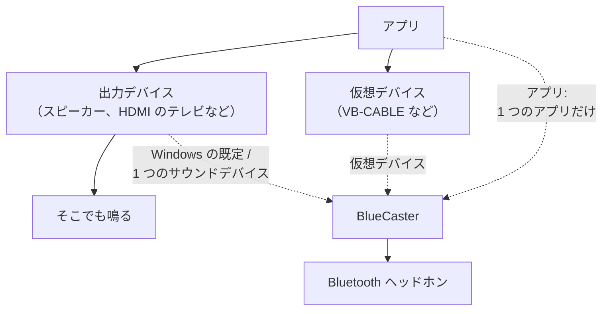
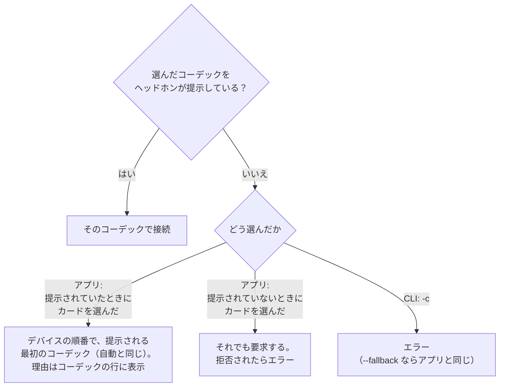

# 使い方
{: .no_toc }

## 目次
{: .no_toc .text-delta }

1. TOC
{:toc}

---

## ウィンドウ

スタートメニューから **BlueCaster** を起動します（または `bluecaster.exe` を実行します）。左のメニューには、以下で説明する画面が並びます: ホーム、コーデック、オーディオデバイス、アダプター、診断、設定、このソフトについて。開発者モードでは開発者が加わり、そこで音量ミキサーをオンにすると音量ミキサーも加わります。ウィンドウの幅が狭いと、メニューはアイコンだけになります。ウィンドウはバックグラウンドで動き続ける `bluecaster-core.exe` を表示しているだけなので、閉じても配信は止まりません（[トレイとフライアウト](#tray)を参照）。

### ホーム

- 保存したオーディオデバイスごとのカードが横に並び、状態とバッテリー残量を表示します。接続中のデバイスのカードには、使用中のコーデック（リスト形式。下記を参照）とビットレートも表示されます。選んだものとは別のコーデックを使っているときは、コーデックの行に数秒間その理由が表示されます（例: **aptX Adaptive（Opus 非対応）**。*使用中* の場合もあります）。その後は警告マークだけが残り（マウスを重ねると理由が表示されます）、状態の行には **接続済み** とだけ表示されます
- 各カードの下に **接続** / **切断** があります。同時に接続できるデバイスは 1 台だけです。別のデバイスの **接続** を押すと、今のデバイスを切断して新しいデバイスに接続します
- **音量**: ヘッドホンの音量です（[音量](#volume)を参照）。スピーカーのアイコンをクリックするとミュートし（無音を送ります）、もう一度クリックするとミュートを解除します。ほかのデバイスのカードでは、スライダーは無効の状態で表示されます
- 接続中のデバイスのカードにあるコーデックのリストで、コーデックをすばやく切り替えられます（ゲーム用と音楽用など）。リストには、[コーデック](#codecs)画面と同じく、デバイスが対応するコーデックが名前だけで並びます。自動選択の間も、使用中のコーデックが表示されます。コーデックを選ぶと自動選択はオフになります（オンに戻すにはコーデック画面を使います）。選択はすぐに反映されます。デバイスは新しいコーデックで接続し直し、コーデック画面と同じく、接続し直すまで次の選択は待たされます
- 配信中は、接続中のデバイスのカードに通信品質の小さなグラフが表示されます。出力ソースは **オーディオデバイス** で選びます。出力ソースのアプリがまだ起動していないときは、カードにそう表示されます
- エラーには原因が表示され、直す方法があればそのボタンも付きます（**WinUSB ドライバーに置き換える**、**ダウンロードページを開く**、**Bluetooth を再起動**、**もう一度試す**、**コーデック**、**オーディオデバイス** など）
- カードの上には、閉じるまで次のお知らせが表示されます: Windows でほかの Bluetooth アダプターが有効なときの警告と、OPPO のイヤホンが Hi-Res をオンにしたときのお知らせ（[コーデック](#codecs)を参照）

サイドバーには、どの画面でもすべてのデバイスについて同じ情報が表示されます。トレイのフライアウトには、接続中のデバイスについて表示されます。

### コーデック {#codecs}

保存したオーディオデバイスごとにセクションがあり、見出しには点（デバイスの接続中は緑）、名前、**ペアリング済み** / **オーディオ** のタグが並びます。アドレスは **オーディオデバイス** で確認できます。その下にコーデックのカードが並び、自分で並べ替えない限り、音質の高い順です。各カードには 3 本のバー（音質・低遅延・安定性）があり、前回の接続でデバイスがそのコーデックを提示したかどうかが **対応**（緑の印）/ **非対応**（赤の印）で表示されます。**対応しているコーデックのみ表示** がオン（既定）のときは、表示されるカードはすべて対応しているので、**対応** のタグは付きません。一度も接続していないデバイス（Windows から取り込んだデバイスなど）には、どの Bluetooth オーディオデバイスにもある **SBC** のカードと、そのデバイスに選んだコーデックのカードだけが表示されます。ほかのカードは、初めて接続したあとか、このスイッチをオフにすると表示されます。Huawei と Honor のイヤホンでは、LDAC を提示するまで **LDAC** のカードが **未確認** として残ります。これらのイヤホンは、LDAC を選んだあとでないと提示しないことがあるためです。LHDC V5 で配信するとき（自分で選んだ場合も自動の場合も。ただし音質が **低音質** のときと ABR のときは除く）、LHDC V5 の最大ビットレートを提示する OPPO のイヤホンには、Hi-Res をオンにするよう一度だけ要求します。そのためにイヤホンは一度だけ接続し直し、ビットレートが上がったときはホームにそう表示されます。その後も Hi-Res はイヤホン側でオンのままです。効果のなかったイヤホンは元の設定に戻します。開発者モードでは、LHDC V5 の設定にある **Hi-Res をもう一度要求** で、デバイスが提示した内容と要求済みであることを忘れさせ、次の接続でもう一度要求できます。

- **対応するコーデックのうち最も音質の高いものを自動で選ぶ**（ページ上部にある、全デバイス共通の設定。既定でオン）: 各デバイスは、対応するコーデックのうち最も音質の高いものを LHDC V5 > LDAC > aptX Adaptive > Opus > aptX HD > aptX > aptX LL > AAC > SBC XQ > SBC の順で使います。設定は既定のもので、コーデックの設定の **自動** と同じです: 高音質、コーデックが対応していれば 24 ビット、48 kHz（デバイスに 48 kHz がなければ、提示された別のレートで、44.1 kHz を優先します。Windows 側のレートはリサンプリングします）。カードで変えられるのは順番だけで（下記のとおりドラッグします。自動ではデバイスが対応する最初のカードを使います）、使用中のコーデック（または自動で選ばれるコーデック）が強調表示されます。カードやその **...** をクリックすると、自動選択をオフにするか確認されます（**自動選択をオフにする** / **キャンセル**）。オフにすると、クリックしたカードが選ばれます（**...** の場合は設定が開きます）。自動選択をオフにすると、デバイスごとにコーデックと設定を自分で選べます。まだコーデックを選んでいないデバイスは、自動で選ばれるコーデックのままです。自動選択がオンの間も、デバイスごとに選んだコーデックは保持されます。2.0.2 より前の設定でいずれかのデバイスのコーデックを選んでいた場合は、自動選択がオフの状態で始まります
- 自動選択がオフのときは、カードをクリックするとそのデバイスのコーデックになります。選択はすぐに保存され、配信中のデバイスはそのコーデックで接続し直します。デバイスが対応していないカード（**対応しているコーデックのみ表示** がオフのときに表示されます）も選べます。その場合も BlueCaster はそのコーデックをデバイスに要求し、デバイスが拒否すると、そう伝えるエラーで接続が止まります（別のカードを選ぶか、自動選択をオンにしてください）。このときホーム、サイドバー、トレイのフライアウトとトレイアイコンのツールチップには、原因が短く表示されます（例: *LDAC 非対応*）。コーデックが原因で接続が止まったとき（デバイスが対応していない、拒否した、別のデバイスで使用中）は、いつも同じように表示されます。そのデバイスで別のカードや別の設定を選ぶか、自動選択をオンにすると、接続し直します。デバイスが提示していたときに選んだコーデックを、あとでデバイスが提示しなくなった場合（イヤホンが別のコーデックに切り替えたときなど）は、デバイスの順番で対応している最初のカードを使います。順番を変えていなければ、対応するコーデックのうち最も音質の高いものです（[指定したコーデックがない場合](#codec-fallback)を参照）
- デバイスのカードをドラッグすると、コーデックを好きな順番に並べ替えられます（手の形のカーソルはボタンを押している間だけ表示されます。自動選択がオフのときは、カード上で Alt＋矢印キーでも並べ替えられます）。順番はデバイスごとに保存されます。自動選択、まだコーデックを選んでいないデバイス、デバイスが対応していないコーデックを選んだ場合は、いずれもこの順番で最初に対応しているカードを使います。FastStream と Opus 05（**Opus (PipeWire)** のカード。開発者モードのときだけ表示され、開発者モードがオフのときは選んでいても使いません）は、どこに置いても、選んだときにだけ使います。**コーデックの順番をリセット** で既定の順番に戻ります。このボタンは、表示中のカードが既定の順番と違う間だけ表示されます（手で並べ戻しても既定の順番に戻ります）。並べ替えで使用中のコーデックが変わる場合、配信中のデバイスは接続し直します
- 配信中のデバイスで別のコーデックを選ぶと、そのコーデックで接続し直します。カード（とホームおよびトレイのフライアウトのコーデックのリスト）は、接続し直すまで次の選択を受け付けません。そのため、続けてすばやくクリックしても、設定中の接続が途中で切れることはありません。コーデックを切り替えても接続の通知は出ません（デバイスを接続したときは出ます）
- **対応しているコーデックのみ表示**（既定でオン。オフにすると、対応していないコーデックも表示します）: デバイスが提示しなかったコーデックを隠します。デバイスを初めて接続する前は、**SBC**（とそのデバイスに選んだコーデック）だけが表示されます
- カードの **...** で、そのコーデックの設定が開きます。変更はすぐに反映されます。使用中のコーデックでは、変更を保存してデバイスが接続し直します。例外は、再生中にそのまま変わる **ビットプール** と、どちらにしてもストリームの設定が同じになる場合の下のスイッチです。ほかのコーデックの変更は、そのコーデックを選んだときのために保存されます。設定はコーデックごと（aptX Adaptive と aptX Adaptive LL も別々）に保存されるので、別のコーデックに切り替えて戻しても元の設定に戻ります。表示されるのは、コーデックが対応し、かつ前回の接続でデバイスが提示した項目だけです。上部の ***デバイス* が対応しているオプションのみ表示**（既定でオン。デバイスが項目を提示したあとに表示されます）をオフにすると、デバイスが提示しなかったサンプルレート・ビット深度・音質・ビットプールなども含め、そのコーデックのすべての項目が表示されます（*(非対応)* と表示）。デバイスがこれらを拒否することがあり、その場合はそう伝えるエラーで接続が止まります。スイッチをオンに戻すと、デバイスが提示しなかった項目は自動に戻ります。コーデックごとの設定は次のとおりです（自動選択では使いません）:
  - **音質**: LDAC は **高音質** / **中音質** / **低音質**（990 / 660 / 330 kbps）、LHDC V5 は **高音質** / **中高音質** / **中音質** / **低音質**（1000 / 900 / 500 / 400 kbps。Android の 4 段階）。aptX Adaptive は **高音質** です（低遅延モードには別のカード **aptX Adaptive LL** があります: 265 kbps、48 kHz、ABR なし。[aptX Adaptive](#aptx-adaptive)を参照）。LHDC V5 の ABR がオンのときは、音質はグレー表示になります（ABR は 400 kbps 以下にとどまります）。AAC、Opus、Opus 05、SBC、SBC XQ の音質は **高音質** の 1 段階だけで、選ぶのではなく表示だけです。デバイスが受け付ける最大のビットレートを使います（ABR や VBR がある場合は、それによって変動します。SBC と SBC XQ は、ビットプールとフレーム設定で決まるビットレートを表示します）。aptX、aptX HD、aptX LL、FastStream のビットレートはコーデックで決まっています。以前のバージョンで保存した、今はそのコーデックにない音質（aptX Adaptive の標準 / モバイル、AAC の低い段階など）は、高音質として読み込みます
  - **アダプティブビットレート (ABR)**: LDAC、LHDC V5、aptX Adaptive、SBC、SBC XQ にあります（[ABR](#abr)を参照）。AAC には **VBR** があります
  - **低遅延**（LHDC V5。対応を提示したデバイスのみ）: 音がヘッドホンに早く届きます。ABR がオフのときは、接続が追いつかない間はビットレートを下げ（1000、900、500 kbps の順）、問題のない状態が 1 分続くと元に戻します。送信キューのパケットは 350 ms ではなく 100 ms で破棄されます。そのため、接続が不安定なときも遅延が長引かず、音が短く途切れるだけで済みます
  - **サンプルレート**: 自動は 48 kHz です（デバイスに 48 kHz がなければ、提示された別のレートで、44.1 kHz を優先します）。決まったレートも一緒に表示されます（例: *自動（48000 Hz）*）。自動では 96 kHz を選びません。96 kHz は遅延が増えて相性の問題も出やすいわりに、聞き分けられる差がないためです（Windows のミキサーは 48 kHz で動いています）。96 kHz を使うにはここで選びます。選べるのは、デバイスが提示したレートだけです（LHDC V5 には 88.2 kHz がありません。aptX Adaptive の 96 kHz は、提示したデバイスでだけ選べます。[aptX Adaptive](#aptx-adaptive)を参照）。提示したレートが 1 つだけのデバイスでは、自動はなく、そのレートだけが表示されます
  - **ビット深度**: LDAC と LHDC V5 は、デバイスが提示する範囲で 16 / 24 ビット（自動は 24 ビット。LHDC V5 はデバイスが 24 ビットを提示したときだけ）、aptX HD と aptX Adaptive は 24 ビット、それ以外は 16 ビットです。LDAC の 24 ビットは、Android の 32 ビットの設定と同じく、32 ビットのサンプルとしてエンコーダーに渡ります。ビット深度は LDAC の構成に含まれないため、ヘッドホンが受け取るストリームはどちらでも同じです
  - **ビットプール**（SBC、SBC XQ）: 最小と最大のビットプールを 2 つのつまみで決めるスライダーで、デバイスが提示した範囲の中で動かせます。最大は実際に使うビットプールで、最小は使う中で最も低い値です（接続時に設定する範囲の下限で、ABR が下げられる限度でもあります）。**自動** で両方を戻します。最大は音質に合わせた値に、最小はデバイスと ABR の既定の値に戻ります。下の行には、コーデックごとに決まっているチャンネルモードが表示されます（SBC はジョイントステレオ、SBC XQ はデュアルチャンネル）。SBC XQ のビットプールの上限は 44.1 kHz で 47、48 kHz で 43 です。***デバイス* が対応しているオプションのみ表示** をオフにすると、53 まで上げられます。
  - **フレーム設定**（SBC と SBC XQ。開発者モードのときだけ）: ブロック数、サブバンド数、ビット割り当て、SBC ではチャンネルモードも設定できます。自動では 16 ブロック、8 サブバンド、Loudness、Joint stereo のままです。デバイスが受け付けない値は、接続時に自動に戻ります。ユーザーが試した Sony のデバイスでは、12 ブロックにすると音が崩れ、切断することもありました（エンコーダーの出力は正しくデコードでき、ほかのブロック数は問題なく再生できます）。選んだ値は保存されたままですが、開発者モードがオフの間は使いません。AAC と LHDC V5 のビットレートは、デバイスが提示した最大値を超えません

既定の設定で最も良い音になるので、ほとんどのデバイスは **自動** のままで十分です。LE Audio デバイス（実験的）には **LC3** と **LC3 LL** の 2 枚のカードがあります（[LE Audio](#le-audio)を参照）。その **...** は、通話コーデックと同じく、A2DP のコーデックと同じ項目を読み取り専用で表示します。aptX Adaptive の低遅延モードには、**aptX Adaptive** の隣に専用のカード **aptX Adaptive LL** があります。このカードは自動では選ばれません。以前のバージョンで aptX Adaptive を低遅延に設定していた場合は、このカードが選ばれた状態になります。

クラシックのデバイスのマイクが開いている間（[オーディオデバイス](#audio-devices)を参照）は、音楽用のカードの代わりに、使える通話コーデックのカードが表示されます。LC3（32 kHz）、mSBC（16 kHz）、CVSD（8 kHz）で、使用中のものが選ばれた状態になります。自動選択がオンの間は、通話のリンクが双方の対応する最良のコーデックを選びます。カードをクリックすると、自動選択をオフにするか確認されます。自動選択がオフのときは、カードをクリックすると通話コーデックを選べます。マイクはそのコーデックで開き直し、ヘッドホンが対応していなければ、その 1 つ下のコーデックを使います。**...** で設定を読み取り専用で確認できます。マイクが閉じると、音楽用のカードに戻ります。自動選択をオンにしている間も、選んだ通話コーデックは保持されます。**対応しているコーデックのみ表示** がオンのときは、ヘッドホンが対応していないコーデックは表示されません。

LE Audio デバイスのマイクが開いている間は、音楽用のカードの後ろに **マイク** のカード（LC3、モノラル）が表示されます。自動選択がオフのときは、その **...** で、ヘッドホンが対応するサンプルレートからマイクのレートを選べます（**自動** は先頭のレートを使います。変えるとデバイスが接続し直します）。自動選択がオンの間は、使用中のレートが表示されます。

内部では、BlueCaster はデバイスごとに 1 つの項目を `profiles.json` に保存しています（コーデック、コーデックごとの設定、コーデックの順番）。項目名は「*デバイス* | *コーデック*」ですが、ウィンドウとトレイのメニューにはデバイス名だけが表示されます。以前のバージョンでは、1 台のデバイスに複数のプロファイルを作れました。コーデック画面のあるバージョンを初めて起動すると、最後に使ったプロファイル（なければ最初のもの）を残し、ほかのプロファイルをそこにまとめます。その際、コーデックごとの設定（音質、サンプルレート、ビット深度、ABR、SBC の設定）は、それぞれのコーデックの設定として引き継ぎます。プロファイル名、出力ソース、パケットサイズは引き継がれません。元の `profiles.json` は、設定フォルダーに `profiles-before-codecs.json` として一度だけ保存されます。2.0.2 のプレリリースにあった **自動選択の順番…**（開発者モードでの、全デバイス共通の順番）は使われなくなりました。現在は、デバイスごとに順番があります。

### オーディオデバイス {#audio-devices}

BlueCaster で配信できるヘッドホンやスピーカーが、それぞれの設定とともに表示されます。その下の **オーディオデバイスを追加** で **デバイスを検索** を押すと、USB アダプターで近くのデバイスを 30 秒間探し、応答した順に一覧に表示します。**検索を停止** で検索を終了します。先にヘッドホンをペアリングモードにしてください。デバイスの接続中は、検索の前にそのデバイスを切断するか確認されます。**追加** を押すと、見つかったデバイスを保存して接続します。BlueCaster で以前ペアリングしたデバイスには **ペアリング済み** のタグが付きます。検索で見つからないときは、**手動入力:** にアドレスを入力して **追加** を押します。アドレスは入力や貼り付けの時点で整形されます（`aa-bb-cc-dd-ee-ff`、`AABBCCDDEEFF`、`AA BB CC DD EE FF` はどれも `AA:BB:CC:DD:EE:FF` になります）。ヘッドホンからは、アダプターが PC 名の後ろに BlueCaster を付けた名前（例: *Taro-PC (BlueCaster)*）で見えるので、Windows 自体の Bluetooth と区別できます。PC 内蔵の Bluetooth など、別のアダプターを通じて Windows がペアリングしているデバイスは、追加の前に確認されます（**Windows でペアリング済み**: Windows で削除するか、**このまま追加**）。Windows がこのアダプターを通じてペアリングしたデバイスも、同じく確認されます（そのペアリングはセットアップで取り込めます。[サービスとペアリングキー](#shared-pairing)を参照）。保存したデバイスは、名前の変更と削除ができます。削除するとデバイスの設定とペアリングも消えるので、もう一度ペアリングするまで接続できません。保存した各デバイスには次の設定があります:

- **出力ソース**: 一覧の先頭に単独で並ぶ **Windows の既定**（Windows の既定の出力で、括弧内にその名前が表示されます。仮想デバイスの場合もあります。新しいデバイスの初期値です）、**サウンドデバイス** の下の出力デバイスのうち 1 つ、仮想デバイス、またはアプリ（[キャプチャモード](#capture-modes)を参照）。横には、キャプチャするデバイスを Windows がミックスする形式（サンプルレートとビット深度。読み取り専用）が表示されます。デバイスが別の形式で配信しているとき（接続していないときは、コーデックの設定が別の形式を求めているとき）は琥珀色になり、下の行に両方の形式が表示されます（変換して配信は続きます）。その下には、ソースの説明が表示されます
- **接続中は Windows の既定の出力にする**（開発者モード。仮想デバイスかサウンドデバイスのとき）
- **入力ソース**: ヘッドホンのマイクと、開発者モードでは **接続中は Windows の既定の入力にする**（下記を参照）

**入力ソース** は各デバイスにある設定で、ヘッドホンのマイクを Windows に届け、通話やボイスチャットで使えるようにします。BlueCaster には独自のオーディオドライバーがないため、マイクの音は VB-CABLE などの仮想オーディオケーブルで再生されます。一覧には、アプリが録音する側の名前で各ケーブルが並びます（VB-CABLE なら *CABLE Output*）。アプリでは、この名前のデバイスをマイクとして選んでください。一覧の横で **オフ** か **自動** を選びます。**自動** はアプリが録音している間だけマイクを開くので、それ以外の時間は元の音質で再生できます。開発者モードでは、マイクを常に開いておく **オン** も選べます。開発者モードがオフのときは、**オン** に設定したデバイスも **自動** と同じ動作になります。**オフ** の間も、一覧はグレー表示で残ります。**オフ** と、ホームやフライアウトのマイクのボタンは同じ設定です。**自動** か **オン** のデバイスで **オフ** を選ぶと、ボタンと同じくマイクが無効になり、モードは記憶されます。ボタンを押すと、そのモードに戻ります。**接続中は Windows の既定の入力にする**（開発者モードで表示。開発者モードがオフのときは常にオン）をオンにすると、デバイスの接続中は、ケーブルの録音側（*CABLE Output*）が Windows の既定のマイクになります。既定のマイクで録音するアプリにヘッドホンのマイクの音が届き、**自動** もそのアプリのためにマイクを開きます。切断すると、元の既定のマイクに戻ります（その間に別のマイクを選んだ場合はそのままです）。

一番下の **マイクの調整** から、マイクの音をアプリに届く前に処理できます。**入力ソース** が **オフ** のときは、この項目はグレー表示になります。**マイクの調整を使う** で処理のオン/オフを切り替えます。オフの間はマイクの音がそのまま届き、スライダーの値は保持されます。**ゲイン** は音量を上げ下げします（-12〜+24 dB）。**ノイズ抑制** はファンやハムのような一定の背景ノイズを取り除きます。右にするほど強く効き、左にするほど元の音が多く残ります（左端は **オフ**）。**ノイズゲート** は、マイクの音が選んだレベルを下回っている間ミュートします（左端は **オフ**）。上げたゲインで音が割れないよう、リミッターがかかります。変更はすぐに反映され、再接続はしません。ノイズ抑制を使うとマイクの音が約 20 ms 遅れます。すべてオフなら、マイクの音はそのまま届きます。**診断** の **マイク** テストでは、アプリが聞くのと同じ音を録音します。

新しく追加するデバイスは、VB-CABLE がインストールされていればそれを、なければ Hi-Fi Cable を使う設定で始まります。ただし、そのケーブルがデバイスの **出力ソース** の場合は除きます。クラシックのデバイスは **自動**、LE Audio のデバイスは **オフ** で始まります（LE Audio では **自動** でもマイクが開いたままになるためです）。マイクがオンでもケーブルのないデバイスには、Windows にケーブルが現れた時点で割り当てられます。足りないケーブルは、**オーディオデバイス** 画面とセットアップがインストールを勧めます（[キャプチャモード](#capture-modes)を参照）。あとからケーブルをインストールすると、BlueCaster が自動で設定したデバイスと、そのようなマイクを使う **Windows の既定** のデバイスは、セットアップと同じルールで設定し直されます。ケーブルが両方あれば、音声に Hi-Fi Cable、マイクに VB-CABLE を使います。ケーブルが 1 つだけなら、そのケーブルをマイクに使い、音声は **サウンドデバイス** の下の出力デバイスから取ります（モニターやテレビの音声出力があればそれを、複数あればそのうち Windows の既定の出力を、なければ Windows の既定の出力を使います）。どのデバイスが Windows の既定の出力になっていても同じです。自分で選んだ出力ソースやマイクは変更されません。ケーブルがなく、Windows にモニターやテレビの音声出力とサウンドカードの両方がある場合は、音声をモニターやテレビから取り、マイクは **オフ** の状態でサウンドカードに再生する設定になります。開発者モードで **オン** にすると、出力デバイスを録音するアプリ（OBS の音声出力キャプチャなど）でマイクの音を取り込めます。**自動** では、誰がサウンドカードの音を聞いているかを判別できません。**オーディオデバイス** で追加したデバイスも、同じ設定で始まります。**Windows の既定** のデバイスで、Windows の既定の出力になっているケーブルにマイクを再生している場合も、同じ音声ソースに切り替わります。そのままでは、マイクの音がヘッドホンから聞こえてしまうためです。

マイクを Hi-Fi Cable に再生していて、Windows のサウンド設定でケーブルの再生側と録音側のサンプルレートが違うときは、警告が表示されます。アプリに何も聞こえない場合は、両方を同じレートにしてください。一覧には、アプリが録音できるケーブルだけが並びます。BlueCaster 自身がキャプチャしているケーブル（**出力ソース**、または **Windows の既定** のときは Windows の既定の出力。ただし、ほかのデバイスの出力ソースがそのデバイスの接続中に既定になっている場合は除きます）は一覧に入りません。同じケーブルのもう一方の端も入りません（VB-CABLE の *CABLE In 16ch* は、*CABLE Input* と同じ *CABLE Output* に録音されます）。マイクの音が再生中の音と混ざってしまうためです。同じく、**入力ソース** が **オフ** 以外の間は、マイクを再生しているケーブルは **出力ソース** の一覧に入りません。**開発者 > アプリ設定 > ソースの一覧にすべてのオーディオデバイスを表示** をオンにすると、どちらの一覧にもすべてのデバイスが並びます。録音側のない出力（スピーカーなど）は、マイクを再生するだけなので **モニター用** の下に並びます。VB-CABLE の 16 チャンネルのケーブルは、*CABLE Output · CABLE In 16ch*（共有する録音側の名前と、そのケーブル自体の名前）として並びます。出力ソースのケーブルはグレー表示になり、名前の後ろに *(出力ソースで使用中)* と付きます。*CABLE Input* と *CABLE Output* は 1 本のケーブルの両端なので、仮想デバイスの出力ソースとマイクを両方使うには、ケーブルが 2 本必要です。おすすめは、音声には遅延が最も少ない VB-Audio の **Hi-Fi Cable**（[VB-Audio のページ](https://vb-audio.com/Cable/)の *HiFi-Cable & ASIO-Bridge*）、マイクには VB-CABLE です。また、マイクを再生するデバイスを Windows の既定の出力にすることもできません。アプリには再生中の音がマイクと混ざって聞こえ、ほかのデバイスの出力ソースには何も届かなくなるためです。この場合は **入力ソース** の下に警告が表示されます。

マイクが開いている間、クラシック Bluetooth のデバイスは通話用の接続で再生します。音質は通話品質のモノラル（CVSD、mSBC、LC3 のうち、双方が対応する最良のもの）になり、その間コーデックは薄く表示されます。マイクが閉じると、接続し直さずに元のコーデックに戻ります。LE Audio のデバイスは、いつもの音質のまま LC3 で再生を続け、マイクの音も同時に送ります。モードを変えると接続し直します（LE Audio では、自動でもマイクが開いたままになります）。ヘッドホンによっては、マイクを拒否したり、通話していないのに通話中と表示したりすることがあります。**自動** か **オン** でマイクのデバイスを選んでいると、デバイスの接続中（接続処理中を含む）は、サイドバー、ホーム、フライアウトのコーデックの下に **マイク:** の行が表示され、マイクの状態がわかります。マイクが開いている間はコーデックとサンプルレートが赤い点付きで表示され（*マイク: mSBC 16 kHz*）、閉じている間はモードが薄く表示されます。ホームとフライアウトでは、その横のマイクのボタンでマイクを無効にできます。ボタンに斜線が付き、マイクが閉じて、クラシックのデバイスは元のコーデックに戻り、**入力ソース** には **オフ** と表示されます。もう一度クリックすると、元のモードでマイクが有効に戻ります。**入力ソース** で **自動** か **オン** を選んでも戻ります。自動でアプリの録音を待っている間はボタンが点線で表示され、マイクを開けなかったときは警告マークが表示されます。理由はツールチップで確認できます。

一覧の上の **すべてのオーディオデバイス** には、全デバイス共通のスイッチがあります: **連動する Windows 音量**（[音量](#volume)を参照）、**オーディオデバイスのボタンで再生を操作**、**自動で再接続する**。デバイスごとの **最大メディアパケットサイズ** は、**開発者** 画面にあります（[最大メディアパケットサイズ](#max-packet)を参照）。

### 診断

- 配信中の **通信品質**: 実際のビットレート、パケット数、送信前に破棄したパケット、キャプチャ時の音声の欠落、送信キュー、デバイスが報告する遅延（[遅延](#latency)を参照）、無線の使用時間、電波の強さ（RSSI）、AFH のチャネル（[通信品質と AFH](#link-quality)を参照）。ヘッドセットマイクが開いている間は、クラシックのデバイスの通話用の接続も同じように計測します（mSBC などのコーデックと送信量）。戻ってくるパケットは **マイク** カードに表示されます: 受信数、無線区間で破損した数、補間した数
- **無線**: 2.4 GHz 帯にある Bluetooth の 79 チャネルのうち、リンクが使っているチャネルとアダプターが避けているチャネルを、Wi-Fi のチャネルと重ねて表示します。接続を安定させるためのヒントも表示されます。開発者モードでは、**スキャン** で周囲の 2.4 GHz の Wi-Fi ネットワークも表示できます（[無線タブ](#radio-tab)を参照）
- 配信中の **コーデックの詳細**: メディアペイロード、ヘッダー、コーデックのフレームとパケットあたりのフレーム数、デバイスのエンドポイントが提示する内容と使用中の内容。SBC はビットプール、サンプルレート、チャンネルモード、ブロック数、サブバンド数、ビット割り当て、AAC はオブジェクトタイプ、サンプルレート、チャンネル、最大ビットレート、VBR、それ以外のコーデックはサンプルレート、ビット深度、最大ビットレートを表示します
- **マイク**: 配信中のクラシック Bluetooth デバイスのヘッドセットマイクをテストします。**録音** でマイクを開き、最大 10 秒間録音して、音量をバーに表示します（その間は通話品質で再生されます。この接続でまだマイクを開いたことがなければ、先に接続し直します）。**再生** で、録音した音をヘッドホンで再生します。タブを離れるとテストは終わり、再生は元のコーデックに戻ります。LE Audio デバイスにはまだ対応していません
- **接続フロー**: 直近の接続の 11 の段階（開始、Bluetooth アダプター、ACL / AVDTP 接続、コーデック能力の取得、コーデックの選択、音声のキャプチャ、ストリームの設定、エンコーダー、ストリームの開始、音声の送信、接続の維持と切断・再接続）を、かかった時間とともに OK / 警告 / 失敗で表示します。**フローをコピー** でコピーできます
- **ログ**: ログをリアルタイムに表示します。レベル（すべて、情報以上、警告とエラー、エラーのみ）、文字列、直近の接続（**現在の接続のみ**）で絞り込めます。**表示中のログをコピー** で、表示中の行をコピーします。**ログフォルダーを開く** で、ログファイルのあるフォルダーを開きます。**診断情報をコピー** と違い、これらのファイルの内容は伏せられていません（Bluetooth アドレスと Windows のユーザー名が含まれます）
- **HCI キャプチャを開始** / **HCI キャプチャを停止**（[送信ストリームの検証](#verify-stream)を参照）
- **診断情報をコピー**: バージョン、OS、アダプター、オーディオデバイス（コーデックとその設定、順番）、接続フロー、警告とエラー、直近のログをクリップボードにコピーします。そのまま不具合報告に貼り付けられます。**BT アドレスを伏せる**（既定でオン）では、アドレスを `<addr-1>`, `<addr-2>`...（アダプター自身のアドレスは `<adapter>`）に、デバイス名を `<device-1>`, `<device-2>`... に置き換えます。USB のシリアル番号、アプリのフォルダーより上のパス（`<path>\BlueCaster\logs\...`）、Windows のアカウント（ユーザー名と SID）も伏せます。不具合報告用にコピーするクラッシュレポートとエラーの文面も、同じように伏せられます
- **問題を報告**:
  - **詳細ログ**: **詳細（debug）** または **すべて（trace、1 時間）** を選ぶと、Bluetooth、USB、音声のキャプチャ、エンコードについて、ずっと多くのログを記録します。debug は再起動しても 24 時間有効で（起動時の問題の調査用）、その後は自動でオフになります。オンにして問題を再現してから、診断パッケージを保存してください
  - **診断パッケージ > 保存…**: HCI キャプチャを含めるか（既定ではオフ。アドレスとデバイス名が含まれるので、求められた場合だけ含めてください）と、テキストファイル内の Bluetooth アドレスを伏せるかを選んでから、`.zip` ファイルを 1 つ保存します（保存先は設定フォルダーの `logs\bundles\` で、新しい 3 件を保持します）。中身は、診断情報、コア・ウィンドウ・ドライバー補助のログファイル、クラッシュレポート、システム情報（USB Bluetooth アダプターとそのドライバー、Windows のペアリング済みデバイス、オーディオデバイス）、設定と各デバイスのコーデック設定（リンクキーは含みません）、HCI フライトレコーダーです。HCI キャプチャのアドレスは伏せられません（ペアリングキーは含みません）。BlueCaster は、できるだけ GitHub の添付ファイルの上限 25 MB に収まるようにします（新しいログから最大 48 MB のテキスト、新しい 5 件の記録と 2 件のミニダンプ）
  - **GitHub で報告**（保存後に表示）: バージョン、Windows のビルド、アダプター、ヘッドホン、コーデック、キャプチャモード、診断情報（アドレスは伏せた状態）を記入済みの不具合報告を開き、エクスプローラーで診断パッケージを表示します。ファイルを報告にドラッグしてください

一度だけ起きた問題も調べられるよう、BlueCaster は次のデータを常に記録しています。

- **HCI フライトレコーダー**: 直近数分間の Bluetooth 通信をメモリに保持し（メディアのペイロードは先頭だけ、ペアリングキーは除きます）、ストリームが失敗したり接続が切れたりすると `logs\hci\` に保存します（新しい 10 ファイルを保持します）
- **クラッシュレポート**: BlueCaster がクラッシュすると、`.dmp` ミニダンプと `.txt` ファイルを `logs\crash\` に保存します（プログラムごとに新しい 5 件を保持します）

ディスクの使用量には上限があります。通常、1 日分のログは 1 MB よりずっと小さく、7 日分を保持します。詳細ログの間は、1 日のファイルにつき debug と trace の行は 100 MB までです（それを超えると、翌日まで info 以上だけを記録します）。フライトレコーダーのファイルは最大でも数 MB で、10 件を保持します。

### 開発者 {#developer}

**設定 > 開発者モード** がオンの間だけ表示されます。ほとんどの人には必要ありません。デバイスのテストや問題の切り分けのための画面で、一部のデバイスでしか働かない設定もあります。タブは 7 つです:

- **アプリ設定**: **音量ミキサーを使う**（既定でオフ）をオンにすると、**音量ミキサー** 画面、フライアウトのアプリ一覧、出力のミュートが使えるようになります（[キャプチャモード](#capture-modes)を参照）。おすすめはしません。PC から音を出さないようにするには、VB-CABLE を使うほうが適しています。**ソースの一覧にすべてのオーディオデバイスを表示**（既定でオフ）をオンにすると、**オーディオデバイス** の **出力ソース** と **入力ソース** に、向いていないものも含めてすべてのデバイスが並びます（[オーディオデバイス](#audio-devices)を参照）。**仮想オーディオデバイスの警告を表示しない**（既定でオフ）をオンにすると、VB-Audio のケーブルが足りないときの警告が表示されなくなります（[キャプチャモード](#capture-modes)を参照）。**アップデート確認にアルファ版を含める**（アルファ版では既定でオン）をオンにすると、アルファ版も更新の対象になります（[更新](#updates)を参照）
- **コーデック設定**: デバイスが無音のままになる原因を調べるためのスイッチ（RTP マーカービット、最初のメディアパケットのログ出力、AAC の構成とエンコーダーのオプション）と、保存した各デバイスの **最大メディアパケットサイズ**（[最大メディアパケットサイズ](#max-packet)を参照）があります。**コーデックの自動選択でも、各コーデックの設定を使う**: 自動選択がオンのままでもコーデックのカードの **…** が開き（自動選択はオフになりません）、自動で選ばれたコーデックは、自動の設定ではなくそのコーデックの設定で接続します。**サンプルレートとビット深度を PC の出力に合わせる**: 自動のサンプルレートやビット深度を、48 kHz ではなく、Windows のサウンド設定にある出力デバイスの形式に合わせます。デバイスがそのコーデックで提示するレートのうち、PC と同じレートを選びます。なければ同じ系列（44.1 kHz または 48 kHz の倍数）で最も近いレート、それもなければすぐ上のレートを選びます。出力が 16 ビットなら 16 ビットで送ります。**デバイスの最大ビットレートを無視**: デバイスが提示する上限（LHDC V5・AAC・Opus 05 のビットレート、SBC のビットプール）がもっと低くても、どのコーデックも選んだ音質のビットレートで動かします。**コーデック** 画面では、すべての音質とビットプールを選べるようになります。上限を超えると、デバイスの音が途切れたり出なくなったりすることがあります。**送信キューの上限**: メディアパケットが破棄されるまでに送信キューで待てる時間です。50～2000 ms（空欄なら 350 ms）。通信が良好なときの遅延は減りません（[遅延](#latency)を参照）。**送信時にエンコード**: リンクが止まっている間、音声をエンコード済みのパケットではなく、エンコード前の状態で待たせます。そのため ABR がオン（SBC、SBC XQ、LDAC、LHDC V5、aptX Adaptive）なら、止まり始めたときのビットレートではなく、その間に ABR が下げたビットレートで送信されます。止まっている時間自体は短くなりません。電波が回復するまで何も送られず、そのあと追いつくためのデータが少なくなるだけです。送信キューの上限より長く待った音声は、どちらの場合も破棄されます。診断では、待っている音声も送信キューの待ち時間に含めます。これらはすべて既定でオフで、次にストリームを開始したときから反映されます。どれかがオンの間はバナーが表示されます。**すべてオフ** で元に戻せます
- **ベンダー**: BlueCaster がイヤホン独自のプロトコルを使うかどうかを決めます（Huawei: LDAC、OPPO: Hi-Res。[コーデック](#codecs)を参照）。ベンダーごとに **メーカー独自プロトコル** があり、**自動**（名前からそのベンダーとわかるイヤホンで使います。既定）、**常に**（どのデバイスでも使います）、**使わない** から選びます。OPPO には **接続のたびに Hi-Res を要求（毎回再接続）** もあります。変更は次にストリームを開始したときから反映されます。どれかを変えている間はバナーが表示され、**すべてオフ** で元に戻せます。開発者モードがオフの間は使いません
- **ログ**: ログファイルの保存日数（既定 7 日）、1 日のサイズの上限（既定 100 MB）、常に有効な詳細ログ（24 時間や 1 時間の制限がなく、コアの起動直後から有効）、10 秒ごとのストリームの状態の行、**マーカーを追加**（あとでその時点を見つけられるよう、番号付きの行をログに書き込みます）。開発者モードをオフにすると、既定値に戻ります
- **対向受信テスト**: 別の PC で動く測定用の受信機に配信し、送った内容と届いた内容を比べます（[対向受信テスト](#receiver)を参照）
- **チップ**: WinUSB のアダプターでチップスクリプトを実行します。チップへの要求を入力するかファイルから読み込むもので、チップへの対応を追加する人向けの機能です（[チップ対応の追加](chip-support#chip-scripts)を参照）。チップを変更するおそれのある行は、**実行を許可** を押したあとにだけ実行されます。その間 Bluetooth は停止し、次に必要になったときに再起動します
- **デバッグ**: 実験的な機能で、どれも既定でオフです。**ペアリングキーと Windows**: **元のドライバーに戻すときに LE のキーも Windows にコピーする** をオンにすると、**元のドライバーに戻す** の際に、BlueCaster の LE のキー（Long Term Key、EDIV、Rand、キーの長さ、Identity Resolving Key）を Windows に書き込みます。対象は、Windows がそのアダプターについて LE のキーをすでに持っているデバイスだけです。Windows の古いキーは `pairing\replaced_windows_keys.json` に保存され、あなたの Windows ユーザーだけが読めます。**Windows と比較**（管理者の許可が必要）は、1 つのアダプターについて、リンクキーと LE のキーが BlueCaster と Windows で一致するデバイス、異なるデバイス、片方にしかないデバイスの数を数えます。表示もログも数だけで、アドレスやキーは出さないので、結果はそのまま共有できます。Windows がアダプターと LE のデバイスについて保存している値の名前・種類・サイズも表示します（値の中身は表示しません）

### アダプター

- 検出された USB Bluetooth アダプターと、そのチップ、アドレス、USB ID、Bluetooth バージョン、**ドライバー**、**ファームウェア** が表示されます。アダプターを抜き差しすると、一覧は自動で更新されます。ドライバーは **元のドライバー**（Windows かメーカーがインストールしたもの。マウスを重ねると名前が表示されます）か **WinUSB ドライバー**（BlueCaster が使うもの）のどちらかです。Realtek のアダプターは、まだ使っていなくても、USB のシリアル番号から取得したアドレスを表示します。それ以外のアダプターのアドレスと Bluetooth バージョンは、Windows の Bluetooth か BlueCaster がそのアダプターを一度使うと表示されます（表示されない理由は、マウスを重ねると確認できます）。BlueCaster が使えないアダプター（一部の MediaTek と Qualcomm）はドライバーがそのままで、WinUSB とファームウェアのボタンは無効になります。開発者モードでは、それでも WinUSB を割り当てられます。WinUSB のアダプターで **チップ情報を読む** を押すと、いくつかの読み取りコマンドへのチップの応答を `logs\probe\` に保存します。そのチップへの対応を追加する人向けの機能です（その間 Bluetooth は停止し、次に必要になったときに再起動します）。続けて **GitHub で報告** を押すと、その内容を記入した issue が開きます。BlueCaster がファームウェアを読み込むアダプター（Intel、MediaTek、Qualcomm）の起動中は、読み込みの進み具合と、失敗したかどうかが表示されます
- **WinUSB ドライバーに置き換える** / **元のドライバーに戻す**（[セットアップ](setup#winusb)を参照）。毎回 Windows が管理者の許可を求めます（盾のアイコンが付いたボタンはすべて同じです）。元のドライバーに戻すと、Windows もこのアダプターでペアリングしていたデバイスについて、BlueCaster での新しいペアリングを Windows に引き渡します。そのため、Windows でペアリングし直さずに接続できます。**制限:** LE のキーは引き渡さないため、Windows が LE（LE Audio）で使うデバイスは、Windows でペアリングし直す必要があります（開発者モードで試せます: **開発者 > デバッグ**）
- ファームウェア用の **Bluetooth チップ** と、**ファームウェアをダウンロード**、**ダウンロードページを開く**、**ファームウェアフォルダーを開く**（[ファームウェア](setup#firmware)を参照）。ほかのメーカーのアダプターでは、代わりにファームウェアの入手元が表示されます（**MediaTek のドライバーから**、**ファームウェアフォルダーから**、**不要** など）。BlueCaster が読み込んだあとは **読み込み済み** と表示されます。Realtek の Windows ドライバーのファームウェアを使う Realtek のアダプターには、代わりに **カスタムファームウェアを使う** が表示されます。**ドライバーのファームウェアを使う** で元に戻せます
- **Wi-Fi チャネルの回避**: 自動、オフ、手動から選びます。横には Wi-Fi のチャネルが表示されます。自動では今避けているチャネル、オフでは何も表示されず（どちらも読み取り専用）、手動では入力したチャネルです（[通信品質と AFH](#link-quality)を参照）
- **Bluetooth スタック**: 停止中（最初の検索か接続で起動します）、起動中、準備完了、エラーのいずれかの状態と、**Bluetooth を再起動** が表示されます
- **このアダプターを使う**（WinUSB のアダプターが 2 つ以上あるとき、各アダプターのカードに表示）: BlueCaster は最初に見つかったアダプターの代わりにそのアダプターを開きます。Bluetooth がそのアダプターで再起動し、ストリームは再接続されます。選択したアダプターのカードの **自動で選ぶ** で、最初に見つかったアダプターに戻ります。使用中のアダプターには **使用中** と表示され、**Bluetooth スタック** の横に名前が出ます。選択したもののまだ使われていないアダプター（次に Bluetooth が起動したときに開かれるか、別のプログラムが使用中）には **選択済み** と表示されます

### 設定

| 項目 | 設定 |
|:-----|:-----|
| 表示 | 言語、テーマ（システム / ライト / ダーク） |
| 起動 | **Windows 起動時に開始** と **トレイに最小化して起動**（[Windows 起動時に開始](#autostart)を参照）、**システムトレイに最小化**、**トレイウィンドウを開く場所**（[トレイとフライアウト](#tray)を参照） |
| 通知 | **デバイスの接続時に通知する**（デバイス、バッテリー残量、コーデックとその設定。既定でオン）、**バッテリー残量が少ないときに通知**: **20% 未満**（既定）、**10% 未満**、**5% 未満**、**通知しない**。通知は 1 回の接続につき 1 回だけです（バッテリー残量がそこから 5 ポイント以上回復すると、また通知します） |
| 更新 | **アップデートを確認**、**起動時にアップデートを確認**、**アップデート確認にプレリリースを含める**（ベータ版も通知します）、**今すぐ更新**（[更新](#updates)を参照） |
| 詳細 | **開発者モード**（[開発者](#developer)画面、コーデックの設定の SBC の **フレーム設定**、**オーディオデバイス** の **サービス** タグのペアリングキー（[サービスとペアリングキー](#shared-pairing)を参照）、コーデック **Opus (PipeWire)**、**アダプター** の **チップ情報を読む** が加わり、ログが詳しくなります。再起動は不要です）、**設定フォルダー** と **設定フォルダーを開く**、**セットアップを実行** |

**BlueCaster を終了** は一番下にあります。**このソフトについて** 画面には、バージョンと BlueCaster のライセンスが表示されます。**サードパーティ ソフトウェア** の下には、ライブラリ、**サードパーティライセンス**、VB-Audio のケーブルが VB-Audio のドネーションウェアであることの説明、ケーブルのダイアログ（**仮想オーディオデバイス**）があります。

### 初回セットアップ

初回の起動時（オーディオデバイスがまだないか、WinUSB のアダプターがない場合）は **セットアップウィザード** が開きます。一度完了するかスキップするまで、起動のたびに開きます。まず、アダプター、ドライバー、ファームウェアを選びます（Windows がこのアダプターでペアリングしたデバイスは、Windows で使えなくなるため、先に表示されます）。次に、オーディオデバイスを探します。「接続」でデバイスを最適な設定で保存して接続します。Windows がペアリングしたデバイスでは、先に確認されます。**Windows のペアリングを取り込む** で、Windows がこのアダプターでペアリングしたデバイスが一覧に表示されます（[サービスとペアリングキー](#shared-pairing)を参照）。**次へ** はデバイスがなくても押せます。デバイスはあとから **オーディオデバイス** で追加できます。最後は **全般設定** です: テーマ、**Windows 起動時に開始** と **トレイに最小化して起動**（初めてのセットアップでは両方オンになります）、通知、**起動時にアップデートを確認**。[セットアップ](setup#first-run)を参照してください。**設定 > セットアップを実行** で、もう一度開けます。

## トレイとフライアウト {#tray}

BlueCaster は、ウィンドウを開いていてもいなくても、システムトレイで動き続けます。

- トレイアイコンを **左クリック** すると、フライアウトが開きます。デバイスとその状態、**接続** / **切断**、音量、デバイスの切り替え、コーデック（ホームと同じくリストで選べます）、通信品質、**BlueCaster を開く** が表示されます。フライアウトの高さは内容に合わせて変わります。Esc キーを押すか、ほかの場所をクリックすると隠れます。エラーの解決にメインウィンドウの画面（コーデック、オーディオデバイス、アダプター）が必要な場合は、エラーのボタンでウィンドウのその画面が開きます
- **設定 > トレイウィンドウを開く場所**（既定は **トレイアイコン**）: Windows 11 で **クイック設定（音量ボタン）** にすると、トレイアイコンではメインウィンドウが開き、フライアウトはクイック設定を開いたときにそのパネルの上に開いて、一緒に閉じます。フライアウトを操作しても、クイック設定は閉じません。画面の高さが足りないときは、パネルの左側に開きます。**開かない** にすると、フライアウトは開かず、トレイアイコンでメインウィンドウが開きます。
- **右クリック** でメニューが開きます: **BlueCaster を開く**、最初の 10 台のデバイス（名前で表示。LE Audio の項目には「(LE Audio)」が付き、配信中のデバイスにはチェックが付きます。クリックするとそのデバイスに接続します）、**切断**、**終了**。メニューはウィンドウを起動せずにすぐ開きます
- アイコンのツールチップで、待機中か接続済みかがわかります

**設定 > システムトレイに最小化** がオン（既定）のときは、ウィンドウを最小化しても閉じても、トレイに隠れるだけで配信は続きます。オフのときは、最小化するとタスクバーに入り、ウィンドウを閉じると BlueCaster が終了します。トレイのメニューの **終了** か **設定 > BlueCaster を終了** を使うと、配信を止めてアダプターを解放し、BlueCaster を完全に終了します。

## Windows 起動時に開始 {#autostart}

**設定 > Windows 起動時に開始** をオンにすると、サインイン時に BlueCaster が起動します。**トレイに最小化して起動** がオンのときはバックグラウンドで起動し、トレイアイコンだけが表示されます。ウィンドウはトレイアイコンから開きます。オフ（既定）のときは、メインウィンドウが開きます。この設定は、`HKEY_CURRENT_USER\Software\Microsoft\Windows\CurrentVersion\Run` の値 `BlueCaster` として保存されます（データは `"<フォルダー>\bluecaster-core.exe"` で、**トレイに最小化して起動** がオンなら後ろに `--background` が付きます）。手動で無効にするには、この値を削除してください。v1 に v2 を上書きインストールすると、**トレイに最小化して起動** がオンになります（v1 は常にトレイで起動していたためです）。

## CLI モード

`bluecaster-core.exe --cli` を使うと、ウィンドウと同じコアでコンソールから配信できます。アダプターを使えるのは一度に 1 つのプログラムだけなので、先に BlueCaster を終了してください（トレイ > **終了**）。CLI は保存したデバイスの設定を読み込みません。すべてオプションで指定します。

### 基本

```bash
# 最適なコーデックを自動選択
bluecaster-core.exe --cli -d AA:BB:CC:DD:EE:FF
```

Ctrl+C で配信を止めます。CLI は状態、コーデック、ビットレートを表示し、最後に送信したパケット数と破棄したパケット数を表示します。

### コーデック選択

```bash
bluecaster-core.exe --cli -d AA:BB:CC:DD:EE:FF -c ldac      # LDAC
bluecaster-core.exe --cli -d AA:BB:CC:DD:EE:FF -c aptxhd    # aptX HD
bluecaster-core.exe --cli -d AA:BB:CC:DD:EE:FF -c aptxll    # aptX Low Latency
bluecaster-core.exe --cli -d AA:BB:CC:DD:EE:FF -c aptx      # aptX
bluecaster-core.exe --cli -d AA:BB:CC:DD:EE:FF -c aac       # AAC
bluecaster-core.exe --cli -d AA:BB:CC:DD:EE:FF -c sbc       # SBC
bluecaster-core.exe --cli -d AA:BB:CC:DD:EE:FF -c lhdcv5    # LHDC V5
bluecaster-core.exe --cli -d AA:BB:CC:DD:EE:FF -c opus      # Opus（48 kHz、256 kbps）
bluecaster-core.exe --cli -d AA:BB:CC:DD:EE:FF -c opus05    # PipeWire の Opus 05（相手が PipeWire のとき）
bluecaster-core.exe --cli -d AA:BB:CC:DD:EE:FF -c aptxad    # aptX Adaptive（48 kHz。96 kHz は --rate 96000）
```

自動選択の優先順位: LHDC V5 > LDAC > aptX Adaptive > Opus > aptX HD > aptX > aptX LL > AAC > SBC XQ > SBC（FastStream、Opus 05 は明示的に選んだときだけ）

ヘッドホンが指定したコーデックを提示していない場合、CLI は理由を表示し、エラーで止まります。ヘッドホンが提示する最良のコーデックを使うには `-c auto`（既定）を指定します。`--fallback` を付けると、アプリと同じく、指定したコーデックの代わりに、提示されている最良のコーデックを使います（[aptX ファミリーと aptX Adaptive](#aptx-compatibility)を参照）。

### 品質

```bash
bluecaster-core.exe --cli -d AA:BB:CC:DD:EE:FF -c ldac -q hq   # 高音質 990 kbps（既定）
bluecaster-core.exe --cli -d AA:BB:CC:DD:EE:FF -c ldac -q sq   # 中音質 660 kbps
bluecaster-core.exe --cli -d AA:BB:CC:DD:EE:FF -c ldac -q mq   # 低音質 330 kbps

# LHDC V5: hq 1000 / mhq 900 / sq 500 / mq 400 kbps
bluecaster-core.exe --cli -d AA:BB:CC:DD:EE:FF -c lhdcv5 -q sq   # 中音質 500 kbps

# aptX Adaptive: hq 427 / ll 265 kbps
bluecaster-core.exe --cli -d AA:BB:CC:DD:EE:FF -c aptxad -q ll   # 低遅延
```

ほかのコーデックには音質の設定がなく、`hq`（ヘッドホンが受け付ける最大のビットレート。aptX、aptX HD、aptX LL、FastStream はコーデックでビットレートが決まっています）で動きます。そのコーデックにない段階（LHDC V5 以外の `mhq`、aptX Adaptive の `sq` / `mq`、aptX Adaptive 以外の `ll`）を指定すると、`hq` で動きます。

### ABR（アダプティブビットレート） {#abr}

```bash
bluecaster-core.exe --cli -d AA:BB:CC:DD:EE:FF -c ldac -a
bluecaster-core.exe --cli -d AA:BB:CC:DD:EE:FF -c lhdcv5 -a
bluecaster-core.exe --cli -d AA:BB:CC:DD:EE:FF -c aptxad -a
```

ABR は、Bluetooth の接続が不安定なときにビットレートを自動で下げ、状態が良くなると上げます。LDAC は音質モードの間を移動し、LHDC V5 は Android と同じ方針で 160～400 kbps の範囲で動きます。aptX Adaptive は高音質の中で段階を移動します（[aptX Adaptive](#aptx-adaptive)を参照）。SBC と SBC XQ は、1 秒ごとにビットプールを 2 下げるか 1 上げます。SBC、SBC XQ、aptX Adaptive では、接続が不安定で下げたビットプールや段階に戻すのは 10 秒後で、そこでまた下げるたびに待ち時間が 2 倍になります（最大 2 分）。そのため、1 段下なら安定するデバイスは、その段階に落ち着きます。その段階で 1 分間問題がなければ、待ち時間は最初に戻ります。ウィンドウでは、ABR はコーデックの設定（**コーデック** 画面のカードの **...**）にあります。

### デバイス検出

```bash
# USB アダプターで近くのデバイスを探す（10 秒。長くするには --scan 20 など）
bluecaster-core.exe --cli --scan
```

先にヘッドホンをペアリングモードにしてください。

### オプション一覧 {#all-options}

| オプション | 説明 |
|:-----------|:-----|
| `-d <addr>` | ヘッドホン / 受信機の Bluetooth アドレス（`AA:BB:CC:DD:EE:FF`。既定: Windows でペアリングした最初のオーディオデバイス） |
| `--device-name <name>` | `-d` と一緒に使い、保存済みのデバイスと同じようにデバイスの名前を指定します（Huawei のイヤホンは名前で識別します） |
| `-l` | Windows でペアリングした Bluetooth デバイスを表示して終了 |
| `-u <adapter>` | WinUSB のアダプターが複数あるときに使う USB アダプター: インスタンス ID、デバイスパス、または `VID:PID`（例: `0bda:8771`） |
| `-c <codec>` | `ldac`、`aptxhd`、`aptxll`、`aptx`、`aptxad`、`aac`、`sbcxq`、`sbc`、`lhdcv5`、`opus`、`opus05`、`faststream`、`auto`（既定: `auto`） |
| `-q <mode>` | 品質: `hq`（高音質、既定）。LDAC と LHDC V5 は `sq`（中音質）と `mq`（低音質）も可、LHDC V5 は `mhq`（中高音質）も可。aptX Adaptive は `ll`（低遅延）も可。ほかのコーデックはどの段階も `hq` として扱う |
| `-a` | ABR（LDAC、LHDC V5、aptX Adaptive。SBC / SBC XQ はビットプールの適応） |
| `--fallback` | `-c` のコーデックをヘッドホンが提示していなければ、エラーにせずアプリと同じく提示されている最良のコーデックを使う |
| `-m <mode>` | キャプチャモード: `loopback`（既定）、`virtual`、`app` |
| `--audio-device <id>` | `-m virtual` で使う再生デバイス |
| `--app <exe>` | `-m app` で使う実行ファイル（例: `spotify.exe`） |
| `--headset-mic` | ヘッドセットマイク（[オーディオデバイス](#audio-devices)を参照）: ヘッドホンのマイクを `--mic-output` に再生します。その間、クラシックのデバイスは通話品質で再生します。`--le-audio` と一緒に使うと、マイクも送れる LE Audio の構成を使います |
| `--mic-output <名前>` | マイクを再生する出力デバイス。名前の一部で指定します（例: `"CABLE Input"`。既定: Windows の既定の出力）。`.wav` ファイルを指定するとそこに書き込みます |
| `--voice-codec <cvsd\|msbc\|lc3_swb>` | `--headset-mic` と一緒に使います（クラシックのデバイス）: 使う通話コーデックの上限（ヘッドホンが対応していなければ 1 つ下のもの。既定: 双方が対応する最良のもの） |
| `--mic-rate <Hz>` | `--headset-mic --le-audio` と一緒に使います: マイクのサンプルレート（例: `16000`。ヘッドホンが対応していないレートを指定すると、対応している最初のレートを使います） |
| `--mic-gain <dB>` | `--headset-mic` と一緒に使います: マイクのゲイン（-12〜24。既定は 0） |
| `--mic-noise-suppression` | `--headset-mic` と一緒に使います: マイクのノイズを抑制します |
| `--rate <hz>` | キャプチャのサンプルレート（既定: 48 kHz。デバイスに 48 kHz がなければ、提示された別のレート） |
| `--bits <16\|24>` | ビット深度（既定: コーデックが対応していれば 24） |
| `--max-packet <バイト数>` | 最大メディアパケットサイズ、679〜1679、既定 1023（[最大メディアパケットサイズ](#max-packet)を参照） |
| `--sbc-blocks <n>`、`--sbc-subbands <n>`、`--sbc-alloc <method>`、`--sbc-bitpool <n>` | SBC / SBC XQ のフレーム設定: ブロック数 4/8/12/16（既定 16）、サブバンド数 4/8（既定 8）、割り当て `loudness`（既定）または `snr`、ビットプール（既定: 品質で決まる） |
| `--sbc-mode <mode>` | SBC のチャンネルモード: `joint_stereo`（既定）、`stereo`、`mono`（デュアルチャンネルは `-c sbcxq`） |
| `--afh <auto\|off\|6,11>` | AFH ホストチャネル分類（[通信品質と AFH](#link-quality)を参照） |
| `--remote-sink <host[:port]\|auto>` | 対向受信機が受け取った内容を表示。`-d` がなければその受信機へ送信（[対向受信テスト](#receiver)を参照） |
| `--scan [秒]` | 近くのデバイスを表示して終了（既定 10 秒） |
| `--probe` | 読み取りコマンドへのアダプターの応答を `logs\probe\` に保存して終了。BlueCaster がまだ使えないアダプター向けです（[チップ対応の追加](chip-support)を参照） |
| `--script <file>`, `--allow-writes` | アダプターでチップスクリプトを実行し、その結果を保存して終了。`--allow-writes` で、チップを変更するおそれのある行も実行します（[チップ対応の追加](chip-support#chip-scripts)を参照） |
| `-h` | ヘルプを表示 |

開発・テスト用に、次のオプションもあります: `--hci-tcp <host:port>`（WinUSB アダプターの代わりに TCP 経由の仮想コントローラーを使う）、`--test-tone`（キャプチャした音声の代わりに左 1 kHz / 右 1.5 kHz）、`--duration <秒>`（指定した秒数で停止）、`--sessions <n>`（アプリでの切断 / 接続のように、n 回続けて配信）、`--restart`（`--sessions` と一緒に使い、セッションの合間に Bluetooth を再起動）、`--restart-on-link`（接続中に設定を変えたときのように、リンクがつながるとすぐセッションをやり直す）、`--wait-off`（ヘッドホンの電源を切っても実行を終えない）、`--hci-capture <file.pklg>`（実行全体の HCI キャプチャ）。[ビルド](building#emu)を参照してください。LE Audio のオプションは `-h` で表示されます（[LE Audio](#le-audio)を参照）。`--services` は、配信の開始後に、デバイスが SDP で公開しているサービスを表示します。

`--cli` を付けない `bluecaster-core.exe` は常駐プログラムとして動き、ウィンドウも起動します。`--background` を付けると、トレイアイコンだけで起動します（**トレイに最小化して起動** がオンのときに **Windows 起動時に開始** が使います）。`bluecaster-core.exe --quit` は、動作中の BlueCaster に配信を止めて終了するよう指示します（インストーラーが使います）。

## キャプチャモード {#capture-modes}

BlueCaster には 4 つのオーディオキャプチャモードがあります。一覧の先頭に単独で並ぶ **Windows の既定** と、**サウンドデバイス**、**仮想デバイス**、**アプリ** の下に並ぶものです。モードによって、音声の経路のどこでキャプチャするかが違います:

| モード | キャプチャするもの |
|:-------|:-------------|
| Windows の既定 | Windows の既定の出力デバイスで再生される音（すべてのアプリのミックス） |
| 仮想デバイス | 選んだデバイス（VB-CABLE 等）にアプリが出力した音 |
| 1 つのサウンドデバイス | 1 つの出力デバイス（スピーカー、USB ヘッドセット、テレビなど）で再生される音 |
| アプリ | 1 つのアプリ（とその子プロセス）が再生する音だけを、アプリ自身の処理の後でキャプチャします。Windows 11 または Windows 10 バージョン 2004（ビルド 19041）以降が必要です |



**オーディオデバイス** 画面の **出力ソース** の下にも、同じ説明が表示されます。新しいデバイスは **Windows の既定** をキャプチャします。これはほかに何もインストールしなくても使えます（仮想ケーブルがインストールされている場合の初期設定は、上の **入力ソース** を参照）。ほかのソースは、そこで選べます。

**Windows の既定** のキャプチャは音声をコピーするだけで、既定の出力デバイスから音声を奪いません。そのため、そのデバイス（スピーカー、有線ヘッドホン、HDMI 接続のテレビなど）からも音が出ます。Bluetooth ヘッドホンだけで聞くには、VB-CABLE などの仮想デバイスを使ってください。

開発者モードで **開発者 > アプリ設定 > 音量ミキサーを使う** がオンのときは、**接続中は Windows の既定の出力をミュートする**（**音量ミキサー** 画面にあります。既定でオフ）をオンにすると、配信中は既定の出力デバイスをミュートし、配信を止めるとミュートを解除します。テストトーン以外のすべてのキャプチャ元で働きます。BlueCaster がキャプチャする音には影響しません。このとき、Windows のミュートキーは代わりにヘッドホンをミュートし（無音を送ります。もう一度押すと再開します）、デバイスはミュートのままです。音量キーを押すと Windows ではミュートが解除されますが、デバイスはミュートのまま、ヘッドホンは再生したままです。LE Audio のデバイスでは、ミュートキーはデバイスをミュートのままにするだけです。自分でミュートしていたデバイスは、ミュートのままです。BlueCaster が異常終了した場合は、デバイスがミュートのまま残るので、Windows で解除してください。開発者モードがオフのときは、この設定にかかわらずミュートしません。

このスイッチがオンなら、ミュートの有無にかかわらず、**音量ミキサー** 画面とフライアウトでアプリごとの音量を変えられます。出力のミュート中も使えます（このとき Windows のミキサーでは音が途切れることがあります）。Windows の既定の出力が仮想デバイスの場合は、ミュートすると配信の音も消えることがあるので、ミュートをオフにしてください。

仮想デバイスかサウンドデバイスで **接続中は Windows の既定の出力にする** をオンにすると、配信中は選んだデバイスが Windows の既定の出力になります。Windows の設定を変えなくても、アプリの音声がそのデバイスに出力されます。配信を止めると、元の既定のデバイスに戻ります。このスイッチは開発者モードで表示されます。開発者モードがオフのときは、設定にかかわらず常にオンです。

- **出力ソース** の一覧の **仮想デバイス** の下には、BlueCaster が仮想オーディオデバイスと判定したデバイスだけが表示されます。
- **仮想ケーブル**: 音声には VB-Audio の **Hi-Fi Cable**（遅延が最も少ない）、ヘッドホンのマイクには **VB-CABLE** をおすすめします。どちらかが足りない間は、**オーディオデバイス** 画面とセットアップに、閉じられない警告が表示されます。両方がインストールされると、代わりにそれを伝える緑の行が表示されます（どちらも **開発者 > アプリ設定 > 仮想オーディオデバイスの警告を表示しない** で非表示にできます）。その **詳細** には両方のケーブルが載っていて、**このソフトについて** からも開けます。VB-CABLE の **インストール** は、VB-Audio の VB-CABLE パッケージを VB-Audio からダウンロードし（1.3 MB）、そのままインストールします（管理者の許可を求められます）。ダウンロードに失敗したときは、代わりに **ダウンロード** で VB-Audio のページが開きます。ケーブルが表示されないときは、Windows を再起動してください。Hi-Fi Cable の **ダウンロード** は、VB-Audio のページを開きます。インストール済みのケーブルには **アンインストール** があります。VB-Audio 自身のセットアップでケーブルを削除してから、デバイス マネージャーと同じようにハードウェアの変更をスキャンします（管理者の許可は 1 回です）。そのあともケーブルが一覧に残っているときは、Windows を再起動してください。Hi-Fi Cable は、一緒にインストールされるプログラム ASIO Bridge とセットになっています。削除したケーブルを使っていたデバイスは、残っているケーブルで、新しいデバイスと同じように設定し直されます。どちらのケーブルも VB-Audio のドネーションウェア（[vb-cable.com](https://vb-cable.com/)）で（**このソフトについて** にも記載）、寄付は VB-Audio に届きます。企業などの組織では、VB-Audio はインストールごとのライセンスを求めています（[ライセンス](https://vb-audio.com/Services/licensing.htm)）。
- 既定の通信デバイス（通話アプリが使うもの）は変更しません。
- アプリによっては、再起動するまで元のデバイスで再生し続けます。
- BlueCaster が異常終了した場合、既定のデバイスは元に戻りません。Windows のサウンド設定で変更してください。

**出力ソース** の一覧の **サウンドデバイス** の下には、Windows の出力デバイスがすべて 1 回ずつ並びます（VB-CABLE の 16 チャンネルのケーブルは、**開発者 > アプリ設定 > ソースの一覧にすべてのオーディオデバイスを表示** がオンのときだけ）。BlueCaster は選んだデバイスで再生される音をキャプチャし、仮想デバイスと同じく、配信中はそのデバイスを Windows の既定の出力にします（上の **接続中は Windows の既定の出力にする** を参照）。そのため、モニターの HDMI 音声など、使っていない出力を仮想ケーブルの代わりに使えます。**連動する Windows 音量** は、そのデバイスの音量と連動します。接続するときにそのデバイスがない場合（取り外されている、無効になっている）は、代わりに **Windows の既定** を送り、接続の状態にそう表示されます。**オーディオデバイス** 画面では、未接続と表示されます。

### アプリモード {#application-mode}

アプリモードは、1 つのアプリ（音楽プレーヤー、ブラウザー、エフェクトアプリなど）の音声を送ります。**出力ソース** の一覧の **アプリ** の下から選んでください。一覧には、今音声を再生しているアプリが表示されます。目的のアプリが見つからない場合は、そのアプリで再生を始めてから、一覧の横の **更新** を押してください。子プロセスも含まれるので、別のプロセスで音声を再生するブラウザーでも使えます。

- アプリが起動していなくても接続できます。BlueCaster はヘッドホンに接続し、アプリが起動すると送信を始めます。配信中にアプリを終了しても接続は維持され、アプリを起動し直すと自動でキャプチャを再開します。
- アプリの出力先のデバイスからも音は出続けます。ヘッドホンだけで聞くには、その出力デバイスをミュートしてください（マスター音量）。BlueCaster がキャプチャする音には影響しません。ただし、Windows の音量ミキサーでアプリ自体をミュートすると、ヘッドホンも無音になります。
- Windows の音量ミキサーにあるそのアプリのスライダーで、ヘッドホンに送る音量が変わります（出力先のデバイスの音量も一緒に変わります）。マスター音量や音量キーでは、送る音は変わりません。**連動する Windows 音量** がオンなら、代わりにヘッドホンの音量が変わります（[音量](#volume)を参照）。
- Windows が BlueCaster の指定したサンプルレートに変換するので、サウンド設定のデバイスの形式には左右されません。
- Windows 10 バージョン 2004（ビルド 19041）より前には、アプリ単位のキャプチャがありません。そのバージョンでアプリのキャプチャを設定したデバイスに接続すると、別の出力ソースを選ぶよう求めるエラーが表示されます。

### 音量 {#volume}

配信中、ホームとトレイのフライアウトの **音量** スライダーは、ヘッドホンが AVRCP 絶対音量に対応していれば使えます（対応していなければ無効になります）。ヘッドホン自体の音量を変えるので、送る音声の解像度は落ちません。横のスピーカーのアイコンで、ミュート（ヘッドホンの音量を 0 にします）とミュート解除（元の音量に戻します）ができます。音量が 0 のときは、どの方法で 0 にしても（スピーカー、スライダー、Windows、ヘッドホンのボタン）BlueCaster は無音を送ります。多くのヘッドホンは、最小の音量でもかすかに音が出るためです。ヘッドホンの音量ボタンやタッチ操作で変えた音量も、スライダーに反映されます。

**連動する Windows 音量**（**オーディオデバイス** にある全デバイス共通の設定。既定でオン）をオンにすると、配信中は Windows の音量とヘッドホンの音量が連動します。連動するのは、BlueCaster がキャプチャするデバイスの Windows の音量です。**Windows の既定** とアプリでは既定の出力デバイス、仮想デバイスとサウンドデバイスでは選んだデバイスの音量です。オフにすると、Windows の音量とヘッドホンの音量は別々になります。

- ヘッドホンの音量ボタンやジェスチャー、**音量** スライダーで変えると、連動先の Windows の音量が変わります。サウンド設定でその音量のスライダーを動かすと、ヘッドホンの音量が変わります。
- 音量キーと Windows の音量フライアウトは常に既定の出力デバイスに働きます。そのため、ヘッドホンの音量が変わるのは、連動先が既定の出力デバイスのときだけです（仮想デバイスかサウンドデバイスで **接続中は Windows の既定の出力にする** がオフの場合を除き、常にそうなります）。
- 配信を始めると、ヘッドホンの音量が Windows の音量に合わせられます。配信を止めると、Windows のデバイスは元の音量に戻ります。
- 音声は Windows の音量がかかる前にキャプチャするので、音量が下がるのはヘッドホン側の 1 回だけです。連動先の音量でキャプチャする音も変わる場合は、音量が二重にかかります。その場合は連動をオフにしてください（[システム全体のエフェクトアプリ](#effects-apps)を参照）。
- ミュートは連動しません。出力デバイスをミュートすると PC からは音が出なくなりますが、ヘッドホンはミュートされません。

以前のバージョンでは、デバイスの音量を別の出力デバイスの音量に連動させることができました（開発者モード）。この設定は使われなくなりました。

BlueCaster はオーディオデバイスごとに音量を保存し、デバイスが接続するとすぐ、音声を送る前に元に戻します。そのため、あるデバイスの音量が別のデバイスに引き継がれることはありません。

### ヘッドホンのボタン {#headphone-buttons}

配信中は、ヘッドホンの再生/一時停止、次の曲、前の曲の操作（ボタンやタッチ操作。WH-1000XM4 のダブルタップなど）で PC の再生を操作できます。BlueCaster はこれらの操作を Windows のメディアキーとして渡し、Windows のメディアコントロールに表示されているアプリ（Spotify、ブラウザー、メディアプレーヤーなど）が受け取ります。停止の操作も渡します。

- 再生と一時停止は、どちらも Windows の再生/一時停止キーとして扱います。そのため、ヘッドホン側が認識している再生状態がずれていても、タップのたびに再生と一時停止が切り替わります。
- BlueCaster は、再生中かどうか（キャプチャする音声があるかどうか）をヘッドホンに伝えます。そのため、外すと一時停止するヘッドホンも、正しい操作を送れます。
- 早送りと巻き戻し（ボタンの長押し）は、対応する Windows のメディアキーがないため無視します。
- 音量の操作では、ヘッドホン自体の音量が変わります。**連動する Windows 音量** がオンなら、連動先の Windows の音量も変わります（[音量](#volume)を参照）。
- この機能は **オーディオデバイス > オーディオデバイスのボタンで再生を操作** でオフにできます（全デバイス共通のスイッチです）。ほかのプログラムもメディアキーに反応して、操作が二重に働く場合などに使います。

ヘッドホンが AVRCP に対応している必要があります（ほぼすべてのヘッドホンが対応しています）。対応していない場合も、ボタンが使えないだけで、配信は通常どおり動作します。

### システム全体のエフェクトアプリ {#effects-apps}

システム全体にかかるエフェクトアプリ（イコライザー、音質補正、バーチャルサラウンドなど）の多くは、独自の仮想出力デバイスをインストールします。ほかのアプリはそのデバイスに音を再生し、エフェクトアプリは処理した音を、エフェクトアプリで選んだ出力デバイスに再生します。BlueCaster で選ぶモードによって、ヘッドホンに届く音にエフェクトがかかるかどうかが決まります:

| 設定 | ヘッドホンに届く音 |
|:-----|:-------------------|
| 仮想デバイス: エフェクトアプリ自身の仮想デバイス | エフェクト**前**の音（アプリがエフェクトアプリに送る音） |
| アプリ: エフェクトアプリ | エフェクト**後**の音（エフェクトアプリが再生する音。おすすめ） |
| 仮想デバイス: エフェクトアプリの出力先デバイス（出力先を VB-CABLE にした場合など） | エフェクト後の音（アプリモードが使えない Windows 向け） |

アプリモードでは、エフェクトアプリの出力先はどのデバイスでも構いません。BlueCaster がキャプチャするのはアプリが再生する音で、デバイスが再生する音ではないので、出力先は音の行き先として必要なだけです。PC からも同時に音が出ないように、誰も聞いていない出力（モニターの HDMI 音声など）を選ぶか、そのデバイスのマスター音量をミュートしてください。VB-CABLE などの仮想デバイスを音の行き先にしてもかまいませんが、必須ではありません。出力先のデバイスは、有効で接続されている必要があります。

エフェクトアプリ自身の仮想デバイスが Windows の既定の出力デバイスの場合、その音量を下げると、エフェクトアプリが受け取る音も小さくなります。**連動する Windows 音量** がオンだと、音量の変更が二重に（エフェクトアプリの入力とヘッドホンの両方に）かかります。連動をオフにして、ヘッドホンの音量か **音量** スライダーを使ってください。

#### BlueCaster が自分の仮想出力デバイスを持たない理由 {#no-virtual-device}

Bluetooth ヘッドホンを Windows の出力デバイスの一覧に表示し、エフェクトアプリから直接選べるようにするには、カーネルモードのオーディオドライバーが必要です。BlueCaster はこのドライバーを含めていません:

- カーネルのオーディオドライバーの開発と保守は大がかりな作業で、不具合があると Windows ごと停止（ブルースクリーン）することがあります。
- Windows 10 / 11 は、Microsoft の署名があるドライバーしか読み込みません。署名を受けるには、EV コード署名証明書（年に数百米ドル）と Microsoft Partner Center のアカウントが必要で、通常は法人として登録します。
- 署名を回避する方法は Windows のテスト署名モードだけですが、システムのセキュリティが下がり、一部のソフトウェア（アンチチートのあるゲームなど）が動かなくなります。BlueCaster はこの方法を使いません。

同じ用途には、アプリモードか、無料の仮想デバイス（VB-CABLE など）を使ってください。

- Windows には既定のデバイスを変更する公開 API がありません。そのため BlueCaster は、ほかの音声切り替えツールと同じく、非公開の IPolicyConfig インターフェースを使います（Windows 10 / 11）。

{: .warning }
サウンドデバイスと仮想デバイスは、WASAPI 共有モードを使います。サンプルレートが自動のとき（自動選択も含む）、BlueCaster は 48 kHz を要求します（ヘッドホンに 48 kHz がなければ、提示された別のレートで、44.1 kHz を優先します）。WASAPI は、デバイスの **既定の形式** からそのレートにリサンプリングします。LDAC の 96 kHz を使うには、コーデックの設定で 96 kHz を選んでください。**サウンド設定 > デバイスのプロパティ > 詳細** の **既定の形式** を変える必要はありません。

## コーデック比較

| コーデック | 最適な用途 | トレードオフ |
|:-----------|:-----------|:-------------|
| LHDC V5 | 最高のビットレートとサンプルレート（最大 1000 kbps、192 kHz） | 対応デバイスが少ない。安定した接続が必要 |
| LDAC (HQ) | Sony 製や Android 向けの多くのデバイスで最高の音質 | 遅延が大きい。安定した接続が必要 |
| LDAC (ABR) | 音質と安定性の両立 | 接続状況によってビットレートが変動する |
| aptX Adaptive | Qualcomm 系のデバイスで、高音質と低遅延モード | 接続状況によってビットレートが変わる |
| Opus | 効率が良く、256 kbps で良い音質 | 対応する受信側が少ない（Android の A2DP Opus、PipeWire） |
| aptX HD | 高音質で、対応デバイスが比較的多い | 576 kbps 固定 |
| aptX | aptX の中で対応デバイスが最も多い | 16 ビット、352/384 kbps |
| aptX LL | ゲーム、動画（低遅延） | 音質が低い（16 ビット） |
| AAC | Apple のデバイス、効率が良い | 音質は中程度 |
| SBC XQ | SBC が対応していればどのデバイスでも、SBC よりずっと良い音質 | デュアルチャンネルとビットプール 29 以上が必要。約 385〜552 kbps |
| SBC | 最大の互換性 | 最低の音質 |

**コーデック** 画面では、各コーデックのカードの 3 本のバーで同じ比較を表示します。

## aptX ファミリーと aptX Adaptive {#aptx-compatibility}

BlueCaster は、[libopenaptx](https://github.com/pali/libopenaptx) でエンコードする 3 種類の aptX コーデックと、[AKS-Logic/aptx-adaptive-linux](https://github.com/AKS-Logic/aptx-adaptive-linux) のエンコーダーでエンコードする aptX Adaptive に対応しています。

{: .warning }
**aptX HD と aptX Low Latency** は Android / PipeWire の実装に合わせてあり、エンコードとデコードの往復テストには合格していますが、実際のヘッドホンではまだ確認していません。

{: .note }
**クラシック aptX だけが目的なら**、Windows 10 の標準の Bluetooth スタックがクラシック aptX に対応しているので（aptX HD、aptX LL、aptX Adaptive には非対応）、BlueCaster は必要ありません。BlueCaster が主に役立つのは、LDAC、aptX HD、aptX Low Latency です。

| コーデック | Vendor ID / Codec ID | RTP ヘッダー | 対応状況 |
|:-----------|:---------------------|:-------------|:---------|
| aptX Adaptive | 0x000000D7 / 0x00AD | あり | 対応（265-427 kbps、48 / 96 kHz、24-bit） |
| aptX HD | 0x000000D7 / 0x0024 | あり | 対応（576 kbps、24-bit 入力） |
| aptX | 0x0000004F / 0x0001 | なし | 対応（44.1/48 kHz で 352/384 kbps） |
| aptX Low Latency | 0x0000000A または 0x000000D7 / 0x0002 | なし | 対応（352 kbps） |

### aptX Adaptive {#aptx-adaptive}

{: .note }
**aptX Adaptive は、48 kHz で実際のヘッドホンでの動作を確認済みです。** 2.0.2-beta.6 で EarFun Air Pro 4+ に配信したところ、途切れも音飛びもなく、クラシック aptX と同じくらい安定していたとの報告がありました（[#86](https://github.com/SeiyaFunaokaJP/BlueCaster/issues/86)）。単体テスト、上流のビット単位で一致するテスト一式、仮想 Bluetooth シンク（`tools/emu`。RTP ヘッダー、パケットのサイズ、フレームの種類を確認します。公開されたデコーダーがないため、音声はデコードしません）とのエンドツーエンドテストにも合格しています。上流は、Linux / PipeWire で Bose QuietComfort Ultra（第 1 世代）と B&W Px7 S2e を使い、48 kHz の高音質と低遅延での動作を報告しています。96 kHz（高音質、646 kbps）も実際のヘッドホンで動作を確認しました（[#86](https://github.com/SeiyaFunaokaJP/BlueCaster/issues/86)）。96 kHz は、コーデックの設定で選び（CLI では `--rate 96000`）、ヘッドホンがそのレートを提示する R2 のシンクの場合に使います（設定で選べるのもその場合だけです）。低遅延では使いません。自動（自動選択も含む）では 48 kHz で配信します。[報告をお待ちしています](https://github.com/SeiyaFunaokaJP/BlueCaster/issues/11)。

エンコーダーには、[AKS-Logic/aptx-adaptive-linux](https://github.com/AKS-Logic/aptx-adaptive-linux) の Rust だけで書かれた aptX Adaptive エンコーダー（MIT）を使っています。上流の説明では、これはクリーンルームでの再実装で、数値テーブルは合法に入手した Qualcomm の出荷済みバイナリと無線のキャプチャから再構成したものです。Qualcomm のコード、SDK、バイナリは含まれていません（[ライセンス](licenses)を参照）。

- **選ばれる条件**: ヘッドホンが LHDC V5 も LDAC も提示していなければ、自動選択で選ばれます。**コーデック** 画面で **aptX Adaptive** を選ぶか、`-c aptxad` を指定することもできます。
- **形式**: 48 kHz ステレオ、24 ビット。96 kHz を選ぶと、96 kHz を提示するデバイス（aptX Adaptive R2）には高音質の 96 kHz で配信します。44.1 kHz を指定しても、48 kHz でキャプチャします。
- **ヘッドホン**: R1 のシンク（能力の拡張がないもの。例: B&W Px7 S2e）と R2 のシンク（R2 のビットストリーム）に対応しています。

| 品質（**...** / `-q`） | R1 のシンク | R2 のシンク | パケット |
|:----------------------------|:------------|:------------|:---------|
| 高音質（`hq`） | 427 kbps | 427 kbps | 12 ms、656 バイト |
| 低遅延（`ll`） | 265 kbps | 270 kbps | 10 ms、348 バイト |

`ll` を使うのは aptX Adaptive だけです。ほかのコーデックでは高音質として扱います。標準とモバイル（R1 は 364 / 318 kbps、R2 は 270 / 204 kbps）は、音質としては選べなくなりました。これらで保存したデバイスや、`-q sq` / `-q mq` は高音質で動きます。ABR は今もこれらの段階を使います。

**ABR**（コーデックの設定の **ABR**、CLI の `-a`）: 高音質のとき、送信キューに 3 パケット以上たまっている間は、ビットレートを 1 段下げます（標準、モバイルの順で、それより下げません。間隔は最短でも約 0.5 秒）。約 3 秒間キューのパケットが 1 つ以下なら、1 段上げます（高音質まで）。低遅延には ABR はありません。

### aptX Adaptive から aptX への「フォールバック」ではありません

接続時、ヘッドホンは対応するコーデックの **一覧**（AVDTP ストリームエンドポイント）を提示し、BlueCaster はその中から 1 つを選びます。aptX Adaptive とクラシック aptX は一覧の中の別々の項目なので、コーデックの内部で一方からもう一方へ「フォールバック」することはありません:

- **ヘッドホンがクラシック aptX も提示している場合** -- Qualcomm は aptX Adaptive が aptX / aptX HD と下位互換があると説明しているため、多くの aptX Adaptive 対応ヘッドホンがこれに当てはまります。自動では aptX Adaptive を選びます（aptX HD と aptX より上位のため）。クラシック aptX は、選んだときに使われます。これはヘッドホンの一覧にある独立したコーデックで、aptX Adaptive の機能を落としたモードではありません。
- **ヘッドホンが aptX Adaptive だけを提示している場合**（クラシック aptX、aptX HD、aptX LL がない） -- aptX を選ぶと、ヘッドホンが提示する最良のコーデック（**コーデック** 画面のデバイスの順番で最初のもの）に切り替わります。通常は aptX Adaptive 自体です。

自動選択の優先順位: LHDC V5 > LDAC > aptX Adaptive > Opus > aptX HD > aptX > aptX LL > AAC > SBC XQ > SBC（FastStream、Opus 05 は明示的に選んだときだけ）

### 指定したコーデックがない場合 {#codec-fallback}

ヘッドホンが提示していないコーデックを指定した場合の動作は次のとおりです:

| 場所 | 動作 |
|:-----|:-----|
| アプリ（**コーデック**、自動選択オフ） | デバイスの順番（カードを並べ替えていなければ自動選択の優先順位）で、ヘッドホンが提示する最初のコーデックを使い、自動選択と同じように接続します。たとえば、Opus を選び、ヘッドホンが aptX Adaptive、aptX、AAC、SBC を提示する場合は、Opus のすぐ下の aptX ではなく aptX Adaptive を使います。SBC XQ を先頭に並べていれば SBC XQ を使います。代わりに使うコーデックとその理由は、コーデックの行に数秒間表示されます。これは、ヘッドホンが提示していたときに選んだコーデックの場合で、**コーデック** 画面には、使用中のコーデックが選んだものとして表示されます。ヘッドホンが（前回の接続で）提示していなかったときに選んだカードは、別のコーデックに切り替えずにそのまま要求します。拒否されると、接続はエラーで止まります。 |
| CLI（`-c <codec>`） | エラー（「デバイスは ... に対応していません」）で止まります。aptX、aptX HD、aptX LL を指定し、ヘッドホンが aptX Adaptive しか提示していない場合は、そのことが表示されます。アプリと同じように切り替えるには、`--fallback` を付けるか、`-c auto` を指定してください。 |



以前のバージョンでは、代わりに **このコーデックが使えない場合は、対応している別のコーデックを使う** というオプションがありました。現在は、この切り替えは常に有効です。2.0.2 の一部のプレリリースでは、最良のコーデックではなく、選んだコーデックのすぐ下のコーデックに切り替えていました。

### ヘッドホンが別のデバイスとも接続中でコーデックが表示されない {#sep-in-use}

ヘッドホンは、コーデックごとにストリームエンドポイント（SEP）を提示します。デュアル（マルチポイント）接続でスマートフォンや PC に再生中のエンドポイントは **使用中** と報告され、その再生が止まるまで、そのコーデックは使えません。また、接続しているデバイスが 1 台のときだけハイレゾコーデック（LDAC、L2HC など）を提示するヘッドホンもあります。この場合、BlueCaster はログに次のように記録します。

```
remote SEP 6: sink audio, IN USE (codec not queried)
remote SEPs in use by another connection: 1 of 6 audio sink SEP(s); ...
capability discovery complete (LDAC=false ... , 1 of 6 audio sink SEP(s) in use)
```

エラーにも「別のデバイスが使用中です」と表示されます。ヘッドホンとスマートフォンや PC との接続を切って（またはヘッドホンのアプリでデュアル接続をオフにして）から、もう一度接続してください。PC 内蔵の Bluetooth がヘッドホンとペアリングされたままの場合も、別のデバイスとして数えられます。

Sony の WH-1000XM4 などのヘッドホンは、**2台の機器と同時接続**（マルチポイント）がオンの間は LDAC を提示しません。Sony Sound Connect アプリでオフにしてから、もう一度接続してください。WH-1000XM6 など、マルチポイントと LDAC を同時に使える機種もあります。

ヘッドホンの純正アプリ（バッテリー、ノイズコントロール、EQ）は、スマートフォンかこの PC の内蔵 Bluetooth から、ヘッドホンへの専用の接続を必要とします。この接続がある間はヘッドホンがデュアル接続の状態になり、BlueCaster でのコーデックの変更に時間がかかったり、失敗したりします。コーデックを変える前に、スマートフォンを切断するか、アプリを終了してください。[EncoDeck](works-with) は BlueCaster 自身の接続を通じてヘッドホンを制御するので、2 台目の接続は増えません。

### サンプルレート

aptX、aptX HD、aptX LL が対応するのは 44.1 kHz と 48 kHz だけです（aptX Adaptive は 48 kHz。96 kHz を選び、ヘッドホンが提示していれば 96 kHz）。BlueCaster はヘッドホンが提示したサンプルレートから 1 つを選び（自動では 48 kHz、なければ 44.1 kHz）、キャプチャした音声を WASAPI でリサンプリングします。aptX のために Windows のサウンド設定を変える必要はありません。

### ヘッドホンが提供するコーデックの確認方法

1. ヘッドホンに接続します。
2. **診断** を開き、ログの絞り込みに `remote` と入力します。

同じ行は、設定フォルダーのログファイル（`%APPDATA%\BlueCaster\logs\<YYYY-MM-DD>\core.log`）にも記録されます。このファイルの内容は伏せられていないので、報告に添付する前に確認してください。CLI モードでは、コンソールに表示されます。次の行で、ヘッドホンが提示しているコーデックを正確に確認できます。

```
remote supports aptX (SEID ..., [...])
remote supports aptX Adaptive (SEID ..., [...])
remote vendor codec 0x........./0x.... (SEID ...) - unsupported
capability discovery complete (LDAC=false aptX HD=false aptX LL=false aptX=true aptX Adaptive=true SBC=true SBC XQ=true AAC=true LHDC V5=false Opus=false Opus 05=false FastStream=false)
```

- `aptX=true` -- クラシック aptX を使えます（`aptX Adaptive=true` の場合も同じです）。自動ではこちらを使います。
- `aptX=false`・`aptX HD=false`・`aptX LL=false` で `aptX Adaptive=true` -- ヘッドホンは aptX Adaptive しか提示していません。aptX Adaptive を選ぶか、自動、AAC、SBC を使ってください。
- `aptX Adaptive=true [not usable]` -- ヘッドホンの aptX Adaptive に、BlueCaster が必要とする 48 kHz ステレオがありません。
- `remote vendor codec ... - unsupported` -- BlueCaster が実装していない、ほかのベンダーのコーデックです。

## 最大メディアパケットサイズ（デバイスごと） {#max-packet}

各デバイスの **最大メディアパケットサイズ**（**開発者** 画面に保存済みのデバイスごとの欄があります。CLI では `--max-packet <バイト数>`）は、Bluetooth パケット 1 つに入れる音声データの上限を 679〜1679 バイトの範囲で設定します。別の値が必要なオーディオデバイスには、個別の値を設定できます。開発者画面は、開発者モード（**設定 > 開発者モード**）のときに表示されます。ほとんどの人には必要ありません。オーディオデバイス側の上限（MTU）も常に適用され、BlueCaster は小さいほうを使います。変更は次の接続から反映されます。以前はプロファイルの設定（**詳細設定** の中）でした。デバイスは、そのデバイス用に残したプロファイルの値を引き継ぎます（[コーデック](#codecs)を参照）。1.1 より前の v1 で保存したプロファイルには、その当時に全体で設定していた値が入ります。

**既定値の 1023 をおすすめします。** Bluetooth のベースバンドパケット（3-DH5）1 つに収まる大きさです。大きくしても、減らせるオーバーヘッドは 1〜2% 程度で、パケットが失われたときに失われる音声が長くなります。679 は 2-DH5 パケット 1 つ分の大きさで、LDAC が受け付ける最小値です。

## 送信ストリームの検証（bluecaster_decode） {#verify-stream}

多くのヘッドホンは、使用中のコーデックを表示できません。**診断 > HCI キャプチャを開始** / **HCI キャプチャを停止** で、HCI パケットログ（設定フォルダーの `logs\hci\hci_<日付>_<時刻>.pklg`）を記録できます。ログには、コーデックの交渉内容と、送信したすべてのメディアパケットが記録されます。LDAC 990 kbps では 1 時間あたり約 0.5 GB 増えるので、必要な間だけ記録してください。CLI モードでは、`--hci-capture <file.pklg>` で実行全体を記録します。

キャプチャは、接続前でも配信中でも開始できます。接続中に開始した場合は、BlueCaster が記憶していた接続確立時のパケット（L2CAP チャネルの確立と、コーデックの交渉を含む AVDTP シグナリング）を先に書き込むので、途中から記録したファイルでも解析できます。記録中と停止後は、診断にファイルのパスが表示されます。

キャプチャは Wireshark で開けます。また、開発者向けツール `bluecaster_decode`（ソースからビルドします。[ビルド](building)を参照）で検証することもできます。

```
bluecaster_decode "%APPDATA%\BlueCaster\logs\hci\hci_20260925_120000.pklg" -o C:\temp\check
```

このツールは AVDTP シグナリング（SET_CONFIGURATION / RECONFIGURE と、ヘッドホンがそれを受け入れたかどうか）を追跡し、BlueCaster が送信したメディアパケットを取り出して、交渉した設定と照合します。

| コーデック | 検証内容 | 出力 |
|:-----------|:---------|:-----|
| SBC・SBC XQ・FastStream・AAC・aptX・aptX HD・aptX LL・Opus・Opus 05 | リファレンスデコーダーで全体をデコード。フレームのパラメーターと設定が一致するか、メディアペイロードヘッダーのフレーム数 | 試聴用の `<prefix>.<n>.<codec>.wav` |
| LDAC | フレームヘッダーのみ（同期ワード、サンプルレート、チャンネルモード、フレーム長）、フレーム数、ビットレート。オープンソースの LDAC デコーダーはありません | レポートのみ |
| LHDC V5 | フレームヘッダーのみ（メディアペイロードヘッダーのフレーム数、シーケンス番号）、ビットレート。オープンソースのデコーダーはありません | レポートのみ |
| aptX Adaptive | 独自の RTP ヘッダー（サンプル数によるタイムスタンプ、遅延モード）とコーデックのパケットヘッダーのみ。オープンソースのデコーダーはありません | レポートのみ |

`bluecaster_decode --le-audio` は、LE Audio のキャプチャ（CIS 上の LC3）について同じことを行います。

各ストリームについて、RTP シーケンス番号の抜け、RTP タイムスタンプの進み方、ビットレート、Bluetooth コントローラーが送信完了を報告した ACL パケットの数も表示します。最後の行は `RESULT: OK` か `RESULT: PROBLEMS FOUND` です（終了コード 0 / 1）。

{: .note }
これでわかるのは、BlueCaster が何を送信したかと、その内容が交渉したコーデックとして正しいかどうかです。受信側は交渉したコーデックでしかデコードできないため、ヘッドホンから正しく音が出ていて、レポートに問題がなければ、そのコーデックが実際に使われていると考えてよいでしょう。

## 通信品質と AFH {#link-quality}

**診断 > 通信品質** には、配信中に BlueCaster が送信している内容が表示されます: 実際のビットレート、送信パケット数、送信前に破棄したパケット（無線が追いつかず、送信キューで待ちすぎたもの）、キャプチャ時の音声の欠落（PC の処理が追いつかなかったもの）、送信キュー、無線の使用時間、**電波（理想との差）**（接続の RSSI を、コントローラーの適正な受信範囲と比べた値。0 なら適正、マイナスは弱すぎです。絶対値ではありません。範囲を下回るときは、実際の強さの上限を dBm で添えます）、Bluetooth の 79 チャネルのうちホッピングに使っている数（AFH）。ホームとトレイのフライアウトでは、これを 良好 / やや不安定 / 不安定 にまとめて表示します。通信は問題ないのに PC が音声を取りこぼしたときは、PC の処理落ち と表示します。

Windows 自体も、オーディオエンジンが途切れたとき（高い負荷や、ほかのオーディオソフトが処理を止めているとき）に、BlueCaster に届く前に音声を飛ばすことがあります。**診断情報をコピー** は、こうした途切れとそれで失われた音声を、PC の処理落ちや電波とは別に数えます。ここに数えられた途切れは、通信が原因ではありません。

Bluetooth は混んでいるチャネルを自動で避けますが（AFH）、Wi-Fi のことはエラーからしか学べません。そこで BlueCaster は、避けるべきチャネルをコントローラーにも伝えます（AFH ホストチャネル分類）。これはすべての接続に適用されます:

| AFH | |
|:--|:--|
| 自動（既定） | この PC が接続している 2.4 GHz の Wi-Fi のチャネルだけ（接続中は 30 秒ごとに確認し直します）。PC が 2.4 GHz の Wi-Fi に接続していないとき（未接続、5 GHz、有線）は何も伝えません。読み取るのはチャネル番号だけなので、位置情報の許可は不要です。1〜14 番の 6 GHz のチャネルは 2.4 GHz として扱います |
| オフ | 何も伝えません（コントローラーに任せます） |
| 手動（例: `6,11`） | 指定した Wi-Fi チャネル（1〜14） |

自動では、PC から聞こえるだけの Wi-Fi（近所のアクセスポイントなど）は、コントローラー自身の AFH に任せます。混んでいるチャネルでも、避けるとホッピングの幅が 22 MHz 減り、かえって通信が悪くなることがあるためです。それでも避けたいチャネルは、手動で入力してください。

Bluetooth のチャネルは常に 20 以上残します。設定は、**アダプター** 画面、`settings.json`（設定フォルダー）の `"afh"`、CLI モードの `--afh` で行います。避けている Wi-Fi のチャネルは、電波の行に表示されます。効果は環境によって違うので、対向受信テストで測って確かめてください。

### 無線タブ {#radio-tab}

**診断 > 無線** は、アダプターが報告するリンクのチャネルマップ（Read AFH Channel Map）を描きます。Wi-Fi のない PC でも、どこで干渉を受けているかがわかります。赤いチャネルは、アダプター自身の AFH が外したチャネルです。ある Wi-Fi チャネルの幅の大半が赤いときは、そのチャネル名が表示されます。BlueCaster がアダプターに回避を指示したチャネル（上の自動・手動）には枠が付きます。

開発者モードの **スキャン** は、Windows に Wi-Fi のスキャンを依頼し、2.4 GHz のネットワークを帯域の上に描きます（強いほど高く表示されます）。Windows 11 24H2 以降では、この一覧は位置情報として扱われます。そのため、位置情報へのアクセスを求められることがあり、「デスクトップ アプリに位置情報へのアクセスを許可する」がオフだと一覧を取得できません。スキャンしても AFH は変わりません。自動で避けるのは、引き続きこの PC 自身のチャネルだけです（理由は上記を参照）。

### ブレンド {#afh-blend}

開発者モードでは、**Wi-Fi チャネルの回避** に **ブレンド** も加わり、強さを **弱**・**中**・**強** から選べます。ブレンドは、自動で避けるチャネルに加えて、2 つの手がかりが干渉を示している Bluetooth チャネルも避けます。1 つは 11 MHz 以内に聞こえる Wi-Fi ネットワーク（-90 dBm から数え、-50 dBm で最大）、もう 1 つは、アダプター自身が最近のチャネルマップでそのチャネルを外した頻度です。弱と中では、アダプターが問題なく使い続けている強いネットワークがあるだけでは避けません。強くするほどチャネルを避けやすくなり、常に使うチャネルの下限は 79 のうち 56（弱）、48（中）、40（強）になります。

ブレンドの間、BlueCaster は 2 分ごとに Wi-Fi をスキャンします。**スキャン** と同じく位置情報へのアクセスが必要で、許可がなければ、アダプターのマップだけで判断します。ブレンドは実際のアダプターではまだ測定しておらず、自動より悪くなることがあります。使い続ける前に、[対向受信テスト](#receiver)で比べてください。開発者モードでなければ、自動として動きます。`settings.json` と `--afh` では、`blend-mild`、`blend-medium`、`blend-strong` です。

## 遅延 {#latency}

PC の音に対して聞こえる音が遅れるのは、いくつかの遅延が積み重なるためです。PC 側では、オーディオエンジンの 10 ms 周期、エンコーダーの 10 ms 単位の処理、コーデック自体のフレーム（AAC の 1024 サンプルは 21 ms、LDAC のパケットは約 5 ms）、送信キューがあります。送信キューは、通信が良好ならほぼ空のままです（**診断 > 通信品質** に表示されます）。最も大きいのは、オーディオデバイス側の遅延です。デバイスは電波の途切れに備えてストリームをためてから再生し、LDAC や LHDC V5 のビットレートではさらに多くためます。この分は、スマートフォンなど、どの送信元から送っても同じです。

遅延報告（Delay Reporting）に対応したデバイスは、ストリームの準備ができたときと遅延が変わったときに、その遅延を BlueCaster に伝えます。この値は **診断 > 通信品質** の **機器の遅延（報告値）** に表示され、**診断情報をコピー** にも含まれます。対応していないデバイスでは、ダッシュが表示されます。Android はこの報告をもとに映像を遅らせて、音と同期させます。Windows にはその仕組みがないため、動画プレーヤーでは、この遅延の分だけ映像が音より先に進みます。多くのプレーヤーには、音声や映像を指定した分だけ遅らせる設定（音声オフセット、音声遅延など）があります。報告された値を入力するか、口の動きが合うまで値を調整してください。ゲームではこの方法は使えませんが、低めのビットレート（LDAC の中音質・低音質、フレームの小さいコーデック、aptX Adaptive LL、aptX LL）にすると、ためる量を減らすデバイスもあります。

開発者モードの **送信キューの上限**（**開発者 > コーデック設定**）は、パケットが破棄されるまでに待てる時間の上限です。この設定自体が遅延を増やすことはなく、通信が良好なら、どのパケットも上限には近づきません。効果があるのは電波が止まったときだけで、上限を短くすると、音が途切れる代わりに、その後の遅延が少なくなります。

## 対向受信テスト（tools/linux_sink） {#receiver}

通信品質に表示されるのは、BlueCaster が送信した内容です。実際に何が届いたかを確認するには、Linux を実行している 2 台目の PC で `tools/linux_sink/bluecaster_sink.py` を起動します。このツールは、その PC の一般的な Bluetooth アダプター（内蔵のもので構いません）を直接（Bumble、HCI ユーザーチャネル）A2DP シンクとして動かし、LDAC を含むすべてのコーデックで、届いたメディアパケットをすべて測定して、統計をネットワーク経由で提供します。

`tools/linux_sink` フォルダーを Linux PC にコピーして（フォルダーだけで動きます）、次を実行します:

```bash
sh setup.sh      # 初回のみ: デコーダーライブラリと Python 環境（Ubuntu / Debian、Python 3.11 以上）
sudo sh run.sh   # 受信側を起動（Bluetooth アダプターを使うため root）
```

Windows の PC で BlueCaster を終了して（トレイ > **終了**）、次を実行します:

```bash
bluecaster-core.exe --cli --remote-sink auto -c ldac --test-tone
```

`--remote-sink auto` はローカルネットワークで受信側を見つけ、`-d` で別のデバイスを指定しない限り、受信側の Bluetooth アダプターに配信します。そして、受信側の統計を 5 秒ごとと終了時に表示します: ビットレート、欠落・遅延したパケット（RTP シーケンス番号）、ジッターと間隔、模擬した再生バッファーの音切れと音飛び、ストリームやデコードのエラー、受信側の RSSI（適正な受信範囲との差。0 なら適正、マイナスは弱すぎ）。`--test-tone` を付けなければ、システムの音声を送ります。`--remote-sink <host[:port]>` を使うと、探さずに受信側を指定できます。

同じテストはウィンドウでもできます。**設定 > 開発者モード** をオンにして、**開発者 > 対向受信テスト** を開きます。**受信側** を空欄にすると、ローカルネットワークで受信側を探します（アドレスを入力することもできます）。**接続** で受信側の統計に接続します。コーデック、その設定、音源（**テストトーン** か **システム音声**）と、必要なら受信側が提示する L2CAP MTU と再生バッファーを選び、**開始** を押します。テストは各手順を確認し、この PC が送った内容と受信側が数えた内容を並べて表示します。先に何かを終了する必要はありません。ウィンドウは、動作中の BlueCaster を使います。

パケット数は、送信側も受信側もストリームの最初のパケットから数えるので、送信数と受信数を比べられます。通常は一致します。Bluetooth は届かなかった無線パケットをコントローラーの中で再送し、BlueCaster はリンクが続く限りパケットをあきらめません。そのため電波が悪いときは、パケットの欠落ではなく、受信側の間隔、ジッター、音切れとして現れます。無線が追いつかないときは、送信側が送信前にパケットを破棄します。再送の回数は、送信側と受信側のどちらからもわかりません。アダプターの送信失敗の回数は、アダプターがあきらめたパケットだけを数えるので、BlueCaster がパケットをあきらめない以上、通常は 0 のままです。

ツールの実行中は、受信側 PC の Bluetooth スタックはそのアダプターを使えません。検出には UDP ブロードキャスト（ポート 51201）を使うので、2 台の PC は同じネットワークセグメントにある必要があります（そうでない場合は、アドレスを指定します）。オプションと統計のプロトコルについては、`tools/linux_sink/README.md` を参照してください。

## サービスとペアリングキー {#shared-pairing}

**オーディオデバイス** の保存済みのデバイスには、**サービス** タグがあります。LE Audio の項目では、このタグに、前回の接続時の GATT サービスが一覧表示されます（キーは表示しません）。クラシックのデバイスでは、タグをクリックすると次の内容が開きます:

- 開発者モードでは、まず **ペアリングキー** が表示されます（クリックするまで折りたたまれています。サービスと同じく **名前** と **値** の表です）: **リンクキー**（BlueCaster がそのデバイス用に保存しているリンクキーとその種類）、**Long Term Key (LTK)**（*鍵長 16* のように鍵長付き）、**Identity Resolving Key (IRK)**（デバイスの LE のキー）。LE のキーはリンクキーから得られます。BlueCaster は、ペアリングの直後か、ペアリング済みのデバイスなら次の接続時に（Bluetooth を起動するたびに、デバイスごとに 1 回）デバイスにこれらのキーを要求します。Long Term Key は双方がリンクキーから導出し（クロストランスポート鍵導出）、Identity Resolving Key はデバイスが送ります。キーを提供するのは対応しているデバイスだけで、BlueCaster が主導する接続（通常は BlueCaster から開始した接続）に限られます。LE Audio がオフでも要求します。BlueCaster が持っていないキーは **なし** と表示され、値を作り出すことはありません。LE のキーがないときは、キーの下にその理由が表示されます（まだ要求していない（BlueCaster から開始した接続でだけ要求します）、またはデバイスの応答（提供できない、拒否した、応答なし））。キーは Bluetooth が送る順（最下位バイトが先）で表示されます。キーの横のコピーボタンで、キーを 1 つずつコピーできます。たとえば、同じ PC の別のシステムで、同じアダプターの同じペアリングを使うときに便利です。これらのキーを知っていれば誰でもそのデバイスになりすませるので、人に教えないでください
- その下には（開発者モード以外ではこれだけが表示されます）、デバイスが公開しているサービスが **名前** と **GUID** の表で表示されます。**名前** は Bluetooth の名前で、なければデバイス自身の名前、それもなければ Qualcomm GAIA や Google Fast Pair などの既知のメーカーの名前です（どれもない場合は **不明なサービス**）。一覧はデバイスの接続中に問い合わせ、未接続のときは前回の接続時の一覧を表示します

初回セットアップのデバイスの手順にある **Windows のペアリングを取り込む**（WinUSB のアダプターで、BlueCaster に保存されていないデバイスを Windows がそのアダプターでペアリングしていたときに表示されます）は、それらのデバイスをすべてチェックした状態で一覧に表示し、アダプターを WinUSB に切り替える前に Windows の Bluetooth が保存していたリンクキーを引き継ぎます。これにより、Windows でこのアダプターを使ってペアリングしたヘッドホンは、ペアリングし直さずに BlueCaster に接続できます。このキーはシステムしか読めないため、管理者の許可を求められます。BlueCaster がすでにキーを持っているデバイスは、そのキーを使い続けます（あとから BlueCaster でペアリングしたもので、Windows のキーのほうが古いためです）。PC 内蔵の Bluetooth など、別のアダプターで Windows が作ったキーは使えません。ペアリングはアダプターのアドレスに結び付いているためです。Windows はキーの種類を保存しないため、取り込んだキーの種類は 4 になります。デバイスの LE のキー（Long Term Key と Identity Resolving Key）もリンクキーと一緒に取り込み、LE Audio で使います。取り込んだヘッドホンは、Windows での名前で保存済みのデバイスに追加され、すぐに接続できます。Windows がペアリングしたデバイスは通常ペアリングモードではないため、検索では見つかりません。取り込みなら、ペアリングモードにしなくても引き継げます。検索で見つかった場合やアドレスを入力した場合は、**追加**（セットアップでは **接続**）を押すと、Windows がペアリングしたデバイスであることが先に警告されます。**このまま追加** を選ぶと、新しいデバイスとしてペアリングし直します。

## LE Audio（実験的） {#le-audio}

BlueCaster は、LE Audio のヘッドホンやイヤホンにも配信できます（BAP ユニキャストで、LC3 を接続型アイソクロナスストリームで送ります）。ヘッドセットの音量（VCP）、メディアボタン（MCP）、左右一組のイヤホン（CSIP）、ゲーミングヘッドセット向けの低遅延モード（GMAP）にも対応しています。この機能は **実験的** で、デバイスごとに選びます。使われるのは、デバイスの LE Audio の項目だけです。確認したのは 1 つのアダプター（MediaTek MT7925。既知の問題あり）と Bluetooth のエミュレーターだけなので、お使いのアダプターでは動かないことがあります。普段の視聴には、従来の A2DP を使ってください。

必要なもの:

- **Bluetooth 5.2 以降でアイソクロナスチャネル（ISO）に対応した** USB Bluetooth アダプター（A2DP と同じく WinUSB を割り当てます）。ISO に対応していないアダプターでは、「adapter does not support LE Audio (no ISO buffers)」というエラーで止まります。
- LE Audio（LC3）に対応したヘッドホンやイヤホン。機種によっては、先に専用アプリで LE Audio をオンにする必要があります。

使い方:

1. ヘッドホンをペアリングモードにして、**オーディオデバイス** でデバイスを検索します。LE Audio のデバイスには **LE Audio**、左右一組のイヤホンには **LE Audio セット** のタグが付きます（どちらか片方を選べば、もう片方は BlueCaster が探します）。A2DP にも対応したヘッドホンは 1 つだけ表示されます。**追加** を押すと両方の種類で保存され、どちらで接続するかは **利用可能な場合は LE Audio を使用する（実験的）** で決まります。ヘッドホンが対応していれば、どちらか一方でペアリングするだけで両方に使えます（クラシックのペアリングのあと、BlueCaster はヘッドホンに LE のキーを要求します）。
2. **コーデック** 画面では、デバイスに 2 枚のカードがあります。**LC3**（既定）は、ヘッドホンが受け付ける最も良い LC3 の構成を使います。**LC3 LL** は、GMAP のゲーム用の役割に対応したヘッドセットでは短い LC3 フレームを使い、それ以外のヘッドセットではどちらのカードでも通常の構成になります。**...** で、再生中のレートとビットレートを確認できます。以前のバージョンでは LC3 LL が既定で、選んでも保存されなかったため、LC3 LL だったデバイスは LC3 で始まります。LC3 にしていたデバイスはそのままです。キャプチャできるのは、サウンドデバイスと仮想デバイスだけです。
3. **オーディオデバイス** の **入力ソース** で、イヤホンのマイクの音も PC に送れます。再生は LC3 の音質のままです（[オーディオデバイス](#audio-devices)を参照。CLI モードでは `--headset-mic`）。

LE Audio は既定でオフで、現在は開発者モードでのみ使えます。使うには、開発者モードで **アダプター** 画面の **利用可能な場合は LE Audio を使用する（実験的）** をオンにします。このスイッチは、アダプターが LE Audio に対応しているときだけ表示されます。切り替えると Bluetooth が再起動し、接続中のデバイスは、LE Audio またはクラシックの接続ですぐに接続し直します。

CLI モードでは、`--le-audio -d <アドレス>` で LE Audio のデバイスに配信します。`--le-device <アドレス>` でグループのもう 1 台（もう片方のイヤホン）を追加し、`--le-scan` で近くの LE Audio デバイスを一覧表示し、`--le-low-latency` / `--le-preset <名前>` で構成を選びます（LE のすべてのオプションは `bluecaster-core.exe --cli -h` で表示されます）。

## 更新 {#updates}

BlueCaster は、GitHub Releases を 1 日に 1 回まで確認します（**設定 > 起動時にアップデートを確認**。**アップデート確認にプレリリースを含める** でベータ版も通知します）。新しいバージョンがあると、新しい点を数行にまとめたダイアログが表示されます（全文はリンク先で確認できます）。ダイアログには **今すぐ更新**（ポータブル版では **ダウンロードページを開く**）と **後で** があります。**後で** を選ぶと、次のバージョンが出るまで、更新は設定画面にだけ表示されます。設定画面からも更新できます:

- **インストール版**: **今すぐ更新** で署名付きの更新をダウンロードします。オーディオデバイスの接続中は、切断されるまで待ってからインストールするので、更新で音が途切れることはありません。BlueCaster はいったん終了し、新しいバージョンをインストールして、自動で再起動します。
- **ポータブル版**（または更新の署名がないビルド）: **ダウンロードページを開く** でリリースのページを開きます。

開発者モードでは、**開発者 > アプリ設定 > アップデート確認にアルファ版を含める** をオンにすると、アルファ版も通知されます。アルファ版はベータ版の合間に公開されるビルド（新しいチップへの対応など）で、より頻繁に公開される代わりに、テストは少なめです。開発者モードがオフのときは通知されません。

## トラブルシューティング

音が途切れる、音飛びする、接続に失敗する、ビットレートが想定より低いといった場合は、**[音切れと接続の問題](wireless)** を参照してください。これまでの報告の原因と、まず確認することをまとめています。

### コアが動いていないと表示される

ウィンドウは、同じフォルダーにある `bluecaster-core.exe` を自動で起動します。「BlueCaster を起動できませんでした」は、コアを起動できなかったという意味です。BlueCaster を再インストールしてください（ポータブル版なら zip を展開し直します）。「バージョンが合いません」は、2 つのプログラムのバージョンが違うという意味です。両方を同じバージョンにしてください（最新のリリースをインストールすれば揃います）。

### ドライバーの割り当てや復元に失敗する

- 「管理者の許可が得られなかったため、ドライバーは変更されていません」: もう一度ボタンを押し、管理者の許可を求める画面で許可してください。
- 「ドライバーを変更できませんでした」: 詳しくは **診断 > ログ** を見てください。
- 「元のドライバーには戻りませんでした」: Zadig で設定したアダプターでは、Windows がまた Zadig の WinUSB ドライバーパッケージを選ぶことがあります。デバイス マネージャーでそのドライバーパッケージを削除し（アダプター > デバイスのアンインストールで、「このデバイスのドライバーを削除しようとしました」にチェック）、アダプターを抜いて挿し直してください。
- 「ドライバーは元に戻りましたが、Windows が同時に使える Bluetooth アダプターは 1 つだけで…」: ほかの Bluetooth アダプター（PC の内蔵アダプターなど）が Windows で使われています。代わりにこのアダプターを Windows で使うには、デバイス マネージャーでほかのアダプターを無効にしてから、このアダプターを抜いて挿し直してください。
- アダプターを元のドライバーに戻したあと、デバイスが Windows で接続できない: Windows の設定でデバイスを削除して、ペアリングし直してください。BlueCaster が Windows に引き渡すのは、Windows がこのアダプターでペアリングしていたデバイスのペアリングだけで、LE のキーは引き渡しません。

### Bluetooth アダプターが応答しない {#adapter-no-answer}

開いたアダプターから何も返ってこない（HCI Reset に応答しない）場合、BlueCaster は 5 秒で打ち切り、もう一度だけ開き直します。それでも応答しなければ、「Bluetooth アダプターが応答しません」と表示します。アダプターを抜いて挿し直してから、もう一度お試しください（または **Bluetooth を再起動** を押します）。BlueCaster を再起動する必要はありません。開始に失敗してもアダプターは解放され、次の開始時に初期化し直します。

アダプターが固まらないように、BlueCaster はアダプターを開くときに USB パイプをリセットし、閉じるときに HCI Reset を送ります。

### Windows が Bluetooth アダプターを読み取れない {#adapter-hung}

アダプターの使用中に BlueCaster が予期せず停止すると、アダプターのチップが固まることがあります。このとき Windows はデバイス マネージャーにアダプターを「不明な USB デバイス (デバイス記述子要求の失敗)」と表示し、BlueCaster は「Windows が Bluetooth アダプターを読み取れません」と表示します。

チップは、電源が切れたときにだけ元に戻ります。

- USB アダプター: 抜いて挿し直してください。
- 内蔵アダプター: **Shift** キーを押しながら **シャットダウン** を選び、PC の電源を入れ直してください。再起動や、高速スタートアップが有効な状態でのシャットダウンでは、チップに電源が入ったままです。

### アップデート後にペアリングがうまくいかない

BlueCaster は SSP（Just Works）と **General Bonding** でペアリングし、リンクキーを保存するので、次回からはペアリングし直さずに再接続できます（v2 は v1 のリンクキーを読み込みます）。以前のバージョンの BlueCaster でペアリングしたヘッドホンに接続できなくなった場合は、ヘッドホン側で BlueCaster のペアリング情報を削除し（ペアリング履歴の消去方法は、ヘッドホンの説明書を参照してください）、改めてペアリングしてください。

### 接続がタイムアウトする {#connection-timeouts}

BlueCaster は SDP レコード（A2DP Source、AVRCP Controller / Target）を登録し、ヘッドホンがオーディオソースとして認識できるようにしています。接続がタイムアウトした場合は、中途半端な接続が破棄されるので、BlueCaster を再起動せずにそのままやり直せます。ヘッドホンの電源が入っていること、通信範囲内にあること、ほかのデバイスに接続されていないことを確認してください。

接続は確立したのにその後の通信が届かなかった場合や、ヘッドホンが応答しなかった場合は、自動でやり直します（最大 3 回）。ヘッドホンがペアリング情報を失っている場合（リセットや、別の PC とのペアリングなど）は、保存したキーを破棄して、もう一度ペアリングします。失敗したときは、何が起きたかが表示されます:

| メッセージ | 意味 |
|:--|:--|
| デバイスが応答しません | 電源が切れている、範囲外にある、または接続できない状態です（新しいデバイスはペアリングモードにします） |
| 接続がすぐに切れました | 電波の状態が原因です。もう一度試すか、アダプターやデバイスの位置を変えてください |
| デバイスが接続を切りました | 今は接続を受け付けない状態です: 電源を切っている途中、充電中、別のデバイスに接続中など |
| 認証に失敗しました（ペアリングし直しても失敗） | デバイスをペアリングモードにするか、デバイス側のペアリング情報を削除してから、もう一度お試しください |

ヘッドホンへの **最初の接続** には、ペアリングモードが必要です。2 回目からは、保存したリンクキーで再接続します。ペアリングモードにしても失敗するときは、ヘッドホンがスマートフォンや別の PC にまだ接続されている（LE Audio 経由を含む）可能性があります。そちらの接続を切り、ヘッドホンのアプリに LE Audio の設定があればオフにしてから、ペアリングモードにしてもう一度接続してください。このときログには、`signaling connection failed (0x66)`（セキュリティ上の理由による拒否: この PC の Windows の Bluetooth など、以前のペアリングのキーをヘッドホンが保持している）や `(0x67)`（リソース不足による拒否: 別のデバイスが使用中）が記録されます。

切れた接続は、自動で再接続します（最大 10 回）。配信中に PC がスリープに入った場合は、復帰後に再接続します。この再接続は回数に含めません。

ヘッドホンの電源を入れ直して PC とスマートフォンの間で切り替えている場合は、**オーディオデバイス > 自動で再接続する** をオフにしてください。切れた接続はそのまま切断された状態になり、BlueCaster が Bluetooth アダプターを解放するので、ヘッドホンはスマートフォンに接続できます。PC にもう一度接続するには、ホームの **接続** を押します。
