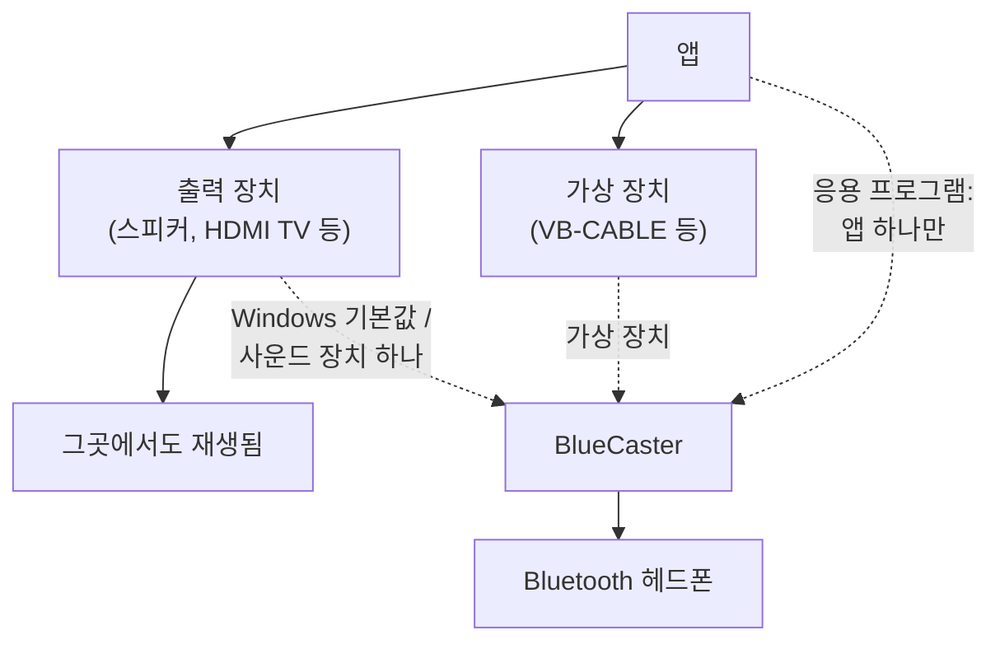
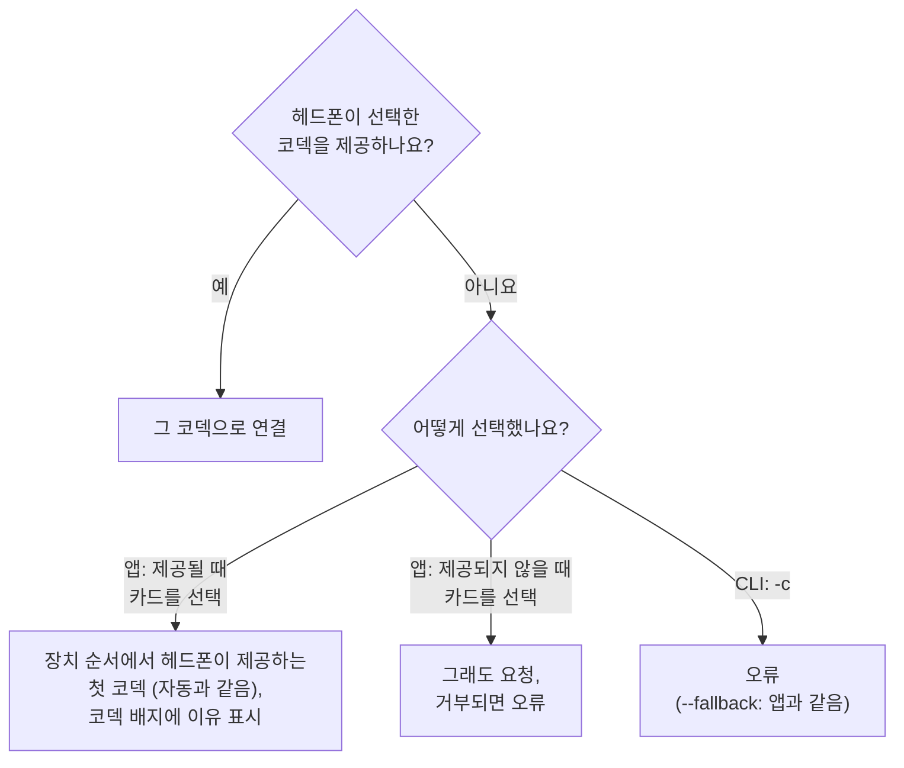

# 사용법
{: .no_toc }

## 목차
{: .no_toc .text-delta }

1. TOC
{:toc}

---

## 창

시작 메뉴에서 **BlueCaster**를 실행하세요(또는 `bluecaster.exe`를 직접 실행). 왼쪽 메뉴에는 아래에서 설명하는 화면이 있습니다. 홈, 코덱, 오디오 장치, 어댑터, 진단, 설정, 정보이며, 개발자 모드에서는 개발자가, 그곳에서 켜면 볼륨 믹서가 추가됩니다. 창이 좁으면 메뉴는 아이콘만 표시합니다. 창은 백그라운드에서 계속 실행되는 `bluecaster-core.exe`의 상태를 보여 줄 뿐이므로, 창을 닫아도 스트리밍은 멈추지 않습니다([트레이와 플라이아웃](#tray) 참조).

### 홈

- 저장된 오디오 장치마다 카드가 하나씩 나란히 표시되며, 상태와 배터리를 보여 줍니다. 연결된 장치의 카드에는 사용 중인 코덱(목록 형태, 아래 참조)과 비트레이트도 표시됩니다. 선택한 코덱과 다른 코덱을 사용 중이면 코덱 줄에 잠시 그 이유가 표시됩니다(예: **aptX Adaptive (Opus 미지원)** 또는 *사용 중*). 몇 초 뒤에는 경고 표시만 남고(마우스를 올리면 이유가 보임), 상태 줄에는 **연결됨**만 표시됩니다
- 각 카드 아래의 **연결** / **연결 끊기**. 한 번에 한 장치만 연결할 수 있습니다. 다른 장치에서 **연결**을 누르면 현재 장치의 연결을 끊고 새 장치에 연결합니다
- **볼륨**: 헤드폰의 볼륨입니다([볼륨](#volume) 참조). 스피커 아이콘을 클릭하면 음소거되고(BlueCaster가 무음을 보냄), 다시 클릭하면 음소거가 해제됩니다. 다른 장치의 카드에서는 슬라이더가 비활성화됩니다
- 연결된 장치의 카드에 있는 코덱 목록으로 코덱을 빠르게 바꿀 수 있습니다(예: 게임용 코덱과 음악용 코덱). 목록에는 [코덱](#codecs) 화면처럼 장치가 지원하는 코덱이 이름만 표시되며, **자동 선택** 중에도 사용 중인 코덱이 표시됩니다. 코덱을 고르면 자동 선택이 꺼집니다(코덱 화면에서 다시 켤 수 있음). 선택은 바로 적용됩니다. 장치가 새 코덱으로 다시 연결하며, 코덱 화면과 마찬가지로 다시 연결될 때까지 다음 선택은 기다립니다
- 연결된 장치가 스트리밍하는 동안 그 카드에 연결 품질 그래프가 작게 표시됩니다. 출력 소스는 **오디오 장치**에서 고르며, 그 소스가 아직 실행되지 않은 응용 프로그램이면 카드에 그렇게 표시됩니다
- 오류가 나면 원인과 함께, 해결 방법이 있으면 해결 버튼(**WinUSB 드라이버로 교체**, **다운로드 페이지 열기**, **Bluetooth 다시 시작**, **다시 시도**, **코덱**, **오디오 장치** 등)이 표시됩니다
- 카드 위에는 닫을 때까지 다음이 표시됩니다: Windows에서 다른 Bluetooth 어댑터가 활성화되어 있을 때의 경고, OPPO 이어폰이 Hi-Res를 켰을 때의 알림([코덱](#codecs) 참조)

사이드바는 모든 화면에서 각 장치에 대해 같은 정보를 보여 주고, 트레이 플라이아웃은 연결된 장치에 대해 보여 줍니다.

### 코덱 {#codecs}

저장된 오디오 장치마다 구역이 하나씩 있습니다. 구역 맨 위에는 점(장치가 연결된 동안 초록색), 장치 이름, **페어링됨** / **오디오** 태그가 있으며, 주소는 **오디오 장치**에서 볼 수 있습니다. 그 아래에 코덱 카드가 있으며, 순서를 바꾸지 않았다면 음질이 높은 순으로 표시됩니다. 각 카드에는 막대 세 개(음질, 낮은 지연, 안정성)가 있고, 장치가 마지막으로 연결했을 때 그 코덱을 제공했는지가 **지원**(초록색 표시) 또는 **미지원**(빨간색 표시)으로 표시됩니다. **지원되는 코덱만 표시**가 켜져 있으면(기본값) 표시되는 카드는 모두 지원되는 코덱이므로 **지원** 태그가 붙지 않습니다. 이때 한 번도 연결하지 않은 장치(예: Windows에서 가져온 장치)에는 모든 Bluetooth 오디오 장치가 지원하는 **SBC** 카드와 그 장치에 고른 코덱만 표시됩니다. 나머지 카드는 처음 연결한 뒤에, 또는 이 스위치를 끄면 나타납니다. Huawei와 Honor 이어폰은 LDAC을 고른 뒤에야 목록에 올리는 경우가 있으므로, 목록에 올릴 때까지 **LDAC** 카드를 **미확인**으로 표시한 채 유지합니다. LHDC V5로 스트리밍할 때(직접 골랐든 자동이 골랐든, 단 음질 **낮음**이나 ABR은 제외) LHDC V5의 최대 비트레이트를 알리는 OPPO 이어폰에는 Hi-Res를 켜도록 한 번 요청합니다. 이어폰은 이를 위해 한 번 다시 연결하며, 그 결과 비트레이트가 올라가면 홈에 알림이 표시됩니다. 이후 Hi-Res는 이어폰에서 켜진 채로 유지되며, 효과가 없었던 이어폰은 원래대로 되돌립니다. 개발자 모드에서 LHDC V5 설정의 **Hi-Res 다시 요청**을 누르면 장치가 알린 내용과 요청 기록을 잊으므로, 다음 연결 때 다시 요청합니다.

- **지원하는 코덱 중 음질이 가장 높은 코덱 자동 선택**(페이지 위쪽, 모든 장치에 공통인 설정, 기본값 켜짐): 각 장치는 지원하는 코덱 가운데 음질이 가장 높은 코덱을 사용합니다. 순서는 LHDC V5 > LDAC > aptX Adaptive > Opus > aptX HD > aptX > aptX LL > AAC > SBC XQ > SBC입니다. 설정은 코덱 설정의 **자동**과 같은 기본값을 씁니다. 고음질, 코덱이 지원하면 24비트, 48 kHz입니다(장치에 48 kHz가 없으면 장치가 알리는 다른 속도를 쓰며 44.1 kHz가 우선. Windows 쪽 속도는 리샘플링됨). 카드는 순서만 바꿀 수 있고(아래처럼 끌어서 바꿈. 자동은 장치가 지원하는 첫 카드를 고름) 나머지는 읽기 전용이며, 사용 중인 코덱이나 자동이 고를 코덱이 강조 표시됩니다. 카드나 카드의 **...**를 클릭하면 자동 선택을 끌지 묻습니다(**자동 선택 끄기** / **취소**). 끄면 클릭한 카드가 선택됩니다(**...**를 클릭했다면 그 설정이 열림). 자동 선택을 끄면 장치마다 코덱과 설정을 직접 고를 수 있으며, 아직 코덱을 고르지 않은 장치는 자동이 고른 코덱을 그대로 씁니다. 자동 선택이 켜져 있는 동안에도 장치별로 고른 코덱은 저장된 채로 남습니다. 2.0.2 이전 설정에서 어느 장치든 코덱을 골라 두었다면 자동 선택이 꺼진 상태로 시작합니다
- 자동 선택이 꺼져 있으면 카드를 클릭해 그 장치의 코덱을 고릅니다. 선택은 즉시 저장되며, 스트리밍 중인 장치는 그 코덱으로 다시 연결합니다. 장치가 지원하지 않는 카드(**지원되는 코덱만 표시**를 끄면 표시됨)도 고를 수 있습니다. 이때 BlueCaster는 그래도 장치에 그 코덱을 요청하며, 장치가 거부하면 그 사실을 알리는 오류와 함께 연결이 중지됩니다(다른 카드를 고르거나 자동 선택을 켜세요). 그러면 홈, 사이드바, 트레이 플라이아웃, 트레이 아이콘의 도구 설명에 원인이 짧게 표시됩니다(예: *LDAC 미지원*). 코덱 때문에 연결이 멈출 때(장치가 지원하지 않거나, 거부하거나, 다른 소스에 사용 중일 때)는 언제나 이렇게 표시됩니다. 그 장치에 다른 카드나 다른 설정을 고르거나 자동 선택을 켜면 다시 연결합니다. 장치가 제공하던 코덱을 골랐는데 나중에 장치가 그 코덱을 제공하지 않게 되면(예: 이어폰이 다른 코덱으로 바꾼 경우), BlueCaster는 장치의 순서에서 장치가 지원하는 첫 카드로 대체합니다. 순서를 바꾸지 않았다면 지원되는 가장 좋은 코덱입니다([명시적으로 선택한 코덱을 제공하지 않는 경우](#codec-fallback) 참조)
- 장치의 카드를 끌어서 코덱을 원하는 순서로 놓을 수 있습니다(버튼을 누르고 있는 동안 손 모양 커서가 표시됨. 자동 선택이 꺼져 있으면 카드에서 Alt+화살표 키로도 가능). 순서는 장치마다 따로 저장됩니다. 자동 선택, 아직 코덱을 고르지 않은 장치, 장치가 지원하지 않는 코덱을 고른 장치는 모두 지원되는 첫 카드를 사용합니다. FastStream과 Opus 05(**Opus (PipeWire)** 카드, 개발자 모드 전용. 개발자 모드가 꺼져 있으면 골라도 사용되지 않음)는 어느 위치에 있든 직접 골랐을 때만 사용됩니다. **코덱 순서 초기화**는 기본 순서로 되돌리며, 표시된 카드가 기본 순서가 아닐 때만 나타납니다(직접 원래 위치로 옮겨도 기본 순서로 돌아감). 이 변경으로 코덱이 바뀌는 스트리밍 중인 장치는 다시 연결합니다
- 스트리밍 중인 장치에 다른 코덱을 고르면 그 코덱으로 다시 연결합니다. 그동안 카드(와 홈, 트레이 플라이아웃의 코덱 목록)는 다시 연결될 때까지 다음 선택을 받지 않으므로, 빠르게 여러 번 클릭해도 설정 중인 연결이 끊기지 않습니다. 코덱을 바꿀 때는 연결 알림이 표시되지 않으며, 장치를 연결할 때만 표시됩니다
- **지원되는 코덱만 표시**(기본값 켜짐. 끄면 지원되는 코덱과 지원되지 않는 코덱을 모두 표시): 장치가 제공하지 않은 코덱을 숨깁니다. 장치를 처음 연결하기 전에는 **SBC**(와 그 장치에 고른 코덱)만 표시됩니다
- 카드의 **...**는 그 코덱의 설정을 엽니다. 변경 사항은 바로 적용됩니다. 사용 중인 코덱이면 변경 사항이 저장되고 장치가 그 설정으로 다시 연결합니다. 예외는 듣는 동안 바뀌는 **비트풀**과, 어느 쪽이든 스트림 설정이 같아지는 경우의 아래 스위치입니다. 다른 코덱이면 변경 사항은 그 코덱을 고를 때까지 보관됩니다. 코덱마다(aptX Adaptive와 aptX Adaptive LL도 각각) 설정이 따로 저장되므로, 다른 코덱으로 바꿨다가 돌아와도 설정이 그대로입니다. 코덱이 지원하고 장치가 마지막 연결 때 알린 옵션만 표시됩니다. 위쪽의 ***장치*이(가) 지원하는 옵션만 표시**(기본값 켜짐. 장치가 옵션을 알린 뒤에 나타남)를 끄면, 장치가 알리지 않은 샘플링 속도, 비트 심도, 음질, 비트풀 등 코덱이 가진 모든 옵션이 *(지원 안 됨)* 표시와 함께 나타납니다. 장치가 이를 거부할 수 있으며, 그러면 그 사실을 알리는 오류와 함께 연결이 중지됩니다. 스위치를 다시 켜면 장치가 알리지 않은 항목은 자동으로 돌아갑니다. 코덱별 설정은 다음과 같습니다(자동 선택은 이 설정을 사용하지 않음).
  - **음질**: LDAC **높음** / **중간** / **낮음**(990 / 660 / 330 kbps), LHDC V5 **높음** / **중상** / **중간** / **낮음**(1000 / 900 / 500 / 400 kbps, Android의 네 단계), aptX Adaptive **높음**(저지연 모드는 별도 카드 **aptX Adaptive LL**: 265 kbps, 48 kHz, ABR 없음. [aptX Adaptive](#aptx-adaptive) 참조). LHDC V5의 ABR을 켜면 음질이 회색으로 표시됩니다(ABR은 400 kbps 이하에서 동작). AAC, Opus, Opus 05, SBC, SBC XQ에는 **높음** 한 단계만 있으며, 고르는 값이 아니라 표시만 됩니다. 장치가 받아들이는 가장 높은 비트레이트이며, ABR이나 VBR이 있으면 그에 따라 달라집니다(SBC와 SBC XQ는 비트풀과 프레임 구성에서 나오는 비트레이트를 표시). aptX, aptX HD, aptX LL, FastStream의 비트레이트는 코덱이 정한 고정값입니다. 이전 버전에서 저장했지만 지금은 코덱에 없는 음질(aptX Adaptive의 표준 / 모바일, AAC의 낮은 단계 등)은 높음으로 불러옵니다
  - **적응형 비트레이트 (ABR)**: LDAC, LHDC V5, aptX Adaptive, SBC, SBC XQ용입니다([ABR](#abr) 참조). AAC는 **VBR**
  - **저지연**(LHDC V5, 지원을 알리는 장치만): 소리가 헤드폰에 더 빨리 도착합니다. ABR이 꺼져 있으면 연결이 따라가지 못하는 동안 비트레이트를 낮추고(1000, 900, 500 kbps 순), 문제없는 상태가 1분 이어지면 다시 올립니다. 패킷은 전송 대기열에서 350 ms가 아니라 100 ms가 지나면 버려집니다. 그래서 연결이 불안정해도 지연이 오래 남지 않고, 소리가 잠깐 끊기는 데 그칩니다
  - **샘플링 속도**: 자동은 48 kHz이며, 장치에 48 kHz가 없으면 장치가 알리는 다른 속도(44.1 kHz 우선)를 씁니다. 실제 속도도 함께 표시됩니다(예: *자동(48000 Hz)*). 자동은 96 kHz를 고르지 않습니다. 96 kHz는 지연이 늘고 호환성이 떨어지지만 들리는 차이는 없기 때문입니다(Windows도 48 kHz로 믹스함). 96 kHz를 쓰려면 여기에서 고르세요. 장치가 알리는 속도만 표시됩니다(LHDC V5에는 88.2 kHz가 없음. aptX Adaptive는 96 kHz를 알리는 장치에만 96 kHz를 제공, [aptX Adaptive](#aptx-adaptive) 참조). 속도를 하나만 알리는 장치는 자동 없이 그 속도만 표시합니다
  - **비트 심도**: LDAC와 LHDC V5는 장치가 알리는 범위에서 16비트 또는 24비트(자동: 24비트. LHDC V5는 장치가 24비트를 알릴 때만), aptX HD와 aptX Adaptive는 24비트, 그 밖의 코덱은 16비트입니다. LDAC의 24비트는 Android의 32비트 옵션처럼 32비트 샘플로 인코더에 전달됩니다. 비트 심도는 LDAC 구성에 포함되지 않으므로, 헤드폰이 받는 스트림은 어느 쪽이든 같습니다
  - **비트풀**(SBC, SBC XQ): 핸들이 두 개인 슬라이더로, 장치가 알리는 범위 안에서 최소 비트풀과 최대 비트풀을 정합니다. 최대값은 실제로 쓰는 비트풀이고, 최소값은 내려갈 수 있는 가장 낮은 비트풀입니다(연결을 설정할 때 범위의 아래쪽이자 ABR이 낮출 수 있는 한계). **자동**은 둘 다 초기화합니다. 최대값은 음질에 맞추고, 최소값은 장치와 ABR의 기본값으로 돌립니다. 아래 줄에는 코덱마다 고정된 채널 모드가 표시됩니다(SBC는 조인트 스테레오, SBC XQ는 듀얼 채널). SBC XQ의 비트풀은 44.1 kHz에서 47, 48 kHz에서 43까지이며, ***장치*이(가) 지원하는 옵션만 표시**를 끄면 53까지 올라갑니다.
  - **프레임 구성**(SBC와 SBC XQ, 개발자 모드 전용): 블록 수, 서브밴드 수, 비트 할당, 그리고 SBC의 채널 모드입니다. 자동은 16블록, 8서브밴드, 라우드니스, 조인트 스테레오를 유지합니다. 장치가 받아들이지 않는 값은 연결할 때 자동으로 돌아갑니다. 한 사용자가 시험한 Sony 장치에서는 12블록이면 소리가 깨지고 연결이 끊길 수 있습니다(인코더 출력은 올바르게 디코딩되며, 다른 블록 수는 정상 재생됨). 고른 값은 저장된 채로 남지만, 개발자 모드가 꺼져 있는 동안에는 사용되지 않습니다. AAC와 LHDC V5의 비트레이트는 장치가 알리는 최대값을 넘지 않습니다

기본값으로 가장 좋은 음질을 얻을 수 있으며, 대부분의 장치는 **자동**이면 충분합니다. LE Audio 장치(실험적)에는 **LC3**와 **LC3 LL** 카드 두 개가 있습니다([LE Audio](#le-audio) 참조). 이 카드의 **...**는 통화 코덱과 마찬가지로 A2DP 코덱과 같은 항목을 읽기 전용으로 보여 줍니다. aptX Adaptive의 저지연 모드는 **aptX Adaptive** 옆의 별도 카드 **aptX Adaptive LL**입니다. 자동은 이 카드를 고르지 않으며, 이전 버전에서 저지연으로 설정한 aptX Adaptive는 이 카드에 표시됩니다.

클래식 장치의 마이크가 열려 있는 동안([오디오 장치](#audio-devices) 참조)에는 음악용 카드 대신 그 장치가 쓸 수 있는 통화 코덱이 표시됩니다. LC3(32 kHz), mSBC(16 kHz), CVSD(8 kHz)이며, 사용 중인 코덱이 선택되어 있습니다. **자동 선택**이 켜져 있으면 통화 연결이 양쪽이 지원하는 가장 좋은 코덱을 고르며, 카드를 클릭하면 자동 선택을 끌지 묻습니다. 자동 선택이 꺼져 있으면 카드를 클릭해 통화 코덱을 고릅니다. 마이크가 그 코덱으로 다시 열리며, 헤드폰이 지원하지 않으면 한 단계 낮은 코덱을 씁니다. **...**는 설정을 읽기 전용으로 보여 줍니다. 마이크가 닫히면 음악용 카드가 돌아옵니다. 자동 선택이 켜져 있는 동안에도 고른 통화 코덱은 저장된 채로 남습니다. **지원되는 코덱만 표시**가 켜져 있으면 헤드폰이 지원하지 않는 코덱은 숨겨집니다.

LE Audio 장치의 마이크가 열려 있는 동안에는 음악용 카드 뒤에 **마이크** 카드(LC3, 모노)가 나타납니다. 자동 선택이 꺼져 있으면 이 카드의 **...**에서 헤드폰이 지원하는 속도 중 마이크의 샘플링 속도를 고를 수 있습니다(**자동**은 첫 번째 속도를 사용하며, 바꾸면 장치가 다시 연결함). 자동 선택이 켜져 있으면 사용 중인 속도를 표시합니다.

BlueCaster는 내부적으로 `profiles.json`에 장치마다 항목 하나(코덱, 코덱별 설정, 코덱 순서)를 저장하며, 파일 안에서는 "*장치* | *코덱*"이라는 이름으로 기록됩니다. 창과 트레이 메뉴에는 장치 이름만 표시됩니다. 이전 버전에서는 한 장치에 프로필을 여러 개 만들 수 있었습니다. 코덱 화면이 있는 버전을 처음 실행하면 가장 최근에 사용한 프로필(없으면 첫 번째 프로필)을 남기고 나머지 프로필을 거기에 합칩니다. 이때 각 프로필의 코덱 설정(음질, 샘플링 속도, 비트 심도, ABR, SBC 구성)은 해당 코덱의 설정으로 유지됩니다. 프로필 이름, 출력 소스, 패킷 크기는 유지되지 않으며, 원래 `profiles.json`은 설정 폴더에 `profiles-before-codecs.json`으로 한 번 저장됩니다. 2.0.2 시험판의 **자동 선택 순서…**(모든 장치에 공통인 순서 하나, 개발자 모드)는 더 이상 사용되지 않으며, 이제 장치마다 각자의 순서가 있습니다.

### 오디오 장치 {#audio-devices}

BlueCaster가 스트리밍할 수 있는 헤드폰과 스피커가 장치별 설정과 함께 표시됩니다. 그 아래 **오디오 장치 추가**에서 **장치 검색**을 누르면 USB 어댑터로 30초 동안 주변 장치를 찾고, 응답하는 장치부터 목록에 추가합니다. **검색 중지**로 검색을 끝낼 수 있습니다. 먼저 헤드폰을 페어링 모드로 전환하세요. 연결된 장치가 있으면 BlueCaster가 검색 전에 연결을 끊을지 묻습니다. **추가**는 찾은 장치를 저장하고 연결합니다. 전에 BlueCaster와 페어링한 장치에는 **페어링됨** 태그가 붙습니다. 검색에서 장치를 찾지 못하면 **직접 입력:**에 주소를 입력하고 **추가**를 클릭하세요. 주소는 입력하거나 붙여 넣는 즉시 형식이 맞춰집니다(`aa-bb-cc-dd-ee-ff`, `AABBCCDDEEFF`, `AA BB CC DD EE FF`는 모두 `AA:BB:CC:DD:EE:FF`가 됨). 헤드폰에는 어댑터가 PC 이름 뒤에 BlueCaster가 붙은 이름(예: *Taro-PC (BlueCaster)*)으로 보이므로, Windows 자체 Bluetooth와 구별할 수 있습니다. Windows가 PC 내장 Bluetooth 같은 다른 어댑터로 페어링한 장치는 BlueCaster가 먼저 묻습니다(**Windows에서 페어링됨**: Windows에서 제거하거나 **그래도 추가**). Windows가 이 어댑터로 페어링한 장치도 먼저 묻습니다(설정 마법사에서 그 페어링을 가져올 수 있음, [서비스와 페어링 키](#shared-pairing) 참조). 저장된 장치는 이름을 바꾸거나 제거할 수 있습니다. 제거하면 설정과 페어링도 삭제되므로, 다시 페어링해야 연결할 수 있습니다. 저장된 각 장치에는 다음 설정이 있습니다.

- **출력 소스**: **Windows 기본값**(목록 맨 앞에 따로 표시. Windows 기본 출력이며 괄호 안에 그 이름이 표시되고, 가상 장치일 수도 있음. 새 장치의 기본값), **사운드 장치** 아래의 출력 장치 하나, 가상 장치, 응용 프로그램 중에서 고릅니다([캡처 모드](#capture-modes) 참조). 옆에는 Windows가 캡처 대상 장치를 믹스하는 형식(샘플링 속도와 비트 심도, 읽기 전용)이 표시됩니다. 장치가 다른 형식으로 스트리밍하면(연결되지 않았을 때는 코덱 설정이 다른 형식을 요구하면) 호박색으로 바뀌고, 아래 줄에 두 형식이 표시됩니다(변환해서 스트리밍은 계속됨). 그 아래에는 소스에 대한 설명이 표시됩니다
- **연결 중 Windows 기본 출력으로 설정**(개발자 모드, 가상 장치나 사운드 장치를 쓸 때)
- **입력 소스**: 헤드폰의 마이크. 개발자 모드에서는 **연결 중 Windows 기본 입력으로 설정**도 있습니다(아래 참조)

각 장치의 **입력 소스**는 헤드폰의 마이크를 Windows로 보내 통화나 음성 채팅에 쓸 수 있게 합니다. BlueCaster에는 자체 오디오 드라이버가 없으므로, 마이크 소리를 VB-CABLE 같은 가상 오디오 케이블로 재생합니다. 목록에는 각 케이블이 앱이 녹음하는 쪽의 이름(VB-CABLE이면 *CABLE Output*)으로 표시되며, 앱에서 이 장치를 마이크로 고르면 됩니다. 목록 옆에서 **끄기**나 **자동**을 고르세요. **자동**은 앱이 녹음하는 동안에만 마이크를 열므로, 나머지 시간에는 원래 음질로 재생합니다. 개발자 모드에서는 마이크를 계속 열어 두는 **켜기**도 고를 수 있습니다. 개발자 모드가 꺼져 있으면 **켜기**인 장치는 **자동**처럼 동작합니다. **끄기**인 동안에는 목록이 회색으로 표시됩니다. **끄기**와 홈, 플라이아웃의 마이크 버튼은 같은 설정입니다. **자동**이나 **켜기**인 장치에서 **끄기**를 고르면 버튼과 마찬가지로 마이크를 사용 안 함으로 바꾸고 모드를 기억하며, 버튼을 누르면 그 모드로 돌아갑니다. **연결 중 Windows 기본 입력으로 설정**(개발자 모드. 개발자 모드가 꺼져 있으면 항상 켜짐)은 장치가 연결된 동안 케이블의 녹음 쪽(*CABLE Output*)을 Windows 기본 마이크로 설정합니다. 그러면 기본 마이크로 녹음하는 앱이 헤드폰 마이크를 받고, **자동**도 그 앱을 위해 마이크를 엽니다. 장치 연결이 끊기면 이전 기본값으로 돌아갑니다. 단, 그사이 다른 기본값을 골랐다면 그대로 둡니다.

맨 아래의 **마이크 조정**에서 마이크 소리를 앱에 전달하기 전에 처리할 수 있습니다. **입력 소스**가 **끄기**이면 이 항목은 회색으로 표시됩니다. **마이크 조정 사용**으로 처리를 켜거나 끕니다. 끄면 마이크 소리가 그대로 전달되고, 슬라이더 값은 유지됩니다. **게인**은 소리를 키우거나 줄입니다(-12~+24 dB). **노이즈 억제**는 팬이나 험 같은 일정한 배경 소음을 없앱니다. 오른쪽으로 갈수록 강하게 적용되고, 왼쪽으로 갈수록 원래 소리가 더 많이 남습니다(맨 왼쪽: **끔**). **노이즈 게이트**는 마이크 소리가 정한 레벨보다 낮은 동안 음소거합니다(맨 왼쪽: **끔**). 키운 마이크 소리가 찢어지지 않도록 리미터가 적용됩니다. 변경 사항은 다시 연결하지 않고 바로 적용됩니다. 노이즈 억제를 켜면 마이크가 약 20 ms 늦어지며, 모두 끄면 마이크 소리가 그대로 전달됩니다. **진단**의 **마이크** 테스트는 앱이 듣는 그대로 녹음합니다.

새 장치는 VB-CABLE이 설치되어 있으면 VB-CABLE로, 없으면 Hi-Fi Cable로 시작합니다. 단, 그 케이블이 장치의 **출력 소스**이면 제외됩니다. 클래식 장치는 **자동**, LE Audio 장치는 **끄기**로 시작합니다(LE Audio에서는 **자동**이어도 마이크가 계속 열려 있기 때문). 마이크가 켜져 있지만 케이블이 없는 장치는 Windows에 케이블이 나타나는 즉시 그 케이블을 받습니다. **오디오 장치**와 설정 마법사는 없는 케이블을 설치하도록 권합니다([캡처 모드](#capture-modes) 참조). 나중에 케이블을 설치하면 BlueCaster가 자동으로 설정한 장치와, **Windows 기본값**이면서 그런 마이크를 쓰는 장치를 설정 마법사와 같은 방식으로 다시 설정합니다. 케이블이 둘 다 있으면 Hi-Fi Cable로 소리를, VB-CABLE로 마이크를 보냅니다. 케이블이 하나뿐이면 그 케이블로 마이크를 보내고, 소리는 **사운드 장치** 아래의 출력 장치에서 가져옵니다(모니터나 TV의 오디오가 있으면 그 장치, 여러 개면 그중 Windows 기본 출력, 없으면 Windows 기본 출력). 어느 장치가 Windows 기본 출력이든 마찬가지입니다. 직접 고른 출력 소스나 마이크는 그대로 둡니다. 케이블이 없고 Windows에 모니터나 TV의 오디오와 사운드 카드가 모두 있으면, 소리는 모니터나 TV에서 가져오고 마이크는 사운드 카드로 재생하며 **끄기**로 설정됩니다. 개발자 모드에서 **켜기**로 바꾸면 출력 장치를 녹음하는 앱(OBS의 오디오 출력 캡처)이 거기서 마이크 소리를 가져올 수 있습니다. **자동**은 누가 사운드 카드를 듣고 있는지 알 수 없습니다. **오디오 장치**에서 추가한 장치도 같은 방식으로 시작합니다. **Windows 기본값**인 장치 가운데 마이크를 Windows 기본 출력인 케이블로 재생하는 장치도 그 소리 소스로 바뀝니다. 그러지 않으면 마이크 소리가 헤드폰에서 들리기 때문입니다.

마이크를 Hi-Fi Cable로 재생하는데 Windows 소리 설정에서 케이블의 재생 쪽과 녹음 쪽 샘플링 속도가 다르면 경고가 표시됩니다. 앱에 아무것도 들리지 않으면 둘을 같은 속도로 맞추세요. 목록에는 앱이 녹음할 수 있는 케이블만 나타납니다. BlueCaster가 직접 캡처하는 케이블(**출력 소스**, 또는 **Windows 기본값**일 때의 Windows 기본 출력. 단, 다른 장치가 연결된 동안 그 장치의 출력 소스가 기본값이 된 경우는 제외)은 목록에서 빠지며, 그 케이블의 반대쪽도 빠집니다(VB-CABLE의 *CABLE In 16ch*는 *CABLE Input*과 같은 *CABLE Output*으로 녹음됨). 마이크 소리가 재생 소리와 섞이기 때문입니다. 마찬가지로 **입력 소스**가 **끄기**가 아니면 **출력 소스** 목록에서 마이크를 재생하는 케이블이 빠집니다. **개발자 > 앱 설정 > 소스 목록에 모든 오디오 장치 표시**를 켜면 두 목록 모두 모든 장치를 보여 줍니다. 녹음 쪽이 없는 출력(스피커 등)은 마이크를 재생만 하므로 **모니터링** 아래에 나타납니다. VB-CABLE의 16채널 케이블은 *CABLE Output · CABLE In 16ch*(공유하는 녹음 쪽 이름, 케이블 자체 이름 순)로 나타나고, 출력 소스의 케이블은 회색으로 이름 뒤에 *(출력 소스로 사용 중)*이 붙습니다. *CABLE Input*과 *CABLE Output*은 한 케이블의 양쪽 끝이므로, 가상 출력 소스와 마이크를 함께 쓰려면 케이블이 두 개 필요합니다. 소리에는 지연이 가장 적은 VB-Audio의 **Hi-Fi Cable**([VB-Audio 페이지](https://vb-audio.com/Cable/)의 *HiFi-Cable & ASIO-Bridge*)을, 마이크에는 VB-CABLE을 권장합니다. 마이크용 장치는 Windows 기본 출력이어서도 안 됩니다. 앱에 재생 소리가 마이크와 섞여 들리고, 다른 장치의 출력 소스에는 아무것도 전달되지 않기 때문입니다. 이 경우 **입력 소스** 아래에 경고가 표시됩니다.

마이크가 열려 있는 동안 클래식 Bluetooth 장치는 통화용 연결로 재생합니다. 통화 음질의 모노(CVSD, mSBC, LC3 중 양쪽이 지원하는 가장 좋은 코덱)이며, 그동안 원래 코덱은 흐리게 표시됩니다. 마이크가 닫히면 다시 연결하지 않고 원래 코덱으로 돌아갑니다. LE Audio 장치는 평소 음질 그대로 LC3로 재생하면서 마이크도 함께 보내며, 모드를 바꾸면 다시 연결합니다(LE Audio에서는 자동도 마이크를 계속 열어 둠). 일부 헤드폰은 마이크를 거부하거나, 통화 중이 아닌데도 통화 중으로 표시할 수 있습니다. **자동**이나 **켜기**이고 장치를 선택했으면, 장치가 연결되어 있거나 연결 중인 동안 사이드바, 홈, 플라이아웃의 코덱 아래에 **마이크:** 줄이 나타납니다. 마이크가 열려 있으면 코덱과 샘플링 속도가 빨간 점과 함께(*마이크: mSBC 16 kHz*), 닫혀 있으면 모드가 흐리게 표시됩니다. 홈과 플라이아웃에서는 그 옆의 마이크 버튼으로 마이크를 사용 안 함으로 바꿀 수 있습니다. 버튼에 사선이 그어지고, 마이크가 닫히고, 클래식 장치는 원래 코덱으로 돌아가며, **입력 소스**는 **끄기**로 표시됩니다. 버튼을 다시 클릭하면 이전 모드로 마이크를 사용하며, **입력 소스**에서 **자동**이나 **켜기**를 골라도 됩니다. 자동이 앱을 기다리는 동안에는 버튼이 점선으로 표시됩니다. 마이크를 열지 못하면 버튼에 경고 표시가 나타나며, 도구 설명에 이유가 표시됩니다.

목록 위의 **모든 오디오 장치**에는 모든 장치에 적용되는 스위치가 있습니다: **Windows 볼륨 동기화**([볼륨](#volume) 참조), **오디오 장치 버튼으로 재생 제어**, **자동으로 다시 연결**. 장치별 **최대 미디어 패킷 크기**는 **개발자** 화면에 있습니다([최대 미디어 패킷 크기](#max-packet) 참조).

### 진단

- 스트리밍 중의 **연결 품질**: 실제 비트레이트, 패킷, 전송 전 버린 패킷, 캡처 시 버린 오디오, 전송 대기열, 장치가 보고한 지연([지연](#latency) 참조), 무선 사용 시간, 신호(RSSI), AFH 채널입니다([연결 품질과 AFH](#link-quality) 참조). 헤드셋 마이크가 열려 있는 동안에는 클래식 장치의 통화 연결도 같은 방식으로 측정하며(mSBC 같은 코덱과 보내는 양), **마이크** 카드에 돌아오는 패킷을 받은 수, 전송 중 손상된 수, 보간한 수로 표시합니다
- **무선**: 2.4 GHz 대역의 Bluetooth 79개 채널 가운데 링크가 쓰는 채널과 어댑터가 건너뛰는 채널을 보여 줍니다. 아래에는 Wi-Fi 채널이 함께 표시되며, 연결을 깨끗하게 유지하는 팁도 몇 가지 있습니다. 개발자 모드에서는 **스캔**으로 주변 2.4 GHz Wi-Fi 네트워크도 겹쳐 표시합니다([무선 탭](#radio-tab) 참조)
- 스트리밍 중의 **코덱 세부 정보**: 미디어 페이로드, 헤더, 코덱 프레임, 패킷당 프레임 수, 그리고 장치의 엔드포인트가 알리는 값과 사용 중인 값입니다. SBC는 비트풀, 샘플링 속도, 채널 모드, 블록, 서브밴드, 비트 할당, AAC는 오브젝트 유형, 샘플링 속도, 채널, 최대 비트레이트, VBR, 그 밖의 코덱은 샘플링 속도, 비트 심도, 최대 비트레이트를 보여 줍니다
- **마이크**: 스트리밍 중인 클래식 Bluetooth 장치의 헤드셋 마이크를 테스트합니다. **녹음**은 마이크를 열고 최대 10초 동안 녹음하며, 음량을 막대로 보여 줍니다(그동안 장치는 통화 음질로 재생하며, 이 연결에서 마이크를 연 적이 없으면 먼저 다시 연결함). **재생**은 녹음한 소리를 헤드폰으로 재생합니다. 탭을 벗어나면 테스트가 끝나고 재생은 원래 코덱으로 돌아갑니다. LE Audio 장치는 아직 지원하지 않습니다
- **연결 흐름**: 가장 최근 연결 시도의 11단계(시작, Bluetooth 어댑터, ACL / AVDTP 연결, 기능 검색, 코덱 선택, 오디오 캡처, 스트림 구성, 인코더, 스트림 시작, 오디오 전송, 연결 끊김 / 다시 연결을 포함한 연결 유지)를 OK, 경고, 실패로 표시하고 각 단계에 걸린 시간도 보여 줍니다. **흐름 복사**로 복사할 수 있습니다
- **로그**: 실시간 로그입니다. 수준(모든 수준, 정보 이상, 경고 및 오류, 오류만), 텍스트, 현재 연결 시도(**현재 시도만**)로 필터링할 수 있습니다. **표시된 로그 복사**는 표시된 내용을 복사합니다. **로그 폴더 열기**는 로그 파일이 있는 폴더를 엽니다. **진단 정보 복사**와 달리 이 파일들은 가려지지 않습니다(Bluetooth 주소와 Windows 사용자 이름이 포함됨)
- **HCI 캡처 시작** / **HCI 캡처 중지**([미디어 스트림 검증](#verify-stream) 참조)
- **진단 정보 복사**: 버전, OS, 어댑터, 오디오 장치(코덱, 설정, 순서), 연결 흐름, 경고 / 오류, 최근 로그를 클립보드에 복사하므로 버그 보고서에 바로 붙여 넣을 수 있습니다. **Bluetooth 주소 가리기**(기본값 켜짐)는 주소를 `<addr-1>`, `<addr-2>`...(어댑터 자체 주소는 `<adapter>`)로, 장치 이름을 `<device-1>`, `<device-2>`...로 바꾸고, USB 일련번호, 앱 폴더보다 위의 파일 경로(`<path>\BlueCaster\logs\...`), Windows 계정(사용자 이름과 SID)을 가립니다. 버그 보고용으로 복사하는 충돌 보고서와 오류 텍스트에도 같은 가리기가 적용됩니다
- **문제 보고**:
  - **상세 로그**: **상세 (debug)** 또는 **전체 (trace, 1시간)**를 고르면 Bluetooth, USB, 오디오 캡처, 인코딩에 대해 훨씬 많은 내용을 기록합니다. debug는 다시 시작해도 24시간 동안 켜져 있다가(시작할 때 생기는 문제용) 자동으로 꺼집니다. 켜고 문제를 재현한 다음 진단 패키지를 저장하세요
  - **진단 패키지 > 저장…**: HCI 캡처를 넣을지(요청받지 않았다면 끄세요. 주소와 장치 이름이 들어 있습니다), 텍스트 파일의 Bluetooth 주소를 가릴지 고른 다음 `.zip` 파일 하나로 저장합니다(설정 폴더의 `logs\bundles\`, 최신 3개 유지). 진단 정보, 코어·창·드라이버 도우미의 로그 파일, 충돌 보고서, 시스템 정보(USB Bluetooth 어댑터와 드라이버, Windows에 페어링된 장치, 오디오 장치), 설정과 장치별 코덱 설정(링크 키는 포함하지 않음), HCI 플라이트 레코더가 들어갑니다. HCI 캡처에는 주소가 그대로 남습니다(페어링 키는 없음). BlueCaster는 가능하면 패키지를 GitHub 첨부 파일 한도인 25 MB 이하로 유지합니다(최신 로그 우선, 텍스트 최대 48 MB, 최신 기록 5개와 미니덤프 2개)
  - **GitHub에 보고**(저장 후): 버전, Windows 빌드, 어댑터, 헤드폰, 코덱, 캡처 모드, 진단 정보(주소는 가림)가 채워진 새 버그 보고서를 엽니다. 탐색기에 패키지가 표시되므로 보고서로 끌어 넣으면 됩니다

BlueCaster는 한 번만 일어난 문제도 나중에 조사할 수 있도록 일부 데이터를 항상 기록합니다.

- **HCI 플라이트 레코더**: 최근 몇 분간의 Bluetooth 트래픽을 메모리에 보관하며(미디어 페이로드는 잘라 내고 페어링 키는 제거), 스트림이 실패하거나 연결이 끊길 때마다 `logs\hci\`에 저장합니다(최신 10개 파일 유지)
- **충돌 보고서**: BlueCaster가 충돌하면 `.dmp` 미니덤프와 `.txt` 파일이 `logs\crash\`에 저장됩니다(프로그램별 최신 5개)

디스크 사용량은 제한됩니다. 평소 하루 로그는 1 MB에 훨씬 못 미치며, 7일분을 보관합니다. 상세 로그를 켜면 하루 파일에 debug와 trace 줄이 최대 100 MB까지 기록됩니다(그 뒤에는 다음 날까지 정보 이상만 기록). 플라이트 레코더 파일은 많아야 몇 MB이며, 10개를 보관합니다.

### 개발자 {#developer}

**설정 > 개발자 모드**가 켜져 있을 때 표시되며, 대부분의 사용자에게는 필요 없습니다. 장치 시험과 문제 해결을 위한 화면으로, 일부 설정은 특정 장치에서만 작동합니다. 탭은 일곱 개입니다.

- **앱 설정**: **볼륨 믹서 사용**(기본값 꺼짐)을 켜면 **볼륨 믹서** 화면, 플라이아웃의 앱 목록, 출력 음소거가 추가됩니다([캡처 모드](#capture-modes) 참조). 권장하지 않습니다. PC 스피커를 조용히 하려면 VB-CABLE이 더 좋은 방법입니다. **소스 목록에 모든 오디오 장치 표시**(기본값 꺼짐)를 켜면 **오디오 장치**의 **출력 소스**와 **입력 소스**에 맞지 않는 장치까지 모든 장치가 나타납니다([오디오 장치](#audio-devices) 참조). **가상 오디오 장치 경고 숨기기**(기본값 꺼짐)는 VB-Audio 케이블이 없을 때의 경고를 숨깁니다([캡처 모드](#capture-modes) 참조). **업데이트 확인 시 알파 버전 포함**(알파 빌드에서는 기본값 켜짐)을 켜면 알파 릴리스도 제안합니다([업데이트](#updates) 참조)
- **코덱 설정**: 장치에서 소리가 나지 않는 원인을 찾기 위한 스위치(RTP 마커 비트, 처음 몇 개의 미디어 패킷 기록, AAC 구성과 인코더 옵션)와 저장된 장치별 **최대 미디어 패킷 크기**([최대 미디어 패킷 크기](#max-packet) 참조)가 있습니다. **코덱 자동 선택 시에도 각 코덱의 설정 사용**: 자동 선택이 켜져 있어도 코덱 카드의 **…**가 자동 선택을 끄지 않고 열리며, 자동이 고른 코덱은 자동의 설정 대신 그 코덱의 설정으로 연결합니다. **샘플링 속도와 비트 심도를 PC 출력에 맞추기**: 자동으로 둔 샘플링 속도나 비트 심도가 48 kHz 대신 Windows 소리 설정의 출력 장치 형식을 따릅니다. BlueCaster는 장치가 그 코덱에 대해 알리는 속도 중에서 PC와 같은 속도를, 없으면 같은 계열(44.1 kHz 또는 48 kHz의 배수) 중 가장 가까운 속도를, 그것도 없으면 더 높은 속도 중 가장 가까운 속도를 고릅니다. 출력이 16비트이면 16비트로 스트리밍합니다. **장치의 최대 비트레이트 무시**: 장치가 더 낮은 최대값(LHDC V5, AAC, Opus 05의 비트레이트나 SBC 비트풀)을 알려도 모든 코덱이 선택한 음질의 비트레이트로 동작하며, **코덱** 화면에서 모든 음질과 비트풀을 고를 수 있습니다. 최대값을 넘으면 장치 소리가 끊기거나 나오지 않을 수 있습니다. **전송 대기열 상한**: 미디어 패킷이 버려지기 전까지 전송 대기열에서 기다릴 수 있는 시간으로, 50~2000 ms입니다(비워 두면 350 ms). 연결 상태가 좋을 때의 지연은 줄어들지 않습니다([지연](#latency) 참조). **전송할 때 인코딩**: 링크가 멈춘 동안 오디오를 인코딩된 패킷이 아니라 인코딩 전 상태로 대기시킵니다. 그래서 ABR이 켜져 있으면(SBC, SBC XQ, LDAC, LHDC V5, aptX Adaptive) 멈춤이 시작될 때의 비트레이트가 아니라 그사이 ABR이 낮춘 비트레이트로 전송합니다. 멈춤 자체를 줄이지는 않습니다. 무선이 다시 전송할 때까지는 아무것도 나가지 않으며, 그 뒤 따라잡을 때의 데이터만 줄어듭니다. 전송 대기열 상한보다 오래 기다린 오디오는 어느 경우든 버려지며, 진단은 기다리는 오디오를 전송 대기열 대기 시간에 포함해 셉니다. 이 설정은 모두 기본값이 꺼짐이며 다음 스트림을 시작할 때 적용됩니다. 하나라도 켜져 있으면 배너가 표시되며, **모두 끄기**로 모두 되돌릴 수 있습니다
- **제조사**: BlueCaster가 이어폰 고유의 프로토콜을 쓸지 정합니다(Huawei: LDAC, OPPO: Hi-Res. [코덱](#codecs) 참조). 제조사마다 **제조사 프로토콜**이 있습니다: **자동**(이름으로 해당 제조사 이어폰임을 알 수 있는 경우, 기본값), **항상**(모든 장치), **사용 안 함**. OPPO에는 **연결할 때마다 Hi-Res 요청(매번 다시 연결)**도 있습니다. 변경 사항은 다음 스트림을 시작할 때 적용됩니다. 하나라도 바뀌어 있으면 배너가 표시되며, **모두 끄기**로 모두 되돌릴 수 있습니다. 개발자 모드가 꺼져 있으면 사용되지 않습니다
- **로그**: 로그 파일 보관 기간(기본값 7일), 하루 크기 한도(기본값 100 MB), 계속 켜 두는 상세 로그(24시간이나 1시간 제한 없음, 코어 시작부터 동작), 10초마다 기록하는 스트림 상태 줄, **마커 추가**(번호가 붙은 줄을 로그에 기록해 그 순간을 나중에 찾을 수 있게 함). 개발자 모드를 끄면 기본값으로 돌아갑니다
- **피어 수신기 테스트**: 다른 PC의 측정용 수신기로 스트리밍하고, 보낸 내용과 도착한 내용을 비교합니다([피어 수신기 테스트](#receiver) 참조)
- **칩**: WinUSB 어댑터에서 칩 스크립트를 실행합니다. 스크립트는 직접 입력하거나 파일에서 불러온 칩 요청으로, 칩 지원을 추가하려는 사람을 위한 기능입니다([칩 지원 추가](chip-support#chip-scripts) 참조). 칩을 변경할 수 있는 줄은 **실행 허용**을 클릭한 뒤에만 실행됩니다. 그동안 Bluetooth가 멈추고, 다음에 필요할 때 다시 시작됩니다
- **디버그**: 실험 기능이며 모두 기본값이 꺼짐입니다. **페어링 키와 Windows**: **원래 드라이버로 복원할 때 LE 키도 Windows에 복사**를 켜면 **원래 드라이버 복원** 시 BlueCaster의 LE 키(Long Term Key, EDIV, Rand, 키 길이, Identity Resolving Key)를 Windows에 기록합니다. 대상은 Windows가 그 어댑터용 LE 키를 이미 가진 장치뿐입니다. Windows의 이전 키는 `pairing\replaced_windows_keys.json`에 저장되며, 사용자의 Windows 계정만 읽을 수 있습니다. **Windows와 비교**(관리자 권한 필요)는 어댑터 하나에 대해 링크 키와 LE 키가 BlueCaster와 Windows에서 일치하는 장치, 다른 장치, 한쪽에만 있는 장치의 수를 셉니다. 화면과 로그에는 숫자만 표시되고 주소나 키는 나오지 않으므로, 결과를 안심하고 공유할 수 있습니다. Windows가 어댑터와 LE 장치에 대해 저장한 값의 이름, 형식, 크기도 보여 주지만, 데이터는 표시하지 않습니다

### 어댑터

- 감지된 USB Bluetooth 어댑터와 각 어댑터의 칩, 주소, USB ID, Bluetooth 버전, **드라이버**, **펌웨어**가 표시됩니다. 어댑터를 꽂거나 뽑으면 목록이 자동으로 업데이트됩니다. 드라이버는 **원래 드라이버**(Windows나 제조사가 설치한 드라이버, 마우스를 올리면 이름이 표시됨) 또는 **WinUSB 드라이버**(BlueCaster가 사용하는 드라이버)입니다. Realtek 어댑터는 사용하기 전에도 USB 일련번호에서 읽은 주소를 표시합니다. 그 밖의 어댑터는 Windows Bluetooth나 BlueCaster가 어댑터를 사용한 뒤에 주소와 Bluetooth 버전이 표시됩니다(그 줄에 마우스를 올리면 이유가 표시됨). BlueCaster가 사용할 수 없는 어댑터(일부 MediaTek, Qualcomm 모델)는 드라이버를 그대로 두며, WinUSB와 펌웨어 버튼이 비활성화됩니다. 개발자 모드에서는 그래도 WinUSB를 할당할 수 있습니다. WinUSB 어댑터에서 **칩 정보 읽기**를 누르면 몇 가지 읽기 명령에 대한 칩의 응답을 `logs\probe\`에 저장합니다. 이 칩의 지원을 추가하려는 사람을 위한 기능이며, 그동안 Bluetooth가 멈추고 다음에 필요할 때 다시 시작됩니다. 그다음 **GitHub에 보고**를 누르면 이 정보가 채워진 이슈가 열립니다. BlueCaster가 직접 펌웨어를 로드하는 어댑터(Intel, MediaTek, Qualcomm)가 시작되는 동안에는 로드 진행 상황과 실패 여부가 화면에 표시됩니다
- **WinUSB 드라이버로 교체** / **원래 드라이버 복원**([설치](setup#winusb) 참조). Windows가 매번 관리자 권한을 요청합니다(방패 아이콘이 있는 모든 버튼과 같음). 복원하면 Windows가 이 어댑터로 페어링했던 장치에 대해 BlueCaster의 더 새로운 페어링을 Windows에 넘겨주므로, Windows에서 다시 페어링하지 않아도 연결됩니다. **제한 사항:** LE 키는 넘겨주지 않으므로, Windows가 LE(LE Audio)로 사용하는 장치는 Windows에서 다시 페어링해야 합니다(개발자 모드에서 시험해 볼 수 있음: **개발자 > 디버그**)
- 펌웨어용 **Bluetooth 칩**과 **펌웨어 다운로드**, **다운로드 페이지 열기**, **펌웨어 폴더 열기**([펌웨어](setup#firmware) 참조). 다른 제조사의 어댑터는 대신 펌웨어를 어디서 가져오는지 표시하며(**MediaTek 드라이버에서**, **펌웨어 폴더에서**, **필요 없음** 등), BlueCaster가 펌웨어를 불러오면 **로드됨**으로 바뀝니다. Realtek Windows 드라이버의 펌웨어를 쓰는 Realtek 어댑터에는 대신 **사용자 지정 펌웨어 사용**이 표시되며, **드라이버 펌웨어 사용**으로 다시 돌아갈 수 있습니다
- **Wi-Fi 채널 피하기**: 자동, 끄기, 수동 중에서 고르며, 옆에 Wi-Fi 채널이 표시됩니다. 자동은 지금 피하고 있는 채널을, 끄기는 아무 채널도 표시하지 않으며(둘 다 읽기 전용), 수동은 입력한 채널을 사용합니다([연결 품질과 AFH](#link-quality) 참조)
- **Bluetooth 스택**: 중지됨(처음 검색하거나 연결할 때 시작), 시작 중, 준비됨, 오류 중 하나의 상태와 **Bluetooth 다시 시작**
- **이 어댑터 사용**(WinUSB 어댑터가 두 개 이상일 때 각 어댑터 카드에 표시): BlueCaster는 처음 찾은 어댑터 대신 그 어댑터를 엽니다. Bluetooth가 그 어댑터에서 다시 시작되고 스트림이 다시 연결됩니다. 선택한 어댑터 카드의 **자동으로 선택**을 누르면 처음 찾은 어댑터로 돌아갑니다. 사용 중인 어댑터에는 **사용 중**이 표시되고 **Bluetooth 스택** 옆에 이름이 나옵니다. 선택했지만 아직 사용되지 않은 어댑터(다음에 Bluetooth가 시작될 때 열리거나 다른 프로그램이 사용 중)에는 **선택됨**이 표시됩니다

### 설정

| 섹션 | 설정 |
|:-----|:-----|
| 모양 | 언어, 테마 (시스템 / 밝게 / 어둡게) |
| 시작 | **Windows 시작 시 실행**과 **트레이에서 시작** ([Windows 시작 시 실행](#autostart) 참조), **시스템 트레이로 최소화**와 **트레이 창 열기 위치** ([트레이와 플라이아웃](#tray) 참조) |
| 알림 | **장치가 연결되면 알림**(장치, 배터리, 코덱과 그 설정. 기본값 켜짐), **배터리가 부족하면 알림**: **20% 미만**(기본값), **10% 미만**, **5% 미만** 또는 **알리지 않음**. 연결당 한 번만 알립니다(배터리가 그보다 5포인트 이상 회복된 뒤에만 다시 알림) |
| 업데이트 | **업데이트 확인**, **시작 시 업데이트 확인**, **업데이트 확인 시 시험판 포함** (베타 릴리스도 제안), **지금 업데이트** ([업데이트](#updates) 참조) |
| 고급 | **개발자 모드** ([개발자](#developer) 화면, 코덱 설정의 SBC **프레임 구성**, **오디오 장치**의 **서비스** 태그에 있는 페어링 키([서비스와 페어링 키](#shared-pairing) 참조), **Opus (PipeWire)** 코덱, **어댑터**의 **칩 정보 읽기**가 추가되고 로그가 더 자세해짐. 다시 시작할 필요 없음), **설정 폴더**와 **설정 폴더 열기**, **설정 마법사 실행** |

**BlueCaster 종료**는 맨 아래에 있습니다. **정보** 화면에는 버전과 BlueCaster의 라이선스가 표시되고, **타사 소프트웨어** 아래에 라이브러리, **타사 라이선스**, VB-Audio 케이블이 VB-Audio의 도네이션웨어라는 안내, 케이블 대화 상자(**가상 오디오 장치**)가 있습니다.

### 첫 실행 설정

처음 시작할 때(오디오 장치가 아직 없거나 WinUSB 어댑터가 없을 때) **설정 마법사**가 열립니다. 한 번 완료하거나 건너뛸 때까지 매번 열립니다. 먼저 어댑터, 드라이버, 펌웨어를 고릅니다(Windows가 이 어댑터로 페어링한 장치는 Windows에서 작동하지 않게 되므로 먼저 표시됨). 다음으로 오디오 장치를 찾습니다. 연결을 누르면 그 장치에 가장 좋은 설정으로 장치를 저장하고 연결합니다. Windows가 페어링한 장치는 먼저 묻습니다. **Windows 페어링 가져오기**는 Windows가 이 어댑터로 페어링한 장치를 나열합니다([서비스와 페어링 키](#shared-pairing) 참조). **다음**은 장치 없이도 누를 수 있으며, 장치는 나중에 **오디오 장치**에서 추가할 수 있습니다. 마지막으로 **일반 설정**에서 테마, **Windows 시작 시 실행**과 **트레이에서 시작**(처음 설정에서는 둘 다 켜짐), 알림, **시작 시 업데이트 확인**을 정합니다. [설치](setup#first-run)를 참조하세요. **설정 > 설정 마법사 실행**으로 다시 열 수 있습니다.

## 트레이와 플라이아웃 {#tray}

BlueCaster는 창이 열려 있든 닫혀 있든 시스템 트레이에서 계속 실행됩니다.

- 트레이 아이콘을 **왼쪽 클릭**하면 플라이아웃이 열립니다. 장치와 상태, **연결** / **연결 끊기**, 볼륨, 장치 전환, 코덱(홈처럼 목록에서 선택), 연결 품질, **BlueCaster 열기**가 표시됩니다. 플라이아웃의 높이는 내용에 맞춰집니다. Esc를 누르거나 다른 곳을 클릭하면 닫힙니다. 오류를 해결하는 데 기본 창의 화면(코덱, 오디오 장치, 어댑터)이 필요하면, 오류의 버튼이 그 화면으로 창을 엽니다
- **설정 > 트레이 창 열기 위치**(기본값 **트레이 아이콘**): Windows 11에서 **빠른 설정(볼륨 버튼)**을 고르면 트레이 아이콘은 기본 창을 열고, 플라이아웃은 대신 빠른 설정과 함께 그 패널 위에 열렸다가 패널과 함께 닫힙니다. 패널을 닫지 않고도 플라이아웃을 사용할 수 있습니다. 화면 높이가 부족하면 패널 왼쪽에 열립니다. **열지 않음**을 고르면 플라이아웃이 열리지 않고 트레이 아이콘이 기본 창을 엽니다.
- **오른쪽 클릭**하면 메뉴가 열립니다: **BlueCaster 열기**, 처음 10개 장치(이름으로 표시. LE Audio 항목에는 "(LE Audio)"가 붙고 스트리밍 중인 장치에는 체크 표시, 클릭하면 그 장치에 연결), **연결 끊기**, **종료**. 메뉴는 창을 시작하지 않고 바로 열립니다
- 도구 설명에는 BlueCaster가 대기 중인지 연결되어 있는지 표시됩니다

**설정 > 시스템 트레이로 최소화**가 켜져 있으면(기본값) 창을 최소화하거나 닫아도 트레이로 숨겨질 뿐이며, 스트리밍은 계속됩니다. 꺼져 있으면 창은 작업 표시줄로 최소화되고, 창을 닫으면 BlueCaster가 종료됩니다. 트레이 메뉴의 **종료**나 **설정 > BlueCaster 종료**는 스트리밍을 중지하고 어댑터를 해제한 뒤 BlueCaster를 완전히 종료합니다.

## Windows 시작 시 실행 {#autostart}

**설정 > Windows 시작 시 실행**을 켜면 로그인할 때 BlueCaster가 시작됩니다. **트레이에서 시작**이 켜져 있으면 백그라운드에서 시작되어 트레이 아이콘만 나타나며, 창은 트레이 아이콘에서 열 수 있습니다. 꺼져 있으면(기본값) 기본 창이 열립니다. 이 설정은 `HKEY_CURRENT_USER\Software\Microsoft\Windows\CurrentVersion\Run` 아래의 `BlueCaster` 값으로 저장됩니다. 데이터는 `"<folder>\bluecaster-core.exe"`이며, **트레이에서 시작**이 켜져 있으면 뒤에 `--background`가 붙습니다. 직접 끄려면 이 값을 삭제하세요. v1 위에 v2를 설치하면 **트레이에서 시작**이 켜집니다. v1은 항상 트레이에서 시작했기 때문입니다.

## CLI 모드

`bluecaster-core.exe --cli`는 창과 같은 코어를 사용해 콘솔에서 스트리밍합니다. 어댑터는 한 번에 한 프로그램만 쓸 수 있으므로 먼저 BlueCaster를 종료하세요(트레이 > **종료**). CLI는 저장된 장치의 설정을 읽지 않으므로, 모든 설정을 옵션으로 지정합니다.

### 기본

```bash
# Auto-select best codec
bluecaster-core.exe --cli -d AA:BB:CC:DD:EE:FF
```

Ctrl+C로 스트리밍을 중지합니다. CLI는 상태, 코덱, 비트레이트를 출력하고, 마지막에 전송한 패킷 수와 버린 패킷 수를 출력합니다.

### 코덱 선택

```bash
bluecaster-core.exe --cli -d AA:BB:CC:DD:EE:FF -c ldac      # LDAC
bluecaster-core.exe --cli -d AA:BB:CC:DD:EE:FF -c aptxhd    # aptX HD
bluecaster-core.exe --cli -d AA:BB:CC:DD:EE:FF -c aptxll    # aptX Low Latency
bluecaster-core.exe --cli -d AA:BB:CC:DD:EE:FF -c aptx      # aptX
bluecaster-core.exe --cli -d AA:BB:CC:DD:EE:FF -c aac       # AAC
bluecaster-core.exe --cli -d AA:BB:CC:DD:EE:FF -c sbc       # SBC
bluecaster-core.exe --cli -d AA:BB:CC:DD:EE:FF -c lhdcv5    # LHDC V5
bluecaster-core.exe --cli -d AA:BB:CC:DD:EE:FF -c opus      # Opus (48 kHz, 256 kbps)
bluecaster-core.exe --cli -d AA:BB:CC:DD:EE:FF -c opus05    # PipeWire's Opus 05 (to PipeWire sinks)
bluecaster-core.exe --cli -d AA:BB:CC:DD:EE:FF -c aptxad    # aptX Adaptive (48 kHz; --rate 96000 for 96 kHz)
```

자동 선택 우선순위: LHDC V5 > LDAC > aptX Adaptive > Opus > aptX HD > aptX > aptX LL > AAC > SBC XQ > SBC (FastStream, Opus 05는 직접 선택한 경우에만)

요청한 코덱을 헤드폰이 제공하지 않으면 CLI는 이유를 알려 주는 오류와 함께 중지합니다. 헤드폰이 제공하는 가장 좋은 코덱을 쓰려면 `-c auto`(기본값)를 쓰세요. 앱처럼 요청한 코덱 대신 헤드폰이 제공하는 가장 좋은 코덱으로 대체하려면 `--fallback`을 쓰세요([aptX 계열과 aptX Adaptive](#aptx-compatibility) 참조).

### 음질

```bash
bluecaster-core.exe --cli -d AA:BB:CC:DD:EE:FF -c ldac -q hq   # High, 990 kbps (default)
bluecaster-core.exe --cli -d AA:BB:CC:DD:EE:FF -c ldac -q sq   # Medium, 660 kbps
bluecaster-core.exe --cli -d AA:BB:CC:DD:EE:FF -c ldac -q mq   # Low, 330 kbps

# LHDC V5: hq 1000 / mhq 900 / sq 500 / mq 400 kbps
bluecaster-core.exe --cli -d AA:BB:CC:DD:EE:FF -c lhdcv5 -q sq   # Medium, 500 kbps

# aptX Adaptive: hq 427 / ll 265 kbps
bluecaster-core.exe --cli -d AA:BB:CC:DD:EE:FF -c aptxad -q ll   # Low Latency
```

그 밖의 코덱에는 음질 설정이 없으며, 헤드폰이 받아들이는 가장 높은 비트레이트인 `hq`로 동작합니다(aptX, aptX HD, aptX LL, FastStream은 코덱이 비트레이트를 정함). 코덱에 없는 단계(LHDC V5 이외 코덱의 `mhq`, aptX Adaptive의 `sq` / `mq`, aptX Adaptive 이외 코덱의 `ll`)는 `hq`로 동작합니다.

### ABR (적응형 비트레이트) {#abr}

```bash
bluecaster-core.exe --cli -d AA:BB:CC:DD:EE:FF -c ldac -a
bluecaster-core.exe --cli -d AA:BB:CC:DD:EE:FF -c lhdcv5 -a
bluecaster-core.exe --cli -d AA:BB:CC:DD:EE:FF -c aptxad -a
```

ABR은 Bluetooth 연결이 불안정하면 비트레이트를 자동으로 낮추고, 상태가 좋아지면 다시 높입니다. LDAC은 음질 모드 사이를 오가고, LHDC V5는 Android 정책에 따라 160~400 kbps 범위에 머뭅니다. aptX Adaptive는 높음 안에서 단계를 오가며([aptX Adaptive](#aptx-adaptive) 참조), SBC와 SBC XQ는 1초마다 비트풀을 2씩 낮추거나 1씩 올립니다. SBC, SBC XQ, aptX Adaptive에서는 연결이 어떤 비트풀이나 단계에서 물러나면, 10초 뒤에야 그 단계를 다시 시도합니다. 같은 단계에서 다시 물러날 때마다 대기 시간이 두 배가 되므로(최대 2분), 한 단계 낮은 곳에서 안정적인 장치는 그 단계에 머물게 됩니다. 그 단계에서 1분 동안 문제가 없으면 대기 시간이 처음으로 돌아갑니다. 창에서는 코덱 설정(**코덱** 화면의 카드에서 **...**)에서 ABR을 켭니다.

### 장치 검색

```bash
# Nearby devices, found with the USB adapter (10 seconds; --scan 20 for longer)
bluecaster-core.exe --cli --scan
```

먼저 헤드폰을 페어링 모드로 전환하세요.

### 전체 옵션 {#all-options}

| 옵션 | 설명 |
|:-----|:-----|
| `-d <addr>` | 헤드폰 / 수신기의 Bluetooth 주소 (`AA:BB:CC:DD:EE:FF`. 기본값: Windows와 페어링된 첫 번째 오디오 장치) |
| `--device-name <name>` | `-d`와 함께 쓰는 장치 이름. 저장된 장치의 이름과 같은 역할 (Huawei 이어폰은 이 이름으로 식별) |
| `-l` | Windows와 페어링된 Bluetooth 장치 목록을 표시하고 종료 |
| `-u <adapter>` | 여러 어댑터에 WinUSB가 있을 때 사용할 USB 어댑터: 인스턴스 ID, 장치 경로 또는 `VID:PID` (예: `0bda:8771`) |
| `-c <codec>` | `ldac`, `aptxhd`, `aptxll`, `aptx`, `aptxad`, `aac`, `sbcxq`, `sbc`, `lhdcv5`, `opus`, `opus05`, `faststream`, `auto` (기본값: `auto`) |
| `-q <mode>` | 음질: `hq` (높음, 기본값). LDAC와 LHDC V5는 `sq` (중간)와 `mq` (낮음)도, LHDC V5는 `mhq` (중상)도, aptX Adaptive는 `ll` (저지연)도 가능. 다른 코덱은 모든 단계를 `hq`로 처리 |
| `-a` | ABR (LDAC, LHDC V5, aptX Adaptive. SBC / SBC XQ: 적응형 비트풀) |
| `--fallback` | 헤드폰이 `-c` 코덱을 제공하지 않으면 오류로 중지하는 대신, 앱처럼 헤드폰이 제공하는 가장 좋은 코덱으로 대체 |
| `-m <mode>` | 캡처 모드: `loopback` (기본값), `virtual`, `app` |
| `--audio-device <id>` | `-m virtual`에 사용할 렌더링 장치 |
| `--app <exe>` | `-m app`에 사용할 실행 파일 (예: `spotify.exe`) |
| `--headset-mic` | 헤드셋 마이크([오디오 장치](#audio-devices) 참조): 헤드폰의 마이크를 `--mic-output`으로 재생합니다. 그동안 클래식 장치는 통화 음질로 재생합니다. `--le-audio`와 함께 쓰면 마이크도 전달하는 LE Audio 구성을 사용합니다 |
| `--mic-output <이름>` | 마이크를 재생할 출력 장치. 이름의 일부로 지정 (예: `"CABLE Input"`. 기본값: Windows 기본 출력), 또는 기록할 `.wav` 파일 |
| `--voice-codec <cvsd\|msbc\|lc3_swb>` | `--headset-mic`와 함께, 클래식 장치: 사용할 가장 좋은 통화 코덱 (헤드폰이 지원하지 않으면 한 단계 낮은 코덱. 기본값: 양쪽이 지원하는 가장 좋은 코덱) |
| `--mic-rate <Hz>` | `--headset-mic --le-audio`와 함께: 마이크의 샘플링 속도 (예: `16000`. 헤드폰이 지원하지 않으면 지원하는 첫 번째 속도를 사용) |
| `--mic-gain <dB>` | `--headset-mic`와 함께: 마이크 게인 (-12~24, 기본값 0) |
| `--mic-noise-suppression` | `--headset-mic`와 함께: 마이크의 노이즈를 억제 |
| `--rate <hz>` | 캡처 샘플링 속도 (기본값: 48 kHz. 장치에 48 kHz가 없으면 장치가 알리는 다른 속도) |
| `--bits <16\|24>` | 비트 심도 (기본값: 코덱이 지원하면 24) |
| `--max-packet <bytes>` | 최대 미디어 패킷 크기, 679-1679, 기본값 1023 ([최대 미디어 패킷 크기](#max-packet) 참조) |
| `--sbc-blocks <n>`, `--sbc-subbands <n>`, `--sbc-alloc <method>`, `--sbc-bitpool <n>` | SBC / SBC XQ 프레임 구성: 블록 4/8/12/16 (기본값 16), 서브밴드 4/8 (기본값 8), 할당 `loudness` (기본값) 또는 `snr`, 비트풀 (기본값: 음질에 따름) |
| `--sbc-mode <mode>` | SBC 채널 모드: `joint_stereo` (기본값), `stereo`, `mono` (듀얼 채널은 `-c sbcxq`) |
| `--afh <auto\|off\|6,11>` | AFH 호스트 채널 분류 ([연결 품질과 AFH](#link-quality) 참조) |
| `--remote-sink <host[:port]\|auto>` | 피어 수신기가 받는 내용 표시. `-d` 없이 쓰면 그 수신기로 스트리밍 ([피어 수신기 테스트](#receiver) 참조) |
| `--scan [seconds]` | 주변 장치 목록을 표시하고 종료 (기본값 10초) |
| `--probe` | 읽기 명령에 대한 어댑터의 응답을 `logs\probe\`에 저장하고 종료. BlueCaster가 아직 사용할 수 없는 어댑터용 ([칩 지원 추가](chip-support) 참조) |
| `--script <file>`, `--allow-writes` | 어댑터에서 칩 스크립트를 실행하고 보고서를 저장한 뒤 종료. `--allow-writes`를 지정하면 칩을 변경할 수 있는 줄도 실행 ([칩 지원 추가](chip-support#chip-scripts) 참조) |
| `-h` | 도움말 표시 |

개발과 테스트용 옵션도 있습니다: `--hci-tcp <host:port>`(WinUSB 어댑터 대신 TCP를 통한 가상 컨트롤러), `--test-tone`(캡처한 오디오 대신 왼쪽 1 kHz / 오른쪽 1.5 kHz), `--duration <s>`(지정한 초가 지나면 중지), `--sessions <n>`(앱의 연결 끊기 / 연결처럼 n번 연속 스트리밍), `--restart`(`--sessions`와 함께: 세션 사이마다 Bluetooth 다시 시작), `--restart-on-link`(링크가 연결되자마자 세션을 다시 시작. 연결 중에 설정을 바꿨을 때와 같음), `--wait-off`(헤드폰을 꺼도 실행이 끝나지 않음), `--hci-capture <file.pklg>`(실행 전체의 HCI 캡처). [빌드](building#emu)를 참조하세요. `-h`는 LE Audio 옵션도 표시합니다([LE Audio](#le-audio) 참조). `--services`는 스트리밍이 시작되면 장치가 SDP로 알리는 서비스를 표시합니다.

`--cli` 없이 실행하면 `bluecaster-core.exe`는 상주 프로그램으로 동작하며 창도 함께 시작합니다. 단, `--background`를 지정하면 트레이 아이콘만 표시됩니다(**트레이에서 시작**이 켜져 있을 때 **Windows 시작 시 실행**이 사용). `bluecaster-core.exe --quit`는 실행 중인 BlueCaster에 스트리밍을 중지하고 종료하도록 요청합니다(설치 프로그램이 사용).

## 캡처 모드 {#capture-modes}

BlueCaster는 오디오 캡처 모드 네 가지를 지원합니다. 목록 맨 앞의 **Windows 기본값**과, **사운드 장치**, **가상 장치**, **응용 프로그램** 아래의 항목입니다. 각 모드는 오디오 경로의 서로 다른 지점에서 소리를 캡처합니다.

| 모드 | 녹음하는 내용 |
|:-----|:--------------|
| Windows 기본값 | Windows 기본 출력 장치에서 재생되는 소리: 모든 앱의 혼합 |
| 가상 장치 | 앱이 선택한 장치(예: VB-CABLE)로 재생하는 소리 |
| 사운드 장치 하나 | 한 출력 장치(스피커, USB 헤드셋, TV 등)에서 재생되는 소리 |
| 응용 프로그램 | 한 앱(및 하위 프로세스)이 재생하는 소리만, 앱 자체 처리 후. Windows 11 또는 Windows 10 버전 2004(빌드 19041) 이상 필요 |



**오디오 장치** 화면의 **출력 소스** 아래에도 같은 설명이 표시됩니다. 새 장치는 **Windows 기본값**을 캡처하며, 따로 설치할 것이 없습니다(가상 케이블이 설치되어 있을 때 새 장치가 어떻게 시작하는지는 위의 **입력 소스** 참조). 다른 소스는 그곳에서 고를 수 있습니다.

**Windows 기본값** 캡처는 오디오를 복사할 뿐 기본 출력 장치에서 가져오지 않으므로, 소리가 그 장치(스피커, 유선 헤드폰, HDMI TV 등)에서도 재생됩니다. Bluetooth 헤드폰에서만 들으려면 VB-CABLE 같은 가상 장치를 사용하세요.

개발자 모드에서 **개발자 > 앱 설정 > 볼륨 믹서 사용**을 켜면 **연결 중 Windows 기본 출력 음소거**(**볼륨 믹서** 화면, 기본값 꺼짐)를 쓸 수 있습니다. 이 설정은 테스트 톤을 제외한 모든 캡처 소스에서 스트리밍 중에 그 장치를 음소거하고, 스트리밍이 멈추면 음소거를 해제합니다. BlueCaster가 캡처하는 소리에는 영향을 주지 않습니다. 이때 Windows의 음소거 키는 대신 헤드폰을 음소거하며(BlueCaster가 무음을 보냄. 키를 다시 누르면 재생), 장치는 음소거된 채로 유지됩니다. Windows에서 음소거도 해제하는 볼륨 키를 눌러도 장치는 음소거된 채로 남고 헤드폰은 계속 재생합니다. LE Audio 장치에서는 음소거 키가 장치를 음소거된 채로 유지하기만 합니다. 직접 음소거한 장치는 음소거된 채로 남습니다. BlueCaster가 예기치 않게 종료되면 장치가 음소거된 채로 남으므로, Windows에서 해제하세요. 개발자 모드가 꺼져 있으면 이 설정과 관계없이 음소거는 적용되지 않습니다.

이 스위치를 켜면 **볼륨 믹서** 화면과 플라이아웃에서 음소거 여부와 관계없이 앱별 볼륨을 조절할 수 있습니다. 출력이 음소거되어 Windows 믹서로는 소리가 끊길 수 있을 때도 동작합니다. Windows 기본 출력이 가상 장치이면 음소거하면 스트림도 무음이 될 수 있으므로, 음소거를 끄세요.

가상 장치나 사운드 장치를 쓸 때 **연결 중 Windows 기본 출력으로 설정**을 켜면, 스트리밍하는 동안 선택한 장치가 Windows 기본 출력이 됩니다. 따라서 Windows 설정을 바꾸지 않아도 앱이 그 장치로 재생합니다. 스트리밍이 멈추면 BlueCaster가 이전 기본 장치로 되돌립니다. 이 스위치는 개발자 모드에서 표시되며, 개발자 모드가 꺼져 있으면 설정과 관계없이 항상 켜져 있습니다.

- **출력 소스** 목록의 가상 장치 아래에는 BlueCaster가 가상 오디오 장치로 감지한 장치만 표시됩니다.
- **가상 케이블**: 소리에는 VB-Audio의 **Hi-Fi Cable**(지연이 가장 적음)을, 헤드폰 마이크에는 **VB-CABLE**을 권장합니다. 둘 중 하나라도 없으면 **오디오 장치**와 설정 마법사에 닫을 수 없는 경고가 표시되고, 둘 다 설치되면 녹색 줄로 설치되었음을 알려 줍니다(**개발자 > 앱 설정 > 가상 오디오 장치 경고 숨기기**로 둘 다 숨길 수 있음). 그 **자세히 알아보기**에는 두 케이블이 모두 나열되며, **정보**에서도 열 수 있습니다. VB-CABLE의 **설치**는 VB-Audio에서 VB-CABLE 패키지(1.3 MB)를 다운로드해 수정 없이 설치합니다(관리자 권한 요청이 표시됨). 다운로드에 실패하면 대신 **다운로드**가 VB-Audio 페이지를 엽니다. 케이블이 나타나지 않으면 Windows를 다시 시작하세요. Hi-Fi Cable의 **다운로드**는 VB-Audio 페이지를 엽니다. 설치된 케이블에는 **제거**가 있습니다. VB-Audio의 설치 프로그램으로 케이블을 제거한 뒤, 장치 관리자처럼 하드웨어 변경 사항을 검색합니다(관리자 권한 요청 한 번). 그 뒤에도 케이블이 목록에 남아 있으면 Windows를 다시 시작하세요. Hi-Fi Cable은 함께 설치되는 프로그램인 ASIO Bridge와 한 묶음입니다. 제거된 케이블을 쓰던 장치는 남은 케이블로 새 장치처럼 다시 설정됩니다. 두 케이블 모두 VB-Audio의 도네이션웨어이며([vb-cable.com](https://vb-cable.com/), **정보**에도 안내), 기부금은 VB-Audio에 전달됩니다. 회사나 그 밖의 조직에서는 VB-Audio가 설치마다 라이선스를 요구합니다([라이선스](https://vb-audio.com/Services/licensing.htm)).
- 기본 통신 장치(통화 앱이 사용하는 장치)는 바뀌지 않습니다.
- 일부 앱은 다시 시작할 때까지 이전 장치로 계속 재생합니다.
- BlueCaster가 예기치 않게 종료되면 기본 장치가 되돌려지지 않습니다. Windows 소리 설정에서 바꾸세요.

**출력 소스** 목록의 **사운드 장치** 아래에는 Windows의 모든 출력 장치가 한 번씩 표시됩니다(VB-CABLE의 16채널 케이블은 **개발자 > 앱 설정 > 소스 목록에 모든 오디오 장치 표시**가 켜져 있을 때만). BlueCaster는 선택한 장치에서 재생되는 소리를 녹음하며, 가상 장치와 마찬가지로 스트리밍하는 동안 그 장치를 Windows 기본 출력으로 설정합니다(위의 **연결 중 Windows 기본 출력으로 설정** 참조). 따라서 모니터의 HDMI 오디오처럼 쓰지 않는 출력을 가상 케이블 대신 쓸 수 있으며, **Windows 볼륨 동기화**는 그 장치의 볼륨을 동기화합니다. 연결할 때 장치가 없으면(분리되었거나 사용 안 함) BlueCaster는 대신 **Windows 기본값**을 보내고 연결 상태에 그렇게 표시합니다. **오디오 장치** 화면에는 그 장치가 연결되지 않음으로 표시됩니다.

### 응용 프로그램 모드 {#application-mode}

응용 프로그램 모드는 음악 플레이어, 브라우저, 효과 앱 같은 앱 하나의 소리를 보냅니다. **출력 소스** 목록의 응용 프로그램 아래에서 앱을 고르세요. 목록에는 지금 오디오를 재생 중인 앱이 표시됩니다. 원하는 앱이 없으면 그 앱에서 재생을 시작하고 목록 옆의 **새로 고침**을 클릭하세요. 앱의 하위 프로세스도 포함되므로, 별도 프로세스에서 오디오를 재생하는 브라우저도 작동합니다.

- 앱이 실행 중이 아니어도 됩니다. BlueCaster는 먼저 헤드폰에 연결하고, 앱이 시작되면 전송을 시작합니다. 스트리밍 중에 앱이 종료되어도 연결은 유지되며, 앱을 다시 시작하면 다시 캡처합니다.
- 앱은 원래 출력 장치에서도 계속 재생합니다. 헤드폰에서만 들으려면 그 출력 장치(마스터 볼륨)를 음소거하세요. BlueCaster가 캡처하는 소리에는 영향이 없습니다. 단, Windows 볼륨 믹서에서 앱을 음소거하면 헤드폰도 무음이 되므로 그렇게 하지 마세요.
- Windows 볼륨 믹서의 앱 슬라이더는 헤드폰으로 보내는 음량(과 출력 장치의 음량)을 바꿉니다. 마스터 볼륨과 볼륨 키는 전송되는 소리를 바꾸지 않으며, **Windows 볼륨 동기화**가 켜져 있으면 대신 헤드폰 볼륨을 바꿉니다([볼륨](#volume) 참조).
- Windows가 BlueCaster가 요청한 샘플링 속도로 오디오를 변환하므로, 소리 설정의 장치 형식에 제한받지 않습니다.
- 버전 2004(빌드 19041) 이전의 Windows 10에는 앱별 캡처 기능이 없습니다. 이런 버전에서 응용 프로그램 캡처로 설정한 장치를 연결하면 다른 출력 소스를 고르라는 오류가 표시됩니다.

### 볼륨 {#volume}

스트리밍 중에 헤드폰이 AVRCP 절대 볼륨을 지원하면 홈과 트레이 플라이아웃의 **볼륨** 슬라이더를 쓸 수 있습니다(지원하지 않으면 비활성화됨). 슬라이더는 헤드폰 자체의 볼륨을 바꾸므로, 전송되는 오디오는 원래 해상도를 유지합니다. 옆의 스피커 아이콘으로 음소거(헤드폰 볼륨 0)와 음소거 해제(이전 볼륨으로 복원)를 할 수 있습니다. 볼륨이 0이면 어떤 방법으로 설정했든(스피커, 슬라이더, Windows, 헤드폰 버튼) BlueCaster는 무음을 보냅니다. 많은 헤드폰이 가장 낮은 볼륨에서도 작게 소리를 내기 때문입니다. 슬라이더는 헤드폰의 볼륨 버튼과 터치 조작도 따라 움직입니다.

**Windows 볼륨 동기화**(**오디오 장치**, 모든 장치 공통, 기본값 켜짐)는 스트리밍하는 동안 Windows 볼륨과 헤드폰 볼륨을 연결해 함께 움직이게 합니다. 동기화되는 Windows 볼륨은 BlueCaster가 캡처하는 장치의 볼륨입니다. **Windows 기본값**과 응용 프로그램에서는 기본 출력 장치, 가상 장치와 사운드 장치에서는 선택한 장치입니다. 동기화를 끄면 Windows 볼륨과 헤드폰 볼륨이 따로 동작합니다.

- 헤드폰의 볼륨 버튼과 제스처, **볼륨** 슬라이더는 동기화된 Windows 볼륨을 움직이며, 소리 설정에서 그 볼륨의 슬라이더를 움직이면 헤드폰 볼륨이 바뀝니다.
- 볼륨 키와 Windows 볼륨 플라이아웃은 항상 기본 출력 장치에 작용하므로, 기본 출력 장치가 동기화 대상일 때만 헤드폰 볼륨을 바꿉니다. 대부분 그렇지만, **연결 중 Windows 기본 출력으로 설정**을 끈 가상 장치나 사운드 장치는 예외입니다.
- 스트리밍이 시작되면 헤드폰이 Windows 볼륨을 이어받고, 스트리밍이 끝나면 장치는 이전 볼륨으로 돌아갑니다.
- 오디오는 Windows 볼륨이 적용되기 전에 캡처되므로, 볼륨은 헤드폰에서 한 번만 낮아집니다. 동기화된 볼륨이 캡처되는 오디오도 바꾸는 경우에는 볼륨이 두 번 적용되므로, 동기화를 끄세요([시스템 전체 효과 앱](#effects-apps) 참조).
- 음소거는 동기화되지 않습니다. 출력 장치를 음소거하면 PC는 조용해지지만 헤드폰은 음소거되지 않습니다.

이전 버전에서는 장치가 다른 출력 장치의 볼륨을 따르도록 할 수 있었지만(개발자 모드), 이 설정은 더 이상 사용되지 않습니다.

BlueCaster는 오디오 장치마다 볼륨을 저장하고, 장치가 연결되면 오디오를 보내기 전에 바로 복원합니다. 따라서 한 장치의 볼륨이 다른 장치로 넘어가지 않습니다.

### 헤드폰 버튼 {#headphone-buttons}

헤드폰의 재생/일시 정지, 다음 곡, 이전 곡 조작(버튼이나 터치 제스처, 예: WH-1000XM4의 두 번 탭)으로 스트리밍 중에 PC의 재생을 제어할 수 있습니다. BlueCaster가 이 조작을 미디어 키로 Windows에 전달하면, Windows 미디어 컨트롤에 표시된 앱(Spotify, 브라우저, 미디어 플레이어 등)이 받습니다. 정지도 전달됩니다.

- 재생과 일시 정지는 모두 Windows의 재생/일시 정지 키로 동작합니다. 따라서 헤드폰이 알고 있는 상태가 실제와 달라도, 탭하면 항상 재생과 일시 정지가 전환됩니다.
- BlueCaster는 캡처할 오디오가 있는지에 따라 재생 중인지를 헤드폰에 알립니다. 따라서 벗으면 일시 정지하는 헤드폰도 올바른 명령을 보냅니다.
- 빨리 감기 / 되감기(버튼 길게 누르기)는 대응하는 Windows 미디어 키가 없어 무시됩니다.
- 볼륨 제스처는 헤드폰 자체 볼륨을 바꾸며, **Windows 볼륨 동기화**가 켜져 있으면 동기화된 Windows 볼륨도 따라 바뀝니다([볼륨](#volume) 참조).
- 다른 프로그램도 미디어 키에 반응해 두 번 동작하는 경우 등에는 **오디오 장치 > 오디오 장치 버튼으로 재생 제어**(모든 장치 공통 스위치)로 이 기능을 끄세요.

이 기능은 헤드폰의 AVRCP 지원이 필요하며, 거의 모든 헤드폰이 지원합니다. 지원하지 않아도 버튼만 쓸 수 없을 뿐, 스트리밍은 평소대로 됩니다.

### 시스템 전체 효과 앱 {#effects-apps}

시스템 전체 효과 앱(이퀄라이저, 음질 향상 앱, 가상 서라운드 앱 등)은 보통 자체 가상 출력 장치를 설치합니다. 다른 앱이 그 장치로 재생하면 효과 앱이 오디오를 처리해, 효과 앱에서 고른 출력 장치로 결과를 재생합니다. 헤드폰에 효과가 적용되는지는 BlueCaster에서 고른 모드에 따라 달라집니다.

| 설정 | 헤드폰에 도달하는 소리 |
|:-----|:-----------------------|
| 가상 장치: 효과 앱 자체의 가상 장치 | 효과 적용 **전** 오디오: 앱이 효과 앱으로 보내는 소리 |
| 응용 프로그램: 효과 앱 | 효과 적용 **후** 오디오: 효과 앱이 재생하는 소리 (권장) |
| 가상 장치: 효과 앱의 출력 장치 (예: 출력으로 설정한 VB-CABLE) | 효과 적용 후 오디오 (응용 프로그램 모드가 없는 Windows 버전용) |

응용 프로그램 모드에서는 효과 앱의 출력 장치로 어떤 장치든 쓸 수 있습니다. BlueCaster는 장치가 재생하는 소리가 아니라 앱이 재생하는 소리를 가져오므로, 출력 장치는 소리를 내보낼 곳 역할만 합니다. PC에서 소리가 동시에 나지 않게 하려면 아무도 듣지 않는 출력(예: 모니터의 HDMI 오디오)을 고르거나 그 장치의 마스터 볼륨을 음소거하세요. VB-CABLE 같은 가상 장치도 소리 없는 출력으로 쓸 수 있지만, 꼭 필요하지는 않습니다. 출력 장치는 사용 가능 상태이고 연결되어 있어야 합니다.

효과 앱 자체의 가상 장치가 Windows 기본 출력 장치이면, 그 볼륨이 효과 앱이 받는 소리도 낮춥니다. 이때 **Windows 볼륨 동기화**가 켜져 있으면 볼륨 변경이 두 번 적용됩니다(효과 앱의 입력과 헤드폰). 동기화를 끄고, 헤드폰 볼륨이나 **볼륨** 슬라이더를 사용하세요.

#### BlueCaster에 자체 가상 출력 장치가 없는 이유 {#no-virtual-device}

Bluetooth 헤드폰을 Windows 출력 장치 목록에 넣어 효과 앱이 직접 고를 수 있게 하려면 커널 모드 오디오 드라이버가 필요합니다. BlueCaster에는 이 드라이버가 없습니다.

- 커널 오디오 드라이버는 만들고 유지 관리하기가 큰 작업이며, 버그가 있으면 Windows가 중단될 수 있습니다(블루스크린).
- Windows 10과 11은 Microsoft가 서명한 드라이버만 로드합니다. 이 서명을 받으려면 EV 코드 서명 인증서(연간 수백 달러)와 Microsoft 파트너 센터 계정이 필요하며, 이 계정은 보통 회사 명의로 등록합니다.
- 서명을 우회하는 유일한 방법은 Windows 테스트 서명 모드입니다. 이 모드는 시스템 보안을 낮추고 일부 소프트웨어(예: 안티 치트가 있는 게임)를 작동하지 않게 하므로, BlueCaster는 이 모드에 의존하지 않습니다.

응용 프로그램 모드나 VB-CABLE 같은 무료 가상 장치로 같은 목적을 이룰 수 있습니다.

- Windows에는 기본 장치를 바꾸는 공개 API가 없습니다. BlueCaster는 다른 오디오 전환 도구처럼 문서화되지 않은 IPolicyConfig 인터페이스를 사용합니다(Windows 10 및 11).

{: .warning }
사운드 장치와 가상 장치는 WASAPI 공유 모드를 사용합니다. 샘플링 속도가 자동이면(자동 선택 포함) BlueCaster는 48 kHz를 요청하고(헤드폰에 48 kHz가 없으면 헤드폰이 알리는 다른 속도. 44.1 kHz 우선), WASAPI가 장치의 **기본 형식**을 그 속도로 리샘플링합니다. LDAC을 96 kHz로 쓰려면 코덱 설정에서 96 kHz를 고르세요. **소리 설정 > 장치 속성 > 고급**의 **기본 형식**은 바꿀 필요가 없습니다.

## 코덱 비교

| 코덱 | 적합한 용도 | 단점 |
|:-----|:------------|:-----|
| LHDC V5 | 가장 높은 비트레이트와 샘플링 속도 (최대 1000 kbps, 192 kHz) | 지원 장치가 적음, 안정적인 연결 필요 |
| LDAC (HQ) | 많은 Sony 및 Android 지향 장치에서 최고 음질 | 지연이 길고 안정적인 연결 필요 |
| LDAC (ABR) | 음질 + 안정성 | 연결 상태에 따라 비트레이트 변동 |
| aptX Adaptive | Qualcomm 기반 장치에서 저지연 모드를 갖춘 고음질 | 링크에 따라 비트레이트 변동 |
| Opus | 효율적, 256 kbps에서 좋은 음질 | 지원 싱크가 적음 (Android의 A2DP Opus, PipeWire) |
| aptX HD | 고음질, 더 넓은 장치 지원 | 576 kbps 고정 |
| aptX | 가장 넓은 aptX 장치 지원 | 16비트, 352/384 kbps |
| aptX LL | 게임, 동영상 (저지연) | 음질이 낮음 (16비트) |
| AAC | Apple 장치, 높은 효율 | 보통 음질 |
| SBC XQ | SBC가 허용하는 모든 장치에서 SBC보다 훨씬 좋은 음질 | 듀얼 채널과 비트풀 ≥ 29 필요, 약 385-552 kbps |
| SBC | 최대 호환성 | 가장 낮은 음질 |

**코덱** 화면의 각 코덱 카드에도 같은 비교가 막대 세 개로 표시됩니다.

## aptX 계열과 aptX Adaptive {#aptx-compatibility}

BlueCaster는 [libopenaptx](https://github.com/pali/libopenaptx)로 인코딩하는 aptX 코덱 세 가지와, [AKS-Logic/aptx-adaptive-linux](https://github.com/AKS-Logic/aptx-adaptive-linux)의 인코더로 인코딩하는 aptX Adaptive를 지원합니다.

{: .warning }
**aptX HD와 aptX Low Latency**는 Android / PipeWire 구현을 따르며 인코딩/디코딩 왕복 테스트를 통과했지만, 아직 실제 헤드폰에서 확인하지 않았습니다.

{: .note }
**기본 aptX만 필요하신가요?** Windows 10의 기본 Bluetooth 스택은 이미 기본 aptX를 지원하므로(aptX HD, aptX LL, aptX Adaptive는 미지원), 이 경우에는 BlueCaster가 필요 없습니다. BlueCaster는 주로 LDAC, aptX HD, aptX Low Latency에 유용합니다.

| 코덱 | Vendor ID / Codec ID | RTP 헤더 | 상태 |
|:-----|:---------------------|:---------|:-----|
| aptX Adaptive | 0x000000D7 / 0x00AD | 있음 | 지원 (265-427 kbps, 48 / 96 kHz, 24비트) |
| aptX HD | 0x000000D7 / 0x0024 | 있음 | 지원 (576 kbps, 24비트 입력) |
| aptX | 0x0000004F / 0x0001 | 없음 | 지원 (44.1/48 kHz에서 352/384 kbps) |
| aptX Low Latency | 0x0000000A 또는 0x000000D7 / 0x0002 | 없음 | 지원 (352 kbps) |

### aptX Adaptive {#aptx-adaptive}

{: .note }
**aptX Adaptive는 48 kHz에서 실제 헤드폰으로 확인되었습니다.** 한 사용자가 2.0.2-beta.6에서 EarFun Air Pro 4+로 스트리밍했으며, 끊김이나 버벅임 없이 기본 aptX만큼 안정적이었습니다([#86](https://github.com/SeiyaFunaokaJP/BlueCaster/issues/86)). 단위 테스트, 업스트림의 비트 단위 일치 테스트 모음, 가상 Bluetooth 싱크를 상대로 한 엔드투엔드 테스트(`tools/emu`: RTP 헤더, 패킷 크기, 프레임 종류를 확인. 공개된 디코더가 없어 오디오는 디코딩하지 않음)도 통과했습니다. 업스트림은 Linux / PipeWire에서 Bose QuietComfort Ultra(1세대)와 B&W Px7 S2e로 48 kHz 높음과 저지연이 동작한다고 보고합니다. 96 kHz(높음, 646 kbps)도 실제 헤드폰으로 확인되었습니다([#86](https://github.com/SeiyaFunaokaJP/BlueCaster/issues/86)). 96 kHz는 코덱 설정에서 고르고(CLI `--rate 96000`) 헤드폰이 96 kHz를 알리는 R2 싱크일 때 사용되며(설정에서도 그때만 고를 수 있음), 저지연에서는 사용되지 않습니다. 자동(자동 선택 포함)은 48 kHz로 스트리밍합니다. [보고를 환영합니다](https://github.com/SeiyaFunaokaJP/BlueCaster/issues/11).

인코더는 [AKS-Logic/aptx-adaptive-linux](https://github.com/AKS-Logic/aptx-adaptive-linux)의 순수 Rust aptX Adaptive 인코더(MIT)입니다. 업스트림은 이 인코더를 클린룸 재구현이라고 설명하며, 숫자 테이블은 합법적으로 입수한 출시 제품의 Qualcomm 바이너리와 무선 캡처에서 재구성했습니다. Qualcomm의 코드, SDK, 바이너리는 포함되어 있지 않습니다([라이선스](licenses) 참조).

- **선택 방법**: 헤드폰이 LHDC V5도 LDAC도 제공하지 않으면 자동이 aptX Adaptive를 고릅니다. **코덱** 화면에서 **aptX Adaptive**를 직접 고르거나 `-c aptxad`를 쓸 수도 있습니다.
- **형식**: 48 kHz 스테레오, 24비트. 96 kHz를 고르면 96 kHz를 알리는 장치(aptX Adaptive R2)에 높음에서 96 kHz로 보냅니다. 44.1 kHz를 요청하면 48 kHz로 캡처합니다.
- **헤드폰**: R1 싱크(기능 확장 없음, 예: B&W Px7 S2e)와 R2 싱크(R2 비트스트림).

| 음질 (**...** / `-q`) | R1 싱크 | R2 싱크 | 패킷 |
|:---------------------|:--------|:--------|:-----|
| 높음 (`hq`) | 427 kbps | 427 kbps | 12 ms, 656바이트 |
| 저지연 (`ll`) | 265 kbps | 270 kbps | 10 ms, 348바이트 |

`ll`은 aptX Adaptive만 사용하며, 다른 코덱은 높음으로 처리합니다. 표준과 모바일 단계(R1 364 / 318 kbps, R2 270 / 204 kbps)는 더 이상 음질 옵션으로 제공되지 않습니다. 이 단계로 저장된 장치와 `-q sq` / `-q mq`는 높음으로 동작하지만, ABR은 여전히 이 단계들을 거칩니다.

**ABR**(코덱 설정의 **ABR**, CLI `-a`): 높음에서는 전송 대기열에 패킷이 3개 이상 쌓여 있는 동안 비트레이트를 한 단계씩 낮추고(표준, 그다음 모바일까지. 최대 약 0.5초마다), 대기열의 패킷이 1개 이하인 상태가 약 3초 이어지면 한 단계 올립니다(높음까지). 저지연에는 ABR이 없습니다.

### aptX Adaptive에서 aptX로의 "대체"는 없습니다

BlueCaster가 연결하면 헤드폰이 **코덱 목록**(AVDTP 스트림 엔드포인트)을 알리고, BlueCaster는 그 목록에서 코덱 하나를 고릅니다. aptX Adaptive와 기본 aptX는 목록에서 별개의 항목이므로, 코덱 안에서 한쪽이 다른 쪽으로 "대체"되는 일은 없습니다.

- **헤드폰이 기본 aptX도 제공하는 경우** -- Qualcomm이 aptX Adaptive를 aptX / aptX HD와 하위 호환된다고 홍보하므로, 많은 aptX Adaptive 헤드폰이 여기에 해당합니다. 자동은 aptX Adaptive를 고릅니다(aptX HD와 aptX보다 순위가 높음). 기본 aptX는 직접 골랐을 때 사용되며, aptX Adaptive의 축소 모드가 아니라 헤드폰 목록에 있는 별도의 코덱입니다.
- **헤드폰이 aptX Adaptive만 제공하는 경우** (기본 aptX, aptX HD, aptX LL 없음) -- aptX를 고르면 헤드폰이 제공하는 가장 좋은 코덱(**코덱** 화면의 장치 순서 기준)으로 대체되며, 보통 aptX Adaptive 자체입니다.

자동 선택 우선순위: LHDC V5 > LDAC > aptX Adaptive > Opus > aptX HD > aptX > aptX LL > AAC > SBC XQ > SBC (FastStream, Opus 05는 직접 선택한 경우에만)

### 명시적으로 선택한 코덱을 제공하지 않는 경우 {#codec-fallback}

헤드폰 목록에 없는 코덱을 직접 요청한 경우:

| 위치 | 동작 |
|:-----|:-----|
| 앱 (**코덱**, 자동 꺼짐) | 장치의 순서(카드를 끌어 옮기지 않았다면 자동의 우선순위)에서 헤드폰이 제공하는 첫 코덱으로, 자동과 같이 연결합니다. 예를 들어 Opus를 골랐고 헤드폰이 aptX Adaptive, aptX, AAC, SBC를 제공하면, Opus 바로 아래의 aptX가 아니라 aptX Adaptive를 사용합니다. SBC XQ를 맨 앞으로 끌어 놓았다면 SBC XQ를 사용합니다. 코덱 배지에는 대신 사용한 코덱과 그 이유가 잠시 표시됩니다. 이는 헤드폰이 제공할 때 고른 코덱에 해당하며, 이때 **코덱** 화면에는 사용 중인 코덱이 선택된 것으로 표시됩니다. 헤드폰이 (마지막 연결 때) 제공하지 않을 때 고른 카드는 대체 없이 그대로 요청하며, 헤드폰이 거부하면 오류와 함께 연결이 중지됩니다. |
| CLI (`-c <codec>`) | 오류("장치가 ...을(를) 지원하지 않습니다")와 함께 중지합니다. aptX, aptX HD, aptX LL을 요청했는데 헤드폰이 aptX Adaptive만 제공하면 메시지에 그렇게 표시됩니다. 앱처럼 대체하려면 `--fallback`을 추가하거나 `-c auto`를 쓰세요. |



이전 버전에는 대신 **이 코덱을 사용할 수 없으면 지원되는 다른 코덱 사용** 옵션이 있었습니다. 이제 대체는 항상 켜져 있습니다. 일부 2.0.2 시험판은 가장 좋은 코덱이 아니라 선택한 코덱 바로 아래의 코덱으로 대체했습니다.

### 헤드폰이 다른 장치에 연결되어 있어 코덱이 없는 경우 {#sep-in-use}

헤드폰은 코덱마다 스트림 엔드포인트(SEP)를 제공합니다. 듀얼(멀티포인트) 연결에서는 휴대폰이나 PC로 스트리밍 중인 엔드포인트가 **사용 중**으로 보고되며, 그 스트림이 멈출 때까지 해당 코덱을 쓸 수 없습니다. 일부 헤드폰은 장치가 하나만 연결되어 있을 때만 고해상도 코덱(LDAC, L2HC 등)을 제공하기도 합니다. 이때 BlueCaster는 로그에 다음과 같이 기록합니다.

```
remote SEP 6: sink audio, IN USE (codec not queried)
remote SEPs in use by another connection: 1 of 6 audio sink SEP(s); ...
capability discovery complete (LDAC=false ... , 1 of 6 audio sink SEP(s) in use)
```

그리고 오류 메시지에 엔드포인트가 다른 장치에서 사용 중이라고 표시됩니다. 휴대폰 / PC에서 헤드폰 연결을 끊고(또는 헤드폰 앱에서 듀얼 연결을 끄고) 다시 연결하세요. 내장 Bluetooth가 아직 헤드폰과 페어링되어 있는 PC도 다른 장치로 간주됩니다.

WH-1000XM4 같은 Sony 헤드폰은 **2대의 기기와 동시 연결**(멀티포인트)이 켜져 있으면 LDAC을 제공하지 않습니다. Sony Sound Connect 앱에서 이 기능을 끈 다음 다시 연결하세요. WH-1000XM6 등 일부 모델은 멀티포인트와 LDAC을 함께 지원합니다.

헤드폰 전용 앱(배터리, 노이즈 컨트롤, EQ)은 휴대폰이나 이 PC의 내장 Bluetooth에서 헤드폰으로 별도의 연결이 필요합니다. 이 연결이 있는 동안 헤드폰은 듀얼 연결 상태가 되므로, BlueCaster에서 코덱을 바꾸는 데 오래 걸리거나 실패할 수 있습니다. 코덱을 바꾸기 전에 휴대폰 연결을 끊거나 앱을 닫으세요. [EncoDeck](works-with)는 대신 BlueCaster 자체 연결로 헤드폰을 제어하므로, 두 번째 연결을 만들지 않습니다.

### 샘플링 속도

aptX, aptX HD, aptX LL은 44.1 kHz와 48 kHz만 지원합니다(aptX Adaptive는 48 kHz, 또는 96 kHz를 골랐고 헤드폰이 알리면 96 kHz). BlueCaster는 헤드폰이 알리는 속도 중 하나를 고르고(자동이면 48 kHz, 없으면 44.1 kHz), 캡처한 오디오는 WASAPI가 리샘플링합니다. aptX를 쓰려고 Windows 소리 설정을 바꿀 필요는 없습니다.

### 헤드폰이 제공하는 코덱 확인

1. 헤드폰에 연결합니다.
2. **진단**을 열고 로그 필터에 `remote`를 입력합니다.

같은 줄이 설정 폴더의 로그 파일(`%APPDATA%\BlueCaster\logs\<YYYY-MM-DD>\core.log`)에도 기록됩니다. 이 파일은 가려지지 않으므로, 보고서에 첨부하기 전에 확인하세요. CLI 모드에서는 콘솔에 출력됩니다. 기능 줄에는 헤드폰이 제공하는 코덱이 정확히 표시됩니다.

```
remote supports aptX (SEID ..., [...])
remote supports aptX Adaptive (SEID ..., [...])
remote vendor codec 0x........./0x.... (SEID ...) - unsupported
capability discovery complete (LDAC=false aptX HD=false aptX LL=false aptX=true aptX Adaptive=true SBC=true SBC XQ=true AAC=true LHDC V5=false Opus=false Opus 05=false FastStream=false)
```

- `aptX=true` -- 기본 aptX를 쓸 수 있습니다(`aptX Adaptive=true`여도 마찬가지). 자동은 이 코덱을 사용합니다.
- `aptX Adaptive=true`이면서 `aptX=false`, `aptX HD=false`, `aptX LL=false` -- 헤드폰이 aptX Adaptive만 제공합니다. aptX Adaptive를 고르거나 자동, AAC, SBC를 사용하세요.
- `aptX Adaptive=true [not usable]` -- 헤드폰이 aptX Adaptive를 제공하지만, BlueCaster에 필요한 48 kHz 스테레오가 없습니다.
- `remote vendor codec ... - unsupported` -- BlueCaster가 구현하지 않은 다른 제조사 코덱입니다.

## 최대 미디어 패킷 크기 (장치별) {#max-packet}

각 장치의 **최대 미디어 패킷 크기**(**개발자** 화면, 저장된 장치마다 입력란 하나. CLI: `--max-packet <bytes>`)는 Bluetooth 패킷 하나에 담는 오디오 데이터의 상한을 679~1679바이트 범위에서 정합니다. 따라서 다른 값이 필요한 오디오 장치에는 따로 값을 지정할 수 있습니다. 개발자 화면은 개발자 모드(**설정 > 개발자 모드**)에서 표시되며, 대부분의 사용자에게는 필요 없습니다. 오디오 장치 자체의 한도(MTU)도 항상 적용되며, BlueCaster는 둘 중 작은 값을 씁니다. 변경 사항은 다음 연결부터 적용됩니다. 이 설정은 예전에 프로필 설정(**고급** 아래)이었으며, 장치는 남겨 둔 프로필의 값을 이어받습니다([코덱](#codecs) 참조). 1.1 이전의 v1에서 저장한 프로필은 당시 전역으로 설정되어 있던 값을 씁니다.

**1023(기본값)을 권장합니다.** Bluetooth 베이스밴드 패킷(3-DH5) 하나에 들어가는 크기입니다. 더 큰 값은 오버헤드를 1~2%만 줄일 뿐이며, 패킷 하나를 잃을 때 더 많은 오디오가 손실됩니다. 679는 2-DH5 패킷 하나에 들어가며, LDAC이 허용하는 최솟값입니다.

## 미디어 스트림 검증 (bluecaster_decode) {#verify-stream}

대부분의 헤드폰은 사용 중인 코덱을 보여 주지 못합니다. **진단 > HCI 캡처 시작** / **HCI 캡처 중지**는 코덱 협상과 전송된 모든 미디어 패킷을 담은 HCI 패킷 로그(설정 폴더의 `logs\hci\hci_<date>_<time>.pklg`)를 기록합니다. LDAC 990 kbps에서는 시간당 약 0.5 GB씩 커지므로, 필요한 만큼만 캡처하세요. CLI 모드에서는 `--hci-capture <file.pklg>`로 실행 전체를 기록합니다.

캡처는 연결하기 전이나 스트리밍 중에 시작할 수 있습니다. 연결 중에 시작하면 BlueCaster가 기억해 둔 연결 설정 패킷(코덱 협상을 포함한 L2CAP 채널 설정과 AVDTP 시그널링)을 먼저 기록하므로, 파일을 분석할 수 있습니다. 진단 화면에는 기록하는 동안과 중지한 뒤에 파일 경로가 표시됩니다.

캡처 파일은 Wireshark에서 열거나, 개발자 도구 `bluecaster_decode`(소스에서 빌드, [빌드](building) 참조)로 확인할 수 있습니다.

```
bluecaster_decode "%APPDATA%\BlueCaster\logs\hci\hci_20260925_120000.pklg" -o C:\temp\check
```

이 도구는 AVDTP 시그널링(SET_CONFIGURATION / RECONFIGURE와 헤드폰의 수락 여부)을 추적하고, BlueCaster가 보낸 미디어 패킷을 추출해 협상된 구성과 대조합니다.

| 코덱 | 검사 내용 | 출력 |
|:-----|:----------|:-----|
| SBC, SBC XQ, FastStream, AAC, aptX, aptX HD, aptX LL, Opus, Opus 05 | 참조 디코더로 전체 디코딩, 프레임 파라미터와 구성 비교, 미디어 페이로드 헤더의 프레임 수 | 들어 볼 수 있는 `<prefix>.<n>.<codec>.wav` |
| LDAC | 프레임 헤더만(동기 워드, 샘플링 속도, 채널 모드, 프레임 길이), 프레임 수, 비트레이트. 오픈 소스 LDAC 디코더는 존재하지 않음 | 보고서만 |
| LHDC V5 | 프레임 헤더만(미디어 페이로드 헤더의 프레임 수, 시퀀스 번호), 비트레이트. 오픈 소스 디코더는 존재하지 않음 | 보고서만 |
| aptX Adaptive | 자체 RTP 헤더(샘플 수 타임스탬프, 지연 모드)와 코덱 패킷 헤더만. 오픈 소스 디코더는 존재하지 않음 | 보고서만 |

`bluecaster_decode --le-audio`는 LE Audio 캡처(CIS를 통한 LC3)에 대해 같은 검사를 합니다.

모든 스트림에 대해 RTP 시퀀스 누락, RTP 타임스탬프 증가 속도, 비트레이트, Bluetooth 컨트롤러가 완료로 보고한 ACL 패킷 수도 보고합니다. 마지막 줄은 `RESULT: OK` 또는 `RESULT: PROBLEMS FOUND`입니다(종료 코드 0 또는 1).

{: .note }
이 결과로 BlueCaster가 보낸 내용과, 그 내용이 협상된 코덱에 맞는지 알 수 있습니다. 싱크는 협상된 코덱만 디코딩할 수 있으므로, 헤드폰에서 소리가 제대로 나오고 보고서에 문제가 없다면 그 코덱이 실제로 사용되고 있다는 강력한 증거입니다.

## 연결 품질과 AFH {#link-quality}

**진단 > 연결 품질**은 스트리밍 중에 BlueCaster가 보내는 내용을 보여 줍니다. 실제 비트레이트, 전송한 패킷, 전송 전 버린 패킷(무선 링크가 따라가지 못해 전송 대기열에서 너무 오래 기다린 패킷), 캡처 시 버린 오디오(PC가 처리를 따라가지 못함), 전송 대기열, 무선 사용 시간, **신호 (최적 대비)**, 그리고 링크가 79개 Bluetooth 채널 중 몇 개를 호핑하는지(AFH)가 표시됩니다. **신호 (최적 대비)**는 컨트롤러의 골든 수신 범위를 기준으로 한 연결의 RSSI입니다(0 = 양호, 음수 = 너무 약함). 절대 수준이 아니며, 범위보다 낮으면 실제 수준의 최대값을 dBm으로 함께 표시합니다. 홈과 트레이 플라이아웃은 이를 요약해 좋음, 보통, 나쁨으로 표시하며, 링크는 양호하지만 PC가 오디오를 버렸을 때는 PC 과부하로 표시합니다.

Windows 자체도 오디오 엔진에 문제가 생기면(높은 부하나, 다른 오디오 소프트웨어가 엔진을 붙잡고 있을 때) BlueCaster가 받기 전에 오디오를 건너뛸 수 있습니다. **진단 정보 복사**는 이런 끊김과 그로 인해 잃은 오디오를 PC 과부하나 무선 문제와 따로 셉니다. 여기에 집계된 끊김은 링크 탓이 아닙니다.

Bluetooth는 혼잡한 채널을 자동으로 피하지만(AFH), Wi-Fi가 있다는 것은 오류를 통해서만 알게 됩니다. 그래서 BlueCaster는 연결할 때마다 피해야 할 채널을 컨트롤러에 알려 줍니다(AFH 호스트 채널 분류).

| AFH | |
|:--|:--|
| 자동 (기본값) | 이 PC가 연결된 2.4 GHz Wi-Fi 채널만 (연결 중 30초마다 다시 확인). PC가 2.4 GHz Wi-Fi에 연결되어 있지 않으면(연결 끊김, 5 GHz, 유선) 아무것도 피하지 않음. 채널 번호만 읽으므로 위치 권한이 필요 없으며, 번호가 1~14인 6 GHz 채널은 2.4 GHz로 간주함 |
| 끄기 | 없음: 컨트롤러가 스스로 결정 |
| 수동, 예: `6,11` | 지정한 Wi-Fi 채널 (1~14) |

자동은 PC가 수신만 하는 네트워크를 컨트롤러 자체의 AFH에 맡깁니다. 이웃의 혼잡한 채널을 피하면 호핑에서 22 MHz가 빠지므로, 링크가 오히려 나빠질 수 있습니다. 그래도 그런 채널을 피하려면 수동에 입력하세요.

Bluetooth 채널은 항상 20개 이상 사용됩니다. 이 설정은 **어댑터** 화면, 설정 폴더의 `settings.json`에 있는 `"afh"`, 또는 CLI 모드의 `--afh`로 바꿀 수 있습니다. 무선 줄에는 피하고 있는 Wi-Fi 채널이 표시됩니다. 효과는 환경에 따라 다르므로 피어 수신기 테스트로 측정해 보세요.

### 무선 탭 {#radio-tab}

**진단 > 무선**은 어댑터가 링크에 대해 보고하는 채널 맵(Read AFH Channel Map)을 그립니다. 따라서 Wi-Fi가 없는 PC에서도 링크가 어디서 간섭을 받는지 볼 수 있습니다. 빨간 채널은 어댑터 자체의 AFH가 뺀 채널이며, Wi-Fi 채널 폭의 대부분이 빨가면 탭에 그 채널 이름이 표시됩니다. BlueCaster가 어댑터에 피하도록 요청한 채널(위의 자동 또는 수동)에는 테두리가 그려집니다.

개발자 모드의 **스캔**은 Windows에 새 Wi-Fi 스캔을 요청하고, 2.4 GHz 네트워크를 대역 위에 그립니다(신호가 강할수록 높게). Windows 11 24H2 이상에서는 이 목록이 위치 정보로 취급되므로 Windows가 위치 액세스를 요청할 수 있으며, '데스크톱 앱이 위치에 액세스하도록 허용'이 꺼져 있으면 목록을 받을 수 없습니다. 스캔은 AFH를 바꾸지 않습니다. 자동은 여전히 이 PC 자신의 채널만 피합니다(이유는 위 참조).

### 혼합 {#afh-blend}

개발자 모드에서는 **Wi-Fi 채널 피하기**에 **혼합**도 있으며, **약**, **중**, **강** 중에서 고를 수 있습니다. 혼합은 자동이 피하는 채널에 더해, 두 신호가 간섭을 가리키는 Bluetooth 채널도 피합니다. 하나는 11 MHz 이내에서 들리는 Wi-Fi 네트워크(-90 dBm부터 세고 -50 dBm에서 최대로 반영)이고, 다른 하나는 어댑터가 최근 채널 맵에서 그 채널을 뺀 빈도입니다. 약과 중에서는 어댑터가 문제없이 계속 쓰는 강한 네트워크만으로는 채널을 피하지 않습니다. 강하게 설정할수록 채널을 쉽게 피하고, 항상 사용하는 채널 수는 줄어듭니다: 79개 중 56개(약), 48개(중), 40개(강).

혼합이 동작하는 동안 BlueCaster는 2분마다 Wi-Fi를 스캔하며, **스캔**과 마찬가지로 위치 액세스가 필요합니다. 위치 액세스가 없으면 어댑터의 채널 맵만으로 정합니다. 혼합은 아직 실제 어댑터로 측정하지 않았으며, 자동보다 링크가 나빠질 수 있습니다. 계속 쓰기 전에 [피어 수신기 테스트](#receiver)로 비교하세요. 개발자 모드가 아니면 자동으로 동작합니다. `settings.json`과 `--afh`에서는 `blend-mild`, `blend-medium`, `blend-strong`입니다.

## 지연 {#latency}

들리는 소리는 여러 지연을 합친 만큼 PC보다 늦습니다. PC 쪽에는 오디오 엔진의 10 ms 주기, 인코더의 10 ms 단위 처리, 코덱 자체의 프레임(AAC의 1024 샘플은 21 ms, LDAC 패킷은 약 5 ms), 그리고 전송 대기열이 있습니다. 전송 대기열은 연결이 좋으면 거의 비어 있습니다(**진단 > 연결 품질**에 표시). 가장 큰 부분은 오디오 장치 쪽입니다. 오디오 장치는 무선 끊김에 대비해 스트림을 버퍼에 쌓은 뒤 재생하며, LDAC와 LHDC V5의 비트레이트에서는 더 많이 쌓습니다. 이 부분은 휴대폰을 포함해 무엇으로 보내든 똑같습니다.

지연 보고(Delay Reporting)를 지원하는 장치는 스트림이 설정되면, 그리고 지연이 바뀔 때마다 그 지연을 BlueCaster에 알립니다. **진단 > 연결 품질**에 **장치 지연 (보고값)**으로 표시되며, **진단 정보 복사**에도 포함됩니다. 지연 보고를 지원하지 않는 장치는 대시로 표시됩니다. Android는 같은 보고를 바탕으로 영상을 늦춰 소리와 맞춥니다. Windows에는 이런 기능이 없어서, 동영상 플레이어의 영상이 그 지연만큼 소리보다 앞서갑니다. 대부분의 플레이어에는 오디오나 영상을 지정한 만큼 늦추는 설정(오디오 오프셋, 오디오 지연)이 있습니다. 보고된 값을 넣거나, 입 모양이 맞을 때까지 값을 바꿔 보세요. 게임은 이 방법으로 해결할 수 없지만, 더 낮은 비트레이트(LDAC 중간 또는 낮음, 프레임이 작은 코덱, aptX Adaptive LL, aptX LL)를 쓰면 버퍼를 줄이는 장치도 있습니다.

개발자 모드의 **전송 대기열 상한**(**개발자 > 코덱 설정**)은 패킷이 버려지기 전까지 기다릴 수 있는 시간을 제한할 뿐, 그 자체로 지연을 더하지 않습니다. 연결이 좋으면 어떤 패킷도 상한에 가까워지지 않습니다. 무선이 멈췄을 때만 의미가 있으며, 상한을 짧게 하면 소리가 끊기는 대신 그 뒤의 지연이 줄어듭니다.

## 피어 수신기 테스트 (tools/linux_sink) {#receiver}

연결 품질 화면은 BlueCaster가 보내는 내용을 보여 줍니다. 실제로 도착하는 내용을 보려면 Linux가 설치된 두 번째 PC에서 `tools/linux_sink/bluecaster_sink.py`를 실행하세요. 이 도구는 그 PC의 일반 Bluetooth 어댑터(내장 어댑터도 가능)를 직접 구동해(HCI user channel을 통한 Bumble) LDAC을 포함한 모든 코덱의 A2DP 싱크로 동작합니다. 도착하는 모든 미디어 패킷을 측정하고, 통계를 네트워크로 제공합니다.

`tools/linux_sink` 폴더를 Linux PC에 복사한 다음(폴더만 있으면 됨) 다음 명령을 실행합니다.

```bash
sh setup.sh      # once: decoder libraries, Python environment (Ubuntu / Debian, Python 3.11+)
sudo sh run.sh   # start the receiver (root: it takes the Bluetooth adapter)
```

Windows PC에서는 BlueCaster를 종료하고(트레이 > **종료**) 다음 명령을 실행합니다.

```bash
bluecaster-core.exe --cli --remote-sink auto -c ldac --test-tone
```

`--remote-sink auto`는 로컬 네트워크에서 수신기를 찾아, `-d`로 다른 장치를 지정하지 않으면 수신기의 Bluetooth 어댑터로 스트리밍합니다. 그리고 5초마다, 그리고 마지막에 수신기의 통계를 출력합니다: 비트레이트, 손실 및 지연 패킷(RTP 시퀀스 번호), 지터와 간격, 모델링된 재생 버퍼의 끊김과 건너뜀, 스트림 / 디코딩 오류, 수신기의 RSSI(골든 수신 범위 기준: 0 = 양호, 음수 = 너무 약함). `--test-tone`이 없으면 시스템 오디오를 보냅니다. `--remote-sink <host[:port]>`는 검색하지 않고 수신기를 직접 지정합니다.

같은 테스트를 창에서도 할 수 있습니다. **설정 > 개발자 모드**를 켜고 **개발자 > 피어 수신기 테스트**를 엽니다. **수신기**를 비워 두면 로컬 네트워크에서 수신기를 찾습니다(주소를 입력해도 됨). **연결**을 누르면 수신기의 통계에 연결합니다. 코덱, 코덱 설정, 소스(**테스트 톤** 또는 **시스템 오디오**)와, 필요하면 수신기가 제공하는 L2CAP MTU와 재생 버퍼를 고른 다음 **시작**을 클릭하세요. 테스트는 단계마다 확인하며, 이 PC가 보낸 내용과 수신기가 센 내용을 나란히 보여 줍니다. 미리 종료할 것은 없습니다. 창은 실행 중인 BlueCaster를 사용합니다.

양쪽 모두 스트림의 첫 패킷부터 패킷을 세므로 보낸 패킷과 받은 패킷을 비교할 수 있으며, 두 값은 같아야 합니다. Bluetooth는 손실된 무선 패킷을 컨트롤러 안에서 재전송하고, BlueCaster는 링크가 살아 있는 동안 패킷을 포기하지 않습니다. 따라서 무선 링크가 나쁘면 손실 패킷보다는 수신기 쪽의 간격, 지터, 끊김으로 나타납니다. 링크가 따라가지 못하면 보내는 쪽이 전송 전에 패킷을 버립니다. 컨트롤러가 얼마나 자주 재전송하는지는 어느 쪽에서도 알 수 없습니다. 어댑터의 전송 포기 횟수는 어댑터가 포기한 패킷만 세며, BlueCaster는 패킷을 포기하지 않으므로 보통 0입니다.

도구가 실행되는 동안 수신기의 어댑터는 그 PC의 Bluetooth 스택에서 쓸 수 없습니다. 수신기 검색에는 포트 51201의 UDP 브로드캐스트를 사용하므로, 두 PC가 같은 네트워크 세그먼트에 있어야 합니다(아니면 주소를 입력하세요). 모든 옵션과 통계 프로토콜은 `tools/linux_sink/README.md`를 참조하세요.

## 서비스와 페어링 키 {#shared-pairing}

**오디오 장치**의 저장된 장치에는 **서비스** 태그가 있습니다. LE Audio 항목에서는 이 태그가 마지막 연결 때의 GATT 서비스를 보여 주며, 키는 없습니다. 클래식 장치에서는 태그를 클릭하면 다음이 열립니다.

- 개발자 모드에서는 먼저 **페어링 키**가 표시됩니다. 클릭할 때까지 접혀 있으며, 서비스처럼 **이름** / **값** 표입니다. **링크 키**(BlueCaster가 그 장치용으로 저장한 링크 키와 종류), **Long Term Key (LTK)**(*키 크기 16*처럼 크기 포함), **Identity Resolving Key (IRK)**가 있으며, 뒤의 두 개는 장치의 LE 키입니다. LE 키는 링크 키에서 나옵니다. BlueCaster는 페어링 직후에, 이미 페어링된 장치라면 다음 연결 때(Bluetooth를 시작할 때마다 장치당 한 번) 장치에 LE 키를 요청합니다. Long Term Key는 양쪽이 링크 키에서 유도하고(크로스 트랜스포트 키 유도), Identity Resolving Key는 장치가 보냅니다. 이를 지원하는 장치만, 그리고 BlueCaster가 주도하는 연결(대개 BlueCaster가 연 연결)에서만 키를 줍니다. LE Audio를 켜지 않아도 됩니다. BlueCaster에 없는 키는 **없음**으로 표시되며, 값을 지어내지 않습니다. LE 키가 없으면 키 아래에 그 이유가 표시됩니다. 아직 요청하지 않았거나(BlueCaster는 자신이 연 연결에서만 요청), 장치의 응답(제공 불가, 거부, 응답 없음) 때문입니다. 키는 Bluetooth가 보내는 바이트 순서(최하위 바이트 먼저)로 표시됩니다. 키 옆의 복사 버튼으로 키를 복사할 수 있으며, 예를 들어 같은 PC의 다른 시스템이 같은 어댑터로 같은 페어링을 쓰게 할 때 사용합니다. 이 키를 가진 사람은 누구나 그 장치로 가장할 수 있으므로 공유하지 마세요
- 그 아래(개발자 모드가 아니면 이것만)에는 장치가 제공하는 서비스가 **이름** / **GUID** 표로 표시됩니다. **이름**은 Bluetooth 이름이며, 없으면 장치 자체 이름, 그것도 없으면 Qualcomm GAIA나 Google Fast Pair 같은 알려진 제조사 이름입니다(아무것도 없으면 **알 수 없는 서비스**). 목록은 장치가 연결된 동안 조회하며, 연결되어 있지 않으면 마지막 연결 때의 목록을 보여 줍니다

설정 마법사의 장치 단계에 있는 **Windows 페어링 가져오기**(WinUSB 어댑터용. BlueCaster에 저장되지 않은 장치를 Windows가 그 어댑터로 페어링했을 때 표시)는 그런 장치를 모두 체크된 상태로 나열하고, 어댑터를 WinUSB로 바꾸기 전에 Windows Bluetooth가 저장한 링크 키를 가져옵니다. 그러면 Windows에서 그 어댑터로 페어링한 헤드폰이 다시 페어링하지 않고 BlueCaster에 연결됩니다. 이 키는 시스템만 읽을 수 있으므로 Windows가 관리자 권한을 요청합니다. BlueCaster에 이미 키가 있는 장치는 그 키를 유지합니다(나중에 BlueCaster와 페어링했으므로 Windows의 키가 더 오래된 것입니다). PC 내장 Bluetooth 같은 다른 어댑터로 Windows가 만든 키는 쓸 수 없습니다. 페어링은 어댑터 주소에 묶여 있기 때문입니다. Windows는 키 유형을 저장하지 않으므로, 가져온 키는 유형 4가 됩니다. 장치의 LE 키(Long Term Key와 Identity Resolving Key)도 LE Audio용으로 링크 키와 함께 가져옵니다. 가져온 헤드폰은 Windows에서 쓰던 이름으로 저장된 장치에 추가되어 바로 연결할 수 있습니다. Windows가 페어링한 장치는 보통 페어링 모드가 아니므로 검색에 나타나지 않지만, 가져오기를 쓰면 페어링 모드 없이 넘겨받을 수 있습니다. 검색에 나타나거나 주소를 입력한 경우에는 **추가**(설정 마법사에서는 **연결**)가 먼저 Windows가 페어링한 장치라고 경고하며, **그래도 추가**를 누르면 새 장치로 다시 페어링합니다.

## LE Audio (실험적) {#le-audio}

BlueCaster는 LE Audio 헤드폰과 이어폰으로도 스트리밍할 수 있습니다(BAP 유니캐스트, 연결형 등시성 스트림으로 LC3 전송). 헤드셋 볼륨(VCP), 미디어 버튼(MCP), 한 쌍의 양쪽 이어폰(CSIP), 게이밍 헤드셋용 저지연 모드(GMAP)도 지원합니다. 이 기능은 **실험적**이며 장치마다 선택합니다. 장치의 LE Audio 항목에만 사용됩니다. 어댑터 하나(MediaTek MT7925, 알려진 문제 있음)와 Bluetooth 에뮬레이터로만 시험했으므로, 사용 중인 장치에서는 작동하지 않을 수 있습니다. 평소 감상에는 클래식 A2DP를 사용하세요.

필요한 것:

- **등시성 채널(ISO)을 지원하는 Bluetooth 5.2 이상**의 USB Bluetooth 어댑터(A2DP와 마찬가지로 WinUSB 할당). ISO를 지원하지 않는 어댑터는 "adapter does not support LE Audio (no ISO buffers)" 오류로 거부됩니다.
- LE Audio(LC3)를 지원하는 헤드폰이나 이어폰. 일부 장치는 먼저 전용 앱에서 LE Audio를 켜야 합니다.

사용 방법:

1. 헤드폰을 페어링 모드로 전환하고 **오디오 장치**에서 장치를 검색합니다. LE Audio 장치에는 **LE Audio** 태그가, 한 쌍의 이어폰에는 **LE Audio 세트** 태그가 붙습니다(둘 중 하나를 고르면 BlueCaster가 나머지를 찾음). A2DP도 지원하는 헤드폰은 한 번만 표시됩니다. **추가**하면 두 방식 모두로 저장되며, 어느 쪽으로 연결할지는 **사용 가능한 경우 LE Audio 사용 (실험적)**이 정합니다. 헤드폰이 지원하면 한쪽으로 페어링하는 것만으로 둘 다 쓸 수 있습니다(BlueCaster가 클래식 페어링 뒤에 LE 키를 요청함).
2. **코덱** 화면에서 이 장치에는 카드가 두 개 있습니다. **LC3**(기본값)는 헤드폰이 받아들이는 가장 좋은 LC3 구성입니다. **LC3 LL**은 GMAP 게임 역할을 지원하는 헤드셋에서 더 짧은 LC3 프레임을 쓰며, 다른 헤드셋은 어느 카드든 미디어 구성을 받습니다. **...**는 재생 중의 샘플링 속도와 비트레이트를 보여 줍니다. 이전 버전에서는 LC3 LL이 기본값이었고 선택해도 저장되지 않았으므로, LC3 LL이던 장치는 이제 LC3로 시작합니다. LC3로 설정한 장치는 그대로 유지됩니다. 캡처할 수 있는 소스는 사운드 장치와 가상 장치뿐입니다.
3. **오디오 장치**의 **입력 소스**로 이어폰의 마이크도 PC로 보낼 수 있으며, 재생은 LC3 음질을 유지합니다([오디오 장치](#audio-devices) 참조, CLI 모드에서는 `--headset-mic`).

LE Audio는 기본적으로 꺼져 있으며, 현재는 개발자 모드에서만 쓸 수 있습니다. 개발자 모드에서 **어댑터**의 **사용 가능한 경우 LE Audio 사용 (실험적)**을 켜세요. 이 스위치는 어댑터가 LE Audio를 지원할 때만 나타나며, 바꾸면 Bluetooth가 다시 시작됩니다. 그러면 연결된 장치가 LE Audio나 클래식 연결로 바로 다시 연결합니다.

CLI 모드에서는 `--le-audio -d <주소>`로 LE Audio 장치에 스트리밍하고, `--le-device <주소>`로 그룹의 다른 장치(다른 쪽 이어폰)를 추가하며, `--le-scan`으로 주변 LE Audio 장치를 나열하고, `--le-low-latency` / `--le-preset <이름>`으로 구성을 고릅니다(모든 LE 옵션은 `bluecaster-core.exe --cli -h`로 확인).

## 업데이트 {#updates}

BlueCaster는 GitHub Releases를 하루에 한 번까지 확인합니다(**설정 > 시작 시 업데이트 확인**. **업데이트 확인 시 시험판 포함**을 켜면 베타 릴리스도 제안). 새 버전이 있으면 새로운 내용 몇 줄(전체 릴리스 노트 링크 포함)과 함께 **지금 업데이트**(포터블 버전은 **다운로드 페이지 열기**)와 **나중에** 버튼이 있는 대화 상자가 표시됩니다. **나중에**를 누르면 다음 버전이 나올 때까지 업데이트는 설정에만 표시됩니다. 설정에서는 다음과 같이 업데이트할 수 있습니다.

- **설치한 버전**: **지금 업데이트**는 서명된 업데이트를 다운로드합니다. 오디오 장치가 연결되어 있으면 기다렸다가 연결이 끊기면 설치하므로, 업데이트 때문에 소리가 끊기는 일은 없습니다. 그다음 BlueCaster가 종료되고, 새 버전을 설치한 뒤 자동으로 다시 시작됩니다.
- **포터블 버전**(또는 업데이트 서명이 없는 빌드): **다운로드 페이지 열기**가 릴리스 페이지를 엽니다.

개발자 모드에서 **개발자 > 앱 설정 > 업데이트 확인 시 알파 버전 포함**을 켜면 알파 릴리스도 제안합니다. 알파는 베타 사이에 나오는 빌드(예: 새 칩 지원)로, 더 자주 나오지만 테스트는 덜 되어 있습니다. 개발자 모드가 아니면 제안하지 않습니다.

## 문제 해결

소리가 끊기거나 버벅이는 경우, 연결에 실패하는 경우, 비트레이트가 예상보다 낮은 경우에는 **[끊김과 연결 문제](wireless)**를 참조하세요. 지금까지의 보고가 실제로 무엇이었는지와 먼저 확인할 사항을 정리해 두었습니다.

### 창에 코어가 실행되고 있지 않다고 표시됨

창은 같은 폴더의 `bluecaster-core.exe`가 필요하며, 이를 자동으로 시작합니다. "BlueCaster를 시작하지 못했습니다"는 코어를 시작하지 못했다는 뜻입니다. BlueCaster를 다시 설치하세요(또는 포터블 zip의 압축을 다시 푸세요). "버전이 맞지 않습니다"는 두 프로그램의 버전이 다르다는 뜻입니다. 둘 다 같은 버전으로 설치하세요(최신 릴리스를 설치하면 됩니다).

### 드라이버 할당 또는 복원에 실패함

- "관리자 권한 요청이 거부되어 드라이버를 변경하지 않았습니다": 드라이버는 바뀌지 않았습니다. 버튼을 다시 클릭하고 요청을 허용하세요.
- "드라이버를 변경하지 못했습니다": 자세한 내용은 **진단 > 로그**를 확인하세요.
- "어댑터가 이전 드라이버로 돌아오지 않았습니다": 어댑터를 Zadig로 설정한 경우 Windows가 Zadig의 WinUSB 드라이버 패키지를 다시 선택할 수 있습니다. 장치 관리자에서 그 드라이버 패키지를 제거한 다음(어댑터 > 디바이스 제거, "이 장치의 드라이버를 제거하려고 시도합니다" 선택), 어댑터를 뽑았다가 다시 꽂으세요.
- "드라이버는 복원되었지만 Windows는 Bluetooth 어댑터를 한 번에 하나만 사용할 수 있고": 다른 Bluetooth 어댑터(PC 내장 어댑터 등)가 Windows에서 사용 중입니다. Windows에서 이 어댑터를 대신 쓰려면 장치 관리자에서 다른 어댑터를 사용 안 함으로 설정한 다음, 이 어댑터를 뽑았다가 다시 꽂으세요.
- 어댑터가 원래 드라이버로 돌아간 뒤 Windows에서 장치가 연결되지 않음: Windows 설정에서 장치를 제거하고 다시 페어링하세요. BlueCaster는 Windows가 이 어댑터로 페어링했던 장치의 페어링만 Windows에 넘겨주며, LE 키는 넘겨주지 않습니다.

### Bluetooth 어댑터가 응답하지 않음 {#adapter-no-answer}

어댑터를 연 뒤 아무 응답이 없으면(HCI Reset에 응답하지 않음) BlueCaster는 5초 뒤 포기하고 한 번 더 엽니다. 그래도 응답하지 않으면 "Bluetooth 어댑터가 응답하지 않습니다"를 표시합니다. 어댑터를 뽑았다가 다시 꽂고 다시 시도하세요(또는 **Bluetooth 다시 시작**). BlueCaster를 다시 시작할 필요는 없습니다. 시작에 실패하면 어댑터가 해제되고, 새로 시작할 때마다 다시 초기화되기 때문입니다.

어댑터가 멈추지 않도록 BlueCaster는 어댑터를 열 때 USB 파이프를 재설정하고, 닫을 때 HCI Reset을 보냅니다.

### Windows가 Bluetooth 어댑터를 읽을 수 없음 {#adapter-hung}

어댑터가 동작하는 중에 BlueCaster가 예기치 않게 멈추면 어댑터의 칩이 멈출 수 있습니다. 그러면 Windows는 장치 관리자에 "알 수 없는 USB 장치(장치 설명자 요청 실패)"로 표시하고, BlueCaster는 "Windows가 Bluetooth 어댑터를 읽을 수 없습니다"를 표시합니다.

칩은 전원이 끊겨야만 복구됩니다.

- USB 어댑터: 뽑았다가 다시 꽂으세요.
- 내장 어댑터: **Shift** 키를 누른 채 **시스템 종료**를 선택한 다음 PC를 다시 켜세요. 다시 시작하거나 빠른 시작이 켜진 상태로 종료하면 칩에 전원이 계속 공급됩니다.

### 업데이트 후 페어링 문제

BlueCaster는 SSP(Just Works)와 **General Bonding**으로 페어링하며, 링크 키를 저장하므로 헤드폰은 다시 페어링하지 않고도 다시 연결할 수 있습니다(v2는 v1의 링크 키를 읽음). 이전 BlueCaster 빌드로 헤드폰을 페어링했는데 더 이상 연결되지 않으면, 헤드폰에서 BlueCaster 페어링을 삭제하고(페어링 목록을 지우는 방법은 헤드폰 설명서 참조) 다시 페어링하세요.

### 연결 시간 초과 {#connection-timeouts}

BlueCaster는 헤드폰이 BlueCaster를 오디오 소스로 인식할 수 있도록 SDP 레코드(A2DP Source, AVRCP Controller / Target)를 등록합니다. 연결 시도가 시간 초과되면 반쯤 열린 연결은 해제되므로, BlueCaster를 다시 시작하지 않고 다시 시도하면 됩니다. 헤드폰이 켜져 있고, 범위 안에 있고, 다른 장치에 연결되어 있지 않은지 확인하세요.

링크가 연결된 뒤 아무것도 전달되지 않았거나 헤드폰이 응답하지 않아 연결에 실패하면, 자동으로 다시 시도합니다(최대 3회). 헤드폰이 페어링 정보를 더 이상 알지 못하면(초기화했거나 다른 PC와 페어링함) 저장된 키를 삭제하고 다시 페어링합니다. 이때 오류 메시지에 무슨 일이 있었는지 표시됩니다.

| 메시지 | 의미 |
|:--|:--|
| 장치가 응답하지 않았습니다 | 꺼져 있음, 범위 밖, 또는 연결할 수 없는 상태 (새 장치: 페어링 모드 필요) |
| 연결이 바로 끊겼습니다 | 무선 환경 문제: 다시 시도하거나 어댑터 / 장치를 옮겨 보세요 |
| 장치가 연결을 종료했습니다 | 지금은 연결을 받지 않음: 전원을 끄는 중, 충전 중, 또는 다른 장치에 연결됨 |
| 인증에 실패했습니다 | 장치를 페어링 모드로 전환하거나 페어링 목록에서 항목을 삭제한 뒤 다시 시도하세요 |

헤드폰과의 **첫 연결**에는 페어링 모드가 필요하며, 이후에는 저장된 링크 키로 다시 연결합니다. 페어링 모드인데도 실패하면 헤드폰이 아직 휴대폰이나 다른 PC에 연결되어 있을 수 있습니다(LE Audio 연결 포함). 그쪽에서 연결을 끊고, 헤드폰 앱에 LE Audio 옵션이 있으면 끈 다음, 페어링 모드로 전환하고 다시 연결하세요. 이때 로그에는 `signaling connection failed (0x66)`(보안상 거부: 헤드폰이 이 PC의 Windows Bluetooth 등과의 이전 페어링 키를 보관하고 있음) 또는 `(0x67)`(리소스 부족으로 거부: 다른 장치에 사용 중)이 표시됩니다.

끊어진 연결은 자동으로 다시 연결됩니다(최대 10회). 스트리밍 중에 PC가 절전 모드로 전환되면 BlueCaster는 PC가 깨어난 뒤 다시 연결하며, 이 시도는 횟수에 포함되지 않습니다.

헤드폰을 껐다 켜서 PC와 휴대폰 사이를 오가는 경우에는 **오디오 장치 > 자동으로 다시 연결**을 끄세요. 그러면 끊어진 연결은 끊긴 채로 남고 BlueCaster가 Bluetooth 어댑터를 해제하므로, 헤드폰이 휴대폰에 연결할 수 있습니다. PC에 다시 연결하려면 홈에서 **연결**을 누르세요.
