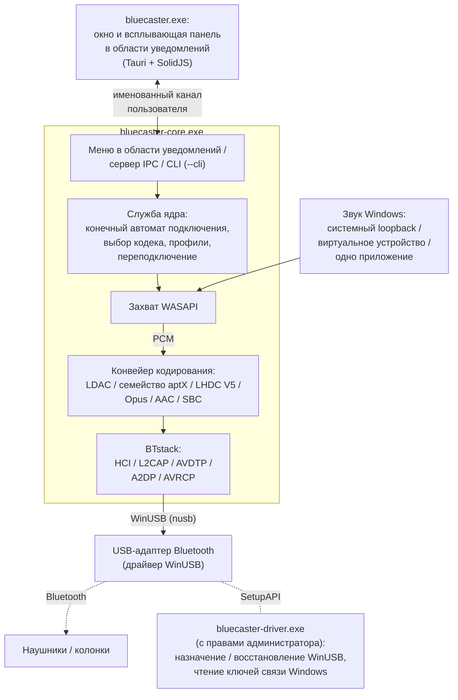
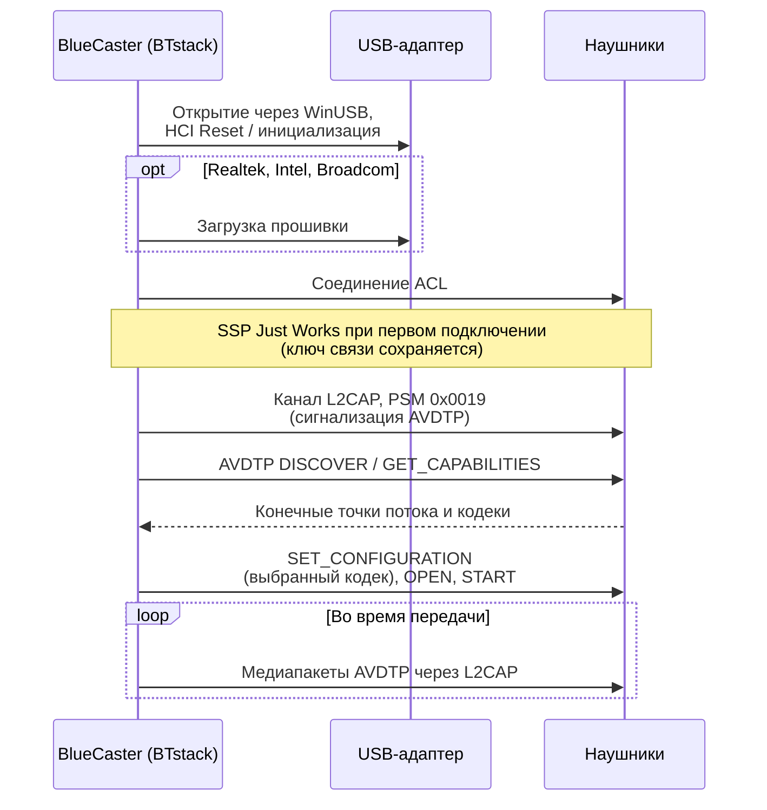
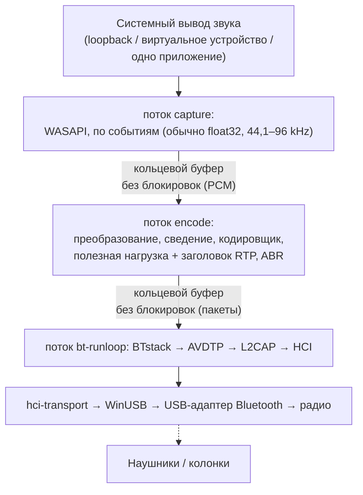
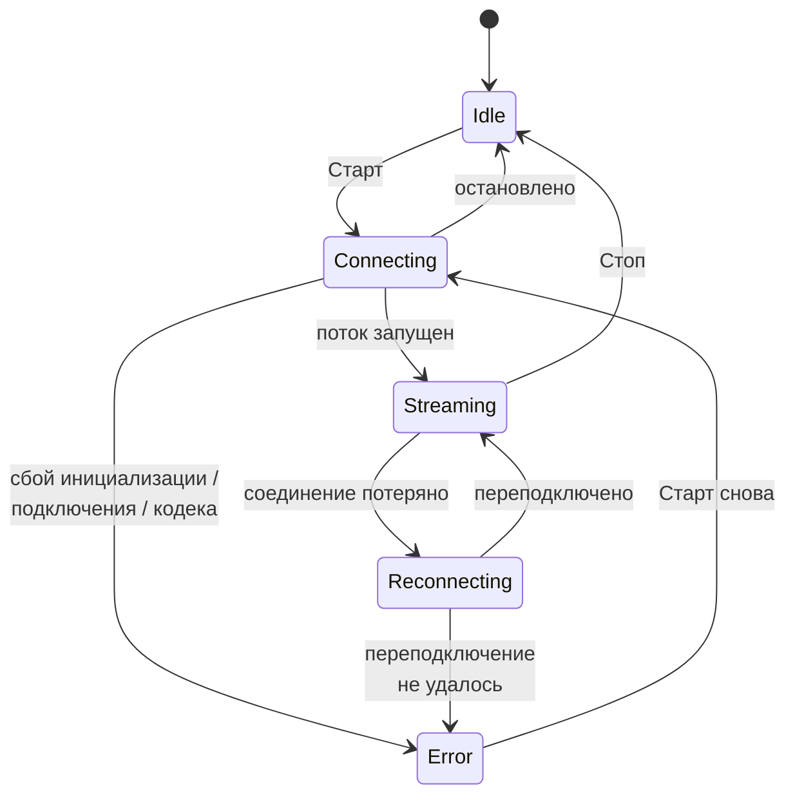
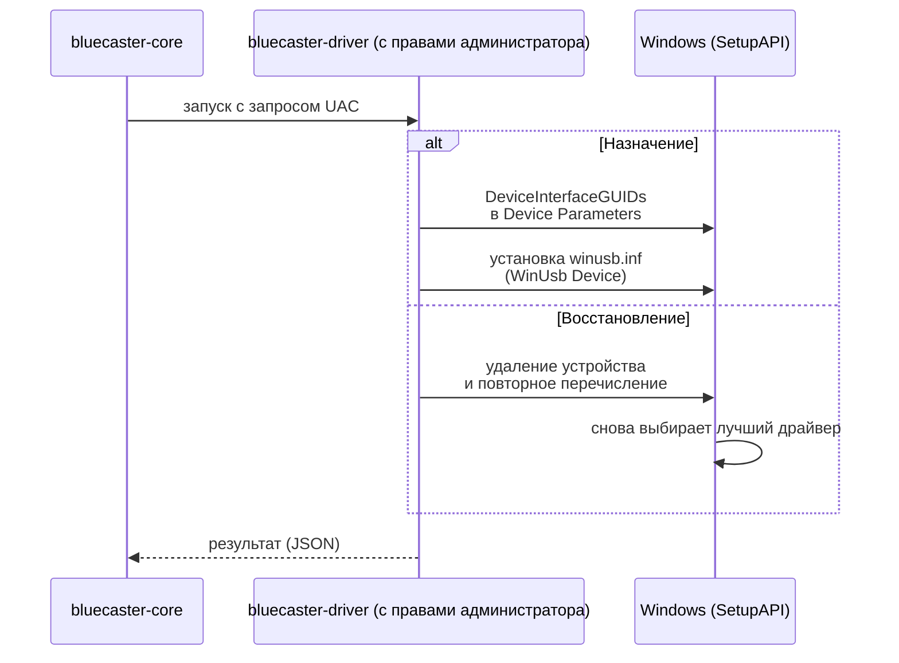

# Архитектура
{: .no_toc }

## Содержание
{: .no_toc .text-delta }

1. TOC
{:toc}

---

## Обзор

BlueCaster позволяет передавать Bluetooth-звук в Windows с кодеками LHDC V5, LDAC, aptX Adaptive, aptX HD,
aptX Low Latency, aptX, Opus, AAC, SBC XQ и SBC
(а также LC3 через LE Audio, экспериментально). Собственный стек Bluetooth Windows поддерживает для A2DP
только SBC, классический aptX и (только в Windows 11) AAC. BlueCaster добавляет
остальные кодеки без драйвера режима ядра.

BlueCaster использует **BTstack + WinUSB**: всё работает в пользовательском режиме, поэтому подпись драйвера не нужна.

BlueCaster 2.0 написан на Rust. Библиотеки на C, которые нельзя заменить
(BTstack и кодировщики кодеков), компилируются из исходного кода и вызываются через
небольшие FFI-крейты. Всё остальное, включая кодировщик SBC, написано на Rust.

## Процессы

BlueCaster состоит из трёх программ, которые запускаются по мере надобности:

| Программа | Когда работает | Что делает |
|:--------|:-----|:-----|
| `bluecaster-core.exe` | Всё время, пока запущен BlueCaster (его запускает окно, меню «Пуск» или параметр **Запускать вместе с Windows**) | Bluetooth, захват и кодирование звука, профили и настройки, значок в области уведомлений и его меню, сервер IPC. Параметр `--cli` запускает то же ядро в консоли |
| `bluecaster.exe` | Только пока открыто окно (завершается через 3 минуты после закрытия последнего окна) | Главное окно и всплывающая панель в области уведомлений (Tauri 2, SolidJS + TypeScript). Собственного состояния не хранит |
| `bluecaster-driver.exe` | Ненадолго, с правами администратора (UAC), для смены драйвера или импорта ключей | Назначает адаптеру WinUSB, восстанавливает прежний драйвер адаптера или читает ключи связи, которые Bluetooth Windows хранит для адаптера (`windows-keys`), и завершается |

- **Ядро — не служба Windows.** Это обычный процесс пользователя, вошедшего в систему,
  потому что loopback WASAPI захватывает звук сеанса именно этого пользователя.
  Мьютекс сеанса допускает только один экземпляр ядра; при повторном запуске ядра
  открывается окно.
- **Область уведомлений принадлежит ядру.** Меню значка по правому щелчку (открыть, первые 10
  устройств, отключить, выход) открывается сразу, без запуска окна. Щелчок
  левой кнопкой открывает всплывающую панель (или главное окно, в зависимости от
  параметров).
- **Окно только отображает.** Оно получает снимок состояния ядра,
  а затем каждое изменение. Закрытие окна или его сбой не останавливают
  звук. При закрытии окно лишь скрывается, поэтому из области уведомлений
  оно открывается мгновенно.
- **Командная строка использует то же ядро.** `bluecaster-core.exe --cli` запускает
  службу ядра без области уведомлений и IPC; так работает тест с эмулятором.

## Транспорт: BTstack + WinUSB

BlueCaster полностью обходит стек Bluetooth Windows и работает с
USB-адаптером Bluetooth напрямую через WinUSB (универсальный USB-драйвер, подписанный Microsoft). BTstack —
стек Bluetooth с открытым для ознакомления исходным кодом (некоммерческая лицензия) — реализует HCI, L2CAP, AVDTP и A2DP в
пользовательском режиме.

**Преимущества**:
- Не нужно платить за подпись драйвера
- Не нужен тестовый режим подписи
- Не нужно отключать Secure Boot
- Весь код работает в пользовательском режиме (проще отладка)

**Компромиссы**:
- Нужен отдельный USB-адаптер Bluetooth (помимо встроенного
  Bluetooth Windows)
- Пока адаптер занят WinUSB, обычный Bluetooth Windows
  не может его использовать
- Устройства находятся поиском (GAP inquiry) через USB-адаптер, или их адрес
  вводится вручную

**Как это работает**:
1. Пользователь назначает USB-адаптеру Bluetooth драйвер WinUSB — в приложении (**Адаптеры >
   Заменить на драйвер WinUSB**, см. [Назначение драйвера](#driver-assignment)) или с помощью Zadig
2. Крейт `hci-transport` открывает адаптер через WinUSB с помощью `nusb`
   и подключает его к BTstack как транспорт HCI
3. BTstack отправляет команды HCI для инициализации контроллера Bluetooth
4. Для адаптеров Realtek, Intel и Broadcom BlueCaster при необходимости загружает прошивку
5. BTstack устанавливает соединение ACL и открывает каналы L2CAP (PSM 0x0019)
6. Сигнализация AVDTP обнаруживает SEP удалённого устройства и согласует кодеки
7. Закодированный звук отправляется медиапакетами AVDTP через L2CAP

В USB-транспорте сохранены приёмы восстановления, которые понадобились реальным адаптерам в
v1. При открытии адаптера он сбрасывает каналы событий и ACL, повторяет неудачное
чтение события, ограничивает время ожидания команд HCI, а при закрытии адаптера отправляет
HCI Reset (кроме контроллера, который ещё в загрузчике). Так следующий
сеанс начинается с контроллером в состоянии простоя.

## Структура крейтов

Весь код — одна рабочая область Cargo (`Cargo.toml` в корне репозитория) из пяти уровней.
Каждый уровень зависит только от уровней ниже. Библиотеки находятся в
`app/src/crates/`, программы — в `app/src/core`, `app/src/ui` и
`app/src/driver`. Встроенный в репозиторий крейт `aptx-adaptive` подключён к `codec` как зависимость по пути
и в рабочую область не входит. Код `unsafe` могут содержать только крейты `*-sys` и `win-sys`;
во всех остальных крейтах стоит `#![forbid(unsafe_code)]`.

| Уровень | Крейт | Что делает |
|:------|:------|:-----|
| 1. FFI | `btstack-sys` | Собирает BTstack с помощью `cc` (MSVC), написанные вручную объявления FFI и безопасные обёртки, `btstack_config.h`. BTstack можно вызывать только в потоке его цикла выполнения: это обеспечивает токен `Stack` с `!Send` |
| 1. FFI | `ldac-sys`, `openaptx-sys`, `fdkaac-sys`, `lhdcv5-sys`, `opus-sys`, `lc3-sys` | Собирают кодировщики на C и дают к ним доступ. На каждую библиотеку свой крейт, чтобы лицензии не смешивались |
| 1. FFI | `win-sys` | API Win32, для которых нет библиотеки на Rust: MMCSS, аудиоустройство по умолчанию (IPolicyConfig), WLAN API (AFH), уведомления питания, раздел Run, мультимедийные клавиши, DACL канала, повышение прав, назначение драйвера WinUSB (SetupAPI) и собственный Bluetooth Windows (его радиомодули, сопряжённые устройства и ключи связи) |
| 2. Компоненты | `hci-transport` | HCI через USB («H2») с помощью `nusb` и H4 через TCP к виртуальному контроллеру (`tools/emu`) |
| 2. Компоненты | `aptx-adaptive` | Кодировщик aptX Adaptive на Rust (взят из AKS-Logic/aptx-adaptive-linux, MIT) |
| 2. Компоненты | `codec` | Трейт `Encoder`, кодировщик SBC (перенос кодировщика Bluedroid на Rust), безопасные обёртки кодировщиков на C, разбор Codec Information и выбор кодека |
| 2. Компоненты | `audio-capture` | Захват WASAPI (крейт `wasapi`): системный loopback, виртуальное устройство, одно приложение (loopback процесса); списки устройств и приложений, тестовый сигнал, громкость отдельных приложений (микшер громкости) |
| 2. Компоненты | `voice-link` | Звук микрофона гарнитуры (режим разработчика): монофонический PCM выводится на выбранное устройство вывода (WASAPI), захват сводится в моно для обратного канала, голосовые кодеки CVSD / mSBC / LC3-SWB работают поверх полезной нагрузки SCO |
| 3. Движок | `bt-host` | Запускает BTstack в собственном потоке и работает через команды и типизированные события: GAP, A2DP Source, AVRCP, SDP, каналы RFCOMM для сквозной передачи (`rfcomm.*`), ключи связи, службы SDP устройства, AFH, загрузка прошивки и загрузчики чипов (`bringup`), опрос чипа и скрипты чипа, запись HCI (`.pklg`), LE Audio (`le/`) |
| 2. Компоненты | `le-audio` | LE Audio: логика без BTstack и Windows (присвоенные номера, LTV, PDU PACS / ASCS, пресеты, модели CSIP / VCP / MCP / CCP) |
| 3. Движок | `pipeline` | Кольцевые буферы PCM, преобразование формата, сведение каналов, кодирование, полезная нагрузка медиапакетов, темп отправки, ABR |
| 4. Ядро | `bluecaster-core` (папка `core`) | Конечный автомат, переподключения, сон / возобновление, профили, настройки и перенос из v1, синхронизация громкости, отключение звука устройства вывода, проверка обновлений, скачивание прошивки Realtek, клиент проверки приёмника, статистика, протоколы производителей (`vendor/`) |
| 4. Ядро | `ipc` | Типы протокола, общие для ядра и окна (serde; типы TypeScript генерируются с помощью `ts-rs`), и разбиение на кадры в канале |
| 5. Программы | `bluecaster-core-exe` (`app/src/core`) | `bluecaster-core.exe`: ядро, область уведомлений (`tray-icon` на цикле событий `tao`), сервер IPC, `--cli` |
| 5. Программы | `bluecaster-ui` (`app/src/ui`) | `bluecaster.exe`: Tauri 2; сторона Rust — клиент IPC, страница — SolidJS + TypeScript + Vite |
| 5. Программы | `bluecaster-driver` (`app/src/driver`) | `bluecaster-driver.exe`: вспомогательная программа с правами администратора |

## Путь звука и потоки

| Поток | Приоритет | Работа |
|:-------|:---------|:-----|
| capture | MMCSS "Audio" | Читает WASAPI; заполняет паузы в потоке тишиной |
| encode | MMCSS "Pro Audio" | Преобразует PCM во входной формат кодировщика, кодирует целые блоки (остаток ждёт следующего цикла) и упаковывает кадры в полезную нагрузку медиапакетов. Работает циклами примерно по 10 ms, чтобы пакеты уходили равномерно |
| bt-runloop | -- | Цикл выполнения BTstack; отправляет пакет из очереди, как только L2CAP готов к отправке. Каждый раз, когда в очередь отправки (64 пакета) ставится пакет, из неё отбрасываются пакеты, ждущие уже 350 ms (100 ms при низкой задержке LHDC V5), начиная с самых старых |
| USB | -- | Передачи WinUSB: по три одновременных чтения на каждом канале IN (события, данные ACL), отдельные потоки записи для команд и для данных ACL (до 8 одновременных передач) |
| core | Normal | Конечный автомат, IPC (tokio; очереди сквозного канала RFCOMM для каждого подключения), настройки, статистика (4 Hz), проверка обновлений |

Во время передачи путь звука не выделяет память и не берёт блокировок.
Статистика — это атомарные счётчики, которые ядро читает четыре раза в секунду.
BTstack не потокобезопасен, поэтому другие потоки отправляют ему команды, которые выполняются
в потоке bt-runloop.

## Ядро и IPC

Окно обменивается данными с ядром через именованный канал пользователя
`\\.\pipe\bluecaster-<user SID>`. DACL канала пускает только этого пользователя. Сообщения —
это кадры JSON с префиксом длины:

1. Окно отправляет `hello { protocol, client }`. Ядро с другой
   версией протокола отвечает `reject`, и окно сообщает, что
   программы относятся к разным версиям. Иначе ядро отвечает
   `welcome { protocol, server, features }`; `features` перечисляет дополнения к
   протоколу (`rfcomm`).
2. Ядро отправляет `snapshot`: всё своё состояние (адаптер, устройства,
   поток, профили, настройки, обновление) и номер ревизии.
3. Дальше ядро отправляет события `event` с изменениями. Если окно пропустило ревизию,
   оно запрашивает новый снимок.
4. Действия — это `request { id, method, params }` с ответом `response { id,
   result | error }`. Группы методов: `state.*`, `stream.*`,
   `device.*`, `profile.*`, `settings.*`, `adapter.*`, `audio.*`, `diag.*`,
   `receiver.*`, `rfcomm.*` и `app.*`.

Другие программы используют тот же канал; подробности — на странице
[Интеграция (IPC)](integration). В версиях до 3.0.0 канал назывался
`\\.\pipe\a2dpwb-<user SID>`. Ядро принимает подключения и по этому имени ещё как минимум 6
месяцев после 3.0.0.

Ошибки — это коды с параметрами (например, `adapter.driver_missing`), а не
тексты. Окно переводит их и показывает способ исправления рядом с сообщением.
Часто обновляемые данные (качество связи, журнал) ядро отправляет, только пока какой-либо экран
на них подписан.

Конечный автомат подключения:

Ядро повторяет неудачное подключение до 3 раз. Потерянное соединение оно пытается восстановить до
3 раз, а после перезапуска стека (сон, сбой адаптера) — до 10 раз.
Когда компьютер уходит в спящий режим, ядро останавливает BTstack, не считая
потерю соединения сбоем, и после выхода из спящего режима подключается заново.

## Назначение драйвера {#driver-assignment}

Windows 8 и новее содержат подписанный Microsoft драйвер WinUSB
(`winusb.inf`). `bluecaster-driver.exe` делает через SetupAPI то же, что в диспетчере устройств
«Обновить драйвер > Выбрать драйвер из списка > WinUsb Device»:

1. Открывает адаптер по ИД экземпляра устройства.
2. Записывает значение `DeviceInterfaceGUIDs` в его `Device Parameters`, чтобы
   WinUSB зарегистрировал для него интерфейс устройства.
3. Выбирает модель «WinUsb Device» из `%SystemRoot%\INF\winusb.inf` и
   устанавливает её с помощью `DiInstallDevice`. Встроенный драйвер подписан, поэтому
   сертификат не устанавливается (в отличие от Zadig / libwdi, которые подписывают сгенерированный
   INF самодельным сертификатом).
4. **Восстановление**: удаляет устройство (`DiUninstallDevice`) и заново перечисляет устройства.
   Windows снова выбирает драйвер с наилучшим рейтингом (обычно `BthUSB` или
   драйвер производителя). Прежний драйвер адаптера записывается в
   папку настроек (`driver\`), и после восстановления результат сверяется с этой записью.
   `restore --records <folder>` восстанавливает все записанные адаптеры за один
   запуск с правами администратора. Программа удаления использует эту команду, спросив пользователя.

Ядро никогда не работает от имени администратора. Для назначения или восстановления драйвера оно запускает
вспомогательную программу с запросом UAC (`ShellExecuteEx` "runas") и читает её результат
в JSON. Чтобы получить список адаптеров и их драйверов, права администратора не нужны.

## Основные модули

### Выбор кодека (`codec::caps`)

- Разбирает возможности удалённого устройства: стандартные элементы SBC и AAC и
  кодеки производителей, в том числе aptX LL под обоими vendor ID и aptX Adaptive
  (приёмники R1 и R2; пригоден только с 48 kHz стерео)
- Выбирает кодек: «Авто» берёт кодек с наилучшим качеством звука из тех, что предлагает
  удалённое устройство. Если устройство не предлагает запрошенный кодек, его заменяет
  кодек, который выбрал бы «Авто» (для профиля — всегда, начиная с issue #86; в
  командной строке — только с `--fallback`); иначе это ошибка. Кодек,
  выбранный на своей карточке, хотя устройство его не предлагало (`codec_forced` профиля),
  всё равно запрашивается, без замены (`RemoteCaps::forcing`).
  Кодек, карточка которого предлагает больше, чем перечисляет устройство
  (`unlisted_options`), настраивается по `RemoteCaps::unlisted`
- Пока включён параметр `auto_codec` (Кодеки > Автоматически выбирать кодек с наилучшим
  качеством; начиная со схемы 5 — один параметр для всех устройств), передаёт каждый профиль A2DP
  как «Авто» с настройками «Авто» по умолчанию. Кодек,
  выбранный для устройства, остаётся в его профиле на случай, если параметр выключат
- Учитывает порядок кодеков, который пользователь задал, перетаскивая карточки устройства
  (`codec_order` профиля; `codec::AutoOrder`, пустой порядок —
  сначала наилучшее качество звука). Порядок действует и при выборе «Авто», и при замене
  выбранного кодека, в том числе при автовыборе. FastStream и Opus
  05 никогда не выбираются «Авто» и не служат заменой. (В бета-версиях 2.0.2 был один порядок
  для всех устройств, `auto_order` в settings.json, теперь он игнорируется.)
- Выбирает частоту дискретизации для семейства aptX (44,1 / 48 kHz из частот, которые
  объявляет удалённое устройство; WASAPI передискретизирует захват). aptX Adaptive использует 48 kHz, а
  96 kHz — если выбрано 96 kHz, качество «Высокое», а приёмник — R2 с поддержкой
  96 kHz. Частота «Авто» (в том числе при автовыборе) запрашивает 48 kHz.
  Если приёмник её не поддерживает, каждый кодек выбирает лучшую из перечисленных частот (issue #86: не
  самую высокую и не частоту микширования Windows)
- Сопоставляет качество профиля с уровнями, которые предлагает кодек
  (`Quality::for_codec`, issue #86): LDAC и LHDC V5 — Высокое / Среднее
  (`sq`) / Низкое (`mq`), LHDC V5 также Выше среднего (`mhq`), aptX Adaptive —
  Высокое / Низкая задержка, все остальные кодеки — Высокое (наибольший битрейт, который принимает
  устройство). Качество, которого у кодека больше нет (Standard /
  Mobile у aptX Adaptive, нижние уровни AAC), работает как Высокое
- Запоминает, какие значения устройство указало для каждого предложенного кодека (`KnownCodecs.caps`:
  частоты дискретизации, разрядности, максимальный битрейт; `RemoteCaps::listed_*`), чтобы
  настройки кодека предлагали только их. Диапазон bitpool SBC запоминался и раньше

### Хост Bluetooth (`bt-host`)

**Задачи**:
- Запускать BTstack с транспортом HCI через USB (или TCP) в собственном потоке
- Регистрировать конечные точки потока: кодеки производителей (LDAC, aptX HD, aptX, aptX LL,
  LHDC V5, FastStream, Opus, Opus 05, aptX Adaptive), а также SBC (используется и
  SBC XQ) и AAC: всего 11 (`MAX_NR_AVDTP_STREAM_ENDPOINTS` в BTstack)
- Регистрировать записи SDP (A2DP Source, AVRCP Controller, AVRCP Target; HFP
  Audio Gateway — только для уровня заряда батареи, пока этот параметр
  включён)
- Управлять сопряжением SSP (Just Works, General Bonding; ключи связи сохраняются)
- Разрывать полуоткрытое соединение после тайм-аута подключения, чтобы повторные попытки срабатывали
- Повторять неудачное подключение (до 3 попыток) и различать причины (нет
  ответа, молчащее соединение, соединение разорвано удалённым устройством, аутентификация); удалять ключ связи,
  который устройство больше не помнит, и выполнять сопряжение заново
- GAP inquiry для поиска устройств
- Абсолютная громкость AVRCP и кнопки наушников
- Классификация каналов хостом для AFH, а также показания RSSI / AFH для экрана
  качества связи
- Загрузка прошивки: Realtek и Broadcom — через драйверы чипсетов BTstack,
  Intel (загрузчики legacy и TLV) — на Rust через общий интерфейс загрузчиков чипов
  (`bringup`). Пока адаптер запускается, ход загрузки виден на экране
  «Адаптеры»
- Режим разработчика: опрос чипа (что адаптер отвечает на стандартные команды
  чтения, отчёт в JSON в `logs\probe\`), скрипты чипа (запросы, записанные
  текстом и выполняемые на адаптере с WinUSB) и службы SDP, которые перечисляет подключённое
  устройство
- Запись HCI (`.pklg`), включая установку соединения, даже если запись начата уже после подключения

**Основные используемые API BTstack**:
- `a2dp_source_create_stream_endpoint()` — регистрация конечных точек кодеков
- `a2dp_source_establish_stream()` — подключение к приёмнику A2DP
- `a2dp_source_set_config_other()` — настройка кодека производителя
- `a2dp_source_stream_send_media_payload_rtp()` — отправка закодированного звука с
  заголовком RTP (LDAC, aptX HD, AAC, SBC, SBC XQ, LHDC V5, Opus)
- `a2dp_source_stream_send_media_packet()` — отправка необработанных медиапакетов без
  заголовка RTP (aptX, aptX LL, FastStream) или с собственным заголовком RTP BlueCaster
  (aptX Adaptive)

### Захват звука (`audio-capture`)

Захватывает звук в реальном времени через Windows Audio Session API.
- Системный loopback устройства вывода по умолчанию, loopback выбранного
  (виртуального) устройства или loopback процесса для одного приложения и его дочерних
  процессов (Windows 10 сборки 19041 или новее)
- Выдаёт формат микширования устройства в общем режиме (обычно float32;
  конвейер преобразует его для кодировщика)
- В режиме «Приложение» ждёт запуска приложения и снова начинает захват
  после его перезапуска
- Задаёт громкость приложения и отключает его звук на устройстве вывода по умолчанию, как
  микшер громкости Windows (`mixer`). Громкость сеанса влияет на захват loopback, даже
  когда ядро отключает звук этого устройства вывода во время передачи из системного loopback
  (`bluecaster-core::mute_output`)

### Протоколы производителей (`bluecaster-core::vendor`)

Некоторые наушники предлагают кодек или битрейт только после того, как фирменное приложение переключит
режим через их службу RFCOMM. Для каждого производителя есть модуль, который делает это через
соединение BlueCaster. Наушники распознаются по имени:

- **Huawei / Honor**: если профиль запрашивает LDAC, а наушники его не
  предлагают, модуль включает их режим «приоритет качества звука» и подключается заново.
  Если LDAC так и не появился, а режим до этого был выключен, модуль выключает его обратно. Для «Авто»
  не используется
- **OPPO**: когда передаётся LHDC V5 (выбранный вручную или «Авто»), модуль один раз
  запрашивает у наушников Hi-Res и один раз переподключается, чтобы узнать, что они теперь предлагают.
  Отметка об этом хранится вместе с кодеками устройства (`device_codecs.json`), пока
  её не сбросит `device.forget_codecs`

На вкладке «Производители» в режиме разработчика можно выбрать, когда работает каждый модуль (Авто по имени,
Всегда, Никогда), и задать параметры производителя.

### Сопряжения (`link_keys`, `win-sys::bt_keys`)

Ключи связи хранятся в `link_keys.txt`. При добавлении устройств ядро может
импортировать ключи, которые Bluetooth Windows хранил для адаптера, теперь занятого BlueCaster.
Их читает `bluecaster-driver.exe windows-keys` (один запрос UAC). Ключи, которые у BlueCaster
уже есть, остаются прежними, а аудиоустройства среди импортированных сохраняются с
именами из Windows. В режиме разработчика видны ключ связи устройства и
службы SDP, которые оно предлагает.

Файлы ключей в `pairing\` (ключи связи, привязки LE, координированные наборы, ключи LE,
перенятые из Windows, заменённые ключи Windows) зашифрованы для пользователя Windows
с помощью DPAPI (`win-sys::dpapi`). Их не прочитают ни другие пользователи, ни другой компьютер,
если скопировать на него эти файлы. Незашифрованные файлы прежних версий читаются
и перезаписываются в зашифрованном виде. Файл, который не удаётся расшифровать, сохраняется как
`<name>.undecryptable`, а его устройства сопрягаются заново. BlueCaster сам хранит
LE TLV BTstack (`TlvStore` из `btstack-sys`, с содержимым, которое
записывал `btstack_tlv_windows`). `keys_for_windows.json`, который вспомогательная
программа с правами администратора читает при восстановлении, не шифруется (она может работать от имени другого
администратора) и удаляется, когда она завершается.

### Кодировщики звука

| Кодировщик | Библиотека | Битрейт | Особенности |
|---------|---------|---------|----------|
| LHDC V5 | lhdcv5-enc (перенос кодировщика AOSP на C) | 400/500/900/1000 kbps (Низкое/Среднее/Выше среднего/Высокое), не больше максимума, указанного приёмником, ABR 160–400 kbps | 16/24 бит, кадры 5 ms, 2-байтовый заголовок полезной нагрузки, заголовок RTP; низкая задержка, если приёмник её указывает (кодирует каждые 10 ms вместо 20; при выключенном ABR добавляется защита очереди, описанная ниже) |
| LDAC | libldac (AOSP) | 330/660/990 kbps | Режимы Высокое/Среднее/Низкое (HQ/SQ/MQ), ABR |
| aptX Adaptive | aptx-adaptive (кодировщик на чистом Rust из AKS-Logic/aptx-adaptive-linux, MIT) | 427 kbps Высокое, 265 kbps Низкая задержка (приёмники R2: 270); ABR понижает до 364/318 (R2: 270/204) | 48 kHz стерео (96 kHz в режиме Высокое, если выбрано, для приёмника R2, который его перечисляет: 646/340/255 kbps), 24 бит; один пакет кодека на медиапакет за собственным заголовком RTP BlueCaster; ABR в режиме Высокое; «Авто» выбирает его после LHDC V5 и LDAC |
| Opus | libopus 1.6.1 | 256 kbps (стерео; моно — половина) | A2DP Opus из Android: 48 kHz, кадры 20 ms (10 ms, если у приёмника есть только они), ограниченный VBR с ограничением по полезной нагрузке медиапакета, один кадр на пакет, 1-байтовый заголовок полезной нагрузки, заголовок RTP |
| aptX HD | libopenaptx | 576 kbps | 24-битный вход, фиксированный битрейт, заголовок RTP |
| aptX | libopenaptx | 352/384 kbps (44,1/48 kHz) | 16 бит стерео, без заголовка RTP |
| aptX LL | libopenaptx | 352 kbps | Задержка ~32 ms, без заголовка RTP, пакеты ≤ ~7,5 ms |
| AAC | fdk-aac | до 256 kbps (не больше битрейта, указанного приёмником) | AAC-LC, транспорт LATM |
| SBC XQ | тот же кодировщик SBC | ~385/505/552 kbps | Dual channel, bitpool 47 / 43 при 44,1 / 48 kHz (Высокое); только если SBC приёмника допускает dual channel и bitpool не меньше 29 (тогда bitpool ограничивается максимумом приёмника, как в PipeWire); использует общие с SBC конечную точку потока, заголовок полезной нагрузки и заголовок RTP |
| SBC | перенос кодировщика Bluedroid на Rust | до ~345 kbps | Обязательная основа A2DP; побитово совпадает с кодировщиком на C (проверено на всех конфигурациях) |
| FastStream | тот же кодировщик SBC | 198/216 kbps (44,1/48 kHz) | Кодек производителя CSR, только направление музыки (без обратного голосового канала): SBC joint stereo, bitpool 29, кадры дополнены до 72 байт, 3 на пакет, без заголовка полезной нагрузки и без заголовка RTP (как в PipeWire); «Авто» никогда его не выбирает |

**Защита очереди LHDC V5** (низкая задержка включена, ABR выключен): пока в
очереди отправки в среднем за секунду 12 пакетов или больше, кодировщик снижает
битрейт на один уровень (1000, 900, затем 500 kbps), не чаще чем раз в 2 s.
После спокойной минуты он повышает битрейт на один уровень. Если повышение не
держится 30 s, ожидание удваивается, но не больше чем до 10 минут.

Все кодировщики реализуют трейт `codec::Encoder`: они сообщают формат PCM
и число кадров, которое принимает один вызов, и возвращают кадры кодека.

libopenaptx ожидает группы по 4 стереосэмпла в виде упакованного 24-битного PCM little-endian;
обёртки aptX преобразуют 16- или 32-битные сэмплы в этот формат,
а монофонический вход дублируется в оба канала.

## Codec Information Elements кодеков производителей

Нестандартные кодеки регистрируются в AVDTP как Vendor Specific:

| Кодек | Vendor ID | Codec ID |
|-------|-----------|----------|
| LHDC V5 | Savitech (0x0000053A) | 0x4C35 |
| LDAC | Sony (0x0000012D) | 0x00AA |
| aptX Adaptive | Qualcomm (0x000000D7) | 0x00AD |
| Opus | Google (0x000000E0) | 0x0001 |
| aptX HD | Qualcomm (0x000000D7) | 0x0024 |
| aptX | APT (0x0000004F) | 0x0001 |
| aptX Low Latency | CSR (0x0000000A) или Qualcomm (0x000000D7) | 0x0002 |
| FastStream | CSR (0x0000000A) | 0x0001 |
| Opus 05 | The Linux Foundation (0x000005F1, PipeWire) | 0x1005 |

AAC и SBC используют стандартные идентификаторы кодеков, определённые в спецификации A2DP.

Размеры элементов Codec Information (включая 6 байт vendor ID / codec ID):

- **aptX**: 7 байт (байт 6 = частота дискретизации / режим каналов)
- **aptX HD**: 11 байт (байт 6 как у aptX, плюс 4 зарезервированных байта); стерео
  обязательно
- **aptX LL**: 8 байт или 17 байт, если приёмник устанавливает расширенный флаг
  («new caps»). BlueCaster регистрирует одну конечную точку aptX LL и настраивает
  поток с тем vendor ID, который использовал приёмник
- **LHDC V5**: 11 байт (Android `a2dp_vendor_lhdcv5_constants.h`): байт 6 —
  частоты дискретизации (0x20 44,1k, 0x10 48k, 0x04 96k, 0x01 192k), байт 7 — разрядность
  (0x04 16 бит, 0x02 24 бит) и минимальный/максимальный битрейт приёмника, байт 8 —
  подверсия кодека (0x01 = V5 ver.1) и 0x10 = кадры 5 ms, байты 9-10 —
  необязательные функции (low latency, lossless, JAS, AR, META). BlueCaster запрашивает
  low latency (байт 9, 0x40), если в настройках LHDC V5 включена «Низкая задержка»
  и приёмник её указывает. Остальные функции BlueCaster не предлагает. Только стерео. Ограничения битрейта приёмника возвращаются в
  конфигурации и применяются к кодировщику, как в Android. Медиапакеты
  несут 2-байтовый заголовок полезной нагрузки: число кадров << 2 (биты задержки 0) и
  порядковый номер
- **FastStream**: 8 байт (PipeWire `a2dp_faststream_t`): байт 6 — направление
  (0x01 sink = музыка, 0x02 source = голос), байт 7 — в младшем полубайте частоты приёмника
  (0x2 44,1k, 0x1 48k), в старшем — частота источника (0x2 16k). BlueCaster предлагает
  и настраивает только направление музыки
- **Opus**: 7 байт (Android `a2dp_vendor_opus_constants.h`): байт 6, биты
  2..0 — режим каналов (0x01 моно, 0x02 стерео, 0x04 dual mono), биты 4..3 —
  длительность кадра (0x08 10 ms, 0x10 20 ms), бит 7 — 48 kHz. BlueCaster предлагает моно
  и стерео, 10 и 20 ms, и настраивает 20 ms стерео (моно — только для монофонического
  входа и приёмника, который его поддерживает). Медиапакеты несут один пакет Opus за
  1-байтовым заголовком полезной нагрузки (число кадров 1 в младших 4 битах)
- **aptX Adaptive**: 40 байт. Событие возможностей BTstack обрезает
  Codec Information приёмника до 30 байт, но в них есть всё, что нужно BlueCaster.
  SET_CONFIGURATION: 48 kHz с типом источника 2 (кодировщик на хосте: приёмник сам задаёт тайминг
  воспроизведения), стерео; приёмник R1 получает обратно свои байты целевой
  задержки, при этом LL0 повышается не менее чем до 80 ms, а нулевая задержка HQ заменяется на
  200 ms; приёмник R2 получает собственный блок R2 источника

**RTP или без RTP**: медиапакеты LDAC, aptX HD, AAC, SBC, SBC XQ, LHDC V5 и Opus несут
12-байтовый заголовок RTP. aptX, aptX LL и FastStream отправляются **без** заголовка RTP (как в Android и
PipeWire), поэтому весь L2CAP MTU доступен для кадров aptX.

**aptX Adaptive** отправляет один пакет кодека на медиапакет
за собственным 12-байтовым заголовком RTP BlueCaster (BTstack его не добавляет): тип полезной нагрузки 96,
порядковый номер +1 на пакет, отметка времени = число сэмплов на канал в
пакете (а не часы), SSRC = режим задержки приёмника (0x000000A3 HQ,
0x000000A1 LL). Байты полезной нагрузки переставлены в 16-битных словах. Пакеты HQ имеют размер
656 байт (12 ms), пакеты LL — 348 байт (10 ms). «Авто» выбирает его раньше
классического aptX, Opus и AAC (порядок из issue #86), но после LHDC V5 и LDAC.

## Настройки и файлы {#settings-and-files}

Всё хранится в папке настроек `%APPDATA%\BlueCaster` (или в
папке, указанной в переменной среды `BLUECASTER_CONFIG_DIR`). Файлы
из v1 и 2.0.x сохраняют свои форматы. Версия 2.0.x использовала `%APPDATA%\A2DPWB`; 3.0.0
переименовывает эту папку при первом запуске и раскладывает файлы по папкам
ниже:

| Путь | Содержимое |
|:-----|:---------|
| `settings.json` | Настройки приложения с `schema_version`; неизвестные ключи сохраняются |
| `profiles.json` | Профили |
| `devices\devices.txt` | Известные устройства |
| `devices\le_audio_devices.txt` | LE Audio: записи LE Audio из списка устройств |
| `devices\le_audio_sets.txt` | LE Audio: координированные наборы сохранённых устройств (только адреса участников; оба наушника из пары — одно устройство) |
| `devices\device_codecs.json` | Что предлагало каждое классическое устройство при последнем подключении (и запрашивался ли у наушников OPPO Hi-Res) |
| `pairing\link_keys.txt` | Ключи связи: наушники, сопряжённые в v1 или 2.0.x, подключаются без повторного сопряжения |
| `pairing\le_audio_bonds.tlv`, `pairing\le_audio_csip.txt` | LE Audio: привязки LE (с постоянными значениями CCC сервера GATT) и координированные наборы |
| `pairing\windows_le_keys.txt`, `pairing\replaced_windows_keys.json` | Ключи LE, взятые из Windows, пока стек их не добавит; ключи Windows, которые заменила кнопка **Восстановить исходный драйвер** |
| `adapters\adapter_caps.json` | Что стек узнал о каждом адаптере (поддержка LE Audio, адрес, версия HCI, его имя в Windows) |
| `adapters\driver\<instance id>.json` | Прежний драйвер каждого адаптера, которому был назначен WinUSB |
| `firmware\` | Файлы прошивки (`*.bin`, `*.hcd`, `ibt-*`; файлы Intel также в `firmware\intel\`, как они разложены в linux-firmware); файлы, которые прежние версии хранили прямо в папке настроек, переносятся сюда |
| `logs\<YYYY-MM-DD>\core.log`, `ui.log`, `driver.log` | Журналы ядра, окна и вспомогательной программы драйвера, по одной папке на день (UTC); не маскируются |
| `logs\hci\*.pklg` | Записи HCI: записи «бортового самописца», которые сохраняются при сбое потока или потере соединения (10 последних), и записи, которые вы начинаете сами (`hci_<date>_<time>.pklg`) |
| `logs\probe\` | Отчёты опроса чипа и скриптов чипа (10 последних) |
| `logs\crash\` | Отчёты о сбоях: минидамп (`*.dmp`) и текстовый файл на каждый сбой (5 последних для каждой программы) |
| `logs\bundles\*.zip` | Диагностические архивы (3 последних) |
| `backup\v1\` | Копия настроек v1, создаётся один раз при первом запуске v2 |
| `backup\v2\` | Копия настроек и сопряжений 2.0.x, создаётся один раз при первом запуске 3.0.0 |
| `backup\profiles-before-codecs.json` | `profiles.json` до того, как экран «Кодеки» объединил несколько профилей устройства в один (записывается один раз) |

Папка программы — `%LOCALAPPDATA%\BlueCaster\`: три программы,
программа удаления и `licenses\` (`licenses\README.txt`, `licenses\bluecaster\LICENSE...`,
`licenses\third-party\...`). Кэш скачанной прошивки — `%TEMP%\bluecaster-cache`.

## Система сборки

- **Cargo** собирает программы; CMake им не нужен. Каждый крейт `-sys`
  компилирует свою библиотеку на C из подмодуля git в `extern/` с помощью MSVC в
  `build.rs`. С помощью CMake собирается только инструмент разработчика `tools/a2dp_decode`
- Страница окна собирается с помощью **Vite** (`pnpm build` в `app/src/ui`) и
  встраивается Tauri в `bluecaster.exe`
- Типы TypeScript для протокола IPC генерируются из типов Rust
  (`cargo test -p ipc export_bindings`)
- Языковые файлы (`app/lang/*.json`) используются окном и меню ядра
  в области уведомлений
- `installer/build-release.ps1` создаёт установщик (Inno Setup, `installer/BlueCaster.iss`),
  портативный ZIP-архив и манифест обновлений. См. [Сборка](building)

## Важные замечания

- **Совместимость адаптеров**: Realtek (проверены лучше всего), CSR, Intel, Broadcom, MediaTek
  и другие ([Проверенное оборудование](hardware)). Адаптерам Realtek нужна загрузка прошивки при запуске,
  адаптерам Intel в режиме загрузчика — тоже
- **Сопряжение**: BlueCaster использует SSP Just Works с General Bonding. Ключи связи сохраняются
  в локальный файл или импортируются из Bluetooth Windows для этого адаптера
- **Рекомендуется второй адаптер**: оставьте встроенный Bluetooth для Windows, а для BlueCaster
  используйте отдельный USB-адаптер
- Прошивка некоторых адаптеров Bluetooth ограничивает достижимый битрейт
- USB-адаптеры Bluetooth 5.0+ обычно хорошо работают с LDAC
- Приоритет автоматического выбора кодека (по качеству звука, issue #86): LHDC V5 > LDAC > aptX Adaptive > Opus > aptX HD > aptX > aptX LL > AAC > SBC XQ > SBC (FastStream и Opus 05 — только если выбраны); если выбранный кодек устройство больше не предлагает, его заменяет первый предлагаемый устройством кодек в порядке этого устройства; кодек, выбранный на своей карточке, хотя устройство его не предлагало, всё равно запрашивается (`codec_forced`, без замены)
