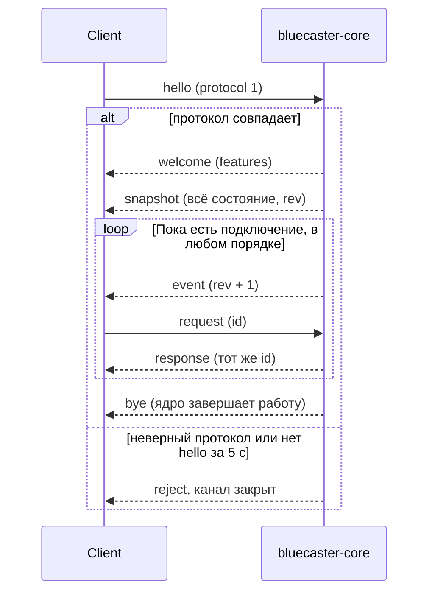

# Интеграция (IPC)
{: .no_toc }

Как стороннему инструменту работать с ядром BlueCaster: показывать состояние потока, запускать и останавливать профили, менять громкость или обращаться к собственным службам наушников через Bluetooth-соединение BlueCaster. Инструменты, которые это делают, перечислены на странице [Совместимые инструменты](works-with).

{: .warning }
> Протокол ещё может измениться в ходе бета-версий 2.0.2. Точное описание протокола — [`app/src/crates/ipc/src/protocol.rs`](https://github.com/SeiyaFunaokaJP/BlueCaster/blob/main/app/src/crates/ipc/src/protocol.rs) и сгенерированные из него типы TypeScript в [`app/src/ui/src/ipc/bindings`](https://github.com/SeiyaFunaokaJP/BlueCaster/tree/main/app/src/ui/src/ipc/bindings). Эта страница объясняет, как ими пользоваться, но не перечисляет все поля.

## Содержание
{: .no_toc .text-delta }

1. TOC
{:toc}

## Подключение {#connecting}

Ядро (`bluecaster-core.exe`) работает всё время, пока запущен BlueCaster, с окном или без него. Оно ожидает подключений на именованном канале того пользователя, от имени которого запущено:

```
\\.\pipe\bluecaster-<user SID>
```

- `<user SID>` — строка SID вошедшего в систему пользователя (`S-1-5-21-...`), например из `whoami /user`. У каждого пользователя свои ядро и канал. DACL канала пускает только этого пользователя, а удалённые клиенты отклоняются.
- Канал работает в байтовом режиме. Одновременно может быть подключено несколько клиентов (окно BlueCaster — один из них). Все они получают одно и то же состояние и одни и те же события.
- До 2.0.x канал назывался `\\.\pipe\a2dpwb-<user SID>`. BlueCaster 3.0.0 принимает подключения по **обоим** именам и сохранит старое имя ещё как минимум на 6 месяцев после 3.0.0. Клиенту следует сначала пробовать `bluecaster-<user SID>`, а если не получится — старое имя. Версия протокола остаётся 1.
- Если канала нет, ядро не запущено. Проверяйте это по каналу, а не по мьютексу ядра.
- Сборки для разработки, запущенные с `BLUECASTER_INSTANCE=<name>`, ожидают подключений на `\\.\pipe\bluecaster-<SID>-<name>`, поэтому могут работать одновременно с установленной версией.

### Канал службы {#the-service-pipe}

Служба BlueCaster — это прототип в режиме разработчика. Она позволяет пользоваться Bluetooth-клавиатурами и мышами на экране входа. На ПК с установленной службой ядро работает как служба Windows. В этом случае отдельных каналов для каждого пользователя нет. Вместо него ядро обслуживает один общий канал для всех пользователей:

```
\\.\pipe\bluecaster-service
```

- Сначала пробуйте `bluecaster-<user SID>`, затем `bluecaster-service`. Под старым именем служба канал не создаёт. Кадры, рукопожатие и запросы на обоих каналах одинаковые.
- Открывайте канал только с `GENERIC_READ | FILE_WRITE_DATA`. Чтобы изменить режим канала, добавьте `FILE_WRITE_ATTRIBUTES`. Клиентов, которые запрашивают `GENERIC_WRITE`, канал отклоняет: это право включает создание ещё одного экземпляра канала (`FILE_CREATE_PIPE_INSTANCE`). В Python `open(..., "r+b")` запрашивает `GENERIC_WRITE`. Поэтому используйте `CreateFileW`, например через `ctypes`.
- Чтобы убедиться, что сервер действительно BlueCaster, сравните идентификатор процесса сервера канала (`GetNamedPipeServerProcessId`) с идентификатором процесса службы `BlueCaster` (`QueryServiceStatusEx`). Пока служба остановлена, другая программа может создать канал с таким именем.
- Запросы, которые меняют весь ПК, возвращают ошибку `ipc.needs_admin`. Это, например, режим разработчика, драйверы адаптера или добавление клавиатур и мышей. Инструмент не может выдать разрешение администратора. Попросите пользователя внести изменение в окне BlueCaster. Окно само запросит разрешение у Windows.
- Когда ядро работает как служба, некоторые запросы возвращают `ipc.not_in_service`. Один из них — `app.quit`, потому что служба должна продолжать работать, чтобы клавиатуры и мыши оставались доступны. Вместо него используйте `app.close`. Этот метод останавливает трансляцию и закрывает окно BlueCaster и значок в области уведомлений.

### Кадры

Каждое сообщение в обоих направлениях — один кадр: длина JSON в виде **u32 little-endian**, затем сам JSON (UTF-8). Кадры больше 4 MiB отклоняются.

### Рукопожатие

1. Клиент отправляет `hello` в течение 5 секунд после подключения:
   ```json
   {"type": "hello", "protocol": 1, "client": "mytool/1.2.0"}
   ```
   `client` — любое имя и версия на ваш выбор; они попадут в журнал ядра.
2. Ядро отвечает `welcome` либо отвечает `reject` и закрывает канал (неверная версия протокола или hello не пришёл):
   ```json
   {"type": "welcome", "protocol": 1, "server": "bluecaster-core/2.0.2-beta.12", "features": ["rfcomm"]}
   {"type": "reject", "reason": "protocol 2 not supported (core speaks 1)"}
   ```
3. Ядро отправляет `snapshot` со всем своим состоянием, затем события `event`.

Версия протокола должна совпадать точно. Обратно совместимые дополнения вместо этого объявляются в `features` (см. [Совместимость](#compatibility)).



## Состояние и события {#state-and-events}

```json
{"type": "snapshot", "rev": 41, "state": {"adapter": {...}, "devices": [...], "stream": {...}, "profiles": [...], "active_profile": "WH-1000XM5", "settings": {...}, ...}}
{"type": "event", "rev": 42, "event": {"kind": "stream", "value": {"state": "streaming", "profile": "WH-1000XM5", "info": {"codec": "ldac", "bitrate_kbps": 990, ...}, "volume": 80, ...}}}
```

Клиенту не нужно собственное состояние: достаточно хранить последний снимок и применять к нему каждое событие. Каждое событие состояния **целиком заменяет одну часть** снимка:

| Событие `kind` | Заменяет |
|:--|:--|
| `adapter` | `adapter` |
| `devices` | `devices` |
| `scanning`, `le_scanning` | `scanning`, `le_scanning` |
| `stream` | `stream` (состояние, сообщение, профиль, сведения о кодеке, громкость, заряд батареи) |
| `profiles` | `profiles` и `active_profile` |
| `settings` | `settings` |
| `update` | `update` |
| `capture` | `capture` |
| `v1_running`, `verbose`, `crashes` | одноимённое поле |

`stream.state` принимает одно из значений `idle`, `connecting`, `streaming`, `reconnecting`, `error`. `stream.message` сообщает причину в виде [ключа сообщения](#errors-and-messages).

`adapter.active` — USB-адаптер, который сейчас использует BlueCaster. Пока ни один адаптер не открыт (до первого поиска или подключения, а также во время перезапуска Bluetooth), значение равно `null`.

```json
"active": {"display_name": "RTL8761BU (0x2357:0x0604)", "windows_name": "TP-Link UB500 Adapter", "vid": 9047, "pid": 1540, "vendor": "Realtek", "chip": "RTL8761BU", "bt_version": "5.1"}
```

`vid` и `pid` — числа. `windows_name`, `chip` и `bt_version` могут быть `null`. `chip` известен только для адаптеров Realtek.

Каждый клиент получает события состояния без подписки. Событие приходит, только когда что-то меняется, поэтому соединение может долго молчать.

**Ревизии.** Каждое событие состояния содержит следующий номер ревизии (`rev` + 1). Пропуск в номерах означает, что событие потеряно: отправьте `state.snapshot`, чтобы получить новый снимок. Если клиент читает слишком медленно, ядро само отправит ему новый `snapshot`. События, не относящиеся к состоянию (`link`, `log`, `receiver`, `rfcomm_data`, `rfcomm_closed`, `media_button`), содержат текущую ревизию и не увеличивают её.

Завершая работу, ядро отправляет событие `bye` и закрывает канал.

## Запросы {#requests}

```json
{"type": "request", "id": 7, "method": "stream.start", "params": {"profile": "WH-1000XM5"}}
{"type": "response", "id": 7, "result": null, "error": null}
```

- `id` — любое число на выбор клиента; ответ содержит тот же `id`. Запросы выполняются параллельно, поэтому ответы могут приходить в другом порядке.
- Для методов без параметров `params` не указывается.
- На запрос, который меняет состояние, ядро отвечает после завершения изменения, а само изменение также приходит событием. Показывайте состояние по событиям, а не по ответу.

### Ошибки и сообщения {#errors-and-messages}

```json
{"type": "response", "id": 8, "result": null, "error": {"code": "rfcomm.not_connected", "message": {"key": "ipc.error.rfcomm_not_connected", "args": []}}}
```

`code` предназначен для программ (`adapter.driver_missing`, `app.streaming`, ...). `message` — ключ перевода из языковых файлов BlueCaster ([`app/lang`](https://github.com/SeiyaFunaokaJP/BlueCaster/tree/main/app/lang)) с аргументами в стиле printf, как и тексты состояния в снимке. Инструмент может найти ключ там или показать для кода свой текст.

### Методы {#methods}

Методы для инструментов:

| Метод | Параметры | Результат |
|:--|:--|:--|
| `state.snapshot` | -- | `Snapshot` |
| `stream.start` | `profile` | `null`; сначала останавливает уже идущий поток |
| `stream.stop` | -- | `null` |
| `stream.set_volume` | `volume` (абсолютная громкость AVRCP 0-127) | `null` |
| `stream.volume_step` | `delta` (от -127 до 127) | новая громкость; см. [Быстрое управление](#quick-controls) |
| `profile.set_active` | `name` | `null` |
| `profile.set_headset_mic` | `name` (необязательно), `mode` (`off`, `auto`, `on`) | `null`; см. [Быстрое управление](#quick-controls) |
| `profile.set_mic_muted` | `name` (необязательно), `muted` (bool) | `null`; см. [Быстрое управление](#quick-controls) |
| `profile.set_media_eq` | `name` (необязательно), `enabled` (bool) | `null`; см. [Быстрое управление](#quick-controls) |
| `device.scan` | `seconds` (3-600) | `Device[]`, также в виде события `devices` |
| `device.scan_stop` | -- | `null`; после этого завершается идущий `device.scan` |
| `audio.devices` | -- | `AudioDevice[]` (источники захвата) |
| `diag.subscribe` | `logs` (уровень или `null`), `link` (bool), `receiver` (bool, необязательно) | `null`; включает или выключает события `log` / `link` / `receiver` для этого подключения |
| `diag.info` | `{"mask": bool}` (необязательно) | `DiagInfo` (текст «Копировать диагностику») |
| `rfcomm.open`, `rfcomm.send`, `rfcomm.close` | см. [Сквозной канал RFCOMM](#rfcomm-passthrough) | |

Передавайте и `logs`, и `link` при каждом вызове `diag.subscribe`. Каждый вызов задаёт оба значения, поэтому без `logs` события журнала отключаются.

Чтобы изменить одну настройку, используйте [быстрое управление](#quick-controls) вместо `profile.save` или `settings.set`.

Методы окна BlueCaster, которые инструменту стоит вызывать с осторожностью: `profile.save` / `profile.delete`, `settings.set` (заменяет **все** настройки: отправляйте последние полученные `settings` со своим изменением, а не частичный объект), `device.forget` / `device.rename`, `adapter.*` (`adapter.assign_winusb` и `adapter.restore_driver` показывают запрос UAC; `adapter.probe` и `adapter.run_script` — инструменты для чипов из режима разработчика — останавливают стек Bluetooth), `app.quit`. Остальные методы обслуживают собственные экраны окна и могут измениться без предупреждения: `stream.start_custom`, прочие `device.*` (`device.import_windows_pairings` показывает запрос UAC), `audio.apps`, `audio.mixer` / `audio.mixer_set`, `diag.*`, кроме двух указанных выше, `receiver.*` и `app.*`. Полный список с параметрами и результатами — перечисление `Method` в `protocol.rs`.

## Сквозной канал RFCOMM {#rfcomm-passthrough}

Доступен, если `welcome.features` содержит `"rfcomm"` (2.0.2-beta.10 и новее). Через уже установленное соединение BlueCaster инструмент может обращаться к собственным службам RFCOMM наушников (их используют фирменные приложения: заряд, шумоподавление, эквалайзер). Сама Windows наушники, подключённые через BlueCaster, не видит.

- `rfcomm.open {address, uuid}` → `{channel_id, mtu}`. `address` — адрес устройства, на которое сейчас идёт передача. Ради этого ядро не подключается и не выполняет сопряжение (`rfcomm.not_connected`). `uuid` — полный 128-битный UUID или 16-битный `"xxxx"` на основе Bluetooth Base UUID. Ответ приходит в течение 20 с, даже если запрос стоит в очереди за другими открытиями, поэтому ждите не менее 25 с. Ошибки: `rfcomm.not_connected`, `rfcomm.service_not_found`, `rfcomm.service_reserved`, `rfcomm.open_failed`, `rfcomm.busy`.
- Службы гарнитуры и громкой связи (`1108`, `1112`, `111E`, `111F`) отклоняются с ошибкой `rfcomm.service_reserved` в любой форме UUID. BlueCaster использует их для микрофона гарнитуры.
- Сквозному каналу нужно соединение Classic (A2DP). Для устройства, подключённого через LE Audio, `rfcomm.open` всегда возвращает `rfcomm.not_connected`.
- `rfcomm.send {channel_id, data}` → `null`. `data` — base64 (стандартный, с дополнением), не более 64 KiB на запрос. Данные отправляются кадрами не больше `mtu` в порядке запросов. Ошибки: `rfcomm.no_channel`, `rfcomm.busy` (очередь заполнена, не отправлено), `rfcomm.timeout` (неизвестно, отправлены ли данные: не повторяйте запрос, а откройте канал заново).
- Отправляйте большие объёмы данных медленно, например при обновлении прошивки. Канал использует ту же радиосвязь, что и звук, поэтому быстрая отправка большого объёма данных может вызвать прерывания звука.
- Принятые данные приходят событиями `rfcomm_data` `{channel_id, data}` только тому подключению, которое открыло канал.
- `rfcomm.close {channel_id}` → `null`, когда данные, отправленные до него, уйдут. Событие `rfcomm_closed` после этого не приходит.
- Канал RFCOMM также закрывается, когда завершается подключение к именованному каналу, или с событием `rfcomm_closed` `{channel_id, reason}`: `remote` (устройство закрыло его или соединение разорвалось), `disconnected` (подключение A2DP завершилось), `stopped` (стек Bluetooth остановлен), `overflow` (клиент оставил непрочитанными более 1 MiB принятых данных).

## Кнопки наушников {#headphone-buttons}

Доступно, если `welcome.features` содержит `"media_button"`. Когда на наушниках нажимают или отпускают кнопку, каждый клиент получает событие `media_button`. Подписка не нужна.

```json
{"type": "event", "rev": 42, "event": {"kind": "media_button", "value": {"button": "play", "pressed": true, "le_audio": false}}}
```

- `button` принимает одно из значений `play`, `pause`, `stop`, `next`, `previous`, `fast_forward`, `rewind`, `volume_up`, `volume_down`, `mute`. О других кнопках события не приходят.
- `pressed` равно `true`, когда кнопку нажали, и `false`, когда её отпустили. Наушники LE Audio сообщают только о нажатии.
- `le_audio` равно `true`, если событие пришло от наушников LE Audio.
- Наушники отправляют `play` или `pause` в зависимости от того, идёт ли, по их мнению, воспроизведение. Эти сведения могут устареть. Если нужно только переключать воспроизведение, обрабатывайте оба значения одинаково.
- BlueCaster по-прежнему передаёт в Windows воспроизведение/паузу, следующий и предыдущий трек и остановку как мультимедийные клавиши. Если ваш инструмент сам обрабатывает кнопки, попросите пользователя выключить **Аудиоустройства > Управлять воспроизведением кнопками аудиоустройства**. События приходят и тогда, когда этот параметр выключен.

## Быстрое управление {#quick-controls}

Доступно, если `welcome.features` содержит `"tool_controls"`. Каждый метод меняет только одну настройку, поэтому инструменту не нужно отправлять профиль целиком.

**Экспериментальная функция до BlueCaster 3.1.** Названия методов и параметры ещё могут измениться с учётом отзывов. При несовместимом изменении `"tool_controls"` будет заменено новым названием функции. Так инструмент сможет определить, какую версию поддерживает ядро.

- `name` — имя сохранённого профиля. Если имя не указано, используется профиль текущего потока. Если поток не запущен, используется активный профиль. На неизвестное имя возвращается `profile.not_found`.
- Изменение сохраняется в профиле и применяется к потоку так же, как изменение в окне BlueCaster. Все клиенты получают событие `profiles`.
- Если отправить текущее значение, ничего не изменится.
- `profile.set_headset_mic` работает как кнопки режима микрофона в окне. `off` выключает микрофон, но сохраняет текущий режим. `auto` и `on` переключают на этот режим и снова включают микрофон. Если режим разработчика выключен, `on` возвращает `developer.off`.
- `profile.set_mic_muted` выключает или снова включает микрофон гарнитуры, не меняя режим.
- Оба метода микрофона возвращают `profile.no_mic_output`, пока микрофон гарнитуры не настроен для устройства. Пока устройство подключается, они возвращают `stream.busy`.
- `profile.set_media_eq` включает или выключает эквалайзер воспроизведения без переподключения. Точки эквалайзера сохраняются.
- `stream.volume_step` меняет громкость наушников на `delta` и возвращает новую громкость (0-127). Шаг отсчитывается от громкости, которую наушники сообщили последней. Если поток не запущен или наушники ещё не сообщили громкость, метод возвращает `stream.volume_unknown`. На `delta` вне диапазона от -127 до 127 возвращается `stream.bad_volume_step`.

## Совместимость {#compatibility}

- **Возможности.** Проверяйте `welcome.features`, прежде чем использовать дополнение. Ядра до 2.0.2-beta.10 не передают это поле.
- **Неизвестные запросы.** На запрос, который ядро не может разобрать (неизвестный метод, неверные параметры), приходит ошибка `ipc.bad_request`, а подключение остаётся открытым. Ядра до 2.0.2-beta.10 вместо этого закрывают подключение. Любой другой нечитаемый кадр закрывает его.
- **Новые поля.** Со временем ядро добавляет поля в состояние и в события. Игнорируйте незнакомые поля и не отклоняйте из-за них сообщение. Со временем появляются и новые типы событий: пропускайте событие с незнакомым `kind`.
- **Переименование в 3.0.0** ([#193](https://github.com/SeiyaFunaokaJP/BlueCaster/issues/193)): канал становится `\\.\pipe\bluecaster-<SID>`. Не менее 6 месяцев после 3.0.0 ядро продолжит принимать подключения и на `\\.\pipe\a2dpwb-<SID>` с тем же протоколом. Об удалении старого имени будет заранее объявлено в заметках к выпуску. Сначала пробуйте `bluecaster-<SID>`, а если не получится — `a2dpwb-<SID>`. Мьютекс ядра становится `Local\BlueCaster_Core`. В течение того же срока ядро удерживает и `Local\A2DPWB_v2_Core`; об удалении старого канала и старого мьютекса будет объявлено одновременно.

## Пример {#example}

Минимальный клиент на Python (только стандартная библиотека), который выводит состояние потока и следит за его изменениями:

```python
import json, struct, subprocess

sid = subprocess.run(["whoami", "/user", "/fo", "csv", "/nh"],
                     capture_output=True, text=True).stdout.strip().split(",")[1].strip('"')
pipe = open(rf"\\.\pipe\bluecaster-{sid}", "r+b", buffering=0)

def send(msg):
    b = json.dumps(msg).encode()
    pipe.write(struct.pack("<I", len(b)) + b)

def read_exact(n):
    buf = b""
    while len(buf) < n:
        chunk = pipe.read(n - len(buf))
        if not chunk:
            raise EOFError
        buf += chunk
    return buf

def recv():
    (n,) = struct.unpack("<I", read_exact(4))
    return json.loads(read_exact(n))

send({"type": "hello", "protocol": 1, "client": "example/0.1"})
welcome = recv()
assert welcome["type"] == "welcome", welcome
snap = recv()
print("stream:", snap["state"]["stream"]["state"])
while True:
    m = recv()
    if m["type"] == "event" and m["event"]["kind"] == "stream":
        s = m["event"]["value"]
        print("stream:", s["state"], (s.get("info") or {}).get("codec"))
    elif m["type"] == "event" and m["event"]["kind"] == "bye":
        break
```

Чтобы проверить инструмент, не затрагивая установленный BlueCaster, запустите сборку для разработки с заданными `BLUECASTER_INSTANCE` и `BLUECASTER_CONFIG_DIR` (см. [Сборка](building)) и подключитесь к её каналу.
