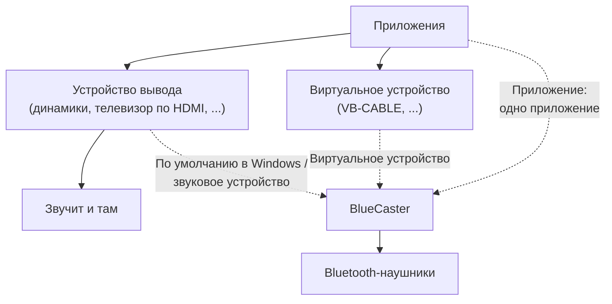
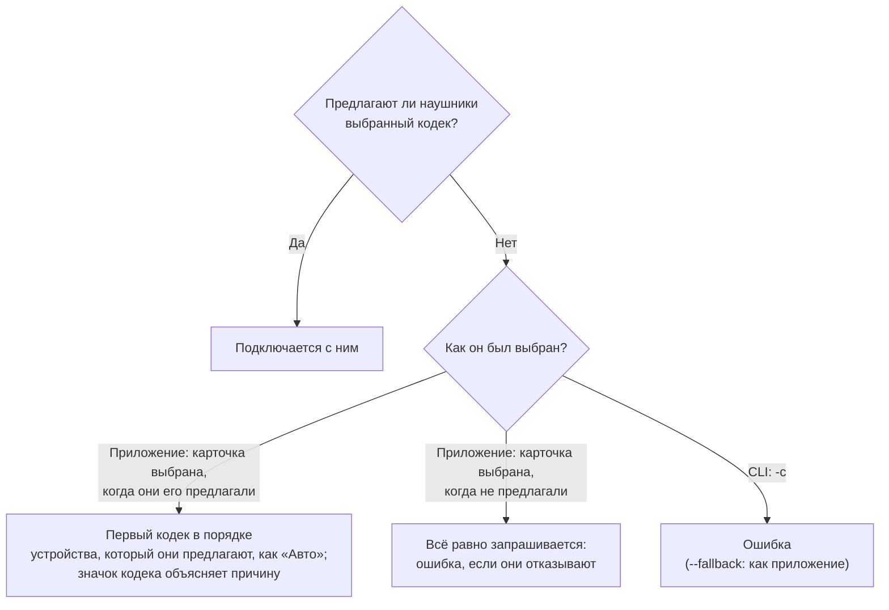

# Использование
{: .no_toc }

## Содержание
{: .no_toc .text-delta }

1. TOC
{:toc}

---

## Окно

Запустите **BlueCaster** из меню «Пуск» (или запустите `bluecaster.exe`). В меню слева перечислены экраны, описанные ниже: «Главная», «Кодеки», «Аудиоустройства», «Адаптеры», «Диагностика», «Параметры» и «О программе». В режиме разработчика к ним добавляется «Разработчик», а также «Микшер громкости», если он там включён. В узком окне меню сворачивается до значков. Окно лишь показывает состояние `bluecaster-core.exe`, который продолжает работать в фоновом режиме, поэтому закрытие окна не останавливает передачу звука (см. [Область уведомлений и мини-окно](#tray)).

### Главная

- Карточки всех сохранённых аудиоустройств, рядом друг с другом, с состоянием и зарядом батареи. На карточке подключённого устройства также видны используемый кодек (в виде списка, см. ниже) и битрейт. Если используется не тот кодек, который вы выбрали, строка кодека ненадолго называет причину, например **aptX Adaptive (Opus не поддерживается)** (или *уже используется*). Через несколько секунд остаётся только значок предупреждения (наведите на него указатель, чтобы увидеть причину), а строка состояния показывает просто **Подключено**
- **Подключить** / **Отключить** под каждой карточкой. Одновременно можно подключить только одно устройство: **Подключить** у другого устройства отключает текущее и подключает новое
- **Громкость**: громкость наушников (см. [Громкость](#volume)). Щёлкните значок динамика, чтобы выключить звук (BlueCaster передаёт тишину), и щёлкните ещё раз, чтобы включить его. На карточках остальных устройств ползунок неактивен
- Список кодеков на карточке подключённого устройства для быстрого переключения (например, один кодек для игр, другой для музыки). В нём перечислены кодеки, которые поддерживает устройство, только по названию, как на экране [Кодеки](#codecs). Список показывает используемый кодек, в том числе при автовыборе. Выбор кодека отключает автовыбор (снова включить его можно на экране «Кодеки»). Выбор применяется сразу: устройство переподключается с новым кодеком, а следующий выбор ждёт окончания переподключения, как на экране «Кодеки»
- Небольшой график качества связи на карточке подключённого устройства во время передачи. Источник вывода выбирается на экране **Аудиоустройства**. Если источник — приложение, которое ещё не запущено, карточка сообщает об этом
- При ошибке показывается её причина и, если есть решение, кнопка, которая устраняет проблему (**Заменить на драйвер WinUSB**, **Открыть страницу загрузки**, **Перезапустить Bluetooth**, **Повторить**, **Кодеки**, **Аудиоустройства**, ...)
- Над карточками, пока вы их не закроете: предупреждение, если в Windows активен другой адаптер Bluetooth, и уведомление о том, что наушники OPPO включили Hi-Res (см. [Кодеки](#codecs))

Боковая панель показывает те же сведения обо всех устройствах на любом экране, а мини-окно в области уведомлений — о подключённом устройстве.

### Кодеки {#codecs}

У каждого сохранённого аудиоустройства свой раздел. В его заголовке — точка (зелёная, пока устройство подключено), название и метки **Сопряжено** / **Аудио**; адрес указан на экране **Аудиоустройства**. Ниже идут карточки кодеков: сначала с наилучшим качеством звука, если вы не изменили порядок. На каждой карточке три полосы (качество звука, низкая задержка, стабильность) и отметка о том, предлагало ли устройство этот кодек при последнем подключении: **Поддерживается** (зелёный значок) или **Не поддерживается** (красный значок). Когда включён параметр **Показывать только поддерживаемые кодеки** (по умолчанию), все показанные карточки поддерживаются, поэтому метки **Поддерживается** на них нет. Устройство, которое ещё ни разу не подключалось (например, импортированное из Windows), в этом случае показывает только карточку **SBC**, которая есть у любого аудиоустройства Bluetooth, и выбранный для него кодек. Остальные карточки появятся после первого подключения или если выключить этот переключатель. Наушники Huawei и Honor сохраняют карточку **LDAC** с меткой **Не подтверждено**, пока не сообщат о поддержке LDAC: они могут сообщить о нём только после того, как его выбрали. Когда передаётся LHDC V5 (выбранный вами или режимом «Авто», но не с качеством **Низкое** и не с ABR), наушники OPPO, которые сообщают пиковый битрейт для LHDC V5, один раз получают запрос на включение Hi-Res. Для этого они один раз переподключаются, а экран «Главная» сообщает, если это повысило их битрейт. После этого Hi-Res остаётся включённым в наушниках; наушникам, которым это ничего не дало, настройка возвращается обратно. В режиме разработчика кнопка **Снова запросить Hi-Res** в настройках LHDC V5 сбрасывает то, что сообщило устройство, и отметку о запросе, поэтому при следующем подключении запрос повторяется.

- **Автоматически выбирать кодек с наилучшим качеством** (один параметр для всех устройств, вверху страницы; по умолчанию включён): каждое устройство использует поддерживаемый им кодек с наилучшим качеством в таком порядке: LHDC V5 > LDAC > aptX Adaptive > Opus > aptX HD > aptX > aptX LL > AAC > SBC XQ > SBC. Настройки при этом такие же, как у **Авто** в настройках кодека: высокое качество, 24 бит, если кодек это поддерживает, и 48 kHz (если у устройства нет 48 kHz — другая частота из его списка, в первую очередь 44,1 kHz; собственная частота Windows пересчитывается). Карточки доступны только для чтения, кроме их порядка: их можно перетаскивать, как описано ниже, и «Авто» берёт первую карточку, которую поддерживает устройство. Используемый кодек (или тот, который выберет «Авто») выделен. Щелчок по карточке или по её **...** предлагает отключить автовыбор (**Отключить автовыбор** / **Отмена**). После отключения выбирается карточка, по которой вы щёлкнули, а её **...** открывает настройки. Отключите автовыбор, чтобы самостоятельно выбирать кодек и его настройки для каждого устройства; устройство, для которого кодек ещё не выбран, сохраняет выбор «Авто». Пока автовыбор включён, выбранный для устройства кодек сохраняется на будущее. Если в настройках из версий до 2.0.2 для какого-либо устройства был выбран кодек, автовыбор будет выключен
- Когда автовыбор выключен, щёлкните карточку, чтобы выбрать кодек для этого устройства. Выбор сразу сохраняется, а устройство, которое передаёт звук, переподключается с новым кодеком. Можно выбрать и карточку, которую устройство не поддерживает (она видна, если выключен параметр **Показывать только поддерживаемые кодеки**): BlueCaster всё равно запросит этот кодек. Если устройство откажет, подключение прекратится с сообщением об ошибке (выберите другую карточку или включите автовыбор). Экран «Главная», боковая панель, мини-окно и всплывающая подсказка значка в области уведомлений коротко называют причину (например, *LDAC не поддерживается*). Так происходит всякий раз, когда подключение останавливается из-за кодека: устройство его не поддерживает, отклоняет или использует для другого источника. Устройство снова подключится, если выбрать для него другую карточку или другие настройки либо включить автовыбор. Если вы выбрали кодек, когда устройство его предлагало, а потом оно перестало его предлагать (например, наушники переключились на другой кодек), BlueCaster переходит на первую карточку в порядке устройства, которую оно поддерживает. Если вы не меняли порядок, это лучший поддерживаемый кодек (см. [Явно выбранный кодек не предлагается](#codec-fallback))
- Перетаскивайте карточки устройства, чтобы задать свой порядок кодеков (пока кнопка мыши нажата, указатель имеет вид руки; при выключенном автовыборе можно также нажать Alt и клавишу со стрелкой на карточке). У каждого устройства свой порядок. Первую поддерживаемую карточку используют автовыбор, устройство без выбранного кодека, а также устройство, которое не поддерживает выбранный для него кодек. FastStream и Opus 05 используются только при явном выборе, где бы они ни стояли. Opus 05 — это карточка **Opus (PipeWire)**, она есть только в режиме разработчика; без него Opus 05 не используется, даже если выбран. **Сбросить порядок кодеков** возвращает порядок по умолчанию. Кнопка видна, только пока показанные карточки стоят не в порядке по умолчанию (если вернуть их на места вручную, порядок тоже восстановится). Устройство, которое передаёт звук кодеком, затронутым изменением, переподключается
- Если выбрать другой кодек для устройства, которое передаёт звук, оно переподключится с этим кодеком. Карточки (и список кодеков на экране «Главная» и в мини-окне) принимают следующий выбор только после переподключения, чтобы серия быстрых щелчков не прерывала подключение, которое ещё устанавливается. При смене кодека уведомление о подключении не показывается, а при подключении устройства — показывается
- **Показывать только поддерживаемые кодеки** (по умолчанию включено; выключите, чтобы видеть и поддерживаемые, и неподдерживаемые кодеки): скрывает кодеки, которые устройство не предлагало. До первого подключения устройства показывается только **SBC** (и выбранный для него кодек)
- **...** на карточке открывает настройки этого кодека. Изменения применяются сразу. Для используемого кодека изменение сохраняется, и устройство переподключается с ним. Исключения — **Bitpool**, который меняется прямо во время прослушивания, и переключатель ниже, если поток в обоих случаях настраивается одинаково. Для другого кодека изменение сохраняется и применится, когда этот кодек будет выбран. У каждого кодека свои настройки, в том числе отдельные у aptX Adaptive и aptX Adaptive LL, поэтому после переключения на другой кодек и обратно они восстанавливаются. Предлагаются только параметры, которые поддерживает кодек и о которых устройство сообщило при последнем подключении. Вверху находится переключатель **Показывать только параметры, поддерживаемые *устройство*** (по умолчанию включён; появляется, когда устройство сообщило свои параметры). Выключите его, чтобы видеть всё, что есть у кодека, например частоту дискретизации, разрядность, качество или bitpool, о которых устройство не сообщало (с пометкой *(не поддерживается)*). Устройство может их отклонить, и тогда подключение прекратится с сообщением об ошибке. Если снова включить переключатель, всё, о чём устройство не сообщало, вернётся к «Авто». Настройки по кодекам (автовыбор их не использует):
  - **Качество**: LDAC — **Высокое** / **Среднее** / **Низкое** (990 / 660 / 330 kbps); LHDC V5 — **Высокое** / **Выше среднего** / **Среднее** / **Низкое** (1000 / 900 / 500 / 400 kbps, четыре уровня Android); aptX Adaptive — **Высокое** (режим низкой задержки вынесен на отдельную карточку **aptX Adaptive LL**: 265 kbps, 48 kHz, без ABR; см. [aptX Adaptive](#aptx-adaptive)). Если у LHDC V5 включён ABR, качество неактивно (ABR держится на уровне 400 kbps или ниже). У AAC, Opus, Opus 05, SBC и SBC XQ один уровень, **Высокое**: он показывается, но не выбирается, и означает наибольший битрейт, который принимает устройство. ABR или VBR, где они есть, всё равно его меняют; SBC и SBC XQ показывают битрейт, который получается из их bitpool и параметров кадра. У aptX, aptX HD, aptX LL и FastStream битрейт задан кодеком. Качество, сохранённое более ранней версией, которого у кодека больше нет (Standard / Mobile у aptX Adaptive, нижние уровни AAC, ...), загружается как «Высокое»
  - **Адаптивный битрейт (ABR)**: для LDAC, LHDC V5, aptX Adaptive, SBC и SBC XQ (см. [ABR](#abr)); **Переменный битрейт (VBR)** для AAC
  - **Низкая задержка** (LHDC V5, если устройство её сообщает): звук доходит до наушников быстрее. Когда ABR выключен, битрейт снижается, пока соединение не справляется (1000, 900, затем 500 kbps), и снова повышается после минуты без проблем. Пакеты отбрасываются после 100 ms в очереди отправки вместо 350 ms, поэтому нестабильное соединение даёт короткое выпадение звука, а не долгую задержку
  - **Частота дискретизации**: «Авто» — это 48 kHz или, если у устройства нет 48 kHz, другая частота из его списка (в первую очередь 44,1 kHz). Рядом показывается итоговая частота (например, *Авто (48000 Hz)*). «Авто» никогда не выбирает 96 kHz: эта частота добавляет задержку и хуже совместима, а слышимого выигрыша не даёт (Windows микширует звук на 48 kHz). Чтобы использовать 96 kHz, выберите её здесь. Предлагаются только частоты из списка устройства (у LHDC V5 нет 88,2 kHz; aptX Adaptive предлагает 96 kHz, только если устройство её сообщает, см. [aptX Adaptive](#aptx-adaptive)). Если устройство сообщает только одну частоту, показывается она, без «Авто»
  - **Разрядность**: 16 или 24 бит для LDAC и LHDC V5, если устройство их сообщает («Авто»: 24 бит; для LHDC V5 — только если устройство сообщает 24 бит); 24 бит для aptX HD и aptX Adaptive; 16 бит для остальных. При 24 бит кодировщик LDAC получает 32-битные отсчёты, как при выборе 32 бит в Android. Разрядность не входит в конфигурацию LDAC, поэтому наушники в обоих случаях получают одинаковый поток
  - **Bitpool** (SBC, SBC XQ): один ползунок с двумя маркерами для минимального и максимального bitpool в пределах диапазона, который сообщает устройство. Максимум — это используемый bitpool. Минимум — наименьший используемый: нижняя граница диапазона, с которым настраивается подключение, и предел, до которого может опуститься ABR. **Авто** сбрасывает оба значения: максимум — под качество, минимум — к значению устройства и ABR. Строка под ползунком показывает режим каналов, который у каждого кодека фиксирован: joint stereo у SBC, dual channel у SBC XQ. Bitpool у SBC XQ доходит до 47 при 44,1 kHz и до 43 при 48 kHz, а при выключенном **Показывать только параметры, поддерживаемые *устройство*** — до 53.
  - **Параметры кадра** (SBC и SBC XQ, только в режиме разработчика): блоки, поддиапазоны, распределение битов и, для SBC, режим каналов. «Авто» оставляет 16 блоков, 8 поддиапазонов, Loudness и Joint stereo. Если устройство не принимает значение, при подключении используется «Авто». На устройстве Sony, которое проверил пользователь, 12 блоков искажают звук и могут вызвать отключение (при этом вывод кодировщика декодируется правильно, а с другим числом блоков звук воспроизводится нормально). Выбранные значения сохраняются, но не используются, пока режим разработчика выключен. Битрейты AAC и LHDC V5 не превышают максимум, который сообщает устройство

Значения по умолчанию дают наилучший звук; большинству устройств достаточно **Авто**. У устройства LE Audio (экспериментально) две карточки, **LC3** и **LC3 LL** (см. [LE Audio](#le-audio)). Их **...**, как и у кодеков для звонков, показывает те же поля, что и у кодека A2DP, только для чтения. Режим низкой задержки aptX Adaptive вынесен на отдельную карточку **aptX Adaptive LL** рядом с **aptX Adaptive**. «Авто» её никогда не выбирает. Если более ранняя версия перевела aptX Adaptive в режим низкой задержки, он отображается на этой карточке.

Пока микрофон классического устройства открыт (см. [Аудиоустройства](#audio-devices)), вместо его карточек для музыки показываются кодеки для звонков, которые оно может использовать: LC3 (32 kHz), mSBC (16 kHz) и CVSD (8 kHz). Активный кодек выделен. При автовыборе канал звонка берёт лучший кодек, который поддерживают обе стороны, а щелчок по карточке предлагает отключить автовыбор. Когда автовыбор выключен, щёлкните карточку, чтобы выбрать кодек для звонков: микрофон откроется заново с этим кодеком или со следующим более низким, если наушники его не поддерживают. **...** показывает настройки этих кодеков только для чтения. Когда микрофон закрывается, карточки для музыки возвращаются. Пока автовыбор включён, выбранный кодек для звонков сохраняется на будущее. Если включён параметр **Показывать только поддерживаемые кодеки**, кодеки, которые наушники не поддерживают, скрыты.

Пока микрофон устройства LE Audio открыт, после его карточек для музыки появляется карточка **Микрофон** (LC3, моно). При выключенном автовыборе её **...** задаёт частоту дискретизации микрофона из тех, что поддерживают наушники (**Авто** берёт первую; при изменении устройство переподключается). При автовыборе там показана используемая частота.

BlueCaster хранит по одной записи на каждое устройство в `profiles.json` (кодек, настройки каждого кодека и порядок кодеков). Там запись называется «*устройство* | *кодек*», а окно и меню в области уведомлений показывают только название устройства. Ранние версии позволяли создавать несколько профилей для одного устройства. При первом запуске версии с экраном «Кодеки» сохраняется последний использованный профиль (или первый), а остальные объединяются с ним. Их настройки кодеков (качество, частота дискретизации, разрядность, ABR, настройка SBC) сохраняются для соответствующих кодеков. Их названия, источники вывода и размеры пакетов не сохраняются; исходный `profiles.json` один раз сохраняется как `profiles-before-codecs.json` в папке настроек. Параметр **Порядок «Авто»…** из предварительных версий 2.0.2 (один порядок для всех устройств, в режиме разработчика) больше не используется: теперь у каждого устройства свой порядок.

### Аудиоустройства {#audio-devices}

Наушники и колонки, на которые BlueCaster может передавать звук; у каждого устройства свои настройки. Под ними, в разделе **Добавление аудиоустройства**, кнопка **Найти устройства** в течение 30 секунд ищет устройства поблизости через USB-адаптер и показывает их по мере ответа; **Остановить поиск** завершает поиск. Сначала переведите наушники в режим сопряжения. Если какое-то устройство подключено, BlueCaster перед поиском предложит его отключить. **Добавить** сохраняет найденное устройство и подключает его. Устройства, с которыми BlueCaster уже выполнял сопряжение, помечены как **Сопряжено**. Если поиск не находит устройство, введите его адрес в поле **Вручную:** и нажмите **Добавить**. Адрес форматируется при вводе или вставке (`aa-bb-cc-dd-ee-ff`, `AABBCCDDEEFF` и `AA BB CC DD EE FF` превращаются в `AA:BB:CC:DD:EE:FF`). Наушники видят адаптер под именем вашего компьютера с припиской BlueCaster, например *Taro-PC (BlueCaster)*, чтобы его можно было отличить от собственного Bluetooth Windows. Если Windows сопрягла устройство через другой адаптер, например встроенный Bluetooth компьютера, BlueCaster сначала спросит (**Сопряжено в Windows**: удалите его там или нажмите **Всё равно добавить**). То же происходит с устройством, которое Windows сопрягла через этот адаптер (мастер настройки может импортировать это сопряжение, см. [Службы и ключи сопряжения](#shared-pairing)). Сохранённое устройство можно переименовать или удалить. При удалении удаляются и его настройки, и сопряжение, поэтому для подключения сопряжение придётся выполнить заново. У каждого сохранённого устройства есть:

- **Источник вывода**: **По умолчанию в Windows** (отдельно, первым в списке: устройство вывода Windows по умолчанию, название которого указано в скобках; оно может быть и виртуальным; это значение по умолчанию для нового устройства), одно устройство вывода из раздела **Звуковые устройства**, виртуальное устройство или приложение (см. [Режимы захвата](#capture-modes)). Рядом показан формат, в котором Windows микширует захватываемое устройство (частота дискретизации и разрядность, только для чтения). Он выделяется янтарным цветом, если устройство передаёт звук в другом формате (или, когда оно не подключено, если его настройки кодека требуют другого формата). Тогда строка ниже называет оба формата (передача всё равно работает, с преобразованием). Под ней — описание того, что делает выбранный источник
- **Делать устройством вывода по умолчанию на время подключения** (в режиме разработчика, для виртуального или звукового устройства)
- **Источник ввода**: микрофон наушников и **Делать устройством ввода по умолчанию на время подключения** в режиме разработчика (см. ниже)

**Источник ввода** у каждого устройства передаёт микрофон наушников в Windows для звонков и голосового чата. У BlueCaster нет собственного аудиодрайвера, поэтому он воспроизводит звук микрофона в виртуальный аудиокабель, например VB-CABLE. В списке каждый кабель назван по той стороне, с которой записывают приложения (*CABLE Output* у VB-CABLE): выберите её как микрофон в своих приложениях. Рядом со списком выберите **Выкл.** или **Авто**. В режиме **Авто** микрофон открывается, только пока какое-нибудь приложение с него записывает, поэтому в остальное время воспроизведение сохраняет полное качество. В режиме разработчика есть ещё режим **Вкл.**, при котором микрофон всегда открыт. Без режима разработчика устройство в положении **Вкл.** работает как в режиме **Авто**. В положении **Выкл.** список остаётся на экране, но неактивен. **Выкл.** и кнопка микрофона на экране «Главная» и в мини-окне — это одна и та же настройка: для устройства в режиме **Авто** или **Вкл.** положение **Выкл.** выключает микрофон, как и кнопка, и запоминает режим, который кнопка потом восстанавливает. **Делать устройством ввода по умолчанию на время подключения** (в режиме разработчика; без режима разработчика всегда включено) делает записывающую сторону кабеля (*CABLE Output*) микрофоном Windows по умолчанию, пока устройство подключено. Тогда приложения, которые записывают с микрофона по умолчанию, получают микрофон наушников, и **Авто** открывает его для них. Когда устройство отключается, возвращается прежнее устройство по умолчанию, если вы тем временем не выбрали другое.

Строка **Настройка микрофона** внизу открывает настройки, которые обрабатывают микрофон, прежде чем звук попадёт в приложения. Пока **Источник ввода** в положении **Выкл.**, эта строка неактивна. **Применять настройку микрофона** включает и выключает обработку. Пока она выключена, микрофон проходит без изменений, а ползунки сохраняют свои значения. **Усиление** делает его громче или тише (от -12 до +24 дБ). **Шумоподавление** убирает постоянный фоновый шум, например вентилятор или гул. Чем правее ползунок, тем сильнее подавление; чем левее, тем больше остаётся исходного звука (в крайнем левом положении: **Выкл.**). **Шумовой гейт** отключает микрофон, пока его уровень ниже выбранного (в крайнем левом положении: **Выкл.**). Лимитер не даёт усиленному микрофону перегружаться. Изменения применяются сразу, без переподключения. Шумоподавление задерживает микрофон примерно на 20 мс; если всё выключено, микрофон проходит без изменений. Тест **Микрофон** в разделе **Диагностика** записывает его так, как его слышат приложения.

Новое устройство начинает с VB-CABLE, если он установлен, иначе с Hi-Fi Cable, если только этот кабель не выбран у него как **Источник вывода**. Классическое устройство получает режим **Авто**, устройство LE Audio — **Выкл.** (у него **Авто** держит микрофон открытым). Устройство с включённым микрофоном, но без кабеля получает кабель, как только он появится в Windows. Экран **Аудиоустройства** и мастер настройки предлагают установить недостающие кабели (см. [Режимы захвата](#capture-modes)). Если установить кабель позже, BlueCaster заново настроит, как это сделал бы мастер, устройства, которые он настроил автоматически, а также устройства с источником **По умолчанию в Windows** и таким микрофоном. При двух кабелях Hi-Fi Cable передаёт звук, а VB-CABLE — микрофон. При одном кабеле он передаёт микрофон, а звук берётся с устройства вывода из раздела **Звуковые устройства**: со звука монитора или телевизора, если он есть (из нескольких — с устройства вывода Windows по умолчанию), иначе с устройства вывода Windows по умолчанию, какое бы устройство ни было устройством вывода по умолчанию. Источник вывода или микрофон, которые вы выбрали сами, не меняются. Если кабеля нет, а в Windows есть и звук монитора или телевизора, и звуковая карта, звук берётся с монитора или телевизора, а микрофон воспроизводится в звуковую карту в положении **Выкл.**. Если в режиме разработчика переключить его на **Вкл.**, приложение, которое записывает устройство вывода (захват выхода звука в OBS), сможет взять звук микрофона оттуда; **Авто** не может определить, кто слушает звуковую карту. Устройство, добавленное на экране **Аудиоустройства**, начинает так же. Устройство с источником **По умолчанию в Windows**, микрофон которого воспроизводится в кабель, являющийся устройством вывода Windows по умолчанию, тоже переключается на этот источник звука, иначе микрофон звучал бы в наушниках.

Если микрофон воспроизводится в Hi-Fi Cable, а сторона воспроизведения и сторона записи этого кабеля работают в параметрах звука Windows с разной частотой дискретизации, появляется предупреждение: если приложения ничего не слышат, задайте для обеих сторон одинаковую частоту. В списке есть только кабели, с которых приложения могут записывать. В нём нет кабеля, который захватывает сам BlueCaster (**Источник вывода** или, при **По умолчанию в Windows**, устройство вывода Windows по умолчанию, но не источник вывода другого устройства, ставший устройством по умолчанию на время его подключения). Нет в нём и другой стороны этого кабеля (*CABLE In 16ch* у VB-CABLE записывает в тот же *CABLE Output*, что и *CABLE Input*), иначе микрофон смешивался бы со звуком воспроизведения. По той же причине, пока **Источник ввода** не в положении **Выкл.**, в списке **Источник вывода** нет кабеля, в который воспроизводится микрофон. Если включён параметр **Разработчик > Настройки приложения > Показывать все аудиоустройства в списках источников**, оба списка предлагают все устройства. Выходы без записывающей стороны (динамики и т. п.) находятся в разделе **Прослушивание**, так как они только воспроизводят микрофон. 16-канальный кабель VB-CABLE показан как *CABLE Output · CABLE In 16ch* (сначала общая записывающая сторона, затем его собственное имя). Кабель источника вывода показан неактивным, с пометкой *(используется как источник вывода)* после имени. *CABLE Input* и *CABLE Output* — два конца одного кабеля, поэтому для виртуального источника вывода и микрофона нужны два кабеля. Рекомендуем **Hi-Fi Cable** от VB-Audio (*HiFi-Cable & ASIO-Bridge* на [странице VB-Audio](https://vb-audio.com/Cable/)) для звука, так как он даёт наименьшую задержку, и VB-CABLE для микрофона. Устройство микрофона также не должно быть устройством вывода Windows по умолчанию: приложения слышали бы звук воспроизведения вместе с микрофоном, а источник вывода на другом устройстве ничего бы не получал. Об этом предупреждает сообщение под **Источник ввода**.

Пока микрофон открыт, классическое устройство Bluetooth воспроизводит звук через канал звонка: моно с качеством звонка (CVSD, mSBC или LC3 — лучший кодек, который поддерживают обе стороны). Его кодек на это время затемнён. Когда микрофон закрывается, устройство возвращается к этому кодеку без переподключения. Устройство LE Audio продолжает воспроизводить LC3 с обычным качеством и одновременно передаёт микрофон; при смене режима оно переподключается (у него «Авто» держит микрофон открытым). Некоторые наушники могут не дать доступ к микрофону или показывать звонок, хотя его нет. В режиме **Авто** или **Вкл.** при выбранном устройстве строка **Микр.:** под кодеком (на боковой панели, на экране «Главная» и в мини-окне) показывает состояние микрофона, пока устройство подключено или подключается. Пока микрофон открыт, там видны его кодек и частота с красной точкой (*Микр.: mSBC 16 kHz*), а пока закрыт — затемнённый режим. На экране «Главная» и в мини-окне кнопка микрофона рядом выключает микрофон: кнопка становится перечёркнутой, микрофон закрывается, классическое устройство возвращается к своему кодеку, а **Источник ввода** показывает **Выкл.**. Повторный щелчок снова включает микрофон в прежнем режиме; то же делает выбор **Авто** или **Вкл.** в **Источник ввода**. Пока «Авто» ждёт приложение, кнопка показана пунктиром. Если микрофон не удалось открыть, на кнопке появляется значок предупреждения, а причина видна во всплывающей подсказке.

**Все аудиоустройства** над списком — переключатели, которые действуют для всех устройств: **Синхронизация громкости Windows** (см. [Громкость](#volume)), **Управлять воспроизведением кнопками аудиоустройства** и **Переподключаться автоматически**. **Макс. размер медиапакета** для каждого устройства задаётся на экране **Разработчик** (см. [Максимальный размер медиапакета](#max-packet)).

### Диагностика

- **Качество связи** во время передачи: фактический битрейт, число пакетов, пакеты, отброшенные до отправки, звук, потерянный при захвате, очередь отправки, задержка, о которой сообщает устройство (см. [Задержка](#latency)), занятое эфирное время, уровень сигнала (RSSI) и каналы AFH (см. [Качество связи и AFH](#link-quality)). Пока открыт микрофон гарнитуры, канал звонка классического устройства измеряется так же (его кодек, например mSBC, и что по нему передаётся). Карточка **Микрофон** показывает пакеты, приходящие обратно: принятые, повреждённые в эфире и замаскированные
- **Радио**: 79 каналов Bluetooth в диапазоне 2,4 GHz. Видно, какие из них использует соединение и какие пропускает адаптер; под ними — каналы Wi-Fi и несколько советов, как сделать соединение чище. В режиме разработчика кнопка **Сканировать** добавляет сети Wi-Fi 2,4 GHz поблизости (см. [Вкладка «Радио»](#radio-tab))
- **Сведения о кодеке** во время передачи: медиаданные, заголовки, кадр кодека и число кадров в пакете, а также параметры, которые сообщает точка подключения устройства, рядом с используемыми: для SBC — bitpool, частоты дискретизации, режимы каналов, блоки, поддиапазоны и распределение битов; для AAC — типы объектов, частоты дискретизации, каналы, пиковый битрейт и VBR; для остальных кодеков — частоты дискретизации, разрядности и пиковый битрейт
- **Микрофон**: проверка микрофона гарнитуры классического устройства Bluetooth во время передачи. **Записать** открывает микрофон и записывает до 10 секунд, показывая уровень на шкале. На это время устройство воспроизводит звук с качеством звонка; если микрофон ещё не открывался в этом подключении, устройство сначала переподключится. **Воспроизвести** проигрывает запись в наушниках. Если уйти с вкладки, проверка завершится, и воспроизведение вернётся к прежнему кодеку. Устройства LE Audio пока не поддерживаются
- **Ход подключения**: одиннадцать этапов последней попытки подключения (запуск, адаптер Bluetooth, подключение ACL / AVDTP, обнаружение возможностей, выбор кодека, захват звука, настройка потока, кодировщик, запуск потока, отправка звука, поддержание соединения с отключениями / переподключениями) с отметкой «ОК», «Предупреждение» или «Ошибка» и временем выполнения. **Копировать ход** копирует эти сведения
- **Журнал**: журнал в реальном времени с фильтрами по уровню (все, info и выше, предупреждения и ошибки, только ошибки), по тексту и по текущей попытке подключения (**Только текущая попытка**). **Копировать показанный журнал** копирует то, что видно на экране. **Открыть папку журналов** открывает папку с файлами журналов. В отличие от **Копировать диагностику**, в этих файлах данные не скрыты: в них есть адреса Bluetooth и ваше имя пользователя Windows
- **Начать запись HCI** / **Остановить запись HCI** (см. [Проверка медиапотока](#verify-stream))
- **Копировать диагностику**: копирует в буфер обмена версию, ОС, адаптер, аудиоустройство (кодек, его настройки и порядок), ход подключения, предупреждения / ошибки и недавний журнал, чтобы их можно было вставить в отчёт об ошибке. **Скрывать адреса Bluetooth** (по умолчанию включено) заменяет адреса на `<addr-1>`, `<addr-2>`... (собственный адрес адаптера — на `<adapter>`), а названия устройств — на `<device-1>`, `<device-2>`..., и скрывает серийные номера USB, пути к файлам выше собственной папки приложения (`<path>\BlueCaster\logs\...`) и вашу учётную запись Windows (имя пользователя и SID). Так же скрываются данные в отчёте о сбое и в текстах ошибок, которые копируются для отчёта
- **Сообщить о проблеме**:
  - **Подробное журналирование**: **Подробно (debug)** или **Всё (trace, 1 час)** записывает в журнал гораздо больше о Bluetooth, USB, захвате и кодировании звука. Debug остаётся включённым 24 часа, в том числе после перезапусков (для проблем при запуске), а затем выключается автоматически. Включите его, воспроизведите проблему и сохраните диагностический архив
  - **Диагностический архив > Сохранить…**: выберите, включать ли записи HCI (не включайте, если вас об этом не просили: в них есть адреса и названия устройств) и скрывать ли адреса Bluetooth в текстовых файлах, затем сохраните один файл `.zip` (в `logs\bundles\` папки настроек; хранятся 3 последних). В архив входят диагностические сведения, файлы журналов ядра, окна и вспомогательной программы драйвера, отчёты о сбоях, сведения о системе (USB-адаптеры Bluetooth и их драйверы, сопряжённые в Windows устройства, аудиоустройства), настройки и настройки кодеков каждого устройства (но никогда не ключи связи), а также бортовой самописец HCI. В записях HCI остаются адреса (но не ключи сопряжения). По возможности BlueCaster укладывает архив в ограничение GitHub на вложения в 25 MB (сначала самые новые журналы, до 48 MB текста, 5 последних записей и 2 минидампа)
  - **Сообщить на GitHub** (после сохранения): открывает новый отчёт об ошибке с уже заполненными версией, сборкой Windows, адаптером, наушниками, кодеком, режимом захвата и диагностическими сведениями (адреса скрыты) и показывает архив в проводнике, чтобы его можно было перетащить в отчёт

Кроме того, BlueCaster постоянно записывает некоторые данные, чтобы можно было разобраться даже с проблемой, которая случилась один раз:

- **Бортовой самописец HCI**: последние несколько минут трафика Bluetooth хранятся в памяти (медиаданные обрезаны, ключи сопряжения удалены) и сохраняются в `logs\hci\` при каждом сбое потока или потере соединения (хранятся 10 последних файлов)
- **Отчёты о сбоях**: при сбое BlueCaster минидамп `.dmp` и файл `.txt` сохраняются в `logs\crash\` (по 5 последних для каждой программы)

Место на диске ограничено: журнал за обычный день занимает гораздо меньше 1 MB, а хранятся журналы за 7 дней. С подробным журналированием файл за день содержит не более 100 MB строк debug и trace (после этого до следующего дня записываются только info и выше). Файлы бортового самописца занимают не более нескольких MB, хранятся 10 последних.

### Разработчик {#developer}

Экран виден, пока включён параметр **Параметры > Режим разработчика**; большинству пользователей он не нужен. Он предназначен для проверки устройств и устранения неполадок, и некоторые его настройки работают только с определёнными устройствами. Семь вкладок:

- **Настройки приложения**: **Использовать микшер громкости** (по умолчанию выключено) включает экран **Микшер громкости**, список приложений в мини-окне и отключение звука вывода (см. [Режимы захвата](#capture-modes)). Не рекомендуется: чтобы ПК не издавал звука, лучше использовать VB-CABLE. **Показывать все аудиоустройства в списках источников** (по умолчанию выключено): списки **Источник вывода** и **Источник ввода** на экране **Аудиоустройства** предлагают все устройства, в том числе неподходящие (см. [Аудиоустройства](#audio-devices)). **Скрыть предупреждение о виртуальных аудиоустройствах** (по умолчанию выключено) убирает предупреждение об отсутствующем кабеле VB-Audio (см. [Режимы захвата](#capture-modes)). **Включать альфа-версии** (по умолчанию включено в альфа-сборках) предлагает также альфа-выпуски (см. [Обновления](#updates))
- **Настройки кодеков**: переключатели, которые помогают выяснить, почему устройство молчит (бит маркера RTP, запись первых медиапакетов в журнал, конфигурация AAC и параметры кодировщика), и **Макс. размер медиапакета** для каждого сохранённого устройства (см. [Максимальный размер медиапакета](#max-packet)). **Применять настройки кодека при его автовыборе**: при включённом автовыборе **…** на карточке кодека открывается без отключения автовыбора, а кодек, выбранный «Авто», подключается с этими настройками, а не с настройками «Авто». **Подстраивать частоту и разрядность под вывод компьютера**: частота дискретизации или разрядность в режиме «Авто» следуют формату устройства вывода в параметрах звука Windows, а не 48 kHz. Из частот, которые устройство сообщает для кодека, BlueCaster берёт частоту ПК, иначе ближайшую из того же семейства (кратные 44,1 или 48 kHz), иначе ближайшую более высокую; 16-битный вывод передаётся в 16 бит. **Игнорировать пиковый битрейт устройства**: каждый кодек работает с битрейтом выбранного качества, даже если устройство сообщает меньший максимум (битрейт LHDC V5, AAC или Opus 05 либо bitpool SBC), а экран **Кодеки** предлагает все уровни качества и значения bitpool. Выше своего максимума устройство может терять звук или замолкать. **Лимит очереди отправки**: сколько медиапакет может ждать в очереди отправки, прежде чем будет отброшен, от 50 до 2000 ms (пусто = 350 ms). На хорошем соединении он не уменьшает задержку (см. [Задержка](#latency)). **Кодировать в момент отправки**: пока соединение простаивает, звук ждёт некодированным, а не в виде уже закодированных пакетов. При включённом ABR (SBC, SBC XQ, LDAC, LHDC V5 и aptX Adaptive) он затем уходит с битрейтом, до которого ABR успел снизиться, а не с тем, что был в начале простоя. Сам простой это не сокращает: пока радиоканал не возобновит передачу, ничего не отправляется, и меньше данных требуется только для последующего догоняния. Звук, который ждёт дольше лимита очереди отправки, отбрасывается в любом случае; «Диагностика» учитывает ожидающий звук во времени ожидания в очереди отправки. По умолчанию все эти параметры выключены и применяются при запуске следующего потока; пока какой-либо из них включён, об этом сообщает баннер. **Выключить все** сбрасывает их
- **Производители**: использует ли BlueCaster собственные протоколы наушников (Huawei: LDAC, OPPO: Hi-Res; см. [Кодеки](#codecs)). У каждого производителя есть параметр **Протокол производителя**: **Авто** (наушники, по названию которых определяется производитель; по умолчанию), **Всегда** (любое устройство) или **Никогда**. У OPPO есть также **Запрашивать Hi-Res при каждом подключении (каждый раз с переподключением)**. Изменения применяются при запуске следующего потока; пока что-либо изменено, об этом сообщает баннер, а **Выключить все** сбрасывает изменения. Когда режим разработчика выключен, эти параметры не используются
- **Журналирование**: сколько хранить файлы журналов (по умолчанию 7 дней), суточный лимит размера (по умолчанию 100 MB), постоянное подробное журналирование (без ограничения в 24 часа или 1 час и с момента запуска ядра), строка о состоянии потока каждые 10 секунд и **Добавить метку** (записывает в журнал пронумерованную строку, чтобы потом найти этот момент). При выключении режима разработчика восстанавливаются значения по умолчанию
- **Тест с приёмником**: передаёт звук на измерительный приёмник на другом ПК и сравнивает отправленное с полученным (см. [Тест с приёмником](#receiver))
- **Чип**: выполняет скрипт чипа на адаптере с WinUSB. Скрипт — это запросы к чипу, введённые вручную или загруженные из файла; он нужен тем, кто добавляет поддержку чипа (см. [Добавление поддержки чипов](chip-support#chip-scripts)). Строки, которые могут изменить чип, выполняются только после нажатия **Выполнить их**; Bluetooth для этого останавливается и снова запускается, когда понадобится
- **Отладка**: экспериментальные функции, по умолчанию все выключены. **Ключи сопряжения и Windows**: **Также копировать ключи LE в Windows при восстановлении исходного драйвера** при нажатии **Восстановить исходный драйвер** записывает в Windows ключи LE из BlueCaster (Long Term Key, EDIV, Rand, размер ключа, Identity Resolving Key), но только для устройств, ключи LE которых Windows уже хранит для этого адаптера. Старые ключи Windows сохраняются в `pairing\replaced_windows_keys.json`, который может прочитать только ваш пользователь Windows. **Сравнить с Windows** (нужны права администратора) подсчитывает для одного адаптера устройства, у которых ключи связи и ключи LE в BlueCaster и Windows совпадают, различаются или есть только с одной стороны. Показываются и записываются в журнал только числа, никогда не адреса и не ключи, поэтому результатом можно делиться. Также выводятся имена, типы и размеры значений, которые Windows хранит для адаптера и его устройств LE, но не их данные

### Адаптеры

- Обнаруженные USB-адаптеры Bluetooth: чип, адрес, USB ID, версия Bluetooth, **Драйвер** и **Прошивка**. Список обновляется автоматически, когда адаптер подключают или отключают. Драйвер — это **Исходный драйвер** (установленный Windows или производителем; наведите указатель, чтобы увидеть его название) или **Драйвер WinUSB** (тот, который использует BlueCaster). Адаптер Realtek показывает адрес, взятый из серийного номера USB, ещё до первого использования. У остальных адаптеров адрес и версия Bluetooth появляются после того, как адаптер использовал Bluetooth Windows или BlueCaster (наведите указатель на строку, чтобы узнать причину). Адаптер, который BlueCaster не может использовать (некоторые модели MediaTek и Qualcomm), сохраняет свой драйвер, а его кнопки WinUSB и прошивки неактивны. В режиме разработчика ему всё же можно назначить WinUSB. Кнопка **Прочитать сведения о чипе** на адаптере с WinUSB сохраняет в `logs\probe\` ответы чипа на несколько команд чтения — для тех, кто будет добавлять поддержку этого чипа (Bluetooth для этого останавливается и снова запускается, когда понадобится). Затем **Сообщить на GitHub** открывает issue с этими сведениями. Пока запускается адаптер, прошивку которого BlueCaster загружает сам (Intel, MediaTek, Qualcomm), на экране видны ход загрузки и ошибка, если она произошла
- **Заменить на драйвер WinUSB** / **Восстановить исходный драйвер** (см. [Настройка](setup#winusb)). Windows каждый раз запрашивает права администратора, как и для любой кнопки со значком щита. При восстановлении BlueCaster передаёт Windows более новые сопряжения устройств, которые Windows ранее сопрягла через этот адаптер, поэтому они подключаются в Windows без повторного сопряжения. **Ограничение:** ключи LE не передаются, поэтому устройство, которое Windows использует через LE (LE Audio), придётся снова сопрячь в Windows (в режиме разработчика можно попробовать передать их: **Разработчик > Отладка**)
- **Чип Bluetooth** для прошивки с кнопками **Скачать прошивку**, **Открыть страницу загрузки** и **Открыть папку прошивки** (см. [Прошивка](setup#firmware)). Для адаптера другого производителя вместо этого указано, откуда берётся прошивка, например **Из драйвера MediaTek**, **Из папки прошивки** или **Не требуется**, а после загрузки — **Загружена**. У адаптера Realtek, прошивка которого берётся из драйвера Realtek для Windows, вместо этого есть кнопка **Использовать свою прошивку**, а **Использовать прошивку драйвера** возвращает прошивку драйвера
- **Обходить каналы Wi-Fi**: «Авто», «Выкл.» или «Вручную». Рядом показаны каналы Wi-Fi: те, которые сейчас обходит «Авто», или ни одного при «Выкл.» (в обоих случаях только для чтения), либо введённые вами каналы при «Вручную» (см. [Качество связи и AFH](#link-quality))
- **Стек Bluetooth**: остановлен (запускается при первом поиске или подключении), запускается, готов или ошибка, а также **Перезапустить Bluetooth**
- **Использовать этот адаптер** (на карточке каждого адаптера, когда WinUSB назначен двум адаптерам и более): BlueCaster открывает этот адаптер вместо первого найденного. Bluetooth перезапускается на нём, поток подключается заново. Кнопка **Выбирать автоматически** на карточке выбранного адаптера возвращает первый найденный. Используемый адаптер отмечен как **Используется**, а его название указано рядом с **Стек Bluetooth**. Выбранный, но ещё не используемый адаптер (Bluetooth откроет его при следующем запуске, или его держит другая программа) отмечен как **Выбран**

### Параметры

| Раздел | Параметры |
|:-------|:----------|
| Оформление | Язык, тема (Системная / Светлая / Тёмная) |
| Запуск | **Запускать вместе с Windows** и **Запускать в области уведомлений** (см. [Запуск вместе с Windows](#autostart)), **Сворачивать в область уведомлений** и **Открывать мини-окно из** (см. [Область уведомлений и мини-окно](#tray)) |
| Уведомления | **Уведомлять о подключении устройства** (устройство, его заряд, кодек и с какими параметрами он работает; по умолчанию включено), **Уведомлять о низком заряде батареи**: **Ниже 20%** (по умолчанию), **Ниже 10%**, **Ниже 5%** или **Никогда**, один раз за подключение (повторно — только после того, как заряд снова поднимется на 5 пунктов выше порога) |
| Обновления | **Проверить обновления**, **Проверять обновления при запуске**, **Включать предварительные версии** (предлагать также бета-выпуски), **Обновить сейчас** (см. [Обновления](#updates)) |
| Дополнительно | **Режим разработчика** (добавляет экран [Разработчик](#developer), **Параметры кадра** SBC в настройках кодека, ключи сопряжения под меткой **Службы** на экране **Аудиоустройства** (см. [Службы и ключи сопряжения](#shared-pairing)), кодек **Opus (PipeWire)**, **Прочитать сведения о чипе** на экране **Адаптеры** и больше подробностей в журнале; перезапуск не нужен), **Папка настроек** с кнопкой **Открыть папку настроек**, **Запустить настройку** |

Внизу находится кнопка **Выйти из BlueCaster**. Экран **О программе** показывает версию и лицензию BlueCaster. В разделе **Стороннее ПО** перечислены библиотеки, **Сторонние лицензии**, примечание о том, что кабели VB-Audio распространяются компанией VB-Audio как donationware, и диалог кабелей (**Виртуальные аудиоустройства**).

### Настройка при первом запуске

При первом запуске (аудиоустройств ещё нет или ни одному адаптеру не назначен WinUSB) открывается **Мастер настройки**. Он открывается при каждом запуске, пока вы один раз не пройдёте или не пропустите его. Сначала выберите адаптер, драйвер и прошивку (первыми указаны устройства, которые Windows сопрягла через этот адаптер, так как они перестанут работать с Windows). Затем найдите аудиоустройства: «Подключить» сохраняет устройство с наилучшими для него настройками и подключает его; для устройства, сопряжённого в Windows, сначала появится вопрос; **Импортировать сопряжения из Windows** показывает устройства, которые Windows сопрягла через этот адаптер (см. [Службы и ключи сопряжения](#shared-pairing)); **Далее** работает и без устройства, его можно добавить позже на экране **Аудиоустройства**. Последний шаг — **Общие настройки**: тема, **Запускать вместе с Windows** и **Запускать в области уведомлений** (при первой настройке оба параметра включаются), уведомления и **Проверять обновления при запуске**. См. [Настройка](setup#first-run). **Параметры > Запустить настройку** снова открывает мастер.

## Область уведомлений и мини-окно {#tray}

BlueCaster продолжает работать в области уведомлений — с окном или без него:

- **Щелчок левой кнопкой** по значку в области уведомлений открывает мини-окно: устройство и его состояние, **Подключить** / **Отключить**, громкость, переключатель устройств, кодек (список для выбора, как на экране «Главная»), качество связи и **Открыть BlueCaster**. Высота мини-окна подстраивается под содержимое. Чтобы скрыть его, нажмите Esc или щёлкните в другом месте. Если для исправления ошибки нужен экран главного окна («Кодеки», «Аудиоустройства», адаптер), кнопка ошибки открывает окно на этом экране
- **Параметры > Открывать мини-окно из** (по умолчанию **Значок в области уведомлений**): в Windows 11 при выборе **Быстрые параметры (кнопка громкости)** значок в области уведомлений открывает главное окно, а мини-окно открывается вместе с быстрыми параметрами поверх их панелей и закрывается вместе с ними. Мини-окном можно пользоваться, не закрывая быстрые параметры. Если высоты экрана не хватает, оно открывается слева от них. При выборе **Нигде** мини-окно не открывается, а значок открывает главное окно.
- **Щелчок правой кнопкой** открывает меню: **Открыть BlueCaster**, первые 10 устройств по названию (запись LE Audio помечена «(LE Audio)», а устройство, которое передаёт звук, отмечено флажком; щёлкните устройство, чтобы подключить его), **Отключить** и **Выход**. Меню открывается сразу, без запуска окна
- Всплывающая подсказка показывает, бездействует ли BlueCaster или подключён

Если включён параметр **Параметры > Сворачивать в область уведомлений** (по умолчанию), при сворачивании или закрытии окно лишь скрывается в область уведомлений, а передача продолжается. Если параметр выключен, окно сворачивается на панель задач, а закрытие окна завершает BlueCaster. **Выход** в меню области уведомлений или **Параметры > Выйти из BlueCaster** останавливает передачу, освобождает адаптер и полностью закрывает BlueCaster.

## Запуск вместе с Windows {#autostart}

**Параметры > Запускать вместе с Windows** запускает BlueCaster при входе в систему. Если включён параметр **Запускать в области уведомлений**, BlueCaster запускается в фоновом режиме: появляется только значок в области уведомлений, через который можно открыть окно. Если параметр выключен (по умолчанию), открывается главное окно. Настройка хранится как значение `BlueCaster` в разделе `HKEY_CURRENT_USER\Software\Microsoft\Windows\CurrentVersion\Run` с данными `"<folder>\bluecaster-core.exe"`, к которым добавляется `--background`, если включён **Запускать в области уведомлений**. Чтобы отключить автозапуск вручную, удалите это значение. При установке v2 поверх v1 параметр **Запускать в области уведомлений** включается, так как v1 всегда запускалась в области уведомлений.

## Режим CLI

`bluecaster-core.exe --cli` передаёт звук из консоли с тем же ядром, что и окно. Сначала закройте BlueCaster (область уведомлений > **Выход**), так как адаптер одновременно может использовать только одна программа. CLI не читает настройки сохранённых устройств: всё задаётся параметрами командной строки.

### Основы

```bash
# Автоматически выбрать лучший кодек
bluecaster-core.exe --cli -d AA:BB:CC:DD:EE:FF
```

Ctrl+C останавливает передачу. CLI выводит состояние, кодек и битрейт, а в конце — число отправленных и отброшенных пакетов.

### Выбор кодека

```bash
bluecaster-core.exe --cli -d AA:BB:CC:DD:EE:FF -c ldac      # LDAC
bluecaster-core.exe --cli -d AA:BB:CC:DD:EE:FF -c aptxhd    # aptX HD
bluecaster-core.exe --cli -d AA:BB:CC:DD:EE:FF -c aptxll    # aptX Low Latency
bluecaster-core.exe --cli -d AA:BB:CC:DD:EE:FF -c aptx      # aptX
bluecaster-core.exe --cli -d AA:BB:CC:DD:EE:FF -c aac       # AAC
bluecaster-core.exe --cli -d AA:BB:CC:DD:EE:FF -c sbc       # SBC
bluecaster-core.exe --cli -d AA:BB:CC:DD:EE:FF -c lhdcv5    # LHDC V5
bluecaster-core.exe --cli -d AA:BB:CC:DD:EE:FF -c opus      # Opus (48 kHz, 256 kbps)
bluecaster-core.exe --cli -d AA:BB:CC:DD:EE:FF -c opus05    # Opus 05 от PipeWire (на приёмники PipeWire)
bluecaster-core.exe --cli -d AA:BB:CC:DD:EE:FF -c aptxad    # aptX Adaptive (48 kHz; --rate 96000 для 96 kHz)
```

Приоритет автовыбора: LHDC V5 > LDAC > aptX Adaptive > Opus > aptX HD > aptX > aptX LL > AAC > SBC XQ > SBC (FastStream и Opus 05 — только при явном выборе)

Если наушники не предлагают запрошенный кодек, CLI останавливается с ошибкой и указывает причину. Используйте `-c auto` (по умолчанию), чтобы взять лучший кодек из предлагаемых, или `--fallback`, чтобы вместо запрошенного кодека брать лучший из предлагаемых, как это делает приложение (см. [Семейство aptX и aptX Adaptive](#aptx-compatibility)).

### Качество

```bash
bluecaster-core.exe --cli -d AA:BB:CC:DD:EE:FF -c ldac -q hq   # Высокое, 990 kbps (по умолчанию)
bluecaster-core.exe --cli -d AA:BB:CC:DD:EE:FF -c ldac -q sq   # Среднее, 660 kbps
bluecaster-core.exe --cli -d AA:BB:CC:DD:EE:FF -c ldac -q mq   # Низкое, 330 kbps

# LHDC V5: hq 1000 / mhq 900 / sq 500 / mq 400 kbps
bluecaster-core.exe --cli -d AA:BB:CC:DD:EE:FF -c lhdcv5 -q sq   # Среднее, 500 kbps

# aptX Adaptive: hq 427 / ll 265 kbps
bluecaster-core.exe --cli -d AA:BB:CC:DD:EE:FF -c aptxad -q ll   # Низкая задержка
```

У остальных кодеков нет настройки качества: они работают как `hq`, то есть с наибольшим битрейтом, который принимают наушники (у aptX, aptX HD, aptX LL и FastStream битрейт задан кодеком). Уровень, которого у кодека нет (`mhq` для любого кодека, кроме LHDC V5, `sq` / `mq` для aptX Adaptive, `ll` для любого кодека, кроме aptX Adaptive), работает как `hq`.

### ABR (адаптивный битрейт) {#abr}

```bash
bluecaster-core.exe --cli -d AA:BB:CC:DD:EE:FF -c ldac -a
bluecaster-core.exe --cli -d AA:BB:CC:DD:EE:FF -c lhdcv5 -a
bluecaster-core.exe --cli -d AA:BB:CC:DD:EE:FF -c aptxad -a
```

ABR автоматически снижает битрейт, когда соединение Bluetooth нестабильно, и повышает его, когда условия улучшаются. LDAC переключается между режимами качества; LHDC V5 следует политике Android и держится между 160 и 400 kbps; aptX Adaptive переходит между уровнями в пределах режима «Высокое» (см. [aptX Adaptive](#aptx-adaptive)); SBC и SBC XQ каждую секунду снижают bitpool на 2 и повышают на 1. Если с SBC, SBC XQ или aptX Adaptive соединению пришлось отступить с какого-то bitpool или уровня, повторная попытка на нём делается только через 10 s, а при каждом новом отступлении ожидание удваивается (до 2 минут). Так устройство, которое справляется на ступень ниже, остаётся на ней. После минуты без проблем на этой ступени ожидание начинается заново. В окне ABR находится в настройках кодека (**...** на его карточке на экране **Кодеки**).

### Поиск устройств

```bash
# Устройства поблизости, найденные USB-адаптером (10 секунд; --scan 20 для более долгого поиска)
bluecaster-core.exe --cli --scan
```

Сначала переведите наушники в режим сопряжения.

### Все параметры {#all-options}

| Параметр | Описание |
|:---------|:---------|
| `-d <addr>` | Адрес Bluetooth наушников / приёмника (`AA:BB:CC:DD:EE:FF`; по умолчанию: первое аудиоустройство, сопряжённое с Windows) |
| `--device-name <name>` | Название устройства вместе с `-d`, как у сохранённого устройства (по нему распознаются наушники Huawei) |
| `-l` | Вывести список устройств Bluetooth, сопряжённых с Windows, и выйти |
| `-u <adapter>` | USB-адаптер, который нужно использовать, если WinUSB назначен нескольким: ID экземпляра, путь к устройству или `VID:PID` (например, `0bda:8771`) |
| `-c <codec>` | `ldac`, `aptxhd`, `aptxll`, `aptx`, `aptxad`, `aac`, `sbcxq`, `sbc`, `lhdcv5`, `opus`, `opus05`, `faststream`, `auto` (по умолчанию: `auto`) |
| `-q <mode>` | Качество: `hq` («Высокое», по умолчанию); у LDAC и LHDC V5 также `sq` («Среднее») и `mq` («Низкое»), у LHDC V5 также `mhq` («Выше среднего»); у aptX Adaptive также `ll` («Низкая задержка»). Остальные кодеки работают на любом уровне как `hq` |
| `-a` | ABR (LDAC, LHDC V5 и aptX Adaptive; SBC / SBC XQ: адаптивный bitpool) |
| `--fallback` | Если наушники не предлагают кодек `-c`, использовать лучший из предлагаемых, как в приложении, вместо остановки с ошибкой |
| `-m <mode>` | Режим захвата: `loopback` (по умолчанию), `virtual`, `app` |
| `--audio-device <id>` | Устройство воспроизведения для `-m virtual` |
| `--app <exe>` | Исполняемый файл для `-m app` (например, `spotify.exe`) |
| `--headset-mic` | Микрофон гарнитуры (см. [Аудиоустройства](#audio-devices)): воспроизводит микрофон наушников в `--mic-output`; классическое устройство на это время переходит на качество звонка. С `--le-audio` используется конфигурация LE Audio, которая передаёт и микрофон |
| `--mic-output <name>` | Устройство вывода, в которое воспроизводится микрофон, по части его названия (например, `"CABLE Input"`; по умолчанию: устройство вывода Windows по умолчанию), или файл `.wav` для записи |
| `--voice-codec <cvsd\|msbc\|lc3_swb>` | С `--headset-mic`, классическое устройство: лучший кодек для звонков (следующий более низкий, если наушники его не поддерживают; по умолчанию: лучший, поддерживаемый обеими сторонами) |
| `--mic-rate <Hz>` | С `--headset-mic --le-audio`: частота дискретизации микрофона (например, `16000`; если наушники её не поддерживают, используется первая поддерживаемая) |
| `--mic-gain <dB>` | С `--headset-mic`: усиление микрофона (от -12 до 24; по умолчанию 0) |
| `--mic-noise-suppression` | С `--headset-mic`: подавляет шум микрофона |
| `--rate <hz>` | Частота дискретизации захвата (по умолчанию: 48 kHz или другая частота из списка устройства, если у него нет 48 kHz) |
| `--bits <16\|24>` | Разрядность (по умолчанию: 24, если кодек её поддерживает) |
| `--max-packet <bytes>` | Максимальный размер медиапакета, 679-1679, по умолчанию 1023 (см. [Максимальный размер медиапакета](#max-packet)) |
| `--sbc-blocks <n>`, `--sbc-subbands <n>`, `--sbc-alloc <method>`, `--sbc-bitpool <n>` | Параметры кадра SBC / SBC XQ: блоки 4/8/12/16 (по умолчанию 16), поддиапазоны 4/8 (по умолчанию 8), распределение `loudness` (по умолчанию) или `snr`, bitpool (по умолчанию: по качеству) |
| `--sbc-mode <mode>` | Режим каналов SBC: `joint_stereo` (по умолчанию), `stereo`, `mono` (dual channel — это `-c sbcxq`) |
| `--afh <auto\|off\|6,11>` | Классификация каналов AFH хостом (см. [Качество связи и AFH](#link-quality)) |
| `--remote-sink <host[:port]\|auto>` | Показывать, что получает приёмник; без `-d` — передавать на этот приёмник (см. [Тест с приёмником](#receiver)) |
| `--scan [seconds]` | Вывести список устройств поблизости и выйти (по умолчанию 10 секунд) |
| `--probe` | Сохранить ответы адаптера на команды чтения в `logs\probe\` и выйти — для адаптеров, которые BlueCaster пока не может использовать (см. [Добавление поддержки чипов](chip-support)) |
| `--script <file>`, `--allow-writes` | Выполнить скрипт чипа на адаптере, сохранить отчёт и выйти; `--allow-writes` разрешает выполнять строки, которые могут изменить чип (см. [Добавление поддержки чипов](chip-support#chip-scripts)) |
| `-h` | Показать справку |

Для разработки и тестирования есть также `--hci-tcp <host:port>` (виртуальный контроллер по TCP вместо адаптера WinUSB), `--test-tone` (1 kHz слева / 1,5 kHz справа вместо захваченного звука), `--duration <s>` (остановиться через указанное число секунд), `--sessions <n>` (передавать n раз подряд, как «Отключить» / «Подключить» в приложении), `--restart` (с `--sessions`: перезапускать Bluetooth между ними), `--restart-on-link` (перезапускать сеанс, как только установлено соединение, — так происходит при изменении настройки во время подключения), `--wait-off` (выключение наушников не завершает работу) и `--hci-capture <file.pklg>` (запись HCI всего запуска); см. [Сборка](building#emu). Параметры LE Audio выводит `-h` (см. [LE Audio](#le-audio)). `--services` после начала передачи выводит список служб, которые устройство сообщает в SDP.

Без `--cli` `bluecaster-core.exe` работает как резидентная программа и также запускает окно, кроме запуска с `--background` (только значок в области уведомлений; так его запускает **Запускать вместе с Windows**, когда включён **Запускать в области уведомлений**). `bluecaster-core.exe --quit` просит запущенный BlueCaster остановить передачу и завершить работу (это использует установщик).

## Режимы захвата {#capture-modes}

BlueCaster поддерживает четыре режима захвата звука. В списке это **По умолчанию в Windows** (первым, отдельно) и разделы **Звуковые устройства**, **Виртуальное устройство** и **Приложение**. Каждый режим записывает звук в своей точке звукового тракта:

| Режим | Что он записывает |
|:------|:------------------|
| По умолчанию в Windows | То, что воспроизводит устройство вывода Windows по умолчанию: все приложения вместе |
| Виртуальное устройство | То, что приложения воспроизводят на выбранное устройство (например, VB-CABLE) |
| Звуковое устройство | То, что воспроизводит одно устройство вывода (динамики, USB-гарнитура, телевизор, ...) |
| Приложение | Только то, что воспроизводит одно приложение (и его дочерние процессы), после собственной обработки приложения. Нужна Windows 11 или Windows 10 версии 2004 (сборка 19041) или новее |



Экран **Аудиоустройства** показывает то же пояснение под **Источник вывода**. Новое устройство захватывает **По умолчанию в Windows** — это работает без установки дополнительных программ (если установлен виртуальный кабель, о том, с чего начинает новое устройство, см. **Источник ввода** выше). Другой источник можно выбрать там же.

Захват **По умолчанию в Windows** копирует звук, а не забирает его у устройства вывода по умолчанию, поэтому звук воспроизводится и там (динамики, проводные наушники, телевизор по HDMI, ...). Чтобы звук был слышен только в Bluetooth-наушниках, используйте виртуальное устройство, например VB-CABLE.

В режиме разработчика, если включён параметр **Разработчик > Настройки приложения > Использовать микшер громкости**, параметр **Отключать звук устройства вывода по умолчанию на время подключения** (на экране **Микшер громкости**; по умолчанию выключен) выключает звук этого устройства на время передачи и снова включает его, когда передача прекращается. Это действует для любого источника захвата, кроме тестового сигнала, и не влияет на то, что захватывает BlueCaster. Клавиша выключения звука Windows тогда выключает звук в наушниках (BlueCaster передаёт тишину; нажмите клавишу ещё раз, чтобы продолжить), а устройство остаётся без звука. Клавиши громкости, которые в Windows тоже включают звук, оставляют устройство без звука, а наушники продолжают играть. С устройством LE Audio клавиша выключения звука только оставляет устройство без звука. Устройство, звук которого вы выключили сами, остаётся без звука. Если BlueCaster неожиданно завершит работу, устройство останется без звука: включите звук в Windows. Когда режим разработчика выключен, звук никогда не отключается, что бы ни было задано в этом параметре.

Когда этот переключатель включён, экран **Микшер громкости** и мини-окно задают громкость каждого приложения, с отключением звука вывода или без него. Они продолжают работать, пока звук вывода выключен, — в этом случае микшер Windows может обрезать звук. Если устройство вывода Windows по умолчанию виртуальное, его отключение может заглушить и поток: выключите отключение звука.

С виртуальным или звуковым устройством параметр **Делать устройством вывода по умолчанию на время подключения** делает выбранное устройство устройством вывода Windows по умолчанию на время передачи, поэтому приложения воспроизводят звук на нём без изменения настроек Windows. Когда передача прекращается, BlueCaster возвращает прежнее устройство по умолчанию. Переключатель доступен в режиме разработчика; без режима разработчика он всегда включён, независимо от значения.

- В разделе «Виртуальное устройство» список **Источник вывода** показывает только устройства, которые BlueCaster распознаёт как виртуальные аудиоустройства.
- **Виртуальные кабели**: для звука рекомендуется **Hi-Fi Cable** от VB-Audio (он даёт наименьшую задержку), а для микрофона наушников — **VB-CABLE**. Пока одного из них нет, экран **Аудиоустройства** и мастер настройки показывают предупреждение, которое нельзя закрыть. Когда установлены оба, это подтверждает зелёная строка (**Разработчик > Настройки приложения > Скрыть предупреждение о виртуальных аудиоустройствах** скрывает и то и другое). Ссылка **Подробнее** открывает список обоих кабелей; его можно открыть и с экрана **О программе**. Кнопка **Установить** у VB-CABLE скачивает пакет VB-CABLE с сайта VB-Audio (1,3 MB) и устанавливает его без изменений (с запросом прав администратора). Если скачать не удалось, вместо неё **Скачать** открывает страницу VB-Audio; если кабель не появился, перезагрузите Windows. **Скачать** у Hi-Fi Cable открывает страницу VB-Audio. У установленного кабеля есть кнопка **Удалить**: она запускает собственную программу установки VB-Audio для удаления, а затем обновляет конфигурацию оборудования, как диспетчер устройств (один запрос прав администратора). Если кабель после этого всё ещё в списке, перезагрузите Windows. Hi-Fi Cable поставляется вместе с ASIO Bridge — программой, с которой он устанавливается. Устройство, которое использовало удалённый кабель, настраивается заново с оставшимися кабелями, как новое устройство. Оба кабеля VB-Audio распространяет как donationware ([vb-cable.com](https://vb-cable.com/)), как указано на экране **О программе**, и пожертвования идут VB-Audio. В компании или другой организации VB-Audio просит приобрести лицензию на каждую установку ([лицензирование](https://vb-audio.com/Services/licensing.htm)).
- Устройство связи по умолчанию (используемое приложениями для звонков) не меняется.
- Некоторые приложения продолжают воспроизводить звук на прежнем устройстве, пока их не перезапустят.
- Если BlueCaster неожиданно завершит работу, прежнее устройство по умолчанию не вернётся. Измените его в параметрах звука Windows.

В разделе **Звуковые устройства** список **Источник вывода** показывает каждое устройство вывода Windows один раз (16-канальный кабель VB-CABLE — только при включённом **Разработчик > Настройки приложения > Показывать все аудиоустройства в списках источников**). BlueCaster записывает то, что воспроизводит выбранное устройство, и, как и с виртуальным устройством, делает его устройством вывода Windows по умолчанию на время передачи (см. **Делать устройством вывода по умолчанию на время подключения** выше). Так свободный выход, например HDMI-звук монитора, может заменить виртуальный кабель; **Синхронизация громкости Windows** синхронизирует громкость этого устройства. Если при подключении устройства нет (оно отсоединено или отключено), BlueCaster передаёт вместо него **По умолчанию в Windows**, а состояние подключения сообщает об этом; экран **Аудиоустройства** показывает устройство как неподключённое.

### Режим «Приложение» {#application-mode}

Режим «Приложение» передаёт звук одного приложения, например музыкального проигрывателя, браузера или приложения эффектов. Выберите приложение в списке **Источник вывода** в разделе «Приложение». Там показаны приложения, которые прямо сейчас воспроизводят звук; если вашего нет, начните в нём воспроизведение и нажмите **Обновить** рядом со списком. Дочерние процессы приложения тоже учитываются, поэтому работает и браузер, воспроизводящий звук из отдельного процесса.

- Приложение не обязательно должно быть запущено. BlueCaster всё равно подключается к наушникам и начинает передачу, как только приложение запустится. Если приложение закрывается во время передачи, BlueCaster остаётся подключённым и снова подхватывает приложение при его перезапуске.
- Приложение продолжает воспроизводить звук и на своём устройстве вывода. Чтобы звук был слышен только в наушниках, выключите звук этого устройства вывода (его общую громкость); на захват BlueCaster это не влияет. Но не выключайте звук приложения в микшере громкости Windows, иначе в наушниках тоже будет тишина.
- Ползунок приложения в микшере громкости Windows меняет уровень звука, который передаётся в наушники (и звучит на устройстве вывода приложения). Общая громкость и клавиши громкости не меняют передаваемый звук; если включена **Синхронизация громкости Windows**, они вместо этого меняют громкость наушников (см. [Громкость](#volume)).
- Windows преобразует звук в частоту дискретизации, которую запрашивает BlueCaster, поэтому формат устройства в параметрах звука её не ограничивает.
- В Windows 10 до версии 2004 (сборка 19041) нет захвата звука отдельных приложений. На этих версиях при подключении устройства с захватом «Приложение» появляется ошибка с просьбой выбрать другой источник вывода.

### Громкость {#volume}

Во время передачи ползунок **Громкость** на экране «Главная» и в мини-окне работает, если наушники поддерживают абсолютную громкость AVRCP (иначе ползунок неактивен). Он меняет громкость в самих наушниках, поэтому передаваемый звук сохраняет полное разрешение. Значок динамика рядом выключает звук (громкость 0 в наушниках) и включает его (восстанавливает прежнюю громкость). При громкости 0, как бы она ни была задана (значком динамика, ползунком, в Windows или кнопками наушников), BlueCaster передаёт тишину, так как многие наушники даже на минимальной громкости звучат тихо. Ползунок также следует за кнопками громкости и сенсорным управлением наушников.

**Синхронизация громкости Windows** (на экране **Аудиоустройства**, для всех устройств; по умолчанию включено) связывает громкость Windows с громкостью наушников на время передачи, и они меняются вместе. Синхронизируется громкость того устройства, которое захватывает BlueCaster: устройства вывода по умолчанию — для **По умолчанию в Windows** и для приложения; выбранного устройства — для виртуального или звукового устройства. Если синхронизация выключена, громкость Windows и громкость наушников независимы.

- Кнопки и жесты громкости на наушниках, а также ползунок **Громкость** меняют синхронизированную громкость Windows, а ползунок этой громкости в параметрах звука меняет громкость наушников.
- Клавиши громкости и всплывающая панель громкости Windows всегда действуют на устройство вывода по умолчанию, поэтому они меняют громкость наушников, только когда синхронизируемое устройство — это устройство вывода по умолчанию (всегда, кроме виртуального или звукового устройства без **Делать устройством вывода по умолчанию на время подключения**).
- Когда передача начинается, наушники получают громкость Windows; когда передача прекращается, устройству возвращается прежняя громкость.
- Звук захватывается до применения громкости Windows, поэтому он понижается только один раз — в наушниках. Если синхронизированная громкость меняет и захватываемый звук, громкость применяется дважды: в этом случае выключите синхронизацию (см. [Общесистемные приложения эффектов](#effects-apps)).
- Выключение звука не синхронизируется: если выключить звук устройства вывода, ПК замолкает, а звук в наушниках не выключается.

В более ранних версиях устройство могло следовать громкости другого устройства вывода (в режиме разработчика); этот выбор больше не используется.

BlueCaster сохраняет громкость каждого аудиоустройства и восстанавливает её сразу при подключении, ещё до передачи звука, поэтому громкость одного устройства не переносится на другое.

### Кнопки наушников {#headphone-buttons}

Кнопки воспроизведения/паузы, следующего и предыдущего трека на наушниках (кнопки или сенсорные жесты, например двойное касание на WH-1000XM4) во время передачи управляют воспроизведением на ПК. BlueCaster передаёт их в Windows как мультимедийные клавиши, а те попадают в приложение, показанное в элементах управления мультимедиа Windows (Spotify, браузер, проигрыватель...). Команда остановки тоже передаётся.

- Воспроизведение и пауза действуют как клавиша Windows «Воспроизведение/пауза», поэтому касание всегда переключает воспроизведение и паузу, даже если наушники неверно считают текущее состояние.
- BlueCaster сообщает наушникам, идёт ли воспроизведение (по тому, есть ли звук для захвата), поэтому наушники, которые ставят воспроизведение на паузу, когда их снимают, отправляют правильную команду.
- Для перемотки вперёд / назад (удержание кнопки) в Windows нет мультимедийной клавиши, поэтому она игнорируется.
- Жесты громкости меняют громкость самих наушников; если включена **Синхронизация громкости Windows**, синхронизированная громкость Windows следует за ней (см. [Громкость](#volume)).
- Чтобы выключить эту функцию, используйте **Аудиоустройства > Управлять воспроизведением кнопками аудиоустройства** (один переключатель для всех устройств), например если другая программа тоже реагирует на мультимедийные клавиши и команды срабатывают дважды.

Для этого нужен AVRCP на наушниках, который есть почти у всех. Без него передача работает как обычно, только без кнопок.

### Общесистемные приложения эффектов {#effects-apps}

Общесистемное приложение эффектов (эквалайзер, улучшитель звука, виртуальный объёмный звук, ...) обычно устанавливает собственное виртуальное устройство вывода. Другие приложения воспроизводят звук на это устройство, а приложение эффектов обрабатывает его и выводит результат на устройство, выбранное в самом приложении эффектов. От режима BlueCaster зависит, услышите ли вы эффекты в наушниках:

| Настройка | Что попадает в наушники |
|:----------|:------------------------|
| Виртуальное устройство: собственное виртуальное устройство приложения эффектов | Звук **до** эффектов: то, что приложения отправляют в приложение эффектов |
| Приложение: приложение эффектов | Звук **после** эффектов: то, что воспроизводит приложение эффектов (рекомендуется) |
| Виртуальное устройство: устройство вывода приложения эффектов (например, VB-CABLE, заданный как его вывод) | Звук после эффектов (для версий Windows без режима «Приложение») |

В режиме «Приложение» устройство вывода приложения эффектов может быть любым: BlueCaster берёт то, что воспроизводит приложение, а не устройство, поэтому устройство нужно лишь для того, чтобы звуку было куда идти. Чтобы ПК одновременно не воспроизводил звук, выберите выход, который никто не слушает (например, HDMI-звук монитора), или выключите общую громкость этого устройства. Как беззвучный выход подойдёт и виртуальное устройство, например VB-CABLE, но оно не обязательно. Устройство должно быть включено и подключено.

Если собственное виртуальное устройство приложения эффектов — это устройство вывода Windows по умолчанию, его громкость понижает и звук, который получает приложение эффектов. Если при этом включена **Синхронизация громкости Windows**, изменение громкости применяется дважды (на входе приложения эффектов и в наушниках). Выключите синхронизацию и регулируйте громкость наушниками или ползунком **Громкость**.

#### Почему у BlueCaster нет собственного виртуального устройства вывода {#no-virtual-device}

Чтобы Bluetooth-наушники появились в списке устройств вывода Windows и приложение эффектов могло выбрать их напрямую, нужен аудиодрайвер режима ядра. В BlueCaster его нет:

- Написание и сопровождение аудиодрайвера ядра — большая работа, а ошибка в нём может привести к сбою Windows (синий экран).
- Windows 10 и 11 загружают только драйверы, подписанные Microsoft. Для такой подписи нужен сертификат подписи кода EV (несколько сотен долларов США в год) и учётная запись Microsoft Partner Center, которую обычно регистрируют на компанию.
- Единственный способ обойти подпись — тестовый режим подписи Windows, который снижает безопасность системы и нарушает работу некоторых программ (например, игр с античитом). BlueCaster не будет на него полагаться.

Те же задачи решает режим «Приложение» или бесплатное виртуальное устройство, например VB-CABLE.

- В Windows нет общедоступного API для смены устройства по умолчанию. BlueCaster использует недокументированный интерфейс IPolicyConfig, как и другие программы для переключения звука (Windows 10 и 11).

{: .warning }
Звуковые и виртуальные устройства используют общий режим WASAPI: при частоте дискретизации «Авто» (и при автовыборе) BlueCaster запрашивает 48 kHz или, если у наушников нет 48 kHz, другую частоту из их списка (сначала 44,1 kHz), а WASAPI пересчитывает в неё **Формат по умолчанию** устройства. Чтобы использовать LDAC на 96 kHz, выберите 96 kHz в настройках кодека; **Формат по умолчанию** в **Параметры звука > Свойства устройства > Дополнительно** менять не нужно.

## Сравнение кодеков

| Кодек | Лучше всего для | Компромисс |
|:------|:----------------|:-----------|
| LHDC V5 | Наибольший битрейт и частота дискретизации (до 1000 kbps, 192 kHz) | Мало устройств; нужно стабильное соединение |
| LDAC (HQ) | Наивысшее качество звука на многих устройствах Sony и устройствах для Android | Большая задержка, нужно стабильное соединение |
| LDAC (ABR) | Качество + стабильность | Битрейт зависит от соединения |
| aptX Adaptive | Высокое качество с режимом низкой задержки, на устройствах на базе Qualcomm | Битрейт зависит от соединения |
| Opus | Эффективность, хорошее качество при 256 kbps | Мало приёмников (A2DP Opus из Android, PipeWire) |
| aptX HD | Высокое качество, более широкая поддержка устройств | Фиксированные 576 kbps |
| aptX | Самая широкая поддержка среди устройств с aptX | 16 бит, 352/384 kbps |
| aptX LL | Игры, видео (низкая задержка) | Более низкое качество звука (16 бит) |
| AAC | Устройства Apple, хорошая эффективность | Среднее качество |
| SBC XQ | Намного лучше SBC на любом устройстве, где это позволяет его SBC | Нужны dual channel и bitpool ≥ 29; ~385-552 kbps |
| SBC | Максимальная совместимость | Самое низкое качество звука |

Экран **Кодеки** показывает то же сравнение тремя полосами на каждой карточке кодека.

## Семейство aptX и aptX Adaptive {#aptx-compatibility}

BlueCaster поддерживает три кодека aptX, кодируемых с помощью [libopenaptx](https://github.com/pali/libopenaptx), и aptX Adaptive, кодируемый кодировщиком из [AKS-Logic/aptx-adaptive-linux](https://github.com/AKS-Logic/aptx-adaptive-linux).

{: .warning }
**aptX HD и aptX Low Latency** следуют реализациям Android / PipeWire и проходят тесты кодирования/декодирования туда и обратно, но ещё не проверены на реальных наушниках.

{: .note }
**Нужен только классический aptX?** Windows 10 уже поддерживает классический aptX во встроенном стеке Bluetooth (но не aptX HD, aptX LL или aptX Adaptive), поэтому BlueCaster для него не нужен. BlueCaster полезен прежде всего для LDAC, aptX HD и aptX Low Latency.

| Кодек | Vendor ID / Codec ID | Заголовок RTP | Состояние |
|:------|:---------------------|:--------------|:----------|
| aptX Adaptive | 0x000000D7 / 0x00AD | Да | Поддерживается (265-427 kbps, 48 / 96 kHz, 24 бит) |
| aptX HD | 0x000000D7 / 0x0024 | Да | Поддерживается (576 kbps, 24-битный вход) |
| aptX | 0x0000004F / 0x0001 | Нет | Поддерживается (352/384 kbps при 44,1/48 kHz) |
| aptX Low Latency | 0x0000000A или 0x000000D7 / 0x0002 | Нет | Поддерживается (352 kbps) |

### aptX Adaptive {#aptx-adaptive}

{: .note }
**aptX Adaptive подтверждён на реальных наушниках при 48 kHz:** пользователь передавал его на EarFun Air Pro 4+ в 2.0.2-beta.6 без выпадений и заиканий, так же стабильно, как классический aptX ([#86](https://github.com/SeiyaFunaokaJP/BlueCaster/issues/86)). Он также проходит модульные тесты, побитовый набор тестов исходного проекта и сквозной тест с виртуальным приёмником Bluetooth (`tools/emu` проверяет заголовок RTP, размеры пакетов и типы кадров; звук не декодируется, так как открытого декодера нет). Автор исходного проекта сообщает о работе в Linux / PipeWire с Bose QuietComfort Ultra (1-го поколения) и B&W Px7 S2e при 48 kHz в режимах «Высокое» и «Низкая задержка». 96 kHz («Высокое», 646 kbps) тоже подтверждена на реальных наушниках ([#86](https://github.com/SeiyaFunaokaJP/BlueCaster/issues/86)). BlueCaster использует её, если она выбрана в настройках кодека (в CLI — `--rate 96000`) и наушники — приёмник R2, который её сообщает (только тогда настройки её и предлагают). В режиме «Низкая задержка» она не используется никогда. «Авто», в том числе при автовыборе, передаёт 48 kHz. [Отчёты приветствуются](https://github.com/SeiyaFunaokaJP/BlueCaster/issues/11).

Кодировщик — это кодировщик aptX Adaptive на чистом Rust из [AKS-Logic/aptx-adaptive-linux](https://github.com/AKS-Logic/aptx-adaptive-linux) (MIT). Автор исходного проекта описывает его как реализацию методом «чистой комнаты»: числовые таблицы восстановлены по законно полученным серийным двоичным файлам Qualcomm и записям радиоэфира. Код, SDK и двоичные файлы Qualcomm в него не входят (см. [Лицензии](licenses)).

- **Как выбрать**: «Авто» выбирает его, если наушники не предлагают ни LHDC V5, ни LDAC. Можно также выбрать **aptX Adaptive** на экране **Кодеки** или использовать `-c aptxad`.
- **Формат**: 48 kHz, стерео, 24 бит; 96 kHz в режиме «Высокое», если эта частота выбрана и устройство её сообщает (aptX Adaptive R2). Запрос 44,1 kHz захватывается на 48 kHz.
- **Наушники**: приёмники R1 (без расширения возможностей, например B&W Px7 S2e) и приёмники R2 (поток R2).

| Качество (**...** / `-q`) | Приёмники R1 | Приёмники R2 | Пакеты |
|:--------------------------|:-------------|:-------------|:-------|
| Высокое (`hq`) | 427 kbps | 427 kbps | 12 ms, 656 байт |
| Низкая задержка (`ll`) | 265 kbps | 270 kbps | 10 ms, 348 байт |

`ll` использует только aptX Adaptive; другие кодеки воспринимают его как «Высокое». Уровни Standard и Mobile (R1 364 / 318 kbps, R2 270 / 204 kbps) больше не предлагаются как уровни качества: устройство, сохранённое с одним из них, а также `-q sq` / `-q mq` работают в режиме «Высокое», но ABR по-прежнему использует эти уровни.

**ABR** (параметр **ABR** в настройках кодека, в CLI — `-a`): в режиме «Высокое» битрейт снижается на один уровень (Standard, затем Mobile, не ниже), пока в очереди отправки 3 пакета или больше, но не чаще чем раз в ~0,5 s. Обратно он повышается на один уровень (не выше «Высокое») через ~3 s, если в очереди не больше одного пакета. В режиме «Низкая задержка» ABR нет.

### «Отката» с aptX Adaptive на aptX не существует

При подключении BlueCaster наушники сообщают **список кодеков** (точки подключения потоков AVDTP). BlueCaster выбирает из этого списка один кодек. aptX Adaptive и классический aptX — отдельные записи в нём, поэтому никакого «отката» с одного на другой внутри кодека нет:

- **Наушники сообщают и классический aptX** — так делают многие наушники с aptX Adaptive, потому что Qualcomm позиционирует aptX Adaptive как обратно совместимый с aptX / aptX HD. «Авто» выбирает aptX Adaptive (он стоит выше aptX HD и aptX). Классический aptX используется, если вы выберете его, как отдельный кодек из списка наушников, а не как упрощённый режим aptX Adaptive.
- **Наушники сообщают только aptX Adaptive** (без классического aptX, aptX HD или aptX LL) — при выборе aptX используется лучший предлагаемый ими кодек (в порядке устройства на экране **Кодеки**), обычно сам aptX Adaptive.

Приоритет автовыбора: LHDC V5 > LDAC > aptX Adaptive > Opus > aptX HD > aptX > aptX LL > AAC > SBC XQ > SBC (FastStream и Opus 05 — только при явном выборе)

### Явно выбранный кодек не предлагается {#codec-fallback}

Если вы запрашиваете определённый кодек, которого нет в списке наушников:

| Где | Поведение |
|:----|:----------|
| Приложение (**Кодеки**, «Авто» выключено) | Подключается с первым кодеком в порядке устройства, который предлагают наушники, как сделал бы «Авто» (это порядок приоритета «Авто», если вы не перетаскивали карточки). Например, если выбран Opus, а наушники предлагают aptX Adaptive, aptX, AAC и SBC, используется aptX Adaptive, а не aptX (следующий после Opus); если SBC XQ перетащен на первое место — SBC XQ. Значок кодека ненадолго показывает, какой кодек используется вместо выбранного и почему. Это относится к кодеку, выбранному, когда наушники его предлагали; экран **Кодеки** при этом показывает используемый кодек как выбранный. Карточка, выбранная, когда наушники её не предлагали (при последнем подключении), всё равно запрашивается, без отката: если наушники отказывают, подключение прекращается с ошибкой. |
| CLI (`-c <codec>`) | Останавливается с ошибкой («Устройство не поддерживает ...»); если вы запросили aptX, aptX HD или aptX LL, а наушники предлагают только aptX Adaptive, сообщение указывает на это. Добавьте `--fallback`, чтобы переходить на другой кодек, как приложение, или используйте `-c auto`. |



Раньше вместо этого был параметр **Использовать другой поддерживаемый кодек, если этот недоступен**; теперь откат всегда включён. Некоторые предварительные версии 2.0.2 переходили на следующий кодек после выбранного, а не на лучший.

### Кодек недоступен, пока наушники подключены к другому устройству {#sep-in-use}

Наушники предлагают каждый кодек через точку подключения потока (SEP). При двойном подключении (multipoint) точка, которая передаёт поток на телефон или ПК, помечается как **in use**, и её кодек нельзя использовать, пока этот поток не остановится. Некоторые наушники также предлагают кодеки высокого разрешения (LDAC, L2HC, ...) только при подключении одного устройства. В этом случае BlueCaster записывает в журнал:

```
remote SEP 6: sink audio, IN USE (codec not queried)
remote SEPs in use by another connection: 1 of 6 audio sink SEP(s); ...
capability discovery complete (LDAC=false ... , 1 of 6 audio sink SEP(s) in use)
```

а в сообщении об ошибке говорится, что точки подключения заняты другим устройством. Отключите наушники от телефона / ПК (или выключите двойное подключение в приложении наушников) и подключитесь снова. ПК, встроенный Bluetooth которого всё ещё сопряжён с наушниками, тоже считается другим устройством.

Наушники Sony, например WH-1000XM4, не предлагают LDAC, пока включён параметр **Подключение к 2 устройствам одновременно** (multipoint): выключите его в приложении Sony Sound Connect и подключитесь снова. Некоторые модели, например WH-1000XM6, поддерживают LDAC вместе с multipoint.

Приложению самих наушников (заряд, шумоподавление, эквалайзер) нужно отдельное соединение с наушниками — с телефона или через встроенный Bluetooth этого ПК. Пока это соединение активно, наушники находятся в двойном подключении, и смена кодека в BlueCaster может занять больше времени или не удаться. Перед сменой кодека отключите телефон или закройте приложение. [EncoDeck](works-with) управляет наушниками через собственное соединение BlueCaster, поэтому второго подключения не добавляет.

### Частота дискретизации

aptX, aptX HD и aptX LL поддерживают только 44,1 kHz и 48 kHz (aptX Adaptive — 48 kHz или 96 kHz, если она выбрана и наушники её сообщают). BlueCaster выбирает одну из частот, которые сообщают наушники (в режиме «Авто» 48 kHz, иначе 44,1 kHz), а WASAPI пересчитывает захваченный звук. Для aptX менять параметры звука Windows не нужно.

### Как проверить, что предлагают наушники

1. Подключитесь к наушникам.
2. Откройте **Диагностика** и введите `remote` в фильтр журнала.

Те же строки есть в файлах журнала в папке настроек (`%APPDATA%\BlueCaster\logs\<YYYY-MM-DD>\core.log`; данные в них не скрыты, поэтому проверьте файл, прежде чем прикладывать его к отчёту). В режиме CLI они выводятся в консоль. Строки возможностей точно показывают, какие кодеки сообщают наушники:

```
remote supports aptX (SEID ..., [...])
remote supports aptX Adaptive (SEID ..., [...])
remote vendor codec 0x........./0x.... (SEID ...) - unsupported
capability discovery complete (LDAC=false aptX HD=false aptX LL=false aptX=true aptX Adaptive=true SBC=true SBC XQ=true AAC=true LHDC V5=false Opus=false Opus 05=false FastStream=false)
```

- `aptX=true` — классический aptX доступен (даже если также `aptX Adaptive=true`); «Авто» использует его.
- `aptX=false`, `aptX HD=false`, `aptX LL=false` при `aptX Adaptive=true` — наушники предлагают только aptX Adaptive; выберите aptX Adaptive либо «Авто», AAC или SBC.
- `aptX Adaptive=true [not usable]` — наушники предлагают aptX Adaptive без стерео 48 kHz, которое нужно BlueCaster.
- `remote vendor codec ... - unsupported` — другой кодек производителя, который BlueCaster не поддерживает.

## Максимальный размер медиапакета (для каждого устройства) {#max-packet}

**Макс. размер медиапакета** для каждого устройства (экран **Разработчик**, по полю на каждое сохранённое устройство; в CLI — `--max-packet <bytes>`) задаёт верхний предел аудиоданных в одном пакете Bluetooth, от 679 до 1679 байт. Так аудиоустройствам, которым нужно другое значение, можно задать своё. Экран «Разработчик» доступен в режиме разработчика (**Параметры > Режим разработчика**); большинству пользователей он не нужен. Собственный предел аудиоустройства (MTU) действует всегда, и BlueCaster использует меньшее из двух значений. Изменения применяются со следующего подключения. Раньше это была настройка профиля (в разделе **Дополнительно**): устройство получает значение профиля, который был сохранён для него (см. [Кодеки](#codecs)). Профили, сохранённые в v1 до версии 1.1, получают значение, которое тогда задавалось глобально.

**Рекомендуется 1023 (по умолчанию).** Это значение помещается в один пакет основной полосы Bluetooth (3-DH5). Большие значения экономят лишь 1-2% накладных расходов, зато каждый потерянный пакет уносит больше звука. 679 помещается в один пакет 2-DH5, и это минимум, который принимает LDAC.

## Проверка медиапотока (bluecaster_decode) {#verify-stream}

Большинство наушников не показывают, какой кодек используется. **Диагностика > Начать запись HCI** / **Остановить запись HCI** записывает журнал пакетов HCI (`logs\hci\hci_<date>_<time>.pklg` в папке настроек) с согласованием кодека и всеми отправленными медиапакетами. При LDAC 990 kbps файл растёт примерно на 0,5 GB в час, поэтому записывайте только столько, сколько нужно. В режиме CLI `--hci-capture <file.pklg>` записывает весь запуск.

Запись можно начать до подключения или во время передачи. Если начать её во время подключения, BlueCaster сначала запишет запомненные пакеты установки соединения (настройку каналов L2CAP и сигнализацию AVDTP, включая согласование кодека), поэтому файл всё равно можно будет проанализировать. «Диагностика» показывает путь к файлу во время записи и после её остановки.

Откройте запись в Wireshark или проверьте её инструментом разработчика `bluecaster_decode` (собирается из исходного кода, см. [Сборка](building)):

```
bluecaster_decode "%APPDATA%\BlueCaster\logs\hci\hci_20260925_120000.pklg" -o C:\temp\check
```

Инструмент отслеживает сигнализацию AVDTP (SET_CONFIGURATION / RECONFIGURE и то, приняли ли её наушники), извлекает медиапакеты, отправленные BlueCaster, и проверяет их на соответствие согласованной конфигурации:

| Кодек | Что проверяется | Результат |
|:------|:----------------|:----------|
| SBC, SBC XQ, FastStream, AAC, aptX, aptX HD, aptX LL, Opus, Opus 05 | Полное декодирование эталонными декодерами; параметры кадров в сравнении с конфигурацией; число кадров в заголовке медиаданных | `<prefix>.<n>.<codec>.wav` для прослушивания |
| LDAC | Только заголовки кадров (синхрослово, частота дискретизации, режим каналов, длина кадра), число кадров, битрейт. Декодера LDAC с открытым исходным кодом не существует | Только отчёт |
| LHDC V5 | Только заголовки кадров (число кадров в заголовке медиаданных, порядковые номера), битрейт. Декодера с открытым исходным кодом не существует | Только отчёт |
| aptX Adaptive | Только его собственный заголовок RTP (метка времени по числу отсчётов, режим задержки) и заголовок пакета кодека. Декодера с открытым исходным кодом не существует | Только отчёт |

`bluecaster_decode --le-audio` делает то же самое для записи LE Audio (LC3 по CIS).

Для каждого потока инструмент также сообщает о пропусках порядковых номеров RTP, скорости роста метки времени RTP, битрейте и о том, сколько пакетов ACL контроллер Bluetooth сообщил как завершённые. Последняя строка — `RESULT: OK` или `RESULT: PROBLEMS FOUND` (код выхода 0 или 1).

{: .note }
Отчёт показывает, что отправил BlueCaster и что эти данные корректны для согласованного кодека. Приёмник может декодировать только согласованный кодек, поэтому правильный звук в наушниках вместе с чистым отчётом — веское доказательство того, что кодек действительно используется.

## Качество связи и AFH {#link-quality}

**Диагностика > Качество связи** показывает, что BlueCaster отправляет во время передачи: фактический битрейт, отправленные пакеты, пакеты, отброшенные до отправки (они слишком долго ждали в очереди отправки, потому что радиоканал не успевал), звук, потерянный при захвате (ПК не успевал), очередь отправки, занятое эфирное время и **Сигнал относительно идеала**. Это RSSI соединения относительно «золотого» диапазона приёма контроллера: 0 — нормально, отрицательное значение — слишком слабо. Это не абсолютный уровень; ниже диапазона дополнительно указывается, каким максимум может быть фактический уровень в dBm. Также показано, по скольким из 79 каналов Bluetooth соединение выполняет скачки частоты (AFH). Экран «Главная» и мини-окно сводят это к оценке «Хорошее», «Среднее» или «Плохое» либо «ПК перегружен», если соединение в порядке, но ПК потерял звук.

Сама Windows тоже может пропускать звук до того, как его получит BlueCaster, если в её звуковом движке происходят сбои (высокая нагрузка или другие звуковые программы, которые его задерживают). **Копировать диагностику** подсчитывает эти пропуски и потерянный в них звук отдельно от «ПК перегружен» и от радиоканала: выпадение, учтённое там, не связано с соединением.

Bluetooth сам обходит занятые каналы (AFH), но о Wi-Fi узнаёт только по ошибкам. Поэтому BlueCaster при каждом подключении дополнительно сообщает своему контроллеру, какие каналы обходить (классификация каналов AFH хостом):

| AFH | |
|:--|:--|
| Авто (по умолчанию) | Только канал Wi-Fi 2,4 GHz, к которому подключён этот ПК (проверяется каждые 30 секунд во время подключения). Ничего, если ПК не подключён к Wi-Fi 2,4 GHz (Wi-Fi отключён, используется 5 GHz или кабель). Читается только номер канала, для этого не нужно разрешение на доступ к расположению; канал 6 GHz с номером от 1 до 14 считается каналом 2,4 GHz |
| Выкл. | Ничего: контроллер решает сам |
| Вручную, например `6,11` | Эти каналы Wi-Fi (от 1 до 14) |

Сети, которые ПК только слышит, «Авто» оставляет собственному AFH контроллера: если обходить занятый канал соседа, из скачков частоты выпадают 22 MHz, и соединение может стать хуже, а не лучше. Чтобы всё же обходить такой канал, введите его в режиме «Вручную».

Как минимум 20 каналов Bluetooth всегда остаются в использовании. Режим задаётся на экране **Адаптеры**, через `"afh"` в `settings.json` (папка настроек) или параметром `--afh` в режиме CLI. Строка радиоканала показывает, какие каналы Wi-Fi обходятся. Поможет ли это, зависит от окружения: проверьте с помощью теста с приёмником.

### Вкладка «Радио» {#radio-tab}

**Диагностика > Радио** рисует карту каналов, которую адаптер сообщает для соединения (Read AFH Channel Map). Так видно, где соединение сталкивается с помехами, даже на ПК без Wi-Fi. Красным отмечены каналы, которые исключил собственный AFH адаптера; если красной оказывается бо́льшая часть ширины канала Wi-Fi, вкладка называет этот канал. Каналы, которые BlueCaster попросил адаптер обходить («Авто» или «Вручную» выше), обведены контуром.

В режиме разработчика **Сканировать** запрашивает у Windows новое сканирование Wi-Fi и рисует каждую сеть 2,4 GHz поверх диапазона: чем сильнее сигнал, тем выше. В Windows 11 24H2 и новее этот список считается данными о расположении: Windows может запросить доступ к расположению, а если параметр **Разрешить классическим приложениям доступ к вашему расположению** выключен, список не возвращается. Сканирование не меняет AFH: «Авто» по-прежнему обходит только канал самого ПК (почему — см. выше).

### Смешанный режим {#afh-blend}

В режиме разработчика **Обходить каналы Wi-Fi** предлагает также **Смешанный** с уровнями **Слабая**, **Средняя** или **Сильная**. Он обходит то же, что и «Авто», а также каналы Bluetooth, на которые указывают два признака помех: сети Wi-Fi, слышимые в пределах 11 MHz (учитываются начиная с -90 dBm, в полную силу — при -50 dBm), и то, как часто сам адаптер исключал канал из своих последних карт каналов. На уровнях «Слабая» и «Средняя» громкой сети, которую адаптер продолжает использовать без проблем, самой по себе недостаточно. Чем строже уровень, тем охотнее канал обходится и тем меньше каналов всегда остаётся в использовании: 56 («Слабая»), 48 («Средняя») или 40 («Сильная») из 79.

Пока работает смешанный режим, BlueCaster сканирует Wi-Fi каждые 2 минуты. Для этого, как и для **Сканировать**, нужен доступ к расположению; без него решение принимается только по карте адаптера. Смешанный режим ещё не проверялся на реальных адаптерах и может сделать соединение хуже, чем «Авто»: прежде чем оставить его, сравните результаты с помощью [теста с приёмником](#receiver). Без режима разработчика он работает как «Авто». В `settings.json` и в `--afh` это `blend-mild`, `blend-medium` или `blend-strong`.

## Задержка {#latency}

Звук в наушниках отстаёт от ПК на сумму нескольких задержек. На ПК это период звукового движка (10 ms), циклы кодировщика по 10 ms, собственные кадры кодека (1024 отсчёта AAC — это 21 ms, пакеты LDAC — около 5 ms) и очередь отправки, которая на хорошем соединении почти пуста (её показывает **Диагностика > Качество связи**). Бо́льшая часть задержки приходится на аудиоустройство: оно буферизует поток перед воспроизведением, чтобы пережить пропуски в радиоканале, и при битрейтах LDAC и LHDC V5 буферизует больше. Эта часть одинакова, что бы ни передавало звук, в том числе телефон.

Если устройство поддерживает Delay Reporting, оно сообщает BlueCaster свою задержку после настройки потока и снова при каждом её изменении. **Диагностика > Качество связи** показывает её как **Задержка устройства (по его данным)** (она также входит в **Копировать диагностику**). Для устройства без Delay Reporting показывается прочерк. Android использует это сообщение, чтобы задерживать видео и сохранять синхронность со звуком. В Windows такого механизма нет, поэтому видеопроигрыватель показывает изображение раньше звука на величину этой задержки. Большинство проигрывателей позволяют задержать звук или видео на заданное время (настройка смещения или задержки звука): укажите сообщённую задержку или подбирайте значение, пока движения губ не совпадут со звуком. В играх так не сделать, но более низкий битрейт (LDAC «Среднее» или «Низкое», кодек с более короткими кадрами, aptX Adaptive LL, aptX LL) позволяет некоторым устройствам буферизовать меньше.

**Лимит очереди отправки** в режиме разработчика (**Разработчик > Настройки кодеков**) ограничивает, сколько пакет может ждать, прежде чем будет отброшен. Сам он задержку не добавляет, и на хорошем соединении ни один пакет к нему даже не приближается. Он важен только при остановке радиоканала: более короткий лимит даёт пропуск в звуке, но меньшую задержку после него.

## Тест с приёмником (tools/linux_sink) {#receiver}

Окно качества связи показывает, что отправляет BlueCaster. Чтобы увидеть, что на самом деле приходит, запустите `tools/linux_sink/bluecaster_sink.py` на втором ПК с Linux. Скрипт напрямую управляет обычным адаптером Bluetooth этого ПК (подойдёт и встроенный; Bumble через пользовательский канал HCI) в роли приёмника A2DP для всех кодеков, включая LDAC. Он измеряет каждый поступающий медиапакет и отдаёт статистику по сети.

Скопируйте папку `tools/linux_sink` на ПК с Linux (достаточно только этой папки), затем:

```bash
sh setup.sh      # один раз: библиотеки декодеров, окружение Python (Ubuntu / Debian, Python 3.11+)
sudo sh run.sh   # запустить приёмник (root: он забирает адаптер Bluetooth)
```

На ПК с Windows закройте BlueCaster (область уведомлений > **Выход**) и выполните:

```bash
bluecaster-core.exe --cli --remote-sink auto -c ldac --test-tone
```

`--remote-sink auto` находит приёмник в локальной сети, передаёт звук на его адаптер Bluetooth, если `-d` не указывает другое устройство, и выводит статистику приёмника каждые 5 секунд и в конце: битрейт, потерянные и опоздавшие пакеты (порядковые номера RTP), джиттер и пропуски, выпадения и перескоки модели буфера воспроизведения, ошибки потока / декодирования и RSSI на приёмнике (относительно его «золотого» диапазона приёма: 0 — нормально, отрицательное значение — слишком слабо). Без `--test-tone` передаётся системный звук. `--remote-sink <host[:port]>` задаёт приёмник явно, без поиска.

Тот же тест можно запустить в окне: включите **Параметры > Режим разработчика** и откройте **Разработчик > Тест с приёмником**. Оставьте поле **Приёмник** пустым, чтобы найти приёмник в локальной сети (или введите его адрес); **Подключить** подключается к его статистике. Выберите кодек, его настройки, источник (**Тестовый сигнал** или **Системный звук**) и при необходимости MTU L2CAP и буфер воспроизведения, которые предлагает приёмник, затем нажмите **Старт**. Тест проверяет каждый шаг и показывает, что отправил этот ПК, рядом с тем, что насчитал приёмник. Предварительно ничего закрывать не нужно: окно использует запущенный BlueCaster.

Обе стороны считают пакеты потока с его первого пакета, поэтому отправленные и полученные пакеты можно сравнить: их число должно совпадать. Bluetooth повторно передаёт потерянные радиопакеты внутри контроллеров, а BlueCaster не отказывается от пакета, пока соединение установлено. Поэтому плохой радиоканал проявляется на приёмнике как пропуски, джиттер и выпадения, а не как потерянные пакеты. Когда соединение не успевает, передающая сторона отбрасывает пакеты до отправки. Ни одна сторона не видит, как часто контроллеры повторяют передачу. Неудачные контакты адаптера учитывают только пакеты, от которых он отказался, поэтому обычно остаются на 0: BlueCaster от пакетов не отказывается.

Пока инструмент работает, адаптер приёмника недоступен собственному стеку Bluetooth этого ПК. Обнаружение использует широковещательную рассылку UDP на порт 51201, поэтому оба ПК должны находиться в одном сегменте сети (иначе введите адрес). Все параметры и протокол статистики описаны в `tools/linux_sink/README.md`.

## Службы и ключи сопряжения {#shared-pairing}

У сохранённого устройства на экране **Аудиоустройства** есть метка **Службы**. Для записи LE Audio метка показывает службы GATT, которые были у устройства при последнем подключении, без ключей. Для классического устройства она открывает:

- в режиме разработчика сначала **Ключи сопряжения** (свёрнуты, пока вы не щёлкнете по ним) в виде таблицы **Имя** / **Значение**, как у служб: **Link Key** — ключ связи, который BlueCaster хранит для устройства, и его тип; **Long Term Key (LTK)** (с размером, например *Размер ключа 16*) и **Identity Resolving Key (IRK)** — ключи LE устройства. Ключи LE получаются из ключа связи. BlueCaster запрашивает их у устройства сразу после сопряжения или, если сопряжение было выполнено раньше, при следующем подключении (один раз для каждого устройства после каждого запуска Bluetooth). Обе стороны выводят Long Term Key из ключа связи (межтранспортное выведение ключей), а устройство передаёт свой Identity Resolving Key. Их предоставляют только устройства с такой поддержкой и только при подключении, которое ведёт BlueCaster (обычно это подключение, которое он сам открыл); включать LE Audio не нужно. Ключ, которого у BlueCaster нет, показан как **Недоступно**, а не выдуманным значением. Если ключей LE нет, строка под ключами объясняет причину: их ещё не запрашивали (BlueCaster запрашивает их только при подключении, которое открывает сам) или устройство ответило иначе (не может их предоставить, отказало, не ответило). Ключи показаны в том порядке байтов, в котором их передаёт Bluetooth (младший байт первым). Кнопка копирования рядом с ключом копирует его, например чтобы настроить то же сопряжение с тем же адаптером в другой системе на этом ПК. Тот, у кого есть эти ключи, может выдавать себя за устройство: никому их не передавайте
- под ними (вне режима разработчика — только они) службы, которые сообщает устройство, в виде таблицы **Имя** / **GUID**. **Имя** — это имя службы по Bluetooth, иначе собственное имя от устройства, иначе известное название производителя, например Qualcomm GAIA или Google Fast Pair (**Неизвестная служба**, если имени нет). Список запрашивается, пока устройство подключено; иначе показывается список с последнего подключения

**Импортировать сопряжения из Windows** на шаге мастера настройки с устройствами (для адаптера с WinUSB; кнопка видна, если Windows сопрягла через него устройство, которого нет среди сохранённых в BlueCaster) показывает список этих устройств, все отмечены флажками. Затем BlueCaster переносит ключи связи, которые Bluetooth Windows хранил для этого адаптера до перевода на WinUSB. После этого наушники, сопряжённые с Windows через этот адаптер, подключаются к BlueCaster без повторного сопряжения. Windows запрашивает права администратора, так как читать эти ключи может только система. Если у BlueCaster уже есть ключ для устройства, он сохраняется (устройство было сопряжено с BlueCaster позже, поэтому ключ Windows старше). Ключи, созданные Windows с другим адаптером, например встроенным Bluetooth компьютера, не работают, так как сопряжение привязано к адресу адаптера. Windows не хранит тип ключа, поэтому импортированный ключ получает тип 4. Ключи LE устройства (Long Term Key и Identity Resolving Key) импортируются вместе с ключом связи — для LE Audio. Импортированные наушники добавляются в сохранённые устройства под именами, известными Windows, и готовы к подключению. Устройство, сопряжённое в Windows, обычно не находится в режиме сопряжения, поэтому поиск его не находит; импорт переносит его без режима сопряжения. Если поиск всё же его показывает или вы вводите его адрес, **Добавить** (**Подключить** в мастере настройки) сначала предупреждает, что устройство сопряжено в Windows; **Всё равно добавить** выполняет сопряжение заново, как с новым устройством.

## LE Audio (экспериментально) {#le-audio}

BlueCaster также может передавать звук на наушники и вкладыши LE Audio (LC3 по подключённым изохронным потокам, BAP unicast) с регулировкой громкости гарнитуры (VCP), кнопками управления воспроизведением (MCP), поддержкой обоих наушников пары (CSIP) и режимом низкой задержки для игровых гарнитур (GMAP). Это **экспериментальная** функция, которая включается для каждого устройства отдельно: она используется только для записи LE Audio устройства. Она проверена на одном адаптере (MediaTek MT7925), где есть известные проблемы, и на эмуляторе Bluetooth, поэтому с вашим оборудованием может не работать. Для повседневного прослушивания используйте классический A2DP.

Что нужно:

- USB-адаптер Bluetooth с **Bluetooth 5.2 или новее и поддержкой изохронных каналов (ISO)**, которому назначен WinUSB, как и для A2DP. Адаптер без поддержки ISO отклоняется с сообщением «adapter does not support LE Audio (no ISO buffers)».
- Наушники с поддержкой LE Audio (LC3); на некоторых сначала нужно включить LE Audio в их приложении.

Как пользоваться:

1. Переведите наушники в режим сопряжения и запустите поиск устройств на экране **Аудиоустройства**. Устройства LE Audio отмечены меткой **LE Audio**, а пара наушников — меткой **Набор LE Audio** (выберите любой наушник: BlueCaster найдёт второй). Наушники, которые поддерживают и A2DP, показаны один раз: **Добавить** сохраняет оба варианта, а параметр **Использовать LE Audio, если доступно (экспериментально)** определяет, какой из них подключается. Если наушники это поддерживают, одного сопряжения хватает для обоих вариантов (после классического сопряжения BlueCaster запрашивает у них ключи LE).
2. На экране **Кодеки** у устройства две карточки: **LC3** (по умолчанию) — лучшая конфигурация LC3, которую принимают наушники, и **LC3 LL** — более короткие кадры LC3 для гарнитур с поддержкой игровой роли GMAP; остальные гарнитуры в любом случае получают конфигурацию для медиа. **...** показывает частоту и битрейт во время воспроизведения. В более ранних версиях по умолчанию была LC3 LL, и её выбор не сохранялся, поэтому устройство, у которого она была, теперь начинает с LC3; устройство, для которого был выбран LC3, сохраняет его. Захватывать можно только звуковые и виртуальные устройства.
3. **Источник ввода** на экране **Аудиоустройства** передаёт на ПК и микрофон наушников, при этом воспроизведение сохраняет качество LC3 (см. [Аудиоустройства](#audio-devices); `--headset-mic` в режиме CLI).

По умолчанию LE Audio выключено и пока доступно только в режиме разработчика. Чтобы использовать его, включите там **Использовать LE Audio, если доступно (экспериментально)** на экране **Адаптеры**. Переключатель появляется, только если адаптер поддерживает LE Audio, а при его изменении Bluetooth перезапускается. Подключённое устройство после этого сразу переподключается — по LE Audio или по классическому соединению.

В режиме CLI: `--le-audio -d <address>` передаёт звук на устройство LE Audio, `--le-device <address>` добавляет ещё одно устройство группы (второй наушник), `--le-scan` выводит список устройств LE Audio поблизости, а `--le-low-latency` / `--le-preset <name>` выбирают конфигурацию (`bluecaster-core.exe --cli -h` выводит все параметры LE).

## Обновления {#updates}

BlueCaster проверяет GitHub Releases не чаще раза в день (**Параметры > Проверять обновления при запуске**; **Включать предварительные версии** предлагает также бета-выпуски). Когда выходит новая версия, появляется окно с кратким описанием изменений (и ссылкой на полные заметки) и кнопками **Обновить сейчас** (для портативной копии — **Открыть страницу загрузки**) и **Позже**. Если нажать **Позже**, обновление остаётся в параметрах до выхода следующей версии. В параметрах его тоже можно установить:

- **Установленная копия**: **Обновить сейчас** скачивает подписанное обновление. Если аудиоустройство подключено, установка ждёт его отключения, поэтому обновление никогда не прерывает звук. Затем BlueCaster закрывается, устанавливает новую версию и автоматически перезапускается.
- **Портативная копия** (или сборка без подписи обновлений): **Открыть страницу загрузки** открывает страницу выпуска.

В режиме разработчика **Разработчик > Настройки приложения > Включать альфа-версии** предлагает также альфа-выпуски: сборки между бета-версиями, например с поддержкой новых чипов, которые выходят чаще и проверяются меньше. Вне режима разработчика они не предлагаются.

## Устранение неполадок

Если звук выпадает или заикается, подключение не удаётся или битрейт ниже ожидаемого, см. **[Выпадения звука и проблемы с подключением](wireless)**: там собрано, в чём оказывались причины прошлых сообщений о проблемах и что проверить в первую очередь.

### Окно сообщает, что ядро не запущено

Окну нужен файл `bluecaster-core.exe` в той же папке, и окно запускает его автоматически. Сообщение «Ядро BlueCaster не запущено» означает, что его не удалось запустить: переустановите BlueCaster (или заново распакуйте портативный zip). «Ядро другой версии» означает, что две программы из разных версий: установите одинаковую версию обеих (последний выпуск устанавливает обе).

### Не удаётся назначить или восстановить драйвер

- «Запрос прав администратора отклонён»: драйвер не изменён. Нажмите кнопку ещё раз и разрешите запрос.
- «Не удалось изменить драйвер»: подробности см. в **Диагностика > Журнал**.
- «Адаптер не вернулся к прежнему драйверу»: если адаптер настраивался через Zadig, Windows может снова выбрать пакет драйвера WinUSB от Zadig. Удалите этот пакет драйвера в диспетчере устройств (адаптер > «Удалить устройство» с флажком «Попытаться удалить драйвер для этого устройства»), затем отключите и снова подключите адаптер.
- «Драйвер восстановлен, но Windows работает только с одним адаптером Bluetooth одновременно»: в Windows используется другой адаптер Bluetooth (например, встроенный в ПК). Чтобы вместо него использовать в Windows этот адаптер, отключите другой в диспетчере устройств, затем отсоедините и снова подсоедините этот.
- Устройство не подключается в Windows после возврата адаптера на его драйвер: удалите устройство в параметрах Windows и выполните сопряжение заново. BlueCaster передаёт Windows только сопряжения устройств, которые Windows сопрягла через этот адаптер, и без их ключей LE.

### Адаптер Bluetooth не отвечает {#adapter-no-answer}

Если адаптер после открытия молчит (не отвечает на HCI Reset), BlueCaster через 5 секунд прекращает ожидание, открывает его ещё раз и, если ответа по-прежнему нет, показывает «Адаптер Bluetooth не отвечает». Отключите адаптер, снова подключите его и повторите попытку (или нажмите **Перезапустить Bluetooth**). Перезапускать BlueCaster не нужно: неудачный запуск освобождает адаптер, а каждый новый запуск заново его инициализирует.

Чтобы адаптер не зависал, BlueCaster сбрасывает его каналы USB при открытии и отправляет HCI Reset при закрытии.

### Windows не может прочитать адаптер Bluetooth {#adapter-hung}

Если BlueCaster неожиданно остановится, пока адаптер занят, чип адаптера может зависнуть. Тогда Windows показывает его в диспетчере устройств как «Неизвестное USB-устройство (сбой запроса дескриптора устройства)», а BlueCaster показывает «Windows не может прочитать адаптер Bluetooth».

Чип восстанавливается, только если отключить от него питание:

- USB-адаптер: отключите его и снова подключите.
- Встроенный адаптер: удерживая **Shift**, выберите **Завершение работы**, затем снова включите ПК. При перезагрузке или завершении работы с включённым быстрым запуском чип остаётся под питанием.

### Проблемы с сопряжением после обновления

BlueCaster выполняет сопряжение по SSP (Just Works) с **General Bonding**, а ключи связи сохраняются, чтобы наушники могли переподключаться без повторного сопряжения (v2 читает ключи связи v1). Если вы сопрягали наушники со старой сборкой BlueCaster и они больше не подключаются, удалите сопряжение с BlueCaster на наушниках (как очистить список сопряжений, см. в руководстве к наушникам) и выполните сопряжение заново.

### Тайм-ауты подключения {#connection-timeouts}

BlueCaster регистрирует записи SDP (A2DP Source, AVRCP Controller / Target), чтобы наушники могли распознать его как источник звука. Если время ожидания подключения истекло, полуоткрытое соединение разрывается, поэтому можно просто повторить попытку без перезапуска BlueCaster. Убедитесь, что наушники включены, находятся в зоне действия и не подключены к другому устройству.

Неудачное подключение автоматически повторяется (до 3 попыток), если соединение установилось, но затем ничего не передавалось, или если наушники не ответили. Если наушники больше не помнят сопряжение (после сброса или сопряжения с другим ПК), сохранённый ключ удаляется и сопряжение выполняется заново. Тогда сообщение об ошибке объясняет, что произошло:

| Сообщение | Значение |
|:--|:--|
| Устройство не ответило | Выключено, вне зоны действия или недоступно для подключения (новое устройство: режим сопряжения) |
| Соединение установлено, но затем ничего не передавалось | Условия радиоканала: повторите попытку или переставьте адаптер / устройство |
| Устройство ответило, но затем само разорвало соединение | Сейчас оно не принимает подключение: выключается, заряжается или подключено к другому устройству |
| Ошибка проверки подлинности, в том числе после повторного сопряжения | Переведите устройство в режим сопряжения или удалите его запись из списка сопряжений и повторите попытку |

**Первое подключение** к наушникам требует режима сопряжения; последующие используют сохранённый ключ связи. Если подключение не удаётся, хотя наушники в режиме сопряжения, они, возможно, всё ещё подключены к телефону или другому ПК (в том числе через LE Audio): отключите их там, выключите LE Audio в приложении наушников, если там есть такой параметр, переведите их в режим сопряжения и подключитесь снова. В журнале тогда видно `signaling connection failed (0x66)` (отказ по соображениям безопасности: наушники сохранили ключ от прежнего сопряжения, например с Bluetooth Windows этого ПК) или `(0x67)` (отказ из-за нехватки ресурсов: наушники заняты другим устройством).

Потерянное соединение восстанавливается автоматически (до 10 попыток). Если ПК переходит в спящий режим во время передачи, BlueCaster переподключается после выхода из него; эти попытки не учитываются.

Выключите **Аудиоустройства > Переподключаться автоматически**, если вы переключаете наушники между ПК и телефоном, выключая и включая их. Тогда потерянное соединение остаётся разорванным, а BlueCaster освобождает адаптер Bluetooth, чтобы наушники могли подключиться к телефону. Снова подключить их к ПК можно кнопкой **Подключить** на экране «Главная».
