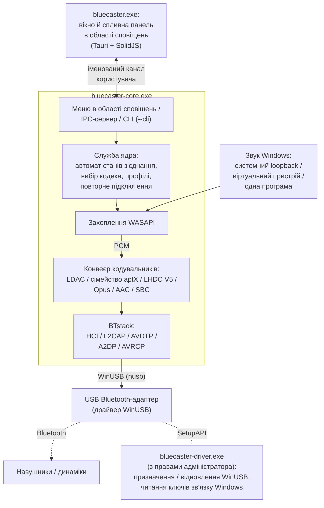
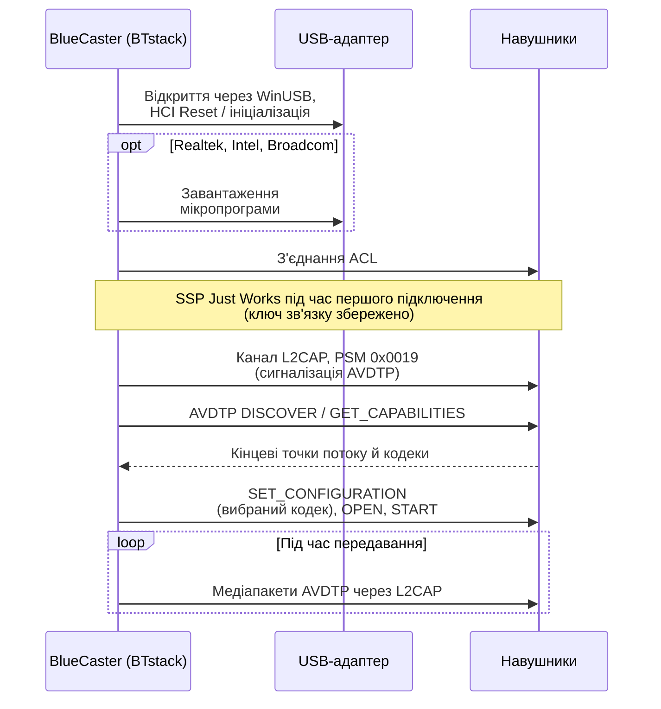
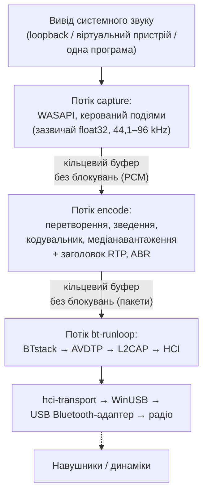
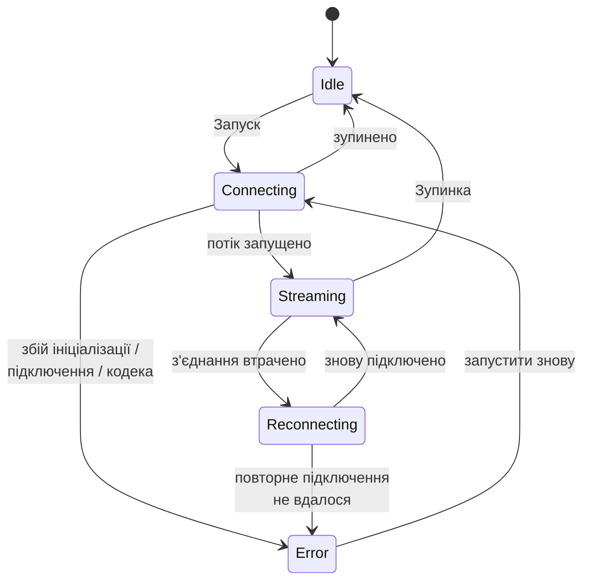
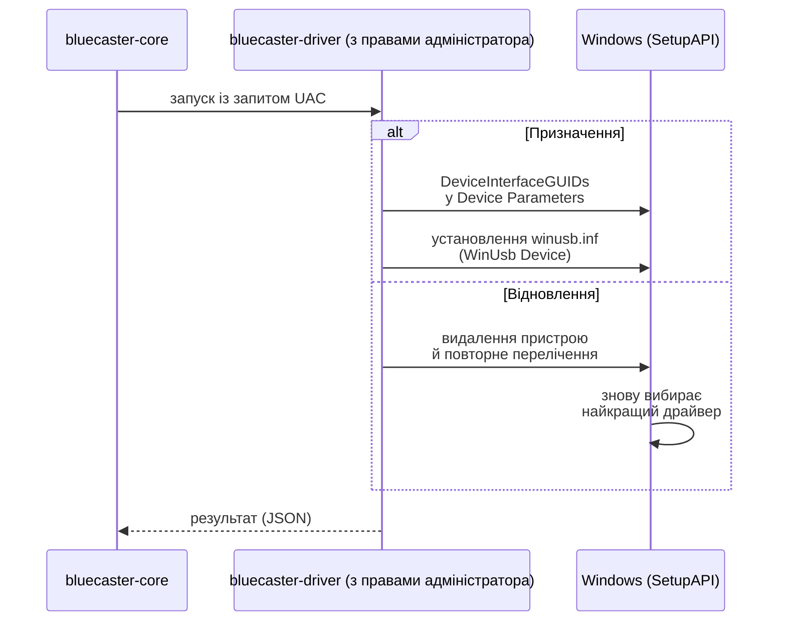

# Архітектура
{: .no_toc }

## Зміст
{: .no_toc .text-delta }

1. TOC
{:toc}

---

## Огляд

BlueCaster дає змогу передавати у Windows Bluetooth-звук у форматах LHDC V5, LDAC, aptX Adaptive, aptX HD,
aptX Low Latency, aptX, Opus, AAC, SBC XQ і SBC
(а також LC3 через LE Audio, експериментально). Власний стек Bluetooth Windows підтримує для A2DP
лише SBC, класичний aptX і (лише у Windows 11) AAC; BlueCaster додає
решту без драйвера режиму ядра.

BlueCaster використовує **BTstack + WinUSB**: усе працює в режимі користувача, тож підписувати драйвер не потрібно.

BlueCaster 2.0 написано на Rust. Бібліотеки C, які неможливо замінити
(BTstack і кодувальники кодеків), компілюються з вихідного коду й викликаються через
невеликі FFI-крейти; решту, зокрема кодувальник SBC, написано на Rust.

## Процеси

BlueCaster працює як щонайбільше три програми:

| Програма | Коли працює | Що робить |
|:--------|:-----|:-----|
| `bluecaster-core.exe` | Поки працює BlueCaster (запускається вікном, з меню «Пуск» або через **Запускати разом із Windows**) | Bluetooth, захоплення й кодування звуку, профілі й параметри, значок в області сповіщень і його меню, IPC-сервер. `--cli` натомість запускає те саме ядро в консолі |
| `bluecaster.exe` | Лише поки відкрито вікно (завершує роботу через 3 хвилини після закриття останнього вікна) | Головне вікно й спливна панель в області сповіщень (Tauri 2, SolidJS + TypeScript). Не має власного стану |
| `bluecaster-driver.exe` | Недовго, з правами адміністратора (UAC), для зміни драйвера або імпорту ключів | Встановлює для адаптера WinUSB, відновлює його попередній драйвер або зчитує ключі зв'язку, які Bluetooth Windows зберігає для адаптера (`windows-keys`), і завершує роботу |

- **Ядро не є службою Windows.** Це звичайний процес користувача, який
  увійшов у систему, бо loopback WASAPI захоплює звук сеансу саме цього користувача.
  М'ютекс на рівні сеансу допускає лише один екземпляр; повторний запуск ядра відкриває
  вікно.
- **Область сповіщень належить ядру.** Контекстне меню значка (відкрити, перші 10
  пристроїв, відключити, вийти) відкривається одразу, без запуску вікна. Клацання
  лівою кнопкою відкриває спливну панель (або головне вікно, залежно від
  параметрів).
- **Вікно лише відображає стан.** Воно отримує знімок стану ядра,
  а потім кожну зміну. Закриття вікна чи його аварійне завершення не зупиняє
  звук. Закрите вікно лише ховається, тож з області сповіщень воно
  відкривається миттєво.
- **Командний рядок використовує те саме ядро.** `bluecaster-core.exe --cli` запускає
  службу ядра без області сповіщень та IPC; у цьому режимі працює тест з емулятором.

## Транспорт: BTstack + WinUSB

BlueCaster повністю обходить стек Bluetooth Windows і працює напряму з
USB Bluetooth-адаптером через WinUSB (універсальний USB-драйвер, підписаний Microsoft). BTstack,
стек Bluetooth із доступним вихідним кодом (некомерційна ліцензія), реалізує HCI, L2CAP, AVDTP і A2DP у
режимі користувача.

**Переваги**:
- Не потрібно платити за підписування драйвера
- Не потрібен режим тестового підписування
- Не потрібно вимикати безпечне завантаження
- Увесь код працює в режимі користувача (його легше налагоджувати)

**Компроміси**:
- Потрібен окремий USB Bluetooth-адаптер (окремо від вбудованого
  Bluetooth Windows)
- Поки адаптером керує WinUSB, він недоступний для звичайного Bluetooth
  Windows
- Пристрої знаходять пошуком (GAP inquiry) через USB-адаптер або вводять
  їхню адресу вручну

**Як це працює**:
1. Користувач встановлює для USB Bluetooth-адаптера WinUSB у програмі (**Адаптери >
   Замінити драйвером WinUSB**, див. [Призначення драйвера](#driver-assignment)) або за допомогою Zadig
2. Крейт `hci-transport` відкриває адаптер через WinUSB за допомогою `nusb`
   і під'єднує його до BTstack як транспорт HCI
3. BTstack надсилає команди HCI, щоб ініціалізувати Bluetooth-контролер
4. Для адаптерів Realtek, Intel і Broadcom BlueCaster за потреби завантажує мікропрограму
5. BTstack установлює з'єднання ACL і відкриває канали L2CAP (PSM 0x0019)
6. Сигналізація AVDTP виявляє SEP віддаленого пристрою й узгоджує кодеки
7. Закодований звук надсилається як медіапакети AVDTP через L2CAP

USB-транспорт зберігає кроки відновлення, які були потрібні справжнім адаптерам у
v1: під час відкриття адаптера він скидає канали подій і ACL, повторює невдале
читання подій, обмежує команди HCI тайм-аутом, а під час закриття адаптера надсилає
HCI Reset (крім контролера, який ще перебуває в завантажувачі), тож наступний
сеанс застає контролер у стані простою.

## Структура крейтів

Код — це один робочий простір Cargo (`Cargo.toml` у корені репозиторію) із п'яти рівнів;
кожен рівень залежить лише від рівнів під ним. Бібліотеки містяться в
`app/src/crates/`, програми — в `app/src/core`, `app/src/ui` і
`app/src/driver`. Запозичений крейт `aptx-adaptive` — залежність `codec` за шляхом
і не входить до робочого простору. Лише крейти `*-sys` і `win-sys` можуть містити код `unsafe`;
усі інші крейти мають `#![forbid(unsafe_code)]`.

| Рівень | Крейт | Що робить |
|:------|:------|:-----|
| 1. FFI | `btstack-sys` | Збирає BTstack за допомогою `cc` (MSVC), написані вручну оголошення FFI й безпечні обгортки, `btstack_config.h`. BTstack можна викликати лише в потоці його циклу виконання; це гарантує маркер `Stack` з `!Send` |
| 1. FFI | `ldac-sys`, `openaptx-sys`, `fdkaac-sys`, `lhdcv5-sys`, `opus-sys`, `lc3-sys` | Збирають кодувальники на C і надають до них доступ; один крейт на бібліотеку, щоб ліцензії лишалися окремими |
| 1. FFI | `win-sys` | API Win32 без бібліотеки Rust: MMCSS, аудіопристрій за замовчуванням (IPolicyConfig), WLAN API (AFH), сповіщення про живлення, ключ Run, мультимедійні клавіші, DACL каналу, підвищення прав, призначення драйвера WinUSB (SetupAPI) і власний Bluetooth Windows (його радіомодулі, сполучені пристрої й ключі зв'язку) |
| 2. Складники | `hci-transport` | HCI через USB («H2») за допомогою `nusb` і H4 через TCP до віртуального контролера (`tools/emu`) |
| 2. Складники | `aptx-adaptive` | Кодувальник aptX Adaptive на Rust (запозичений з AKS-Logic/aptx-adaptive-linux, MIT) |
| 2. Складники | `codec` | Трейт `Encoder`, кодувальник SBC (перенесення кодувальника з Bluedroid на Rust), безпечні обгортки кодувальників на C, розбір Codec Information і вибір кодека |
| 2. Складники | `audio-capture` | Захоплення WASAPI (крейт `wasapi`): системний loopback, віртуальний пристрій, одна програма (loopback процесу); списки пристроїв і програм, тестовий тон, гучність окремих програм (мікшер гучності) |
| 2. Складники | `voice-link` | Звук мікрофона гарнітури (режим розробника): моно-PCM, що відтворюється на вибраному пристрої виводу (WASAPI), зведене захоплення для зворотного напрямку та голосові кодеки CVSD / mSBC / LC3-SWB поверх корисного навантаження SCO |
| 3. Рушій | `bt-host` | Запускає BTstack в окремому потоці, яким керують команди й типізовані події: GAP, A2DP Source, AVRCP, SDP, канали RFCOMM для наскрізного каналу (`rfcomm.*`), ключі зв'язку, служби SDP пристрою, AFH, завантаження мікропрограм і завантажувачі мікросхем (`bringup`), опитування мікросхеми й скрипти мікросхеми, запис HCI (`.pklg`), LE Audio (`le/`) |
| 2. Складники | `le-audio` | LE Audio: логіка без BTstack і Windows (assigned numbers, LTV, PDU PACS / ASCS, пресети, моделі CSIP / VCP / MCP / CCP) |
| 3. Рушій | `pipeline` | Кільцеві буфери PCM, перетворення формату, зведення каналів, кодування, медіанавантаження, темп надсилання, ABR |
| 4. Ядро | `bluecaster-core` (каталог `core`) | Автомат станів, повторні підключення, сон / відновлення, профілі, параметри й перенесення з v1, синхронізація гучності, вимкнення звуку виводу, перевірка оновлень, завантаження мікропрограми Realtek, клієнт тесту приймача, статистика, протоколи виробників (`vendor/`) |
| 4. Ядро | `ipc` | Типи протоколу, спільні для ядра й вікна (serde; типи TypeScript генеруються за допомогою `ts-rs`), і кадрування в каналі |
| 5. Програми | `bluecaster-core-exe` (`app/src/core`) | `bluecaster-core.exe`: ядро, область сповіщень (`tray-icon` на циклі подій `tao`), IPC-сервер, `--cli` |
| 5. Програми | `bluecaster-ui` (`app/src/ui`) | `bluecaster.exe`: Tauri 2; частина на Rust — це IPC-клієнт, сторінка — SolidJS + TypeScript + Vite |
| 5. Програми | `bluecaster-driver` (`app/src/driver`) | `bluecaster-driver.exe`: допоміжна програма з правами адміністратора |

## Шлях звуку й потоки

| Потік | Пріоритет | Робота |
|:-------|:---------|:-----|
| capture | MMCSS "Audio" | Читає WASAPI; заповнює беззвучні проміжки тишею |
| encode | MMCSS "Pro Audio" | Перетворює PCM у вхідний формат кодувальника, кодує цілі блоки кодувальника (залишок чекає наступного циклу) і пакує кадри в медіанавантаження; цикли тривають приблизно 10 ms, щоб пакети виходили рівномірно |
| bt-runloop | -- | Цикл виконання BTstack; надсилає пакет із черги, щойно L2CAP може надсилати. Щоразу, коли до черги надсилання (64 пакети) додається пакет, вона відкидає пакети, що чекали 350 ms (100 ms з низькою затримкою LHDC V5), починаючи з найстаріших |
| USB | -- | Передавання WinUSB: по три одночасні читання на кожному каналі IN (події, дані ACL), один записувач для команд і один для даних ACL (до 8 одночасних передавань) |
| core | Normal | Автомат станів, IPC (tokio; черги наскрізного каналу RFCOMM для кожного підключення), параметри, статистика (4 Hz), перевірка оновлень |

Коли потік запущено, шлях звуку не виділяє пам'ять і не бере блокувань.
Статистика — це атомарні лічильники, які ядро читає чотири рази на секунду.
BTstack не є потокобезпечним, тому інші потоки надсилають йому команди, а виконуються вони
в потоці bt-runloop.

## Ядро й IPC

Вікно обмінюється даними з ядром через іменований канал користувача
`\\.\pipe\bluecaster-<user SID>`, DACL якого допускає лише цього користувача. Повідомлення —
це кадри JSON із префіксом довжини:

1. Вікно надсилає `hello { protocol, client }`. Ядро з іншою версією
   протоколу відповідає `reject`, і вікно повідомляє, що дві
   програми мають різні версії. Інакше ядро відповідає
   `welcome { protocol, server, features }`; `features` перелічує доповнення до
   протоколу (`rfcomm`).
2. Ядро надсилає `snapshot`: увесь свій стан (адаптер, пристрої,
   потік, профілі, параметри, оновлення) і номер ревізії.
3. Далі ядро надсилає події `event` зі змінами. Якщо вікно пропустило ревізію,
   воно запитує новий знімок.
4. Дії — це `request { id, method, params }` з `response { id,
   result | error }`. Групи методів: `state.*`, `stream.*`,
   `device.*`, `profile.*`, `settings.*`, `adapter.*`, `audio.*`, `diag.*`,
   `receiver.*`, `rfcomm.*` і `app.*`.

Інші програми використовують той самий канал; див.
[Інтеграція (IPC)](integration). Версії до 3.0.0 називали канал
`\\.\pipe\a2dpwb-<user SID>`; ядро обслуговує й цю назву щонайменше 6
місяців після 3.0.0.

Помилки — це коди з параметрами (наприклад, `adapter.driver_missing`), а не
тексти; вікно перекладає їх і показує спосіб виправлення поруч із повідомленням.
Дані з високою частотою оновлення (якість зв'язку, журнал) ядро надсилає, лише поки екран
на них підписаний.

Автомат станів з'єднання:

Невдале підключення ядро повторює до 3 разів. Втрачене з'єднання воно відновлює до
3 разів або до 10 разів після перезапуску стеку (сон, адаптер,
що перестав працювати). Коли ПК переходить у режим сну, ядро зупиняє BTstack, не зараховуючи
втрачене з'єднання як збій, і перепідключається після виходу ПК зі сну.

## Призначення драйвера {#driver-assignment}

Windows 8 і новіші містять підписаний Microsoft драйвер WinUSB
(`winusb.inf`). `bluecaster-driver.exe` через SetupAPI робить те саме, що й команда Диспетчера пристроїв
«Оновити драйвер > Вибрати драйвер зі списку > WinUsb Device»:

1. Відкриває адаптер за ідентифікатором екземпляра пристрою.
2. Записує значення `DeviceInterfaceGUIDs` до його `Device Parameters`, щоб
   WinUSB зареєстрував для нього інтерфейс пристрою.
3. Вибирає модель «WinUsb Device» з `%SystemRoot%\INF\winusb.inf` і
   встановлює її за допомогою `DiInstallDevice`. Вбудований драйвер підписано, тож
   жоден сертифікат не встановлюється (на відміну від Zadig / libwdi, які підписують згенерований
   INF власноруч створеним сертифікатом).
4. **Відновлення**: видаляє пристрій (`DiUninstallDevice`) і знову виконує його перелічення;
   після цього Windows знову вибирає драйвер із найвищим рейтингом (зазвичай `BthUSB` або
   драйвер виробника). Попередній драйвер адаптера записується в
   папці параметрів (`driver\`), і після відновлення результат звіряється з цим записом.
   `restore --records <folder>` відновлює всі записані адаптери за один
   запуск із правами адміністратора; програма видалення робить це, попередньо запитавши користувача.

Ядро ніколи не працює від імені адміністратора: для призначення чи відновлення воно запускає
допоміжну програму із запитом UAC (`ShellExecuteEx` "runas") і читає її результат
у JSON. Щоб переглянути адаптери та їхні драйвери, права адміністратора не потрібні.

## Основні модулі

### Вибір кодека (`codec::caps`)

- Розбирає можливості віддаленого пристрою: стандартні елементи SBC і AAC та
  кодеки виробників, зокрема aptX LL під обома vendor ID і aptX Adaptive
  (приймачі R1 і R2; придатний лише з 48 kHz стерео)
- Вибирає кодек: «Авто» бере кодек із найвищою якістю звуку, який пропонує
  віддалений пристрій. Якщо віддалений пристрій не пропонує запитаного кодека, його замінює
  кодек, який узяв би «Авто» (для профілю — завжди, починаючи з issue #86; у
  командному рядку — лише з `--fallback`); інакше це помилка. Кодек,
  вибраний на його картці, хоча віддалений пристрій його не пропонував (`codec_forced` профілю),
  запитується все одно, без заміни (`RemoteCaps::forcing`).
  Кодек, картка якого пропонує більше, ніж перелічує віддалений пристрій
  (`unlisted_options`), налаштовується з `RemoteCaps::unlisted`
- Поки ввімкнено параметр `auto_codec` (Кодеки > Автоматично вибирати кодек найвищої
  якості; один параметр для всіх пристроїв, починаючи зі схеми 5), передає кожен профіль A2DP
  як «Авто» з параметрами «Авто» за замовчуванням. Кодек,
  вибраний для пристрою, лишається в його профілі на випадок, коли параметр вимкнуть
- Дотримується порядку кодеків, який користувач задав, перетягуючи картки пристрою
  (`codec_order` профілю; `codec::AutoOrder`, порожній порядок —
  спершу найвища якість звуку), і для вибору «Авто», і для заміни
  вибраного кодека, зокрема за автовибору. FastStream і Opus
  05 ніколи не стають вибором «Авто» чи заміною. (Бета-версії 2.0.2 мали один порядок для
  всіх пристроїв, `auto_order` у settings.json, тепер він ігнорується.)
- Вибирає частоту дискретизації для сімейства aptX (44,1 / 48 kHz із частот, які оголошує
  віддалений пристрій; WASAPI передискретизує захоплення); aptX Adaptive використовує 48 kHz або
  96 kHz, якщо вибрано 96 kHz, якість — «Висока», а приймач — R2 і
  перелічує 96 kHz. Частота «Авто» (зокрема за автовибору) запитує 48 kHz; якщо
  приймач її не перелічує, кожен кодек бере найкращу частоту з переліку приймача (issue #86: не
  найвищу перелічену частоту й не частоту мікшування Windows)
- Зіставляє якість профілю з тими, які пропонує кодек
  (`Quality::for_codec`, issue #86): LDAC і LHDC V5 «Висока» / «Середня»
  (`sq`) / «Низька» (`mq`), LHDC V5 також «Вище середньої» (`mhq`), aptX Adaptive
  «Висока» / «Низька затримка», будь-який інший кодек — «Висока» (найвищий бітрейт, який приймає
  пристрій). Якість, якої кодек більше не має (Standard /
  Mobile в aptX Adaptive, нижчі рівні AAC), працює як «Висока»
- Записує, що пристрій перелічує для кожного запропонованого кодека (`KnownCodecs.caps`:
  частоти дискретизації, розрядності, максимальний бітрейт; `RemoteCaps::listed_*`), щоб
  параметри кодека пропонували лише ці значення; діапазон bitpool для SBC записувався й раніше

### Bluetooth-хост (`bt-host`)

**Обов'язки**:
- Запускати BTstack із транспортом HCI через USB (або TCP) в окремому потоці
- Реєструвати кінцеві точки потоку: кодеки виробників (LDAC, aptX HD, aptX, aptX LL,
  LHDC V5, FastStream, Opus, Opus 05, aptX Adaptive), а також SBC (його використовує й
  SBC XQ) і AAC: загалом 11 (`MAX_NR_AVDTP_STREAM_ENDPOINTS` у BTstack)
- Реєструвати записи SDP (A2DP Source, AVRCP Controller, AVRCP Target; HFP
  Audio Gateway — лише заради рівня заряду, поки ввімкнено відповідний
  параметр)
- Керувати сполученням SSP (Just Works, General Bonding; ключі зв'язку зберігаються)
- Розривати напіввідкрите з'єднання після тайм-ауту підключення, щоб повторні спроби спрацьовували
- Повторювати невдале підключення (до 3 спроб) і розрізняти причини (немає
  відповіді, мовчазне з'єднання, віддалений пристрій розірвав з'єднання, автентифікація); відкидати ключ зв'язку,
  якого пристрій більше не знає, і виконувати сполучення знову
- GAP inquiry для пошуку пристроїв
- Абсолютна гучність AVRCP і кнопки навушників
- Класифікація каналів хостом для AFH і показники RSSI / AFH для перегляду
  якості зв'язку
- Завантаження мікропрограм: Realtek і Broadcom — через драйвери чипсетів BTstack,
  Intel (застарілий завантажувач і завантажувач TLV) — на Rust через спільний інтерфейс завантажувачів мікросхем
  (`bringup`); поки адаптер запускається, екран «Адаптери» показує
  перебіг завантаження
- Режим розробника: опитування мікросхеми (що адаптер відповідає на стандартні команди
  читання, звіт JSON у `logs\probe\`), скрипти мікросхеми (запити, записані
  текстом, які виконуються на адаптері з WinUSB) і служби SDP, які перелічує підключений
  пристрій
- Запис HCI (`.pklg`), зокрема встановлення з'єднання, якщо запис почався посеред з'єднання

**Основні використовувані API BTstack**:
- `a2dp_source_create_stream_endpoint()` — реєстрація кінцевих точок кодеків
- `a2dp_source_establish_stream()` — підключення до приймача A2DP
- `a2dp_source_set_config_other()` — налаштування кодека виробника
- `a2dp_source_stream_send_media_payload_rtp()` — надсилання закодованого звуку з
  заголовком RTP (LDAC, aptX HD, AAC, SBC, SBC XQ, LHDC V5, Opus)
- `a2dp_source_stream_send_media_packet()` — надсилання необроблених медіапакетів без
  заголовка RTP (aptX, aptX LL, FastStream) або з власним заголовком RTP BlueCaster
  (aptX Adaptive)

### Захоплення звуку (`audio-capture`)

Захоплює звук у реальному часі через Windows Audio Session API.
- Системний loopback пристрою виводу за замовчуванням, loopback вибраного
  (віртуального) пристрою або loopback процесу однієї програми та її дочірніх
  процесів (Windows 10 збірки 19041 або новішої)
- Видає формат мікшування пристрою в спільному режимі (зазвичай float32;
  конвеєр перетворює його для кодувальника)
- У режимі «Програма» чекає на запуск програми й знову захоплює її звук після
  перезапуску
- Задає гучність і вимкнення звуку програми на виводі за замовчуванням, як мікшер
  гучності Windows (`mixer`): гучність сеансу впливає на loopback-захоплення, навіть
  коли ядро вимикає звук цього виводу під час потоку «Системний звук»
  (`bluecaster-core::mute_output`)

### Протоколи виробників (`bluecaster-core::vendor`)

Деякі навушники пропонують кодек або бітрейт лише після того, як застосунок виробника перемкне
режим через власну службу RFCOMM навушників. Окремий модуль для кожного виробника робить це через
з'єднання BlueCaster, розпізнаючи навушники за назвою:

- **Huawei / Honor**: якщо профіль запитує LDAC, а навушники його не
  перелічують, модуль вмикає їхній режим «спершу якість звуку» й перепідключається;
  якщо LDAC так і не з'явився, а режим раніше був вимкнений, модуль знову його вимикає. Ніколи
  не працює для «Авто»
- **OPPO**: коли передається LHDC V5 (вибраний вручну або через «Авто»), модуль один раз запитує в навушників
  Hi-Res і один раз перепідключається, щоб зчитати, що вони тепер перелічують; запис
  про це зберігається разом із кодеками пристрою (`device_codecs.json`), доки
  `device.forget_codecs` його не очистить

Вкладка «Виробники» в режимі розробника визначає, коли працює кожен модуль («Авто» за назвою,
«Завжди», «Ніколи»), і пропонує власні параметри виробника.

### Сполучення (`link_keys`, `win-sys::bt_keys`)

Ключі зв'язку зберігаються в `link_keys.txt`. Під час додавання пристроїв ядро може
імпортувати ключі, які Bluetooth Windows зберігав для адаптера, що тепер використовує BlueCaster:
`bluecaster-driver.exe windows-keys` зчитує їх (один запит UAC). Ключі, які BlueCaster
уже має, лишаються без змін, а аудіопристрої серед імпортованих зберігаються з
назвами з Windows. Режим розробника показує ключ зв'язку пристрою і служби SDP,
які перелічує пристрій.

Файли ключів у `pairing\` (ключі зв'язку, LE-бонди, координовані набори, ключі LE,
перейняті з Windows, замінені ключі Windows) шифруються для користувача Windows
за допомогою DPAPI (`win-sys::dpapi`); інші користувачі не можуть їх прочитати, як і
інший ПК, на який їх скопійовано. Незашифровані файли попередніх версій BlueCaster читає
й перезаписує зашифрованими. Файл, який неможливо розшифрувати, зберігається як
`<name>.undecryptable`, а його пристрої доведеться сполучити знову. BlueCaster сам зберігає
LE TLV BTstack (`TlvStore` з `btstack-sys`, із вмістом, який записував
`btstack_tlv_windows`). `keys_for_windows.json`, який допоміжна програма з правами
адміністратора читає під час відновлення, лишається незашифрованим (допоміжна програма може працювати від імені іншого
адміністратора) і видаляється, коли вона завершує роботу.

### Кодувальники звуку

| Кодувальник | Бібліотека | Бітрейт | Особливості |
|---------|---------|---------|----------|
| LHDC V5 | lhdcv5-enc (перенесення кодувальника AOSP на C) | 400/500/900/1000 kbps (Низька/Середня/Вище середньої/Висока), не більше заявленого приймачем максимуму, ABR 160–400 kbps | 16/24 біт, кадри по 5 ms, 2-байтовий заголовок медіанавантаження, заголовок RTP; низька затримка, якщо приймач її заявляє (кодує кожні 10 ms замість 20; коли ABR вимкнено, додається захист черги, описаний нижче) |
| LDAC | libldac (AOSP) | 330/660/990 kbps | Режими Висока/Середня/Низька (HQ/SQ/MQ), ABR |
| aptX Adaptive | aptx-adaptive (кодувальник на чистому Rust з AKS-Logic/aptx-adaptive-linux, MIT) | 427 kbps у режимі «Висока», 265 kbps у режимі «Низька затримка» (приймачі R2: 270); ABR знижує до 364/318 (R2: 270/204) | 48 kHz стерео (96 kHz у режимі «Висока», якщо вибрано, для приймача R2, що його перелічує: 646/340/255 kbps), 24 біт; один пакет кодека на медіапакет за власним заголовком RTP BlueCaster; ABR у режимі «Висока»; «Авто» бере його після LHDC V5 і LDAC |
| Opus | libopus 1.6.1 | 256 kbps (стерео; моно — половина) | A2DP Opus з Android: 48 kHz, кадри по 20 ms (10 ms, якщо приймач має лише такі), обмежений VBR у межах медіанавантаження, один кадр на пакет, 1-байтовий заголовок медіанавантаження, заголовок RTP |
| aptX HD | libopenaptx | 576 kbps | 24-бітний вхід, фіксований бітрейт, заголовок RTP |
| aptX | libopenaptx | 352/384 kbps (44,1/48 kHz) | 16 біт стерео, без заголовка RTP |
| aptX LL | libopenaptx | 352 kbps | Затримка ~32 ms, без заголовка RTP, пакети ≤ ~7,5 ms |
| AAC | fdk-aac | до 256 kbps (не більше заявленого приймачем бітрейту) | AAC-LC, транспорт LATM |
| SBC XQ | той самий кодувальник SBC | ~385/505/552 kbps | Dual channel, bitpool 47 / 43 за 44,1 / 48 kHz («Висока»); лише якщо SBC приймача дозволяє dual channel і bitpool щонайменше 29 (тоді bitpool обмежується максимумом приймача, як у PipeWire); спільні з SBC кінцева точка потоку, заголовок медіанавантаження й заголовок RTP |
| SBC | Перенесення кодувальника Bluedroid на Rust | до ~345 kbps | Обов'язкова основа A2DP; побітово ідентичний кодувальнику на C (перевірено на всіх конфігураціях) |
| FastStream | той самий кодувальник SBC | 198/216 kbps (44,1/48 kHz) | Кодек виробника CSR, лише напрямок музики (без зворотного голосового каналу): SBC joint stereo з bitpool 29, кадри доповнено до 72 байтів, 3 на пакет, без заголовка медіанавантаження й без заголовка RTP (як у PipeWire); «Авто» ніколи його не вибирає |

**Захист черги LHDC V5** (низьку затримку ввімкнено, ABR вимкнено): поки в черзі
надсилання в середньому за секунду 12 пакетів або більше, кодувальник знижує
бітрейт на один рівень (1000, 900, потім 500 kbps), не частіше ніж раз на 2 s.
Після спокійної хвилини він підвищує бітрейт на один рівень. Якщо підвищення не
тримається 30 s, очікування подвоюється, щонайбільше до 10 хвилин.

Усі кодувальники реалізують трейт `codec::Encoder`: кожен повідомляє формат PCM
і кількість кадрів, яку споживає один виклик, і повертає кадри кодека.

libopenaptx очікує групи з 4 стереосемплів як упакований 24-бітний PCM little-endian;
обгортки aptX перетворюють 16-бітні або 32-бітні семпли в цей формат
і дублюють моновхід в обидва канали.

## Codec Information Elements кодеків виробників

Нестандартні кодеки реєструються в AVDTP як Vendor Specific:

| Кодек | Vendor ID | Codec ID |
|-------|-----------|----------|
| LHDC V5 | Savitech (0x0000053A) | 0x4C35 |
| LDAC | Sony (0x0000012D) | 0x00AA |
| aptX Adaptive | Qualcomm (0x000000D7) | 0x00AD |
| Opus | Google (0x000000E0) | 0x0001 |
| aptX HD | Qualcomm (0x000000D7) | 0x0024 |
| aptX | APT (0x0000004F) | 0x0001 |
| aptX Low Latency | CSR (0x0000000A) або Qualcomm (0x000000D7) | 0x0002 |
| FastStream | CSR (0x0000000A) | 0x0001 |
| Opus 05 | The Linux Foundation (0x000005F1, PipeWire) | 0x1005 |

AAC і SBC використовують стандартні ідентифікатори кодеків, визначені в специфікації A2DP.

Розміри Codec Information Elements (разом із 6 байтами vendor ID / codec ID):

- **aptX**: 7 байтів (байт 6 = частота дискретизації / режим каналів)
- **aptX HD**: 11 байтів (байт 6 як в aptX, плюс 4 зарезервовані байти); стерео
  обов'язкове
- **aptX LL**: 8 байтів або 17 байтів, якщо приймач установлює прапорець розширених
  можливостей («new caps»). BlueCaster реєструє одну кінцеву точку aptX LL і налаштовує
  потік із тим vendor ID, який використав приймач
- **LHDC V5**: 11 байтів (Android `a2dp_vendor_lhdcv5_constants.h`): байт 6 —
  частоти дискретизації (0x20 44,1k, 0x10 48k, 0x04 96k, 0x01 192k), байт 7 — розрядність
  (0x04 16 біт, 0x02 24 біт) і мінімальний/максимальний бітрейт приймача, байт 8 —
  підверсія кодека (0x01 = V5 ver.1) і 0x10 = кадри по 5 ms, байти 9-10 —
  необов'язкові функції (low latency, lossless, JAS, AR, META). BlueCaster запитує
  low latency (байт 9, 0x40), якщо в налаштуваннях LHDC V5 увімкнено «Низька затримка»
  і приймач її заявляє. Інших функцій BlueCaster не пропонує. Лише стерео. Обмеження бітрейту приймача BlueCaster повертає в
  конфігурації й застосовує до кодувальника, як Android. Медіапакети
  мають 2-байтовий заголовок корисного навантаження: кількість кадрів << 2 (біти затримки 0) і
  порядковий номер
- **FastStream**: 8 байтів (PipeWire `a2dp_faststream_t`): байт 6 — напрямок
  (0x01 sink = музика, 0x02 source = голос), у байті 7 молодший напівбайт — частоти приймача
  (0x2 44,1k, 0x1 48k), старший напівбайт — частота джерела (0x2 16k). BlueCaster пропонує
  й налаштовує лише напрямок музики
- **Opus**: 7 байтів (Android `a2dp_vendor_opus_constants.h`): байт 6, біти
  2..0 — режим каналів (0x01 моно, 0x02 стерео, 0x04 dual mono), біти 4..3 —
  тривалість кадру (0x08 10 ms, 0x10 20 ms), біт 7 — 48 kHz. BlueCaster пропонує моно
  й стерео, 10 і 20 ms, а налаштовує 20 ms стерео (моно — лише для моновходу
  і приймача, який підтримує моно). Медіапакети містять один пакет Opus за
  1-байтовим заголовком корисного навантаження (кількість кадрів 1 у молодших 4 бітах)
- **aptX Adaptive**: 40 байтів. Подія можливостей BTstack обрізає
  Codec Information приймача до 30 байтів, які все одно містять усе, що використовує BlueCaster.
  SET_CONFIGURATION: 48 kHz із типом джерела 2 (кодувальник на хості: приймач сам задає
  таймінг відтворення), стерео; приймач R1 отримує назад власні байти
  цільової затримки, де LL0 піднято щонайменше до 80 ms, а нульову затримку HQ
  замінено на 200 ms; приймач R2 отримує власний блок R2 джерела

**RTP чи без RTP**: медіапакети LDAC, aptX HD, AAC, SBC, SBC XQ, LHDC V5 і Opus містять
12-байтовий заголовок RTP. aptX, aptX LL і FastStream надсилаються **без** заголовка RTP (як в Android і
PipeWire), тож увесь L2CAP MTU лишається для кадрів aptX.

**aptX Adaptive** надсилає один пакет кодека на медіапакет
за власним 12-байтовим заголовком RTP BlueCaster (BTstack свого не додає): тип корисного навантаження 96,
порядковий номер +1 на пакет, позначка часу = кількість семплів на канал у
пакеті (а не час за годинником), SSRC = режим затримки приймача (0x000000A3 HQ,
0x000000A1 LL). У корисному навантаженні байти в 16-бітних словах переставлено. Пакети HQ мають
656 байтів (12 ms), пакети LL — 348 байтів (10 ms). «Авто» ставить його перед
класичним aptX, Opus і AAC (порядок з issue #86), але після LHDC V5 і LDAC.

## Параметри й файли {#settings-and-files}

Усе зберігається в папці параметрів `%APPDATA%\BlueCaster` (або в
папці, указаній змінною середовища `BLUECASTER_CONFIG_DIR`); файли,
які були у v1 і 2.0.x, зберігають свої формати (2.0.x використовувала `%APPDATA%\A2DPWB`; 3.0.0
під час першого запуску перейменовує цю папку й розкладає файли по
наведених нижче папках):

| Шлях | Вміст |
|:-----|:---------|
| `settings.json` | Параметри програми з `schema_version`; невідомі ключі зберігаються |
| `profiles.json` | Профілі |
| `devices\devices.txt` | Відомі пристрої |
| `devices\le_audio_devices.txt` | LE Audio: записи LE Audio у списку пристроїв |
| `devices\le_audio_sets.txt` | LE Audio: координовані набори збережених пристроїв (лише адреси учасників; обидва навушники з пари — один пристрій) |
| `devices\device_codecs.json` | Що пропонував кожен класичний пристрій під час останнього підключення (і чи запитували в навушників OPPO Hi-Res) |
| `pairing\link_keys.txt` | Ключі зв'язку: навушники, сполучені з v1 або 2.0.x, підключаються знову без повторного сполучення |
| `pairing\le_audio_bonds.tlv`, `pairing\le_audio_csip.txt` | LE Audio: LE-бонди (з постійними значеннями CCC сервера GATT) і координовані набори |
| `pairing\windows_le_keys.txt`, `pairing\replaced_windows_keys.json` | Ключі LE, перейняті з Windows, доки стек їх не додасть; ключі Windows, які замінила дія **Відновити початковий драйвер** |
| `adapters\adapter_caps.json` | Що стек дізнався про кожен адаптер (підтримка LE Audio, адреса, версія HCI, назва адаптера у Windows) |
| `adapters\driver\<instance id>.json` | Попередній драйвер кожного адаптера, для якого встановлено WinUSB |
| `firmware\` | Файли мікропрограм (`*.bin`, `*.hcd`, `ibt-*`; файли Intel також у `firmware\intel\`, як у linux-firmware); файли, які попередні версії зберігали прямо в папці параметрів, переносяться сюди |
| `logs\<YYYY-MM-DD>\core.log`, `ui.log`, `driver.log` | Журнали ядра, вікна й допоміжної програми драйвера, одна папка на день (UTC); без маскування |
| `logs\hci\*.pklg` | Записи HCI: записи «бортового самописця», що зберігаються, коли потік завершується збоєм або з'єднання втрачено (10 найновіших), і записи, які ви запускаєте самі (`hci_<date>_<time>.pklg`) |
| `logs\probe\` | Звіти опитування мікросхеми й скриптів мікросхеми (10 найновіших) |
| `logs\crash\` | Звіти про аварійне завершення: мінідамп (`*.dmp`) і текстовий файл на кожен збій (5 найновіших для кожної програми) |
| `logs\bundles\*.zip` | Пакети діагностики (3 найновіші) |
| `backup\v1\` | Копія параметрів v1, створена один раз під час першого запуску v2 |
| `backup\v2\` | Копія параметрів і сполучень 2.0.x, створена один раз під час першого запуску 3.0.0 |
| `backup\profiles-before-codecs.json` | `profiles.json` у вигляді до того, як екран «Кодеки» об'єднав кілька профілів пристрою в один (записується один раз) |

Папка програми — `%LOCALAPPDATA%\BlueCaster\`: три програми,
програма видалення й `licenses\` (`licenses\README.txt`, `licenses\bluecaster\LICENSE...`,
`licenses\third-party\...`). Кеш завантаження мікропрограм — `%TEMP%\bluecaster-cache`.

## Система збирання

- **Cargo** збирає програми без CMake. Кожен крейт `-sys`
  компілює свою бібліотеку C з підмодуля git у `extern/` за допомогою MSVC у
  `build.rs`. CMake потрібен лише для інструмента розробника `tools/a2dp_decode`
- **Vite** збирає сторінку вікна (`pnpm build` в `app/src/ui`), а Tauri
  вбудовує її в `bluecaster.exe`
- Типи TypeScript протоколу IPC генеруються з типів Rust
  (`cargo test -p ipc export_bindings`)
- Мовні файли (`app/lang/*.json`) спільні для вікна й меню ядра
  в області сповіщень
- `installer/build-release.ps1` створює інсталятор (Inno Setup, `installer/BlueCaster.iss`),
  портативний ZIP-архів і маніфест оновлювача. Див. [Збирання](building)

## Важливі зауваги

- **Сумісність адаптерів**: Realtek (перевірено найкраще), CSR, Intel, Broadcom, MediaTek
  та інші ([Перевірене обладнання](hardware)). Адаптерам Realtek потрібно завантажувати мікропрограму під час запуску,
  адаптерам Intel у режимі завантажувача — теж
- **Сполучення**: SSP Just Works з General Bonding. Ключі зв'язку зберігаються
  в локальному файлі або імпортуються з Bluetooth Windows для цього адаптера
- **Рекомендовано другий адаптер**: залиште вбудований Bluetooth для Windows, а для BlueCaster
  використовуйте окремий USB-адаптер
- Мікропрограма деяких Bluetooth-адаптерів обмежує досяжний бітрейт
- USB-адаптери з Bluetooth 5.0+ зазвичай добре працюють з LDAC
- Пріоритет автоматичного вибору кодека (за якістю звуку, issue #86): LHDC V5 > LDAC > aptX Adaptive > Opus > aptX HD > aptX > aptX LL > AAC > SBC XQ > SBC (FastStream і Opus 05 — лише якщо їх вибрано); якщо пристрій більше не пропонує вибраного кодека, його замінює перший кодек у порядку пристрою, який той пропонує; кодек, вибраний на його картці, хоча пристрій його не пропонував, запитується все одно (`codec_forced`, без заміни)
