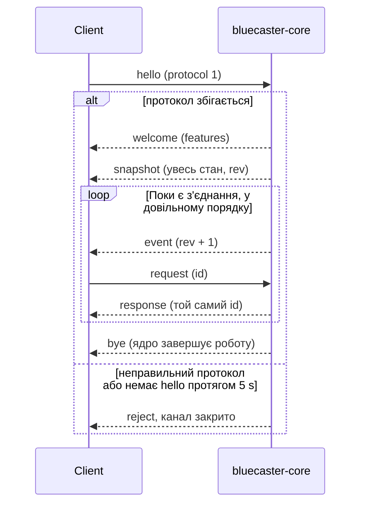

# Інтеграція (IPC)
{: .no_toc }

Як сторонній інструмент обмінюється даними з ядром BlueCaster: показує стан потоку, запускає й зупиняє профілі, задає гучність або звертається до власних служб навушників через Bluetooth-з'єднання BlueCaster. Інструменти, які це вміють, перелічено на сторінці [Сумісні програми](works-with).

{: .warning }
> Протокол ще може змінюватися під час бета-версій 2.0.2. Джерелом істини є [`app/src/crates/ipc/src/protocol.rs`](https://github.com/SeiyaFunaokaJP/BlueCaster/blob/main/app/src/crates/ipc/src/protocol.rs) і згенеровані з нього типи TypeScript у [`app/src/ui/src/ipc/bindings`](https://github.com/SeiyaFunaokaJP/BlueCaster/tree/main/app/src/ui/src/ipc/bindings). Ця сторінка пояснює, як ними користуватися, але не перелічує всіх полів.

## Зміст
{: .no_toc .text-delta }

1. TOC
{:toc}

## Підключення {#connecting}

Ядро (`bluecaster-core.exe`) працює щоразу, коли працює BlueCaster, з вікном або без нього. Воно очікує підключень на іменованому каналі того користувача, від імені якого запущене:

```
\\.\pipe\bluecaster-<user SID>
```

- `<user SID>` — рядок SID користувача, що ввійшов у систему (`S-1-5-21-...`), наприклад із виводу `whoami /user`. Кожен користувач має власне ядро й канал; DACL каналу пускає лише цього користувача, а віддаленим клієнтам відмовлено.
- Канал працює в байтовому режимі. Одночасно можуть бути підключені кілька клієнтів (вікно BlueCaster — один із них), і кожен отримує той самий стан і ті самі події.
- До 2.0.x включно канал називався `\\.\pipe\a2dpwb-<user SID>`. BlueCaster 3.0.0 обслуговує **обидві** назви і обслуговуватиме стару щонайменше 6 місяців після виходу 3.0.0. Клієнт має спершу пробувати `bluecaster-<user SID>`, а в разі невдачі — стару назву. Версія протоколу лишається 1.
- Щоб перевірити, чи працює ядро, шукайте канал, а не м'ютекс ядра: якщо каналу немає, ядро не запущене.
- Збірки для розробки, запущені з `BLUECASTER_INSTANCE=<name>`, натомість очікують підключень на `\\.\pipe\bluecaster-<SID>-<name>`, щоб працювати поруч зі встановленою версією.

### Канал служби {#the-service-pipe}

Служба BlueCaster — це прототип у режимі розробника. Вона дає змогу користуватися Bluetooth-клавіатурами й мишами на екрані входу. На ПК зі встановленою службою ядро працює як служба Windows. Тоді окремих каналів для кожного користувача немає. Натомість ядро обслуговує один спільний канал для всіх користувачів:

```
\\.\pipe\bluecaster-service
```

- Спершу пробуйте `bluecaster-<user SID>`, потім `bluecaster-service`. Служба не обслуговує канал зі старою назвою. Кадри, рукостискання й запити на обох каналах однакові.
- Відкривайте канал лише з `GENERIC_READ | FILE_WRITE_DATA`. Щоб змінити режим каналу, додайте `FILE_WRITE_ATTRIBUTES`. Канал відхиляє клієнтів, які запитують `GENERIC_WRITE`, бо це право включає створення ще одного екземпляра каналу (`FILE_CREATE_PIPE_INSTANCE`). У Python `open(..., "r+b")` запитує `GENERIC_WRITE`. Тому використовуйте `CreateFileW`, наприклад через `ctypes`.
- Щоб перевірити, що сервер справді BlueCaster, порівняйте ідентифікатор процесу сервера каналу (`GetNamedPipeServerProcessId`) з ідентифікатором процесу служби `BlueCaster` (`QueryServiceStatusEx`). Поки служба зупинена, інша програма може створити канал із такою назвою.
- Запити, що змінюють увесь ПК, повертають помилку `ipc.needs_admin`. Це, наприклад, режим розробника, драйвери адаптера або додавання клавіатур і мишей. Інструмент не може надати дозвіл адміністратора. Попросіть користувача внести зміну у вікні BlueCaster. Вікно саме запитає дозвіл у Windows.
- Коли ядро працює як служба, деякі запити повертають `ipc.not_in_service`. Один із них — `app.quit`, бо служба має працювати й далі для клавіатур і мишей. Натомість використовуйте `app.close`. Цей метод зупиняє трансляцію і закриває вікно BlueCaster та значок в області сповіщень.

### Кадри

Кожне повідомлення в обох напрямках — це один кадр: довжина JSON як **u32 little-endian**, а за нею сам JSON (UTF-8). Кадри понад 4 MiB відхиляються.

### Рукостискання

1. Клієнт надсилає `hello` протягом 5 секунд після підключення:
   ```json
   {"type": "hello", "protocol": 1, "client": "mytool/1.2.0"}
   ```
   `client` — довільні назва й версія на ваш вибір; вони з'являються в журналі ядра.
2. Ядро відповідає `welcome` або `reject`; у другому випадку воно закриває канал (неправильна версія протоколу або немає hello):
   ```json
   {"type": "welcome", "protocol": 1, "server": "bluecaster-core/2.0.2-beta.12", "features": ["rfcomm"]}
   {"type": "reject", "reason": "protocol 2 not supported (core speaks 1)"}
   ```
3. Ядро надсилає `snapshot` з усім своїм станом, а потім події `event`.

Версія протоколу має збігатися точно. Зворотно сумісні доповнення натомість оголошуються в `features` (див. [Сумісність](#compatibility)).



## Стан і події {#state-and-events}

```json
{"type": "snapshot", "rev": 41, "state": {"adapter": {...}, "devices": [...], "stream": {...}, "profiles": [...], "active_profile": "WH-1000XM5", "settings": {...}, ...}}
{"type": "event", "rev": 42, "event": {"kind": "stream", "value": {"state": "streaming", "profile": "WH-1000XM5", "info": {"codec": "ldac", "bitrate_kbps": 990, ...}, "volume": 80, ...}}}
```

Клієнтові не потрібен власний стан: він зберігає останній знімок і застосовує до нього кожну подію. Кожна подія стану **замінює одну частину знімка цілком**:

| Подія `kind` | Замінює |
|:--|:--|
| `adapter` | `adapter` |
| `devices` | `devices` |
| `scanning`, `le_scanning` | `scanning`, `le_scanning` |
| `stream` | `stream` (стан, повідомлення, профіль, відомості про кодек, гучність, заряд акумулятора) |
| `profiles` | `profiles` і `active_profile` |
| `settings` | `settings` |
| `update` | `update` |
| `capture` | `capture` |
| `v1_running`, `verbose`, `crashes` | поле з тією самою назвою |

`stream.state` — одне зі значень `idle`, `connecting`, `streaming`, `reconnecting`, `error`; `stream.message` пояснює причину у вигляді [ключа повідомлення](#errors-and-messages).

`adapter.active` — USB-адаптер, який зараз використовує BlueCaster. Поки жоден адаптер не відкрито (до першого пошуку чи підключення, а також під час перезапуску Bluetooth), значення дорівнює `null`.

```json
"active": {"display_name": "RTL8761BU (0x2357:0x0604)", "windows_name": "TP-Link UB500 Adapter", "vid": 9047, "pid": 1540, "vendor": "Realtek", "chip": "RTL8761BU", "bt_version": "5.1"}
```

`vid` і `pid` — числа. `windows_name`, `chip` і `bt_version` можуть бути `null`. `chip` відомий лише для адаптерів Realtek.

Кожен клієнт отримує події стану без підписки. Подія надходить, лише коли щось змінюється, тому з'єднання може довго мовчати.

**Ревізії.** Кожна подія стану несе наступну ревізію (`rev` + 1). Пропуск означає, що подію втрачено: надішліть `state.snapshot`, щоб отримати новий знімок. Якщо клієнт читає надто повільно, ядро саме надсилає йому новий `snapshot`. Події, що не стосуються стану (`link`, `log`, `receiver`, `rfcomm_data`, `rfcomm_closed`, `media_button`), несуть поточну ревізію й не збільшують її.

Під час завершення роботи ядро надсилає подію `bye` і закриває канал.

## Запити {#requests}

```json
{"type": "request", "id": 7, "method": "stream.start", "params": {"profile": "WH-1000XM5"}}
{"type": "response", "id": 7, "result": null, "error": null}
```

- `id` — будь-яке число на вибір клієнта; відповідь містить те саме число. Запити виконуються паралельно, тож відповіді можуть надходити в іншому порядку.
- Для методів без параметрів `params` не передається.
- На запит, який змінює стан, ядро відповідає, щойно зміну виконано, і ця зміна також надходить як подія. Клієнти мають показувати стан за подіями, а не за відповіддю.

### Помилки й повідомлення {#errors-and-messages}

```json
{"type": "response", "id": 8, "result": null, "error": {"code": "rfcomm.not_connected", "message": {"key": "ipc.error.rfcomm_not_connected", "args": []}}}
```

`code` призначено для програм (`adapter.driver_missing`, `app.streaming`, ...). `message` — ключ перекладу з мовних файлів BlueCaster ([`app/lang`](https://github.com/SeiyaFunaokaJP/BlueCaster/tree/main/app/lang)) з аргументами у стилі printf, як і тексти стану; інструмент може знайти там ключ або показати власний текст для коду.

### Методи {#methods}

Методи для інструментів:

| Метод | Параметри | Результат |
|:--|:--|:--|
| `state.snapshot` | -- | `Snapshot` |
| `stream.start` | `profile` | `null`; спершу зупиняє потік, якщо він уже передається |
| `stream.stop` | -- | `null` |
| `stream.set_volume` | `volume` (абсолютна гучність AVRCP 0-127) | `null` |
| `stream.volume_step` | `delta` (від -127 до 127) | нова гучність; див. [Швидке керування](#quick-controls) |
| `profile.set_active` | `name` | `null` |
| `profile.set_headset_mic` | `name` (необов’язково), `mode` (`off`, `auto`, `on`) | `null`; див. [Швидке керування](#quick-controls) |
| `profile.set_mic_muted` | `name` (необов’язково), `muted` (bool) | `null`; див. [Швидке керування](#quick-controls) |
| `profile.set_media_eq` | `name` (необов’язково), `enabled` (bool) | `null`; див. [Швидке керування](#quick-controls) |
| `device.scan` | `seconds` (3-600) | `Device[]`, а також подія `devices` |
| `device.scan_stop` | -- | `null`; після цього запущений `device.scan` повертає результат |
| `audio.devices` | -- | `AudioDevice[]` (джерела запису) |
| `diag.subscribe` | `logs` (рівень або `null`), `link` (bool), `receiver` (bool, необов'язковий) | `null`; вмикає або вимикає події `log` / `link` / `receiver` для цього підключення |
| `diag.info` | `{"mask": bool}` (необов'язковий) | `DiagInfo` (текст «Копіювати діагностику») |
| `rfcomm.open`, `rfcomm.send`, `rfcomm.close` | див. [Наскрізний канал RFCOMM](#rfcomm-passthrough) | |

Передавайте і `logs`, і `link` під час кожного виклику `diag.subscribe`. Кожен виклик задає обидва значення, тому без `logs` події журналу вимикаються.

Щоб змінити одне налаштування, використовуйте [швидке керування](#quick-controls) замість `profile.save` або `settings.set`.

Методи, які використовує вікно BlueCaster і які інструментам варто використовувати обережно: `profile.save` / `profile.delete`, `settings.set` (замінює **всі** параметри: надсилайте останні `settings` зі своєю зміною, ніколи не частковий об'єкт), `device.forget` / `device.rename`, `adapter.*` (`adapter.assign_winusb` і `adapter.restore_driver` показують запит UAC; `adapter.probe` і `adapter.run_script`, інструменти для мікросхем у режимі розробника, зупиняють стек Bluetooth), `app.quit`. Решта обслуговує власні екрани вікна й може змінитися без попередження: `stream.start_custom`, інші методи `device.*` (`device.import_windows_pairings` показує запит UAC), `audio.apps`, `audio.mixer` / `audio.mixer_set`, `diag.*`, крім двох наведених вище, `receiver.*` і `app.*`. Повний список із параметрами й результатами див. у переліку `Method` у `protocol.rs`.

## Наскрізний канал RFCOMM {#rfcomm-passthrough}

Доступний, якщо `welcome.features` містить `"rfcomm"` (2.0.2-beta.10 і новіші). Дає інструменту доступ до власних служб RFCOMM навушників (програми керування від виробників: заряд, шумоподавлення, еквалайзер) через уже наявне з'єднання BlueCaster; сама Windows не бачить навушників, підключених через BlueCaster.

- `rfcomm.open {address, uuid}` → `{channel_id, mtu}`. `address` має бути пристроєм, на який зараз передається звук; заради цього ядро ніколи не підключається й не виконує сполучення (`rfcomm.not_connected`). `uuid` — повний 128-бітний UUID або 16-бітний `"xxxx"` на основі базового UUID Bluetooth. Відповідь надходить протягом 20 s, навіть якщо запит стоїть у черзі за іншими відкриттями, тож чекайте щонайменше 25 s. Помилки: `rfcomm.not_connected`, `rfcomm.service_not_found`, `rfcomm.service_reserved`, `rfcomm.open_failed`, `rfcomm.busy`.
- Служби гарнітури та гучного зв'язку (`1108`, `1112`, `111E`, `111F`) відхиляються з помилкою `rfcomm.service_reserved` у будь-якій формі UUID. BlueCaster використовує їх для мікрофона гарнітури.
- Наскрізному каналу потрібне з'єднання Classic (A2DP). Для пристрою, підключеного через LE Audio, `rfcomm.open` завжди повертає `rfcomm.not_connected`.
- `rfcomm.send {channel_id, data}` → `null`. `data` — base64 (стандартний, із доповненням), щонайбільше 64 KiB на запит; дані надсилаються кадрами розміром не більше `mtu` у порядку запитів. Помилки: `rfcomm.no_channel`, `rfcomm.busy` (черга заповнена, нічого не надіслано), `rfcomm.timeout` (невідомо, чи надіслано: не повторюйте запит, а відкрийте канал знову).
- Надсилайте великі обсяги даних повільно, наприклад під час оновлення прошивки. Канал використовує той самий радіозв'язок, що й звук, тому швидке надсилання великого обсягу даних може спричинити переривання звуку.
- Отримані дані надходять як події `rfcomm_data` `{channel_id, data}` і лише до того підключення, яке відкрило канал.
- `rfcomm.close {channel_id}` → `null`, щойно дані, надіслані перед ним, пішли; подія `rfcomm_closed` після цього не надходить.
- Канал також закривається, коли завершується підключення до іменованого каналу, або з подією `rfcomm_closed` `{channel_id, reason}`: `remote` (пристрій закрив його або з'єднання розірвалося), `disconnected` (A2DP-підключення завершилося), `stopped` (стек Bluetooth зупинився), `overflow` (клієнт залишив непрочитаними понад 1 MiB отриманих даних).

## Кнопки навушників {#headphone-buttons}

Доступно, якщо `welcome.features` містить `"media_button"`. Коли на навушниках натискають або відпускають кнопку, кожен клієнт отримує подію `media_button`. Підписка не потрібна.

```json
{"type": "event", "rev": 42, "event": {"kind": "media_button", "value": {"button": "play", "pressed": true, "le_audio": false}}}
```

- `button` — одне зі значень `play`, `pause`, `stop`, `next`, `previous`, `fast_forward`, `rewind`, `volume_up`, `volume_down`, `mute`. Про інші кнопки події не надходять.
- `pressed` дорівнює `true`, коли кнопку натиснуто, і `false`, коли її відпущено. Навушники LE Audio повідомляють лише про натискання.
- `le_audio` дорівнює `true`, якщо подія надійшла від навушників LE Audio.
- Навушники надсилають `play` або `pause` залежно від того, чи йде, на їхню думку, відтворення. Ці відомості можуть бути застарілими. Якщо потрібно лише перемикати відтворення, обробляйте обидва значення однаково.
- BlueCaster і далі передає у Windows відтворення/паузу, наступний і попередній трек та зупинку як мультимедійні клавіші. Якщо ваш інструмент сам обробляє кнопки, попросіть користувача вимкнути **Аудіопристрої > Керувати відтворенням кнопками аудіопристрою**. Події надходять і тоді, коли цей параметр вимкнено.

## Швидке керування {#quick-controls}

Доступне, якщо `welcome.features` містить `"tool_controls"`. Кожен метод змінює лише одне налаштування, тож інструменту не потрібно надсилати профіль повністю.

**Експериментальна функція до BlueCaster 3.1.** Назви методів і параметри ще можуть змінитися з урахуванням відгуків. У разі несумісної зміни `"tool_controls"` буде замінено новою назвою функції. Так інструмент зможе визначити, яку версію підтримує ядро.

- `name` — назва збереженого профілю. Якщо назву не вказано, використовується профіль, з яким зараз передається звук. Якщо звук не передається, використовується активний профіль. На невідому назву повертається `profile.not_found`.
- Зміна зберігається в профілі й застосовується до потоку так само, як зміна у вікні BlueCaster. Усі клієнти отримують подію `profiles`.
- Якщо надіслати поточне значення, нічого не зміниться.
- `profile.set_headset_mic` працює як кнопки режиму мікрофона у вікні. `off` вимикає мікрофон, але зберігає поточний режим. `auto` і `on` перемикають на цей режим і знову вмикають мікрофон. Якщо режим розробника вимкнено, `on` повертає `developer.off`.
- `profile.set_mic_muted` вимикає або знову вмикає мікрофон гарнітури, не змінюючи режим.
- Обидва методи мікрофона повертають `profile.no_mic_output`, доки мікрофон гарнітури не налаштовано для пристрою. Поки пристрій підключається, вони повертають `stream.busy`.
- `profile.set_media_eq` вмикає або вимикає еквалайзер відтворення без повторного підключення. Точки еквалайзера зберігаються.
- `stream.volume_step` змінює гучність навушників на `delta` і повертає нову гучність (0-127). Крок відраховується від гучності, яку навушники повідомили востаннє. Якщо потік не запущено або навушники ще не повідомили гучність, метод повертає `stream.volume_unknown`. На `delta` поза діапазоном від -127 до 127 повертається `stream.bad_volume_step`.

## Сумісність {#compatibility}

- **Можливості.** Перш ніж використовувати доповнення, перевірте `welcome.features`. Ядра до 2.0.2-beta.10 цього поля не надсилають.
- **Невідомі запити.** На запит, який ядро не може прочитати (невідомий метод, хибні параметри), воно відповідає помилкою `ipc.bad_request`, а підключення лишається відкритим. Ядра до 2.0.2-beta.10 натомість закривають підключення. Будь-який інший нечитабельний кадр закриває підключення.
- **Нові поля.** З часом ядро додає поля до стану й подій. Ігноруйте невідомі поля й не відхиляйте через них повідомлення. З часом з'являються й нові типи подій: пропускайте подію з невідомим `kind`.
- **Перейменування в 3.0.0** ([#193](https://github.com/SeiyaFunaokaJP/BlueCaster/issues/193)): канал стає `\\.\pipe\bluecaster-<SID>`. Ядро й далі очікує підключень також на `\\.\pipe\a2dpwb-<SID>` з тим самим протоколом щонайменше 6 місяців після 3.0.0; про припинення підтримки буде заздалегідь оголошено в примітках до випуску. Спершу пробуйте `bluecaster-<SID>`, а в разі невдачі — `a2dpwb-<SID>`. М'ютекс ядра стає `Local\BlueCaster_Core`; протягом того самого періоду ядро утримує також `Local\A2DPWB_v2_Core`, і про вилучення обох буде оголошено разом.

## Приклад {#example}

Мінімальний клієнт на Python (лише стандартна бібліотека), який виводить стан потоку й стежить за його змінами:

```python
import json, struct, subprocess

sid = subprocess.run(["whoami", "/user", "/fo", "csv", "/nh"],
                     capture_output=True, text=True).stdout.strip().split(",")[1].strip('"')
pipe = open(rf"\\.\pipe\bluecaster-{sid}", "r+b", buffering=0)

def send(msg):
    b = json.dumps(msg).encode()
    pipe.write(struct.pack("<I", len(b)) + b)

def read_exact(n):
    buf = b""
    while len(buf) < n:
        chunk = pipe.read(n - len(buf))
        if not chunk:
            raise EOFError
        buf += chunk
    return buf

def recv():
    (n,) = struct.unpack("<I", read_exact(4))
    return json.loads(read_exact(n))

send({"type": "hello", "protocol": 1, "client": "example/0.1"})
welcome = recv()
assert welcome["type"] == "welcome", welcome
snap = recv()
print("stream:", snap["state"]["stream"]["state"])
while True:
    m = recv()
    if m["type"] == "event" and m["event"]["kind"] == "stream":
        s = m["event"]["value"]
        print("stream:", s["state"], (s.get("info") or {}).get("codec"))
    elif m["type"] == "event" and m["event"]["kind"] == "bye":
        break
```

Щоб випробувати інструмент, не зачіпаючи встановленого BlueCaster, запустіть збірку для розробки із заданими `BLUECASTER_INSTANCE` і `BLUECASTER_CONFIG_DIR` (див. [Збирання](building)) і підключіться до її каналу.
