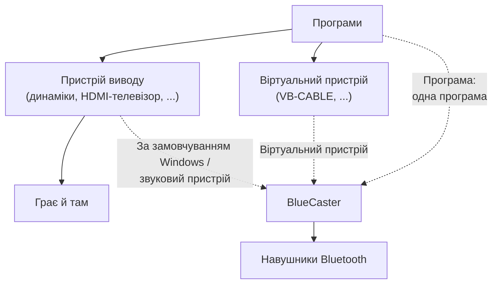
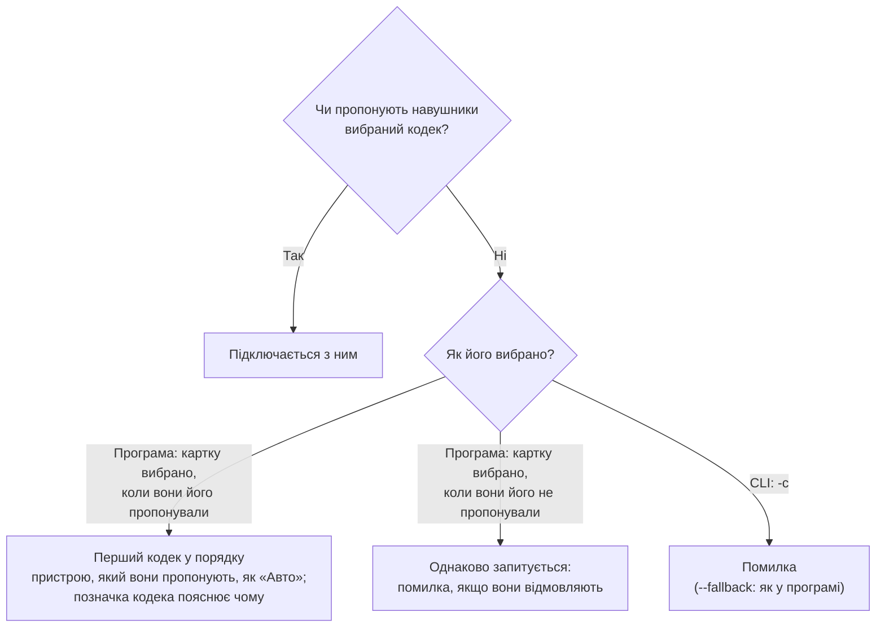

# Використання
{: .no_toc }

## Зміст
{: .no_toc .text-delta }

1. TOC
{:toc}

---

## Вікно

Запустіть **BlueCaster** з меню «Пуск» (або виконайте `bluecaster.exe`). У меню ліворуч є екрани, описані нижче: «Головна», «Кодеки», «Аудіопристрої», «Адаптери», «Діагностика», «Параметри» і «Про програму». У режимі розробника додається екран «Розробник», а якщо там увімкнено мікшер гучності, — ще й «Мікшер гучності». У вузькому вікні меню згортається до значків. Вікно лише показує стан `bluecaster-core.exe`, який працює у фоновому режимі, тому закриття вікна не зупиняє передавання (див. [Значок і вікно в області сповіщень](#tray)).

### Головна

- Картки всіх збережених аудіопристроїв, розміщені поруч, зі станом і зарядом акумулятора. На картці підключеного пристрою також видно поточний кодек (у вигляді списку, див. нижче) і його бітрейт. Якщо використовується не той кодек, який ви вибрали, рядок кодека ненадовго показує причину, наприклад **aptX Adaptive (Opus не підтримується)** (або *уже використовується*). За кілька секунд лишається тільки значок попередження (причину видно, якщо навести на нього вказівник), а рядок стану показує просто **Підключено**
- **Підключити** / **Відключити** під кожною карткою. Одночасно можна підключити лише один пристрій: **Підключити** на іншій картці відключає поточний пристрій і підключає новий
- **Гучність**: гучність навушників (див. [Гучність](#volume)). Клацніть значок динаміка, щоб вимкнути звук (BlueCaster надсилає тишу), і ще раз, щоб увімкнути. На картках інших пристроїв повзунок неактивний
- Список кодеків на картці підключеного пристрою для швидкого перемикання (скажімо, один кодек для ігор, інший для музики). У ньому є кодеки, які підтримує пристрій, лише за назвами, як на екрані [Кодеки](#codecs). Список показує поточний кодек і тоді, коли ввімкнено автовибір. Вибір кодека вимикає автовибір (знову ввімкнути його можна на екрані «Кодеки»). Вибір діє одразу: пристрій перепідключається з новим кодеком, а наступний вибір можна зробити лише після перепідключення, як і на екрані «Кодеки»
- Невеликий графік якості зв'язку на картці підключеного пристрою під час передавання. Джерело виводу вибирається на екрані **Аудіопристрої**. Якщо джерелом є програма, яку ще не запущено, картка про це повідомляє
- Помилки з причиною і, якщо є, кнопкою, яка усуває проблему (**Замінити драйвером WinUSB**, **Відкрити сторінку завантаження**, **Перезапустити Bluetooth**, **Повторити**, **Кодеки**, **Аудіопристрої**, ...)
- Над картками, доки ви їх не закриєте: попередження, коли у Windows активний інший адаптер Bluetooth, і повідомлення, коли навушники OPPO ввімкнули Hi-Res (див. [Кодеки](#codecs))

Бічна панель на кожному екрані показує те саме для всіх пристроїв, а вікно області сповіщень — для підключеного пристрою.

### Кодеки {#codecs}

Кожен збережений аудіопристрій має власний розділ. У його заголовку — крапка (зелена, поки пристрій підключено), назва і позначки **Сполучено** / **Аудіо**; адресу видно на екрані **Аудіопристрої**. Нижче йдуть картки кодеків, від найвищої якості звуку, якщо ви не змінили порядок. Кожна картка має три смуги (якість звуку, низька затримка, стабільність) і показує, чи пропонував пристрій цей кодек під час останнього підключення: **Підтримується** (зелена позначка) або **Не підтримується** (червона позначка). Коли ввімкнено **Показувати лише підтримувані кодеки** (за замовчуванням), усі показані картки підтримуються, тож позначки **Підтримується** на них немає. Пристрій, який ще жодного разу не підключався (наприклад, імпортований з Windows), тоді показує лише картку **SBC**, яку має кожен аудіопристрій Bluetooth, і кодек, вибраний для нього. Інші картки з'являються після першого підключення або якщо вимкнути цей перемикач. Навушники Huawei і Honor зберігають картку **LDAC** з позначкою **Не підтверджено**, доки не вкажуть LDAC: вони можуть вказати його лише після того, як його вибрано. Коли передається LHDC V5 (вибраний вами або режимом «Авто», але не з якістю **Низька** і не з ABR), навушники OPPO, які вказують піковий бітрейт для LHDC V5, один раз отримують запит увімкнути Hi-Res. Для цього вони один раз перепідключаються, а екран «Головна» повідомляє, якщо це підвищило їхній бітрейт. Після цього Hi-Res лишається ввімкненим у навушниках; тим, яким це нічого не дало, параметр повертається назад. У режимі розробника кнопка **Запитати Hi-Res знову** в параметрах LHDC V5 забуває, що вказав пристрій і що запит уже надсилався, тож під час наступного підключення запит надійде знову.

- **Автоматично вибирати кодек найвищої якості** (один параметр для всіх пристроїв угорі сторінки; за замовчуванням увімкнено): кожен пристрій використовує найякісніший кодек, який він підтримує, у такому порядку: LHDC V5 > LDAC > aptX Adaptive > Opus > aptX HD > aptX > aptX LL > AAC > SBC XQ > SBC. Параметри при цьому стандартні, як у режимі **Авто** в параметрах кодека: висока якість, 24 біт, якщо кодек це підтримує, і 48 kHz. Якщо пристрій не має 48 kHz, береться інша частота з його списку, спершу 44,1 kHz; звук Windows перетворюється на цю частоту. Картки доступні лише для читання, крім їхнього порядку (перетягування описано нижче; «Авто» бере першу картку, яку підтримує пристрій). Поточний кодек або той, який вибере «Авто», виділено. Якщо клацнути картку або її **...**, програма запитає, чи вимкнути автовибір (**Вимкнути автовибір** / **Скасувати**). Після вимкнення вибирається клацнута картка (а її **...** відкриває її параметри). Вимкніть автовибір, щоб самостійно вибирати кодек і параметри для кожного пристрою; пристрій, для якого кодек ще не вибрано, зберігає вибір «Авто». Поки автовибір увімкнено, кодек, вибраний для кожного пристрою, зберігається на потім. Якщо в параметрах з версій до 2.0.2 для якогось пристрою було вибрано кодек, автовибір спочатку вимкнено
- Коли автовибір вимкнено, клацніть картку, щоб вибрати кодек для цього пристрою. Вибір зберігається одразу, а пристрій, що передає звук, перепідключається з ним. Можна вибрати й картку, яку пристрій не підтримує (її видно, коли **Показувати лише підтримувані кодеки** вимкнено): BlueCaster однаково запитає цей кодек, і якщо пристрій відмовить, підключення зупиниться з відповідною помилкою (виберіть іншу картку або ввімкніть автовибір). Тоді «Головна», бічна панель, вікно області сповіщень і підказка значка в області сповіщень коротко називають причину (наприклад, *LDAC не підтримується*). Так буває щоразу, коли підключення зупиняється через кодек: пристрій його не підтримує, відхиляє або використовує для іншого джерела. Вибір іншої картки чи інших параметрів для цього пристрою або ввімкнення автовибору знову підключає пристрій. Якщо ви вибрали кодек, коли пристрій його пропонував, а згодом пристрій перестав його пропонувати (скажімо, навушники перейшли на інший кодек), BlueCaster бере першу картку в порядку пристрою, яку той підтримує. Якщо ви не змінювали порядок, це найкращий підтримуваний кодек (див. [Явно вибраний кодек не пропонується](#codec-fallback))
- Перетягуйте картки пристрою, щоб упорядкувати його кодеки по-своєму (поки кнопку миші утримано, показується вказівник-рука; коли автовибір вимкнено, можна також натиснути Alt зі стрілкою на картці). Кожен пристрій має власний порядок. Автовибір, пристрій без вибраного кодека і вибраний кодек, якого пристрій не підтримує, — у всіх цих випадках використовується перша підтримувана картка. FastStream і Opus 05 (картка **Opus (PipeWire)**, лише в режимі розробника; без нього Opus 05 не використовується, навіть якщо його вибрано) використовуються лише тоді, коли їх вибрано, незалежно від місця в порядку. **Скинути порядок кодеків** відновлює стандартний порядок. Кнопка з'являється, лише коли показані картки стоять не в стандартному порядку (якщо повернути їх на місце вручну, порядок теж відновиться). Пристрій, що передає з кодеком, якого це стосується, перепідключається
- Якщо вибрати інший кодек для пристрою, що передає звук, пристрій перепідключається з ним. Картки (а також список кодеків на екрані «Головна» та у вікні області сповіщень) приймають наступний вибір лише після перепідключення, тож кілька швидких клацань не переривають підключення, яке ще встановлюється. Під час перемикання кодеків сповіщення про підключення не з'являється, а під час підключення пристрою — з'являється
- **Показувати лише підтримувані кодеки** (за замовчуванням увімкнено; вимкніть, щоб бачити і підтримувані, і непідтримувані кодеки) приховує кодеки, яких пристрій не пропонував. До першого підключення пристрою видно лише **SBC** (і кодек, вибраний для нього)
- **...** на картці відкриває параметри кодека. Зміни діють одразу. Для поточного кодека зміна зберігається, і пристрій перепідключається з нею. Винятки: **Bitpool**, який змінюється просто під час прослуховування, і перемикач нижче, якщо потік однаково налаштувався б так само. Для іншого кодека зміна зберігається, доки цей кодек не виберуть. Кожен кодек має власні параметри, так само як aptX Adaptive і aptX Adaptive LL, тож якщо перейти на інший кодек і повернутися, вони відновляться. Пропонуються лише варіанти, які підтримує кодек і які пристрій вказав під час останнього підключення. Угорі можна вимкнути **Показувати лише варіанти, які підтримує *пристрій*** (за замовчуванням увімкнено; з'являється, щойно пристрій вказав свої варіанти), щоб бачити все, що має кодек: наприклад, частоту дискретизації, розрядність, якість чи bitpool, яких пристрій не вказав (вони позначені *(не підтримується)*). Пристрій може їх відхилити, і тоді підключення зупиниться з відповідною помилкою. Якщо знову ввімкнути перемикач, усе, чого пристрій не вказав, повертається до «Авто». Параметри кодеків (автовибір їх ніколи не використовує):
  - **Якість**: LDAC — **Висока** / **Середня** / **Низька** (990 / 660 / 330 kbps); LHDC V5 — **Висока** / **Вище середньої** / **Середня** / **Низька** (1000 / 900 / 500 / 400 kbps, чотири рівні Android); aptX Adaptive — **Висока** (режим низької затримки має окрему картку, **aptX Adaptive LL**: 265 kbps, 48 kHz, без ABR; див. [aptX Adaptive](#aptx-adaptive)). Коли для LHDC V5 увімкнено ABR, якість неактивна (ABR тримає бітрейт на рівні 400 kbps або нижче). AAC, Opus, Opus 05, SBC і SBC XQ мають один рівень, **Висока**, який лише показується: це найвищий бітрейт, який приймає пристрій (ABR або VBR, якщо вони є, однаково його змінюють; SBC і SBC XQ показують бітрейт, що виходить з їхнього bitpool і параметрів кадру). Для aptX, aptX HD, aptX LL і FastStream бітрейт фіксує сам кодек. Якість, збережена попередньою версією, якої кодек більше не має (Standard / Mobile в aptX Adaptive, нижчі рівні AAC тощо), завантажується як «Висока»
  - **Адаптивний бітрейт (ABR)**: для LDAC, LHDC V5, aptX Adaptive, SBC і SBC XQ (див. [ABR](#abr)); **Змінний бітрейт (VBR)** для AAC
  - **Низька затримка** (LHDC V5, якщо пристрій її вказує): звук доходить до навушників швидше. Коли ABR вимкнено, бітрейт знижується, поки з'єднання не встигає (1000, 900, потім 500 kbps), і знову підвищується після хвилини без проблем. Пакети відкидаються після 100 ms у черзі надсилання замість 350 ms, тож нестабільне з'єднання спричиняє короткий розрив звуку, а не тривалу затримку
  - **Частота дискретизації**: «Авто» — це 48 kHz, а якщо пристрій не має 48 kHz, то інша частота з його списку (спершу 44,1 kHz); поруч показано отриману частоту (наприклад, *Авто (48000 Hz)*). «Авто» ніколи не вибирає 96 kHz: ця частота додає затримку й гірше сумісна, а чутного виграшу не дає (Windows мікшує звук на 48 kHz). Щоб використовувати 96 kHz, виберіть її тут. Пропонуються лише частоти, які вказує пристрій (LHDC V5 не має 88,2 kHz; aptX Adaptive пропонує 96 kHz лише пристрою, який її вказує, див. [aptX Adaptive](#aptx-adaptive)). Якщо пристрій вказує лише одну частоту, показується вона, без «Авто»
  - **Розрядність**: 16 або 24 біт для LDAC і LHDC V5, якщо пристрій їх вказує («Авто»: 24 біт; для LHDC V5 — лише якщо пристрій вказує 24 біт); 24 біт для aptX HD і aptX Adaptive; 16 біт для решти. 24-бітний звук LDAC надходить у кодувальник як 32-бітні відліки, як і з 32-бітним варіантом в Android. Розрядність не входить до конфігурації LDAC, тож навушники в будь-якому разі отримують той самий потік
  - **Bitpool** (SBC, SBC XQ): один повзунок із двома маркерами для мінімального й максимального bitpool у межах діапазону, який вказує пристрій. Максимальний — це bitpool, що використовується; мінімальний — найнижчий можливий (нижня межа діапазону, з яким налаштовується підключення, і межа, до якої може знижувати ABR). **Авто** скидає обидва: максимальний — відповідно до якості, мінімальний — до значення пристрою й ABR. Рядок нижче показує режим каналів, фіксований для кожного кодека: joint stereo для SBC, dual channel для SBC XQ. Bitpool SBC XQ сягає 47 за 44,1 kHz і 43 за 48 kHz, а якщо вимкнено **Показувати лише варіанти, які підтримує *пристрій***, — 53.
  - **Параметри кадру** (SBC і SBC XQ, лише в режимі розробника): блоки, підсмуги, розподіл бітів і, для SBC, режим каналів. «Авто» лишає 16 блоків, 8 підсмуг, Loudness і Joint stereo. Значення, якого пристрій не приймає, під час підключення замінюється на «Авто». На пристрої Sony, який перевіряв користувач, 12 блоків спотворюють звук і можуть розірвати з'єднання (вивід кодувальника декодується правильно, а з іншою кількістю блоків звук нормальний). Ваш вибір зберігається, але не використовується, коли режим розробника вимкнено. Бітрейти AAC і LHDC V5 не перевищують максимуму, який вказує пристрій

Стандартні значення дають найкращий звук; більшості пристроїв не потрібно нічого, крім **Авто**. Пристрій LE Audio (експериментально) має дві картки: **LC3** і **LC3 LL** (див. [LE Audio](#le-audio)). Їхня кнопка **...**, як і в кодеків для дзвінків, показує ті самі поля, що й для кодека A2DP, лише для читання. Режим низької затримки aptX Adaptive має окрему картку, **aptX Adaptive LL**, поруч із **aptX Adaptive**. «Авто» ніколи її не вибирає, а aptX Adaptive, який попередня версія налаштувала на Low Latency, показується на цій картці.

Поки мікрофон класичного пристрою відкрито (див. [Аудіопристрої](#audio-devices)), замість музичних карток показуються кодеки для дзвінків, які він може використовувати: LC3 (32 kHz), mSBC (16 kHz) і CVSD (8 kHz); активний кодек виділено. Коли ввімкнено автовибір, з'єднання для дзвінків бере найкращий кодек, який підтримують обидві сторони, а клацання картки запитує, чи вимкнути автовибір. Коли автовибір вимкнено, клацніть картку, щоб вибрати кодек для дзвінків: мікрофон відкриється знову з ним або з наступним нижчим, якщо навушники його не підтримують. **...** показує параметри цих кодеків лише для читання. Коли мікрофон закривається, музичні картки повертаються. Поки автовибір увімкнено, вибраний кодек для дзвінків зберігається на потім. Якщо ввімкнено **Показувати лише підтримувані кодеки**, кодеки, яких навушники не підтримують, приховано.

Поки мікрофон пристрою LE Audio відкрито, після його музичних карток з'являється картка **Мікрофон** (LC3, моно). Коли автовибір вимкнено, її **...** задає частоту дискретизації мікрофона з тих, які підтримують навушники (**Авто** бере першу; зміна перепідключає пристрій). Коли автовибір увімкнено, картка показує поточну частоту.

За лаштунками BlueCaster зберігає в `profiles.json` один запис на пристрій (кодек, параметри кожного кодека й порядок кодеків). Там запис має назву «*пристрій* | *кодек*», а вікно й меню в області сповіщень показують лише назву пристрою. Попередні версії дозволяли створювати для одного пристрою кілька профілів. Під час першого запуску версії з екраном «Кодеки» зберігається останній використаний профіль (або перший), а інші об'єднуються з ним разом зі своїми параметрами кодеків (якість, частота дискретизації, розрядність, ABR, налаштування SBC). Їхні назви, джерела виводу й розміри пакетів не зберігаються; початковий `profiles.json` один раз зберігається як `profiles-before-codecs.json` у папці параметрів. **Auto's order…** з попередніх випусків 2.0.2 (один порядок для всіх пристроїв, у режимі розробника) більше не використовується: тепер кожен пристрій має власний порядок.

### Аудіопристрої {#audio-devices}

Навушники й динаміки, на які BlueCaster може передавати звук, кожен із власними параметрами. Під ними, у розділі **Додавання аудіопристрою**, кнопка **Шукати пристрої** протягом 30 секунд шукає пристрої поблизу через USB-адаптер і показує їх у міру того, як вони відповідають; **Зупинити пошук** завершує пошук. Спершу переведіть навушники в режим сполучення. Якщо якийсь пристрій підключено, BlueCaster перед пошуком запропонує його відключити. **Додати** зберігає знайдений пристрій і підключає його. Пристрої, з якими BlueCaster уже сполучався, мають позначку **Сполучено**. Якщо пошук не знаходить пристрій, введіть його адресу в полі **Вручну:** і натисніть **Додати**. Адреса форматується під час введення чи вставлення (`aa-bb-cc-dd-ee-ff`, `AABBCCDDEEFF` і `AA BB CC DD EE FF` перетворюються на `AA:BB:CC:DD:EE:FF`). Навушники бачать адаптер під іменем вашого комп'ютера з приміткою BlueCaster, наприклад *Taro-PC (BlueCaster)*, тож його легко відрізнити від власного Bluetooth Windows. Якщо Windows сполучила пристрій через інший адаптер, наприклад вбудований Bluetooth ПК, BlueCaster спершу запитає (**Сполучено у Windows**: видаліть пристрій там або натисніть **Однаково додати**). Так само він запитує про пристрій, який Windows сполучила через цей адаптер (майстер налаштування може імпортувати це сполучення, див. [Служби й ключі сполучення](#shared-pairing)). Збережений пристрій можна перейменувати або видалити. Видалення стирає також його параметри й сполучення, тож перед наступним підключенням пристрій доведеться сполучити знову. Для кожного збереженого пристрою є:

- **Джерело виводу**: **За замовчуванням Windows** (окремо, першим у списку: пристрій виводу Windows за замовчуванням, назву якого вказано в дужках; це може бути й віртуальний пристрій; типове значення для нового пристрою), один пристрій виводу з розділу **Звукові пристрої**, віртуальний пристрій або програма (див. [Режими захоплення](#capture-modes)). Поруч показано формат, у якому Windows мікшує захоплюваний пристрій (частота дискретизації й розрядність, лише для читання). Він стає бурштиновим, коли пристрій передає звук в іншому форматі (або, якщо пристрій не підключено, коли його параметри кодека вимагають іншого формату), а рядок нижче наводить обидва формати (передавання працює й так, з перетворенням). Ще нижче — опис того, що робить це джерело
- **Робити пристроєм виводу Windows за замовчуванням, поки підключено** (у режимі розробника, з віртуальним або звуковим пристроєм)
- **Джерело вводу**: мікрофон навушників, а в режимі розробника — також **Робити пристроєм вводу Windows за замовчуванням, поки підключено** (див. нижче)

**Джерело вводу** кожного пристрою передає мікрофон навушників у Windows для дзвінків і голосового чату. BlueCaster не має власного аудіодрайвера, тому відтворює звук мікрофона у віртуальний аудіокабель, наприклад VB-CABLE. Список називає кожен кабель за стороною, з якої записують програми (*CABLE Output* для VB-CABLE): саме її виберіть як мікрофон у своїх програмах. Поруч зі списком виберіть **Вимк.** або **Авто**. **Авто** відкриває мікрофон, лише поки якась програма з нього записує, тож решту часу відтворення має повну якість. У режимі розробника є ще режим **Увімк.**, у якому мікрофон постійно відкритий. Коли режим розробника вимкнено, пристрій з режимом **Увімк.** працює як з **Авто**. Коли вибрано **Вимк.**, список лишається видимим, але неактивним. **Вимк.** і кнопка мікрофона на екрані «Головна» та у вікні області сповіщень — це один параметр: для пристрою з **Авто** або **Увімк.** вибір **Вимк.** вимикає мікрофон так само, як кнопка, і запам'ятовує режим, який кнопка потім відновлює. **Робити пристроєм вводу Windows за замовчуванням, поки підключено** (у режимі розробника; коли режим розробника вимкнено, завжди ввімкнено) робить сторону запису кабелю (*CABLE Output*) мікрофоном Windows за замовчуванням, поки пристрій підключено. Тоді програми, які записують із мікрофона за замовчуванням, отримують мікрофон навушників, і **Авто** відкриває його для них. Коли пристрій відключається, повертається попередній пристрій за замовчуванням, якщо тим часом ви не вибрали інший.

Рядок **Налаштування мікрофона** внизу відкриває налаштування, які обробляють мікрофон, перш ніж звук потрапить до програм. Поки **Джерело вводу** в положенні **Вимк.**, цей рядок неактивний. **Застосовувати налаштування мікрофона** вмикає та вимикає обробку. Поки її вимкнено, мікрофон проходить без змін, а повзунки зберігають свої значення. **Підсилення** робить мікрофон гучнішим або тихішим (від -12 до +24 дБ). **Шумозаглушення** прибирає постійний фоновий шум, наприклад вентилятор або гудіння. Що правіше повзунок, то сильніше заглушення; що лівіше, то більше лишається початкового звуку (у крайньому лівому положенні: **Вимк.**). **Шумовий гейт** вимикає мікрофон, поки його рівень нижчий за вибраний (у крайньому лівому положенні: **Вимк.**). Лімітер не дає підсиленому мікрофону перевантажуватися. Зміни застосовуються одразу, без повторного підключення. Шумозаглушення затримує мікрофон приблизно на 20 мс; якщо все вимкнено, мікрофон проходить без змін. Тест **Мікрофон** у розділі **Діагностика** записує його так, як його чують програми.

Нові пристрої отримують VB-CABLE, якщо його встановлено, інакше Hi-Fi Cable, якщо цей кабель не вибрано для них як **Джерело виводу**. Класичний пристрій отримує режим **Авто**, пристрій LE Audio — **Вимк.** (для нього **Авто** тримає мікрофон відкритим). Пристрій, у якого мікрофон увімкнено, але кабелю немає, отримує кабель, щойно Windows його покаже. Екран **Аудіопристрої** і майстер налаштування пропонують установити відсутні кабелі (див. [Режими захоплення](#capture-modes)). Якщо ви встановите кабель пізніше, BlueCaster налаштує заново, як це зробив би майстер, пристрої, які він налаштував автоматично, і пристрої з **За замовчуванням Windows** і таким мікрофоном. З обома кабелями Hi-Fi Cable передає звук, а VB-CABLE — мікрофон. З одним кабелем він передає мікрофон, а звук береться з пристрою виводу з розділу **Звукові пристрої** (звук монітора чи телевізора, якщо він є, а серед кількох — пристрій виводу Windows за замовчуванням; інакше пристрій виводу Windows за замовчуванням), незалежно від того, який пристрій є виводом Windows за замовчуванням. Джерело виводу чи мікрофон, які ви вибрали самі, лишаються без змін. Якщо кабелю немає, а у Windows є і звук монітора чи телевізора, і звукова карта, звук береться з монітора чи телевізора, а мікрофон відтворюється у звукову карту в режимі **Вимк.** Коли в режимі розробника вибрано **Увімк.**, програма, що записує пристрій виводу (захоплення аудіовиводу в OBS), може взяти мікрофон звідти; **Авто** не може визначити, чи хтось слухає звукову карту. Пристрій, доданий на екрані **Аудіопристрої**, налаштовується так само. Пристрій із **За замовчуванням Windows**, мікрофон якого відтворюється в кабель, що є пристроєм виводу Windows за замовчуванням, теж переводиться на це джерело звуку, бо інакше мікрофон звучав би в навушниках.

Якщо мікрофон відтворюється в Hi-Fi Cable, а сторони відтворення й запису цього кабелю в параметрах звуку Windows працюють на різних частотах дискретизації, з'являється попередження: якщо програми нічого не чують, задайте для обох однакову частоту. Список показує лише кабелі, з яких програми можуть записувати. У ньому немає кабелю, який захоплює сам BlueCaster (**Джерело виводу** або, з **За замовчуванням Windows**, пристрій виводу Windows за замовчуванням, але не джерело виводу іншого пристрою, зроблене пристроєм за замовчуванням, поки той підключений), а також іншої сторони цього кабелю (*CABLE In 16ch* у VB-CABLE записує в той самий *CABLE Output*, що й *CABLE Input*), бо мікрофон змішувався б із відтворенням. Так само, поки **Джерело вводу** не має значення **Вимк.**, у списку **Джерело виводу** немає кабелю, у який відтворюється мікрофон. Коли ввімкнено **Розробник > Параметри програми > Показувати всі аудіопристрої у списках джерел**, обидва списки пропонують усі пристрої. Пристрої виводу без сторони запису (динаміки тощо) показано в розділі **Прослуховування**, бо вони лише відтворюють мікрофон. 16-канальний кабель VB-CABLE показано як *CABLE Output · CABLE In 16ch* (спершу спільна сторона запису, потім власна назва). Кабель джерела виводу показано неактивним, з позначкою *(використовується як джерело виводу)* після назви. *CABLE Input* і *CABLE Output* — два кінці одного кабелю, тож для віртуального джерела виводу й мікрофона разом потрібні два кабелі. Рекомендовано **Hi-Fi Cable** від VB-Audio (*HiFi-Cable & ASIO-Bridge* на [сторінці VB-Audio](https://vb-audio.com/Cable/)) для звуку, бо він додає найменшу затримку, і VB-CABLE для мікрофона. Пристрій мікрофона також не має бути пристроєм виводу Windows за замовчуванням: програми чули б відтворення, змішане з мікрофоном, а джерело виводу на іншому пристрої нічого б не отримувало. Про це попереджає напис під **Джерело вводу**.

Поки мікрофон відкрито, класичний пристрій Bluetooth відтворює звук через з'єднання для дзвінків: моно з якістю дзвінка (CVSD, mSBC або LC3 — найкращий кодек, який підтримують обидві сторони). Його музичний кодек тим часом приглушено, а коли мікрофон закривається, пристрій повертається до цього кодека без перепідключення. Пристрій LE Audio і далі відтворює LC3 у звичайній якості й паралельно надсилає мікрофон; зміна режиму його перепідключає (для нього «Авто» тримає мікрофон відкритим). Деякі навушники можуть відхилити мікрофон або показувати дзвінок, хоча його немає. З режимом **Авто** або **Увімк.** і вибраним пристроєм під кодеком (на бічній панелі, на екрані «Головна» та у вікні області сповіщень) з'являється рядок **Мікр.:**, поки пристрій підключено або він підключається. Поки мікрофон відкритий, рядок показує його кодек і частоту з червоною крапкою (*Мікр.: mSBC 16 kHz*), а поки закритий — приглушений режим. На екрані «Головна» та у вікні області сповіщень кнопка мікрофона поруч вимикає мікрофон: кнопка стає перекресленою, мікрофон закривається, класичний пристрій повертається до свого кодека, а **Джерело вводу** показує **Вимк.** Повторне клацання знову вмикає мікрофон у попередньому режимі, так само як вибір **Авто** або **Увімк.** у **Джерело вводу**. Поки «Авто» чекає на програму, кнопка має штриховий контур, а якщо мікрофон не вдалося відкрити, вона показує знак попередження з причиною в підказці.

**Усі аудіопристрої** над списком містить перемикачі для всіх пристроїв: **Синхронізація гучності з Windows** (див. [Гучність](#volume)), **Керувати відтворенням кнопками аудіопристрою** і **Автоматично підключатися знову**. **Макс. розмір медіапакета** для кожного пристрою задається на екрані **Розробник** (див. [Макс. розмір медіапакета](#max-packet)).

### Діагностика

- **Якість зв'язку** під час передавання: фактичний бітрейт, пакети, пакети, відкинуті до надсилання, звук, втрачений під час захоплення, черга надсилання, затримка, яку повідомляє пристрій (див. [Затримка](#latency)), використаний ефірний час, сигнал (RSSI) і канали AFH (див. [Якість зв'язку й AFH](#link-quality)). Поки мікрофон гарнітури відкрито, з'єднання класичного пристрою для дзвінків вимірюється так само (його кодек, наприклад mSBC, і що він надсилає), а картка **Мікрофон** показує пакети, що надходять назад: отримані, пошкоджені в ефірі й замасковані
- **Радіо**: 79 каналів Bluetooth у діапазоні 2,4 GHz — які з них використовує з'єднання, а які пропускає адаптер, — з каналами Wi-Fi під ними і кількома порадами для чистішого з'єднання. У режимі розробника **Сканувати** додає мережі Wi-Fi 2,4 GHz поблизу (див. [Вкладка «Радіо»](#radio-tab))
- **Подробиці кодека** під час передавання: медіанавантаження, заголовки, кадр кодека й кількість кадрів у пакеті, а також що вказує кінцева точка пристрою поруч із тим, що використовується: для SBC — bitpool, частоти дискретизації, режими каналів, блоки, підсмуги й розподіл бітів; для AAC — типи об'єктів, частоти дискретизації, канали, піковий бітрейт і VBR; для інших кодеків — частоти дискретизації, розрядності й піковий бітрейт
- **Мікрофон**: перевірка мікрофона гарнітури класичного пристрою Bluetooth під час передавання. **Записати** відкриває мікрофон і записує до 10 секунд, показуючи рівень на смузі (тим часом пристрій грає з якістю дзвінка; якщо в цьому підключенні мікрофон ще не відкривався, пристрій спершу перепідключається). **Відтворити** відтворює запис у навушниках. Якщо перейти на іншу вкладку, перевірка завершується, і відтворення повертається до свого кодека. Пристрої LE Audio поки не підтримуються
- **Хід підключення**: одинадцять етапів останньої спроби підключення (початок, адаптер Bluetooth, підключення ACL / AVDTP, виявлення можливостей, вибір кодека, захоплення звуку, конфігурація потоку, кодувальник, запуск потоку, надсилання звуку, підтримання з'єднання з відключеннями / повторними підключеннями), кожен із позначкою «OK», «Попередження» або «Помилка» і тривалістю. **Копіювати хід** копіює цей список
- **Журнал**: журнал у реальному часі з фільтрами за рівнем (усі, інформація й вище, попередження й помилки, лише помилки), за текстом і за поточною спробою підключення (**Лише поточна спроба**). **Копіювати показаний журнал** копіює те, що показано. **Відкрити папку журналів** відкриває папку з файлами журналів; на відміну від **Копіювати діагностику**, у цих файлах нічого не замасковано (вони містять адреси Bluetooth і ваше ім'я користувача Windows)
- **Почати захоплення HCI** / **Зупинити захоплення HCI** (див. [Перевірка медіапотоку](#verify-stream))
- **Копіювати діагностику**: копіює в буфер обміну версію, ОС, адаптер, аудіопристрій (кодек, його параметри й порядок), хід підключення, попередження / помилки й останні рядки журналу, готові для вставлення у звіт про помилку. **Приховати адреси Bluetooth** (за замовчуванням увімкнено) замінює адреси на `<addr-1>`, `<addr-2>`... (власну адресу адаптера — на `<adapter>`), а назви пристроїв — на `<device-1>`, `<device-2>`..., і приховує серійні номери USB, шляхи до файлів вище власної папки програми (`<path>\BlueCaster\logs\...`) і ваш обліковий запис Windows (ім'я користувача й SID). Так само маскуються звіт про збій і тексти помилок, скопійовані для звіту про помилку
- **Повідомити про проблему**:
  - **Докладне журналювання**: **Докладно (debug)** або **Усе (trace, 1 година)** записує в журнал значно більше про Bluetooth, USB, захоплення звуку й кодування. Debug лишається ввімкненим 24 години, зокрема й після перезапусків (для проблем під час запуску), а потім вимикається автоматично. Увімкніть його, відтворіть проблему, а потім збережіть пакет діагностики
  - **Пакет діагностики > Зберегти…**: виберіть, чи додавати захоплення HCI (не вмикайте, якщо вас про них не просили: вони містять адреси й назви пристроїв) і чи маскувати адреси Bluetooth у текстових файлах, а потім збережіть один файл `.zip` (у `logs\bundles\` папки параметрів; зберігаються 3 найновіші). У ньому є діагностичні дані, файли журналів ядра, вікна й допоміжної програми драйвера, звіти про збої, відомості про систему (USB-адаптери Bluetooth та їхні драйвери, сполучені пристрої Windows, аудіопристрої), параметри й параметри кодеків кожного пристрою (ключів зв'язку там ніколи немає), а також бортовий реєстратор HCI. Захоплення HCI зберігають адреси (але не ключі сполучення). BlueCaster за можливості тримає пакет у межах ліміту вкладень GitHub у 25 MB (спершу найновіші журнали, до 48 MB тексту, 5 найновіших записів і 2 мінідампи)
  - **Повідомити на GitHub** (після збереження): відкриває новий звіт про помилку, у якому вже заповнено версію, збірку Windows, адаптер, навушники, кодек, режим захоплення й діагностичні дані (адреси замасковано), і показує пакет у Провіднику, щоб ви могли перетягнути його у звіт

BlueCaster також постійно записує деякі дані, щоб одноразову проблему можна було дослідити пізніше:

- **Бортовий реєстратор HCI**: останні кілька хвилин трафіку Bluetooth зберігаються в пам'яті (медіанавантаження скорочено, ключі сполучення видалено) і записуються в `logs\hci\` щоразу, коли потік дає збій або з'єднання втрачається (зберігаються 10 найновіших файлів)
- **Звіти про збої**: якщо BlueCaster аварійно завершує роботу, мінідамп `.dmp` і файл `.txt` записуються в `logs\crash\` (5 найновіших для кожної програми)

Обсяг на диску обмежений: журнал звичайного дня займає значно менше 1 MB, і зберігаються журнали за 7 днів. З докладним журналюванням файл за день містить щонайбільше 100 MB рядків debug і trace (після цього до кінця дня записуються лише рядки рівня info і вище). Файли бортового реєстратора займають щонайбільше кілька MB, і зберігаються 10 таких файлів.

### Розробник {#developer}

Показується, коли ввімкнено **Параметри > Режим розробника**; більшості користувачів цей екран не знадобиться. Він призначений для перевірки пристроїв і усунення неполадок, і деякі його параметри працюють лише з певними пристроями. Сім вкладок:

- **Параметри програми**: **Використовувати мікшер гучності** (за замовчуванням вимкнено) вмикає екран **Мікшер гучності**, список програм у вікні області сповіщень і вимкнення звуку виводу (див. [Режими захоплення](#capture-modes)). Не рекомендовано: щоб ПК не відтворював звук, краще використовувати VB-CABLE. **Показувати всі аудіопристрої у списках джерел** (за замовчуванням вимкнено): списки **Джерело виводу** і **Джерело вводу** на екрані **Аудіопристрої** пропонують усі пристрої, зокрема непридатні (див. [Аудіопристрої](#audio-devices)). **Приховати попередження про віртуальні аудіопристрої** (за замовчуванням вимкнено) прибирає попередження про відсутній кабель VB-Audio (див. [Режими захоплення](#capture-modes)). **Враховувати альфа-версії під час перевірки оновлень** (за замовчуванням увімкнено в альфа-збірках) пропонує також альфа-випуски (див. [Оновлення](#updates))
- **Параметри кодеків**: перемикачі, які допомагають з'ясувати, чому пристрій мовчить (біт маркера RTP, запис перших медіапакетів у журнал, конфігурація AAC і параметри кодувальника), і **Макс. розмір медіапакета** для кожного збереженого пристрою (див. [Макс. розмір медіапакета](#max-packet)). **Використовувати параметри кодека, коли його вибрано автоматично**: коли автовибір увімкнено, **…** на картці кодека відкривається без вимкнення автовибору, а кодек, вибраний режимом «Авто», підключається з цими параметрами замість параметрів «Авто». **Узгоджувати частоту дискретизації й розрядність із виводом ПК**: частота дискретизації або розрядність зі значенням «Авто» відповідає формату пристрою виводу в параметрах звуку Windows, а не 48 kHz. З частот, які пристрій вказує для кодека, BlueCaster бере власну частоту ПК, інакше найближчу з того самого сімейства (кратні 44,1 або 48 kHz), інакше найближчу вищу; 16-бітний вивід передається як 16 біт. **Ігнорувати піковий бітрейт пристрою**: кожен кодек працює з бітрейтом вибраної якості, навіть коли пристрій вказує нижчий максимум (бітрейт LHDC V5, AAC або Opus 05, bitpool SBC), а екран **Кодеки** пропонує всі рівні якості й bitpool. Вище свого максимуму пристрій може переривати звук або замовкати. **Ліміт черги надсилання**: скільки медіапакет може чекати в черзі надсилання, перш ніж його буде відкинуто, від 50 до 2000 ms (порожнє поле = 350 ms); на хорошому з'єднанні затримку він не зменшує (див. [Затримка](#latency)). **Кодувати під час надсилання**: поки з'єднання зупинилося, звук чекає ще не закодованим, а не у вигляді готових пакетів. Тож з увімкненим ABR (SBC, SBC XQ, LDAC, LHDC V5 і aptX Adaptive) він надсилається з бітрейтом, до якого ABR тим часом знизився, а не з тим, що був на початку зупинки. Саму зупинку це не скорочує: нічого не надсилається, доки радіоканал не відновиться, і лише надолужування після цього потребує менше даних. Звук, що чекає довше за ліміт черги надсилання, відкидається в будь-якому разі; діагностика враховує звук, що чекає, у часі очікування в черзі надсилання. Усе це за замовчуванням вимкнено й діє з наступного запуску потоку; поки щось увімкнено, про це повідомляє банер. **Вимкнути все** скидає ці параметри
- **Виробники**: чи використовує BlueCaster власні протоколи навушників (Huawei: LDAC, OPPO: Hi-Res; див. [Кодеки](#codecs)). Для кожного виробника є **Протокол виробника**: **Авто** (навушники, назва яких указує на цього виробника; за замовчуванням), **Завжди** (будь-який пристрій) або **Ніколи**. Для OPPO є також **Запитувати Hi-Res під час кожного підключення (щоразу перепідключається)**. Зміни діють з наступного запуску потоку; поки щось змінено, про це повідомляє банер, а **Вимкнути все** скидає зміни. Коли режим розробника вимкнено, ці параметри не використовуються
- **Журналювання**: скільки зберігаються файли журналів (за замовчуванням 7 днів), денний ліміт розміру (за замовчуванням 100 MB), постійне докладне журналювання (без обмеження в 24 години чи 1 годину й активне від запуску ядра), рядок стану потоку кожні 10 секунд і **Додати мітку** (записує в журнал нумерований рядок, щоб потім знайти цей момент). Якщо вимкнути режим розробника, повертаються значення за замовчуванням
- **Тест із приймачем-партнером**: передає звук на вимірювальний приймач на іншому ПК і порівнює надіслане з отриманим (див. [Тест із приймачем-партнером](#receiver))
- **Мікросхема**: виконує скрипт мікросхеми на адаптері з WinUSB — запити до мікросхеми, введені вручну або завантажені з файлу, — для тих, хто додає підтримку мікросхеми (див. [Додавання підтримки мікросхем](chip-support#chip-scripts)). Рядки, які можуть змінити мікросхему, виконуються лише після натискання **Виконати їх**; Bluetooth для цього зупиняється й знову запускається, коли знадобиться
- **Налагодження**: експерименти, усі за замовчуванням вимкнені. **Ключі сполучення і Windows**: **Також копіювати ключі LE у Windows під час відновлення початкового драйвера** під час **Відновити початковий драйвер** записує в Windows ключі LE з BlueCaster (Long Term Key, EDIV, Rand, розмір ключа, Identity Resolving Key), але лише для пристроїв, ключі LE яких Windows уже зберігає для цього адаптера. Старі ключі Windows зберігаються в `pairing\replaced_windows_keys.json`, який може читати лише ваш користувач Windows. **Порівняти з Windows** (потрібен дозвіл адміністратора) підраховує для одного адаптера пристрої, ключі зв'язку й ключі LE яких збігаються в BlueCaster і Windows, відрізняються або є лише з одного боку. Функція показує й записує в журнал лише числа, ніколи адресу чи ключ, тож результатом можна безпечно поділитися. Вона також перелічує назви, типи й розміри значень, які Windows зберігає для адаптера та його пристроїв LE, але не їхні дані

### Адаптери

- Виявлені USB-адаптери Bluetooth із мікросхемою, адресою, USB ID, версією Bluetooth, **Драйвер** і **Мікропрограма**. Список оновлюється автоматично, коли адаптер під'єднують або від'єднують. Драйвер — це **Початковий драйвер** (встановлений Windows або виробником; наведіть вказівник, щоб побачити його назву) або **Драйвер WinUSB** (той, який використовує BlueCaster). Адаптер Realtek показує адресу, взяту із серійного номера USB, ще до першого використання. Для інших адаптерів адреса й версія Bluetooth з'являються після того, як адаптер використав Bluetooth Windows або BlueCaster (причину видно, якщо навести вказівник на рядок). Адаптер, який BlueCaster не може використовувати (деякі моделі MediaTek і Qualcomm), зберігає свій драйвер, а його кнопки WinUSB і мікропрограми неактивні. У режимі розробника йому однаково можна призначити WinUSB, а **Зчитати дані мікросхеми** на адаптері з WinUSB зберігає в `logs\probe\` відповіді мікросхеми на кілька команд читання — для тих, хто додає її підтримку (Bluetooth для цього зупиняється й знову запускається, коли знадобиться). Потім **Повідомити на GitHub** відкриває issue з цими даними. Поки запускається адаптер, мікропрограму якого BlueCaster завантажує сам (Intel, MediaTek, Qualcomm), екран показує хід завантаження і помилку, якщо воно не вдалося
- **Замінити драйвером WinUSB** / **Відновити початковий драйвер** (див. [Налаштування](setup#winusb)). Windows щоразу запитує дозвіл адміністратора, як і для кожної кнопки зі щитом. Відновлення також передає Windows новіші сполучення BlueCaster для пристроїв, які Windows сполучила через цей адаптер, тож у Windows вони підключаються без повторного сполучення. **Обмеження:** ключі LE не передаються, тому пристрій, який Windows використовує через LE (LE Audio), доведеться сполучити у Windows знову (у режимі розробника можна спробувати це: **Розробник > Налагодження**)
- **Мікросхема Bluetooth** для мікропрограми, з кнопками **Завантажити мікропрограму**, **Відкрити сторінку завантаження** і **Відкрити папку мікропрограм** (див. [Мікропрограма](setup#firmware)). Адаптер іншого виробника натомість показує, звідки береться його мікропрограма, наприклад **З драйвера MediaTek**, **З папки мікропрограм** або **Не потрібно**, і **Завантажено**, щойно BlueCaster її завантажив. Адаптер Realtek, мікропрограма якого береться з драйвера Realtek для Windows, натомість має кнопку **Використовувати власну мікропрограму**, а **Використовувати мікропрограму драйвера** повертає мікропрограму драйвера
- **Уникати каналів Wi-Fi**: «Авто», «Вимк.» або «Вручну», а поруч канали Wi-Fi: ті, яких зараз уникає «Авто», жодного для «Вимк.» (обидва лише для читання) або ті, що ви вводите для «Вручну» (див. [Якість зв'язку й AFH](#link-quality))
- **Стек Bluetooth**: зупинено (запускається з першим пошуком чи підключенням), запускається, готовий або помилка, і **Перезапустити Bluetooth**
- **Використовувати цей адаптер** (на картці кожного адаптера, коли WinUSB мають два адаптери або більше): BlueCaster відкриває цей адаптер замість першого знайденого. Bluetooth перезапускається на ньому, потік підключається знову. Кнопка **Вибирати автоматично** на картці вибраного адаптера повертає перший знайдений. Адаптер, що використовується, позначено як **Використовується**, а його назву вказано поруч зі **Стек Bluetooth**. Вибраний, але ще не використаний адаптер (Bluetooth відкриє його під час наступного запуску, або його тримає інша програма) позначено як **Вибрано**

### Параметри

| Розділ | Параметри |
|:-------|:----------|
| Оформлення | Мова, тема (Системна / Світла / Темна) |
| Запуск | **Запускати разом із Windows** і **Запускати в області сповіщень** (див. [Запуск разом із Windows](#autostart)), **Згортати в область сповіщень** і **Відкривати вікно з області сповіщень через** (див. [Значок і вікно в області сповіщень](#tray)) |
| Сповіщення | **Сповіщати, коли пристрій підключається** (пристрій, його заряд, кодек і його параметри; за замовчуванням увімкнено), **Сповіщати про низький заряд акумулятора**: **Нижче 20%** (за замовчуванням), **Нижче 10%**, **Нижче 5%** або **Ніколи**, один раз за підключення (повторно — лише після того, як заряд підніметься на 5 пунктів вище порогу) |
| Оновлення | **Перевірити наявність оновлень**, **Перевіряти оновлення під час запуску**, **Враховувати попередні випуски під час перевірки оновлень** (пропонувати також бета-випуски), **Оновити зараз** (див. [Оновлення](#updates)) |
| Додатково | **Режим розробника** (додає екран [Розробник](#developer), **Параметри кадру** SBC у параметрах кодека, ключі сполучення під позначкою **Служби** на екрані **Аудіопристрої** (див. [Служби й ключі сполучення](#shared-pairing)), кодек **Opus (PipeWire)**, **Зчитати дані мікросхеми** на екрані **Адаптери** і більше подробиць у журналі; перезапуск не потрібен), **Папка параметрів** з **Відкрити папку параметрів**, **Запустити налаштування** |

Унизу розташовано **Вийти з BlueCaster**. Екран **Про програму** показує версію й ліцензію BlueCaster, а в розділі **Стороннє програмне забезпечення** — бібліотеки, **Ліцензії сторонніх компонентів**, примітку про те, що VB-Audio поширює свої кабелі за пожертви (donationware), і діалогове вікно кабелів (**Віртуальні аудіопристрої**).

### Налаштування під час першого запуску

Під час першого запуску (ще немає аудіопристрою або жоден адаптер не має WinUSB) відкривається **Майстер налаштування**. Він відкриватиметься, доки ви один раз не завершите або не пропустите його. Спершу виберіть адаптер, драйвер і мікропрограму (пристрої, які Windows сполучила через адаптер, показано першими, бо вони перестануть працювати з Windows). Далі знайдіть свої аудіопристрої: «Підключити» зберігає пристрій із найкращими для нього параметрами й підключає його; для пристрою, сполученого у Windows, майстер спершу запитує; **Імпортувати сполучення з Windows** показує пристрої, які Windows сполучила через цей адаптер (див. [Служби й ключі сполучення](#shared-pairing)); **Далі** працює й без пристрою, а додати його можна пізніше на екрані **Аудіопристрої**. Наостанок — **Загальні параметри**: тема, **Запускати разом із Windows** і **Запускати в області сповіщень** (під час першого налаштування обидва параметри вмикаються), сповіщення і **Перевіряти оновлення під час запуску**. Див. [Налаштування](setup#first-run). **Параметри > Запустити налаштування** відкриває майстер знову.

## Значок і вікно в області сповіщень {#tray}

BlueCaster працює в області сповіщень, з вікном або без нього:

- **Клацніть лівою кнопкою** значок в області сповіщень, щоб відкрити вікно області сповіщень: пристрій і його стан, **Підключити** / **Відключити**, гучність, перемикач пристроїв, кодек (список для вибору, як на екрані «Головна»), якість зв'язку і **Відкрити BlueCaster**. Висота вікна відповідає вмісту. Щоб приховати його, натисніть Esc або клацніть деінде. Якщо помилка потребує екрана в головному вікні («Кодеки», «Аудіопристрої», адаптер), її кнопка відкриває вікно на цьому екрані
- **Параметри > Відкривати вікно з області сповіщень через** (за замовчуванням **Значок в області сповіщень**): у Windows 11 з **Швидкі параметри (кнопка гучності)** значок в області сповіщень відкриває головне вікно, а вікно області сповіщень відкривається разом зі швидкими параметрами, поверх їхніх панелей, і закривається разом із ними. Ним можна користуватися, не закриваючи швидкі параметри. Якщо екран надто низький, вікно відкривається ліворуч від них. З **Ніде** вікно області сповіщень не відкривається, а значок відкриває головне вікно.
- **Клацніть правою кнопкою**, щоб відкрити меню: **Відкрити BlueCaster**, перші 10 пристроїв за назвою (запис LE Audio позначено «(LE Audio)», а пристрій, що передає звук, — галочкою; клацніть пристрій, щоб підключити його), **Відключити** і **Вийти**. Меню відкривається одразу, без запуску вікна
- Підказка значка показує, чи BlueCaster неактивний, чи підключений

Коли ввімкнено **Параметри > Згортати в область сповіщень** (за замовчуванням), згортання або закриття вікна лише ховає його в область сповіщень, і передавання триває. Якщо параметр вимкнено, вікно згортається на панель завдань, а його закриття завершує роботу BlueCaster. **Вийти** в меню області сповіщень або **Параметри > Вийти з BlueCaster** зупиняє передавання, звільняє адаптер і повністю закриває BlueCaster.

## Запуск разом із Windows {#autostart}

**Параметри > Запускати разом із Windows** запускає BlueCaster, коли ви входите в систему. Якщо ввімкнено **Запускати в області сповіщень**, програма запускається у фоновому режимі: з'являється лише значок в області сповіщень, з якого відкривається вікно. Якщо цей параметр вимкнено (за замовчуванням), відкривається головне вікно. Параметр зберігається як значення `BlueCaster` у розділі `HKEY_CURRENT_USER\Software\Microsoft\Windows\CurrentVersion\Run` з даними `"<folder>\bluecaster-core.exe"`, після яких іде `--background`, якщо ввімкнено **Запускати в області сповіщень**. Щоб вимкнути автозапуск вручну, видаліть це значення. Встановлення v2 поверх v1 вмикає **Запускати в області сповіщень**, бо v1 завжди запускалася в області сповіщень.

## Режим CLI

`bluecaster-core.exe --cli` передає звук із консолі за допомогою того самого ядра, що й вікно. Спершу закрийте BlueCaster (область сповіщень > **Вийти**), бо адаптер може використовувати лише одна програма водночас. CLI не читає параметри збережених пристроїв: усе задається параметрами командного рядка.

### Основи

```bash
# Автоматично вибрати найкращий кодек
bluecaster-core.exe --cli -d AA:BB:CC:DD:EE:FF
```

Ctrl+C зупиняє передавання. CLI виводить стан, кодек і бітрейт, а наприкінці — кількість надісланих і відкинутих пакетів.

### Вибір кодека

```bash
bluecaster-core.exe --cli -d AA:BB:CC:DD:EE:FF -c ldac      # LDAC
bluecaster-core.exe --cli -d AA:BB:CC:DD:EE:FF -c aptxhd    # aptX HD
bluecaster-core.exe --cli -d AA:BB:CC:DD:EE:FF -c aptxll    # aptX Low Latency
bluecaster-core.exe --cli -d AA:BB:CC:DD:EE:FF -c aptx      # aptX
bluecaster-core.exe --cli -d AA:BB:CC:DD:EE:FF -c aac       # AAC
bluecaster-core.exe --cli -d AA:BB:CC:DD:EE:FF -c sbc       # SBC
bluecaster-core.exe --cli -d AA:BB:CC:DD:EE:FF -c lhdcv5    # LHDC V5
bluecaster-core.exe --cli -d AA:BB:CC:DD:EE:FF -c opus      # Opus (48 kHz, 256 kbps)
bluecaster-core.exe --cli -d AA:BB:CC:DD:EE:FF -c opus05    # Opus 05 від PipeWire (на приймачі PipeWire)
bluecaster-core.exe --cli -d AA:BB:CC:DD:EE:FF -c aptxad    # aptX Adaptive (48 kHz; --rate 96000 для 96 kHz)
```

Пріоритет автовибору: LHDC V5 > LDAC > aptX Adaptive > Opus > aptX HD > aptX > aptX LL > AAC > SBC XQ > SBC (FastStream і Opus 05 — лише якщо вибрано)

Якщо навушники не пропонують запитаний кодек, CLI зупиняється з помилкою, яка пояснює причину. Використайте `-c auto` (за замовчуванням), щоб узяти найкращий запропонований кодек, або `--fallback`, щоб, як і програма, перейти на найкращий запропонований кодек замість запитаного (див. [Сімейство aptX і aptX Adaptive](#aptx-compatibility)).

### Якість

```bash
bluecaster-core.exe --cli -d AA:BB:CC:DD:EE:FF -c ldac -q hq   # Висока, 990 kbps (за замовчуванням)
bluecaster-core.exe --cli -d AA:BB:CC:DD:EE:FF -c ldac -q sq   # Середня, 660 kbps
bluecaster-core.exe --cli -d AA:BB:CC:DD:EE:FF -c ldac -q mq   # Низька, 330 kbps

# LHDC V5: hq 1000 / mhq 900 / sq 500 / mq 400 kbps
bluecaster-core.exe --cli -d AA:BB:CC:DD:EE:FF -c lhdcv5 -q sq   # Середня, 500 kbps

# aptX Adaptive: hq 427 / ll 265 kbps
bluecaster-core.exe --cli -d AA:BB:CC:DD:EE:FF -c aptxad -q ll   # Низька затримка
```

Інші кодеки не мають вибору якості: вони працюють як `hq`, з найвищим бітрейтом, який приймають навушники (для aptX, aptX HD, aptX LL і FastStream бітрейт фіксує кодек). Рівень, якого кодек не має (`mhq` для будь-якого кодека, крім LHDC V5, `sq` / `mq` для aptX Adaptive, `ll` для будь-якого кодека, крім aptX Adaptive), працює як `hq`.

### ABR (адаптивний бітрейт) {#abr}

```bash
bluecaster-core.exe --cli -d AA:BB:CC:DD:EE:FF -c ldac -a
bluecaster-core.exe --cli -d AA:BB:CC:DD:EE:FF -c lhdcv5 -a
bluecaster-core.exe --cli -d AA:BB:CC:DD:EE:FF -c aptxad -a
```

ABR автоматично знижує бітрейт, коли з'єднання Bluetooth нестабільне, і підвищує його, коли умови покращуються. LDAC перемикається між своїми режимами якості; LHDC V5 дотримується політики Android і тримається між 160 і 400 kbps; aptX Adaptive переходить між своїми рівнями в межах High (див. [aptX Adaptive](#aptx-adaptive)); SBC і SBC XQ щосекунди знижують bitpool на 2 або підвищують на 1. Для SBC, SBC XQ і aptX Adaptive, якщо підключенню довелося відступити з певного bitpool або рівня, цей крок знову пробується лише через 10 s, і щоразу, коли доводиться відступати знову, очікування подвоюється (до 2 хвилин). Так пристрій, який стабільно працює на крок нижче, там і залишається. Після хвилини без проблем на цьому кроці очікування починається спочатку. У вікні ABR вмикається в параметрах кодека (**...** на картці кодека на екрані **Кодеки**).

### Пошук пристроїв

```bash
# Пристрої поблизу, знайдені через USB-адаптер (10 секунд; --scan 20 для довшого пошуку)
bluecaster-core.exe --cli --scan
```

Спершу переведіть навушники в режим сполучення.

### Усі параметри {#all-options}

| Параметр | Опис |
|:---------|:-----|
| `-d <addr>` | Адреса Bluetooth навушників / приймача (`AA:BB:CC:DD:EE:FF`; за замовчуванням: перший аудіопристрій, сполучений із Windows) |
| `--device-name <name>` | Назва пристрою разом із `-d`, як у збереженого пристрою (за нею розпізнаються навушники Huawei) |
| `-l` | Показати пристрої Bluetooth, сполучені з Windows, і вийти |
| `-u <adapter>` | USB-адаптер, який слід використовувати, коли WinUSB мають кілька: ідентифікатор екземпляра, шлях до пристрою або `VID:PID` (наприклад, `0bda:8771`) |
| `-c <codec>` | `ldac`, `aptxhd`, `aptxll`, `aptx`, `aptxad`, `aac`, `sbcxq`, `sbc`, `lhdcv5`, `opus`, `opus05`, `faststream`, `auto` (за замовчуванням: `auto`) |
| `-q <mode>` | Якість: `hq` (Висока, за замовчуванням); LDAC і LHDC V5 також `sq` (Середня) і `mq` (Низька), LHDC V5 також `mhq` (Вище середньої); aptX Adaptive також `ll` (Низька затримка). Інші кодеки працюють з будь-яким рівнем як `hq` |
| `-a` | ABR (LDAC, LHDC V5 і aptX Adaptive; SBC / SBC XQ: адаптивний bitpool) |
| `--fallback` | Якщо навушники не пропонують кодек з `-c`, перейти на найкращий запропонований, як у програмі, а не зупинятися з помилкою |
| `-m <mode>` | Режим захоплення: `loopback` (за замовчуванням), `virtual`, `app` |
| `--audio-device <id>` | Пристрій відтворення для `-m virtual` |
| `--app <exe>` | Виконуваний файл для `-m app` (наприклад, `spotify.exe`) |
| `--headset-mic` | Мікрофон гарнітури (див. [Аудіопристрої](#audio-devices)): мікрофон навушників відтворюється в `--mic-output`; класичний пристрій тим часом грає з якістю дзвінка. З `--le-audio` — конфігурація LE Audio, яка передає й мікрофон |
| `--mic-output <name>` | Пристрій виводу, у який відтворюється мікрофон, за частиною його назви (наприклад, `"CABLE Input"`; за замовчуванням: пристрій виводу Windows за замовчуванням), або файл `.wav` для запису |
| `--voice-codec <cvsd\|msbc\|lc3_swb>` | З `--headset-mic`, класичний пристрій: найкращий кодек для дзвінків (наступний нижчий, якщо навушники його не підтримують; за замовчуванням: найкращий, який підтримують обидві сторони) |
| `--mic-rate <Hz>` | З `--headset-mic --le-audio`: частота дискретизації мікрофона (наприклад, `16000`; якщо навушники її не підтримують, використовується перша підтримувана) |
| `--mic-gain <dB>` | З `--headset-mic`: підсилення мікрофона (від -12 до 24; типово 0) |
| `--mic-noise-suppression` | З `--headset-mic`: заглушує шум мікрофона |
| `--rate <hz>` | Частота дискретизації захоплення (за замовчуванням: 48 kHz або інша частота, яку вказує пристрій, якщо 48 kHz у нього немає) |
| `--bits <16\|24>` | Розрядність (за замовчуванням: 24, якщо кодек це підтримує) |
| `--max-packet <bytes>` | Макс. розмір медіапакета, 679-1679, за замовчуванням 1023 (див. [Макс. розмір медіапакета](#max-packet)) |
| `--sbc-blocks <n>`, `--sbc-subbands <n>`, `--sbc-alloc <method>`, `--sbc-bitpool <n>` | Параметри кадру SBC / SBC XQ: блоки 4/8/12/16 (за замовчуванням 16), підсмуги 4/8 (за замовчуванням 8), розподіл `loudness` (за замовчуванням) або `snr`, bitpool (за замовчуванням: за якістю) |
| `--sbc-mode <mode>` | Режим каналів SBC: `joint_stereo` (за замовчуванням), `stereo`, `mono` (dual channel — це `-c sbcxq`) |
| `--afh <auto\|off\|6,11>` | Класифікація каналів AFH хостом (див. [Якість зв'язку й AFH](#link-quality)) |
| `--remote-sink <host[:port]\|auto>` | Показувати, що отримує приймач-партнер; без `-d` — передавати на цей приймач (див. [Тест із приймачем-партнером](#receiver)) |
| `--scan [seconds]` | Показати пристрої поблизу й вийти (за замовчуванням 10 секунд) |
| `--probe` | Зберегти відповіді адаптера на команди читання в `logs\probe\` і вийти, для адаптерів, яких BlueCaster ще не може використовувати (див. [Додавання підтримки мікросхем](chip-support)) |
| `--script <file>`, `--allow-writes` | Виконати скрипт мікросхеми на адаптері, зберегти звіт і вийти; `--allow-writes` дозволяє виконувати рядки, які можуть змінити мікросхему (див. [Додавання підтримки мікросхем](chip-support#chip-scripts)) |
| `-h` | Показати довідку |

Для розробки й тестування є також `--hci-tcp <host:port>` (віртуальний контролер через TCP замість адаптера WinUSB), `--test-tone` (1 kHz ліворуч / 1,5 kHz праворуч замість захопленого звуку), `--duration <s>` (зупинитися через указану кількість секунд), `--sessions <n>` (передавати n разів поспіль, як «Відключити» / «Підключити» в програмі), `--restart` (з `--sessions`: перезапускати Bluetooth між ними), `--restart-on-link` (перезапустити сеанс, щойно з'єднання встановлено, як буває, коли параметр змінюють під час підключення), `--wait-off` (вимкнення навушників не завершує роботу) і `--hci-capture <file.pklg>` (захоплення HCI усього запуску); див. [Збирання](building#emu). Параметри LE Audio показує `-h` (див. [LE Audio](#le-audio)). `--services` після початку передавання показує служби, які пристрій оголошує в SDP.

Без `--cli` `bluecaster-core.exe` працює як резидентна програма й також запускає вікно, крім випадку з `--background` (лише значок в області сповіщень; так його запускає **Запускати разом із Windows**, коли ввімкнено **Запускати в області сповіщень**). `bluecaster-core.exe --quit` просить запущений BlueCaster зупинити передавання й завершити роботу (це використовує програма встановлення).

## Режими захоплення {#capture-modes}

BlueCaster підтримує чотири режими захоплення звуку: **За замовчуванням Windows** (окремо, першим) і режими в розділах **Звукові пристрої**, **Віртуальний пристрій** і **Програма**. Кожен захоплює звук у своїй точці звукового тракту:

| Режим | Що записується |
|:------|:---------------|
| За замовчуванням Windows | Те, що відтворює пристрій виводу Windows за замовчуванням: усі програми, змішані разом |
| Віртуальний пристрій | Те, що програми відтворюють на вибраний пристрій (наприклад, VB-CABLE) |
| Звуковий пристрій | Те, що відтворює один пристрій виводу (динаміки, USB-гарнітура, телевізор, ...) |
| Програма | Лише те, що відтворює одна програма (та її дочірні процеси), після її власної обробки. Потрібна Windows 11 або Windows 10 версії 2004 (збірка 19041) чи новішої |



Екран **Аудіопристрої** показує те саме пояснення під **Джерело виводу**. Новий пристрій захоплює **За замовчуванням Windows**: це працює без додаткових програм (якщо встановлено віртуальний кабель, про те, як налаштовується новий пристрій, див. **Джерело вводу** вище). Інше джерело можна вибрати там само.

Захоплення **За замовчуванням Windows** копіює звук, а не забирає його в пристрою виводу за замовчуванням, тож звук грає й там (динаміки, дротові навушники, HDMI-телевізор, ...). Щоб чути його лише в навушниках Bluetooth, використовуйте віртуальний пристрій, наприклад VB-CABLE.

У режимі розробника з увімкненим **Розробник > Параметри програми > Використовувати мікшер гучності** параметр **Вимикати звук пристрою виводу Windows за замовчуванням, поки підключено** (на екрані **Мікшер гучності**; за замовчуванням вимкнено) вимикає звук цього пристрою під час передавання й знову вмикає, коли передавання припиняється, для будь-якого джерела захоплення, крім тестового сигналу. Це не впливає на те, що захоплює BlueCaster. Клавіша вимкнення звуку Windows тоді вимикає звук у навушниках (BlueCaster надсилає тишу; натисніть клавішу ще раз, щоб продовжити), а пристрій лишається без звуку. Клавіші гучності, які у Windows також вмикають звук, лишають пристрій без звуку, а навушники грають далі. З пристроєм LE Audio клавіша вимкнення звуку лише лишає пристрій без звуку. Пристрій, звук якого ви вимкнули самі, лишається без звуку. Якщо BlueCaster неочікувано завершить роботу, звук пристрою залишиться вимкненим: увімкніть його у Windows. Коли режим розробника вимкнено, звук не вимикається, хоч би яким був цей параметр.

Коли цей перемикач увімкнено, екран **Мікшер гучності** і вікно області сповіщень регулюють гучність кожної програми, з вимкненням звуку чи без нього. Вони працюють і тоді, коли звук виводу вимкнено і мікшер Windows може обривати звук. Якщо пристрій виводу Windows за замовчуванням — віртуальний, вимкнення його звуку може заглушити й потік: тоді вимкніть цю функцію.

З віртуальним або звуковим пристроєм **Робити пристроєм виводу Windows за замовчуванням, поки підключено** робить вибраний пристрій пристроєм виводу Windows за замовчуванням під час передавання, тож програми відтворюють звук на нього без зміни параметрів Windows. Коли передавання припиняється, BlueCaster повертає попередній пристрій за замовчуванням. Перемикач доступний у режимі розробника; коли режим розробника вимкнено, він завжди ввімкнений, хоч би яким було його значення.

- Список **Джерело виводу** в розділі «Віртуальний пристрій» пропонує лише пристрої, які BlueCaster розпізнає як віртуальні аудіопристрої.
- **Віртуальні кабелі**: для звуку рекомендовано **Hi-Fi Cable** від VB-Audio (він додає найменшу затримку), а для мікрофона навушників — **VB-CABLE**. Поки бракує хоча б одного з них, **Аудіопристрої** і майстер налаштування показують попередження, яке не можна закрити; коли встановлено обидва, це підтверджує зелений рядок (**Розробник > Параметри програми > Приховати попередження про віртуальні аудіопристрої** приховує і те, і інше). Посилання **Докладніше** в попередженні перелічує обидва кабелі; це вікно можна відкрити й з екрана **Про програму**. **Встановити** для VB-CABLE завантажує пакет VB-CABLE із сайту VB-Audio (1,3 MB) і встановлює його без змін (із запитом адміністратора). Якщо завантаження не вдається, **Завантажити** натомість відкриває сторінку VB-Audio; якщо кабель не з'являється, перезавантажте Windows. **Завантажити** для Hi-Fi Cable відкриває сторінку VB-Audio. Для встановленого кабелю є кнопка **Видалити**: вона запускає власний інсталятор VB-Audio для видалення, а потім шукає зміни обладнання, як Диспетчер пристроїв (один запит адміністратора). Якщо кабель після цього досі є в списку, перезавантажте Windows. Hi-Fi Cable постачається разом з ASIO Bridge — програмою, з якою його встановлюють. Пристрій, що використовував видалений кабель, налаштовується заново з рештою кабелів, як новий пристрій. Обидва кабелі VB-Audio поширює за пожертви (donationware, [vb-cable.com](https://vb-cable.com/)), як зазначено на екрані **Про програму**, і пожертви йдуть VB-Audio. У компанії чи іншій організації VB-Audio просить ліцензію на кожне встановлення ([ліцензування](https://vb-audio.com/Services/licensing.htm)).
- Пристрій зв'язку за замовчуванням (який використовують програми для дзвінків) не змінюється.
- Деякі програми продовжують відтворювати на попередньому пристрої, доки їх не перезапустити.
- Якщо BlueCaster неочікувано завершить роботу, пристрій за замовчуванням не буде повернуто. Змініть його в параметрах звуку Windows.

У розділі **Звукові пристрої** список **Джерело виводу** містить кожен пристрій виводу Windows лише один раз (16-канальний кабель VB-CABLE — лише з **Розробник > Параметри програми > Показувати всі аудіопристрої у списках джерел**). BlueCaster записує те, що відтворює вибраний пристрій, і, як і з віртуальним пристроєм, робить його пристроєм виводу Windows за замовчуванням під час передавання (див. **Робити пристроєм виводу Windows за замовчуванням, поки підключено** вище). Так запасний вивід, наприклад HDMI-звук монітора, може замінити віртуальний кабель; **Синхронізація гучності з Windows** синхронізує гучність цього пристрою. Якщо під час підключення пристрою немає (його від'єднано або вимкнено), BlueCaster натомість передає **За замовчуванням Windows**, і стан підключення про це повідомляє; на екрані **Аудіопристрої** пристрій позначено як не підключений.

### Режим «Програма» {#application-mode}

Режим «Програма» передає звук однієї програми, наприклад музичного програвача, браузера або програми ефектів. Виберіть програму в списку **Джерело виводу**, у розділі «Програма». Список показує програми, які зараз відтворюють звук; якщо вашої там немає, почніть у ній відтворення й натисніть **Оновити** поруч зі списком. Дочірні процеси програми враховуються, тож браузер, що відтворює звук в окремому процесі, теж працює.

- Програма не обов'язково має бути запущена. BlueCaster однаково підключається до навушників і починає передавання, щойно програма запуститься. Якщо програма завершує роботу під час передавання, BlueCaster лишається підключеним і знову підхоплює її після перезапуску.
- Програма й далі відтворює звук на власному пристрої виводу. Щоб чути її лише в навушниках, вимкніть звук цього пристрою виводу (його загальну гучність): це не впливає на те, що захоплює BlueCaster. Проте не вимикайте звук самої програми в мікшері гучності Windows, інакше навушники теж отримуватимуть тишу.
- Повзунок програми в мікшері гучності Windows змінює рівень звуку, що надсилається в навушники (і на її пристрій виводу). Загальна гучність і клавіші гучності не змінюють надісланий звук; з увімкненою **Синхронізація гучності з Windows** вони натомість змінюють гучність навушників (див. [Гучність](#volume)).
- Windows перетворює звук на частоту дискретизації, яку запитує BlueCaster, тож формат пристрою в параметрах звуку її не обмежує.
- Windows 10 до версії 2004 (збірка 19041) не має захоплення окремих програм. У цих версіях підключення пристрою із захопленням «Програма» показує помилку з проханням вибрати інше джерело виводу.

### Гучність {#volume}

Під час передавання повзунок **Гучність** на екрані «Головна» та у вікні області сповіщень працює, якщо навушники підтримують абсолютну гучність AVRCP (інакше він неактивний). Повзунок задає гучність у самих навушниках, тож надісланий звук зберігає повну роздільність. Значок динаміка поруч вимикає звук (гучність 0 у навушниках) і вмикає його знову (повертає попередню гучність). На гучності 0, хоч би як її встановлено (динаміком, повзунком, у Windows або кнопками навушників), BlueCaster надсилає тишу, бо багато навушників і на найнижчій гучності ледь чутно грають. Повзунок також відстежує кнопки гучності й сенсорне керування на навушниках.

**Синхронізація гучності з Windows** (на екрані **Аудіопристрої**, для всіх пристроїв; за замовчуванням увімкнено) пов'язує гучність Windows із гучністю навушників під час передавання, тож вони змінюються разом. Синхронізується гучність Windows того пристрою, який захоплює BlueCaster: пристрою виводу за замовчуванням — з **За замовчуванням Windows** і з програмою; вибраного пристрою — з віртуальним або звуковим пристроєм. Якщо синхронізацію вимкнено, гучність Windows і гучність навушників не залежать одна від одної.

- Кнопки гучності й жести навушників, а також повзунок **Гучність** змінюють синхронізовану гучність Windows; повзунок цієї гучності в параметрах звуку змінює гучність навушників.
- Клавіші гучності й регулятор гучності Windows завжди діють на пристрій виводу за замовчуванням, тож змінюють гучність навушників лише тоді, коли пристрій виводу за замовчуванням є синхронізованим (завжди, крім віртуального або звукового пристрою без **Робити пристроєм виводу Windows за замовчуванням, поки підключено**).
- Коли передавання починається, навушники отримують гучність Windows; коли передавання припиняється, пристрою повертається попередня гучність.
- Звук захоплюється до застосування гучності Windows, тож він знижується лише один раз, у навушниках. Якщо синхронізована гучність також змінює захоплюваний звук, гучність застосовується двічі: тоді вимкніть синхронізацію (див. [Програми системних ефектів](#effects-apps)).
- Вимкнення звуку не синхронізується: якщо вимкнути звук пристрою виводу, ПК замовкне, а навушники — ні.

Попередні версії дозволяли пристрою відстежувати гучність іншого пристрою виводу (у режимі розробника); цей вибір більше не використовується.

BlueCaster зберігає гучність кожного аудіопристрою й відновлює її, щойно пристрій підключається, ще до надсилання звуку, тож гучність одного пристрою не переноситься на інший.

### Кнопки навушників {#headphone-buttons}

Кнопки відтворення/паузи, наступного й попереднього треку на навушниках (кнопки або сенсорні жести, наприклад подвійний дотик на WH-1000XM4) під час передавання керують відтворенням на ПК: BlueCaster передає їх у Windows як медіаклавіші, а ті надходять до програми, показаної в елементах керування медіа Windows (Spotify, браузер, медіапрогравач...). Зупинка теж передається.

- Відтворення й пауза діють як клавіша Windows «Відтворити/Пауза», тож дотик завжди перемикає між відтворенням і паузою, навіть якщо навушники мають застарілі дані про стан.
- BlueCaster повідомляє навушникам, чи відтворюється звук (залежно від того, чи є звук для захоплення), тож навушники, які ставлять відтворення на паузу, коли їх знімають, надсилають правильну команду.
- Швидке перемотування вперед / назад (утримання кнопки) не має відповідної медіаклавіші Windows і ігнорується.
- Жести гучності змінюють власну гучність навушників; із **Синхронізація гучності з Windows** синхронізована гучність Windows змінюється слідом (див. [Гучність](#volume)).
- Вимкнути цю функцію можна перемикачем **Аудіопристрої > Керувати відтворенням кнопками аудіопристрою** (один для всіх пристроїв), наприклад якщо інша програма теж реагує на медіаклавіші й вони спрацьовують двічі.

Для цього навушникам потрібен AVRCP, який є майже в усіх. Без нього передавання працює як звичайно, лише без кнопок.

### Програми системних ефектів {#effects-apps}

Програма системних ефектів (еквалайзер, покращувач звуку, програма віртуального об'ємного звуку, ...) зазвичай встановлює власний віртуальний пристрій виводу. Інші програми відтворюють звук на цей пристрій, а програма ефектів обробляє його й відтворює результат на пристрій виводу, вибраний у ній. Від режиму BlueCaster залежить, чи почують навушники ефекти:

| Параметр | Що надходить у навушники |
|:---------|:-------------------------|
| Віртуальний пристрій: власний віртуальний пристрій програми ефектів | Звук **до** ефектів: те, що програми надсилають у програму ефектів |
| Програма: програма ефектів | Звук **після** ефектів: те, що відтворює програма ефектів (рекомендовано) |
| Віртуальний пристрій: пристрій виводу програми ефектів (наприклад, VB-CABLE, заданий як її вивід) | Звук після ефектів (для версій Windows без режиму «Програма») |

У режимі «Програма» пристроєм виводу програми ефектів може бути будь-який пристрій: BlueCaster бере те, що відтворює програма, а не пристрій, тож пристрій потрібен лише як місце призначення для звуку. Щоб ПК не відтворював звук одночасно з навушниками, виберіть вивід, який ніхто не слухає (наприклад, HDMI-звук монітора), або вимкніть загальну гучність цього пристрою. Віртуальний пристрій, наприклад VB-CABLE, теж підходить як беззвучне місце призначення, але він не обов'язковий. Пристрій має бути ввімкненим і підключеним.

Якщо власний віртуальний пристрій програми ефектів є пристроєм виводу Windows за замовчуванням, його гучність також знижує те, що отримує програма ефектів. З увімкненою **Синхронізація гучності з Windows** зміна гучності тоді застосовується двічі (на вході програми ефектів і в навушниках). Вимкніть синхронізацію і регулюйте гучність кнопками навушників або повзунком **Гучність**.

#### Чому BlueCaster не має власного віртуального пристрою виводу {#no-virtual-device}

Щоб навушники Bluetooth з'явилися в списку пристроїв виводу Windows і програма ефектів могла вибрати їх безпосередньо, потрібен аудіодрайвер режиму ядра. BlueCaster такого драйвера не має:

- Написання й підтримка аудіодрайвера ядра — велика робота, а помилка в ньому може спричинити збій Windows (синій екран).
- Windows 10 і 11 завантажують лише драйвери, підписані Microsoft. Для отримання такого підпису потрібен сертифікат підпису коду EV (кілька сотень доларів США на рік) і обліковий запис Microsoft Partner Center, який зазвичай реєструють на компанію.
- Єдиний спосіб обійти підпис — тестовий режим підписування Windows, який знижує безпеку системи й порушує роботу деяких програм (наприклад, ігор з античитом). BlueCaster на нього не покладатиметься.

Режим «Програма» або безкоштовний віртуальний пристрій, наприклад VB-CABLE, вирішують те саме завдання.

- Windows не має загальнодоступного API для зміни пристрою за замовчуванням. BlueCaster використовує незадокументований інтерфейс IPolicyConfig, як і інші інструменти перемикання звуку (Windows 10 і 11).

{: .warning }
Звукові й віртуальні пристрої використовують спільний режим WASAPI: коли частота дискретизації має значення «Авто» (зокрема й за автовибору), BlueCaster запитує 48 kHz, а якщо навушники не мають 48 kHz — іншу частоту з їхнього списку (спершу 44,1 kHz), і WASAPI перетворює на неї **Формат за замовчуванням** пристрою. Щоб використовувати LDAC на 96 kHz, виберіть 96 kHz у параметрах кодека; **Формат за замовчуванням** у **Параметри звуку > Властивості пристрою > Додатково** змінювати не потрібно.

## Порівняння кодеків

| Кодек | Найкраще для | Компроміс |
|:------|:-------------|:----------|
| LHDC V5 | Найвищий бітрейт і частота дискретизації (до 1000 kbps, 192 kHz) | Мало пристроїв; потрібне стабільне з'єднання |
| LDAC (HQ) | Найвища якість звуку на багатьох пристроях Sony та орієнтованих на Android | Вища затримка, потрібне стабільне з'єднання |
| LDAC (ABR) | Якість + стабільність | Бітрейт залежить від якості з'єднання |
| aptX Adaptive | Висока якість із режимом низької затримки на пристроях на основі Qualcomm | Бітрейт змінюється залежно від з'єднання |
| Opus | Ефективний, хороша якість на 256 kbps | Мало приймачів (A2DP Opus від Android, PipeWire) |
| aptX HD | Висока якість, ширша підтримка пристроїв | Фіксовані 576 kbps |
| aptX | Найширша підтримка пристроїв aptX | 16 біт, 352/384 kbps |
| aptX LL | Ігри, відео (низька затримка) | Нижча якість звуку (16 біт) |
| AAC | Пристрої Apple, хороша ефективність | Середня якість |
| SBC XQ | Набагато кращий за SBC на будь-якому пристрої, SBC якого це дозволяє | Потрібні dual channel і bitpool ≥ 29; ~385-552 kbps |
| SBC | Максимальна сумісність | Найнижча якість звуку |

Екран **Кодеки** показує те саме порівняння у вигляді трьох смуг на кожній картці кодека.

## Сімейство aptX і aptX Adaptive {#aptx-compatibility}

BlueCaster підтримує три кодеки aptX, які кодує [libopenaptx](https://github.com/pali/libopenaptx), і aptX Adaptive, який кодує кодувальник із [AKS-Logic/aptx-adaptive-linux](https://github.com/AKS-Logic/aptx-adaptive-linux).

{: .warning }
**aptX HD і aptX Low Latency** відповідають реалізаціям Android / PipeWire і проходять тести кодування з подальшим декодуванням, але ще не перевірені на справжніх навушниках.

{: .note }
**Потрібен лише класичний aptX?** Windows 10 уже підтримує класичний aptX у вбудованому стеку Bluetooth (але не aptX HD, aptX LL чи aptX Adaptive), тож для нього BlueCaster не потрібен. BlueCaster корисний насамперед для LDAC, aptX HD і aptX Low Latency.

| Кодек | Vendor ID / Codec ID | Заголовок RTP | Стан |
|:------|:---------------------|:--------------|:-----|
| aptX Adaptive | 0x000000D7 / 0x00AD | Так | Підтримується (265-427 kbps, 48 / 96 kHz, 24 біт) |
| aptX HD | 0x000000D7 / 0x0024 | Так | Підтримується (576 kbps, 24-бітний вхід) |
| aptX | 0x0000004F / 0x0001 | Ні | Підтримується (352/384 kbps на 44,1/48 kHz) |
| aptX Low Latency | 0x0000000A або 0x000000D7 / 0x0002 | Ні | Підтримується (352 kbps) |

### aptX Adaptive {#aptx-adaptive}

{: .note }
**aptX Adaptive підтверджено зі справжніми навушниками на 48 kHz:** користувач передавав його на EarFun Air Pro 4+ у 2.0.2-beta.6 без перебоїв і заїкань, так само стабільно, як класичний aptX ([#86](https://github.com/SeiyaFunaokaJP/BlueCaster/issues/86)). Він також проходить модульні тести, набір тестів побітової відповідності з оригінального проєкту й наскрізний тест із віртуальним приймачем Bluetooth (`tools/emu`, який перевіряє заголовок RTP, розміри пакетів і типи кадрів; звук не декодується, бо відкритого декодера немає). Автори оригінального проєкту повідомляють, що він працює в Linux / PipeWire з Bose QuietComfort Ultra (1-го покоління) і B&W Px7 S2e на 48 kHz у режимах High і Low Latency. 96 kHz (High, 646 kbps) теж підтверджено зі справжніми навушниками ([#86](https://github.com/SeiyaFunaokaJP/BlueCaster/issues/86)). BlueCaster використовує цю частоту, якщо її вибрано в параметрах кодека (CLI `--rate 96000`) і навушники є приймачем R2, який її вказує (лише тоді параметри її пропонують), але ніколи в Low Latency. «Авто», зокрема й за автовибору, передає 48 kHz. [Звіти вітаються](https://github.com/SeiyaFunaokaJP/BlueCaster/issues/11).

Кодувальник — це кодувальник aptX Adaptive на чистому Rust із [AKS-Logic/aptx-adaptive-linux](https://github.com/AKS-Logic/aptx-adaptive-linux) (MIT). Автори описують його як реалізацію методом «чистої кімнати», числові таблиці якої відновлено із законно отриманих двійкових файлів Qualcomm з готових пристроїв і записів з ефіру; код, SDK чи двійкові файли Qualcomm не включено (див. [Ліцензії](licenses)).

- **Вибір**: «Авто» вибирає його, коли навушники не пропонують ні LHDC V5, ні LDAC. Також можна вибрати **aptX Adaptive** на екрані **Кодеки** або вказати `-c aptxad`.
- **Формат**: 48 kHz стерео, 24 біт; 96 kHz у High, якщо її вибрано, для пристрою, який її вказує (aptX Adaptive R2). Запит на 44,1 kHz захоплюється з частотою 48 kHz.
- **Навушники**: приймачі R1 (без розширення можливостей, наприклад B&W Px7 S2e) і приймачі R2 (бітовий потік R2).

| Якість (**...** / `-q`) | Приймачі R1 | Приймачі R2 | Пакети |
|:------------------------|:------------|:------------|:-------|
| High (`hq`) | 427 kbps | 427 kbps | 12 ms, 656 байт |
| Low Latency (`ll`) | 265 kbps | 270 kbps | 10 ms, 348 байт |

`ll` використовує лише aptX Adaptive; інші кодеки трактують його як High. Рівні Standard і Mobile (R1 364 / 318 kbps, R2 270 / 204 kbps) більше не пропонуються як рівні якості: пристрій, збережений з одним із них, а також `-q sq` / `-q mq` працюють як High; ABR і далі використовує ці рівні.

**ABR** (параметр кодека **Адаптивний бітрейт (ABR)**, CLI `-a`): у High бітрейт знижується на один рівень (Standard, потім Mobile, не нижче), поки в черзі надсилання 3 або більше пакетів, щонайбільше раз на ~0,5 s, і підвищується на один рівень (до High) після ~3 s, коли в черзі не більше одного пакета. Low Latency не має ABR.

### Немає «відкату» з aptX Adaptive на aptX

Коли BlueCaster підключається, навушники оголошують **список кодеків** (кінцеві точки потоку AVDTP). BlueCaster вибирає з цього списку один кодек. aptX Adaptive і класичний aptX — окремі записи в ньому, тож усередині кодека нічого не «відкочується» з одного на інший:

- **Навушники також вказують класичний aptX** -- Багато навушників з aptX Adaptive так роблять, бо Qualcomm позиціонує aptX Adaptive як зворотно сумісний з aptX / aptX HD. «Авто» вибирає aptX Adaptive (він стоїть вище за aptX HD і aptX); класичний aptX використовується, коли ви його вибираєте, як окремий кодек зі списку навушників, а не як урізаний режим aptX Adaptive.
- **Навушники вказують лише aptX Adaptive** (без класичного aptX, aptX HD чи aptX LL) -- якщо вибрати aptX, використовується найкращий кодек, який вони пропонують (у порядку пристрою на екрані **Кодеки**), зазвичай сам aptX Adaptive.

Пріоритет автовибору: LHDC V5 > LDAC > aptX Adaptive > Opus > aptX HD > aptX > aptX LL > AAC > SBC XQ > SBC (FastStream і Opus 05 — лише якщо вибрано)

### Явно вибраний кодек не пропонується {#codec-fallback}

Коли ви запитуєте певний кодек, якого навушники не вказують:

| Де | Поведінка |
|:---|:----------|
| Програма (**Кодеки**, «Авто» вимкнено) | Підключається з першим кодеком у порядку пристрою (порядок пріоритету «Авто», якщо ви не перетягували картки), який пропонують навушники, — так, як це зробило б «Авто». Наприклад, якщо вибрано Opus, а навушники пропонують aptX Adaptive, aptX, AAC і SBC, використовується aptX Adaptive, а не aptX (наступний після Opus); якщо на перше місце перетягнуто SBC XQ, використовується SBC XQ. Позначка кодека ненадовго показує, який кодек використовується натомість і чому. Це стосується кодека, вибраного, коли навушники його пропонували; екран **Кодеки** тоді показує поточний кодек як вибраний. Картку, вибрану, коли навушники її не пропонували (під час останнього підключення), однаково буде запитано, без заміни: якщо навушники відмовлять, підключення зупиниться з помилкою. |
| CLI (`-c <codec>`) | Зупиняється з помилкою («Пристрій не підтримує ...»); якщо ви запитали aptX, aptX HD або aptX LL, а навушники пропонують лише aptX Adaptive, повідомлення про це скаже. Додайте `--fallback`, щоб переходити на інший кодек, як програма, або використайте `-c auto`. |



Раніше замість цього був параметр **Use another supported codec if this one is not available**; тепер заміна працює завжди. Деякі попередні випуски 2.0.2 брали наступний кодек нижче вибраного, а не найкращий.

### Кодек відсутній, поки навушники підключені до іншого пристрою {#sep-in-use}

Навушники пропонують кожен кодек на кінцевій точці потоку (SEP). За подвійного (multipoint) підключення кінцева точка, яка передає звук на телефон або ПК, позначається як **використовується**, і її кодек недоступний, доки цей потік не зупиниться. Деякі навушники також пропонують кодеки високої роздільності (LDAC, L2HC, ...) лише тоді, коли підключено один пристрій. BlueCaster тоді записує в журнал:

```
remote SEP 6: sink audio, IN USE (codec not queried)
remote SEPs in use by another connection: 1 of 6 audio sink SEP(s); ...
capability discovery complete (LDAC=false ... , 1 of 6 audio sink SEP(s) in use)
```

а в помилці сказано, що кінцеві точки використовує інший пристрій. Відключіть навушники від телефона / ПК (або вимкніть подвійне підключення в програмі навушників) і підключіть знову. ПК, вбудований Bluetooth якого досі сполучений із навушниками, теж вважається іншим пристроєм.

Навушники Sony, як-от WH-1000XM4, не пропонують LDAC, поки ввімкнено **Connect to 2 devices simultaneously** (multipoint): вимкніть цей параметр у програмі Sony Sound Connect, а потім підключіться знову. Деякі моделі, як-от WH-1000XM6, підтримують LDAC разом із multipoint.

Власна програма навушників (заряд, шумоподавлення, еквалайзер) потребує окремого з'єднання з навушниками, з телефона або з вбудованого Bluetooth цього ПК. Поки це з'єднання активне, навушники мають подвійне підключення, і зміна кодеків у BlueCaster може тривати довше або не вдатися. Перш ніж змінювати кодеки, відключіть телефон або закрийте програму. [EncoDeck](works-with) натомість керує навушниками через власне з'єднання BlueCaster, тож другого підключення не додає.

### Частота дискретизації

aptX, aptX HD і aptX LL підтримують лише 44,1 kHz і 48 kHz (aptX Adaptive — 48 kHz або, якщо її вибрано й навушники її вказують, 96 kHz). BlueCaster вибирає одну з частот, які оголошують навушники (з «Авто» 48 kHz, інакше 44,1 kHz), а WASAPI перетворює захоплений звук на цю частоту. Для aptX не потрібно змінювати параметри звуку Windows.

### Як перевірити, що пропонують навушники

1. Підключіться до навушників.
2. Відкрийте **Діагностика** і введіть `remote` у фільтр журналу.

Ті самі рядки є у файлах журналів у папці конфігурації (`%APPDATA%\BlueCaster\logs\<YYYY-MM-DD>\core.log`; у них нічого не замасковано, тож перегляньте файл, перш ніж додавати його до звіту); у режимі CLI вони виводяться в консоль. Рядки можливостей точно показують, які кодеки вказують навушники:

```
remote supports aptX (SEID ..., [...])
remote supports aptX Adaptive (SEID ..., [...])
remote vendor codec 0x........./0x.... (SEID ...) - unsupported
capability discovery complete (LDAC=false aptX HD=false aptX LL=false aptX=true aptX Adaptive=true SBC=true SBC XQ=true AAC=true LHDC V5=false Opus=false Opus 05=false FastStream=false)
```

- `aptX=true` -- класичний aptX доступний (навіть якщо також `aptX Adaptive=true`); «Авто» його використовує.
- `aptX=false`, `aptX HD=false`, `aptX LL=false` з `aptX Adaptive=true` -- навушники пропонують лише aptX Adaptive; виберіть aptX Adaptive або «Авто», AAC чи SBC.
- `aptX Adaptive=true [not usable]` -- навушники пропонують aptX Adaptive без 48 kHz стерео, яке потрібне BlueCaster.
- `remote vendor codec ... - unsupported` -- інший кодек виробника, якого BlueCaster не підтримує.

## Макс. розмір медіапакета (для кожного пристрою) {#max-packet}

**Макс. розмір медіапакета** для кожного пристрою (екран **Розробник**, одне поле на кожен збережений пристрій; CLI: `--max-packet <bytes>`) задає верхню межу звукових даних у кожному пакеті Bluetooth, від 679 до 1679 байт, тож для аудіопристроїв, яким потрібне інше значення, його можна задати окремо. Екран «Розробник» з'являється в режимі розробника (**Параметри > Режим розробника**); більшості користувачів він не знадобиться. Власне обмеження аудіопристрою (MTU) теж діє завжди, і BlueCaster бере менше з двох значень. Зміни діють з наступного підключення. Раніше це був параметр профілю (у розділі **Додатково**): пристрій отримує значення профілю, залишеного для нього (див. [Кодеки](#codecs)); профілі, збережені v1 до версії 1.1, отримують значення, яке тоді було задано глобально.

**Рекомендовано 1023 (за замовчуванням).** Це значення вміщується в один пакет основної смуги Bluetooth (3-DH5). Більші значення заощаджують лише 1–2% накладних витрат, а кожен втрачений пакет тоді забирає більше звуку. 679 вміщується в один пакет 2-DH5 і є мінімумом, який приймає LDAC.

## Перевірка медіапотоку (bluecaster_decode) {#verify-stream}

Більшість навушників не можуть показати, який кодек використовується. **Діагностика > Почати захоплення HCI** / **Зупинити захоплення HCI** записує журнал пакетів HCI (`logs\hci\hci_<date>_<time>.pklg` у папці конфігурації) з узгодженням кодека й кожним надісланим медіапакетом. З LDAC 990 kbps файл збільшується приблизно на 0,5 GB за годину, тож записуйте не довше, ніж потрібно. У режимі CLI `--hci-capture <file.pklg>` записує весь запуск.

Захоплення можна почати до підключення або вже під час передавання. Якщо почати його під час підключення, BlueCaster спершу записує запам'ятовані пакети встановлення з'єднання (налаштування каналу L2CAP і сигналізацію AVDTP, зокрема узгодження кодека), тож файл однаково можна проаналізувати. Діагностика показує шлях до файлу під час запису й після зупинки.

Відкрийте захоплення у Wireshark або перевірте його інструментом розробника `bluecaster_decode` (збирається з вихідного коду, див. [Збирання](building)):

```
bluecaster_decode "%APPDATA%\BlueCaster\logs\hci\hci_20260925_120000.pklg" -o C:\temp\check
```

Інструмент відстежує сигналізацію AVDTP (SET_CONFIGURATION / RECONFIGURE і чи прийняли її навушники), витягує медіапакети, надіслані BlueCaster, і перевіряє їх на відповідність узгодженій конфігурації:

| Кодек | Що перевіряється | Результат |
|:------|:-----------------|:----------|
| SBC, SBC XQ, FastStream, AAC, aptX, aptX HD, aptX LL, Opus, Opus 05 | Повне декодування еталонними декодерами; параметри кадрів порівняно з конфігурацією; кількість кадрів у заголовку медіанавантаження | `<prefix>.<n>.<codec>.wav` для прослуховування |
| LDAC | Лише заголовки кадрів (слово синхронізації, частота дискретизації, режим каналів, довжина кадру), кількість кадрів, бітрейт. Декодера LDAC з відкритим кодом не існує | Лише звіт |
| LHDC V5 | Лише заголовки кадрів (кількість кадрів у заголовку медіанавантаження, порядкові номери), бітрейт. Декодера з відкритим кодом не існує | Лише звіт |
| aptX Adaptive | Лише його власний заголовок RTP (позначка часу за кількістю відліків, режим затримки) і заголовок пакета кодека. Декодера з відкритим кодом не існує | Лише звіт |

`bluecaster_decode --le-audio` робить те саме для захоплення LE Audio (LC3 через CIS).

Для кожного потоку він також повідомляє про пропуски порядкових номерів RTP, швидкість зростання позначки часу RTP, бітрейт і кількість пакетів ACL, про завершення яких повідомив контролер Bluetooth. Останній рядок — `RESULT: OK` або `RESULT: PROBLEMS FOUND` (код виходу 0 або 1).

{: .note }
Це показує, що надіслав BlueCaster і що надіслане відповідає узгодженому кодеку. Приймач може декодувати лише узгоджений кодек, тож правильний звук у навушниках разом із чистим звітом — вагомий доказ того, що кодек справді використовується.

## Якість зв'язку й AFH {#link-quality}

**Діагностика > Якість зв'язку** показує, що BlueCaster надсилає під час передавання: фактичний бітрейт, надіслані пакети, пакети, відкинуті до надсилання (вони надто довго чекали в черзі, бо радіоканал не встигав), звук, втрачений під час захоплення (ПК не встигав), чергу надсилання, використаний ефірний час, **Сигнал відносно ідеалу** і кількість каналів Bluetooth із 79, якими перестрибує з'єднання (AFH). **Сигнал відносно ідеалу** — це RSSI з'єднання відносно оптимального діапазону приймання контролера: 0 — добре, від'ємне значення — надто слабкий сигнал. Це не абсолютний рівень; нижче діапазону додатково показано, яким щонайбільше може бути фактичний рівень у dBm. Екран «Головна» та вікно області сповіщень підсумовують це як «Добра», «Задовільна» або «Погана», або «ПК перевантажений», коли з'єднання добре, але ПК втратив звук.

Windows і сама може пропускати звук ще до того, як його отримає BlueCaster, коли її звуковий рушій дає збій (велике навантаження або інше звукове ПЗ, що його затримує). **Копіювати діагностику** рахує ці пропуски й утрачений через них звук окремо від «ПК перевантажений» і від радіо: перебій, врахований там, не є виною з'єднання.

Bluetooth сам уникає зайнятих каналів (AFH), але про Wi-Fi дізнається лише з помилок. BlueCaster також повідомляє своєму контролеру, яких каналів уникати (класифікація каналів AFH хостом), для кожного підключення:

| AFH | |
|:--|:--|
| Авто (за замовчуванням) | Лише канал Wi-Fi 2,4 GHz, до якого підключено цей ПК (перевіряється кожні 30 секунд, поки є підключення). Нічого, коли ПК не в мережі Wi-Fi 2,4 GHz: відключений, на 5 GHz або підключений кабелем. Зчитується лише номер каналу, тож доступ до розташування не потрібен; канал 6 GHz з номером від 1 до 14 вважається каналом 2,4 GHz |
| Вимк. | Нічого: контролер вирішує сам |
| Вручну, наприклад `6,11` | Ці канали Wi-Fi (від 1 до 14) |

«Авто» залишає мережі, які ПК лише чує, на розсуд власного AFH контролера: якщо уникати зайнятого каналу сусіда, зі стрибків випадає 22 MHz, і з'єднання може стати гіршим, а не кращим. Щоб усе ж уникати такого каналу, введіть його в режимі «Вручну».

Щонайменше 20 каналів Bluetooth завжди лишаються задіяними. Цей параметр задається на екрані **Адаптери**, ключем `"afh"` у `settings.json` (папка конфігурації) або параметром `--afh` у режимі CLI. Рядок радіо показує, яких каналів Wi-Fi уникає з'єднання. Чи допоможе це, залежить від умов: перевірте за допомогою тесту з приймачем-партнером.

### Вкладка «Радіо» {#radio-tab}

**Діагностика > Радіо** малює карту каналів, яку адаптер повідомляє для з'єднання (Read AFH Channel Map), тож видно, де з'єднання стикається із завадами, навіть на ПК без Wi-Fi. Червоним позначено канали, які виключив власний AFH адаптера; якщо червона більша частина ширини якогось каналу Wi-Fi, вкладка називає цей канал. Канали, яких BlueCaster попросив адаптер уникати («Авто» або «Вручну» вище), обведено контуром.

У режимі розробника **Сканувати** просить Windows виконати нове сканування Wi-Fi і малює кожну мережу 2,4 GHz над діапазоном: що сильніший сигнал, то вище. У Windows 11 24H2 і новіших список вважається даними про розташування: Windows може запитати доступ до розташування, а якщо вимкнено **Дозволити класичним програмам доступ до вашого розташування**, список не повертається. Сканування не змінює AFH: «Авто» і далі уникає лише власного каналу ПК (чому — див. вище).

### Поєднати {#afh-blend}

У режимі розробника **Уникати каналів Wi-Fi** також пропонує **Поєднати** з рівнем **Низька**, **Середня** або **Висока**. Цей режим уникає того самого, що й «Авто», а також каналів Bluetooth, де на завади вказують дві ознаки: мережі Wi-Fi, які чути в межах 11 MHz (враховуються від -90 dBm, повністю від -50 dBm), і те, як часто сам адаптер виключав канал зі своїх останніх карт каналів. На рівнях «Низька» і «Середня» мережі з сильним сигналом, яку адаптер без проблем використовує й далі, самої по собі недостатньо. Що суворіший рівень, то легше канал потрапляє до уникнутих і то менше каналів завжди лишаються задіяними: 56 («Низька»), 48 («Середня») або 40 («Висока») із 79.

Поки діє «Поєднати», BlueCaster сканує Wi-Fi кожні 2 хвилини, для чого потрібен доступ до розташування, як і для **Сканувати**; без нього все вирішує лише карта адаптера. «Поєднати» ще не перевіряли на справжніх адаптерах, і цей режим може погіршити з'єднання порівняно з «Авто»: перш ніж залишати його, порівняйте за допомогою [тесту з приймачем-партнером](#receiver). Без режиму розробника він працює як «Авто». У `settings.json` і з `--afh` це `blend-mild`, `blend-medium` або `blend-strong`.

## Затримка {#latency}

Те, що ви чуєте, відстає від ПК на суму кількох затримок. На ПК: період звукового рушія 10 ms, цикли кодувальника по 10 ms, власні кадри кодека (1024 відліки AAC — це 21 ms, пакети LDAC — близько 5 ms) і черга надсилання, яка на хорошому з'єднанні лишається майже порожньою (її показує **Діагностика > Якість зв'язку**). Найбільша частина припадає на аудіопристрій: він буферизує потік перед відтворенням, щоб пережити пропуски в радіоканалі, а за високих бітрейтів LDAC і LHDC V5 буферизує більше. Ця частина однакова, хоч би що надсилало звук, навіть телефон.

Якщо пристрій підтримує Delay Reporting, він повідомляє BlueCaster свою затримку, щойно потік налаштовано, і щоразу, коли вона змінюється. **Діагностика > Якість зв'язку** показує її як **Затримка пристрою (за його даними)** (вона є й у **Копіювати діагностику**). Для пристрою без Delay Reporting показано прочерк. Android за цим самим повідомленням затримує відео, щоб воно збігалося зі звуком. У Windows такого механізму немає, тож відеопрогравач показує зображення раніше за звук на величину цієї затримки. Більшість програвачів можуть зсунути звук або відео на задану величину (параметр зсуву або затримки звуку): вкажіть повідомлену затримку або підбирайте значення, доки рух губ не збігатиметься зі звуком. Для ігор так не вийде, але з нижчим бітрейтом (LDAC «Середня» або «Низька», кодек із меншими кадрами, aptX Adaptive LL, aptX LL) деякі пристрої буферизують менше.

**Ліміт черги надсилання** в режимі розробника (**Розробник > Параметри кодеків**) обмежує, скільки пакет може чекати, перш ніж його буде відкинуто. Сам він затримки не додає, а на хорошому з'єднанні жоден пакет до нього навіть не наближається. Він важить лише тоді, коли радіоканал зупиняється: коротший ліміт дає пропуск у звуці, зате меншу затримку після нього.

## Тест із приймачем-партнером (tools/linux_sink) {#receiver}

Екран якості зв'язку показує, що надсилає BlueCaster. Щоб побачити, що справді надходить, запустіть `tools/linux_sink/bluecaster_sink.py` на другому ПК з Linux. Скрипт безпосередньо керує звичайним адаптером Bluetooth цього ПК (вбудований теж підійде; Bumble через користувацький канал HCI) як A2DP-приймачем для всіх кодеків, зокрема LDAC, вимірює кожен медіапакет, що надходить, і надає статистику через мережу.

Скопіюйте папку `tools/linux_sink` на ПК з Linux (достатньо самої папки), а потім:

```bash
sh setup.sh      # один раз: бібліотеки декодерів, середовище Python (Ubuntu / Debian, Python 3.11+)
sudo sh run.sh   # запустити приймач (root: він забирає адаптер Bluetooth)
```

На ПК з Windows закрийте BlueCaster (область сповіщень > **Вийти**) і виконайте:

```bash
bluecaster-core.exe --cli --remote-sink auto -c ldac --test-tone
```

`--remote-sink auto` знаходить приймач у локальній мережі, передає звук на його адаптер Bluetooth, якщо `-d` не вказує інший пристрій, і виводить статистику приймача кожні 5 секунд і наприкінці: бітрейт, втрачені й запізнілі пакети (порядкові номери RTP), джитер і пропуски, перебої та пропуски модельованого буфера відтворення, помилки потоку / декодування і RSSI на приймачі (відносно його оптимального діапазону приймання: 0 = добре, від'ємне = надто слабкий). Без `--test-tone` надсилається системний звук. `--remote-sink <host[:port]>` задає приймач явно, без пошуку.

Той самий тест можна запустити у вікні: з увімкненим **Параметри > Режим розробника** відкрийте **Розробник > Тест із приймачем-партнером**. Залиште поле **Приймач** порожнім, щоб знайти приймач у локальній мережі (або введіть його адресу); **Підключити** підключається до його статистики. Виберіть кодек, його параметри, джерело (**Тестовий сигнал** або **Системний звук**) і, за потреби, L2CAP MTU та буфер відтворення, які пропонує приймач, а потім натисніть **Почати**. Тест перевіряє кожен крок і показує, що надіслав цей ПК, поруч із тим, що нарахував приймач. Спершу нічого закривати не потрібно: вікно використовує запущений BlueCaster.

Обидві сторони рахують пакети потоку від першого пакета, тож кількість надісланих і отриманих пакетів можна порівняти: вона має збігатися. Bluetooth повторно передає втрачені радіопакети всередині контролерів, а BlueCaster не відмовляється від пакета, поки з'єднання активне. Тому поганий радіоканал проявляється на приймачі як пропуски, джитер і перебої, а не як втрачені пакети. Коли з'єднання не встигає, сторона передавання відкидає пакети ще до надсилання. Жодна сторона не бачить, як часто контролери повторюють передавання. Невдалі контакти адаптера враховують лише пакети, від яких він відмовився, тож зазвичай лишаються на 0, адже BlueCaster від пакетів не відмовляється.

Поки інструмент працює, адаптер приймача недоступний для власного стека Bluetooth того ПК. Пошук використовує широкомовлення UDP на порту 51201, тож обидва ПК мають бути в одному сегменті мережі (інакше введіть адресу). Усі параметри й протокол статистики описано в `tools/linux_sink/README.md`.

## Служби й ключі сполучення {#shared-pairing}

Збережений пристрій має позначку **Служби** на екрані **Аудіопристрої**. Позначка запису LE Audio перелічує служби GATT, які він мав під час останнього підключення, без ключів. Позначка класичного пристрою відкриває:

- у режимі розробника спершу **Ключі сполучення**, згорнуті, доки ви їх не клацнете, у вигляді таблиці **Назва** / **Значення**, як і служби. **Ключ зв'язку** — ключ зв'язку, який BlueCaster зберігає для пристрою, і його тип; **Long Term Key (LTK)** (з розміром, наприклад *Розмір ключа 16*) і **Identity Resolving Key (IRK)** — ключі LE пристрою. Ключі LE отримуються з ключа зв'язку: BlueCaster запитує їх у пристрою одразу після сполучення або, якщо пристрій сполучено раніше, під час наступного підключення (один раз для кожного пристрою після кожного запуску Bluetooth). Обидві сторони виводять Long Term Key з ключа зв'язку (cross-transport key derivation), а пристрій надсилає свій Identity Resolving Key. Ключі надають лише пристрої, які це підтримують, і лише під час підключення, яке веде BlueCaster (зазвичай яке він сам відкрив); LE Audio при цьому вмикати не обов'язково. Ключ, якого BlueCaster не має, показано як **Недоступно** — вигаданих значень програма не показує. Якщо ключів LE бракує, рядок під ключами пояснює причину: ще не запитано (BlueCaster запитує лише під час підключення, яке відкриває сам) або що відповів пристрій (не може їх надати, відмовив, не відповів). Ключі показано в тому порядку байтів, у якому їх надсилає Bluetooth (молодший байт першим). Кнопка копіювання поруч із ключем копіює його, наприклад щоб інша система на тому самому ПК мала таке саме сполучення з тим самим адаптером. Будь-хто з цими ключами може видати себе за пристрій: нікому їх не передавайте
- під ними (поза режимом розробника — лише вони) служби, які вказує пристрій, у вигляді таблиці **Назва** / **GUID**. **Назва** — це назва Bluetooth, інакше власна назва пристрою, інакше назва відомого виробника, наприклад Qualcomm GAIA чи Google Fast Pair (**Невідома служба**, якщо назви немає). Список запитується, поки пристрій підключено; інакше показується список з останнього підключення

**Імпортувати сполучення з Windows** на кроці пристроїв майстра налаштування (для адаптера з WinUSB; з'являється, коли Windows сполучила через нього пристрій, якого BlueCaster не зберіг) перелічує ці пристрої, усі позначені, і переносить ключі зв'язку, які Bluetooth Windows зберіг для цього адаптера до переведення на WinUSB. Тоді навушники, сполучені з Windows через цей адаптер, підключаються до BlueCaster без повторного сполучення. Windows запитає дозвіл адміністратора, бо лише система може читати ці ключі. Пристрій, для якого BlueCaster уже має ключ, зберігає власний (його сполучили з BlueCaster пізніше, тож ключ Windows старіший). Ключі, які Windows створила з іншим адаптером, наприклад вбудованим Bluetooth ПК, не працюють, бо сполучення прив'язане до адреси адаптера. Windows не зберігає тип ключа, тож імпортований ключ отримує тип 4. Ключі LE пристрою (Long Term Key та Identity Resolving Key) переносяться разом із його ключем зв'язку для LE Audio. Імпортовані навушники додаються до збережених пристроїв під назвами, відомими Windows, і готові до підключення. Пристрій, сполучений у Windows, зазвичай не перебуває в режимі сполучення, тож пошук його не показує; імпорт переносить його й без режиму сполучення. Якщо пошук усе ж показує пристрій або ви вводите його адресу, **Додати** (**Підключити** в майстрі налаштування) спершу попереджає, що його сполучила Windows; **Однаково додати** сполучає його знову як новий пристрій.

## LE Audio (експериментально) {#le-audio}

BlueCaster також може передавати звук на навушники й навушники-вкладиші LE Audio (LC3 через підключені ізохронні потоки, BAP unicast) з гучністю гарнітури (VCP), медіакнопками (MCP), обома вкладишами пари (CSIP) і режимом низької затримки для ігрових гарнітур (GMAP). Це **експериментальна** функція, яка вмикається для кожного пристрою окремо: вона діє лише для запису LE Audio пристрою. Її перевірено на одному адаптері (MediaTek MT7925), де є відомі проблеми, і на емуляторі Bluetooth, тож із вашим адаптером вона може не працювати. Для щоденного прослуховування використовуйте класичний A2DP.

Що потрібно:

- USB-адаптер Bluetooth із **Bluetooth 5.2 або новішим, що підтримує ізохронні канали (ISO)**, з призначеним WinUSB, як і для A2DP. Адаптер без підтримки ISO відхиляється з повідомленням «adapter does not support LE Audio (no ISO buffers)».
- Навушники або вкладиші з підтримкою LE Audio (LC3); деяким потрібно спершу ввімкнути LE Audio у власній програмі.

Як користуватися:

1. Переведіть навушники в режим сполучення й запустіть пошук пристроїв на екрані **Аудіопристрої**. Пристрої LE Audio позначено **LE Audio**, пару вкладишів — **Набір LE Audio** (виберіть будь-який вкладиш: BlueCaster знайде інший). Навушники, які підтримують також A2DP, показано один раз: **Додати** зберігає їх для обох варіантів, а **Використовувати LE Audio, якщо доступно (експериментально)** визначає, через який із них вони підключаються. Якщо навушники це підтримують, достатньо сполучення через один варіант (після класичного сполучення BlueCaster запитує в них ключі LE).
2. На екрані **Кодеки** пристрій має дві картки: **LC3** (за замовчуванням) — найкраща конфігурація LC3, яку приймають навушники, і **LC3 LL**, що використовує коротші кадри LC3 з гарнітурами, які підтримують ігрову роль GMAP; інші гарнітури в будь-якому разі отримують конфігурацію для медіа. Під час відтворення **...** показує частоту й бітрейт. Попередні версії використовували LC3 LL за замовчуванням і не зберігали його вибір, тож пристрій, у якого він був, тепер починає з LC3; пристрій, налаштований на LC3, його зберігає. Захоплювати можна лише звукові й віртуальні пристрої.
3. **Джерело вводу** на екрані **Аудіопристрої** також надсилає на ПК мікрофон вкладишів, а відтворення зберігає свою якість LC3 (див. [Аудіопристрої](#audio-devices); `--headset-mic` у режимі CLI).

LE Audio за замовчуванням вимкнено, і поки що воно доступне лише в режимі розробника. Щоб ним користуватися, увімкніть там **Використовувати LE Audio, якщо доступно (експериментально)** на екрані **Адаптери**. Перемикач з'являється, лише коли адаптер підтримує LE Audio, а після його зміни Bluetooth перезапускається. Підключений пристрій тоді одразу перепідключається — через LE Audio або через своє класичне з'єднання.

У режимі CLI: `--le-audio -d <address>` передає на пристрій LE Audio, `--le-device <address>` додає ще один пристрій групи (другий вкладиш), `--le-scan` показує пристрої LE Audio поблизу, а `--le-low-latency` / `--le-preset <name>` вибирають конфігурацію (`bluecaster-core.exe --cli -h` перелічує всі параметри LE).

## Оновлення {#updates}

BlueCaster перевіряє GitHub Releases щонайбільше раз на день (**Параметри > Перевіряти оновлення під час запуску**; **Враховувати попередні випуски під час перевірки оновлень** пропонує також бета-випуски). Коли виходить нова версія, діалогове вікно показує кілька рядків про нововведення (з посиланням на повні примітки) і кнопки **Оновити зараз** (**Відкрити сторінку завантаження** для портативної копії) та **Пізніше**. Після **Пізніше** оновлення лишається в параметрах до виходу наступної версії. Параметри також пропонують його:

- **Встановлена копія**: **Оновити зараз** завантажує підписане оновлення. Якщо аудіопристрій підключено, оновлення чекає й встановлюється після його відключення, тож воно ніколи не перериває звук. Потім BlueCaster закривається, встановлює нову версію й автоматично перезапускається.
- **Портативна копія** (або збірка без підписування оновлень): **Відкрити сторінку завантаження** відкриває сторінку випуску.

У режимі розробника **Розробник > Параметри програми > Враховувати альфа-версії під час перевірки оновлень** пропонує також альфа-випуски: збірки між бета-версіями, наприклад із підтримкою нових мікросхем, які виходять частіше й тестуються менше. Поза режимом розробника вони не пропонуються.

## Усунення неполадок

Якщо звук переривається чи заїкається, підключення не вдається або бітрейт нижчий за очікуваний, див. **[Перебої та проблеми з підключенням](wireless)**: там підсумовано, у чому виявлялася причина в попередніх звітах і що перевірити насамперед.

### Вікно повідомляє, що ядро не працює

Вікну потрібен `bluecaster-core.exe` у тій самій папці; вікно запускає його автоматично. Повідомлення «Не вдалося запустити BlueCaster» означає, що ядро не запустилося: перевстановіть BlueCaster (або знову розпакуйте портативний zip). «Невідповідність версій» означає, що вікно і ядро належать до різних версій: встановіть однакову версію обох (найновіший випуск так і зробить).

### Не вдається призначити або відновити драйвер

- «Запит адміністратора відхилено»: драйвер не змінено. Натисніть кнопку ще раз і підтвердьте запит.
- «Не вдалося змінити драйвер»: подробиці див. у **Діагностика > Журнал**.
- «Адаптер не повернувся до попереднього драйвера»: якщо адаптер налаштовано через Zadig, Windows може знову вибрати пакет драйвера WinUSB від Zadig. Видаліть цей пакет драйвера в Диспетчері пристроїв (адаптер > «Видалити пристрій», з «Спробувати видалити драйвер для цього пристрою»), потім від'єднайте й знову під'єднайте адаптер.
- «Драйвер повернуто, але Windows працює лише з одним адаптером Bluetooth одночасно»: у Windows використовується інший адаптер Bluetooth (наприклад, вбудований у ПК). Щоб натомість використовувати у Windows цей, вимкніть інший у Диспетчері пристроїв, потім від'єднайте й знову під'єднайте цей.
- Пристрій не підключається у Windows після повернення адаптера до його драйвера: видаліть його в параметрах Windows і сполучіть знову. BlueCaster передає Windows лише сполучення пристроїв, які Windows сполучала через цей адаптер, без їхніх ключів LE.

### Адаптер Bluetooth не відповідає {#adapter-no-answer}

Якщо адаптер нічого не повертає після відкриття (не відповідає на HCI Reset), BlueCaster через 5 секунд припиняє спроби, відкриває його ще раз і, якщо відповіді знову немає, показує «Адаптер Bluetooth не відповідає». Від'єднайте адаптер, під'єднайте знову й повторіть спробу (або натисніть **Перезапустити Bluetooth**). Перезапускати BlueCaster не потрібно: невдалий запуск звільняє адаптер, і кожен новий запуск ініціалізує його заново.

Щоб адаптер не зависав, BlueCaster скидає його канали USB під час відкриття й надсилає HCI Reset під час закриття.

### Windows не може зчитати адаптер Bluetooth {#adapter-hung}

Якщо BlueCaster неочікувано зупиняється, поки адаптер зайнятий, мікросхема адаптера може зависнути. Тоді Windows показує його в Диспетчері пристроїв як «Невідомий USB-пристрій (помилка запиту дескриптора пристрою)», а BlueCaster показує «Windows не може зчитати адаптер Bluetooth».

Мікросхема відновлюється лише після втрати живлення:

- USB-адаптер: від'єднайте його й під'єднайте знову.
- Вбудований адаптер: утримуйте **Shift**, вибираючи **Завершити роботу**, потім знову ввімкніть ПК. Перезавантаження або завершення роботи зі швидким запуском не знеструмлює мікросхему.

### Проблеми зі сполученням після оновлення

BlueCaster сполучається через SSP (Just Works) з **General Bonding** і зберігає ключі зв'язку, тож навушники можуть підключатися знову без повторного сполучення (v2 читає ключі зв'язку v1). Якщо ви сполучили навушники зі старішою збіркою BlueCaster і вони більше не підключаються, видаліть сполучення з BlueCaster на навушниках (як очистити список сполучень, див. посібник до навушників) і сполучіть їх знову.

### Тайм-аути підключення {#connection-timeouts}

BlueCaster реєструє записи SDP (A2DP Source, AVRCP Controller / Target), щоб навушники могли розпізнати його як джерело звуку. Якщо час очікування спроби підключення минає, напіввідкрите з'єднання розривається, тож можна просто повторити спробу без перезапуску BlueCaster. Переконайтеся, що навушники ввімкнені, перебувають у зоні дії і не підключені до іншого пристрою.

Невдале підключення автоматично повторюється (до 3 спроб), якщо з'єднання встановилося, але потім нічого не передавало, або якщо навушники не відповіли. Якщо навушники більше не пам'ятають сполучення (їх скинуто або сполучено з іншим ПК), збережений ключ видаляється, і сполучення виконується ще раз. Тоді помилка пояснює, що сталося:

| Повідомлення | Значення |
|:--|:--|
| Пристрій не відповів | Вимкнений, поза зоною дії або недоступний для підключення (новий пристрій: режим сполучення) |
| З'єднання встановилося, але потім нічого не передавало | Умови радіо: спробуйте ще раз або перемістіть адаптер / пристрій |
| Пристрій відповів, але потім сам розірвав з'єднання | Зараз він не приймає підключення: вимикається, заряджається або підключений до іншого пристрою |
| Помилка автентифікації, також після повторного сполучення | Переведіть пристрій у режим сполучення або видаліть запис у його списку сполучень і повторіть спробу |

**Перше підключення** до навушників потребує режиму сполучення; наступні підключаються знову зі збереженим ключем зв'язку. Якщо воно не вдається, хоча навушники в режимі сполучення, вони, можливо, досі підключені до телефона або іншого ПК (зокрема через LE Audio): відключіть їх там, вимкніть LE Audio в програмі навушників, якщо там є такий параметр, переведіть їх у режим сполучення й підключіться ще раз. Тоді журнал показує `signaling connection failed (0x66)` (відмова з міркувань безпеки: навушники зберегли ключ попереднього сполучення, наприклад із Bluetooth Windows цього ПК) або `(0x67)` (відмова через нестачу ресурсів: зайняті іншим пристроєм).

Втрачене з'єднання відновлюється автоматично (до 10 спроб). Якщо ПК переходить у режим сну під час передавання, BlueCaster підключається знову після пробудження; ці спроби не враховуються.

Вимкніть **Аудіопристрої > Автоматично підключатися знову**, якщо ви перемикаєте навушники між ПК і телефоном, вимикаючи та вмикаючи їх. Тоді втрачене з'єднання не відновлюється, і BlueCaster звільняє адаптер Bluetooth, щоб навушники могли підключитися до телефона. Щоб знову підключити їх до ПК, натисніть **Підключити** на екрані «Головна».
