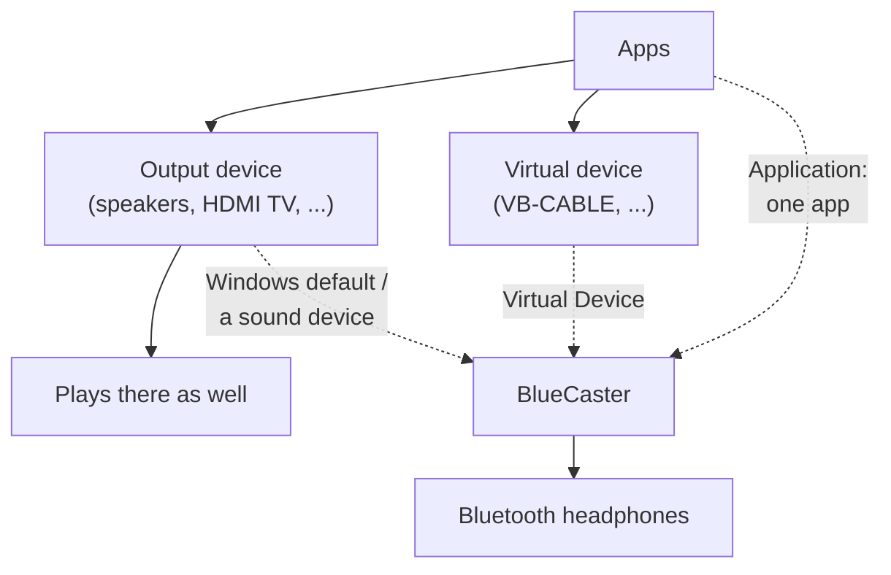
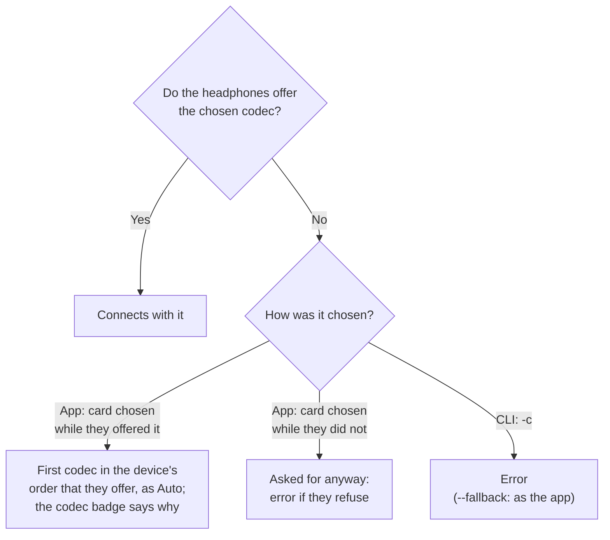

# Usage
{: .no_toc }

## Table of contents
{: .no_toc .text-delta }

1. TOC
{:toc}

---

## The Window

Start **BlueCaster** from the Start menu (or run `bluecaster.exe`). The menu on the left lists the screens described below: Home, Codecs, Audio Devices, Adapters, Diagnostics, Settings and About, plus Developer in developer mode and Volume Mixer when it is turned on there. In a narrow window, the menu collapses to icons. The window is only a view of `bluecaster-core.exe`, which keeps running in the background, so closing the window does not stop streaming (see [Tray and Flyout](#tray)).

### Home

- A card for each saved audio device, side by side, with its state and battery. The connected device's card also shows the codec in use, as a list (see below), and its bitrate. If a codec other than the one you chose is in use, the codec line briefly gives the reason, e.g. **aptX Adaptive (Opus is unsupported)** (or *is in use*); after a few seconds only a warning mark remains (hover over it for the reason), and the status line just says **Connected**
- **Connect** / **Disconnect** under each card. Only one device can be connected at a time: **Connect** on another device disconnects the current one and connects the new one
- **Volume**: the headphones' volume (see [Volume](#volume)). Click the speaker to mute (BlueCaster sends silence) and click it again to unmute. The other devices' cards show the slider disabled
- A codec list on the connected device's card, for switching quickly (say, one codec for games and another for music). It lists the codecs the device supports, by name only, as on [Codecs](#codecs), and shows the codec in use, also under **Auto-select**. Choosing a codec turns Auto-select off (turn it back on in Codecs). The choice takes effect immediately: the device reconnects with the new codec, and the next choice waits until it has reconnected, as on Codecs
- A small link quality graph on the connected device's card while it streams. You choose the output source on **Audio Devices**; if that source is an application that is not running yet, the card says so
- Errors show their cause and, where one exists, a button that fixes the problem (**Replace with WinUSB driver**, **Open Download Page**, **Restart Bluetooth**, **Try again**, **Codecs**, **Audio Devices**, ...)
- Above the cards, until you close them: a warning when another Bluetooth adapter is active in Windows, and a notice when OPPO earbuds have turned Hi-Res on (see [Codecs](#codecs))

The sidebar shows the same information for every device on every screen; the tray flyout shows it for the connected device.

### Codecs {#codecs}

Each saved audio device has its own section, headed by a dot (green while the device is connected), its name and **Paired** / **Audio** tags; the address is on **Audio Devices**. Below are its codec cards, highest sound quality first unless you reorder them. Each card has three bars (sound quality, low latency, stability) and shows whether the device offered the codec when it last connected: **Supported** (green mark) or **Unsupported** (red mark). With **Show only supported codecs** on (the default), every card shown is supported, so none carries the **Supported** tag. A device that has never connected (one imported from Windows, for example) then shows only the **SBC** card, which every Bluetooth audio device has, plus any codec chosen for it; its other cards appear after the first connection, or when you turn the switch off. Huawei and Honor earbuds keep their **LDAC** card, marked **Unconfirmed**, until they list LDAC, since they may list it only once it is chosen. When LHDC V5 streams (chosen by you or by Auto, but not with quality **Low** or ABR), OPPO earbuds that list a peak bit rate for LHDC V5 are asked once to turn on Hi-Res. They reconnect once for this, and Home tells you when it raised their bit rate. Hi-Res then stays on in the earbuds; earbuds that gained nothing are set back. In developer mode, **Ask for Hi-Res again** in LHDC V5's settings forgets what the device listed and that it was asked, so the next connection asks again.

- **Auto-select the codec with the highest quality** (one setting for all devices, at the top of the page; on by default): each device uses the highest-quality codec it supports, in this order: LHDC V5 > LDAC > aptX Adaptive > Opus > aptX HD > aptX > aptX LL > AAC > SBC XQ > SBC. It uses the default settings, the same as **Auto** in a codec's settings: high quality, 24-bit where the codec supports it, and 48 kHz (if the device has no 48 kHz, another rate it lists, 44.1 kHz first; Windows' own rate is resampled). The cards are read-only except for their order (drag them as described below; Auto takes the first card the device supports), and the codec in use, or the one Auto will pick, is highlighted. Clicking a card or its **...** asks whether to turn Auto-select off (**Disable Auto-select** / **Cancel**); once it is off, the card you clicked is chosen (and its **...** opens its settings). Turn Auto-select off to choose each device's codec and settings yourself; a device with no codec chosen yet keeps Auto's pick. While Auto-select is on, each device's chosen codec is kept for later. Settings from before 2.0.2 that chose a codec for any device start with Auto-select off
- With Auto-select off, click a card to choose that device's codec. The choice is saved immediately, and a streaming device reconnects with it. You can also choose a card the device does not support (shown when **Show only supported codecs** is off): BlueCaster asks the device for it anyway, and if the device refuses, the connection stops with an error saying so (choose another card or turn Auto-select on). Home, the sidebar, the tray flyout and the tray icon's tooltip then give the cause in a few words (e.g. *LDAC is unsupported*), as they do whenever the codec stops a connection (because the device does not support it, refuses it or uses it for another source). Choosing another card or other settings for that device, or turning Auto-select on, reconnects it. If you chose a codec while the device offered it and the device later stops offering it (earbuds switched to another codec, say), BlueCaster falls back to the first card in the device's order that the device supports: the best supported codec, unless you changed the order (see [Explicitly Selected Codec Not Offered](#codec-fallback))
- Drag a device's cards to put its codecs in your own order (the hand cursor shows while the button is held; with Auto-select off, you can also press Alt with an arrow key on a card). Each device keeps its own order. Auto-select, a device with no codec chosen yet, and a chosen codec the device does not support all use the first supported card. FastStream and Opus 05 (the **Opus (PipeWire)** card, developer mode only; without developer mode it is not used even when chosen) are used only when chosen, wherever they stand. **Reset codec order** restores the default order; it appears only while the cards shown are out of default order (moving them back by hand also restores it). A device streaming with a codec this affects reconnects
- Choosing another codec for the streaming device reconnects it with that codec. The cards (and the codec list on Home and in the tray flyout) then wait until the device has reconnected before taking the next choice, so a quick series of clicks does not interrupt a connection that is still being set up. Switching codecs shows no connection notification; connecting a device does
- **Show only supported codecs** (on by default; turn it off to show both supported and unsupported codecs): hides the codecs a device did not offer. Before a device's first connection, only **SBC** (and any codec chosen for it) is shown
- **...** on a card opens that codec's settings. Changes take effect immediately. For the codec in use, a change is saved and the device reconnects with it; the exceptions are the **Bitpool**, which changes while you listen, and the switch below when the stream would be set up the same either way. For another codec, the change is kept until that codec is chosen. Each codec keeps its own settings, as do aptX Adaptive and aptX Adaptive LL, so switching to another codec and back restores them. Only options that the codec supports, and that the device listed at its last connection, are offered. At the top, turn off **Show only options *device* supports** (on by default; shown once the device has listed its options) to see everything the codec has, such as a sample rate, bit depth, quality or bitpool the device did not list (marked *(unsupported)*). The device may refuse these, and the connection then stops with an error saying so. When you turn the switch back on, anything the device did not list returns to Auto. The settings, per codec (Auto-select never uses them):
  - **Quality**: LDAC **High** / **Medium** / **Low** (990 / 660 / 330 kbps); LHDC V5 **High** / **Medium-High** / **Medium** / **Low** (1000 / 900 / 500 / 400 kbps, Android's four levels); aptX Adaptive **High** (its low latency mode has its own card, **aptX Adaptive LL**: 265 kbps, 48 kHz, no ABR; see [aptX Adaptive](#aptx-adaptive)). With LHDC V5's ABR on, the quality is greyed out (ABR stays at or below 400 kbps). AAC, Opus, Opus 05, SBC and SBC XQ have a single level, **High**, shown rather than chosen: the highest bit rate the device accepts (ABR or VBR, where available, still varies it; SBC and SBC XQ show the bit rate their bitpool and frame setup produce). aptX, aptX HD, aptX LL and FastStream have a bit rate fixed by the codec. A quality saved by an earlier version that the codec no longer has (aptX Adaptive's Standard / Mobile, AAC's lower levels, ...) loads as High
  - **Adaptive Bit Rate (ABR)**: for LDAC, LHDC V5, aptX Adaptive, SBC and SBC XQ (see [ABR](#abr)); **VBR** for AAC
  - **Low latency** (LHDC V5, on devices that list it): sound reaches the headphones sooner. With ABR off, the bit rate steps down while the connection can't keep up (1000, 900, then 500 kbps) and steps back up after a minute without trouble. Packets are dropped after 100 ms in the send queue instead of 350 ms, so a weak connection causes a short dropout instead of a lasting delay
  - **Sample Rate**: Auto is 48 kHz or, if the device has no 48 kHz, another rate it lists (44.1 kHz first), and shows the resulting rate (e.g. *Auto (48000 Hz)*). Auto never picks 96 kHz, which adds latency and is less compatible with no audible gain (Windows mixes at 48 kHz); choose it here to use it. Only the rates the device lists are offered (LHDC V5 has no 88.2 kHz; aptX Adaptive offers 96 kHz only to a device that lists it, see [aptX Adaptive](#aptx-adaptive)). A device that lists only one rate shows that rate, without Auto
  - **Bit Depth**: 16 or 24 bit for LDAC and LHDC V5, as far as the device lists them (Auto: 24 bit; for LHDC V5 only when the device lists it); 24 bit for aptX HD and aptX Adaptive; 16 bit for the others. LDAC's 24 bit reaches the encoder as 32-bit samples, as with Android's 32-bit option. The bit depth is not part of LDAC's configuration, so the headphones receive the same stream either way
  - **Bitpool** (SBC, SBC XQ): one slider with two handles for the minimum and maximum bitpool, within the range the device lists. The maximum is the bitpool in use; the minimum is the lowest one used (the bottom of the range the connection is set up with, and how far ABR may go down). **Auto** resets both: the maximum to match the quality, the minimum to the device's and ABR's own. The line below shows the channel mode, which is fixed for each codec: joint stereo for SBC, dual channel for SBC XQ. SBC XQ's bitpool goes up to 47 at 44.1 kHz and 43 at 48 kHz, or up to 53 with **Show only options *device* supports** off.
  - **Frame setup** (SBC and SBC XQ, developer mode only): blocks, subbands, bit allocation and, for SBC, the channel mode. Auto keeps 16 blocks, 8 subbands, Loudness and Joint stereo. A value the device does not accept falls back to Auto when connecting. On a Sony device a user tested, 12 blocks garbles the sound and may disconnect (the encoder's output decodes correctly, and the other block counts play fine). Your choices stay saved but are not used while developer mode is off. AAC's and LHDC V5's bit rates stay within the maximum the device lists

The defaults give the best sound; most devices need nothing but **Auto**. An LE Audio device (experimental) has two cards, **LC3** and **LC3 LL** (see [LE Audio](#le-audio)). Their **...**, like that of the call codecs, shows the same fields as an A2DP codec, read-only. aptX Adaptive's low latency mode has its own card, **aptX Adaptive LL**, beside **aptX Adaptive**. Auto never picks it, and aptX Adaptive set to Low Latency by an earlier version appears on this card.

While the microphone of a classic device is open (see [Audio Devices](#audio-devices)), its music cards are replaced by the call codecs it can use: LC3 (32 kHz), mSBC (16 kHz) and CVSD (8 kHz), with the active one selected. Under **Auto-select**, the call link picks the best codec both sides support, and clicking a card asks whether to turn Auto-select off. With Auto-select off, click a card to choose the call codec: the microphone reopens with it, or with the next lower codec if the headphones do not support it. **...** shows their settings, read-only. When the microphone closes, the music cards return. While Auto-select is on, the chosen call codec is kept for later. With **Show only supported codecs**, codecs the headphones do not support are hidden.

While the microphone of an LE Audio device is open, a **Microphone** card (LC3, mono) appears after its music cards. With Auto-select off, its **...** sets the microphone's sample rate, from those the headphones support (**Auto** takes the first; changing it reconnects the device). Under Auto-select, it shows the rate in use.

Behind the scenes, BlueCaster keeps one entry per device in `profiles.json` (its codec, each codec's settings and its codec order), named "*device* | *codec*" there; the window and the tray menu show only the device's name. Earlier versions let you create several profiles for one device. The first start of a version with the Codecs screen keeps the most recently used profile (otherwise the first) and merges the others into it, keeping their codec settings (quality, sample rate, bit depth, ABR, SBC setup) for their codecs. Their names, output sources and packet sizes are not kept; the original `profiles.json` is saved once as `profiles-before-codecs.json` in the settings folder. **Auto's order…** from the 2.0.2 pre-releases (one order for all devices, in developer mode) is no longer used: each device now has its own order.

### Audio Devices

The headphones and speakers BlueCaster can stream to, each with its own settings. Below them, under **Add an audio device**, **Scan Devices** looks for nearby devices with the USB adapter for 30 seconds and lists them as they respond; **Stop Scanning** ends the scan. Put the headphones into pairing mode first. If a device is connected, BlueCaster asks to disconnect it before scanning. **Add** saves a device that was found and connects it. Devices BlueCaster paired with before are tagged **Paired**. If the scan does not find a device, enter its address under **Manual:** and click **Add**; addresses are formatted as you type or paste (`aa-bb-cc-dd-ee-ff`, `AABBCCDDEEFF` and `AA BB CC DD EE FF` all become `AA:BB:CC:DD:EE:FF`). Headphones see the adapter as your computer's name followed by BlueCaster, e.g. *Taro-PC (BlueCaster)*, so you can tell it apart from Windows' own Bluetooth. If Windows paired a device through another adapter, such as the PC's built-in Bluetooth, BlueCaster asks first (**Paired in Windows**: remove it there, or **Add anyway**). It also asks first for a device Windows paired through this adapter (the setup can import that pairing, see [Services and Pairing Keys](#shared-pairing)). You can rename or remove a saved device; removing it also deletes its settings and pairing, so it must be paired again before it can connect. Each saved device has:

- **Output Source**: **Windows default** (listed first on its own: the Windows default output, named in brackets, which can also be a virtual device; the default for a new device), one output device under **Sound Devices**, a virtual device, or an application (see [Capture Modes](#capture-modes)). Beside it is the format in which Windows mixes the captured device (sample rate and bit depth, read-only). It turns amber when the device streams another format (or, when not connected, its codec settings ask for one), and a line below gives both formats (streaming still works, with conversion). Below that, a description of what the source does
- **Set as Windows default output while connected** (developer mode, with a virtual device or a sound device)
- **Equalizer**: a parametric EQ for the sound sent to this device (see below)
- **Input Source**: the headphones' microphone, and **Set as Windows default input while connected** in developer mode (see below)

**Input Source**, on each device, sends the headphones' microphone to Windows for calls and voice chat. BlueCaster has no audio driver of its own, so it plays the microphone into a virtual audio cable such as VB-CABLE. The list names each cable by the side apps record from (*CABLE Output* for VB-CABLE); choose that one as the microphone in your apps. Beside the list, choose **Off** or **Auto**: **Auto** opens the microphone only while an app records from it, so playback keeps its full quality the rest of the time. Developer mode adds **On**, which keeps the microphone open. Without developer mode, a device set to **On** behaves like **Auto**. When set to **Off**, the list stays visible but greyed out. **Off** and the microphone button on Home and in the flyout are the same setting: for a device on **Auto** or **On**, **Off** disables the microphone just as the button does and remembers the mode, which the button restores. **Set as Windows default input while connected** (developer mode; always on when developer mode is off) makes the cable's recording side (*CABLE Output*) the Windows default microphone while the device is connected. Apps that record from the default microphone then get the headphones' microphone, and **Auto** opens it for them. When the device disconnects, the previous default returns, unless you chose another one in the meantime.

**Microphone adjustments**, at the bottom, opens the controls that process the microphone before apps get it. While **Input Source** is **Off**, the line is greyed out. **Use microphone adjustments** turns all of the adjustments on or off. When the switch is off, the microphone passes through unchanged and the sliders keep their values. **Gain** makes the microphone louder or quieter (-12 to +24 dB). **Noise suppression** removes steady background noise such as a fan or hum. Move the slider right for stronger suppression, or left to keep more of the original sound; all the way left is **Off**. **Noise gate** mutes the microphone while it stays below the chosen level (all the way left: **Off**). A limiter keeps a boosted microphone from clipping. Changes apply at once, without reconnecting. Noise suppression delays the microphone by about 20 ms; with everything off, the microphone passes through unchanged. The **Microphone** test on **Diagnostics** records it as apps hear it.

New devices start with VB-CABLE if it is installed, otherwise with the Hi-Fi Cable, unless that cable is their **Output Source**: a classic device on **Auto**, an LE Audio device on **Off** (where **Auto** keeps the microphone open). A device whose microphone is on but has no cable gets one as soon as Windows lists one. **Audio Devices** and the setup suggest any missing cables (see [Capture Modes](#capture-modes)). When you install one later, BlueCaster sets up again, as the setup would, the devices it configured automatically and those on **Windows default** with such a microphone. With both cables, the Hi-Fi Cable carries the sound and VB-CABLE the microphone. With one cable, that cable carries the microphone and the sound comes from an output device under **Sound Devices** (a monitor's or TV's audio if there is one, the Windows default output among several; otherwise the Windows default output), whichever device is the Windows default output. An Output Source or microphone you chose yourself is left as it is. With no cable, if Windows has both a monitor's or TV's audio and a sound card, the sound comes from the monitor or TV and the microphone plays into the sound card, set to **Off**. In developer mode, you can set the microphone to **On** so that an app recording an output device (OBS's audio output capture) can pick up the microphone there; **Auto** cannot tell who is listening to a sound card. A device added on **Audio Devices** starts the same way. A device on **Windows default** whose microphone plays into the cable that is the Windows default output is switched to that sound source as well, because the microphone would otherwise play in the headphones.

If the microphone plays into the Hi-Fi Cable and the cable's playback and recording sides run at different sample rates in Windows' Sound settings, a warning appears: if apps hear nothing, set both to the same rate. The list shows only cables that apps can record from. It leaves out the cable BlueCaster itself captures (the **Output Source**, or the Windows default output with **Windows default**, but not another device's Output Source made the default while that device is connected), and also the other side of that cable (VB-CABLE's *CABLE In 16ch* records into the same *CABLE Output* as *CABLE Input*), since the microphone would be mixed with the playback. Likewise, while **Input Source** is not **Off**, the **Output Source** list leaves out the cable the microphone plays into. With **Developer > App settings > Show every audio device in the source lists** on, both lists offer every device: outputs without a recording side (speakers etc.) appear under **Monitoring**, since they only play the microphone; VB-CABLE's 16-channel cable appears as *CABLE Output · CABLE In 16ch* (the recording side it shares, then its own name); and the Output Source's cable appears greyed out, with *(used as Output Source)* after its name. *CABLE Input* and *CABLE Output* are the two ends of one cable, so a virtual Output Source plus the microphone needs two cables. Recommended: VB-Audio's **Hi-Fi Cable** (*HiFi-Cable & ASIO-Bridge* on [VB-Audio's page](https://vb-audio.com/Cable/)) for the sound, as it adds the least delay, and VB-CABLE for the microphone. The microphone's device must not be the Windows default output either: apps would hear the playback mixed with the microphone, and an Output Source on another device would get nothing. A warning under **Input Source** points this out.

While the microphone is open, a classic Bluetooth device plays over its call connection: mono at call quality (CVSD, mSBC or LC3, the best both sides support). Its codec is dimmed meanwhile, and when the microphone closes, the device returns to that codec without reconnecting. An LE Audio device keeps playing LC3 at its usual quality and sends the microphone alongside; changing the mode reconnects it (there, Auto keeps the microphone open). Some headphones may refuse the microphone, or show a call in progress when there is none. With **Auto** or **On** and a device selected, a **Mic:** line below the codec (in the sidebar, on Home and in the flyout) shows the microphone while the device is connected or connecting: its codec and rate with a red dot while it is open (*Mic: mSBC 16 kHz*), or its mode, dimmed, while it is closed. On Home and in the flyout, the microphone button beside it disables the microphone: the button is crossed out, the microphone closes, a classic device returns to its codec, and **Input Source** shows **Off**. Clicking it again enables the microphone in its previous mode, as does choosing **Auto** or **On** under **Input Source**. The button is dashed while Auto waits for an app, and shows a warning sign, with the reason in its tooltip, when the microphone failed to open.

**Equalizer**, on each device, shapes the sound sent to it with up to 16 points; click the line to open it. It is off by default. While it is off, the audio is sent exactly as captured and the graph and its controls are greyed out. A new equalizer starts with ten points at the standard 10-band frequencies (31 Hz to 16 kHz). All ten are flat, so the sound stays the same until you move one. Once the equalizer is on, the graph shows the curve from 20 Hz to 20 kHz:

| Action | How |
|:-------|:----|
| Add a point | Double-click the graph, or click **Add point** |
| Move a point | Drag it: left/right changes the frequency, up/down the gain (±12 dB) |
| Change its width (Q) | Scroll the mouse wheel over it |
| Change its type or delete it | Right-click it: **Peak**, **Low shelf**, **High shelf**, **Low cut**, **High cut** |
| Set exact values | Click a point, or choose its number under **Point**, and use the fields below the graph (type, frequency, gain, Q) |
| Use the keyboard | Tab to a point; the arrow keys move it (Shift: larger steps), Page Up / Page Down change Q, Delete removes it |
| Go back to the ten flat points | **Reset** |
| Save the points to a file | **Export**: a text file in Equalizer APO format, which AutoEq and many other EQ apps also use |

Changes apply while the device streams, without reconnecting; a dragged point plays as you move it and is saved when you release it. To keep boosts from clipping, BlueCaster lowers the level by the curve's highest boost and a limiter keeps peaks below full scale, so raising a band makes the rest quieter rather than that band louder. The setting is kept per device, for classic and LE Audio devices alike.

**All audio devices**, above the list, holds the switches that apply to every device: **Windows Volume Sync** (see [Volume](#volume)), **Control playback with the audio device's buttons** and **Reconnect automatically**. Each device's **Max media packet size** is on the **Developer** screen (see [Max Media Packet Size](#max-packet)).

### Diagnostics

- **Link Quality** while streaming: actual bitrate, packets, packets dropped before sending, audio dropped at capture, send queue, the delay the device reports (see [Latency](#latency)), radio time used, signal (RSSI) and the AFH channels (see [Link Quality and AFH](#link-quality)). While the headset microphone is open, a classic device's call link is measured the same way (its codec, e.g. mSBC, and what it sends), and a **Microphone** card shows the packets coming back: received, damaged over the air, and concealed
- **Radio**: the 79 Bluetooth channels in the 2.4 GHz band, showing which ones the link uses and which the adapter skips, with the Wi-Fi channels underneath and a few tips for a cleaner link. In developer mode, **Scan** adds the nearby 2.4 GHz Wi-Fi networks (see [The Radio tab](#radio-tab))
- **Codec details** while streaming: the media payload, headers, codec frame and frames per packet, and what the device's endpoint lists next to what is in use: for SBC the bitpool, sample rates, channel modes, blocks, subbands and bit allocation; for AAC the object types, sample rates, channels, peak bit rate and VBR; for the other codecs the sample rates, bit depths and peak bit rate
- **Microphone**: tests the headset microphone of a classic Bluetooth device while it streams. **Record** opens the microphone and records up to 10 seconds, showing the level on the bar (meanwhile the device plays at call quality; if the microphone has never been opened on this connection, the device reconnects first). **Play** plays the recording on the headphones. Leaving the tab ends the test, and playback returns to its codec. LE Audio devices are not supported yet
- **Connection Flow**: the eleven stages of the latest connection attempt (start, Bluetooth adapter, ACL / AVDTP connect, capability discovery, codec selection, audio capture, stream configuration, encoder, stream start, audio sending, connection upkeep with disconnects / reconnects), each marked OK, Warning or Failed, with how long it took. **Copy Flow** copies it
- **Log**: the live log, filtered by level (all, info and above, warnings and errors, errors only), by text, and to the current connection attempt (**Current attempt only**). **Copy Shown Log** copies what is shown. **Open log folder** opens the folder with the log files; unlike **Copy Diagnostics**, these files are not masked (they include Bluetooth addresses and your Windows user name)
- **Start HCI Capture** / **Stop HCI Capture** (see [Verifying the Media Stream](#verify-stream))
- **Copy Diagnostics**: copies the version, OS, adapter, audio device (codec, its settings and order), the flow, warnings / errors and the recent log to the clipboard, ready to paste into a bug report. **Mask Bluetooth addresses** (on by default) replaces addresses with `<addr-1>`, `<addr-2>`... (the adapter's own with `<adapter>`) and device names with `<device-1>`, `<device-2>`..., and hides USB serial numbers, file paths above the app's own folder (`<path>\BlueCaster\logs\...`) and your Windows account (user name and SID). The same masking applies to the crash report and to error texts copied for a bug report
- **Report a problem**:
  - **Verbose logging**: **Detailed (debug)** or **Everything (trace, 1 hour)** logs much more about Bluetooth, USB, audio capture and encoding. Debug stays on for 24 hours, including across restarts (for start-up problems), then turns off automatically. Turn it on, reproduce the problem, then save a diagnostic bundle
  - **Diagnostic bundle > Save…**: choose whether to include HCI captures (leave this off unless you were asked for them: they contain addresses and device names) and whether to mask Bluetooth addresses in the text files, then save a single `.zip` (in `logs\bundles\` of the settings folder; the newest 3 are kept). It contains the diagnostic info, the log files of the core, the window and the driver helper, crash reports, system information (USB Bluetooth adapters and their drivers, Windows' paired devices, audio devices), settings and each device's codec settings (never the link keys), and the HCI flight recorder. The HCI captures keep the addresses (but not the pairing keys). BlueCaster keeps the bundle under GitHub's 25 MB attachment limit where possible (newest logs first, up to 48 MB of text, the newest 5 recordings and 2 minidumps)
  - **Report on GitHub** (after saving): opens a new bug report pre-filled with the version, Windows build, adapter, headphones, codec, capture mode and the diagnostic info (addresses masked), and shows the bundle in Explorer so you can drag it in

BlueCaster also records some data all the time, so that a problem that happened only once can still be investigated:

- **HCI flight recorder**: the last few minutes of Bluetooth traffic are kept in memory (media payloads cut short, pairing keys removed) and saved to `logs\hci\` whenever a stream fails or a connection is lost (the newest 10 files are kept)
- **Crash reports**: if BlueCaster crashes, a `.dmp` minidump and a `.txt` file go to `logs\crash\` (the newest 5 per program)

Disk use stays limited: a normal day's log is well under 1 MB, and 7 days are kept. With verbose logging, a day's file holds at most 100 MB of debug and trace lines (after that, only info and above until the next day). Flight recorder files are a few MB at most, and 10 are kept.

### Developer {#developer}

Shown while **Settings > Developer mode** is on; most users never need it. It is for testing devices and troubleshooting, and some of its settings work only with certain devices. Seven tabs:

- **App settings**: **Use the Volume Mixer** (off by default) turns on the **Volume Mixer** screen, the flyout's app list and the output mute (see [Capture Modes](#capture-modes)). Not recommended; VB-CABLE is a better way to keep the PC silent. **Show every audio device in the source lists** (off by default) makes **Output Source** and **Input Source** on **Audio Devices** offer every device, including unsuitable ones (see [Audio Devices](#audio-devices)). **Hide the virtual audio device warning** (off by default) removes the warning about a missing VB-Audio cable (see [Capture Modes](#capture-modes)). **Include Alphas in Update Checks** (on by default in alpha builds) also offers alpha releases (see [Updates](#updates))
- **Codec settings**: switches for finding out why a device stays silent (RTP marker bit, logging the first media packets, AAC configuration and encoder options), and each saved device's **Max media packet size** (see [Max Media Packet Size](#max-packet)). **Use each codec's settings when the codec is auto-selected**: with Auto-select on, a codec card's **…** opens without turning Auto-select off, and the codec Auto picks connects with those settings instead of Auto's. **Match the sample rate and bit depth to the PC's output**: a sample rate or bit depth set to Auto follows the format of the output device in Windows' sound settings instead of 48 kHz. Of the rates the device lists for the codec, BlueCaster takes the PC's own rate, else the nearest of the same family (multiples of 44.1 or 48 kHz), else the nearest higher rate; a 16-bit output streams 16-bit. **Ignore the device's peak bit rate**: every codec runs at the bit rate of the chosen quality even when the device lists a lower maximum (the bit rate of LHDC V5, AAC or Opus 05, or the SBC bitpool), and the **Codecs** screen offers every quality and bitpool. A device may drop out or go silent above its maximum. **Send queue limit**: how long a media packet may wait in the send queue before it is dropped, 50 to 2000 ms (empty = 350 ms); it does not reduce the delay on a good link (see [Latency](#latency)). **Encode at send time**: while the link stalls, audio waits unencoded instead of as already-encoded packets. With ABR on (SBC, SBC XQ, LDAC, LHDC V5 and aptX Adaptive), it is then sent at the bit rate ABR has lowered to in the meantime, not the one in use when the stall began. It does not shorten the stall itself: nothing is sent until the radio resumes, and only the catch-up afterwards takes less data. Audio that waits longer than the send queue limit is dropped either way; Diagnostics counts the waiting audio in the send queue wait. All of these are off by default and take effect when the next stream starts; while any is on, a banner says so. **Turn all off** resets them
- **Vendors**: whether BlueCaster uses earbuds' own protocols (Huawei: LDAC, OPPO: Hi-Res; see [Codecs](#codecs)). Each has **Vendor protocol**: **Auto** (earbuds whose name identifies that vendor; the default), **Always** (any device) or **Never**. OPPO also has **Ask for Hi-Res on every connection (reconnects each time)**. Changes take effect when the next stream starts; while any is changed, a banner says so, and **Turn all off** resets them. They are not used while developer mode is off
- **Logging**: how long log files are kept (default 7 days), the daily size limit (default 100 MB), verbose logging that stays on (no 24-hour or 1-hour limit, and active from the moment the core starts), the stream health line every 10 seconds, and **Add marker** (writes a numbered line to the log so you can find that moment later). Turning developer mode off restores the defaults
- **Peer Receiver Test**: streams to the measuring receiver on another PC and compares what was sent with what arrived (see [Peer Receiver Test](#receiver))
- **Chip**: runs a chip script on an adapter with WinUSB: requests to the chip, typed in or loaded from a file, for anyone adding support for a chip (see [Adding Chip Support](chip-support#chip-scripts)). Lines that may change the chip run only after you click **Run them**; Bluetooth stops for this and restarts the next time it is needed
- **Debug**: experiments, all off by default. **Pairing keys and Windows**: **Also copy the LE keys to Windows when restoring the original driver** writes BlueCaster's LE keys (Long Term Key, EDIV, Rand, key size, Identity Resolving Key) to Windows on **Restore original driver**, but only for devices whose LE keys Windows already keeps for that adapter. Windows' old keys are saved in `pairing\replaced_windows_keys.json`, readable only by your Windows user. **Compare with Windows** (administrator permission) counts, for one adapter, the devices whose link keys and LE keys match in BlueCaster and Windows, differ, or exist on only one side. It shows and logs only numbers, never an address or a key, so the result is safe to share. It also lists the names, types and sizes of the values Windows keeps for the adapter and its LE devices, never their data

### Adapters

- The detected USB Bluetooth adapters with their chip, address, USB ID, Bluetooth version, **Driver** and **Firmware**. The list updates automatically when you plug an adapter in or out. The driver is **Original driver** (the one Windows or the manufacturer installed; hover to see its name) or **WinUSB driver** (the one BlueCaster uses). A Realtek adapter shows its address, taken from its USB serial number, even before it has been used; for other adapters, the address and Bluetooth version appear once Windows' Bluetooth or BlueCaster has used the adapter (hover over the line to see why). An adapter BlueCaster cannot use (some MediaTek and Qualcomm models) keeps its driver, and its WinUSB and firmware buttons are disabled. In developer mode you can assign WinUSB to it anyway, and **Read chip info** on an adapter with WinUSB saves the chip's answers to a few read commands to `logs\probe\`, for anyone adding support for it (Bluetooth stops for this and restarts the next time it is needed). **Report on GitHub** then opens an issue with this information filled in. While an adapter whose firmware BlueCaster loads itself (Intel, MediaTek, Qualcomm) starts up, the screen shows the loading progress and whether it failed
- **Replace with WinUSB driver** / **Restore original driver** (see [Setup](setup#winusb)). Windows asks for administrator permission each time, as for every button with a shield. Restoring also hands Windows BlueCaster's newer pairings of the devices Windows had paired through this adapter, so they connect in Windows without pairing again. **Limitation:** LE keys are not handed over, so a device that Windows uses over LE (LE Audio) must be paired again in Windows (developer mode can try it: **Developer > Debug**)
- **Bluetooth Chip** for the firmware, with **Download Firmware**, **Open Download Page** and **Open Firmware Folder** (see [Firmware](setup#firmware)). An adapter from another vendor instead shows where its firmware comes from, such as **From MediaTek's driver**, **From the firmware folder** or **Not needed**, and **Loaded** once BlueCaster has loaded it. A Realtek adapter whose firmware comes from Realtek's Windows driver shows **Use custom firmware** instead, and **Use the driver's firmware** switches back
- **Avoid Wi-Fi channels**: Auto, Off or Manual, with the Wi-Fi channels beside it: the ones Auto currently avoids, none for Off (both read-only), or the ones you type for Manual (see [Link Quality and AFH](#link-quality))
- **Bluetooth stack**: stopped (it starts with the first scan or connection), starting, ready or error, and **Restart Bluetooth**
- **Use this adapter** (on each adapter card once two adapters have WinUSB): BlueCaster opens that adapter instead of the first one found. Bluetooth restarts on it, and a stream reconnects. **Choose automatically** on the chosen card goes back to the first one found. The adapter in use is marked **In use** and named beside **Bluetooth stack**; a chosen one not in use yet (Bluetooth opens it at its next start, or another program has it) is marked **Chosen**

### Settings

| Section | Settings |
|:--------|:---------|
| Appearance | Language, theme (System / Light / Dark) |
| Startup | **Start with Windows** and **Start in the tray** (see [Start with Windows](#autostart)), **Minimize to System Tray** and **Open the tray window from** (see [Tray and Flyout](#tray)) |
| Notifications | **Notify when a device connects** (the device, its battery, the codec and its settings; on by default), **Notify when the battery is low**: **Below 20%** (the default), **Below 10%**, **Below 5%** or **Never**, once per connection (and again only after the battery has risen 5 points above it) |
| Updates | **Check for Updates**, **Check for Updates on Startup**, **Include Pre-releases in Update Checks** (also offer beta releases), **Update now** (see [Updates](#updates)) |
| Advanced | **Developer mode** (adds the [Developer](#developer) screen, the SBC **Frame setup** in the codec settings, the pairing keys under the **Services** tag on **Audio Devices** (see [Services and Pairing Keys](#shared-pairing)), the **Opus (PipeWire)** codec, **Read chip info** on **Adapters**, and more details to the log; no restart needed), **Settings folder** with **Open Settings Folder**, **Run setup** |

**Quit BlueCaster** is at the bottom. The **About** screen shows the version and BlueCaster's license; under **Third-party software** it lists the libraries, **Third-party licenses**, a note that VB-Audio's cables are VB-Audio's donationware, and the cables' dialog (**Virtual audio devices**).

### First-Run Setup

On the first start (no audio device yet, or no adapter with WinUSB), the **Setup Wizard** opens; it keeps opening until you finish or skip it once. First, choose the adapter, driver and firmware (devices Windows paired through the adapter are listed first, since they stop working with Windows). Next, find your audio devices: Connect saves a device with the best settings for it and connects it; a device Windows paired asks first; **Import pairings from Windows** lists the devices Windows paired through this adapter (see [Services and Pairing Keys](#shared-pairing)); **Next** works without a device, and you can add one later on **Audio Devices**. Last, **General Settings**: theme, **Start with Windows** and **Start in the tray** (a first setup turns both on), notifications and **Check for Updates on Startup**. See [Setup](setup#first-run). **Settings > Run setup** opens it again.

## Tray and Flyout {#tray}

BlueCaster keeps running in the system tray, with or without the window:

- **Left-click** the tray icon to open the flyout: the device and its state, **Connect** / **Disconnect**, the volume, the device switcher, the codec (a list to choose it, as on Home), the link quality and **Open BlueCaster**. The flyout is only as tall as its content. Press Esc or click elsewhere to hide it. If an error needs a screen in the main window (Codecs, Audio Devices, the adapter), its button opens the window on that screen
- **Settings > Open the tray window from** (**Tray icon** by default): on Windows 11, with **Quick Settings (the volume button)**, the tray icon opens the main window, and the flyout opens with Quick Settings instead, on top of its panels, and closes with them. You can use the flyout there without closing them. If the screen is too short, it opens to their left. With **Nowhere**, no flyout opens and the tray icon opens the main window.
- **Right-click** for the menu: **Open BlueCaster**, the first 10 devices by name (an LE Audio entry is tagged "(LE Audio)" and the streaming one is checked; click one to connect it), **Disconnect** and **Exit**. The menu opens immediately, without starting the window
- The tooltip says whether BlueCaster is idle or connected

With **Settings > Minimize to System Tray** on (the default), minimizing or closing the window only hides it in the tray, and streaming continues. With it off, the window minimizes to the taskbar, and closing it quits BlueCaster. **Exit** in the tray menu or **Settings > Quit BlueCaster** stops streaming, releases the adapter and closes BlueCaster completely.

## Start with Windows {#autostart}

**Settings > Start with Windows** starts BlueCaster when you sign in. With **Start in the tray** on, it starts in the background: only the tray icon appears, and you open the window from it. With it off (the default), the main window opens. The setting is stored as the value `BlueCaster` under `HKEY_CURRENT_USER\Software\Microsoft\Windows\CurrentVersion\Run`, with the data `"<folder>\bluecaster-core.exe"`, followed by `--background` when **Start in the tray** is on. To turn it off manually, delete that value. Installing v2 over v1 turns **Start in the tray** on, because v1 always started in the tray.

## CLI Mode

`bluecaster-core.exe --cli` streams from a console, using the same core as the window. Quit BlueCaster first (tray > **Exit**), because only one program can use the adapter at a time. The CLI does not read the saved devices' settings; you pass everything as options.

### Basic

```bash
# Auto-select best codec
bluecaster-core.exe --cli -d AA:BB:CC:DD:EE:FF
```

Ctrl+C stops streaming. The CLI prints the state, the codec and bitrate, and at the end the number of packets sent and dropped.

### Codec Selection

```bash
bluecaster-core.exe --cli -d AA:BB:CC:DD:EE:FF -c ldac      # LDAC
bluecaster-core.exe --cli -d AA:BB:CC:DD:EE:FF -c aptxhd    # aptX HD
bluecaster-core.exe --cli -d AA:BB:CC:DD:EE:FF -c aptxll    # aptX Low Latency
bluecaster-core.exe --cli -d AA:BB:CC:DD:EE:FF -c aptx      # aptX
bluecaster-core.exe --cli -d AA:BB:CC:DD:EE:FF -c aac       # AAC
bluecaster-core.exe --cli -d AA:BB:CC:DD:EE:FF -c sbc       # SBC
bluecaster-core.exe --cli -d AA:BB:CC:DD:EE:FF -c lhdcv5    # LHDC V5
bluecaster-core.exe --cli -d AA:BB:CC:DD:EE:FF -c opus      # Opus (48 kHz, 256 kbps)
bluecaster-core.exe --cli -d AA:BB:CC:DD:EE:FF -c opus05    # PipeWire's Opus 05 (to PipeWire sinks)
bluecaster-core.exe --cli -d AA:BB:CC:DD:EE:FF -c aptxad    # aptX Adaptive (48 kHz; --rate 96000 for 96 kHz)
```

Auto-select priority: LHDC V5 > LDAC > aptX Adaptive > Opus > aptX HD > aptX > aptX LL > AAC > SBC XQ > SBC (FastStream and Opus 05 only when chosen)

If the headphones do not offer the requested codec, the CLI stops with an error that explains why. Use `-c auto` (the default) to take the best codec they offer, or `--fallback` to fall back to the best codec they offer instead of the requested one, as the app does (see [aptX Family and aptX Adaptive](#aptx-compatibility)).

### Quality

```bash
bluecaster-core.exe --cli -d AA:BB:CC:DD:EE:FF -c ldac -q hq   # High, 990 kbps (default)
bluecaster-core.exe --cli -d AA:BB:CC:DD:EE:FF -c ldac -q sq   # Medium, 660 kbps
bluecaster-core.exe --cli -d AA:BB:CC:DD:EE:FF -c ldac -q mq   # Low, 330 kbps

# LHDC V5: hq 1000 / mhq 900 / sq 500 / mq 400 kbps
bluecaster-core.exe --cli -d AA:BB:CC:DD:EE:FF -c lhdcv5 -q sq   # Medium, 500 kbps

# aptX Adaptive: hq 427 / ll 265 kbps
bluecaster-core.exe --cli -d AA:BB:CC:DD:EE:FF -c aptxad -q ll   # Low Latency
```

The other codecs have no quality setting: they run as `hq`, the highest bit rate the headphones accept (for aptX, aptX HD, aptX LL and FastStream, the codec fixes the bit rate). A level a codec does not have (`mhq` for any codec but LHDC V5, `sq` / `mq` for aptX Adaptive, `ll` for any codec but aptX Adaptive) runs as `hq`.

### ABR (Adaptive Bit Rate) {#abr}

```bash
bluecaster-core.exe --cli -d AA:BB:CC:DD:EE:FF -c ldac -a
bluecaster-core.exe --cli -d AA:BB:CC:DD:EE:FF -c lhdcv5 -a
bluecaster-core.exe --cli -d AA:BB:CC:DD:EE:FF -c aptxad -a
```

ABR automatically lowers the bitrate when the Bluetooth connection is unstable, and raises it when conditions improve. LDAC moves between its quality modes; LHDC V5 follows Android's policy and stays between 160 and 400 kbps; aptX Adaptive steps between its levels within High (see [aptX Adaptive](#aptx-adaptive)); SBC and SBC XQ lower the bitpool by 2 and raise it by 1 each second. With SBC, SBC XQ and aptX Adaptive, once the connection has had to back off from a bitpool or level, that step is retried only after 10 s, and the wait doubles each time it backs off there again (up to 2 minutes), so a device that copes one step lower settles there. After a minute without trouble at that step, the wait starts over. In the window, ABR is in a codec's settings (**...** on its card on **Codecs**).

### Device Discovery

```bash
# Nearby devices, found with the USB adapter (10 seconds; --scan 20 for longer)
bluecaster-core.exe --cli --scan
```

Put the headphones into pairing mode first.

### All Options {#all-options}

| Option | Description |
|:-------|:------------|
| `-d <addr>` | Bluetooth address of the headphones / receiver (`AA:BB:CC:DD:EE:FF`; default: the first audio device paired with Windows) |
| `--device-name <name>` | The device's name, with `-d`, as for a saved device (Huawei earbuds are identified by it) |
| `-l` | List the Bluetooth devices paired with Windows and exit |
| `-u <adapter>` | The USB adapter to use when several have WinUSB: instance ID, device path or `VID:PID` (e.g. `0bda:8771`) |
| `-c <codec>` | `ldac`, `aptxhd`, `aptxll`, `aptx`, `aptxad`, `aac`, `sbcxq`, `sbc`, `lhdcv5`, `opus`, `opus05`, `faststream`, `auto` (default: `auto`) |
| `-q <mode>` | Quality: `hq` (High, default); LDAC and LHDC V5 also `sq` (Medium) and `mq` (Low), LHDC V5 also `mhq` (Medium-High); aptX Adaptive also `ll` (Low Latency). Other codecs run any level as `hq` |
| `-a` | ABR (LDAC, LHDC V5 and aptX Adaptive; SBC / SBC XQ: adaptive bitpool) |
| `--fallback` | If the headphones do not offer the `-c` codec, fall back to the best one they offer, as the app does, instead of stopping with an error |
| `-m <mode>` | Capture mode: `loopback` (default), `virtual`, `app` |
| `--audio-device <id>` | Render device for `-m virtual` |
| `--app <exe>` | Executable for `-m app` (e.g. `spotify.exe`) |
| `--headset-mic` | Headset microphone (see [Audio Devices](#audio-devices)): plays the headphones' microphone into `--mic-output`; a classic device plays at call quality meanwhile. With `--le-audio`, uses the LE Audio setup that also carries the microphone |
| `--mic-output <name>` | The output device the microphone plays into, by part of its name (e.g. `"CABLE Input"`; default: the Windows default output), or a `.wav` file to write |
| `--voice-codec <cvsd\|msbc\|lc3_swb>` | With `--headset-mic`, a classic device: the best call codec to use (the next lower one if the headphones do not support it; default: the best both sides support) |
| `--mic-rate <Hz>` | With `--headset-mic --le-audio`: the microphone's sample rate (e.g. `16000`; if the headphones do not support it, the first rate they support is used) |
| `--mic-gain <dB>` | With `--headset-mic`: the microphone's gain (-12 to 24; default 0) |
| `--mic-noise-suppression` | With `--headset-mic`: suppresses noise on the microphone |
| `--rate <hz>` | Capture sample rate (default: 48 kHz, or another rate the device lists if it has no 48 kHz) |
| `--bits <16\|24>` | Bit depth (default: 24 where the codec carries it) |
| `--max-packet <bytes>` | Max media packet size, 679-1679, default 1023 (see [Max Media Packet Size](#max-packet)) |
| `--sbc-blocks <n>`, `--sbc-subbands <n>`, `--sbc-alloc <method>`, `--sbc-bitpool <n>` | SBC / SBC XQ frame setup: blocks 4/8/12/16 (default 16), subbands 4/8 (default 8), allocation `loudness` (default) or `snr`, bitpool (default: by quality) |
| `--sbc-mode <mode>` | SBC channel mode: `joint_stereo` (default), `stereo`, `mono` (dual channel is `-c sbcxq`) |
| `--afh <auto\|off\|6,11>` | AFH host channel classification (see [Link Quality and AFH](#link-quality)) |
| `--remote-sink <host[:port]\|auto>` | Show what the peer receiver gets; without `-d`, stream to that receiver (see [Peer Receiver Test](#receiver)) |
| `--scan [seconds]` | List nearby devices and exit (default 10 seconds) |
| `--probe` | Save the adapter's answers to read commands to `logs\probe\` and exit, for adapters BlueCaster cannot use yet (see [Adding Chip Support](chip-support)) |
| `--script <file>`, `--allow-writes` | Run a chip script on the adapter, save its report and exit; `--allow-writes` allows lines that may change the chip to run (see [Adding Chip Support](chip-support#chip-scripts)) |
| `-h` | Show the help |

For development and testing there are also `--hci-tcp <host:port>` (a virtual controller over TCP instead of the WinUSB adapter), `--test-tone` (1 kHz left / 1.5 kHz right instead of captured audio), `--duration <s>` (stop after this many seconds), `--sessions <n>` (stream n times in a row, like Disconnect / Connect in the app), `--restart` (with `--sessions`: restart Bluetooth between them), `--restart-on-link` (restart the session as soon as its link is up, as changing a setting while connecting does), `--wait-off` (turning the headphones off does not end the run), `--eq <Hz>:<dB>[:<Q>[:<type>]],...` (the Equalizer on with these points; type `peak`, `lowshelf`, `highshelf`, `highpass` or `lowpass`) and `--hci-capture <file.pklg>` (HCI capture of the whole run); see [Building](building#emu). `-h` lists the LE Audio options (see [LE Audio](#le-audio)). `--services` lists the services the device advertises in SDP once streaming.

Without `--cli`, `bluecaster-core.exe` runs as the resident program and also starts the window, except with `--background` (tray icon only; used by **Start with Windows** when **Start in the tray** is on). `bluecaster-core.exe --quit` asks a running BlueCaster to stop streaming and exit (the installer uses this).

## Capture Modes {#capture-modes}

BlueCaster supports four audio capture modes, listed as **Windows default** (first, on its own) and under **Sound Devices**, **Virtual Device** and **Application**. Each captures audio at a different point in the audio path:

| Mode | What it records |
|:-----|:----------------|
| Windows default | What the Windows default output device plays: all apps mixed |
| Virtual Device | What apps play into the selected device (e.g., VB-CABLE) |
| A sound device | What one output device plays (speakers, a USB headset, a TV, ...) |
| Application | Only what one app (and its child processes) plays, after the app's own processing. Needs Windows 11 or Windows 10 version 2004 (build 19041) or later |



**Audio Devices** shows the same explanation under **Output Source**. A new device captures **Windows default**, which works with nothing else installed (if a virtual cable is installed, see **Input Source** above for how a new device starts); you can choose another source there.

Capturing **Windows default** copies the audio; it does not take it away from the default output device, so the audio also plays there (speakers, wired headphones, an HDMI TV, ...). To hear it only on the Bluetooth headphones, use a virtual device such as VB-CABLE.

In developer mode, with **Developer > App settings > Use the Volume Mixer** on, **Mute Windows default output while connected** (on the **Volume Mixer** screen; off by default) mutes that device while streaming and unmutes it when streaming stops, for every capture source except the test tone. This does not affect what BlueCaster captures. Windows' mute key then mutes the headphones instead (BlueCaster sends silence; press the key again to resume), and the device stays muted. The volume keys, which also unmute in Windows, keep the device muted and the headphones playing. With an LE Audio device, the mute key only keeps the device muted. A device you muted yourself stays muted. If BlueCaster exits unexpectedly, the device stays muted: unmute it in Windows. With developer mode off, the mute is never applied, whatever this setting says.

With that switch on, the **Volume Mixer** screen and the flyout set each app's volume, with or without the mute. They keep working while the output is muted, when the Windows mixer may cut the sound. If the Windows default output is a virtual device, muting it can silence the stream too: turn the mute off.

With a virtual device or a sound device, **Set as Windows default output while connected** makes the selected device the Windows default output while streaming, so apps play to it without changing Windows settings. When streaming stops, BlueCaster switches back to the previous default device. The switch is available in developer mode; with developer mode off, it is always on, whatever its setting.

- Under Virtual Device, the **Output Source** list shows only devices that BlueCaster detects as virtual audio devices.
- **Virtual cables**: VB-Audio's **Hi-Fi Cable** is recommended for the sound (it adds the least delay) and **VB-CABLE** for the headphones' microphone. While either is missing, **Audio Devices** and the setup show a warning that cannot be closed; once both are installed, a green line confirms it (**Developer > App settings > Hide the virtual audio device warning** hides either). Its **Learn more** lists both cables and can also be opened from **About**. VB-CABLE's **Install** downloads VB-Audio's VB-CABLE package from VB-Audio (1.3 MB) and installs it unchanged (with an administrator prompt). If the download fails, **Download** opens VB-Audio's page instead; if the cable does not appear, restart Windows. The Hi-Fi Cable's **Download** opens VB-Audio's page. An installed cable has **Uninstall**, which runs VB-Audio's own setup to remove it and then scans for hardware changes as Device Manager does (one administrator prompt); if the cable is still listed afterwards, restart Windows. The Hi-Fi Cable comes with ASIO Bridge, the program it is installed with. A device that used a removed cable is set up again with the remaining ones, as a new device would be. Both cables are donationware by VB-Audio ([vb-cable.com](https://vb-cable.com/)), as **About** notes, and donations go to VB-Audio; in a company or other organisation, VB-Audio asks for a licence per installation ([licensing](https://vb-audio.com/Services/licensing.htm)).
- The default communication device (used by calling apps) is not changed.
- Some apps keep playing on the previous device until they are restarted.
- If BlueCaster exits unexpectedly, the default device is not switched back. Change it in Windows Sound settings.

Under **Sound Devices**, the **Output Source** list shows each Windows output device once (VB-CABLE's 16-channel cable only with **Developer > App settings > Show every audio device in the source lists**). BlueCaster records what the chosen device plays and, as with a virtual device, makes it the Windows default output while streaming (see **Set as Windows default output while connected** above). This way a spare output, such as a monitor's HDMI audio, can stand in for a virtual cable; **Windows Volume Sync** syncs that device's volume. If the device is missing when connecting (unplugged or disabled), BlueCaster sends **Windows default** instead and the connection status says so; **Audio Devices** shows the device as not connected.

### Application mode {#application-mode}

Application mode sends the audio of one app, for example a music player, a browser or an effects app. Choose the app in the **Output Source** list, under Application. The list shows the apps that are playing audio right now; if yours is missing, start playback in it and click **Refresh** beside the list. The app's child processes are included, so a browser that plays audio from a separate process works too.

- The app does not need to be running. BlueCaster connects to the headphones anyway and starts sending once the app starts. If the app quits during streaming, BlueCaster stays connected and picks the app up again when it restarts.
- The app also keeps playing on its own output device. To hear it only on the headphones, mute that output device (its master volume); this does not affect what BlueCaster captures. Do not mute the app in the Windows Volume Mixer, though, or the headphones get silence too.
- The app's slider in the Windows Volume Mixer changes the level sent to the headphones (and on its output device). The master volume and the volume keys do not change the audio sent; with **Windows Volume Sync** on they change the headphones' volume instead (see [Volume](#volume)).
- Windows converts the audio to the sample rate BlueCaster requests, so the device format in Sound settings does not limit it.
- Windows 10 before version 2004 (build 19041) has no per-app capture. On those versions, connecting a device set to Application capture shows an error asking you to choose another output source.

### Volume {#volume}

While streaming, the **Volume** slider on Home and in the tray flyout works if the headphones support AVRCP absolute volume (otherwise it is disabled). It sets the volume on the headphones themselves, so the audio sent keeps its full resolution. The speaker beside it mutes (volume 0 on the headphones) and unmutes (restoring the previous volume). At volume 0, however it was set (the speaker, the slider, Windows or the headphones' buttons), BlueCaster sends silence, because many headphones still play faintly at their lowest volume. The slider also follows the volume buttons and touch controls on the headphones.

**Windows Volume Sync** (on **Audio Devices**, for all devices; on by default) links a Windows volume to the headphones' volume while streaming, so the two move together. The synced Windows volume is that of the device BlueCaster captures: the default output device with **Windows default** and with an application; the selected device with a virtual device or a sound device. With sync off, the Windows volume and the headphones' volume are independent.

- The headphones' volume buttons and gestures, and the **Volume** slider, move the synced Windows volume; moving that volume's slider in Sound settings changes the headphones' volume.
- The volume keys and the Windows volume flyout always act on the default output device, so they change the headphones' volume only when the default output device is the one synced (always, except with a virtual device or a sound device without **Set as Windows default output while connected**).
- When streaming starts, the headphones take on the Windows volume; when streaming stops, the device gets back its previous volume.
- The audio is captured before the Windows volume is applied, so it is lowered only once, on the headphones. If the synced volume also changes the captured audio, the volume is applied twice: in that case, turn the sync off (see [System-wide effects apps](#effects-apps)).
- Mute is not synced: muting the output device keeps the PC silent and does not mute the headphones.

Earlier versions let a device follow another output device's volume (in developer mode); that choice is no longer used.

BlueCaster saves each audio device's volume and restores it as soon as the device connects, before any audio is sent, so one device's volume does not carry over to another.

### Headphone buttons {#headphone-buttons}

The play/pause, next and previous track controls on the headphones (buttons or touch gestures, e.g. a double tap on the WH-1000XM4) control playback on the PC while streaming: BlueCaster passes them to Windows as media keys, which go to the app shown in the Windows media controls (Spotify, a browser, a media player...). Stop is passed on as well.

- Play and pause both act as the Windows Play/Pause key, so a tap always toggles between playing and paused, even if the headphones' idea of the state is out of date.
- BlueCaster tells the headphones whether audio is playing (based on whether there is audio to capture), so headphones that pause when you take them off send the right command.
- Fast forward / rewind (holding a button) have no Windows media key and are ignored.
- Volume gestures change the headphones' own volume; with **Windows Volume Sync** the synced Windows volume follows (see [Volume](#volume)).
- Turn this off with **Audio Devices > Control playback with the audio device's buttons** (one switch for every device), e.g. if another program also reacts to the media keys and they act twice.

This needs AVRCP on the headphones, which nearly all have. Without it, streaming works as usual, just without the buttons.

### System-wide effects apps {#effects-apps}

A system-wide effects app (an equalizer, a sound enhancer, a virtual surround app, ...) usually installs its own virtual output device. Other apps play into that device; the effects app processes the audio and plays the result to the output device you choose in the effects app. The BlueCaster mode you choose decides whether the headphones get the effects:

| Setting | What reaches the headphones |
|:--------|:----------------------------|
| Virtual Device: the effects app's own virtual device | The audio **before** the effects: what apps send into the effects app |
| Application: the effects app | The audio **after** the effects: what the effects app plays (recommended) |
| Virtual Device: the effects app's output device (e.g., VB-CABLE set as its output) | The audio after the effects (for Windows versions without Application mode) |

In Application mode, the effects app's output device can be any device: BlueCaster takes what the app plays, not what the device plays, so the device only gives the audio somewhere to go. To keep the PC from playing the audio at the same time, choose an output nobody listens to (e.g., a monitor's HDMI audio) or mute that device's master volume. A virtual device such as VB-CABLE also works as a silent destination, but is not required. The device must be enabled and connected.

If the effects app's own virtual device is the Windows default output device, its volume also lowers what the effects app receives. With **Windows Volume Sync** on, a volume change then applies twice (on the effects app's input and on the headphones). Turn the sync off, and use the headphones' volume or the **Volume** slider instead.

#### Why BlueCaster has no virtual output device of its own {#no-virtual-device}

Listing Bluetooth headphones in the Windows output device list, where an effects app could select them directly, would need a kernel-mode audio driver. BlueCaster does not include one:

- Writing and maintaining a kernel audio driver is a large job, and a bug in it can crash Windows (blue screen).
- Windows 10 and 11 load only drivers signed by Microsoft. That signature requires an EV code signing certificate (several hundred US dollars a year) and a Microsoft Partner Center account, normally registered to a company.
- The only way around the signature is Windows test signing mode, which lowers system security and breaks some software (e.g., games with anti-cheat). BlueCaster will not rely on it.

Application mode, or a free virtual device such as VB-CABLE, covers the same use.

- Windows has no public API for changing the default device. BlueCaster uses the undocumented IPolicyConfig interface, as other audio switching tools do (Windows 10 and 11).

{: .warning }
Sound devices and virtual devices use WASAPI shared mode: with the sample rate on Auto (including Auto-select), BlueCaster asks for 48 kHz, or, if the headphones have no 48 kHz, another rate they list (44.1 kHz first), and WASAPI resamples the device's **Default Format** to it. To use LDAC at 96 kHz, choose 96 kHz in the codec's settings; you do not need to change the **Default format** in **Sound settings > Device properties > Advanced**.

## Codec Comparison

| Codec | Best For | Trade-off |
|:------|:---------|:----------|
| LHDC V5 | Highest bit rate and sample rate (up to 1000 kbps, 192 kHz) | Few devices; needs a stable connection |
| LDAC (HQ) | Highest audio quality on many Sony and Android-oriented devices | Higher latency, needs stable connection |
| LDAC (ABR) | Quality + stability | Bitrate fluctuates with connection |
| aptX Adaptive | High quality with a low-latency mode, on Qualcomm-based devices | Bit rate varies with the link |
| Opus | Efficient, good quality at 256 kbps | Few sinks (Android's A2DP Opus, PipeWire) |
| aptX HD | High quality, wider device support | Fixed 576 kbps |
| aptX | Widest aptX device support | 16-bit, 352/384 kbps |
| aptX LL | Gaming, video (low latency) | Lower audio quality (16-bit) |
| AAC | Apple devices, good efficiency | Moderate quality |
| SBC XQ | Much better than SBC on any device whose SBC allows it | Needs dual channel and bitpool ≥ 29; ~385-552 kbps |
| SBC | Maximum compatibility | Lowest audio quality |

The **Codecs** screen shows the same comparison as three bars on each codec card.

## aptX Family and aptX Adaptive {#aptx-compatibility}

BlueCaster supports three aptX codecs encoded with [libopenaptx](https://github.com/pali/libopenaptx), and aptX Adaptive, encoded with the encoder of [AKS-Logic/aptx-adaptive-linux](https://github.com/AKS-Logic/aptx-adaptive-linux).

{: .warning }
**aptX HD and aptX Low Latency** follow the Android / PipeWire implementations and pass encode/decode round-trip tests, but have not yet been verified with real headphones.

{: .note }
**Only need classic aptX?** Windows 10 already supports classic aptX in its built-in Bluetooth stack (not aptX HD, aptX LL or aptX Adaptive), so BlueCaster is not required for it. BlueCaster is mainly useful for LDAC, aptX HD and aptX Low Latency.

| Codec | Vendor ID / Codec ID | RTP header | Status |
|:------|:---------------------|:-----------|:-------|
| aptX Adaptive | 0x000000D7 / 0x00AD | Yes | Supported (265-427 kbps, 48 / 96 kHz, 24-bit) |
| aptX HD | 0x000000D7 / 0x0024 | Yes | Supported (576 kbps, 24-bit input) |
| aptX | 0x0000004F / 0x0001 | No | Supported (352/384 kbps at 44.1/48 kHz) |
| aptX Low Latency | 0x0000000A or 0x000000D7 / 0x0002 | No | Supported (352 kbps) |

### aptX Adaptive {#aptx-adaptive}

{: .note }
**aptX Adaptive is confirmed with real headphones at 48 kHz:** a user streamed it to an EarFun Air Pro 4+ on 2.0.2-beta.6 with no drops or stutter, as stable as classic aptX ([#86](https://github.com/SeiyaFunaokaJP/BlueCaster/issues/86)). It also passes the unit tests, upstream's bit-exact test suite and the end-to-end test against the virtual Bluetooth sink (`tools/emu`, which checks the RTP header, the packet sizes and the frame types; the audio is not decoded, since no open decoder exists). Upstream reports it working on Linux / PipeWire with Bose QuietComfort Ultra (gen 1) and B&W Px7 S2e at 48 kHz in High and Low Latency. 96 kHz (High, 646 kbps) is also confirmed with real headphones ([#86](https://github.com/SeiyaFunaokaJP/BlueCaster/issues/86)). BlueCaster uses it when you choose it in the codec's settings (CLI `--rate 96000`) and the headphones are an R2 sink that lists it (only then do the settings offer it), but never in Low Latency. Auto, including Auto-select, streams 48 kHz. [Reports welcome](https://github.com/SeiyaFunaokaJP/BlueCaster/issues/11).

The encoder is the pure-Rust aptX Adaptive encoder of [AKS-Logic/aptx-adaptive-linux](https://github.com/AKS-Logic/aptx-adaptive-linux) (MIT). Upstream describes it as a clean-room reimplementation whose numeric tables were reconstructed from lawfully obtained shipped Qualcomm binaries and on-air captures; no Qualcomm code, SDK or binary is included (see [Licenses](licenses)).

- **Choosing it**: Auto picks it when the headphones offer neither LHDC V5 nor LDAC. You can also choose **aptX Adaptive** on **Codecs**, or use `-c aptxad`.
- **Format**: 48 kHz stereo, 24-bit; 96 kHz in High when chosen, for a device that lists it (aptX Adaptive R2). A 44.1 kHz request is captured at 48 kHz.
- **Headphones**: R1 sinks (no capability extension, e.g. B&W Px7 S2e) and R2 sinks (R2 bitstream).

| Quality (**...** / `-q`) | R1 sinks | R2 sinks | Packets |
|:-------------------------|:---------|:---------|:--------|
| High (`hq`) | 427 kbps | 427 kbps | 12 ms, 656 bytes |
| Low Latency (`ll`) | 265 kbps | 270 kbps | 10 ms, 348 bytes |

`ll` is used only by aptX Adaptive; other codecs treat it as High. The Standard and Mobile levels (R1 364 / 318 kbps, R2 270 / 204 kbps) are no longer offered as qualities: a device saved with one of them, and `-q sq` / `-q mq`, run at High; ABR still steps through them.

**ABR** (the **ABR** codec setting, CLI `-a`): in High, the bit rate steps down one level (Standard, then Mobile, no lower) while the send queue holds 3 or more packets, at most every ~0.5 s, and steps back up one level (up to High) after ~3 s with at most one packet queued. Low Latency has no ABR.

### There is no "fallback" from aptX Adaptive to aptX

When BlueCaster connects, the headphones advertise a **list of codecs** (AVDTP stream endpoints). BlueCaster chooses one codec from that list. aptX Adaptive and classic aptX are separate entries in it, so nothing "falls back" from one to the other inside the codec:

- **The headphones also list classic aptX** -- Many aptX Adaptive headphones do, because Qualcomm markets aptX Adaptive as backward compatible with aptX / aptX HD. Auto picks aptX Adaptive (it ranks above aptX HD and aptX); classic aptX is used when you choose it, as a separate codec in the headphones' list, not as a reduced mode of aptX Adaptive.
- **The headphones list only aptX Adaptive** (no classic aptX, aptX HD or aptX LL) -- choosing aptX falls back to the best codec they offer (in the device's order on the **Codecs** screen), usually aptX Adaptive itself.

Auto-select priority: LHDC V5 > LDAC > aptX Adaptive > Opus > aptX HD > aptX > aptX LL > AAC > SBC XQ > SBC (FastStream and Opus 05 only when chosen)

### Explicitly Selected Codec Not Offered {#codec-fallback}

When you request a specific codec that the headphones do not list:

| Where | Behavior |
|:------|:---------|
| App (**Codecs**, Auto off) | Connects with the first codec in the device's order (Auto's priority order unless you dragged the cards) that the headphones offer, as Auto would. For example, with Opus chosen and headphones offering aptX Adaptive, aptX, AAC and SBC, it uses aptX Adaptive, not aptX (the next one below Opus); with SBC XQ dragged first, it uses SBC XQ. The codec badge briefly says which codec is used instead and why. This applies to a codec chosen while the headphones offered it; the **Codecs** screen then shows the codec in use as chosen. A card chosen while they did not offer it (at their last connection) is requested anyway, with no fallback: if they refuse it, the connection stops with an error. |
| CLI (`-c <codec>`) | Stops with an error ("Device does not support ..."); if you requested aptX, aptX HD or aptX LL and the headphones offer only aptX Adaptive, the message says so. Add `--fallback` to fall back as the app does, or use `-c auto`. |



Earlier versions had the option **Use another supported codec if this one is not available** instead; the fallback is now always on. Some 2.0.2 pre-releases fell back to the next codec below the chosen one rather than the best one.

### Codec Missing While the Headphones Are Connected to Another Device {#sep-in-use}

Headphones offer each codec on a stream endpoint (SEP). On a dual (multipoint) connection, an endpoint that is streaming to the phone or PC is reported as **in use**, and its codec cannot be used until that stream stops. Some headphones also offer high-resolution codecs (LDAC, L2HC, ...) only while a single device is connected. BlueCaster then logs:

```
remote SEP 6: sink audio, IN USE (codec not queried)
remote SEPs in use by another connection: 1 of 6 audio sink SEP(s); ...
capability discovery complete (LDAC=false ... , 1 of 6 audio sink SEP(s) in use)
```

and the error says that endpoints are in use by another device. Disconnect the headphones from the phone / PC (or turn dual connection off in the headphones' app) and connect again. A PC whose built-in Bluetooth is still paired with the headphones also counts as another device.

Sony headphones such as the WH-1000XM4 do not offer LDAC while **Connect to 2 devices simultaneously** (multipoint) is on: turn it off in the Sony Sound Connect app, then connect again. Some models, such as the WH-1000XM6, support LDAC together with multipoint.

The headphones' own app (battery, noise control, EQ) needs its own link to the headphones, from the phone or from this PC's built-in Bluetooth. While that link is up, the headphones are on a dual connection, and codec changes in BlueCaster may take longer or fail. Disconnect the phone, or close the app, before changing codecs. [EncoDeck](works-with) controls the headphones over BlueCaster's own link instead, so it adds no second connection.

### Sample Rate

aptX, aptX HD and aptX LL support only 44.1 kHz and 48 kHz (aptX Adaptive: 48 kHz, or 96 kHz when chosen if the headphones list it). BlueCaster picks one of the rates the headphones advertise (48 kHz on Auto, else 44.1 kHz) and lets WASAPI resample the capture. You do not need to change the Windows Sound settings for aptX.

### Checking What Your Headphones Offer

1. Connect to the headphones.
2. Open **Diagnostics** and type `remote` into the log filter.

The same lines are in the log files in the config folder (`%APPDATA%\BlueCaster\logs\<YYYY-MM-DD>\core.log`; these are not masked, so check them before attaching one to a report); in CLI mode they are printed to the console. The capability lines show exactly which codecs the headphones list:

```
remote supports aptX (SEID ..., [...])
remote supports aptX Adaptive (SEID ..., [...])
remote vendor codec 0x........./0x.... (SEID ...) - unsupported
capability discovery complete (LDAC=false aptX HD=false aptX LL=false aptX=true aptX Adaptive=true SBC=true SBC XQ=true AAC=true LHDC V5=false Opus=false Opus 05=false FastStream=false)
```

- `aptX=true` -- classic aptX is available (even if `aptX Adaptive=true` too); Auto uses it.
- `aptX=false`, `aptX HD=false`, `aptX LL=false` with `aptX Adaptive=true` -- the headphones offer only aptX Adaptive; choose aptX Adaptive, or Auto, AAC or SBC.
- `aptX Adaptive=true [not usable]` -- the headphones offer aptX Adaptive without 48 kHz stereo, which BlueCaster needs.
- `remote vendor codec ... - unsupported` -- another vendor codec that BlueCaster does not implement.

## Max Media Packet Size (per Device) {#max-packet}

**Max media packet size** for each device (**Developer** screen, one field per saved device; CLI: `--max-packet <bytes>`) sets the upper limit for the audio data in each Bluetooth packet, from 679 to 1679 bytes, so audio devices that need a different value can have their own. The Developer screen appears in developer mode (**Settings > Developer mode**); most users never need it. The audio device's own limit (MTU) always applies too, and BlueCaster uses the smaller of the two. Changes take effect from the next connection. This used to be a profile setting (under **Advanced**): a device keeps the value of the profile kept for it (see [Codecs](#codecs)); profiles saved by v1 before 1.1 take the value that was then set globally.

**1023 (default) is recommended.** It fits one Bluetooth baseband packet (3-DH5). Larger values save only 1-2% overhead, and each lost packet then loses more audio. 679 fits one 2-DH5 packet and is the minimum LDAC accepts.

## Verifying the Media Stream (bluecaster_decode) {#verify-stream}

Most headphones cannot show which codec is in use. **Diagnostics > Start HCI Capture** / **Stop HCI Capture** records an HCI packet log (`logs\hci\hci_<date>_<time>.pklg` in the config folder) with the codec negotiation and every media packet sent. At LDAC 990 kbps it grows by roughly 0.5 GB per hour, so capture only as long as you need. In CLI mode, `--hci-capture <file.pklg>` records the whole run.

You can start a capture before connecting or while already streaming. If you start it during a connection, BlueCaster first writes the connection setup packets it remembered (L2CAP channel setup and AVDTP signaling, including the codec negotiation), so the file can still be analysed. Diagnostics shows the file path while it records and after it stops.

Open the capture in Wireshark, or check it with the `bluecaster_decode` developer tool (built from source, see [Building](building)):

```
bluecaster_decode "%APPDATA%\BlueCaster\logs\hci\hci_20260925_120000.pklg" -o C:\temp\check
```

The tool follows the AVDTP signaling (SET_CONFIGURATION / RECONFIGURE and whether the headphones accepted it), extracts the media packets BlueCaster sent and checks them against the negotiated configuration:

| Codec | What is checked | Output |
|:------|:----------------|:-------|
| SBC, SBC XQ, FastStream, AAC, aptX, aptX HD, aptX LL, Opus, Opus 05 | Full decode with the reference decoders; frame parameters vs configuration; media payload header frame count | `<prefix>.<n>.<codec>.wav` to listen to |
| LDAC | Frame headers only (sync word, sampling rate, channel mode, frame length), frame count, bitrate. No open-source LDAC decoder exists | Report only |
| LHDC V5 | Frame headers only (media payload header frame count, sequence numbers), bitrate. No open-source decoder exists | Report only |
| aptX Adaptive | Its own RTP header (sample count timestamp, latency mode) and the codec packet header only. No open-source decoder exists | Report only |

`bluecaster_decode --le-audio` does the same for an LE Audio capture (LC3 over CIS).

For every stream it also reports RTP sequence gaps, how fast the RTP timestamp advances, the bitrate, and how many ACL packets the Bluetooth controller reported as completed. The last line is `RESULT: OK` or `RESULT: PROBLEMS FOUND` (exit code 0 or 1).

{: .note }
This shows what BlueCaster sent and that it is valid for the negotiated codec. Since a sink can only decode the codec that was negotiated, correct audio from the headphones together with a clean report is strong evidence that the codec is really in use.

## Link Quality and AFH {#link-quality}

**Diagnostics > Link Quality** shows what BlueCaster sends while streaming: the actual bitrate, packets sent, packets dropped before sending (they waited too long in the send queue because the radio link could not keep up), audio dropped at capture (the PC fell behind), the send queue, the radio time used, the **Signal vs. ideal** (the connection's RSSI relative to the controller's golden receive range: 0 = fine, negative = too weak; it is not an absolute level, and below the range it adds the highest the actual level can be, in dBm), and how many of the 79 Bluetooth channels the link hops on (AFH). Home and the tray flyout summarize it as Good, Fair or Poor, or PC busy when the link is fine but the PC dropped audio.

Windows itself can also skip audio before BlueCaster receives it, when its audio engine glitches (heavy load, or other audio software holding it up). **Copy Diagnostics** counts these gaps, and the audio they lost, separately from PC busy and from the radio: a dropout counted there is not the link's fault.

Bluetooth avoids busy channels automatically (AFH), but it learns about Wi-Fi only from errors. BlueCaster also tells its controller which channels to avoid (AFH host channel classification), on every connection:

| AFH | |
|:--|:--|
| Auto (default) | Only the 2.4 GHz Wi-Fi channel this PC is connected on (rechecked every 30 seconds while connected). Nothing when the PC is not on 2.4 GHz Wi-Fi (disconnected, on 5 GHz, or wired). It reads only the channel number, which needs no location permission; a 6 GHz channel numbered 1 to 14 counts as 2.4 GHz |
| Off | Nothing: the controller decides on its own |
| Manual, e.g. `6,11` | These Wi-Fi channels (1 to 14) |

Auto leaves networks the PC merely hears to the controller's own AFH: avoiding a neighbour's busy channel removes 22 MHz from the hopping and can make the link worse, not better. To avoid such a channel anyway, enter it under Manual.

At least 20 Bluetooth channels always stay in use. Set this on the **Adapters** screen, with `"afh"` in `settings.json` (config folder), or with `--afh` in CLI mode. The radio line shows which Wi-Fi channels are avoided. Whether it helps depends on your environment: measure with the peer receiver test.

### The Radio tab {#radio-tab}

**Diagnostics > Radio** draws the channel map the adapter reports for the link (Read AFH Channel Map), so you can see where the link meets interference, even on a PC without Wi-Fi. Red channels are those the adapter's own AFH left out; when most of a Wi-Fi channel's width is red, the tab names that channel. Channels BlueCaster asked the adapter to avoid (Auto or Manual above) are outlined.

In developer mode, **Scan** asks Windows for a fresh Wi-Fi scan and draws each 2.4 GHz network over the band, higher the stronger it is. On Windows 11 24H2 and later, the list counts as location data: Windows may ask for location access, and with **Let desktop apps access your location** off it returns no list. The scan does not change AFH: Auto still avoids only the PC's own channel (see above for why).

### Blend {#afh-blend}

In developer mode, **Avoid Wi-Fi channels** also offers **Blend**, with **Mild**, **Medium** or **Strong**. It avoids what Auto avoids, plus Bluetooth channels where two signals point to interference: Wi-Fi networks heard within 11 MHz (counted from -90 dBm, in full at -50 dBm), and how often the adapter itself left the channel out of its recent channel maps. At Mild or Medium, a loud network that the adapter keeps using without trouble is not enough by itself. The stricter the setting, the more readily a channel is avoided and the fewer channels always stay in use: 56 (Mild), 48 (Medium) or 40 (Strong) of 79.

While Blend is active, BlueCaster scans for Wi-Fi every 2 minutes, which needs location access just as **Scan** does; without it, the adapter's map alone decides. Blend has not been measured on real adapters yet and may make the link worse than Auto: compare it with the [peer receiver test](#receiver) before keeping it. Without developer mode it runs as Auto. In `settings.json` and with `--afh` it is `blend-mild`, `blend-medium` or `blend-strong`.

## Latency {#latency}

What you hear lags behind the PC by the sum of several delays. On the PC: the audio engine's 10 ms period, the encoder's 10 ms rounds, the codec's own frames (AAC's 1024 samples are 21 ms, LDAC packets about 5 ms), and the send queue, which stays nearly empty on a good link (**Diagnostics > Link Quality** shows it). The largest part is in the audio device: it buffers the stream before playing it to ride out radio gaps, and buffers more at the bit rates of LDAC and LHDC V5. That part is the same whatever sends the audio, including a phone.

If a device supports Delay Reporting, it tells BlueCaster its delay once the stream is set up and again whenever it changes; **Diagnostics > Link Quality** shows it as **Device delay (reported)** (and **Copy Diagnostics** includes it). A device without Delay Reporting shows a dash. Android uses the same report to delay video so that it stays in sync with the sound. Windows has no such mechanism, so a video player shows the picture ahead of the sound by that delay. Most players can delay the audio or video by a set amount (an audio offset or audio delay setting): set it to the reported delay, or try values until lip sync is right. Games cannot be fixed that way, but a lower bit rate (LDAC Medium or Low, a codec with smaller frames, aptX Adaptive LL, aptX LL) lets some devices buffer less.

Developer mode's **Send queue limit** (**Developer > Codec settings**) limits how long a packet may wait before it is dropped; it adds no delay itself, and on a good link no packet comes close to it. It matters only when the radio stalls, where a shorter limit trades a gap in the sound for less delay afterwards.

## Peer Receiver Test (tools/linux_sink) {#receiver}

The link quality view shows what BlueCaster sends. To see what actually arrives, run `tools/linux_sink/bluecaster_sink.py` on a second PC running Linux. It drives that PC's ordinary Bluetooth adapter directly (the built-in one is fine; Bumble over the HCI user channel) as an A2DP sink for every codec including LDAC, measures every media packet that arrives, and serves the statistics over the network.

Copy the `tools/linux_sink` folder to the Linux PC (the folder alone is enough), then:

```bash
sh setup.sh      # once: decoder libraries, Python environment (Ubuntu / Debian, Python 3.11+)
sudo sh run.sh   # start the receiver (root: it takes the Bluetooth adapter)
```

On the Windows PC, quit BlueCaster (tray > **Exit**) and run:

```bash
bluecaster-core.exe --cli --remote-sink auto -c ldac --test-tone
```

`--remote-sink auto` finds the receiver on the local network, streams to its Bluetooth adapter unless `-d` names another device, and prints the receiver's statistics every 5 seconds and at the end: bitrate, lost and late packets (RTP sequence numbers), jitter and gaps, dropouts and skips of a modelled playout buffer, stream / decode errors and the RSSI at the receiver (relative to its golden receive range: 0 = fine, negative = too weak). Without `--test-tone` it sends the system audio. `--remote-sink <host[:port]>` names the receiver instead of searching for it.

The same test runs in the window: with **Settings > Developer mode** on, open **Developer > Peer Receiver Test**. Leave **Receiver** empty to find the receiver on the local network (or enter its address); **Connect** connects to its statistics. Choose the codec, its settings, the source (**Test tone** or **System audio**) and, if needed, the L2CAP MTU and playout buffer the receiver offers, then click **Start**. The test checks each step and shows what this PC sent next to what the receiver counted. You do not need to quit anything first: the window uses the running BlueCaster.

Both sides count a stream's packets from its first packet, so the packets sent and received can be compared: the counts should match. Bluetooth retransmits lost radio packets inside the controllers, and BlueCaster does not give up on a packet while the link is up, so a poor radio link shows up as gaps, jitter and dropouts at the receiver rather than as lost packets. When the link cannot keep up, the sending side drops packets before sending. Neither side sees how often the controllers retransmit. The adapter's failed contacts count only packets it gave up on, so they normally stay at 0, since BlueCaster does not give up on packets.

While the tool runs, the receiver's adapter is not available to that PC's own Bluetooth stack. Discovery uses a UDP broadcast on port 51201, so both PCs must be on the same network segment (otherwise enter the address). See `tools/linux_sink/README.md` for all options and the statistics protocol.

## Services and Pairing Keys {#shared-pairing}

A saved device has a **Services** tag on **Audio Devices**. For an LE Audio entry, the tag lists the GATT services it had at its last connection, with no keys. For a classic device, it opens:

- in developer mode, first **Pairing keys**, collapsed until you click it, as a **Name** / **Value** table like the services: **Link Key**, the link key BlueCaster keeps for the device, and its type; **Long Term Key (LTK)** (with its size, e.g. *Key Size 16*) and **Identity Resolving Key (IRK)**, the device's LE keys. The LE keys come from the link key: BlueCaster asks the device for them right after pairing, or at the next connection if it was paired earlier (once per device each time Bluetooth starts). Both sides derive the Long Term Key from the link key (cross-transport key derivation), and the device sends its Identity Resolving Key. Only devices that support this provide them, and only on a connection BlueCaster leads (usually one it opened); LE Audio does not need to be on. A key BlueCaster does not have shows **Not available**, never a made-up value. If the LE keys are missing, a line below the keys explains why: not requested yet (BlueCaster asks only on a connection it opens), or the device's answer (cannot provide them, refused, no answer). Keys are shown in the byte order Bluetooth sends them (least significant byte first). The copy button beside a key copies it, for example to give another system on the same PC the same pairing with the same adapter. Anyone with these keys can impersonate the device: do not share them
- below them (on their own outside developer mode), the services the device lists, as a **Name** / **GUID** table. **Name** is the Bluetooth name, else the device's own, else a known vendor's name such as Qualcomm GAIA or Google Fast Pair (**Unknown service** if there is none). The list is requested while the device is connected; otherwise the list from its last connection is shown

**Import pairings from Windows**, in the setup's device step (for an adapter on WinUSB; shown when Windows paired a device through it that BlueCaster has not saved), lists those devices, all ticked, and takes over the link keys that Windows' Bluetooth kept for that adapter before it was switched to WinUSB. Headphones paired with Windows through that adapter then connect to BlueCaster without pairing again. Windows asks for administrator permission, since only the system may read those keys. A device BlueCaster already has a key for keeps its own (it was paired with BlueCaster later, so Windows' key is the older one). Keys Windows created with another adapter, such as the PC's built-in Bluetooth, do not work, because a pairing belongs to the adapter's address. Windows does not store a key's type, so an imported key gets type 4. A device's LE keys (Long Term Key and Identity Resolving Key) are imported along with its link key, for LE Audio. Imported headphones are added to the saved devices under the names Windows knows, ready to connect. A device Windows paired is usually not in pairing mode, so the scan does not show it; the import takes it over without pairing mode. If the scan does show it, or you type its address, **Add** (**Connect** in the setup) first warns that Windows paired it; **Add anyway** pairs it again as a new device.

## LE Audio (experimental) {#le-audio}

BlueCaster can also stream to LE Audio headphones and earbuds (LC3 over connected isochronous streams, BAP unicast), with headset volume (VCP), media buttons (MCP), both earbuds of a pair (CSIP) and a low-latency mode for gaming headsets (GMAP). This is **experimental** and chosen per device: it is used only for a device's LE Audio entry. It has been tested on one adapter (MediaTek MT7925), with known problems, and against a Bluetooth emulator, so it may not work with yours; use classic A2DP for everyday listening.

What it needs:

- A USB Bluetooth adapter with **Bluetooth 5.2 or later that supports isochronous channels (ISO)**, with WinUSB assigned as for A2DP. An adapter without ISO support is rejected with "adapter does not support LE Audio (no ISO buffers)".
- Headphones or earbuds that support LE Audio (LC3); some need LE Audio turned on in their own app first.

How to use it:

1. Put the headphones into pairing mode and scan for devices on **Audio Devices**. LE Audio devices are listed with an **LE Audio** tag, and a pair of earbuds as **LE Audio set** (pick either one; BlueCaster finds the other). Headphones that also support A2DP are listed once: **Add** saves them for both, and **Use LE Audio when available (experimental)** decides which one connects. If the headphones support it, pairing over one is enough for both (BlueCaster asks them for their LE keys after a classic pairing).
2. On **Codecs**, the device has two cards: **LC3** (the default), the best LC3 configuration the headphones accept, and **LC3 LL**, which uses shorter LC3 frames with headsets that support GMAP's game role; other headsets get the media configuration either way. **...** shows the rate and bit rate while it plays. Earlier versions used LC3 LL as the default and did not save it when chosen, so a device that had it now starts with LC3; a device set to LC3 keeps it. Only sound devices and virtual devices can be captured.
3. **Input Source** on **Audio Devices** also sends the earbuds' microphone to the PC, while playback keeps its LC3 quality (see [Audio Devices](#audio-devices); `--headset-mic` in CLI mode).

LE Audio is off by default, and for now available only in developer mode. There, turn on **Use LE Audio when available (experimental)** on **Adapters** to use it. The switch appears only when the adapter supports LE Audio, and Bluetooth restarts when you change it. A connected device then reconnects immediately, over LE Audio or over its classic connection.

In CLI mode: `--le-audio -d <address>` streams to an LE Audio device, `--le-device <address>` adds another device of the group (the second earbud), `--le-scan` lists the LE Audio devices nearby, and `--le-low-latency` / `--le-preset <name>` choose the configuration (`bluecaster-core.exe --cli -h` lists all LE options).

## Updates {#updates}

BlueCaster checks GitHub Releases at most once a day (**Settings > Check for Updates on Startup**; **Include Pre-releases in Update Checks** also offers beta releases). When a new version is available, a dialog shows a few lines on what is new (with a link to the full notes), with **Update now** (**Open download page** for a portable copy) and **Later**. **Later** leaves the update in Settings until the next version comes out. Settings also offers it:

- **Installed copy**: **Update now** downloads the signed update. If an audio device is connected, it waits and installs when the device disconnects, so an update never cuts off the audio. BlueCaster then closes, installs the new version and restarts automatically.
- **Portable copy** (or a build without update signing): **Open download page** opens the release page.

In developer mode, **Developer > App settings > Include Alphas in Update Checks** also offers alpha releases: builds between betas, for example with new chip support, that are released more often and tested less. Outside developer mode they are not offered.

## Troubleshooting

For sound that drops out or stutters, a connection that fails, or a lower bit rate than expected, see **[Dropouts and Connection Problems](wireless)**, which summarizes what past reports turned out to be and what to check first.

### The Window Says the Core Is Not Running

The window needs `bluecaster-core.exe` next to it and starts it automatically. "BlueCaster could not start" means the core is missing or could not be started: reinstall BlueCaster (or extract the portable zip again). "Version mismatch" means the two programs come from different versions: install the same version of both (the latest release does this).

### Assigning or Restoring the Driver Fails

- "The administrator prompt was declined": the driver was not changed. Click the button again and allow the prompt.
- "Changing the driver failed": see **Diagnostics > Log** for the details.
- "The adapter did not return to its previous driver": if the adapter was set up with Zadig, Windows may pick Zadig's WinUSB driver package again. Remove that driver package in Device Manager (adapter > Uninstall device, with "Attempt to remove the driver for this device"), then unplug and replug the adapter.
- "The driver is back, but Windows runs one Bluetooth adapter at a time": another Bluetooth adapter (such as the PC's built-in one) is in use in Windows. To use this one in Windows instead, disable the other in Device Manager, then unplug and replug this one.
- A device does not connect in Windows after the adapter is back on its driver: remove it in Windows' settings and pair it again. BlueCaster hands Windows only the pairings of devices Windows had paired through this adapter, without their LE keys.

### The Bluetooth Adapter Does Not Respond {#adapter-no-answer}

If the adapter sends nothing back after being opened (it does not answer HCI Reset), BlueCaster gives up after 5 seconds, opens it once more and, if it still does not answer, shows "The Bluetooth adapter does not respond". Unplug the adapter, plug it back in and try again (or **Restart Bluetooth**). You do not need to restart BlueCaster: a failed start releases the adapter, and every new start initializes it again.

To keep an adapter from getting stuck, BlueCaster resets its USB pipes when opening it and sends HCI Reset when closing it.

### Windows Cannot Read the Bluetooth Adapter {#adapter-hung}

If BlueCaster stops unexpectedly while the adapter is busy, the adapter's chip can hang. Windows then lists it as "Unknown USB Device (Device Descriptor Request Failed)" in Device Manager, and BlueCaster shows "Windows cannot read the Bluetooth adapter".

The chip recovers only when it loses power:

- A USB adapter: unplug it and plug it back in.
- A built-in adapter: hold **Shift** while choosing **Shut down**, then turn the PC back on. A restart, or a shutdown with Fast Startup, keeps the chip powered.

### Pairing Problems After Updating

BlueCaster pairs using SSP (Just Works) with **General Bonding**, and the link keys are saved so the headphones can reconnect without pairing again (v2 reads the link keys of v1). If you paired the headphones with an older BlueCaster build and they no longer connect, remove the BlueCaster pairing on the headphones (see the headphones' manual for clearing the pairing list) and pair again.

### Connection Timeouts

BlueCaster registers SDP records (A2DP Source, AVRCP Controller / Target) so the headphones can identify it as an audio source. If a connection attempt times out, the half-open connection is torn down, so you can simply retry without restarting BlueCaster. Make sure the headphones are powered on, in range, and not connected to another device.

A failed connection is retried automatically (up to 3 attempts) when the link came up and then carried nothing, or when the headphones did not answer. If the headphones no longer recognize the pairing (reset, or paired with another PC), the stored key is discarded and pairing is repeated. The error then says what happened:

| Message | Meaning |
|:--|:--|
| The device did not respond | Off, out of range, or not connectable (a new device: pairing mode) |
| The connection dropped right away | Radio conditions: try again, or move the adapter / the device |
| The device ended the connection | It does not accept a connection now: turning off, charging, or connected to another device |
| Authentication failed, also after pairing again | Put the device into pairing mode, or remove its pairing list entry, and try again |

**The first connection** to headphones needs pairing mode; later ones reconnect with the saved link key. If it fails even though the headphones are in pairing mode, they may still be connected to a phone or another PC (possibly over LE Audio): disconnect them there, turn LE Audio off in the headphones' app if it has that option, put them into pairing mode and connect again. The log then shows `signaling connection failed (0x66)` (refused for security: the headphones kept the key of an earlier pairing, for example with this PC's Windows Bluetooth) or `(0x67)` (refused for lack of resources: busy with another device).

A lost connection is reconnected automatically (up to 10 attempts). If the PC goes to sleep while streaming, BlueCaster reconnects after it wakes; these attempts are not counted.

Turn off **Audio Devices > Reconnect automatically** if you switch the headphones between the PC and a phone by turning them off and on. A lost connection then stays disconnected, and BlueCaster releases the Bluetooth adapter so the headphones can connect to the phone. Reconnect them to the PC with **Connect** on Home.
