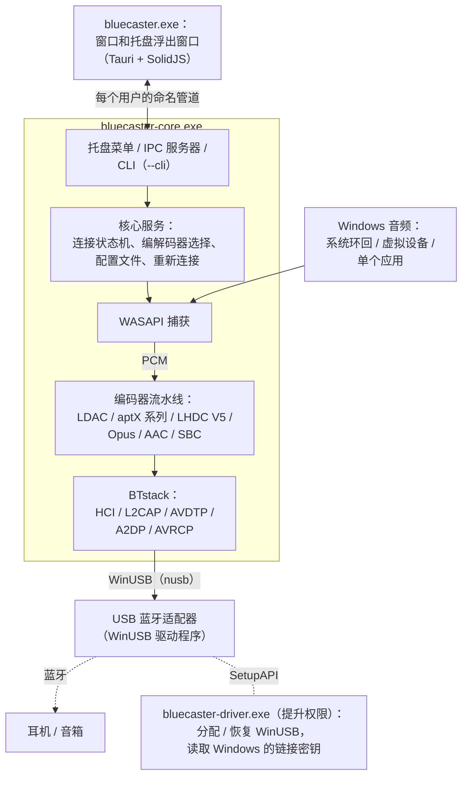
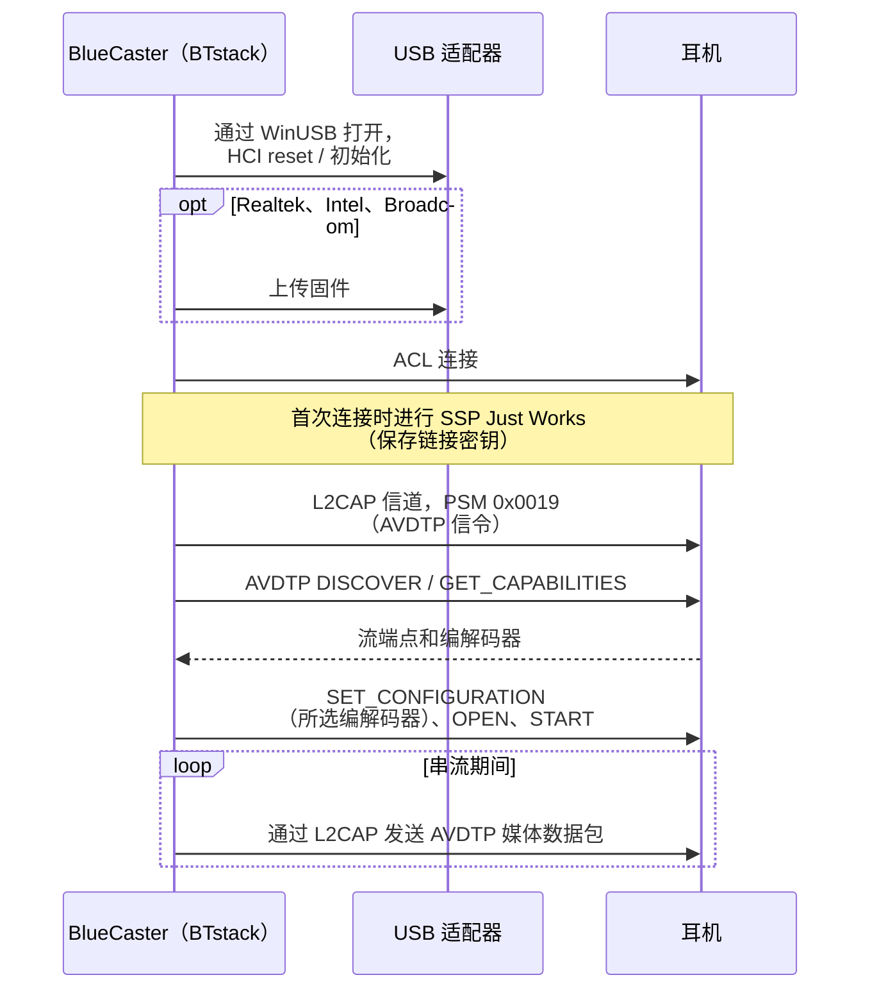
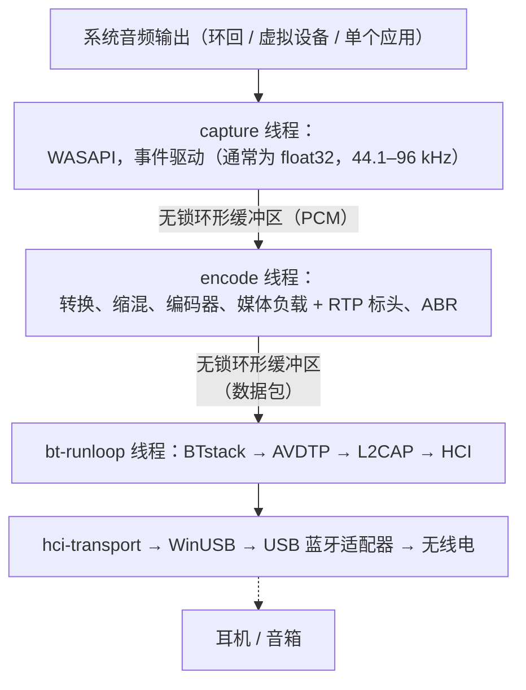
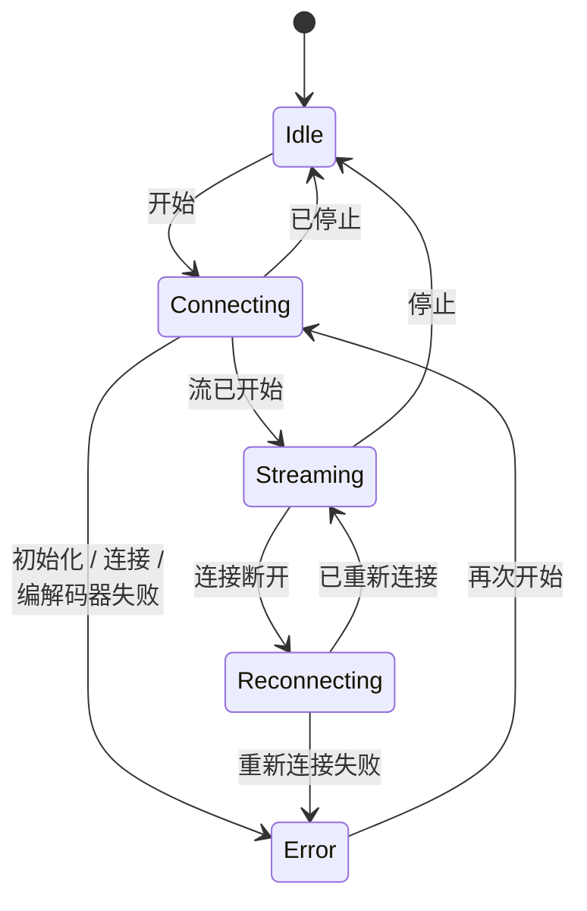
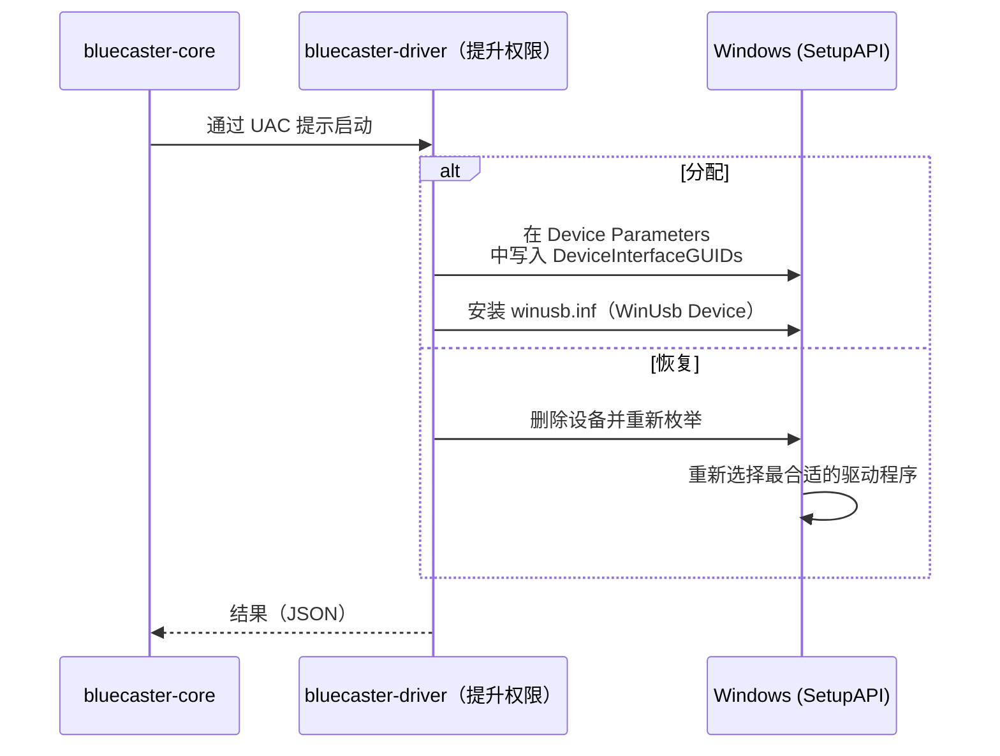

# 架构
{: .no_toc }

## 目录
{: .no_toc .text-delta }

1. TOC
{:toc}

---

## 概述 {#overview}

BlueCaster 让 Windows 可以使用 LHDC V5、LDAC、aptX Adaptive、aptX HD、aptX Low Latency、aptX、Opus、AAC、SBC XQ 和 SBC 蓝牙音频（以及通过 LE Audio 使用 LC3，实验性）。Windows 自带的蓝牙堆栈在 A2DP 上只支持 SBC、经典 aptX 和 AAC（仅限 Windows 11）；BlueCaster 无需内核驱动程序即可提供其他编解码器。

BlueCaster 使用 **BTstack + WinUSB**：一切都在用户模式下运行，因此无需驱动程序签名。

BlueCaster 2.0 使用 Rust 编写。无法替换的 C 库（BTstack 和各编解码器的编码器）从源代码编译，并通过小型 FFI crate 调用；其余部分（包括 SBC 编码器）均为 Rust。

## 进程 {#processes}

BlueCaster 最多以三个程序运行：

| 程序 | 运行时机 | 作用 |
|:--------|:-----|:-----|
| `bluecaster-core.exe` | BlueCaster 运行期间（由窗口、“开始”菜单或**随 Windows 启动**启动） | 蓝牙、音频捕获和编码、配置文件和设置、托盘图标及其菜单、IPC 服务器。`--cli` 则在控制台中运行同一个核心 |
| `bluecaster.exe` | 仅在有窗口打开时（最后一个窗口关闭 3 分钟后退出） | 主窗口和托盘浮出窗口（Tauri 2，SolidJS + TypeScript）。自身不保存任何状态 |
| `bluecaster-driver.exe` | 更改驱动程序或导入密钥时，以管理员权限（UAC）短暂运行 | 为适配器分配 WinUSB、恢复适配器之前的驱动程序，或读取 Windows 蓝牙为某个适配器保存的链接密钥（`windows-keys`），然后退出 |

- **核心不是 Windows 服务。** 核心以已登录用户的普通进程运行，因为 WASAPI 环回捕获的是该用户会话的音频。每个会话的互斥体保证只运行一个实例；再次启动核心会打开窗口。
- **托盘属于核心。** 托盘图标的右键菜单（打开、前 10 台设备、断开连接、退出）会立即打开，无需启动窗口。左键单击会打开浮出窗口（或主窗口，取决于设置）。
- **窗口只负责显示状态。** 窗口先接收核心状态的快照，之后接收每次变更。关闭窗口或窗口崩溃都不会中断音频。关闭窗口只是将其隐藏，因此从托盘重新打开会立即显示。
- **命令行使用同一个核心。** `bluecaster-core.exe --cli` 在没有托盘和 IPC 的情况下运行核心服务；模拟器测试就是以这种方式运行的。

## 传输层：BTstack + WinUSB {#transport-btstack--winusb}

BlueCaster 完全绕过 Windows 的蓝牙堆栈，通过 WinUSB（Microsoft 签名的通用 USB 驱动程序）直接与 USB 蓝牙适配器通信。BTstack 是一个源代码公开的蓝牙堆栈（非商业许可），在用户模式下实现 HCI、L2CAP、AVDTP 和 A2DP。

**优点**：
- 无需驱动签名费用
- 无需测试签名模式
- 无需禁用安全启动（Secure Boot）
- 所有代码都在用户模式下运行（更易于调试）

**取舍**：
- 需要一个专用的 USB 蓝牙适配器（独立于 Windows 的内置蓝牙）
- 被 WinUSB 占用期间，该适配器无法用于 Windows 的普通蓝牙功能
- 需要通过 USB 适配器扫描（GAP inquiry）查找设备，或手动输入设备地址

**工作原理**：
1. 用户在应用中（**适配器 > 替换为 WinUSB 驱动程序**，请参阅[驱动程序分配](#driver-assignment)）或用 Zadig 为 USB 蓝牙适配器分配 WinUSB
2. `hci-transport` crate 通过 WinUSB 使用 `nusb` 打开适配器，并将其作为 HCI 传输连接到 BTstack
3. BTstack 发送 HCI 命令初始化蓝牙控制器
4. 对于 Realtek、Intel 和 Broadcom 适配器，BlueCaster 会根据需要上传固件
5. BTstack 建立 ACL 连接并打开 L2CAP 信道（PSM 0x0019）
6. AVDTP 信令发现远端 SEP 并协商编解码器
7. 编码后的音频作为 AVDTP 媒体数据包通过 L2CAP 发送

USB 传输层保留了 v1 中真实适配器所需的恢复措施：打开适配器时重置事件管道和 ACL 管道，事件读取失败时重试，HCI 命令设有超时，关闭适配器时发送 HCI Reset（仍处于 bootloader 中的控制器除外），这样下一次会话面对的就是一个空闲的控制器。

## Crate 结构 {#crate-structure}

代码是一个 Cargo 工作区（仓库根目录的 `Cargo.toml`），分为五层，每一层只依赖其下方的层。库位于 `app/src/crates/`，程序位于 `app/src/core`、`app/src/ui` 和 `app/src/driver`。内置的 `aptx-adaptive` crate 是 `codec` 的路径依赖，不在工作区内。只有 `*-sys` crate 和 `win-sys` 可以包含 `unsafe` 代码；其他所有 crate 都带有 `#![forbid(unsafe_code)]`。

| 层 | Crate | 作用 |
|:------|:------|:-----|
| 1. FFI | `btstack-sys` | 用 `cc`（MSVC）构建 BTstack，手写的 FFI 声明和安全封装，`btstack_config.h`。BTstack 只能在其运行循环线程上调用，`!Send` 的 `Stack` 令牌保证了这一点 |
| 1. FFI | `ldac-sys`、`openaptx-sys`、`fdkaac-sys`、`lhdcv5-sys`、`opus-sys`、`lc3-sys` | 构建 C 编码器并对外提供；每个库一个 crate，使各自的许可证保持分离 |
| 1. FFI | `win-sys` | 没有 Rust 库可用的 Win32 API：MMCSS、默认音频设备（IPolicyConfig）、WLAN API（AFH）、电源通知、Run 注册表项、媒体键、管道的 DACL、权限提升、WinUSB 驱动程序分配（SetupAPI），以及 Windows 自带的蓝牙（其无线电、已配对设备和链接密钥） |
| 2. 组件 | `hci-transport` | 使用 `nusb` 的 USB 上 HCI（“H2”），以及通过 TCP 连接虚拟控制器（`tools/emu`）的 H4 |
| 2. 组件 | `aptx-adaptive` | Rust 编写的 aptX Adaptive 编码器（内置自 AKS-Logic/aptx-adaptive-linux，MIT） |
| 2. 组件 | `codec` | `Encoder` trait、SBC 编码器（Bluedroid 编码器的 Rust 移植版）、C 编码器的安全封装、Codec Information 解析以及编解码器选择 |
| 2. 组件 | `audio-capture` | WASAPI 捕获（`wasapi` crate）：系统环回、虚拟设备、单个应用（进程环回）；设备和应用列表、测试音、按应用的音量（音量合成器） |
| 2. 组件 | `voice-link` | 耳机麦克风的音频（开发者模式）：把单声道 PCM 播放到所选输出设备（WASAPI）、把捕获的音频缩混后用于上行，以及基于 SCO 负载的语音编解码器 CVSD / mSBC / LC3-SWB |
| 3. 引擎 | `bt-host` | 在独立线程上运行 BTstack，由命令和类型化事件驱动：GAP、A2DP Source、AVRCP、SDP、用于直通（`rfcomm.*`）的 RFCOMM 信道、链接密钥、设备的 SDP 服务、AFH、固件加载和芯片加载程序（`bringup`）、芯片探测和芯片脚本、HCI 捕获（`.pklg`）、LE Audio（`le/`） |
| 2. 组件 | `le-audio` | LE Audio：不依赖 BTstack 和 Windows 的逻辑（assigned numbers、LTV、PACS / ASCS PDU、预设、CSIP / VCP / MCP / CCP 模型） |
| 3. 引擎 | `pipeline` | PCM 环形缓冲区、格式转换、缩混、编码、媒体负载、发送节奏控制、ABR |
| 4. 核心 | `bluecaster-core`（目录 `core`） | 状态机、重新连接、睡眠 / 恢复、配置文件、设置和 v1 迁移、音量同步、输出静音、更新检查、Realtek 固件下载、接收器测试客户端、统计、厂商协议（`vendor/`） |
| 4. 核心 | `ipc` | 核心与窗口共享的协议类型（serde；用 `ts-rs` 生成 TypeScript 类型）以及管道分帧 |
| 5. 程序 | `bluecaster-core-exe`（`app/src/core`） | `bluecaster-core.exe`：核心、托盘（`tao` 事件循环上的 `tray-icon`）、IPC 服务器、`--cli` |
| 5. 程序 | `bluecaster-ui`（`app/src/ui`） | `bluecaster.exe`：Tauri 2；Rust 端是 IPC 客户端，页面为 SolidJS + TypeScript + Vite |
| 5. 程序 | `bluecaster-driver`（`app/src/driver`） | `bluecaster-driver.exe`：提升权限运行的辅助程序 |

## 音频路径与线程 {#audio-path-and-threads}

| 线程 | 优先级 | 工作 |
|:-------|:---------|:-----|
| capture | MMCSS "Audio" | 读取 WASAPI；在无声的时段填充静音 |
| encode | MMCSS "Pro Audio" | 把 PCM 转换为编码器所需的输入格式，按完整的编码块进行编码（剩余部分等下一轮），并将帧打包进媒体负载；每轮约 10 ms，使数据包均匀发出 |
| bt-runloop | -- | BTstack 的运行循环；每当 L2CAP 可以发送时，就发送一个排队的数据包。每次有数据包入队时，发送队列（64 个数据包）会从最旧的开始，丢弃已等待 350 ms（LHDC V5 低延迟时为 100 ms）的数据包 |
| USB | -- | WinUSB 传输：每个 IN 管道（事件、ACL 数据）上同时有三个读取请求，另有一个写入器负责命令、一个负责 ACL 数据（最多同时进行 8 个传输） |
| core | Normal | 状态机、IPC（tokio；RFCOMM 直通按连接划分的队列）、设置、统计（4 Hz）、更新检查 |

串流开始后，音频路径不再分配内存，也不获取任何锁。统计数据是原子计数器，核心每秒读取四次。BTstack 不是线程安全的，因此其他线程只向它发送命令，由 bt-runloop 线程执行。

## 核心与 IPC {#core-and-ipc}

窗口通过用户的命名管道 `\\.\pipe\bluecaster-<user SID>` 与核心通信，该管道的 DACL 只允许该用户访问。消息是带长度前缀的 JSON 帧：

1. 窗口发送 `hello { protocol, client }`。如果核心的协议版本不同，核心会以 `reject` 应答，窗口随即提示这两个程序版本不一致。否则核心以 `welcome { protocol, server, features }` 应答；`features` 列出协议的新增内容（`rfcomm`）。
2. 核心发送 `snapshot`：包含其全部状态（适配器、设备、流、配置文件、设置、更新）和一个修订号。
3. 此后核心以 `event` 发送变更。如果窗口漏掉了某个修订号，会重新获取快照。
4. 操作以 `request { id, method, params }` 发送，并以 `response { id,
   result | error }` 应答。方法分组为 `state.*`、`stream.*`、`device.*`、`profile.*`、`settings.*`、`adapter.*`、`audio.*`、`diag.*`、`receiver.*`、`rfcomm.*` 和 `app.*`。

其他程序也使用同一个管道，请参阅[集成（IPC）](integration)。3.0.0 之前的版本将该管道命名为 `\\.\pipe\a2dpwb-<user SID>`；在 3.0.0 之后至少 6 个月内，核心也会在该名称上提供服务。

错误是带参数的代码（例如 `adapter.driver_missing`），而不是文本；窗口会翻译这些代码，并在消息旁边显示解决方法。高频数据（链路质量、日志）只在有页面订阅时，核心才会发送。

连接状态机：

连接失败时，核心最多尝试 3 次。链路断开时，核心最多重新连接 3 次；如果堆栈重启过（睡眠、适配器停止工作），最多重新连接 10 次。PC 进入睡眠时，核心会停止 BTstack，但不把断开的链路算作失败，并在 PC 唤醒后重新连接。

## 驱动程序分配 {#driver-assignment}

Windows 8 及更高版本自带 Microsoft 签名的 WinUSB 驱动程序（`winusb.inf`）。`bluecaster-driver.exe` 通过 SetupAPI 完成设备管理器中“更新驱动程序 > 让我从列表中选取 > WinUsb Device”所做的操作：

1. 通过设备实例 ID 打开适配器。
2. 向其 `Device Parameters` 写入 `DeviceInterfaceGUIDs` 值，使 WinUSB 为其注册设备接口。
3. 选择 `%SystemRoot%\INF\winusb.inf` 中的“WinUsb Device”型号，并用 `DiInstallDevice` 安装。这个系统自带的驱动程序本身已签名，因此不会安装任何证书（Zadig / libwdi 则会用自制证书为生成的 INF 签名）。
4. **恢复**：删除设备（`DiUninstallDevice`）并重新枚举；Windows 随后会再次选择其排名最高的驱动程序（通常是 `BthUSB` 或厂商的驱动程序）。适配器之前的驱动程序会记录在设置文件夹（`driver\`）中，并在恢复后进行比对。`restore --records <folder>` 会在一次提升权限的运行中恢复所有已记录的适配器；卸载程序会在询问用户后使用这一命令。

核心从不以管理员身份运行：分配或恢复驱动程序时，核心会通过 UAC 提示（`ShellExecuteEx` "runas"）启动辅助程序，并读取辅助程序的 JSON 结果。列出适配器及其驱动程序不需要提升权限。

## 主要模块 {#key-modules}

### 编解码器选择（`codec::caps`）

- 解析远端的能力：标准的 SBC 和 AAC 元素以及厂商编解码器，包括两种厂商 ID 下的 aptX LL 以及 aptX Adaptive（R1 和 R2 接收端；仅在支持 48 kHz 立体声时可用）
- 选择编解码器：“自动”会选择远端提供的音质最高的编解码器。如果远端不提供所请求的编解码器，就改用“自动”会选择的编解码器（自 issue #86 起，配置文件始终如此；命令行仅在使用 `--fallback` 时如此），否则视为错误。如果远端未提供某个编解码器，但用户仍在其卡片上选择了它（配置文件的 `codec_forced`），则照样请求，不回退（`RemoteCaps::forcing`）。如果某个编解码器的卡片提供的选项多于远端列出的内容（`unlisted_options`），则按 `RemoteCaps::unlisted` 配置
- 当 `auto_codec` 设置开启时（**编解码器 > 自动选择支持的音质最高的编解码器**，自 schema 5 起是适用于所有设备的一项设置），每个 A2DP 配置文件都以“自动”及其默认设置串流。为设备选择的编解码器仍保留在配置文件中，在该设置关闭时使用
- 遵循用户拖动设备卡片设定的编解码器顺序（配置文件的 `codec_order`；`codec::AutoOrder`，为空时表示按音质从高到低），既用于“自动”的选择，也用于所选编解码器的回退，自动选择开启时同样适用。FastStream 和 Opus 05 从不会被“自动”选中，也不会作为回退。（2.0.2 的 beta 版本为所有设备使用同一个顺序，即 settings.json 的 `auto_order`，现在已被忽略。）
- 选择 aptX 系列的采样率（从远端通告的采样率中选择 44.1 / 48 kHz；由 WASAPI 对捕获的音频重采样）。aptX Adaptive 使用 48 kHz；如果选择了 96 kHz、音质为高，且接收端为 R2 并列出 96 kHz，则使用 96 kHz。采样率设为“自动”时（自动选择开启时也是如此）会请求 48 kHz；如果接收端没有列出 48 kHz，各编解码器的选择逻辑会采用接收端列出的最佳采样率（issue #86：既不是列出的最高采样率，也不是 Windows 的混音采样率）
- 将配置文件的音质映射为编解码器提供的音质（`Quality::for_codec`，issue #86）：LDAC 和 LHDC V5 为高 / 中（`sq`）/ 低（`mq`），LHDC V5 另有中高（`mhq`），aptX Adaptive 为高 / 低延迟，其他所有编解码器为高（设备接受的最高比特率）。编解码器已不再提供的音质（aptX Adaptive 的标准 / 移动，AAC 的较低档位）按高运行
- 记录设备提供的每个编解码器所列出的内容（`KnownCodecs.caps`：采样率、位深度、最大比特率；`RemoteCaps::listed_*`），使编解码器设置只提供这些选项；SBC 的 bitpool 范围此前就已记录

### 蓝牙主机（`bt-host`）

**职责**：
- 在独立线程上以 USB（或 TCP）HCI 传输运行 BTstack
- 注册流端点：厂商编解码器（LDAC、aptX HD、aptX、aptX LL、LHDC V5、FastStream、Opus、Opus 05、aptX Adaptive）以及 SBC（SBC XQ 也使用它）和 AAC：共 11 个（BTstack 的 `MAX_NR_AVDTP_STREAM_ENDPOINTS`）
- 注册 SDP 记录（A2DP Source、AVRCP Controller、AVRCP Target；在该设置开启期间，还有仅用于电量的 HFP Audio Gateway）
- 管理 SSP 配对（Just Works、General Bonding；链接密钥持久保存）
- 连接超时后拆除半开的连接，确保重试能正常进行
- 重试失败的连接（最多 3 次），并区分失败原因（无应答、链路无数据、远端主动断开、身份验证）；丢弃设备已不再识别的链接密钥并重新配对
- 用于设备扫描的 GAP inquiry
- AVRCP 绝对音量和耳机按键
- AFH 主机信道分类，以及为链路质量视图读取 RSSI / AFH
- 固件加载：Realtek 和 Broadcom 通过 BTstack 的芯片组驱动加载，Intel（传统和 TLV bootloader）基于通用芯片加载程序接口（`bringup`）以 Rust 实现；适配器启动期间，**适配器**页面会显示加载进度
- 开发者模式：芯片探测（适配器对标准读取命令的应答，JSON 报告保存在 `logs\probe\`）、芯片脚本（以文本编写的请求，在使用 WinUSB 的适配器上运行），以及已连接设备列出的 SDP 服务
- HCI 捕获（`.pklg`）：在连接中途开始捕获时，也会包含连接建立过程

**使用的主要 BTstack API**：
- `a2dp_source_create_stream_endpoint()`——注册编解码器端点
- `a2dp_source_establish_stream()`——连接到 A2DP 接收端
- `a2dp_source_set_config_other()`——配置厂商特定的编解码器
- `a2dp_source_stream_send_media_payload_rtp()`——发送带 RTP 标头的编码音频（LDAC、aptX HD、AAC、SBC、SBC XQ、LHDC V5、Opus）
- `a2dp_source_stream_send_media_packet()`——发送不带 RTP 标头的原始媒体数据包（aptX、aptX LL、FastStream），或带有 BlueCaster 自己的 RTP 标头的媒体数据包（aptX Adaptive）

### 音频捕获（`audio-capture`）

使用 Windows 音频会话 API 实时捕获音频。
- 默认输出设备的系统环回、所选（虚拟）设备的环回，或单个应用及其子进程的进程环回（Windows 10 内部版本 19041 或更高版本）
- 提供设备在共享模式下的混音格式（通常为 float32；由流水线为编码器转换）
- 在应用程序模式下，等待应用启动，并在应用重启后继续捕获
- 像 Windows 的音量合成器一样，在默认输出上设置应用的音量和静音（`mixer`）：会话的音量会作用于环回捕获，即使在系统环回串流期间核心将该输出静音，也是如此（`bluecaster-core::mute_output`）

### 厂商协议（`bluecaster-core::vendor`）

有些耳塞只有在厂商应用通过耳塞自己的 RFCOMM 服务切换某个模式后，才会提供某个编解码器或比特率。BlueCaster 为每个厂商提供一个模块，通过 BlueCaster 自己的链路完成这一切换，并按名称识别耳塞：

- **Huawei / Honor**：如果配置文件请求 LDAC，而耳塞没有列出 LDAC，模块会打开耳塞的“音质优先”模式并重新连接；如果仍然没有 LDAC，而该模式原本是关闭的，模块会把它关回去。“自动”时从不执行
- **OPPO**：当 LHDC V5 串流时（手动选择或由“自动”选择），模块会向耳塞请求一次 Hi-Res，并重新连接一次，读取耳塞随后列出的内容；该记录与设备的编解码器一起保存（`device_codecs.json`），直到被 `device.forget_codecs` 清除

开发者模式的**厂商**选项卡可以设置各模块何时运行（按名称自动、始终、不使用），并提供该厂商自己的选项。

### 配对（`link_keys`、`win-sys::bt_keys`）

链接密钥保存在 `link_keys.txt` 中。添加设备时，核心可以导入 Windows 蓝牙为 BlueCaster 当前所用适配器保存的密钥：由 `bluecaster-driver.exe windows-keys` 读取（一次 UAC 提示）。BlueCaster 已有的密钥会保留，导入的设备中的音频设备以 Windows 中的名称保存。开发者模式会显示设备的链接密钥及其列出的 SDP 服务。

`pairing\` 中的密钥文件（链接密钥、LE 绑定信息、协调集、从 Windows 接管的 LE 密钥、被替换的 Windows 密钥）使用 DPAPI 按 Windows 用户加密（`win-sys::dpapi`）；其他用户无法读取，复制到其他电脑上也无法读取。旧版本的明文文件会被读取并以加密形式重写。无法解密的文件保留为 `<名称>.undecryptable`，其设备需要重新配对。BTstack 的 LE TLV 由 BlueCaster 自己保存（`btstack-sys` 的 `TlvStore`，内容与 `btstack_tlv_windows` 写入的相同）。恢复时由管理员权限的辅助程序读取的 `keys_for_windows.json` 仍为明文（辅助程序可能以另一位管理员身份运行），辅助程序结束后即删除。

### 音频编码器

| 编码器 | 库 | 比特率 | 特性 |
|---------|---------|---------|----------|
| LHDC V5 | lhdcv5-enc（AOSP 编码器的 C 语言移植版） | 400/500/900/1000 kbps（低/中/中高/高），不超过接收端列出的最大值，ABR 160–400 kbps | 16/24-bit，5 ms 帧，2 字节媒体负载标头，RTP 标头；接收端列出时支持低延迟（每 10 ms 而非 20 ms 编码一次；ABR 关闭时，另加下文的队列保护） |
| LDAC | libldac (AOSP) | 330/660/990 kbps | 高/中/低（HQ/SQ/MQ）模式，ABR |
| aptX Adaptive | aptx-adaptive（AKS-Logic/aptx-adaptive-linux 的纯 Rust 编码器，MIT） | 高 427 kbps，低延迟 265 kbps（R2 接收端：270）；ABR 降至 364/318（R2：270/204） | 48 kHz 立体声（如果选择了 96 kHz，且 R2 接收端列出 96 kHz，则在高音质下使用 96 kHz：646/340/255 kbps），24-bit；每个媒体数据包一个编解码器数据包，位于 BlueCaster 自己的 RTP 标头之后；高音质下支持 ABR；“自动”将它排在 LHDC V5 和 LDAC 之后 |
| Opus | libopus 1.6.1 | 256 kbps（立体声；单声道减半） | Android 的 A2DP Opus：48 kHz，20 ms 帧（接收端只支持 10 ms 时为 10 ms），以媒体负载为上限的受约束 VBR，每个数据包一帧，1 字节媒体负载标头，RTP 标头 |
| aptX HD | libopenaptx | 576 kbps | 24-bit 输入，固定比特率，RTP 标头 |
| aptX | libopenaptx | 352/384 kbps（44.1/48 kHz） | 16-bit 立体声，无 RTP 标头 |
| aptX LL | libopenaptx | 352 kbps | 约 32 ms 延迟，无 RTP 标头，数据包 ≤ 约 7.5 ms |
| AAC | fdk-aac | 最高 256 kbps（不超过接收端列出的比特率） | AAC-LC，LATM 传输 |
| SBC XQ | 同一 SBC 编码器 | 约 385/505/552 kbps | 双声道（Dual Channel），44.1 / 48 kHz 下 bitpool 为 47 / 43（高）；仅当接收端的 SBC 允许双声道且 bitpool 至少为 29 时使用（bitpool 随后与 PipeWire 一样限制在接收端的最大值）；与 SBC 共用流端点、媒体负载标头和 RTP 标头 |
| SBC | Bluedroid 编码器的 Rust 移植版 | 最高约 345 kbps | A2DP 必备的基础编解码器；与 C 编码器逐位一致（已在所有配置下测试） |
| FastStream | 同一 SBC 编码器 | 198/216 kbps（44.1/48 kHz） | CSR 厂商编解码器，仅音乐方向（无语音回传）：SBC 联合立体声、bitpool 29，帧填充到 72 字节，每个数据包 3 帧，无媒体负载标头也无 RTP 标头（与 PipeWire 相同）；“自动”从不选择 |

**LHDC V5 队列保护**（低延迟开启、ABR 关闭时）：当发送队列在一秒内平均有 12 个或更多数据包时，编码器将比特率降低一级（1000、900、再到 500 kbps），两次之间至少间隔 2 s。平稳一分钟后，编码器将比特率升高一级。如果升高后未能保持 30 s，等待时间加倍，最长 10 分钟。

所有编码器都实现了 `codec::Encoder` trait：编码器声明 PCM 格式以及每次调用消耗的帧数，并返回编解码器帧。

libopenaptx 要求输入为每组 4 个立体声采样、打包为 24 位小端序的 PCM；aptX 封装会将 16 位或 32 位采样转换为该格式，单声道输入会复制到两个声道。

## 厂商编解码器信息元素 {#vendor-codec-information-elements}

非标准编解码器在 AVDTP 中注册为 Vendor Specific：

| 编解码器 | Vendor ID | Codec ID |
|-------|-----------|----------|
| LHDC V5 | Savitech (0x0000053A) | 0x4C35 |
| LDAC | Sony (0x0000012D) | 0x00AA |
| aptX Adaptive | Qualcomm (0x000000D7) | 0x00AD |
| Opus | Google (0x000000E0) | 0x0001 |
| aptX HD | Qualcomm (0x000000D7) | 0x0024 |
| aptX | APT (0x0000004F) | 0x0001 |
| aptX Low Latency | CSR (0x0000000A) 或 Qualcomm (0x000000D7) | 0x0002 |
| FastStream | CSR (0x0000000A) | 0x0001 |
| Opus 05 | The Linux Foundation (0x000005F1, PipeWire) | 0x1005 |

AAC 和 SBC 使用 A2DP 规范中定义的标准 A2DP 编解码器 ID。

编解码器信息元素的大小（包括 6 字节的 vendor/codec ID）：

- **aptX**：7 字节（第 6 字节 = 采样率 / 声道模式）
- **aptX HD**：11 字节（第 6 字节同 aptX，另加 4 个保留字节）；必须为立体声
- **aptX LL**：8 字节；当接收端设置了扩展（“new caps”）标志时为 17 字节。BlueCaster 只注册一个 aptX LL 端点，并以接收端所用的 vendor ID 配置流
- **LHDC V5**：11 字节（Android `a2dp_vendor_lhdcv5_constants.h`）：第 6 字节为采样率（0x20 44.1k、0x10 48k、0x04 96k、0x01 192k），第 7 字节为位深度（0x04 16-bit、0x02 24-bit）以及接收端的最小/最大比特率限制，第 8 字节为编解码器子版本（0x01 = V5 ver.1）和 0x10 = 5 ms 帧，第 9-10 字节为可选功能（低延迟、无损、JAS、AR、META）。当 LHDC V5 设置中开启了低延迟且接收端列出该功能时，BlueCaster 会请求低延迟（第 9 字节，0x40）。其他功能 BlueCaster 均不提供。仅支持立体声。与 Android 一样，接收端的比特率限制会在配置中回传并应用到编码器。媒体数据包带有 2 字节的负载标头：帧数 << 2（延迟位为 0）以及序列号
- **FastStream**：8 字节（PipeWire `a2dp_faststream_t`）：第 6 字节为方向（0x01 sink = 音乐，0x02 source = 语音），第 7 字节的低 4 位为接收方向的采样率（0x2 44.1k、0x1 48k），高 4 位为发送方向的采样率（0x2 16k）。BlueCaster 只提供并配置音乐方向
- **Opus**：7 字节（Android `a2dp_vendor_opus_constants.h`）：第 6 字节的位 2..0 为声道模式（0x01 单声道、0x02 立体声、0x04 双单声道），位 4..3 为帧长（0x08 10 ms、0x10 20 ms），位 7 为 48 kHz。BlueCaster 提供单声道和立体声、10 ms 和 20 ms，并配置为 20 ms 立体声（仅当输入为单声道且接收端支持单声道时才使用单声道）。媒体数据包在 1 字节的负载标头（低 4 位为帧数 1）之后携带一个 Opus 数据包
- **aptX Adaptive**：40 字节。BTstack 的能力事件会把接收端的编解码器信息截断为 30 字节，但其中仍包含 BlueCaster 用到的全部内容。SET_CONFIGURATION：48 kHz，源类型 2（主机编码器：由接收端自行控制播放时序），立体声；R1 接收端会收到它自己的目标延迟字节，其中 LL0 提高到至少 80 ms，HQ 延迟为 0 时改为 200 ms；R2 接收端会收到源端自己的 R2 块

**有无 RTP**：LDAC、aptX HD、AAC、SBC、SBC XQ、LHDC V5 和 Opus 的媒体数据包带有 12 字节的 RTP 标头。aptX、aptX LL 和 FastStream **不带** RTP 标头发送（与 Android 和 PipeWire 相同），因此整个 L2CAP MTU 都可用于 aptX 帧。

**aptX Adaptive** 在 BlueCaster 自己的 12 字节 RTP 标头（BTstack 不添加）之后，每个媒体数据包发送一个编解码器数据包：负载类型 96，序列号每个数据包 +1，时间戳 = 数据包中每声道的采样数（不是时钟），SSRC = 接收端的延迟模式（0x000000A3 HQ、0x000000A1 LL）。负载按 16 位字进行字节交换。HQ 数据包为 656 字节（12 ms），LL 数据包为 348 字节（10 ms）。“自动”将它排在经典 aptX、Opus 和 AAC 之前，LHDC V5 和 LDAC 之后（issue #86 的顺序）。

## 设置与文件 {#settings-and-files}

所有内容都保存在设置文件夹 `%APPDATA%\BlueCaster`（或环境变量 `BLUECASTER_CONFIG_DIR` 指定的文件夹）中。v1 和 2.0.x 的文件保持原有格式。2.0.x 使用 `%APPDATA%\A2DPWB`，3.0.0 首次启动时会重命名该文件夹，并把文件整理到下列文件夹中：

| 路径 | 内容 |
|:-----|:---------|
| `settings.json` | 应用设置，带有 `schema_version`；未知的键会被保留 |
| `profiles.json` | 配置文件 |
| `devices\devices.txt` | 已知设备 |
| `devices\le_audio_devices.txt` | LE Audio：设备列表中的 LE Audio 条目 |
| `devices\le_audio_sets.txt` | LE Audio：已保存设备的协调集（仅成员地址；一对耳机算作一个设备） |
| `devices\device_codecs.json` | 每台经典设备上次连接时提供的内容（以及是否已向 OPPO 耳塞请求过 Hi-Res） |
| `pairing\link_keys.txt` | 链接密钥：与 v1 或 2.0.x 配对过的耳机无需重新配对即可再次连接 |
| `pairing\le_audio_bonds.tlv`、`pairing\le_audio_csip.txt` | LE Audio：LE 绑定信息（含 GATT 服务器持久保存的 CCC 值）以及协调集 |
| `pairing\windows_le_keys.txt`、`pairing\replaced_windows_keys.json` | 从 Windows 接管的 LE 密钥（保留到某个协议栈将其加入为止）；**恢复原始驱动程序**替换掉的 Windows 密钥 |
| `adapters\adapter_caps.json` | 堆栈对每个适配器所了解的信息（是否支持 LE Audio、地址、HCI 版本、Windows 中的名称） |
| `adapters\driver\<instance id>.json` | 每个被分配了 WinUSB 的适配器之前的驱动程序 |
| `firmware\` | 固件文件（`*.bin`、`*.hcd`、`ibt-*`；Intel 的固件也位于 `firmware\intel\`，与 linux-firmware 的布局相同）；早期版本散放在设置文件夹中的文件会被移到这里 |
| `logs\<YYYY-MM-DD>\core.log`、`ui.log`、`driver.log` | 核心、窗口和驱动程序辅助程序的日志，每天一个文件夹（UTC）；内容未做遮盖 |
| `logs\hci\*.pklg` | HCI 捕获：飞行记录器在串流失败或连接断开时写入的捕获（保留最新的 10 个），以及你自己开始的捕获（`hci_<date>_<time>.pklg`） |
| `logs\probe\` | 芯片探测和芯片脚本的报告（最新的 10 个） |
| `logs\crash\` | 崩溃报告：每次崩溃一个小型转储（`*.dmp`）和一个文本文件（每个程序最新的 5 个） |
| `logs\bundles\*.zip` | 诊断包（最新的 3 个） |
| `backup\v1\` | v1 设置的副本，在 v2 首次启动时创建一次 |
| `backup\v2\` | 2.0.x 设置和配对的副本，在 3.0.0 首次启动时创建一次 |
| `backup\profiles-before-codecs.json` | **编解码器**页面将一台设备的多个配置文件合并为一个之前的 `profiles.json`（只写入一次） |

程序文件夹为 `%LOCALAPPDATA%\BlueCaster\`：其中包含三个程序、卸载程序和 `licenses\`（`licenses\README.txt`、`licenses\bluecaster\LICENSE...`、`licenses\third-party\...`）。固件下载缓存为 `%TEMP%\bluecaster-cache`。

## 构建系统 {#build-system}

- 程序由 **Cargo** 构建，不需要 CMake。每个 `-sys` crate 在 `build.rs` 中用 MSVC 从 `extern/` 中的 git 子模块编译其 C 库。只有开发者工具 `tools/a2dp_decode` 使用 CMake 构建
- 窗口的页面由 **Vite** 构建（在 `app/src/ui` 中运行 `pnpm build`），并由 Tauri 嵌入 `bluecaster.exe`
- IPC 协议的 TypeScript 类型由 Rust 类型生成（`cargo test -p ipc export_bindings`）
- 窗口和核心的托盘菜单都使用语言文件（`app/lang/*.json`）
- `installer/build-release.ps1` 生成安装程序（Inno Setup，`installer/BlueCaster.iss`）、便携版 zip 和更新程序清单。请参阅[构建](building)

## 重要注意事项 {#important-considerations}

- **适配器兼容性**：Realtek（测试最充分）、CSR、Intel、Broadcom、MediaTek 等（[已验证的硬件](hardware)）。Realtek 适配器需要在启动时上传固件，处于 bootloader 模式的 Intel 适配器也是如此
- **配对**：BlueCaster 使用 SSP Just Works 和 General Bonding。链接密钥保存到本地文件，或从 Windows 蓝牙中导入该适配器的密钥
- **建议使用第二个适配器**：内置蓝牙留给 Windows 使用，BlueCaster 使用专用的 USB 适配器
- 某些适配器的固件会限制可达到的比特率
- USB 蓝牙 5.0+ 适配器通常能很好地支持 LDAC
- 自动选择编解码器的优先级（按音质，issue #86）：LHDC V5 > LDAC > aptX Adaptive > Opus > aptX HD > aptX > aptX LL > AAC > SBC XQ > SBC（FastStream 和 Opus 05 仅在明确选择时使用）；如果设备不再提供所选的编解码器，则回退到设备编解码器顺序中设备提供的第一个编解码器；如果在设备未提供某个编解码器时仍在其卡片上选择了它，则照样请求（`codec_forced`，不回退）
