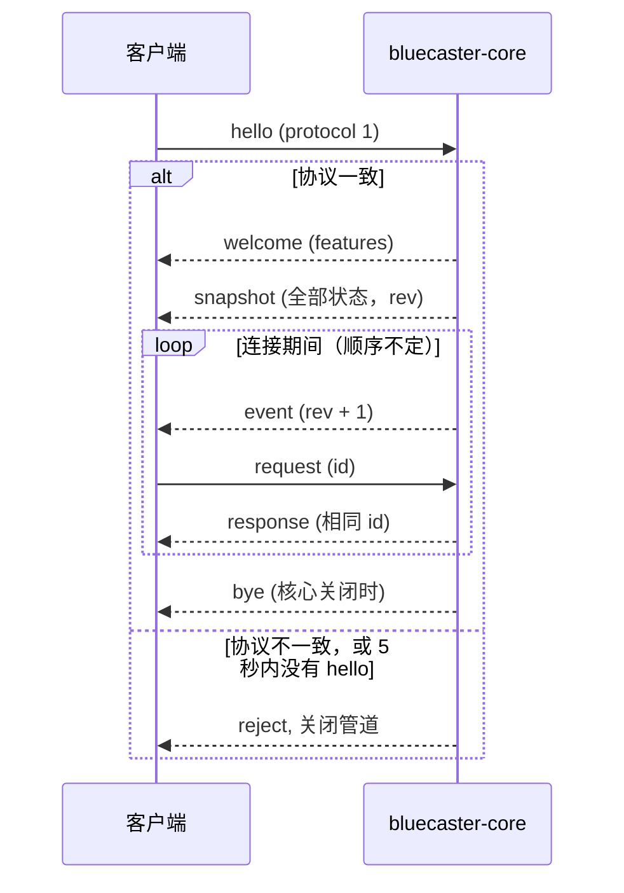

# 集成（IPC）
{: .no_toc }

本页介绍第三方工具如何与 BlueCaster 核心通信：显示串流状态、启动和停止配置文件、设置音量，或通过 BlueCaster 的蓝牙链路访问耳机自己的服务。实现了这些功能的工具列在[配合使用的工具](works-with)页面上。

{: .warning }
> 在 2.0.2 beta 期间，协议仍可能变化。一切以 [`app/src/crates/ipc/src/protocol.rs`](https://github.com/SeiyaFunaokaJP/BlueCaster/blob/main/app/src/crates/ipc/src/protocol.rs) 以及由它生成、位于 [`app/src/ui/src/ipc/bindings`](https://github.com/SeiyaFunaokaJP/BlueCaster/tree/main/app/src/ui/src/ipc/bindings) 的 TypeScript 类型为准。本页说明如何使用它们，不会列出每个字段。

## 目录
{: .no_toc .text-delta }

1. TOC
{:toc}

## 连接 {#connecting}

只要 BlueCaster 在运行，核心（`bluecaster-core.exe`）就在运行，无论窗口是否打开。核心在当前用户专属的命名管道上监听：

```
\\.\pipe\bluecaster-<user SID>
```

- `<user SID>` 是已登录用户的 SID 字符串（`S-1-5-21-...`），例如可以通过 `whoami /user` 获得。每个用户都有自己的核心和管道；管道的 DACL 只允许该用户访问，远程客户端会被拒绝。
- 管道为字节模式。可以同时连接多个客户端（BlueCaster 窗口就是其中之一）；每个客户端都会收到相同的状态和事件。
- 在 2.0.x 及更早版本中，管道名为 `\\.\pipe\a2dpwb-<user SID>`。BlueCaster 3.0.0 **同时**提供这两个名称，并在 3.0.0 之后至少 6 个月内继续提供旧名称。客户端应先尝试 `bluecaster-<user SID>`，失败时再回退到旧名称。协议版本仍为 1。
- 要检查核心是否在运行，请查找管道，而不是核心的互斥体：管道不存在就说明核心没有运行。
- 以 `BLUECASTER_INSTANCE=<name>` 启动的开发版本改为在 `\\.\pipe\bluecaster-<SID>-<name>` 上监听，以便与已安装的版本并行运行。

### 服务管道 {#the-service-pipe}

BlueCaster 服务是开发者模式中的一个原型功能，让用户可以在登录屏幕上使用蓝牙键盘和鼠标。在安装了该服务的电脑上，核心以 Windows 服务的形式运行。此时不存在每个用户专属的管道。核心改为提供一个所有用户共用的管道：

```
\\.\pipe\bluecaster-service
```

- 请先尝试 `bluecaster-<user SID>`，再尝试 `bluecaster-service`。服务不提供旧名称的管道。两个管道上的帧、握手和请求完全相同。
- 打开管道时只请求 `GENERIC_READ | FILE_WRITE_DATA`。如需更改管道模式，请加上 `FILE_WRITE_ATTRIBUTES`。请求 `GENERIC_WRITE` 的客户端会被管道拒绝，因为该访问权限包含创建管道新实例的权限（`FILE_CREATE_PIPE_INSTANCE`）。Python 的 `open(..., "r+b")` 会请求 `GENERIC_WRITE`，因此请改用 `CreateFileW`（例如通过 `ctypes`）。
- 要确认服务器确实是 BlueCaster，请比较管道服务器的进程 ID（`GetNamedPipeServerProcessId`）和 `BlueCaster` 服务的进程 ID（`QueryServiceStatusEx`）。服务停止期间，其他程序可能会创建同名管道。
- 更改整台电脑的请求会返回错误 `ipc.needs_admin`，例如开发者模式、适配器驱动程序以及添加键盘和鼠标。工具无法授予管理员批准。请让用户在 BlueCaster 窗口中进行更改，由窗口向 Windows 请求批准。
- 核心以服务形式运行时，部分请求会返回 `ipc.not_in_service`。`app.quit` 就是其中之一，因为服务必须持续运行，键盘和鼠标才能使用。请改用 `app.close`：它会停止串流，并关闭 BlueCaster 窗口和托盘图标。

### 帧 {#frames}

两个方向上的每条消息都是一帧：先是 JSON 的长度（**u32 小端序**），然后是 JSON（UTF-8）。超过 4 MiB 的帧会被拒绝。

### 握手 {#handshake}

1. 客户端在连接后 5 秒内发送 `hello`：
   ```json
   {"type": "hello", "protocol": 1, "client": "mytool/1.2.0"}
   ```
   `client` 可以是你自选的任意名称和版本，会出现在核心的日志中。
2. 核心以 `welcome` 应答，或以 `reject` 应答并关闭管道（协议版本不符，或没有 hello）：
   ```json
   {"type": "welcome", "protocol": 1, "server": "bluecaster-core/2.0.2-beta.12", "features": ["rfcomm"]}
   {"type": "reject", "reason": "protocol 2 not supported (core speaks 1)"}
   ```
3. 核心先发送包含全部状态的 `snapshot`，之后发送各个 `event`。

协议版本必须完全一致。向后兼容的新增内容则在 `features` 中公布（请参阅[兼容性](#compatibility)）。



## 状态与事件 {#state-and-events}

```json
{"type": "snapshot", "rev": 41, "state": {"adapter": {...}, "devices": [...], "stream": {...}, "profiles": [...], "active_profile": "WH-1000XM5", "settings": {...}, ...}}
{"type": "event", "rev": 42, "event": {"kind": "stream", "value": {"state": "streaming", "profile": "WH-1000XM5", "info": {"codec": "ldac", "bitrate_kbps": 990, ...}, "volume": 80, ...}}}
```

客户端无需维护自己的状态：只要保存最后一个快照，并把每个事件应用到快照上即可。每个状态事件都会**整体替换快照中的一个部分**：

| 事件 `kind` | 替换 |
|:--|:--|
| `adapter` | `adapter` |
| `devices` | `devices` |
| `scanning`、`le_scanning` | `scanning`、`le_scanning` |
| `stream` | `stream`（状态、消息、配置文件、编解码器信息、音量、电量） |
| `profiles` | `profiles` 和 `active_profile` |
| `settings` | `settings` |
| `update` | `update` |
| `capture` | `capture` |
| `v1_running`、`verbose`、`crashes` | 同名的字段 |

`stream.state` 是 `idle`、`connecting`、`streaming`、`reconnecting`、`error` 之一；`stream.message` 以[消息键](#errors-and-messages)说明原因。

`adapter.active` 是 BlueCaster 正在使用的 USB 适配器。没有打开任何适配器时（第一次扫描或连接之前，以及蓝牙重新启动期间），其值为 `null`。

```json
"active": {"display_name": "RTL8761BU (0x2357:0x0604)", "windows_name": "TP-Link UB500 Adapter", "vid": 9047, "pid": 1540, "vendor": "Realtek", "chip": "RTL8761BU", "bt_version": "5.1"}
```

`vid` 和 `pid` 是数字。`windows_name`、`chip` 和 `bt_version` 可能为 `null`。只有 Realtek 适配器才能获知 `chip`。

每个客户端无需订阅即可收到状态事件。只有在状态发生变化时才会发送事件，因此连接可能长时间收不到任何消息。

**修订号。** 每个状态事件都带有下一个修订号（`rev` + 1）。出现跳号说明丢失了事件：请发送 `state.snapshot` 获取新快照。如果客户端读取太慢，核心也会主动向其发送新的 `snapshot`。非状态事件（`link`、`log`、`receiver`、`rfcomm_data`、`rfcomm_closed`、`media_button`）带有当前修订号，不会使其递增。

核心关闭时会发送事件 `bye` 并关闭管道。

## 请求 {#requests}

```json
{"type": "request", "id": 7, "method": "stream.start", "params": {"profile": "WH-1000XM5"}}
{"type": "response", "id": 7, "result": null, "error": null}
```

- `id` 是客户端任选的数字，响应中会原样带回。请求是并发执行的，因此响应的顺序可能与请求不同。
- 没有参数的方法省略 `params`。
- 更改状态的请求会在更改完成后应答，该更改也会以事件形式送达。客户端应根据事件而不是响应来显示状态。

### 错误与消息 {#errors-and-messages}

```json
{"type": "response", "id": 8, "result": null, "error": {"code": "rfcomm.not_connected", "message": {"key": "ipc.error.rfcomm_not_connected", "args": []}}}
```

`code` 供程序使用（`adapter.driver_missing`、`app.streaming` 等）。`message` 是 BlueCaster 语言文件（[`app/lang`](https://github.com/SeiyaFunaokaJP/BlueCaster/tree/main/app/lang)）中的翻译键，附带 printf 风格的参数，与状态中的状态文本相同；工具可以在语言文件中查找该键，也可以根据 `code` 显示自己的文本。

### 方法 {#methods}

供工具使用的方法：

| 方法 | 参数 | 结果 |
|:--|:--|:--|
| `state.snapshot` | -- | `Snapshot` |
| `stream.start` | `profile` | `null`；会先停止正在运行的串流 |
| `stream.stop` | -- | `null` |
| `stream.set_volume` | `volume`（AVRCP 绝对音量 0-127） | `null` |
| `stream.volume_step` | `delta`（-127 到 127） | 新的音量；见[快捷控制](#quick-controls) |
| `profile.set_active` | `name` | `null` |
| `profile.set_headset_mic` | `name`（可选）、`mode`（`off`、`auto`、`on`） | `null`；见[快捷控制](#quick-controls) |
| `profile.set_mic_muted` | `name`（可选）、`muted`（bool） | `null`；见[快捷控制](#quick-controls) |
| `profile.set_media_eq` | `name`（可选）、`enabled`（bool） | `null`；见[快捷控制](#quick-controls) |
| `device.scan` | `seconds`（3-600） | `Device[]`，也作为 `devices` 事件发送 |
| `device.scan_stop` | -- | `null`；随后正在运行的 `device.scan` 返回 |
| `audio.devices` | -- | `AudioDevice[]`（捕获源） |
| `diag.subscribe` | `logs`（级别或 `null`）、`link`（bool）、`receiver`（bool，可选） | `null`；为此连接启动或停止 `log` / `link` / `receiver` 事件 |
| `diag.info` | `{"mask": bool}`（可选） | `DiagInfo`（“复制诊断信息”的文本） |
| `rfcomm.open`、`rfcomm.send`、`rfcomm.close` | 请参阅 [RFCOMM 直通](#rfcomm-passthrough) | |

调用 `diag.subscribe` 时，请始终同时传入 `logs` 和 `link`。每次调用都会同时设置两者，因此省略 `logs` 会关闭日志事件。

只更改一项设置时，请使用[快捷控制](#quick-controls)，而不是 `profile.save` 或 `settings.set`。

以下方法供 BlueCaster 窗口使用，工具使用时需谨慎：`profile.save` / `profile.delete`、`settings.set`（替换**全部**设置：请发送包含你的更改的最新 `settings`，切勿只发送部分对象）、`device.forget` / `device.rename`、`adapter.*`（`adapter.assign_winusb` 和 `adapter.restore_driver` 会显示 UAC 提示；开发者模式的芯片工具 `adapter.probe` 和 `adapter.run_script` 会停止蓝牙堆栈）、`app.quit`。其余方法服务于窗口自己的页面，可能随时更改，恕不另行通知：`stream.start_custom`、其他 `device.*` 方法（`device.import_windows_pairings` 会显示 UAC 提示）、`audio.apps`、`audio.mixer` / `audio.mixer_set`、上述两个以外的 `diag.*`、`receiver.*` 和 `app.*`。完整的方法列表（含参数和结果）见 `protocol.rs` 中的 `Method` 枚举。

## RFCOMM 直通 {#rfcomm-passthrough}

当 `welcome.features` 包含 `"rfcomm"` 时可用（2.0.2-beta.10 及更高版本）。工具可以借此通过 BlueCaster 现有的链路访问耳机自己的 RFCOMM 服务（厂商控制应用：电量、降噪、EQ）；通过 BlueCaster 连接的耳机，Windows 本身是看不到的。

- `rfcomm.open {address, uuid}` → `{channel_id, mtu}`。`address` 必须是正在串流的设备；核心绝不会为此建立连接或配对（而是返回 `rfcomm.not_connected`）。`uuid` 是完整的 128 位 UUID，或基于蓝牙基础 UUID 的 16 位 `"xxxx"`。即使排在其他打开请求之后，应答也会在 20 秒内到达，因此请至少等待 25 秒。错误：`rfcomm.not_connected`、`rfcomm.service_not_found`、`rfcomm.service_reserved`、`rfcomm.open_failed`、`rfcomm.busy`。
- 耳机和免提服务（`1108`、`1112`、`111E`、`111F`）无论使用哪种 UUID 形式，都会被拒绝并返回 `rfcomm.service_reserved`。BlueCaster 将它们用于耳机麦克风。
- RFCOMM 直通需要经典蓝牙（A2DP）连接。对于通过 LE Audio 连接的设备，`rfcomm.open` 始终返回 `rfcomm.not_connected`。
- `rfcomm.send {channel_id, data}` → `null`。`data` 为 base64（标准，带填充），每个请求最多 64 KiB，按请求顺序以最多 `mtu` 大小的帧发送。错误：`rfcomm.no_channel`、`rfcomm.busy`（队列已满，未发送）、`rfcomm.timeout`（不确定是否已发送：请勿重复发送，请重新打开信道）。
- 发送大量数据（例如固件更新）时，请放慢速度。信道与音频共用同一条无线链路，快速发送大量数据可能导致声音中断。
- 收到的数据以 `rfcomm_data` 事件 `{channel_id, data}` 到达，且只发给打开该信道的连接。
- `rfcomm.close {channel_id}` → `null`，在此之前发送的数据全部发出后返回；之后不会再收到 `rfcomm_closed`。
- 管道连接结束时，信道也会关闭；信道还可能随 `rfcomm_closed` 事件 `{channel_id, reason}` 关闭：`remote`（设备关闭了信道或链路断开）、`disconnected`（A2DP 连接结束）、`stopped`（蓝牙堆栈停止）、`overflow`（客户端未读取的接收数据超过 1 MiB）。

## 耳机按钮 {#headphone-buttons}

当 `welcome.features` 包含 `"media_button"` 时可用。耳机上的按钮按下或松开时，所有客户端都会收到 `media_button` 事件。无需订阅。

```json
{"type": "event", "rev": 42, "event": {"kind": "media_button", "value": {"button": "play", "pressed": true, "le_audio": false}}}
```

- `button` 是 `play`、`pause`、`stop`、`next`、`previous`、`fast_forward`、`rewind`、`volume_up`、`volume_down`、`mute` 之一。其他按钮不会上报。
- 按下按钮时 `pressed` 为 `true`，松开时为 `false`。LE Audio 耳机只上报按下。
- 事件来自 LE Audio 耳机时，`le_audio` 为 `true`。
- 耳机会根据自己判断的播放状态发送 `play` 或 `pause`，而这个判断可能已经过时。如果只需切换播放和暂停，请对两者做相同处理。
- BlueCaster 仍会把播放/暂停、下一首、上一首和停止作为媒体键传给 Windows。如果你的工具自己处理按钮，请让用户关闭 **音频设备 > 用音频设备的按钮控制播放**。关闭该设置后，事件仍会送达。

## 快捷控制 {#quick-controls}

当 `welcome.features` 包含 `"tool_controls"` 时可用。每个方法只更改一项设置，因此工具无需发送整个配置文件。

**在 BlueCaster 3.1 之前为实验性功能。** 方法名称和参数仍可能根据反馈调整。如有不兼容的更改，`"tool_controls"` 将替换为新的功能名称，以便工具判断核心支持哪个版本。

- `name` 是已保存配置文件的名称。省略时，使用正在串流的配置文件；没有串流时，使用当前活动的配置文件。名称未知时返回 `profile.not_found`。
- 更改会保存到配置文件，并像在 BlueCaster 窗口中更改一样应用到串流。所有客户端都会收到 `profiles` 事件。
- 发送当前值不会有任何变化。
- `profile.set_headset_mic` 的作用与窗口中的麦克风模式按钮相同。`off` 将麦克风静音，但保留当前模式。`auto` 和 `on` 切换到该模式并取消静音。未打开开发者模式时，`on` 返回 `developer.off`。
- `profile.set_mic_muted` 将耳机麦克风静音或取消静音，不改变模式。
- 在为该设备设置好耳机麦克风之前，两个麦克风方法都返回 `profile.no_mic_output`。设备正在连接时，它们返回 `stream.busy`。
- `profile.set_media_eq` 打开或关闭播放均衡器，串流不会重新连接。均衡器的各个点会保留。
- `stream.volume_step` 将耳机音量调整 `delta`，并返回新的音量（0-127）。步进以耳机最后报告的音量为起点。没有串流，或耳机尚未报告音量时，该方法返回 `stream.volume_unknown`。`delta` 超出 -127 到 127 时返回 `stream.bad_volume_step`。

## 兼容性 {#compatibility}

- **功能。** 使用新增内容之前，请检查 `welcome.features`。2.0.2-beta.10 之前的核心不包含该字段。
- **未知请求。** 核心无法读取的请求（未知方法、错误的参数）会以错误 `ipc.bad_request` 应答；连接保持打开。2.0.2-beta.10 之前的核心则会关闭连接。其他任何无法读取的帧都会关闭连接。
- **新字段。** 核心会随时间向状态和事件中添加字段。请忽略不认识的字段，不要因为这些字段而拒绝消息。事件类型也会以同样的方式增加：遇到不认识的 `kind` 时，请跳过该事件。
- **3.0.0 中的改名**（[#193](https://github.com/SeiyaFunaokaJP/BlueCaster/issues/193)）：管道将改为 `\\.\pipe\bluecaster-<SID>`。在 3.0.0 之后至少 6 个月内，核心仍会以相同的协议同时在 `\\.\pipe\a2dpwb-<SID>` 上监听；移除前会先在发布说明中公布。请先尝试 `bluecaster-<SID>`，失败时再回退到 `a2dpwb-<SID>`。核心的互斥体改为 `Local\BlueCaster_Core`，同一期间也继续持有 `Local\A2DPWB_v2_Core`，两者的移除会一起公告。

## 示例 {#example}

一个最小的 Python 客户端（仅使用标准库），打印串流状态并跟踪其变化：

```python
import json, struct, subprocess

sid = subprocess.run(["whoami", "/user", "/fo", "csv", "/nh"],
                     capture_output=True, text=True).stdout.strip().split(",")[1].strip('"')
pipe = open(rf"\\.\pipe\bluecaster-{sid}", "r+b", buffering=0)

def send(msg):
    b = json.dumps(msg).encode()
    pipe.write(struct.pack("<I", len(b)) + b)

def read_exact(n):
    buf = b""
    while len(buf) < n:
        chunk = pipe.read(n - len(buf))
        if not chunk:
            raise EOFError
        buf += chunk
    return buf

def recv():
    (n,) = struct.unpack("<I", read_exact(4))
    return json.loads(read_exact(n))

send({"type": "hello", "protocol": 1, "client": "example/0.1"})
welcome = recv()
assert welcome["type"] == "welcome", welcome
snap = recv()
print("stream:", snap["state"]["stream"]["state"])
while True:
    m = recv()
    if m["type"] == "event" and m["event"]["kind"] == "stream":
        s = m["event"]["value"]
        print("stream:", s["state"], (s.get("info") or {}).get("codec"))
    elif m["type"] == "event" and m["event"]["kind"] == "bye":
        break
```

要在不影响已安装的 BlueCaster 的情况下试用工具，请设置 `BLUECASTER_INSTANCE` 和 `BLUECASTER_CONFIG_DIR` 运行开发版本（请参阅[构建](building)），并连接到其管道。
