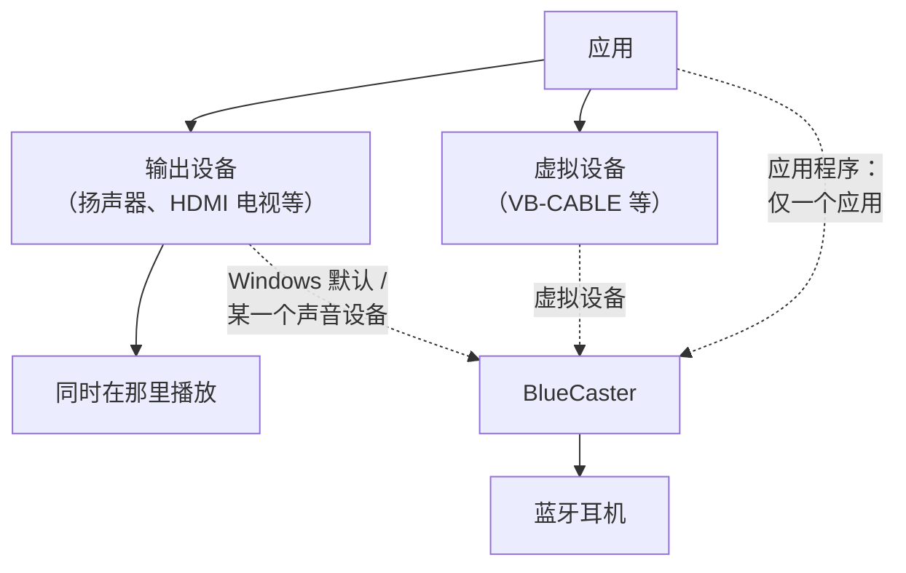
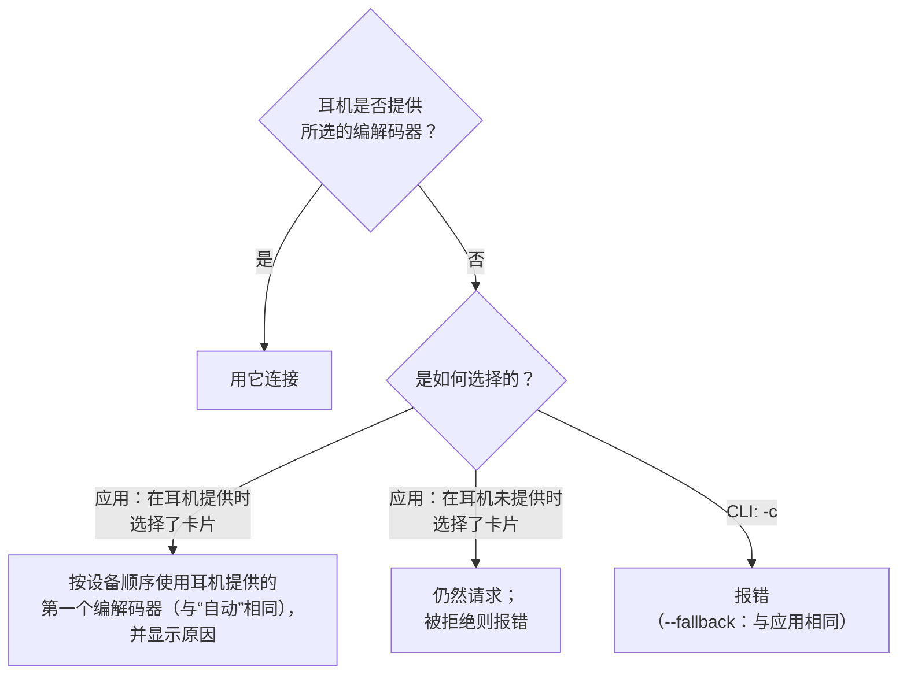

# 使用方法
{: .no_toc }

## 目录
{: .no_toc .text-delta }

1. TOC
{:toc}

---

## 窗口

从“开始”菜单启动 **BlueCaster**（或运行 `bluecaster.exe`）。左侧菜单列出下文介绍的各个页面：主页、编解码器、音频设备、适配器、诊断、设置和关于；开发者模式下还有“开发者”，在其中开启后还有“音量合成器”。窗口较窄时，菜单会折叠为图标。窗口只是 `bluecaster-core.exe` 的显示界面，该程序在后台持续运行，因此关闭窗口不会停止串流（请参阅[托盘与浮出窗口](#tray)）。

### 主页

- 每个已保存的音频设备一张卡片，并排显示其状态和电量。已连接设备的卡片还会显示正在使用的编解码器（以列表形式显示，见下文）及其比特率。如果正在使用的编解码器不是你选择的那一个，编解码器一行会短暂显示原因，例如 **aptX Adaptive（不支持 Opus）**（或*被占用*）；几秒后只保留一个警告标记（将鼠标悬停其上可查看原因），状态行只显示**已连接**
- 每张卡片下方有**连接** / **断开连接**。同一时间只能连接一台设备：在另一台设备上单击**连接**，会断开当前设备并连接新设备
- **音量**：耳机的音量（请参阅[音量](#volume)）。单击扬声器图标可静音（BlueCaster 发送静音），再次单击取消静音。其他设备的卡片上，该滑块处于禁用状态
- 已连接设备的卡片上有一个编解码器列表，便于快速切换（例如游戏用一种、听音乐用另一种）。列表只按名称列出设备支持的编解码器（与[编解码器](#codecs)页面相同），并显示正在使用的编解码器，**自动选择**开启时也是如此。选择某个编解码器会关闭自动选择（可在编解码器页面重新开启）。选择立即生效：设备会用新的编解码器重新连接；与编解码器页面一样，下一次选择要等设备重新连接后才能进行
- 串流期间，已连接设备的卡片上会显示一个小的链路质量图表。输出源在**音频设备**页面中选择；如果输出源是尚未运行的应用程序，卡片上会显示这一点
- 出现错误时会显示原因；如果有解决办法，还会显示相应的按钮（**替换为 WinUSB 驱动程序**、**打开下载页面**、**重启蓝牙**、**重试**、**编解码器**、**音频设备**等）
- 卡片上方会显示以下提示，直到你将其关闭：Windows 中有另一个蓝牙适配器处于活动状态时的警告，以及 OPPO 耳塞开启 Hi-Res 后的通知（请参阅[编解码器](#codecs)）

侧边栏在每个页面上都会显示每台设备的这些信息；托盘浮出窗口则显示已连接设备的信息。

### 编解码器 {#codecs}

每个已保存的音频设备各有一个分区，标题包括一个圆点（设备连接期间为绿色）、设备名称以及**已配对** / **音频**标记；设备地址显示在**音频设备**页面中。分区下方是该设备的编解码器卡片，默认按音质从高到低排列，你也可以调整顺序。每张卡片有三个指标条（音质、低延迟、稳定性），并显示设备上次连接时是否提供了该编解码器：**支持**（绿色标记）或**不支持**（红色标记）。开启**仅显示支持的编解码器**（默认）时，显示的卡片都受支持，因此不再带**支持**标记。此时，从未连接过的设备（例如从 Windows 导入的设备）只显示 **SBC** 卡片（每台蓝牙音频设备都支持 SBC），以及为它选择的编解码器；其他卡片在首次连接后出现，或在关闭此开关后显示。华为和荣耀耳机会一直保留 **LDAC** 卡片（标记为**未确认**），直到它们列出 LDAC，因为它们可能要在选择 LDAC 之后才会列出。LHDC V5 串流时（无论由你选择还是由“自动”选择，但音质为**低**或开启 ABR 时除外），如果 OPPO 耳塞为 LHDC V5 列出了峰值比特率，BlueCaster 会请求它开启 Hi-Res，且只请求一次。耳塞会为此重新连接一次；如果比特率因此提高，主页会提示你。之后 Hi-Res 会在耳塞中保持开启；没有获得提升的耳塞会恢复原设置。在开发者模式下，LHDC V5 设置中的**重新请求 Hi-Res**会清除设备列出的内容和已请求的记录，下次连接时会再次请求。
- **自动选择支持的音质最高的编解码器**（位于页面顶部，适用于所有设备；默认开启）：每台设备使用其支持的音质最高的编解码器，顺序为 LHDC V5 > LDAC > aptX Adaptive > Opus > aptX HD > aptX > aptX LL > AAC > SBC XQ > SBC。它采用默认设置，与编解码器设置中的**自动**相同：高音质；编解码器支持时为 24-bit；采样率为 48 kHz（设备没有 48 kHz 时，使用其列出的其他采样率，优先 44.1 kHz；Windows 自身的采样率会被重采样）。除了顺序之外，卡片为只读（可按下文所述拖动；“自动”会选择设备支持的第一张卡片），正在使用或“自动”将要选择的编解码器会突出显示。单击卡片或其 **...** 会询问是否关闭自动选择（**关闭自动选择** / **取消**）；关闭后，所单击的卡片即被选中（其 **...** 会打开它的设置）。关闭自动选择后，你可以自行为每台设备选择编解码器和设置；尚未选择编解码器的设备沿用“自动”的选择。自动选择开启期间，为各设备选择的编解码器会保留，供以后使用。如果 2.0.2 之前的设置曾为某台设备选择过编解码器，自动选择初始为关闭
- 自动选择关闭时，单击卡片即可为该设备选择编解码器。选择会立即保存，正在串流的设备会用它重新连接。你也可以选择设备不支持的卡片（关闭**仅显示支持的编解码器**时显示）：BlueCaster 仍会向设备请求该编解码器；如果设备拒绝，连接会停止，并显示相应的错误（请选择其他卡片或开启自动选择）。此时，主页、侧边栏、托盘浮出窗口和托盘图标的工具提示会用几个字说明原因（例如 *不支持 LDAC*）；每当编解码器导致连接停止时（设备不支持、拒绝该编解码器，或正将其用于其他音源），都会这样显示。为该设备选择其他卡片或更改其设置，或开启自动选择，设备就会重新连接。如果你选择某个编解码器时设备提供了它，但之后设备不再提供（例如耳机切换到了其他编解码器），BlueCaster 会回退到该设备顺序中第一个受支持的卡片：除非你更改了顺序，否则就是设备支持的最佳编解码器（请参阅[明确指定的编解码器不可用](#codec-fallback)）
- 拖动设备的卡片，即可按自己的顺序排列编解码器（按住鼠标按钮时显示手形指针；自动选择关闭时，也可以在卡片上按 Alt 加方向键）。每台设备保留各自的顺序。自动选择、尚未选择编解码器的设备，以及设备不支持所选编解码器时，都使用第一张受支持的卡片。FastStream 和 Opus 05（即 **Opus (PipeWire)** 卡片，仅限开发者模式；关闭开发者模式后，即使已选择也不会使用）无论排在哪里，都只在被选择时使用。**重置编解码器顺序**可恢复默认顺序；它只在显示的卡片不是默认顺序时出现（手动移回原位也会恢复默认顺序）。如果正在串流的设备所用的编解码器因此改变，设备会重新连接
- 为正在串流的设备选择其他编解码器时，设备会用该编解码器重新连接。卡片（以及主页和托盘浮出窗口中的编解码器列表）会等到设备重新连接后才接受下一次选择，因此快速连续单击不会打断仍在建立的连接。切换编解码器时不显示连接通知；连接设备时才会显示
- **仅显示支持的编解码器**（默认开启；关闭后同时显示支持和不支持的编解码器）：隐藏设备没有提供的编解码器。设备首次连接之前，只显示 **SBC**（以及为它选择的编解码器）
- 卡片上的 **...** 会打开该编解码器的设置。更改立即生效。对于正在使用的编解码器，更改会被保存，设备会用新设置重新连接；例外的是 **Bitpool**，它会在播放时直接改变；下方的开关如果开或关都不改变音频流的建立方式，也不会重新连接。对于其他编解码器，更改会保留到选择该编解码器时使用。每种编解码器各自保存设置（aptX Adaptive 与 aptX Adaptive LL 也分开保存），因此切换到其他编解码器再切换回来，设置会恢复。只提供该编解码器支持、且设备在上次连接时列出的选项。关闭顶部的**仅显示 *设备* 支持的选项**（默认开启；设备列出其选项后显示），即可看到该编解码器的所有选项，例如设备未列出的采样率、位深度、音质或 bitpool（标记为 *（不支持）*）。设备可能会拒绝这些选项，此时连接会停止，并显示相应的错误。重新开启此开关后，设备未列出的选项会恢复为“自动”。各编解码器的设置如下（自动选择从不使用这些设置）：
  - **音质**：LDAC 为 **高** / **中** / **低**（990 / 660 / 330 kbps）；LHDC V5 为 **高** / **中高** / **中** / **低**（1000 / 900 / 500 / 400 kbps，即 Android 的四个级别）；aptX Adaptive 为 **高**（其低延迟模式是单独的卡片 **aptX Adaptive LL**：265 kbps、48 kHz、无 ABR；请参阅 [aptX Adaptive](#aptx-adaptive)）。开启 LHDC V5 的 ABR 时，音质显示为灰色（ABR 保持在 400 kbps 或以下）。AAC、Opus、Opus 05、SBC 和 SBC XQ 只有一个级别 **高**，仅显示、不可选择，即设备接受的最高比特率（如有 ABR 或 VBR，比特率仍会变化；SBC 和 SBC XQ 显示由其 bitpool 和帧结构得出的比特率）。aptX、aptX HD、aptX LL 和 FastStream 的比特率由编解码器固定。早期版本保存的、编解码器已不再提供的音质（aptX Adaptive 的标准 / 移动、AAC 的较低级别等）会按“高”加载
  - **自适应比特率 (ABR)**：用于 LDAC、LHDC V5、aptX Adaptive、SBC 和 SBC XQ（请参阅 [ABR](#abr)）；AAC 为 **VBR**
  - **低延迟**（LHDC V5，仅限列出此功能的设备）：声音更快传到耳机。ABR 关闭时，如果连接跟不上，比特率会逐级降低（1000、900、再到 500 kbps），连续一分钟没有问题后再逐级升回。数据包在发送队列中等待 100 ms（而非 350 ms）即被丢弃，因此连接不稳定时只会短暂断音，而不会持续延迟
  - **采样率**：“自动”为 48 kHz；设备没有 48 kHz 时，使用其列出的其他采样率（优先 44.1 kHz），并显示最终的采样率（例如 *自动（48000 Hz）*）。“自动”从不选择 96 kHz：它会增加延迟、降低兼容性，却听不出差别（Windows 以 48 kHz 混音）；如需使用 96 kHz，请在此处选择。只提供设备列出的采样率（LHDC V5 没有 88.2 kHz；aptX Adaptive 只向列出 96 kHz 的设备提供 96 kHz，请参阅 [aptX Adaptive](#aptx-adaptive)）。设备只列出一种采样率时，直接显示该采样率，不提供“自动”
  - **位深度**：LDAC 和 LHDC V5 为 16 或 24 bit，以设备列出的为限（“自动”为 24 bit；LHDC V5 仅在设备列出 24 bit 时）；aptX HD 和 aptX Adaptive 为 24 bit；其他编解码器为 16 bit。LDAC 的 24 bit 以 32 位采样送入编码器，与 Android 的 32 位选项相同。位深度不属于 LDAC 的配置，因此无论选哪一种，耳机收到的音频流都相同
  - **Bitpool**（SBC、SBC XQ）：一个带两个滑块的滑动条，分别设置最小和最大 bitpool，范围以设备列出的为限。最大值就是正在使用的 bitpool；最小值是会用到的最低 bitpool（即建立连接时所用范围的下限，也是 ABR 最多能降到的值）。**自动**会同时重置两者：最大值按音质设定，最小值采用设备和 ABR 自身的值。下面一行显示声道模式，每种编解码器固定不变：SBC 为联合立体声，SBC XQ 为双声道。SBC XQ 的 bitpool 在 44.1 kHz 时最高为 47，在 48 kHz 时最高为 43；关闭**仅显示 *设备* 支持的选项**后最高可到 53。
  - **帧结构**（SBC 和 SBC XQ，仅限开发者模式）：块数、子带数、比特分配，以及 SBC 的声道模式。“自动”采用 16 块、8 子带、响度和联合立体声。设备不接受的值会在连接时回退为“自动”。在一位用户测试的 Sony 设备上，12 块会使声音失真，并可能断开连接（编码器的输出能正确解码，其他块数也能正常播放）。关闭开发者模式后，这些选择仍会保存，但不会使用。AAC 和 LHDC V5 的比特率不会超过设备列出的最大值

默认设置即可获得最佳音质；大多数设备保持**自动**即可。LE Audio 设备（实验性）有两张卡片：**LC3** 和 **LC3 LL**（请参阅 [LE Audio](#le-audio)）。与通话编解码器一样，它们的 **...** 以只读方式显示与 A2DP 编解码器相同的项目。aptX Adaptive 的低延迟模式有单独的卡片 **aptX Adaptive LL**，位于 **aptX Adaptive** 旁边。“自动”从不选择它；早期版本中设为低延迟的 aptX Adaptive 会显示在这张卡片上。

经典设备的麦克风打开期间（请参阅[音频设备](#audio-devices)），音乐卡片会换成该设备可用的通话编解码器：LC3（32 kHz）、mSBC（16 kHz）和 CVSD（8 kHz），正在使用的那一种处于选中状态。开启**自动选择**时，通话链路会选择双方都支持的最佳编解码器，单击卡片会询问是否关闭自动选择。关闭自动选择后，单击卡片即可选择通话编解码器：麦克风会用它重新打开；如果耳机不支持，则使用低一级的编解码器。**...** 以只读方式显示其设置。麦克风关闭后，音乐卡片会恢复。自动选择开启期间，所选的通话编解码器会保留，供以后使用。开启**仅显示支持的编解码器**时，耳机不支持的编解码器会被隐藏。

LE Audio 设备的麦克风打开期间，音乐卡片之后会出现一张**麦克风**卡片（LC3，单声道）。自动选择关闭时，可在其 **...** 中从耳机支持的采样率里选择麦克风的采样率（**自动**使用第一个；更改后设备会重新连接）。自动选择开启时，这里显示正在使用的采样率。

在后台，BlueCaster 在 `profiles.json` 中为每台设备保存一个条目（编解码器、各编解码器的设置以及编解码器顺序），条目名为“*设备* | *编解码器*”；窗口和托盘菜单只显示设备名称。早期版本允许为一台设备创建多个配置文件。首次启动带有“编解码器”页面的版本时，BlueCaster 会保留最近使用的配置文件（没有则保留第一个），并把其他配置文件合并进来，同时保留它们各自编解码器的设置（音质、采样率、位深度、ABR、SBC 设置）。它们的名称、输出源和数据包大小不会保留；原来的 `profiles.json` 会在设置文件夹中另存一份 `profiles-before-codecs.json`（仅一次）。2.0.2 预发布版本中的**自动选择的顺序…**（所有设备共用一个顺序，位于开发者模式中）已不再使用：现在每台设备都有自己的顺序。

### 音频设备 {#audio-devices}

BlueCaster 可以串流到的耳机和扬声器都列在这里，每台设备各有自己的设置。列表下方的**添加音频设备**中，**扫描设备**会用 USB 适配器查找附近的设备，持续 30 秒，设备应答后即列出；**停止扫描**可结束扫描。请先让耳机进入配对模式。如果有设备已连接，BlueCaster 会先询问是否断开它再扫描。**添加**会保存找到的设备并连接它。BlueCaster 以前配对过的设备带有**已配对**标记。如果扫描找不到设备，请在**手动：**下输入其地址，然后单击**添加**；输入或粘贴的地址会自动格式化（`aa-bb-cc-dd-ee-ff`、`AABBCCDDEEFF` 和 `AA BB CC DD EE FF` 都会变为 `AA:BB:CC:DD:EE:FF`）。耳机看到的适配器名称是电脑名称后加 BlueCaster，例如 *Taro-PC (BlueCaster)*，便于与 Windows 自带的蓝牙区分。如果 Windows 曾通过其他适配器（例如电脑内置的蓝牙）配对过某台设备，BlueCaster 会先询问（**已在 Windows 中配对**：在 Windows 中删除它，或选择**仍然添加**）。对于 Windows 通过此适配器配对过的设备，BlueCaster 也会先询问（设置向导可以导入该配对，请参阅[服务与配对密钥](#shared-pairing)）。已保存的设备可以重命名或删除；删除设备时也会删除其设置和配对，因此必须重新配对才能连接。每台已保存的设备具有以下设置：

- **输出源**：**Windows 默认**（单独列在最前面：即 Windows 默认输出，括号中显示其名称，也可能是虚拟设备；新设备的默认值）、**声音设备**下的某一个输出设备、虚拟设备，或应用程序（请参阅[捕获模式](#capture-modes)）。旁边显示 Windows 混合所捕获设备时使用的格式（采样率和位深度，只读）。如果设备串流时使用其他格式（未连接时，为其编解码器设置所要求的格式），该格式会显示为琥珀色，下方另有一行列出两种格式（串流仍可进行，会经过转换）。再下方是该输出源的说明
- **连接期间设为 Windows 默认输出设备**（开发者模式下，使用虚拟设备或声音设备时）
- **输入源**：耳机的麦克风；开发者模式下还有**连接期间设为 Windows 默认输入设备**（见下文）

每台设备上的**输入源**会把耳机的麦克风送到 Windows，用于通话和语音聊天。BlueCaster 没有自己的音频驱动程序，因此会把麦克风的声音播放到 VB-CABLE 这样的虚拟线缆中。列表以应用录音的那一端为每条线缆命名（VB-CABLE 为 *CABLE Output*）；请在应用中选择这一端作为麦克风。在列表旁可选择**关**或**自动**：**自动**只在有应用从中录音时打开麦克风，其余时间播放保持完整音质。开发者模式下还可选择**开**，让麦克风一直打开；关闭开发者模式时，设为**开**的设备与**自动**效果相同。选择**关**时，列表仍会显示，但呈灰色。**关**与主页和浮出窗口中的麦克风按钮是同一个设置：对于设为**自动**或**开**的设备，**关**会像该按钮一样禁用麦克风，并记住原来的模式，按钮可以恢复该模式。**连接期间设为 Windows 默认输入设备**（开发者模式下显示；关闭开发者模式时始终开启）会在设备连接期间，把线缆的录音端（*CABLE Output*）设为 Windows 默认麦克风。这样，从默认麦克风录音的应用会收到耳机的麦克风，**自动**也会为它们打开麦克风。设备断开后，会恢复之前的默认设备，除非你在此期间选择了其他设备。

通过最下方的**麦克风调整**，可在麦克风声音送达应用之前对其进行处理。**输入源**为**关**时，此项显示为灰色。**使用麦克风调整**用于开启或关闭处理。关闭时，麦克风声音原样传送，各滑块的值保持不变。**增益**用于调高或调低音量（-12 至 +24 dB）。**降噪**可去除风扇声、嗡嗡声等持续的背景噪声。滑块越靠右，降噪越强；越靠左，保留的原声越多，拖到最左边为**关**。**噪声门**会在麦克风音量低于所选电平时将其静音（拖到最左边为**关**）。限幅器可防止提高增益后的声音破音。更改会立即生效，无需重新连接。开启降噪后，麦克风会延迟约 20 ms；全部关闭时，麦克风声音原样传送。**诊断**中的**麦克风**测试会按应用听到的样子录音。

新设备在已安装 VB-CABLE 时使用 VB-CABLE，否则使用 Hi-Fi Cable，除非该线缆就是它的**输出源**。经典设备设为**自动**，LE Audio 设备设为**关**（在 LE Audio 设备上，**自动**会让麦克风一直打开）。麦克风已开启但没有线缆的设备，会在 Windows 列出线缆后立即使用它。**音频设备**页面和设置向导会推荐安装缺少的线缆（请参阅[捕获模式](#capture-modes)）。之后安装线缆时，BlueCaster 会按设置向导的方式，重新设置它自动配置过的设备，以及使用 **Windows 默认**且麦克风也是这样设置的设备。两条线缆都有时，Hi-Fi Cable 传送声音，VB-CABLE 传送麦克风。只有一条线缆时，该线缆传送麦克风，声音则取自**声音设备**下的某个输出设备（有显示器或电视的音频时用它，有多个时用其中的 Windows 默认输出；否则用 Windows 默认输出），无论 Windows 默认输出是哪个设备。你自己选择的输出源或麦克风保持不变。没有线缆时，如果 Windows 同时有显示器或电视的音频和声卡，声音取自显示器或电视，麦克风则播放到声卡，并设为**关**。在开发者模式下改为**开**后，录制输出设备的应用（例如 OBS 的音频输出采集）就可以从声卡获取麦克风；**自动**无法判断是否有人在收听声卡。在**音频设备**页面添加的设备也以同样的方式开始。使用 **Windows 默认**的设备，如果其麦克风播放到的线缆正是 Windows 默认输出，也会改用该声音来源，否则麦克风的声音会在耳机中播放。

如果麦克风播放到 Hi-Fi Cable，而该线缆的播放端和录音端在 Windows 声音设置中的采样率不同，会显示警告：如果应用听不到声音，请将两者设为相同的采样率。列表只列出应用可以从中录音的线缆。BlueCaster 自己正在捕获的线缆不会列出（即**输出源**；使用 **Windows 默认**时为 Windows 默认输出，但不包括另一台设备连接期间被设为默认的其输出源），该线缆的另一端也不会列出（VB-CABLE 的 *CABLE In 16ch* 与 *CABLE Input* 录入同一个 *CABLE Output*），否则麦克风会与正在播放的声音混在一起。同样，**输入源**不为**关**时，**输出源**列表不会列出麦克风所用的线缆。开启**开发者 > 应用设置 > 在源列表中显示所有音频设备**后，两个列表都会列出所有设备：没有录音端的输出设备（扬声器等）列在**监听**下，因为它们只能播放麦克风；VB-CABLE 的 16 声道线缆显示为 *CABLE Output · CABLE In 16ch*（先是共用的录音端，再是它自己的名称）；输出源所用的线缆显示为灰色，名称后带有 *（用作输出源）*。*CABLE Input* 和 *CABLE Output* 是同一条线缆的两端，因此同时使用虚拟输出源和麦克风需要两条线缆。推荐：声音使用 VB-Audio 的 **Hi-Fi Cable**（[VB-Audio 页面](https://vb-audio.com/Cable/)上的 *HiFi-Cable & ASIO-Bridge*），因为它增加的延迟最小；麦克风使用 VB-CABLE。麦克风所用的设备也不能是 Windows 默认输出：否则应用会听到播放的声音与麦克风混在一起，而另一台设备作为输出源时则什么也收不到。**输入源**下方会显示相应的警告。

麦克风打开期间，经典蓝牙设备通过通话连接播放：以通话音质单声道播放（CVSD、mSBC 或 LC3，取双方都支持的最佳者）。此时编解码器显示为灰色；麦克风关闭后，设备无需重新连接即可回到原来的编解码器。LE Audio 设备会继续以平常的音质播放 LC3，同时传送麦克风；切换模式时会重新连接（在 LE Audio 设备上，“自动”会让麦克风一直打开）。部分耳机可能会拒绝麦克风，或在没有通话时显示正在通话。选择**自动**或**开**并选好设备后，只要设备已连接或正在连接，侧边栏、主页和浮出窗口中编解码器下方就会有一行 **麦克风：**。麦克风打开时，这一行显示编解码器和采样率，并带一个红点（*麦克风：mSBC 16 kHz*）；关闭时以灰色显示其模式。在主页和浮出窗口中，旁边的麦克风按钮可以禁用麦克风：按钮显示删除线，麦克风关闭，经典设备回到原来的编解码器，**输入源**显示为**关**。再次单击会以之前的模式重新启用麦克风；在**输入源**中选择**自动**或**开**也一样。“自动”等待应用录音时，按钮显示为虚线；麦克风未能打开时，按钮显示警告标志，原因见其工具提示。

列表上方的**所有音频设备**包含适用于所有设备的开关：**Windows 音量同步**（请参阅[音量](#volume)）、**用音频设备的按钮控制播放**和**自动重新连接**。每台设备的**最大媒体数据包大小**位于**开发者**页面（请参阅[最大媒体数据包大小](#max-packet)）。

### 诊断

- 串流期间的**链路质量**：实际比特率、数据包、发送前丢弃的数据包、捕获时丢弃的音频、发送队列、设备上报的延迟（请参阅[延迟](#latency)）、无线占用时间、信号（RSSI）以及 AFH 信道（请参阅[链路质量与 AFH](#link-quality)）。耳机麦克风打开期间，经典设备的通话链路也以同样方式测量（其编解码器，例如 mSBC，以及发送量），另有一张**麦克风**卡片显示返回的数据包：已接收、在无线传输中损坏以及经过补偿的数量
- **无线**：显示 2.4 GHz 频段中的 79 个蓝牙信道，标出链路正在使用的信道和适配器跳过的信道，下方标出 Wi-Fi 信道，并附有几条改善连接的提示。在开发者模式下，**扫描**会添加附近的 2.4 GHz Wi-Fi 网络（请参阅[无线选项卡](#radio-tab)）
- 串流期间的**编解码器详情**：媒体负载、标头、编解码器帧和每个数据包的帧数，以及设备端点列出的内容与实际使用内容的对照：SBC 为 bitpool、采样率、声道模式、块数、子带数和比特分配；AAC 为对象类型、采样率、声道、峰值比特率和 VBR；其他编解码器为采样率、位深度和峰值比特率
- **麦克风**：在经典蓝牙设备串流期间测试其耳机麦克风。**录音**会打开麦克风并录制最多 10 秒，同时在条形图上显示音量（期间设备以通话音质播放；如果本次连接从未打开过麦克风，设备会先重新连接）。**播放**会在耳机上播放录音。离开该选项卡即结束测试，播放恢复为原来的编解码器。暂不支持 LE Audio 设备
- **连接流程**：最近一次连接尝试的十一个阶段（开始、蓝牙适配器、ACL / AVDTP 连接、功能发现、编解码器选择、音频捕获、流配置、编码器、流开始、音频发送、连接维持（包括断开 / 重新连接）），每个阶段标记为“正常”、“警告”或“失败”，并显示所用时间。**复制流程**可复制这些内容
- **日志**：实时日志，可按级别（所有级别、信息及以上、警告和错误、仅错误）、按文本，以及按当前连接尝试（**仅当前尝试**）筛选。**复制显示的日志**会复制当前显示的内容。**打开日志文件夹**会打开存放日志文件的文件夹；与**复制诊断信息**不同，这些文件未做隐藏处理（其中包含蓝牙地址和你的 Windows 用户名）
- **开始 HCI 捕获** / **停止 HCI 捕获**（请参阅[验证媒体流](#verify-stream)）
- **复制诊断信息**：将版本、操作系统、适配器、音频设备（编解码器及其设置和顺序）、连接流程、警告 / 错误以及最近的日志复制到剪贴板，可直接粘贴到错误报告中。**隐藏蓝牙地址**（默认开启）会将地址替换为 `<addr-1>`、`<addr-2>`...（适配器自身的地址替换为 `<adapter>`），将设备名称替换为 `<device-1>`、`<device-2>`...，并隐藏 USB 序列号、应用自身文件夹以上的文件路径（`<path>\BlueCaster\logs\...`）以及你的 Windows 帐户（用户名和 SID）。崩溃报告和为错误报告复制的错误文本也采用同样的隐藏处理
- **报告问题**：
  - **详细日志**：**详细（debug）**或**全部（trace，1 小时）**会记录多得多的蓝牙、USB、音频捕获和编码信息。debug 会保持开启 24 小时，重新启动后也不例外（便于排查启动问题），之后自动关闭。请先开启它，重现问题，然后保存诊断包
  - **诊断包 > 保存…**：选择是否包含 HCI 捕获（除非有人要求你提供，否则请保持关闭：其中包含地址和设备名称），以及是否在文本文件中隐藏蓝牙地址，然后保存为一个 `.zip` 文件（位于设置文件夹的 `logs\bundles\` 中，保留最新的 3 个）。诊断包包含诊断信息、核心、窗口和驱动程序辅助程序的日志文件、崩溃报告、系统信息（USB 蓝牙适配器及其驱动程序、Windows 中已配对的设备、音频设备）、设置、每台设备的编解码器设置（绝不包含链接密钥），以及 HCI 飞行记录器。HCI 捕获保留地址（但不含配对密钥）。BlueCaster 会尽量让诊断包小于 GitHub 的 25 MB 附件上限（优先保留最新的日志，最多 48 MB 文本、最新的 5 个记录和 2 个小型转储）
  - **在 GitHub 上报告**（保存后）：新建一个错误报告，其中已填好版本、Windows 内部版本、适配器、耳机、编解码器、捕获模式和诊断信息（地址已隐藏），并在文件资源管理器中显示诊断包，方便你将其拖入报告

BlueCaster 还会持续记录一些数据，这样即使问题只发生过一次，也能进行调查：

- **HCI 飞行记录器**：最近几分钟的蓝牙通信保存在内存中（媒体负载会被截短，配对密钥会被移除），每当串流失败或连接中断时保存到 `logs\hci\`（保留最新的 10 个文件）
- **崩溃报告**：如果 BlueCaster 崩溃，会将一个 `.dmp` 小型转储和一个 `.txt` 文件写入 `logs\crash\`（每个程序保留最新的 5 个）

磁盘占用有限：正常情况下，一天的日志远小于 1 MB，保留 7 天。开启详细日志时，一天的文件最多包含 100 MB 的 debug 和 trace 行（超出后，直到第二天只记录信息及以上级别）。飞行记录器的文件最多几 MB，保留 10 个。

### 开发者 {#developer}

在**设置 > 开发者模式**开启时显示；大多数用户不需要它。它用于测试设备和排查问题，其中部分设置只对某些设备有效。共有七个选项卡：

- **应用设置**：**使用音量合成器**（默认关闭）开启后，会显示**音量合成器**页面、浮出窗口中的应用列表和输出静音（请参阅[捕获模式](#capture-modes)）。不推荐使用；要让电脑不发声，VB-CABLE 是更好的办法。**在源列表中显示所有音频设备**（默认关闭）开启后，**音频设备**页面上的**输出源**和**输入源**会列出所有设备，包括不适用的设备（请参阅[音频设备](#audio-devices)）。**隐藏虚拟音频设备警告**（默认关闭）会隐藏缺少 VB-Audio 线缆的警告（请参阅[捕获模式](#capture-modes)）。**检查更新时包括 Alpha 版本**（Alpha 版本中默认开启）开启后，也会提示 Alpha 版本（请参阅[更新](#updates)）
- **编解码器设置**：用于查明设备为何没有声音的开关（RTP 标记位、记录最初的媒体数据包、AAC 配置和编码器选项），以及每台已保存设备的**最大媒体数据包大小**（请参阅[最大媒体数据包大小](#max-packet)）。**自动选择编解码器时也使用各编解码器的设置**：开启自动选择时，编解码器卡片的 **…** 可以直接打开，不会关闭自动选择；“自动”选择的编解码器会用这些设置连接，而不是“自动”的设置。**让采样率和位深度匹配电脑的输出**：设为“自动”的采样率或位深度会跟随 Windows 声音设置中输出设备的格式，而不是 48 kHz。在设备为该编解码器列出的采样率中，BlueCaster 优先使用电脑自身的采样率，其次是同一系列（44.1 kHz 或 48 kHz 的倍数）中最接近的采样率，再次是高于它的最接近的采样率；16 位输出以 16 位串流。**忽略设备的最大比特率**：即使设备列出的最大值更低（LHDC V5、AAC 或 Opus 05 的比特率，或 SBC 的 bitpool），所有编解码器也以所选音质的比特率运行，**编解码器**页面会提供所有音质和 bitpool。超过最大值时，设备可能断续或无声。**发送队列上限**：媒体数据包在发送队列中最多可等待多久，超时即被丢弃，范围为 50 到 2000 ms（留空 = 350 ms）；链路良好时，它不会降低延迟（请参阅[延迟](#latency)）。**发送时编码**：链路停滞期间，音频以未编码的形式等待，而不是以已编码的数据包等待。因此开启 ABR 时（SBC、SBC XQ、LDAC、LHDC V5 和 aptX Adaptive），音频会以 ABR 在此期间降到的比特率发送，而不是停滞开始时的比特率。它不会缩短停滞本身：在无线恢复之前什么都发不出去，只是之后追赶时所需的数据更少。等待时间超过发送队列上限的音频无论如何都会被丢弃；“诊断”会把等待中的音频计入发送队列等待时间。以上选项默认全部关闭，并在下一次串流开始时生效；只要有一项开启，就会显示横幅提示。**全部关闭**可将它们全部重置
- **厂商**：BlueCaster 是否使用耳塞自己的协议（华为：LDAC；OPPO：Hi-Res；请参阅[编解码器](#codecs)）。每个厂商都有**厂商协议**设置：**自动**（名称表明属于该厂商的耳塞；默认）、**始终**（任何设备）或**不使用**。OPPO 还有**每次连接都请求 Hi-Res（每次重新连接）**。更改在下一次串流开始时生效；只要有一项被更改，就会显示横幅提示，**全部关闭**可将它们重置。关闭开发者模式后不会使用这些设置
- **日志**：日志文件的保留时间（默认 7 天）、每日大小上限（默认 100 MB）、保持开启的详细日志（没有 24 小时或 1 小时的限制，并从核心启动时就开始记录）、每 10 秒一次的串流健康状况行，以及**添加标记**（在日志中写入一行带编号的标记，便于之后找到这一时刻）。关闭开发者模式后会恢复为默认值
- **对端接收器测试**：向另一台电脑上的测量用接收器串流，并比较发送的内容和到达的内容（请参阅[对端接收器测试](#receiver)）
- **芯片**：在使用 WinUSB 的适配器上运行芯片脚本。芯片脚本是对芯片发出的请求，可以手动输入，也可以从文件加载，供为芯片添加支持的人使用（请参阅[添加芯片支持](chip-support#chip-scripts)）。可能更改芯片的行只有在单击**允许运行**后才会运行；运行期间蓝牙会停止，下次需要时重新启动
- **调试**：实验性功能，默认全部关闭。**配对密钥与 Windows**：**恢复原始驱动程序时，也将 LE 密钥复制到 Windows** 会在**恢复原始驱动程序**时把 BlueCaster 的 LE 密钥（Long Term Key、EDIV、Rand、密钥长度、Identity Resolving Key）写入 Windows，但仅限 Windows 已为该适配器保存了 LE 密钥的设备。Windows 原有的密钥会保存在 `pairing\replaced_windows_keys.json` 中，只有你的 Windows 用户能读取。**与 Windows 比较**（需要管理员权限）针对一个适配器，统计链接密钥和 LE 密钥在 BlueCaster 与 Windows 中相同、不同或只存在于一方的设备数量。结果只显示和记录数字，从不包含地址或密钥，因此可以放心分享。它还会列出 Windows 为该适配器及其 LE 设备保存的值的名称、类型和大小，但从不显示其数据

### 适配器

- 检测到的 USB 蓝牙适配器，以及它们的芯片、地址、USB ID、蓝牙版本、**驱动程序**和**固件**。插入或拔出适配器时，列表会自动更新。驱动程序为**原始驱动程序**（Windows 或制造商安装的驱动程序；将鼠标悬停其上可查看名称）或 **WinUSB 驱动程序**（BlueCaster 使用的驱动程序）。Realtek 适配器即使从未使用过，也会显示从其 USB 序列号得到的地址；其他适配器的地址和蓝牙版本要在 Windows 蓝牙或 BlueCaster 使用过该适配器后才会显示（将鼠标悬停在该行上可查看原因）。BlueCaster 无法使用的适配器（部分 MediaTek 和 Qualcomm 型号）会保留其驱动程序，其 WinUSB 和固件按钮处于禁用状态。在开发者模式下，你仍可以为其分配 WinUSB；在使用 WinUSB 的适配器上单击**读取芯片信息**，会把芯片对几条读取命令的应答保存到 `logs\probe\`，供为它添加支持的人使用（期间蓝牙会停止，下次需要时重新启动）。之后，**在 GitHub 上报告**会新建一个已填好这些信息的 issue。由 BlueCaster 自行加载固件的适配器（Intel、MediaTek、Qualcomm）启动时，此页面会显示加载进度以及是否失败
- **替换为 WinUSB 驱动程序** / **恢复原始驱动程序**（请参阅[安装与设置](setup#winusb)）。与所有带盾牌图标的按钮一样，每次操作 Windows 都会请求管理员权限。恢复驱动程序时，对于 Windows 曾通过此适配器配对过的设备，BlueCaster 会把更新的配对交给 Windows，这样它们无需重新配对即可在 Windows 中连接。**限制：**不会交出 LE 密钥，因此 Windows 通过 LE 使用的设备（LE Audio）需要在 Windows 中重新配对（可在开发者模式下尝试：**开发者 > 调试**）
- **蓝牙芯片**用于固件，提供**下载固件**、**打开下载页面**和**打开固件文件夹**（请参阅[固件](setup#firmware)）。其他厂商的适配器则显示固件的来源，例如**来自 MediaTek 的驱动程序**、**来自固件文件夹**或**不需要**；BlueCaster 加载固件后显示**已加载**。固件来自 Realtek Windows 驱动程序的 Realtek 适配器会改为显示**使用自定义固件**，选择**使用驱动程序的固件**即可切换回来
- **避开 Wi-Fi 信道**：自动、关或手动，旁边显示 Wi-Fi 信道：“自动”时为当前正在避开的信道，“关”时为空（两者均为只读），“手动”时为你输入的信道（请参阅[链路质量与 AFH](#link-quality)）
- **蓝牙协议栈**：已停止（首次扫描或连接时启动）、正在启动、就绪或错误，以及**重启蓝牙**
- **使用此适配器**（有两个及以上适配器使用 WinUSB 时，显示在每个适配器的卡片上）：BlueCaster 打开该适配器，而不是找到的第一个。蓝牙会在其上重启，串流会重新连接。所选适配器卡片上的**自动选择**改回找到的第一个。正在使用的适配器标有**使用中**，其名称显示在**蓝牙协议栈**旁边；已选择但尚未使用的适配器（蓝牙下次启动时打开它，或被其他程序占用）标有**已选择**

### 设置

| 分区 | 设置项 |
|:--------|:---------|
| 外观 | 语言、主题（跟随系统 / 浅色 / 深色） |
| 启动 | **随 Windows 启动**和**在托盘中启动**（请参阅[随 Windows 启动](#autostart)）、**最小化到系统托盘**和**托盘窗口的打开位置**（请参阅[托盘与浮出窗口](#tray)） |
| 通知 | **设备连接时通知**（设备、电量、编解码器及其设置；默认开启）、**电池电量低时通知**：**低于 20%**（默认）、**低于 10%**、**低于 5%** 或**从不**，每次连接只通知一次（电量回升到比阈值高 5 个百分点后才会再次通知） |
| 更新 | **检查更新**、**启动时检查更新**、**检查更新时包括预发布版本**（也会提示 beta 版本）、**立即更新**（请参阅[更新](#updates)） |
| 高级 | **开发者模式**（添加[开发者](#developer)页面、编解码器设置中的 SBC **帧结构**、**音频设备**上**服务**标记中的配对密钥（请参阅[服务与配对密钥](#shared-pairing)）、**Opus (PipeWire)** 编解码器、**适配器**上的**读取芯片信息**，并在日志中输出更多细节；无需重新启动）、**设置文件夹**及**打开设置文件夹**、**运行设置向导** |

**退出 BlueCaster** 位于页面底部。**关于**页面显示版本和 BlueCaster 的许可证；**第三方软件**下列出各个库、**第三方许可证**、VB-Audio 线缆属于 VB-Audio 捐赠软件的说明，以及线缆对话框（**虚拟音频设备**）。

### 首次运行设置

首次启动时（还没有音频设备，或没有使用 WinUSB 的适配器），会打开**设置向导**；在你完成或跳过一次之前，每次启动都会打开。首先，选择适配器、驱动程序和固件（Windows 通过该适配器配对过的设备会列在最前面，因为它们将无法再在 Windows 中使用）。接着，查找你的音频设备：“连接”会以最适合该设备的设置保存并连接设备；Windows 配对过的设备会先询问；**导入 Windows 的配对**会列出 Windows 通过此适配器配对过的设备（请参阅[服务与配对密钥](#shared-pairing)）；没有设备也可以单击**下一步**，之后再在**音频设备**页面添加。最后是**常规设置**：主题、**随 Windows 启动**和**在托盘中启动**（首次设置会同时开启这两项）、通知以及**启动时检查更新**。请参阅[安装与设置](setup#first-run)。**设置 > 运行设置向导**可再次打开设置向导。

## 托盘与浮出窗口 {#tray}

无论窗口是否打开，BlueCaster 都会在系统托盘中持续运行：

- **左键单击**托盘图标会打开浮出窗口：设备及其状态、**连接** / **断开连接**、音量、设备切换器、编解码器（与主页一样可从列表中选择）、链路质量以及**打开 BlueCaster**。浮出窗口的高度随内容而定。按 Esc 或单击其他位置即可隐藏。如果某个错误需要用到主窗口中的某个页面（编解码器、音频设备、适配器），错误中的按钮会打开窗口并转到该页面
- **设置 > 托盘窗口的打开位置**（默认为**托盘图标**）：在 Windows 11 上选择**快速设置（音量按钮）**时，托盘图标会打开主窗口，而浮出窗口改为随快速设置一起打开，显示在其面板上方，并随面板一起关闭。在那里使用浮出窗口不会关闭这些面板。如果屏幕高度不够，浮出窗口会在面板左侧打开。选择**不打开**时，不会打开浮出窗口，托盘图标会打开主窗口。
- **右键单击**打开菜单：**打开 BlueCaster**、按名称列出的前 10 台设备（LE Audio 条目带有“(LE Audio)”标记，正在串流的设备带勾选标记；单击即可连接该设备）、**断开连接**和**退出**。菜单会立即打开，无需启动窗口
- 工具提示显示 BlueCaster 处于空闲还是已连接状态

**设置 > 最小化到系统托盘**开启时（默认），最小化或关闭窗口只会将其隐藏到托盘，串流继续进行。关闭此设置时，窗口会最小化到任务栏，关闭窗口则会退出 BlueCaster。托盘菜单中的**退出**或**设置 > 退出 BlueCaster** 会停止串流、释放适配器并完全关闭 BlueCaster。

## 随 Windows 启动 {#autostart}

**设置 > 随 Windows 启动**会在你登录时启动 BlueCaster。开启**在托盘中启动**时，BlueCaster 在后台启动：只显示托盘图标，你可以从托盘打开窗口。关闭此项时（默认），会打开主窗口。该设置保存在 `HKEY_CURRENT_USER\Software\Microsoft\Windows\CurrentVersion\Run` 下名为 `BlueCaster` 的值中，数据为 `"<folder>\bluecaster-core.exe"`；开启**在托盘中启动**时，后面会加上 `--background`。如需手动关闭，删除该值即可。在 v1 上覆盖安装 v2 时，**在托盘中启动**会被开启，因为 v1 总是在托盘中启动。

## CLI 模式

`bluecaster-core.exe --cli` 在控制台中串流，使用与窗口相同的核心。请先退出 BlueCaster（托盘 > **退出**），因为同一时间只能有一个程序使用适配器。CLI 不读取已保存设备的设置；所有设置都通过选项指定。

### 基本用法

```bash
# Auto-select best codec
bluecaster-core.exe --cli -d AA:BB:CC:DD:EE:FF
```

按 Ctrl+C 停止串流。CLI 会输出状态、编解码器和比特率，并在结束时输出已发送和已丢弃的数据包数。

### 选择编解码器

```bash
bluecaster-core.exe --cli -d AA:BB:CC:DD:EE:FF -c ldac      # LDAC
bluecaster-core.exe --cli -d AA:BB:CC:DD:EE:FF -c aptxhd    # aptX HD
bluecaster-core.exe --cli -d AA:BB:CC:DD:EE:FF -c aptxll    # aptX Low Latency
bluecaster-core.exe --cli -d AA:BB:CC:DD:EE:FF -c aptx      # aptX
bluecaster-core.exe --cli -d AA:BB:CC:DD:EE:FF -c aac       # AAC
bluecaster-core.exe --cli -d AA:BB:CC:DD:EE:FF -c sbc       # SBC
bluecaster-core.exe --cli -d AA:BB:CC:DD:EE:FF -c lhdcv5    # LHDC V5
bluecaster-core.exe --cli -d AA:BB:CC:DD:EE:FF -c opus      # Opus (48 kHz, 256 kbps)
bluecaster-core.exe --cli -d AA:BB:CC:DD:EE:FF -c opus05    # PipeWire's Opus 05 (to PipeWire sinks)
bluecaster-core.exe --cli -d AA:BB:CC:DD:EE:FF -c aptxad    # aptX Adaptive (48 kHz; --rate 96000 for 96 kHz)
```

自动选择的优先级：LHDC V5 > LDAC > aptX Adaptive > Opus > aptX HD > aptX > aptX LL > AAC > SBC XQ > SBC（FastStream 和 Opus 05 仅在明确选择时使用）

如果耳机不提供所请求的编解码器，CLI 会停止，并显示说明原因的错误。使用 `-c auto`（默认）可采用耳机提供的最佳编解码器；使用 `--fallback` 则会像应用一样，改用耳机提供的最佳编解码器，而不是所请求的编解码器（请参阅 [aptX 系列与 aptX Adaptive](#aptx-compatibility)）。

### 音质

```bash
bluecaster-core.exe --cli -d AA:BB:CC:DD:EE:FF -c ldac -q hq   # High, 990 kbps (default)
bluecaster-core.exe --cli -d AA:BB:CC:DD:EE:FF -c ldac -q sq   # Medium, 660 kbps
bluecaster-core.exe --cli -d AA:BB:CC:DD:EE:FF -c ldac -q mq   # Low, 330 kbps

# LHDC V5: hq 1000 / mhq 900 / sq 500 / mq 400 kbps
bluecaster-core.exe --cli -d AA:BB:CC:DD:EE:FF -c lhdcv5 -q sq   # Medium, 500 kbps

# aptX Adaptive: hq 427 / ll 265 kbps
bluecaster-core.exe --cli -d AA:BB:CC:DD:EE:FF -c aptxad -q ll   # Low Latency
```

其他编解码器没有音质设置：它们以 `hq` 运行，即耳机接受的最高比特率（aptX、aptX HD、aptX LL 和 FastStream 的比特率由编解码器固定）。编解码器没有的级别（LHDC V5 以外的编解码器的 `mhq`、aptX Adaptive 的 `sq` / `mq`、aptX Adaptive 以外的编解码器的 `ll`）会以 `hq` 运行。

### ABR（自适应比特率） {#abr}

```bash
bluecaster-core.exe --cli -d AA:BB:CC:DD:EE:FF -c ldac -a
bluecaster-core.exe --cli -d AA:BB:CC:DD:EE:FF -c lhdcv5 -a
bluecaster-core.exe --cli -d AA:BB:CC:DD:EE:FF -c aptxad -a
```

ABR 会在蓝牙连接不稳定时自动降低比特率，并在状况改善后提高比特率。LDAC 在其各音质模式之间切换；LHDC V5 遵循 Android 的策略，保持在 160 到 400 kbps 之间；aptX Adaptive 在“高”音质内的各级别之间逐级切换（请参阅 [aptX Adaptive](#aptx-adaptive)）；SBC 和 SBC XQ 每秒将 bitpool 降低 2 或提高 1。对于 SBC、SBC XQ 和 aptX Adaptive，如果连接不得不从某个 bitpool 或级别退回，要过 10 秒才会再次尝试该级别；每次在那里再次退回，等待时间就加倍（最长 2 分钟），因此在低一级下能正常工作的设备会稳定在那一级。在该级别下连续一分钟没有问题后，等待时间重新开始计算。在窗口中，ABR 位于编解码器的设置中（**编解码器**页面上卡片的 **...**）。

### 设备发现

```bash
# Nearby devices, found with the USB adapter (10 seconds; --scan 20 for longer)
bluecaster-core.exe --cli --scan
```

请先让耳机进入配对模式。

### 全部选项 {#all-options}

| 选项 | 说明 |
|:-------|:------------|
| `-d <addr>` | 耳机 / 接收器的蓝牙地址（`AA:BB:CC:DD:EE:FF`；默认：与 Windows 配对的第一台音频设备） |
| `--device-name <name>` | 设备名称，与 `-d` 一起使用，作用与已保存设备的名称相同（华为耳塞据此识别） |
| `-l` | 列出与 Windows 配对的蓝牙设备并退出 |
| `-u <adapter>` | 有多个使用 WinUSB 的适配器时要使用的 USB 适配器：实例 ID、设备路径或 `VID:PID`（例如 `0bda:8771`） |
| `-c <codec>` | `ldac`、`aptxhd`、`aptxll`、`aptx`、`aptxad`、`aac`、`sbcxq`、`sbc`、`lhdcv5`、`opus`、`opus05`、`faststream`、`auto`（默认：`auto`） |
| `-q <mode>` | 音质：`hq`（高，默认）；LDAC 和 LHDC V5 另有 `sq`（中）和 `mq`（低），LHDC V5 另有 `mhq`（中高）；aptX Adaptive 另有 `ll`（低延迟）。其他编解码器的任何级别都以 `hq` 运行 |
| `-a` | ABR（LDAC、LHDC V5 和 aptX Adaptive；SBC / SBC XQ：自适应 bitpool） |
| `--fallback` | 耳机不提供 `-c` 指定的编解码器时，像应用那样回退到耳机提供的最佳编解码器，而不是报错 |
| `-m <mode>` | 捕获模式：`loopback`（默认）、`virtual`、`app` |
| `--audio-device <id>` | 用于 `-m virtual` 的渲染设备 |
| `--app <exe>` | 用于 `-m app` 的可执行文件（如 `spotify.exe`） |
| `--headset-mic` | 耳机麦克风（请参阅[音频设备](#audio-devices)）：把耳机的麦克风播放到 `--mic-output`；在此期间经典设备以通话音质播放。与 `--le-audio` 一起使用时，采用同时传输麦克风的 LE Audio 配置 |
| `--mic-output <名称>` | 播放麦克风的输出设备，按其名称的一部分指定（如 `"CABLE Input"`；默认：Windows 的默认输出），或要写入的 `.wav` 文件 |
| `--voice-codec <cvsd\|msbc\|lc3_swb>` | 与 `--headset-mic` 一起用于经典设备：要使用的最佳通话编解码器（耳机不支持时使用低一级的编解码器；默认：双方都支持的最佳编解码器） |
| `--mic-rate <Hz>` | 与 `--headset-mic --le-audio` 一起使用：麦克风的采样率（如 `16000`；耳机不支持时，使用其支持的第一个采样率） |
| `--mic-gain <dB>` | 与 `--headset-mic` 一起使用：麦克风的增益（-12 至 24；默认 0） |
| `--mic-noise-suppression` | 与 `--headset-mic` 一起使用：对麦克风降噪 |
| `--rate <hz>` | 捕获采样率（默认：48 kHz；设备未列出 48 kHz 时，使用其列出的其他采样率） |
| `--bits <16\|24>` | 位深度（默认：编解码器支持时为 24） |
| `--max-packet <bytes>` | 最大媒体数据包大小，679-1679，默认 1023（请参阅[最大媒体数据包大小](#max-packet)） |
| `--sbc-blocks <n>`, `--sbc-subbands <n>`, `--sbc-alloc <method>`, `--sbc-bitpool <n>` | SBC / SBC XQ 帧结构：块数 4/8/12/16（默认 16）、子带数 4/8（默认 8）、比特分配 `loudness`（默认）或 `snr`、bitpool（默认：按音质） |
| `--sbc-mode <mode>` | SBC 声道模式：`joint_stereo`（默认）、`stereo`、`mono`（双声道请使用 `-c sbcxq`） |
| `--afh <auto\|off\|6,11>` | AFH 主机信道分类（请参阅[链路质量与 AFH](#link-quality)） |
| `--remote-sink <host[:port]\|auto>` | 显示对端接收器收到的内容；未指定 `-d` 时，向该接收器串流（请参阅[对端接收器测试](#receiver)） |
| `--scan [seconds]` | 列出附近的设备并退出（默认 10 秒） |
| `--probe` | 将适配器对读取命令的应答保存到 `logs\probe\` 并退出，用于 BlueCaster 尚不能使用的适配器（请参阅[添加芯片支持](chip-support)） |
| `--script <file>`, `--allow-writes` | 在适配器上运行芯片脚本，保存其报告并退出；`--allow-writes` 允许运行可能更改芯片的行（请参阅[添加芯片支持](chip-support#chip-scripts)） |
| `-h` | 显示帮助 |

用于开发和测试的选项还有：`--hci-tcp <host:port>`（通过 TCP 使用虚拟控制器，代替 WinUSB 适配器）、`--test-tone`（以左 1 kHz / 右 1.5 kHz 的测试音代替捕获的音频）、`--duration <s>`（运行指定秒数后停止）、`--sessions <n>`（连续串流 n 次，相当于在应用中断开连接 / 连接）、`--restart`（与 `--sessions` 一起使用：每次之间重新启动蓝牙）、`--restart-on-link`（链路一建立就重新开始会话，与连接期间更改设置时一样）、`--wait-off`（耳机关机不会结束运行）和 `--hci-capture <file.pklg>`（对整个运行过程进行 HCI 捕获）；请参阅[构建](building#emu)。LE Audio 的选项由 `-h` 列出（请参阅 [LE Audio](#le-audio)）。`--services` 在开始串流后列出设备通过 SDP 提供的服务。

不带 `--cli` 时，`bluecaster-core.exe` 作为常驻程序运行，并会启动窗口；使用 `--background` 时除外（只显示托盘图标；开启**在托盘中启动**时，**随 Windows 启动**会使用此选项）。`bluecaster-core.exe --quit` 会请求正在运行的 BlueCaster 停止串流并退出（安装程序会使用此选项）。

## 捕获模式 {#capture-modes}

BlueCaster 支持四种音频捕获模式：单独列在最前面的 **Windows 默认**，以及分别列在**声音设备**、**虚拟设备**和**应用程序**下的模式。每种模式在音频路径的不同位置捕获音频：

| 模式 | 录制内容 |
|:-----|:----------------|
| Windows 默认 | Windows 默认输出设备播放的内容：所有应用混合后的声音 |
| 虚拟设备 | 应用播放到所选设备（如 VB-CABLE）的内容 |
| 某一个声音设备 | 某一个输出设备（扬声器、USB 耳机、电视等）播放的内容 |
| 应用程序 | 仅某一个应用（及其子进程）播放的内容，且是经过该应用自身处理之后的声音。需要 Windows 11，或 Windows 10 版本 2004（内部版本 19041）及更高版本 |



**音频设备**页面的**输出源**下也有相同的说明。新设备捕获 **Windows 默认**，无需安装其他软件即可使用（如果已安装虚拟线缆，新设备的初始设置请参阅上文的**输入源**）；你可以在那里选择其他输出源。

捕获 **Windows 默认**只是复制音频，不会把声音从默认输出设备上拿走，因此声音也会在该设备（扬声器、有线耳机、HDMI 电视等）上播放。如果只想在蓝牙耳机上听到，请使用 VB-CABLE 等虚拟设备。

在开发者模式下开启**开发者 > 应用设置 > 使用音量合成器**后，**连接期间将 Windows 默认输出设备静音**（位于**音量合成器**页面；默认关闭）会在串流期间将该设备静音，并在串流停止时取消静音，适用于测试音以外的所有捕获来源。这不会影响 BlueCaster 捕获的音频。此时，Windows 的静音键会改为让耳机静音（BlueCaster 发送静音；再按一次恢复播放），而该设备保持静音。音量键在 Windows 中也会取消静音，但此时该设备仍保持静音，耳机继续播放。对于 LE Audio 设备，静音键只会让该设备保持静音。你自己静音的设备会保持静音。如果 BlueCaster 意外退出，设备会保持静音：请在 Windows 中取消静音。关闭开发者模式时，无论此设置如何，都不会静音。

开启该开关后，可以在**音量合成器**页面和浮出窗口中设置各应用的音量，无论是否使用静音。即使输出已静音（此时 Windows 合成器可能会切断声音），它们也能正常使用。如果 Windows 默认输出是虚拟设备，将其静音可能会让串流也没有声音：此时请关闭静音。

使用虚拟设备或声音设备时，**连接期间设为 Windows 默认输出设备**会在串流期间将所选设备设为 Windows 默认输出设备，这样无需更改 Windows 设置，应用就会播放到该设备。停止串流时，BlueCaster 会切换回之前的默认设备。该开关仅在开发者模式下提供；关闭开发者模式时，无论设置如何都始终开启。

- 在“虚拟设备”下，**输出源**列表只显示 BlueCaster 识别为虚拟音频设备的设备。
- **虚拟线缆**：推荐声音使用 VB-Audio 的 **Hi-Fi Cable**（增加的延迟最小），耳机的麦克风使用 **VB-CABLE**。缺少其中任何一个时，**音频设备**页面和设置向导会显示无法关闭的警告；两者都安装后，会显示一行绿色的确认信息（**开发者 > 应用设置 > 隐藏虚拟音频设备警告**可隐藏这两种提示）。其中的**了解详情**会列出两种线缆，也可以从**关于**页面打开。VB-CABLE 的**安装**会从 VB-Audio 下载其 VB-CABLE 安装包（1.3 MB）并原样安装（会请求管理员权限）。如果下载失败，**下载**会改为打开 VB-Audio 的页面；如果线缆没有出现，请重启 Windows。Hi-Fi Cable 的**下载**会打开 VB-Audio 的页面。已安装的线缆有**卸载**按钮：它会运行 VB-Audio 自己的安装程序移除线缆，然后像设备管理器那样扫描检测硬件改动（只请求一次管理员权限）；如果之后线缆仍然列出，请重启 Windows。Hi-Fi Cable 随 ASIO Bridge 一起安装。使用了已移除线缆的设备，会像新设备一样用剩下的线缆重新设置。两种线缆都是 VB-Audio 的捐赠软件（[vb-cable.com](https://vb-cable.com/)），**关于**页面中也有说明，捐款归 VB-Audio 所有；在公司或其他组织中使用时，VB-Audio 要求每次安装都购买许可证（[许可](https://vb-audio.com/Services/licensing.htm)）。
- 默认通信设备（通话类应用使用的设备）不会被更改。
- 某些应用在重新启动之前，仍会继续在之前的设备上播放。
- 如果 BlueCaster 意外退出，默认设备不会被切换回去。请在 Windows 声音设置中更改。

在**声音设备**下，**输出源**列表将 Windows 的每个输出设备各列一次（VB-CABLE 的 16 声道线缆仅在开启**开发者 > 应用设置 > 在源列表中显示所有音频设备**后列出）。BlueCaster 录制所选设备播放的内容，并与虚拟设备一样，在串流期间将其设为 Windows 默认输出设备（请参阅上文的**连接期间设为 Windows 默认输出设备**）。这样，显示器的 HDMI 音频等闲置的输出设备就可以代替虚拟线缆；**Windows 音量同步**会同步该设备的音量。如果连接时找不到该设备（已拔出或已禁用），BlueCaster 会改为发送 **Windows 默认**，连接状态会说明这一点；**音频设备**页面会将该设备显示为未连接。

### 应用程序模式 {#application-mode}

应用程序模式发送某一个应用的音频，例如音乐播放器、浏览器或音效应用。在**输出源**列表的“应用程序”下选择该应用。列表中显示当前正在播放音频的应用；如果找不到你的应用，请先在其中开始播放，然后单击列表旁的**刷新**。应用的子进程也包含在内，因此在独立进程中播放音频的浏览器也能正常工作。

- 应用不必正在运行。BlueCaster 仍会连接耳机，并在应用启动后开始发送。如果应用在串流期间退出，BlueCaster 会保持连接，并在应用重新启动后重新捕获它。
- 应用仍会在其自身的输出设备上播放。如果只想在耳机上听到，请将该输出设备静音（即其主音量）；这不会影响 BlueCaster 捕获的内容。但不要在 Windows 音量合成器中将该应用静音，否则耳机也会没有声音。
- 应用在 Windows 音量合成器中的滑块会改变发送到耳机（以及其输出设备上）的音量。主音量和音量键不会改变发送的音频；当 **Windows 音量同步**开启时，它们改为调节耳机的音量（请参阅[音量](#volume)）。
- Windows 会将音频转换为 BlueCaster 请求的采样率，因此声音设置中的设备格式不会对其造成限制。
- 在 Windows 10 版本 2004（内部版本 19041）之前的版本上，Windows 不支持按应用捕获。此时连接设为“应用程序”捕获的设备会显示错误，提示选择其他输出源。

### 音量 {#volume}

串流期间，如果耳机支持 AVRCP 绝对音量，主页和托盘浮出窗口中的**音量**滑块即可使用（否则保持禁用）。它直接设置耳机本身的音量，因此发送的音频保持完整的分辨率。旁边的扬声器图标可静音（耳机音量设为 0）和取消静音（恢复之前的音量）。音量为 0 时，无论是如何设置的（扬声器图标、滑块、Windows 或耳机按键），BlueCaster 都会发送静音，因为很多耳机在最低音量下仍会发出微弱的声音。该滑块也会跟随耳机上的音量按键和触控操作。

**Windows 音量同步**（位于**音频设备**页面，适用于所有设备；默认开启）会在串流期间把某个 Windows 音量与耳机音量关联起来，使两者同步变化。同步的是 BlueCaster 所捕获设备的 Windows 音量：使用 **Windows 默认**和应用程序时为默认输出设备，使用虚拟设备或某一个声音设备时为所选设备。关闭同步时，Windows 音量与耳机音量相互独立。

- 耳机的音量按键和手势以及**音量**滑块会调节同步的 Windows 音量，而声音设置中该设备的滑块会调节耳机的音量。
- 音量键和 Windows 音量浮出控件始终作用于默认输出设备，因此只有当默认输出设备就是同步的设备时，它们才会改变耳机音量（除了使用虚拟设备或声音设备且未开启**连接期间设为 Windows 默认输出设备**的情况，都是如此）。
- 开始串流时，耳机音量会采用 Windows 音量；停止串流时，设备会恢复到之前的音量。
- 音频是在应用 Windows 音量之前被捕获的，因此只会在耳机上衰减一次。如果同步的音量也会改变捕获到的音频，音量就会被应用两次：此时请关闭同步（请参阅[系统级音效应用](#effects-apps)）。
- 静音不会同步：将输出设备静音会让电脑不发声，但不会让耳机静音。

早期版本允许设备跟随另一个输出设备的音量（在开发者模式下）；该选择已不再使用。

BlueCaster 会保存每台音频设备的音量，并在设备连接后、发送任何音频之前立即恢复该音量，因此一台设备的音量不会带到另一台设备上。

### 耳机按键 {#headphone-buttons}

串流期间，耳机上的播放/暂停、下一曲和上一曲控制（按键或触控手势，例如 WH-1000XM4 上的双击）可控制电脑上的播放：BlueCaster 将它们作为媒体键传递给 Windows，由 Windows 媒体控件中显示的应用（Spotify、浏览器、媒体播放器等）接收。停止也会被传递。

- 播放和暂停都作为 Windows 的播放/暂停键处理，因此即使耳机所认为的状态已过时，每次轻点也总会在播放和暂停之间切换。
- BlueCaster 会告诉耳机当前是否在播放音频（依据是否有可捕获的音频），因此摘下时会暂停的耳机也能发送正确的命令。
- 快进 / 快退（长按按键）没有对应的 Windows 媒体键，会被忽略。
- 音量手势会改变耳机自身的音量；开启 **Windows 音量同步**时，同步的 Windows 音量也会随之变化（请参阅[音量](#volume)）。
- 可通过**音频设备 > 用音频设备的按钮控制播放**关闭此功能（一个开关适用于所有设备），例如另一个程序也会响应媒体键、导致操作执行两次时。

此功能需要耳机支持 AVRCP，几乎所有耳机都支持。如果不支持，串流仍可照常进行，只是按键不起作用。

### 系统级音效应用 {#effects-apps}

系统级音效应用（均衡器、音效增强、虚拟环绕声应用等）通常会安装自己的虚拟输出设备。其他应用播放到该设备；音效应用处理音频后，将结果播放到你在音效应用中选择的输出设备。在 BlueCaster 中选择哪种模式，决定了耳机是否能获得音效：

| 设置 | 到达耳机的内容 |
|:--------|:----------------------------|
| 虚拟设备：音效应用自身的虚拟设备 | 音效处理**之前**的音频：应用送入音效应用的内容 |
| 应用程序：音效应用 | 音效处理**之后**的音频：音效应用播放的内容（推荐） |
| 虚拟设备：音效应用的输出设备（例如将 VB-CABLE 设为其输出） | 音效处理之后的音频（适用于不支持应用程序模式的 Windows 版本） |

在应用程序模式下，音效应用的输出设备可以是任意设备：BlueCaster 获取的是应用播放的内容，而不是设备播放的内容，因此该设备只是给音频一个输出目标。为了不让电脑同时发声，请选择没人收听的输出（例如显示器的 HDMI 音频），或将该设备的主音量静音。VB-CABLE 这样的虚拟设备也可以作为静默的输出目标，但并非必需。该设备必须已启用且已连接。

如果音效应用自身的虚拟设备是 Windows 默认输出设备，其音量也会降低音效应用接收到的音频。此时如果开启了 **Windows 音量同步**，音量变化会被应用两次（在音效应用的输入端和耳机上）。请关闭同步，改用耳机的音量或**音量**滑块。

#### 为什么 BlueCaster 没有自己的虚拟输出设备 {#no-virtual-device}

要让蓝牙耳机出现在 Windows 输出设备列表中、供音效应用直接选择，需要内核模式音频驱动程序。BlueCaster 不包含这样的驱动程序：

- 编写和维护内核音频驱动程序工作量很大，其中的错误可能导致 Windows 崩溃（蓝屏）。
- Windows 10 和 11 只加载经过 Microsoft 签名的驱动程序。获得该签名需要 EV 代码签名证书（每年数百美元）和 Microsoft 合作伙伴中心帐户，该帐户通常需要以公司名义注册。
- 绕过签名的唯一方法是 Windows 测试签名模式，它会降低系统安全性，并导致部分软件（例如带反作弊的游戏）无法正常运行。BlueCaster 不会依赖它。

应用程序模式，或 VB-CABLE 等免费虚拟设备，可以满足相同的用途。

- Windows 没有用于更改默认设备的公开 API。BlueCaster 与其他音频切换工具一样，使用未公开的 IPolicyConfig 接口（Windows 10 和 11）。

{: .warning }
声音设备和虚拟设备使用 WASAPI 共享模式：采样率为“自动”时（包括自动选择），BlueCaster 会请求 48 kHz（耳机未列出 48 kHz 时，请求其列出的其他采样率，优先 44.1 kHz），由 WASAPI 将设备的**默认格式**重采样为该采样率。如需以 96 kHz 使用 LDAC，请在编解码器的设置中选择 96 kHz；无需更改**声音设置 > 设备属性 > 高级**中的**默认格式**。

## 编解码器比较

| 编解码器 | 适合 | 取舍 |
|:------|:---------|:----------|
| LHDC V5 | 最高的比特率和采样率（最高 1000 kbps、192 kHz） | 设备很少；需要稳定的连接 |
| LDAC (HQ) | 许多 Sony 和面向 Android 的设备上的最高音质 | 延迟较高，需要稳定的连接 |
| LDAC (ABR) | 音质 + 稳定性 | 比特率随连接状况波动 |
| aptX Adaptive | 高音质并带低延迟模式，适用于基于 Qualcomm 的设备 | 比特率随链路变化 |
| Opus | 高效，256 kbps 下音质良好 | 接收端很少（Android 的 A2DP Opus、PipeWire） |
| aptX HD | 高音质，设备支持更广 | 固定 576 kbps |
| aptX | aptX 设备支持最广 | 16-bit，352/384 kbps |
| aptX LL | 游戏、视频（低延迟） | 音质较低（16-bit） |
| AAC | Apple 设备，效率高 | 音质中等 |
| SBC XQ | 在 SBC 允许的任何设备上都远好于 SBC | 需要双声道和 bitpool ≥ 29；约 385-552 kbps |
| SBC | 兼容性最佳 | 音质最低 |

**编解码器**页面在每张编解码器卡片上以三个指标条显示相同的比较。

## aptX 系列与 aptX Adaptive {#aptx-compatibility}

BlueCaster 支持三种使用 [libopenaptx](https://github.com/pali/libopenaptx) 编码的 aptX 编解码器，以及使用 [AKS-Logic/aptx-adaptive-linux](https://github.com/AKS-Logic/aptx-adaptive-linux) 编码器编码的 aptX Adaptive。

{: .warning }
**aptX HD 和 aptX Low Latency** 参照 Android / PipeWire 的实现，并通过了编码/解码往返测试，但尚未在真实耳机上验证。

{: .note }
**只需要经典 aptX？** Windows 10 的内置蓝牙协议栈已经支持经典 aptX（不含 aptX HD、aptX LL 和 aptX Adaptive），因此无需 BlueCaster。BlueCaster 主要用于 LDAC、aptX HD 和 aptX Low Latency。

| 编解码器 | Vendor ID / Codec ID | RTP 标头 | 状态 |
|:------|:---------------------|:-----------|:-------|
| aptX Adaptive | 0x000000D7 / 0x00AD | 有 | 支持（265-427 kbps，48 / 96 kHz，24-bit） |
| aptX HD | 0x000000D7 / 0x0024 | 有 | 支持（576 kbps，24-bit 输入） |
| aptX | 0x0000004F / 0x0001 | 无 | 支持（44.1/48 kHz 下 352/384 kbps） |
| aptX Low Latency | 0x0000000A 或 0x000000D7 / 0x0002 | 无 | 支持（352 kbps） |

### aptX Adaptive {#aptx-adaptive}

{: .note }
**aptX Adaptive 已在 48 kHz 下用真实耳机确认：** 有用户在 2.0.2-beta.6 上将它串流到 EarFun Air Pro 4+，没有断音或卡顿，与经典 aptX 一样稳定（[#86](https://github.com/SeiyaFunaokaJP/BlueCaster/issues/86)）。它还通过了单元测试、上游的逐位一致性测试套件，以及针对虚拟蓝牙接收端的端到端测试（`tools/emu`，检查 RTP 标头、数据包大小和帧类型；由于没有开源解码器，不对音频进行解码）。上游报告，它在 Linux / PipeWire 上可用于 Bose QuietComfort Ultra（第 1 代）和 B&W Px7 S2e，48 kHz 下高音质和低延迟均可。96 kHz（高，646 kbps）也已用真实耳机确认（[#86](https://github.com/SeiyaFunaokaJP/BlueCaster/issues/86)）。如果你在编解码器的设置中选择了 96 kHz（CLI `--rate 96000`），且耳机是列出 96 kHz 的 R2 接收端（只有这种情况下设置中才会提供该选项），BlueCaster 就会使用 96 kHz，但低延迟模式下从不使用。“自动”（包括自动选择）以 48 kHz 串流。[欢迎反馈](https://github.com/SeiyaFunaokaJP/BlueCaster/issues/11)。

编码器是 [AKS-Logic/aptx-adaptive-linux](https://github.com/AKS-Logic/aptx-adaptive-linux) 的纯 Rust aptX Adaptive 编码器（MIT）。上游称其为净室重新实现，其中的数值表是根据合法获得的 Qualcomm 已出货二进制文件和空中抓包重建的；不包含任何 Qualcomm 代码、SDK 或二进制文件（请参阅[许可证](licenses)）。

- **选择方式**：耳机既不提供 LHDC V5 也不提供 LDAC 时，“自动”会选择它。也可以在**编解码器**页面选择 **aptX Adaptive**，或使用 `-c aptxad`。
- **格式**：48 kHz 立体声，24-bit；对于列出 96 kHz 的设备（aptX Adaptive R2），选择 96 kHz 后会在“高”音质下使用 96 kHz。请求 44.1 kHz 时以 48 kHz 捕获。
- **耳机**：R1 接收端（无能力扩展，例如 B&W Px7 S2e）和 R2 接收端（R2 比特流）。

| 音质（**...** / `-q`） | R1 接收端 | R2 接收端 | 数据包 |
|:-------------------------|:---------|:---------|:--------|
| 高（`hq`） | 427 kbps | 427 kbps | 12 ms，656 字节 |
| 低延迟（`ll`） | 265 kbps | 270 kbps | 10 ms，348 字节 |

`ll` 仅供 aptX Adaptive 使用；其他编解码器将其视为高。标准和移动级别（R1 364 / 318 kbps，R2 270 / 204 kbps）不再作为音质提供：以其中之一保存的设备，以及 `-q sq` / `-q mq`，均以高运行；ABR 仍会在它们之间逐级切换。

**ABR**（编解码器设置中的 **ABR**，CLI `-a`）：在高音质下，当发送队列中有 3 个或更多数据包时，比特率降低一级（先降到标准，再降到移动，不再更低），最多约每 0.5 秒一次；当队列中最多只有一个数据包持续约 3 秒后，再提高一级（最高到高）。低延迟没有 ABR。

### 不存在从 aptX Adaptive 到 aptX 的“回退”

BlueCaster 连接时，耳机会通告一个**编解码器列表**（AVDTP 流端点）。BlueCaster 从该列表中选择一种编解码器。aptX Adaptive 和经典 aptX 是列表中各自独立的项，因此在编解码器内部不存在从一方“回退”到另一方的情况：

- **耳机同时列出了经典 aptX**——许多 aptX Adaptive 耳机都是如此，因为 Qualcomm 宣传 aptX Adaptive 向下兼容 aptX / aptX HD。“自动”会选择 aptX Adaptive（高于 aptX HD 和 aptX）；经典 aptX 在你选择它时使用，它是耳机列表中独立的一种编解码器，而不是 aptX Adaptive 的降级模式。
- **耳机只列出了 aptX Adaptive**（没有经典 aptX、aptX HD 或 aptX LL）——选择 aptX 时会回退到耳机提供的最佳编解码器（按**编解码器**页面上该设备的顺序），通常就是 aptX Adaptive 本身。

自动选择的优先级：LHDC V5 > LDAC > aptX Adaptive > Opus > aptX HD > aptX > aptX LL > AAC > SBC XQ > SBC（FastStream 和 Opus 05 仅在明确选择时使用）

### 明确指定的编解码器不可用 {#codec-fallback}

当你请求了耳机未列出的特定编解码器时：

| 位置 | 行为 |
|:------|:---------|
| 应用（**编解码器**，自动选择关闭） | 与“自动”一样，使用该设备顺序中耳机提供的第一个编解码器连接（除非你拖动过卡片，否则就是“自动”的优先级顺序）。例如，选择了 Opus，而耳机提供 aptX Adaptive、aptX、AAC 和 SBC 时，使用 aptX Adaptive，而不是排在 Opus 之后的 aptX；如果把 SBC XQ 拖到了最前面，则使用 SBC XQ。编解码器标签会短暂显示改用了哪种编解码器以及原因。这适用于在耳机提供时选择的编解码器；此时**编解码器**页面会将实际使用的编解码器显示为已选择。在耳机（上次连接时）未提供时选择的卡片，仍会照样请求，不会回退：如果耳机拒绝，连接会停止并显示错误。 |
| CLI（`-c <codec>`） | 以错误停止（“设备不支持 ...”）；如果你请求的是 aptX、aptX HD 或 aptX LL，而耳机只提供 aptX Adaptive，消息中会说明这一点。添加 `--fallback` 可像应用一样回退，或使用 `-c auto`。 |



早期版本提供的是**此编解码器不可用时使用其他受支持的编解码器**选项；现在回退功能始终开启。部分 2.0.2 预发布版本会回退到所选编解码器之后的下一个编解码器，而不是最佳编解码器。

### 耳机同时连接其他设备时缺少编解码器 {#sep-in-use}

耳机通过流端点（SEP）提供各个编解码器。在双设备（多点）连接时，正在向手机或电脑串流的端点会被报告为**正在使用**，在该串流停止之前无法使用其编解码器。有些耳机还只在仅连接一台设备时才提供高解析度编解码器（LDAC、L2HC 等）。此时 BlueCaster 会在日志中记录：

```
remote SEP 6: sink audio, IN USE (codec not queried)
remote SEPs in use by another connection: 1 of 6 audio sink SEP(s); ...
capability discovery complete (LDAC=false ... , 1 of 6 audio sink SEP(s) in use)
```

并且错误消息会说明端点正被其他设备使用。请断开耳机与手机 / 电脑的连接（或在耳机的应用中关闭双设备连接），然后重新连接。如果电脑的内置蓝牙仍与耳机配对，也算作其他设备。

Sony 耳机（例如 WH-1000XM4）在开启**同时连接 2 台设备**（多点连接）时不提供 LDAC：请在 Sony Sound Connect 应用中将其关闭，然后重新连接。部分型号（例如 WH-1000XM6）支持 LDAC 与多点连接同时使用。

耳机自带的应用（电量、降噪、均衡器）需要一条独立的链路连接耳机，这条链路来自手机或这台电脑的内置蓝牙。该链路连接期间，耳机处于双设备连接状态，在 BlueCaster 中切换编解码器可能会变慢或失败。切换编解码器前，请断开手机或关闭该应用。[EncoDeck](works-with) 则通过 BlueCaster 自己的链路控制耳机，因此不会增加第二条连接。

### 采样率

aptX、aptX HD 和 aptX LL 只支持 44.1 kHz 和 48 kHz（aptX Adaptive 为 48 kHz；选择 96 kHz 且耳机列出时为 96 kHz）。BlueCaster 会从耳机通告的采样率中选择一个（“自动”时为 48 kHz，没有则为 44.1 kHz），并由 WASAPI 对捕获的音频进行重采样。使用 aptX 时无需更改 Windows 声音设置。

### 查看耳机提供的编解码器

1. 连接耳机。
2. 打开**诊断**，在日志筛选框中输入 `remote`。

相同的内容也会写入配置文件夹中的日志文件（`%APPDATA%\BlueCaster\logs\<YYYY-MM-DD>\core.log`；不做隐藏处理，附加到报告之前请先检查）；在 CLI 模式下则输出到控制台。功能发现相关的日志行会准确显示耳机列出了哪些编解码器：

```
remote supports aptX (SEID ..., [...])
remote supports aptX Adaptive (SEID ..., [...])
remote vendor codec 0x........./0x.... (SEID ...) - unsupported
capability discovery complete (LDAC=false aptX HD=false aptX LL=false aptX=true aptX Adaptive=true SBC=true SBC XQ=true AAC=true LHDC V5=false Opus=false Opus 05=false FastStream=false)
```

- `aptX=true`——可以使用经典 aptX（即使同时有 `aptX Adaptive=true`）；“自动”会使用它。
- `aptX=false`、`aptX HD=false`、`aptX LL=false` 且 `aptX Adaptive=true`——耳机只提供 aptX Adaptive；请选择 aptX Adaptive，或使用“自动”、AAC 或 SBC。
- `aptX Adaptive=true [not usable]`——耳机提供的 aptX Adaptive 不支持 BlueCaster 所需的 48 kHz 立体声。
- `remote vendor codec ... - unsupported`——BlueCaster 未实现的其他厂商编解码器。

## 最大媒体数据包大小（每台设备） {#max-packet}

每台设备的**最大媒体数据包大小**（**开发者**页面，每台已保存的设备一个字段；CLI：`--max-packet <bytes>`）设置每个蓝牙数据包中音频数据的上限，范围为 679 到 1679 字节，这样需要不同值的音频设备可以各自设置。“开发者”页面在开发者模式（**设置 > 开发者模式**）下显示；大多数用户不需要它。音频设备自身的上限（MTU）也始终有效，BlueCaster 使用两者中较小的值。更改从下次连接时生效。此设置以前属于配置文件（位于**高级**下）：设备会沿用为其保留的配置文件中的值（请参阅[编解码器](#codecs)）；v1 在 1.1 之前保存的配置文件会采用当时的全局设置值。

**推荐使用 1023（默认）。** 它正好容纳一个蓝牙基带数据包（3-DH5）。更大的值只能节省 1-2% 的开销，而每丢失一个数据包会损失更多音频。679 正好容纳一个 2-DH5 数据包，也是 LDAC 接受的最小值。

## 验证媒体流（bluecaster_decode） {#verify-stream}

大多数耳机无法显示正在使用的编解码器。**诊断 > 开始 HCI 捕获** / **停止 HCI 捕获**会记录一份 HCI 数据包日志（配置文件夹中的 `logs\hci\hci_<date>_<time>.pklg`），包含编解码器协商和发送的每个媒体数据包。在 LDAC 990 kbps 下，它每小时大约增长 0.5 GB，因此请只在需要时进行捕获。在 CLI 模式下，`--hci-capture <file.pklg>` 会记录整个运行过程。

可以在连接前开始捕获，也可以在串流过程中开始。如果在连接期间开始捕获，BlueCaster 会先写入它记住的连接建立数据包（L2CAP 信道建立和 AVDTP 信令，包括编解码器协商），因此该文件仍然可以分析。“诊断”会在记录期间和停止后显示文件路径。

可以用 Wireshark 打开捕获文件，或使用开发者工具 `bluecaster_decode`（需从源代码构建，请参阅[构建](building)）进行检查：

```
bluecaster_decode "%APPDATA%\BlueCaster\logs\hci\hci_20260925_120000.pklg" -o C:\temp\check
```

该工具会跟踪 AVDTP 信令（SET_CONFIGURATION / RECONFIGURE 以及耳机是否接受），提取 BlueCaster 发送的媒体数据包，并对照协商的配置进行检查：

| 编解码器 | 检查内容 | 输出 |
|:------|:----------------|:-------|
| SBC、SBC XQ、FastStream、AAC、aptX、aptX HD、aptX LL、Opus、Opus 05 | 使用参考解码器完整解码；帧参数与配置是否一致；媒体负载标头中的帧数 | 可供试听的 `<prefix>.<n>.<codec>.wav` |
| LDAC | 仅检查帧头（同步字、采样率、声道模式、帧长度）、帧数和比特率。不存在开源的 LDAC 解码器 | 仅报告 |
| LHDC V5 | 仅检查帧头（媒体负载标头中的帧数、序列号）和比特率。不存在开源解码器 | 仅报告 |
| aptX Adaptive | 仅检查其自身的 RTP 标头（采样计数时间戳、延迟模式）和编解码器数据包标头。不存在开源解码器 | 仅报告 |

`bluecaster_decode --le-audio` 对 LE Audio 捕获（通过 CIS 传输的 LC3）进行同样的检查。

对于每个流，它还会报告 RTP 序列号的间断、RTP 时间戳的推进速度、比特率，以及蓝牙控制器报告已完成的 ACL 数据包数量。最后一行为 `RESULT: OK` 或 `RESULT: PROBLEMS FOUND`（退出代码为 0 或 1）。

{: .note }
这表明了 BlueCaster 发送的内容，并证明这些内容对协商的编解码器有效。由于接收端只能解码协商好的编解码器，如果耳机的声音正常，而且报告也没有问题，就有力地证明该编解码器确实在使用中。

## 链路质量与 AFH {#link-quality}

**诊断 > 链路质量**显示串流期间 BlueCaster 发送的情况：实际比特率、已发送的数据包、发送前丢弃的数据包（它们在发送队列中等待过久，因为无线链路跟不上）、捕获时丢弃的音频（电脑处理不过来）、发送队列、无线占用时间、**信号（与理想值之差）**，以及链路在 79 个蓝牙信道中的多少个信道上跳频（AFH）。信号值是连接的 RSSI 相对于控制器理想接收范围的差：0 = 正常，负值 = 太弱；它不是绝对电平，低于该范围时会另外显示实际电平的上限（单位 dBm）。主页和托盘浮出窗口会将其概括为“良好”、“一般”或“较差”；链路正常但电脑丢弃了音频时，显示“电脑繁忙”。

Windows 本身也可能在 BlueCaster 收到音频之前跳过音频，这发生在其音频引擎出现故障时（负载过重，或其他音频软件占用了它）。**复制诊断信息**会单独统计这些间隔及其丢失的音频，与“电脑繁忙”和无线问题分开：计入这里的断音不是链路的问题。

蓝牙会自动避开繁忙的信道（AFH），但它只能通过出错来得知 Wi-Fi 的存在。因此，BlueCaster 还会在每次连接时告诉其控制器应避开哪些信道（AFH 主机信道分类）：

| AFH | |
|:--|:--|
| 自动（默认） | 仅本机所连接的 2.4 GHz Wi-Fi 信道（连接期间每 30 秒重新检查一次）。电脑未使用 2.4 GHz Wi-Fi 时（未连接、使用 5 GHz，或有线连接）不指定任何信道。它只读取信道编号，因此不需要位置权限；编号为 1 到 14 的 6 GHz 信道会被视为 2.4 GHz |
| 关 | 不指定：由控制器自行决定 |
| 手动，例如 `6,11` | 指定的 Wi-Fi 信道（1 到 14） |

对于电脑只是能接收到的网络，“自动”会交给控制器自身的 AFH 处理：避开邻居的繁忙信道会让跳频范围少掉 22 MHz，反而可能让链路变差。如果仍想避开这样的信道，请在“手动”中输入。

始终至少有 20 个蓝牙信道保持使用。可以在**适配器**页面、配置文件夹中 `settings.json` 的 `"afh"`，或 CLI 模式下的 `--afh` 中设置。无线一行会显示正在避开哪些 Wi-Fi 信道。是否有帮助取决于你的环境：请用对端接收器测试进行测量。

### 无线选项卡 {#radio-tab}

**诊断 > 无线**会绘制适配器为该链路报告的信道图（Read AFH Channel Map），即使电脑没有 Wi-Fi，也能看出链路在哪里受到干扰。红色信道是适配器自身的 AFH 排除的信道；某个 Wi-Fi 信道宽度的大部分为红色时，选项卡会指出该信道。BlueCaster 要求适配器避开的信道（上文的“自动”或“手动”）带有边框。

在开发者模式下，**扫描**会请 Windows 重新扫描 Wi-Fi，并把每个 2.4 GHz 网络画在频段上，信号越强位置越高。在 Windows 11 24H2 及更高版本中，该列表属于位置信息：Windows 可能会请求位置访问权限；如果关闭了“允许桌面应用访问你的位置”，则不会返回列表。扫描不会改变 AFH：“自动”仍只避开本机所用的信道（原因见上文）。

### 综合 {#afh-blend}

在开发者模式下，**避开 Wi-Fi 信道**还提供**综合**，强度可选**弱**、**中**或**强**。它会避开“自动”所避开的信道，另外还会避开有两种迹象表明存在干扰的蓝牙信道：11 MHz 以内接收到的 Wi-Fi 网络（从 -90 dBm 开始计入，-50 dBm 时完全计入），以及适配器自己在最近的信道图中排除该信道的频率。在“弱”或“中”下，仅凭一个适配器一直正常使用的强网络，还不足以避开该信道。强度越高，信道越容易被避开，始终保留使用的信道也越少：79 个中保留 56 个（弱）、48 个（中）或 40 个（强）。

综合运行期间，BlueCaster 每 2 分钟扫描一次 Wi-Fi，这与**扫描**一样需要位置访问权限；没有权限时，只按适配器的信道图决定。综合尚未在真实适配器上测量过，可能比“自动”更差：保留此设置之前，请先用[对端接收器测试](#receiver)进行比较。不在开发者模式下时，它按“自动”运行。在 `settings.json` 和 `--afh` 中写作 `blend-mild`、`blend-medium` 或 `blend-strong`。

## 延迟 {#latency}

你听到的声音比电脑上的晚，延迟是几项之和。电脑这边有：音频引擎的 10 ms 周期、编码器每 10 ms 一轮的处理、编解码器自身的帧（AAC 的 1024 个采样为 21 ms，LDAC 数据包约 5 ms），以及发送队列；链路良好时，发送队列几乎是空的（**诊断 > 链路质量**会显示）。最大的一部分在音频设备中：设备会先缓冲音频流再播放，以应对无线中断；在 LDAC 和 LHDC V5 的比特率下缓冲得更多。无论由什么设备发送音频（包括手机），这一部分都一样。

如果设备支持延迟上报（Delay Reporting），它会在音频流建立后，以及延迟每次变化时，把延迟告知 BlueCaster；**诊断 > 链路质量**会将其显示为**设备延迟（上报值）**（**复制诊断信息**中也包含）。不支持延迟上报的设备显示短横线。Android 会用这一上报值推迟视频，使画面与声音保持同步。Windows 没有这种机制，所以视频播放器的画面会比声音提前这段延迟。大多数播放器可以把音频或视频推迟指定的时间（音频偏移或音频延迟设置）：将其设为上报的延迟，或反复尝试，直到口型对上。游戏无法用这种办法解决，但较低的比特率（LDAC 中或低、帧更小的编解码器、aptX Adaptive LL、aptX LL）能让一些设备减少缓冲。

开发者模式中的**发送队列上限**（**开发者 > 编解码器设置**）限制数据包在被丢弃前最多可等待多久；它本身不会增加延迟，链路良好时也没有数据包会接近这个上限。它只在无线停滞时起作用：上限较短时，会以一段声音中断换取之后更少的延迟。

## 对端接收器测试（tools/linux_sink） {#receiver}

链路质量显示的是 BlueCaster 发送的内容。要查看实际到达的内容，请在另一台运行 Linux 的电脑上运行 `tools/linux_sink/bluecaster_sink.py`。它直接驱动该电脑上的普通蓝牙适配器（内置适配器即可；通过 HCI user channel 使用 Bumble），作为支持包括 LDAC 在内所有编解码器的 A2DP 接收端，测量到达的每个媒体数据包，并通过网络提供统计数据。

将 `tools/linux_sink` 文件夹复制到 Linux 电脑上（只需这个文件夹），然后运行：

```bash
sh setup.sh      # once: decoder libraries, Python environment (Ubuntu / Debian, Python 3.11+)
sudo sh run.sh   # start the receiver (root: it takes the Bluetooth adapter)
```

在 Windows 电脑上退出 BlueCaster（托盘 > **退出**），然后运行：

```bash
bluecaster-core.exe --cli --remote-sink auto -c ldac --test-tone
```

`--remote-sink auto` 会在本地网络中查找接收器，向其蓝牙适配器串流（除非 `-d` 指定了其他设备），并每 5 秒以及结束时输出接收器的统计数据：比特率、丢失和迟到的数据包（RTP 序列号）、抖动和间隔、模拟播放缓冲区中的断音和跳过、流 / 解码错误，以及接收端的 RSSI（相对于其理想接收范围：0 = 正常，负值 = 太弱）。不加 `--test-tone` 时发送系统音频。`--remote-sink <host[:port]>` 可直接指定接收器，而不进行查找。

同样的测试也可以在窗口中进行：开启**设置 > 开发者模式**后，打开**开发者 > 对端接收器测试**。将**接收器**留空可在本地网络中查找接收器（也可以输入其地址）；**连接**会连接到接收器的统计数据。选择编解码器及其设置、音源（**测试音**或**系统音频**），如有需要，再选择接收器提供的 L2CAP MTU 和播放缓冲区，然后单击**开始**。测试会逐步检查，并将本机发送的内容与接收器统计的内容并排显示。无需先退出任何程序：窗口使用的是正在运行的 BlueCaster。

双方都从音频流的第一个数据包开始计数，因此可以比较发送和接收的数据包数：两者应当相等。蓝牙会在控制器内部重传丢失的无线数据包，而且只要链路未断开，BlueCaster 就不会放弃任何数据包，因此无线链路较差时，接收端表现为间隔、抖动和断音，而不是丢包。链路跟不上时，发送端会在发送前丢弃数据包。双方都看不到控制器重传的次数。适配器的“放弃发送次数”只统计它放弃的数据包，由于 BlueCaster 不会放弃数据包，该值通常保持为 0。

工具运行期间，接收端电脑自身的蓝牙协议栈无法使用该适配器。接收器发现使用 UDP 端口 51201 上的广播，因此两台电脑必须位于同一网段（否则请输入地址）。所有选项和统计协议请参阅 `tools/linux_sink/README.md`。

## 服务与配对密钥 {#shared-pairing}

已保存的设备在**音频设备**页面中有一个**服务**标记。对于 LE Audio 条目，该标记列出其上次连接时的 GATT 服务，不显示密钥。对于经典设备，单击该标记会展开：

- 在开发者模式下，首先是**配对密钥**，单击前保持折叠，与服务一样以**名称** / **值**表格显示：**Link Key** 是 BlueCaster 为该设备保存的链接密钥及其类型；**Long Term Key (LTK)**（附密钥长度，例如 *密钥长度 16*）和 **Identity Resolving Key (IRK)** 是设备的 LE 密钥。LE 密钥由链接密钥得出：BlueCaster 会在配对后立即向设备请求这些密钥；如果设备是之前配对的，则在下次连接时请求（每次蓝牙启动时，每台设备请求一次）。双方由链接密钥推导出 Long Term Key（跨传输密钥推导），设备则发送其 Identity Resolving Key。只有支持此功能的设备才会提供，而且仅限由 BlueCaster 主导的连接（通常是由它发起的连接）；无需开启 LE Audio。BlueCaster 没有的密钥显示为**无**，绝不会显示编造的值。如果缺少 LE 密钥，密钥下方会有一行说明原因：尚未请求（BlueCaster 只在自己发起的连接中请求），或设备的回应（无法提供、拒绝、无应答）。密钥按蓝牙发送的字节顺序显示（最低有效字节在前）。密钥旁的复制按钮可复制该密钥，例如让同一台电脑上的另一个系统使用同一适配器获得相同的配对。任何拿到这些密钥的人都能冒充该设备：请勿分享
- 下方（非开发者模式下只有这一部分）是设备列出的服务，以**名称** / **GUID** 表格显示。**名称**优先使用蓝牙规范中的名称，其次是设备自己的名称，再次是已知厂商的名称，例如 Qualcomm GAIA 或 Google Fast Pair（都没有时显示**未知服务**）。设备连接时会请求该列表；未连接时显示上次连接时的列表

**导入 Windows 的配对**位于设置向导的设备步骤中（适用于使用 WinUSB 的适配器；当 Windows 曾通过它配对过 BlueCaster 尚未保存的设备时显示）。它会列出这些设备并全部勾选，然后接管 Windows 蓝牙在该适配器改用 WinUSB 之前为其保存的链接密钥。这样，通过该适配器与 Windows 配对过的耳机无需重新配对即可连接 BlueCaster。只有系统才能读取这些密钥，因此 Windows 会请求管理员权限。BlueCaster 已有密钥的设备保留自己的密钥（该设备之后又与 BlueCaster 配对过，所以 Windows 的密钥更旧）。Windows 用其他适配器（例如电脑内置的蓝牙）创建的密钥无法使用，因为配对与适配器的地址绑定。Windows 不保存密钥类型，因此导入的密钥类型为 4。设备的 LE 密钥（Long Term Key 和 Identity Resolving Key）会随链接密钥一起导入，供 LE Audio 使用。导入的耳机会以 Windows 中的名称加入已保存的设备，可直接连接。Windows 配对过的设备通常不处于配对模式，因此扫描时不会出现；导入无需配对模式即可接管它。如果扫描时出现了该设备，或你输入了它的地址，**添加**（设置向导中为**连接**）会先提醒它已由 Windows 配对；**仍然添加**会将其作为新设备重新配对。

## LE Audio（实验性） {#le-audio}

BlueCaster 还可以向 LE Audio 耳机和耳塞串流（BAP 单播，通过连接等时流传输 LC3），并支持耳机音量（VCP）、媒体按键（MCP）、一对耳塞的左右两只（CSIP），以及游戏耳机的低延迟模式（GMAP）。此功能为**实验性功能**，按设备选择：只有设备的 LE Audio 条目才会使用它。它只在一个适配器（MediaTek MT7925，存在已知问题）和蓝牙模拟器上测试过，可能无法与你的设备配合使用；日常收听请使用经典 A2DP。

需要：

- 一个 USB 蓝牙适配器，需为支持等时通道（ISO）的**蓝牙 5.2 或更高版本**，并与 A2DP 一样已分配 WinUSB。不支持 ISO 的适配器会被拒绝，并显示“adapter does not support LE Audio (no ISO buffers)”。
- 支持 LE Audio（LC3）的耳机或耳塞；有些型号需要先在其专用应用中开启 LE Audio。

使用方法：

1. 让耳机进入配对模式，然后在**音频设备**页面扫描设备。LE Audio 设备带有 **LE Audio** 标记，一对耳塞显示为 **LE Audio 组**（任选其中一只，BlueCaster 会找到另一只）。同时支持 A2DP 的耳机只列出一次：**添加**会同时为两者保存，由**可用时使用 LE Audio（实验性）**决定通过哪一种连接。如果耳机支持，只需通过其中一种方式配对，即可用于两者（经典配对之后，BlueCaster 会向耳机请求其 LE 密钥）。
2. 在**编解码器**页面，该设备有两张卡片：**LC3**（默认）使用耳机接受的最佳 LC3 配置；**LC3 LL** 对支持 GMAP 游戏角色的耳机使用更短的 LC3 帧，其他耳机则无论选哪张都使用媒体配置。播放时，**...** 会显示采样率和比特率。早期版本默认使用 LC3 LL，且选择时不会保存，因此原来使用 LC3 LL 的设备现在以 LC3 开始；设为 LC3 的设备保持不变。只能捕获声音设备和虚拟设备。
3. **音频设备**页面上的**输入源**还会把耳塞的麦克风传送到电脑，同时播放保持 LC3 音质（请参阅[音频设备](#audio-devices)；CLI 模式下为 `--headset-mic`）。

LE Audio 默认关闭，目前仅在开发者模式下可用。要使用它，请在开发者模式下于**适配器**页面开启**可用时使用 LE Audio（实验性）**。只有适配器支持 LE Audio 时才会显示此开关，更改后蓝牙会重新启动。已连接的设备随后会立即通过 LE Audio 或经典连接重新连接。

在 CLI 模式下，`--le-audio -d <地址>` 向 LE Audio 设备串流，`--le-device <地址>` 添加组中的另一台设备（另一只耳塞），`--le-scan` 列出附近的 LE Audio 设备，`--le-low-latency` / `--le-preset <名称>` 选择配置（所有 LE 选项见 `bluecaster-core.exe --cli -h`）。

## 更新 {#updates}

BlueCaster 每天最多检查一次 GitHub Releases（**设置 > 启动时检查更新**；**检查更新时包括预发布版本**还会提示 beta 版本）。有新版本时，会弹出对话框，用几行文字介绍新内容（附完整说明的链接），并提供**立即更新**（便携版为**打开下载页面**）和**稍后**。选择**稍后**后，在下一个版本发布之前，更新只在“设置”中提示。“设置”中也提供该更新：

- **安装版**：**立即更新**会下载已签名的更新。音频设备连接期间会等待，直到断开连接后再安装，因此更新永远不会打断音频。随后 BlueCaster 会关闭、安装新版本并自动重新启动。
- **便携版**（或未进行更新签名的构建）：**打开下载页面**会打开发布页面。

在开发者模式下，**开发者 > 应用设置 > 检查更新时包括 Alpha 版本**还会提示 Alpha 版本：这是在两个 beta 版本之间发布的构建（例如带有新的芯片支持），发布更频繁，测试较少。开发者模式关闭时不会提示 Alpha 版本。

## 故障排除

如果声音断续或卡顿、连接失败，或比特率低于预期，请参阅**[断音与连接问题](wireless)**，其中总结了以往的报告最终查明的原因，以及应该首先检查哪些方面。

### 窗口提示核心未运行

窗口需要同一文件夹中的 `bluecaster-core.exe`，并会自动启动它。“BlueCaster 核心未运行”表示无法启动核心：请重新安装 BlueCaster（或重新解压便携版 zip）。“核心版本不同”表示两个程序来自不同的版本：请让两者使用相同的版本（安装最新版本即可）。

### 分配或恢复驱动程序失败

- “管理员权限请求被拒绝”：驱动程序未更改。请再次单击该按钮，并允许该请求。
- “更改驱动程序失败”：详情请查看**诊断 > 日志**。
- “适配器未恢复为之前的驱动程序”：如果适配器是用 Zadig 设置的，Windows 可能会再次选择 Zadig 的 WinUSB 驱动程序包。请在设备管理器中删除该驱动程序包（适配器 > 卸载设备，并勾选“尝试删除此设备的驱动程序”），然后拔下并重新插入适配器。
- “驱动程序已恢复，但 Windows 一次只能使用一个蓝牙适配器”：Windows 中正在使用另一个蓝牙适配器（例如电脑内置的适配器）。如果要改为在 Windows 中使用此适配器，请在设备管理器中禁用另一个适配器，然后拔下并重新插入此适配器。
- 适配器恢复原驱动程序后，某台设备无法在 Windows 中连接：请在 Windows 设置中删除该设备，然后重新配对。BlueCaster 只把 Windows 曾通过此适配器配对过的设备的配对交给 Windows，而且不包括其 LE 密钥。

### 蓝牙适配器无响应 {#adapter-no-answer}

如果适配器打开后没有任何回应（不响应 HCI Reset），BlueCaster 会在 5 秒后放弃，再打开一次；如果仍无响应，则显示“蓝牙适配器无响应”。请拔下适配器，重新插入后再试（或单击**重启蓝牙**）。无需重新启动 BlueCaster：启动失败时会释放适配器，每次新的启动都会重新初始化它。

为防止适配器卡住，BlueCaster 在打开适配器时会重置其 USB 管道，在关闭时会发送 HCI Reset。

### Windows 无法读取蓝牙适配器 {#adapter-hung}

如果 BlueCaster 在适配器工作时意外停止，适配器的芯片可能会卡住。此时 Windows 会在设备管理器中将其显示为“未知 USB 设备(设备描述符请求失败)”，BlueCaster 则显示“Windows 无法读取蓝牙适配器”。

芯片只有在断电后才会恢复：

- USB 适配器：拔下后重新插入。
- 内置适配器：按住 **Shift** 键选择**关机**，然后重新开机。重启，或在启用快速启动时关机，芯片仍会保持通电。

### 更新后出现配对问题

BlueCaster 使用 SSP（Just Works）和 **General Bonding** 进行配对，并保存链接密钥，这样耳机无需重新配对即可再次连接（v2 会读取 v1 的链接密钥）。如果你曾用较旧的 BlueCaster 版本配对过耳机，且现在无法连接，请在耳机上删除 BlueCaster 的配对信息（清除配对列表的方法请参阅耳机的说明书），然后重新配对。

### 连接超时 {#connection-timeouts}

BlueCaster 会注册 SDP 记录（A2DP Source、AVRCP Controller / Target），以便耳机将其识别为音频源。如果连接尝试超时，半开的连接会被断开，因此可以直接重试，无需重新启动 BlueCaster。请确认耳机已开机、在有效范围内，并且没有连接到其他设备。

当链路已建立却没有传输任何数据，或耳机没有应答时，失败的连接会自动重试（最多 3 次）。如果耳机已不认可该配对（已重置，或与其他电脑配对过），已保存的密钥会被丢弃，并重新配对。之后，错误消息会说明发生了什么：

| 消息 | 含义 |
|:--|:--|
| 设备无应答 | 设备关闭、超出范围或不可连接（新设备：请进入配对模式） |
| 连接已建立但没有传输任何数据 | 无线环境问题：请重试，或调整适配器 / 设备的位置 |
| 设备已应答，但随后主动断开了连接 | 设备当前不接受连接：正在关机、充电或已连接到其他设备 |
| 身份验证失败，重新配对后仍然失败 | 请将设备置于配对模式，或删除其配对列表中的条目，然后重试 |

与耳机的**首次连接**需要配对模式；之后会使用保存的链接密钥重新连接。如果耳机已处于配对模式仍然失败，它可能仍连接着手机或其他电脑（可能是通过 LE Audio）：请在那边断开连接；如果耳机的应用中有关闭 LE Audio 的选项，请将其关闭；然后让耳机进入配对模式并重新连接。此时日志会显示 `signaling connection failed (0x66)`（因安全原因被拒绝：耳机保留了之前配对的密钥，例如与这台电脑的 Windows 蓝牙的配对）或 `(0x67)`（因资源不足被拒绝：耳机正忙于其他设备）。

连接中断后会自动重新连接（最多 10 次）。如果电脑在串流期间进入睡眠，BlueCaster 会在恢复后重新连接；这些尝试不计入次数。

如果你通过关闭再打开耳机，在电脑和手机之间切换耳机，请关闭**音频设备 > 自动重新连接**。这样，断开的连接会保持断开，BlueCaster 会释放蓝牙适配器，让耳机可以连接到手机。要重新连接到电脑，请在主页上单击**连接**。
