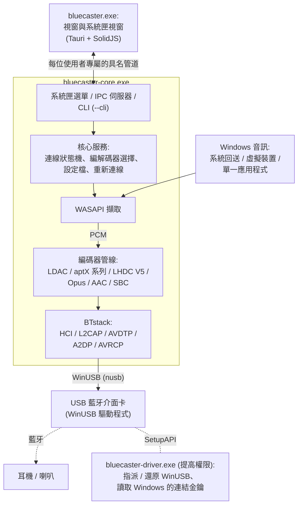
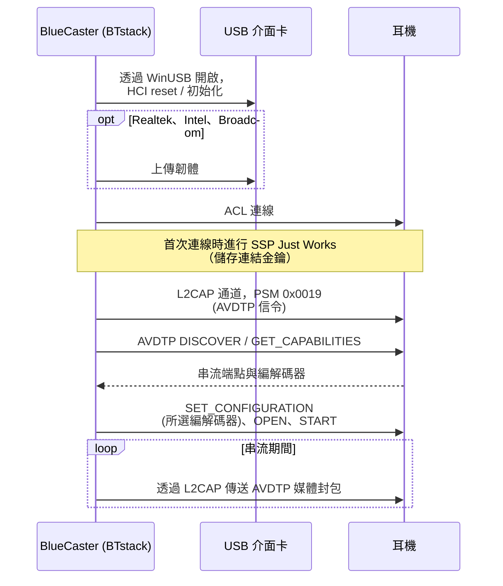
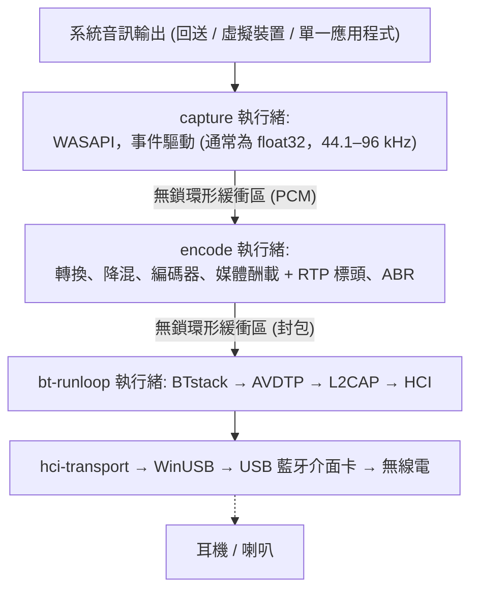
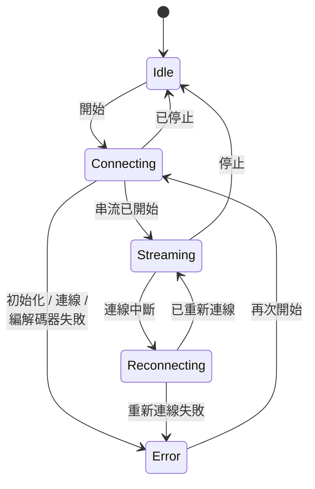
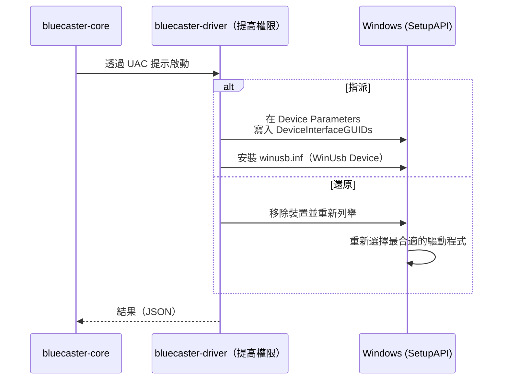

# 架構
{: .no_toc }

## 目錄
{: .no_toc .text-delta }

1. TOC
{:toc}

---

## 概觀 {#overview}

BlueCaster 讓 Windows 能使用 LHDC V5、LDAC、aptX Adaptive、aptX HD、aptX Low Latency、aptX、Opus、AAC、SBC XQ 與 SBC 藍牙音訊（以及透過 LE Audio 的 LC3，實驗性）。Windows 本身的藍牙堆疊在 A2DP 上只支援 SBC、傳統 aptX 與 AAC（僅限 Windows 11）；BlueCaster 不需要核心模式驅動程式，就能加入其他編解碼器。

BlueCaster 使用 **BTstack + WinUSB**：所有程式碼都在使用者模式下執行，因此不需要驅動程式簽章。

BlueCaster 2.0 以 Rust 撰寫。無法取代的 C 程式庫（BTstack 與各編解碼器的編碼器）從原始碼編譯，並透過小型 FFI crate 呼叫；其餘部分（包括 SBC 編碼器）全都是 Rust。

## 處理程序 {#processes}

BlueCaster 最多以三個程式執行：

| 程式 | 執行時機 | 工作內容 |
|:--------|:-----|:-----|
| `bluecaster-core.exe` | BlueCaster 執行期間（由視窗、「開始」功能表或 **隨 Windows 啟動** 啟動） | 藍牙、音訊擷取與編碼、設定檔與設定、系統匣圖示及其選單、IPC 伺服器。`--cli` 則改從主控台執行同一個核心 |
| `bluecaster.exe` | 只在視窗開啟期間執行（最後一個視窗關閉 3 分鐘後結束） | 主視窗與系統匣視窗（Tauri 2、SolidJS + TypeScript）。本身不保存任何狀態 |
| `bluecaster-driver.exe` | 變更驅動程式或匯入金鑰時，以系統管理員權限（UAC）短暫執行 | 為介面卡指派 WinUSB、還原介面卡先前的驅動程式，或讀取 Windows 藍牙為介面卡保存的連結金鑰（`windows-keys`），然後結束 |

- **核心不是 Windows 服務。** 核心是已登入使用者的一般處理程序，因為 WASAPI 回送擷取的是該使用者工作階段的音訊。每個工作階段的 mutex 確保只有一個執行個體；再次啟動核心會開啟視窗。
- **系統匣屬於核心。** 系統匣圖示的右鍵選單（開啟、前 10 個裝置、中斷連線、結束）會立即開啟，不需要啟動視窗。按一下左鍵則會開啟系統匣視窗（或依設定開啟主視窗）。
- **視窗只負責顯示狀態。** 視窗會先收到核心狀態的快照，之後再收到每一項變更。關閉視窗或視窗當機，都不會停止音訊。關閉視窗只是將它隱藏，因此從系統匣重新開啟時會立即出現。
- **命令列使用同一個核心。** `bluecaster-core.exe --cli` 會在沒有系統匣與 IPC 的情況下執行核心服務；模擬器測試就是使用這個模式。

## 傳輸：BTstack + WinUSB {#transport-btstack--winusb}

BlueCaster 完全不經過 Windows 藍牙堆疊，而是透過 WinUSB（Microsoft 簽署的通用 USB 驅動程式）直接與 USB 藍牙介面卡通訊。BTstack 是公開原始碼的藍牙堆疊（非商業授權），在使用者模式下實作 HCI、L2CAP、AVDTP 與 A2DP。

**優點**：
- 不需要驅動程式簽章費用
- 不需要測試簽章模式
- 不需要停用安全開機
- 所有程式碼都在使用者模式下執行（較容易偵錯）

**取捨**：
- 需要一張專用的 USB 藍牙介面卡（與 Windows 內建藍牙分開）
- 被 WinUSB 佔用期間，該介面卡無法用於一般的 Windows 藍牙
- 裝置需透過 USB 介面卡掃描（GAP inquiry）找到，或手動輸入位址

**運作方式**：
1. 使用者在應用程式中（**介面卡 > 替換為 WinUSB 驅動程式**，請參閱 [驅動程式指派](#driver-assignment)）或透過 Zadig，為 USB 藍牙介面卡指派 WinUSB
2. `hci-transport` crate 以 `nusb` 透過 WinUSB 開啟介面卡，並將它作為 HCI 傳輸層接到 BTstack
3. BTstack 傳送 HCI 命令以初始化藍牙控制器
4. 對於 Realtek、Intel 與 Broadcom 介面卡，BlueCaster 會視需要上傳韌體
5. BTstack 建立 ACL 連線並開啟 L2CAP 通道（PSM 0x0019）
6. AVDTP 信令探索遠端 SEP 並協商編解碼器
7. 編碼後的音訊以 AVDTP 媒體封包的形式透過 L2CAP 傳送

USB 傳輸層保留了 v1 時實際介面卡所需的復原步驟：開啟介面卡時重設事件與 ACL 管道、事件讀取失敗時重試、HCI 命令設有逾時，並在關閉介面卡時傳送 HCI Reset（仍在 bootloader 中的控制器除外），讓下一個工作階段面對的是閒置的控制器。

## Crate 結構 {#crate-structure}

程式碼是一個 Cargo 工作區（儲存庫根目錄的 `Cargo.toml`），分為五層；每一層只依賴下方的層。程式庫位於 `app/src/crates/`，程式則位於 `app/src/core`、`app/src/ui` 與 `app/src/driver`。內含於專案的 `aptx-adaptive` crate 是 `codec` 的路徑相依項目，不屬於工作區。只有 `*-sys` crate 與 `win-sys` 可以包含 `unsafe` 程式碼；其他所有 crate 都標有 `#![forbid(unsafe_code)]`。

| 層 | Crate | 工作內容 |
|:------|:------|:-----|
| 1. FFI | `btstack-sys` | 以 `cc`（MSVC）建置 BTstack、手寫的 FFI 宣告與安全包裝函式、`btstack_config.h`。BTstack 只能在其 run loop 執行緒上呼叫，這由 `!Send` 的 `Stack` token 強制保證 |
| 1. FFI | `ldac-sys`、`openaptx-sys`、`fdkaac-sys`、`lhdcv5-sys`、`opus-sys`、`lc3-sys` | 建置 C 編碼器並對外提供；每個程式庫各一個 crate，讓各自的授權維持分離 |
| 1. FFI | `win-sys` | 沒有 Rust 程式庫的 Win32 API：MMCSS、預設音訊裝置（IPolicyConfig）、WLAN API（AFH）、電源通知、Run 機碼、媒體鍵、管道的 DACL、提高權限、WinUSB 驅動程式指派（SetupAPI），以及 Windows 本身的藍牙（其無線電、已配對的裝置與連結金鑰） |
| 2. 元件 | `hci-transport` | 以 `nusb` 實作 HCI over USB（「H2」），以及透過 TCP 以 H4 連線到虛擬控制器（`tools/emu`） |
| 2. 元件 | `aptx-adaptive` | 以 Rust 撰寫的 aptX Adaptive 編碼器（內含自 AKS-Logic/aptx-adaptive-linux，MIT） |
| 2. 元件 | `codec` | `Encoder` trait、SBC 編碼器（Bluedroid 編碼器的 Rust 移植版）、C 編碼器的安全包裝函式、Codec Information 解析與編解碼器選擇 |
| 2. 元件 | `audio-capture` | WASAPI 擷取（`wasapi` crate）：系統回送、虛擬裝置、單一應用程式（處理程序回送）；裝置與應用程式清單、測試音、各應用程式的音量（音量混音程式） |
| 2. 元件 | `voice-link` | 耳機麥克風的音訊（開發人員模式）：將單聲道 PCM 播放到所選的輸出裝置（WASAPI）、將擷取的音訊降混為單聲道供上行使用，以及透過 SCO 酬載傳送的 CVSD / mSBC / LC3-SWB 語音編解碼器 |
| 3. 引擎 | `bt-host` | 在專用執行緒上執行 BTstack，由命令與具型別的事件驅動：GAP、A2DP Source、AVRCP、SDP、供轉送使用的 RFCOMM 通道（`rfcomm.*`）、連結金鑰、裝置的 SDP 服務、AFH、韌體載入與晶片載入程式（`bringup`）、晶片探測與晶片指令碼、HCI 擷取（`.pklg`）、LE Audio（`le/`） |
| 2. 元件 | `le-audio` | LE Audio：不依賴 BTstack 或 Windows 的邏輯（assigned numbers、LTV、PACS / ASCS PDU、預設組合、CSIP / VCP / MCP / CCP 模型） |
| 3. 引擎 | `pipeline` | PCM 環形緩衝區、格式轉換、降混、編碼、媒體酬載、送出節奏控制、ABR |
| 4. 核心 | `bluecaster-core`（目錄 `core`） | 狀態機、重新連線、睡眠 / 恢復、設定檔、設定與 v1 移轉、音量同步、輸出靜音、更新檢查、Realtek 韌體下載、接收器測試用戶端、統計資料、廠商協定（`vendor/`） |
| 4. 核心 | `ipc` | 核心與視窗共用的通訊協定型別（serde；TypeScript 型別以 `ts-rs` 產生）與管道的訊框處理 |
| 5. 程式 | `bluecaster-core-exe`（`app/src/core`） | `bluecaster-core.exe`：核心、系統匣（在 `tao` 事件迴圈上使用 `tray-icon`）、IPC 伺服器、`--cli` |
| 5. 程式 | `bluecaster-ui`（`app/src/ui`） | `bluecaster.exe`：Tauri 2；Rust 端是 IPC 用戶端，頁面為 SolidJS + TypeScript + Vite |
| 5. 程式 | `bluecaster-driver`（`app/src/driver`） | `bluecaster-driver.exe`：提高權限的輔助程式 |

## 音訊路徑與執行緒 {#audio-path-and-threads}

| 執行緒 | 優先順序 | 工作 |
|:-------|:---------|:-----|
| capture | MMCSS "Audio" | 讀取 WASAPI；無聲的區段以靜音填補 |
| encode | MMCSS "Pro Audio" | 將 PCM 轉換為編碼器接受的格式，以完整的編碼器區塊為單位編碼（剩餘部分留待下一輪），並將訊框打包成媒體酬載；每輪約 10 ms，讓封包平均送出 |
| bt-runloop | -- | BTstack 的 run loop；每當 L2CAP 可以傳送時，就送出佇列中的封包。每次有封包加入佇列時，傳送佇列（64 個封包）會從最舊的開始，捨棄已等待 350 ms（LHDC V5 低延遲時為 100 ms）的封包 |
| USB | -- | WinUSB 傳輸：每個 IN 管道（事件、ACL 資料）上同時有三個讀取在進行，另有一個命令寫入者與一個 ACL 資料寫入者（同時最多 8 個傳輸） |
| core | Normal | 狀態機、IPC（tokio；RFCOMM 轉送的各連線佇列）、設定、統計資料（4 Hz）、更新檢查 |

串流開始後，音訊路徑不會配置記憶體，也不會取得任何鎖。統計資料是原子計數器，核心每秒讀取四次。BTstack 並非執行緒安全，因此其他執行緒會把命令送給它，這些命令在 bt-runloop 執行緒上執行。

## 核心與 IPC {#core-and-ipc}

視窗透過使用者的具名管道 `\\.\pipe\bluecaster-<user SID>` 與核心通訊，管道的 DACL 只允許該使用者存取。訊息是附有長度前置碼的 JSON 訊框：

1. 視窗傳送 `hello { protocol, client }`。通訊協定版本不同的核心會回應 `reject`，視窗則會告知兩個程式的版本不同。否則核心會回應 `welcome { protocol, server, features }`；`features` 列出通訊協定的新增功能（`rfcomm`）。
2. 核心傳送 `snapshot`：包含完整狀態（介面卡、裝置、串流、設定檔、設定、更新）與修訂編號。
3. 之後核心會以 `event` 傳送變更。如果視窗漏掉了某個修訂編號，就會重新取得快照。
4. 操作以 `request { id, method, params }` 送出，並以 `response { id, result | error }` 回應。方法群組有 `state.*`、`stream.*`、`device.*`、`profile.*`、`settings.*`、`adapter.*`、`audio.*`、`diag.*`、`receiver.*`、`rfcomm.*` 與 `app.*`。

其他程式也使用同一條管道，請參閱 [整合 (IPC)](integration)。3.0.0 之前的版本將管道命名為 `\\.\pipe\a2dpwb-<user SID>`；在 3.0.0 推出後至少 6 個月內，核心也會繼續提供這個名稱。

錯誤是附有參數的代碼（例如 `adapter.driver_missing`），而不是文字；視窗會將代碼翻譯，並在訊息旁顯示解決方法。高頻率的資料（連線品質、記錄）只會在某個畫面訂閱時才傳送。

連線狀態機：

連線失敗時，核心最多嘗試 3 次。連結中斷時最多重新連線 3 次；若藍牙堆疊曾重新啟動（睡眠、介面卡停止運作），則最多 10 次。電腦進入睡眠時，核心會停止 BTstack，不把中斷的連結計為失敗，並在電腦恢復後重新連線。

## 驅動程式指派 {#driver-assignment}

Windows 8 以上內建由 Microsoft 簽署的 WinUSB 驅動程式（`winusb.inf`）。`bluecaster-driver.exe` 透過 SetupAPI，執行與裝置管理員「更新驅動程式 > 讓我挑選 > WinUsb Device」相同的動作：

1. 以裝置執行個體 ID 開啟介面卡。
2. 在介面卡的 `Device Parameters` 中寫入 `DeviceInterfaceGUIDs` 值，讓 WinUSB 為它註冊裝置介面。
3. 選取 `%SystemRoot%\INF\winusb.inf` 的「WinUsb Device」型號，並以 `DiInstallDevice` 安裝。內建驅動程式已經簽署，因此不會安裝任何憑證（不同於 Zadig / libwdi，它們會以自製憑證簽署產生的 INF）。
4. **還原**：移除裝置（`DiUninstallDevice`）並重新列舉；Windows 接著會再次選擇排名最高的驅動程式（通常是 `BthUSB` 或廠商的驅動程式）。介面卡先前使用的驅動程式會記錄在設定資料夾中（`driver\`），並在還原後與結果比對。`restore --records <folder>` 會在一次提高權限的執行中，還原所有已記錄的介面卡；解除安裝程式在詢問使用者後會使用此功能。

核心絕不會以系統管理員身分執行：進行指派或還原時，核心會以 UAC 提示（`ShellExecuteEx` "runas"）啟動輔助程式，並讀取輔助程式的 JSON 結果。列出介面卡及其驅動程式不需要提高權限。

## 主要模組 {#key-modules}

### 編解碼器選擇 (`codec::caps`) {#codec-choice-codeccaps}

- 解析遠端的能力：標準的 SBC 與 AAC 元素，以及廠商編解碼器，包括兩種 Vendor ID 下的 aptX LL，以及 aptX Adaptive（R1 與 R2 接收端；僅在支援 48 kHz 立體聲時可用）
- 選擇編解碼器：「自動」會選用遠端提供的編解碼器中音質最高的一個。如果遠端沒有提供所要求的編解碼器，會改用「自動」會選擇的編解碼器（設定檔自 issue #86 起一律如此；命令列只有加上 `--fallback` 時才會），否則視為錯誤。遠端未提供、但仍在卡片上選擇的編解碼器（設定檔的 `codec_forced`）仍會照樣要求，不改用其他編解碼器（`RemoteCaps::forcing`）。卡片提供的選項多於遠端所列的編解碼器（`unlisted_options`），則依 `RemoteCaps::unlisted` 設定
- `auto_codec` 設定開啟時（**編解碼器 > 自動選擇支援的音質最高的編解碼器**；自 schema 5 起是適用於所有裝置的單一設定），每個 A2DP 設定檔都以「自動」及其預設設定串流。為裝置選擇的編解碼器會保留在設定檔中，供關閉此設定時使用
- 依照使用者拖曳裝置卡片排出的編解碼器順序（設定檔的 `codec_order`；`codec::AutoOrder`，空白表示依音質由高到低），決定「自動」的選擇，以及所選編解碼器的替代選擇（自動選擇開啟時亦同）。FastStream 與 Opus 05 永遠不會成為「自動」的選擇或替代選擇。（2.0.2 的搶先版對所有裝置使用同一個順序，即 settings.json 的 `auto_order`，現已忽略。）
- 選擇 aptX 系列的取樣率（從遠端公告的取樣率中選擇 44.1 / 48 kHz；擷取的音訊由 WASAPI 重新取樣）。aptX Adaptive 使用 48 kHz；只有在選擇 96 kHz、品質為高，且接收端為 R2 並列出 96 kHz 時，才使用 96 kHz。取樣率設為「自動」時（自動選擇開啟時亦同）會要求 48 kHz；若接收端未列出 48 kHz，則由各編解碼器的選擇邏輯，從接收端列出的取樣率中選出最佳者（issue #86：不是列出的最高取樣率，也不是 Windows 的混音取樣率）
- 將設定檔的品質對應到編解碼器提供的品質（`Quality::for_codec`，issue #86）：LDAC 與 LHDC V5 為高 / 中（`sq`）/ 低（`mq`），LHDC V5 另有中高（`mhq`），aptX Adaptive 為高 / 低延遲，其他所有編解碼器為高（裝置接受的最高位元率）。編解碼器已不再提供的品質（aptX Adaptive 的標準 / 行動、AAC 的較低等級）會以高執行
- 記錄裝置為所提供的每種編解碼器列出的內容（`KnownCodecs.caps`：取樣率、位元深度、最大位元率；`RemoteCaps::listed_*`），讓編解碼器設定只提供這些選項；SBC 的 bitpool 範圍原本就有記錄

### 藍牙主機 (`bt-host`) {#bluetooth-host-bt-host}

**職責**：
- 在專用執行緒上，以 USB（或 TCP）HCI 傳輸層執行 BTstack
- 註冊串流端點：廠商編解碼器（LDAC、aptX HD、aptX、aptX LL、LHDC V5、FastStream、Opus、Opus 05、aptX Adaptive），加上 SBC（SBC XQ 也使用）與 AAC，共 11 個（BTstack 的 `MAX_NR_AVDTP_STREAM_ENDPOINTS`）
- 註冊 SDP 記錄（A2DP Source、AVRCP Controller、AVRCP Target；該設定開啟時，另有僅用於電量的 HFP Audio Gateway）
- 管理 SSP 配對（Just Works、General Bonding；保存連結金鑰）
- 連線逾時後拆除半開的連線，讓重試能正常進行
- 重試失敗的連線（最多 3 次），並區分失敗原因（沒有回應、連結沒有資料、遠端結束連結、驗證）；捨棄裝置已不認得的連結金鑰並重新配對
- 用於裝置掃描的 GAP inquiry
- AVRCP 絕對音量與耳機按鈕
- AFH 主機通道分類，以及供連線品質畫面使用的 RSSI / AFH 讀數
- 韌體載入：Realtek 與 Broadcom 透過 BTstack 的晶片組驅動程式，Intel（傳統與 TLV bootloader）則在共用的晶片載入程式介面（`bringup`）上以 Rust 實作；介面卡啟動期間，**介面卡** 畫面會顯示載入進度
- 開發人員模式：晶片探測（介面卡對標準讀取命令的回應，以 JSON 報告存於 `logs\probe\`）、晶片指令碼（以文字撰寫、在使用 WinUSB 的介面卡上執行的請求），以及已連線裝置列出的 SDP 服務
- HCI 擷取（`.pklg`）；在連線途中開始擷取時，也會包含連線建立過程

**使用的主要 BTstack API**：
- `a2dp_source_create_stream_endpoint()` — 註冊編解碼器端點
- `a2dp_source_establish_stream()` — 連線到 A2DP 接收端
- `a2dp_source_set_config_other()` — 設定廠商專屬編解碼器
- `a2dp_source_stream_send_media_payload_rtp()` — 傳送附 RTP 標頭的編碼音訊（LDAC、aptX HD、AAC、SBC、SBC XQ、LHDC V5、Opus）
- `a2dp_source_stream_send_media_packet()` — 傳送不含 RTP 標頭的原始媒體封包（aptX、aptX LL、FastStream），或帶有 BlueCaster 自己 RTP 標頭的媒體封包（aptX Adaptive）

### 音訊擷取 (`audio-capture`) {#audio-capture-audio-capture}

使用 Windows Audio Session API 即時擷取音訊。
- 預設輸出裝置的系統回送、所選（虛擬）裝置的回送，或單一應用程式及其子處理程序的處理程序回送（Windows 10 組建 19041 以上）
- 提供裝置共用模式的混音格式（通常為 float32；由管線轉換為編碼器所需的格式）
- 在應用程式模式下，會等待應用程式啟動，並在應用程式重新啟動後繼續擷取
- 與 Windows 的音量混音程式一樣，設定預設輸出上各應用程式的音量與靜音（`mixer`）：即使核心在系統回送串流期間將該輸出靜音，工作階段的音量仍會套用到回送擷取（`bluecaster-core::mute_output`）

### 廠商協定 (`bluecaster-core::vendor`) {#vendor-protocols-bluecaster-corevendor}

有些耳塞式耳機必須由廠商的 App 透過耳機本身的 RFCOMM 服務切換模式後，才會提供某種編解碼器或位元率。BlueCaster 為每個廠商各準備一個模組，透過 BlueCaster 既有的連結執行切換，並依耳機名稱辨識耳機：

- **華為 / 榮耀**：設定檔要求 LDAC、但耳機沒有列出 LDAC 時，模組會開啟耳機的「音質優先」模式並重新連線；如果仍然沒有 LDAC，原本關閉此模式的耳機會被改回關閉。「自動」時一律不執行
- **OPPO**：LHDC V5 串流時（手動選擇或由「自動」選擇），模組會向耳機要求一次 Hi-Res，並重新連線一次，讀取耳機之後列出的內容。這項紀錄會與裝置的編解碼器一起保存（`device_codecs.json`），直到 `device.forget_codecs` 將其清除

開發人員模式的 **廠商** 分頁可設定各模組的執行時機（依名稱自動、一律、永不），並提供該廠商自己的選項。

### 配對 (`link_keys`、`win-sys::bt_keys`) {#pairings-link_keys-win-sysbt_keys}

連結金鑰保存在 `link_keys.txt`。新增裝置時，核心可以匯入 Windows 藍牙為 BlueCaster 現在使用的介面卡所保存的金鑰：由 `bluecaster-driver.exe windows-keys` 讀取（一次 UAC 提示）。BlueCaster 已有的金鑰會保留，匯入的金鑰中屬於音訊裝置的，會以 Windows 中的名稱儲存。開發人員模式會顯示裝置的連結金鑰，以及裝置列出的 SDP 服務。

`pairing\` 中的金鑰檔案（連結金鑰、LE 綁定資訊、協調集、從 Windows 匯入的 LE 金鑰、被取代的 Windows 金鑰）會以 DPAPI 依 Windows 使用者加密（`win-sys::dpapi`）；其他使用者無法讀取，複製到其他電腦後也無法讀取。舊版本的明文檔案會被讀取，並以加密形式重新寫入。無法解密的檔案會保留為 `<名稱>.undecryptable`，對應的裝置則需重新配對。BTstack 的 LE TLV 由 BlueCaster 自行保存（`btstack-sys` 的 `TlvStore`，內容與 `btstack_tlv_windows` 寫入的相同）。還原時由提高權限的輔助程式讀取的 `keys_for_windows.json` 仍為明文（輔助程式可能以另一位系統管理員的身分執行），並在輔助程式結束後刪除。

### 音訊編碼器 {#audio-encoders}

| 編碼器 | 程式庫 | 位元率 | 特色 |
|---------|---------|---------|----------|
| LHDC V5 | lhdcv5-enc（AOSP 編碼器的 C 語言移植版） | 400/500/900/1000 kbps（低/中/中高/高），不超過接收端列出的最大值，ABR 160–400 kbps | 16/24 位元、5 ms 訊框、2 位元組媒體酬載標頭、RTP 標頭；接收端有列出時支援低延遲（每 10 ms 而非 20 ms 編碼一次；ABR 關閉時，另加下文的佇列保護） |
| LDAC | libldac (AOSP) | 330/660/990 kbps | 高/中/低（HQ/SQ/MQ）模式、ABR |
| aptX Adaptive | aptx-adaptive（AKS-Logic/aptx-adaptive-linux 的純 Rust 編碼器，MIT） | 高 427 kbps、低延遲 265 kbps（R2 接收端：270）；ABR 降至 364/318（R2：270/204） | 48 kHz 立體聲（選擇 96 kHz 時，對列出 96 kHz 的 R2 接收端於高品質使用 96 kHz：646/340/255 kbps）、24 位元；每個媒體封包一個編解碼器封包，前面加上 BlueCaster 自己的 RTP 標頭；高品質時使用 ABR；「自動」將它排在 LHDC V5 與 LDAC 之後 |
| Opus | libopus 1.6.1 | 256 kbps（立體聲；單聲道為一半） | Android 的 A2DP Opus：48 kHz、20 ms 訊框（接收端只支援 10 ms 時使用 10 ms）、以媒體酬載大小為上限的受限 VBR、每個封包一個訊框、1 位元組媒體酬載標頭、RTP 標頭 |
| aptX HD | libopenaptx | 576 kbps | 24 位元輸入、固定位元率、RTP 標頭 |
| aptX | libopenaptx | 352/384 kbps (44.1/48 kHz) | 16 位元立體聲、無 RTP 標頭 |
| aptX LL | libopenaptx | 352 kbps | 約 32 ms 延遲、無 RTP 標頭、封包 ≤ 約 7.5 ms |
| AAC | fdk-aac | 最高 256 kbps（不超過接收端列出的位元率） | AAC-LC、LATM 傳輸 |
| SBC XQ | 同一個 SBC 編碼器 | 約 385/505/552 kbps | 雙聲道（dual channel），44.1 / 48 kHz 時 bitpool 47 / 43（高）；只在接收端的 SBC 允許雙聲道且 bitpool 至少為 29 時使用（之後與 PipeWire 一樣，將 bitpool 限制在接收端的最大值）；與 SBC 共用串流端點、媒體酬載標頭與 RTP 標頭 |
| SBC | Bluedroid 編碼器的 Rust 移植版 | 最高約 345 kbps | A2DP 必備的基本編解碼器；輸出與 C 編碼器位元完全一致（已測試所有設定組合） |
| FastStream | 同一個 SBC 編碼器 | 198/216 kbps (44.1/48 kHz) | CSR 廠商編解碼器，只傳送音樂（無語音回傳通道）：SBC joint stereo、bitpool 29，訊框補齊至 72 位元組，每個封包 3 個訊框，沒有媒體酬載標頭也沒有 RTP 標頭（與 PipeWire 相同）；「自動」永遠不會選用 |

**LHDC V5 佇列保護**（低延遲開啟、ABR 關閉時）：傳送佇列在一秒內平均有 12 個以上的封包時，編碼器會將位元率降低一級（1000、900、再到 500 kbps），兩次之間至少間隔 2 s。平穩一分鐘後，編碼器會將位元率提高一級。若提高後未能維持 30 s，等待時間加倍，最長 10 分鐘。

所有編碼器都實作 `codec::Encoder` trait：說明 PCM 格式與每次呼叫消耗的訊框數，並傳回編解碼器訊框。

libopenaptx 預期的輸入是以 4 個立體聲取樣為一組、packed 24-bit little-endian 的 PCM；aptX 包裝函式會把 16 位元或 32 位元取樣轉換為這種格式，單聲道輸入則複製到兩個聲道。

## 廠商編解碼器資訊元素 {#vendor-codec-information-elements}

非標準編解碼器在 AVDTP 中以 Vendor Specific 註冊：

| 編解碼器 | Vendor ID | Codec ID |
|-------|-----------|----------|
| LHDC V5 | Savitech (0x0000053A) | 0x4C35 |
| LDAC | Sony (0x0000012D) | 0x00AA |
| aptX Adaptive | Qualcomm (0x000000D7) | 0x00AD |
| Opus | Google (0x000000E0) | 0x0001 |
| aptX HD | Qualcomm (0x000000D7) | 0x0024 |
| aptX | APT (0x0000004F) | 0x0001 |
| aptX Low Latency | CSR (0x0000000A) 或 Qualcomm (0x000000D7) | 0x0002 |
| FastStream | CSR (0x0000000A) | 0x0001 |
| Opus 05 | The Linux Foundation (0x000005F1，PipeWire) | 0x1005 |

AAC 與 SBC 使用 A2DP 規格中定義的標準 Codec ID。

編解碼器資訊元素的大小（含 6 位元組的 vendor/codec ID）：

- **aptX**：7 位元組（第 6 位元組 = 取樣率 / 聲道模式）
- **aptX HD**：11 位元組（第 6 位元組同 aptX，另加 4 個保留位元組）；必須為立體聲
- **aptX LL**：8 位元組；接收端設定延伸（「new caps」）旗標時為 17 位元組。BlueCaster 註冊一個 aptX LL 端點，並以接收端使用的 Vendor ID 設定串流
- **LHDC V5**：11 位元組（Android `a2dp_vendor_lhdcv5_constants.h`）：第 6 位元組為取樣率（0x20 44.1k、0x10 48k、0x04 96k、0x01 192k），第 7 位元組為位元深度（0x04 16-bit、0x02 24-bit）與接收端的最小 / 最大位元率限制，第 8 位元組為編解碼器子版本（0x01 = V5 ver.1）與 0x10 = 5 ms 訊框，第 9-10 位元組為選用功能（low latency、lossless、JAS、AR、META）。LHDC V5 設定中開啟低延遲且接收端有列出時，BlueCaster 會要求低延遲（第 9 位元組，0x40）。其他功能 BlueCaster 都不提供。只支援立體聲。與 Android 相同，接收端的位元率限制會在設定中回傳，並套用到編碼器。媒體封包帶有 2 位元組的酬載標頭：訊框數 << 2（延遲位元為 0）與序號
- **FastStream**：8 位元組（PipeWire `a2dp_faststream_t`）：第 6 位元組為方向（0x01 sink = 音樂、0x02 source = 語音），第 7 位元組的低 4 位元為接收端取樣率（0x2 44.1k、0x1 48k），高 4 位元為來源端取樣率（0x2 16k）。BlueCaster 只提供並設定音樂方向
- **Opus**：7 位元組（Android `a2dp_vendor_opus_constants.h`）：第 6 位元組的位元 2..0 為聲道模式（0x01 單聲道、0x02 立體聲、0x04 雙單聲道），位元 4..3 為訊框長度（0x08 10 ms、0x10 20 ms），位元 7 為 48 kHz。BlueCaster 提供單聲道與立體聲、10 與 20 ms，並設定為 20 ms 立體聲（只有在輸入為單聲道且接收端支援單聲道時才使用單聲道）。媒體封包在 1 位元組的酬載標頭（低 4 位元為訊框數 1）之後帶有一個 Opus 封包
- **aptX Adaptive**：40 位元組。BTstack 的能力事件會把接收端的編解碼器資訊截斷為 30 位元組，但其中仍包含 BlueCaster 使用的所有內容。SET_CONFIGURATION：48 kHz、來源類型 2（主機編碼器：由接收端自行控制播放時序）、立體聲；R1 接收端會收到自己的目標延遲位元組，其中 LL0 提高到至少 80 ms，HQ 延遲為 0 時改為 200 ms；R2 接收端則會收到來源端自己的 R2 區塊

**RTP 與無 RTP**：LDAC、aptX HD、AAC、SBC、SBC XQ、LHDC V5 與 Opus 的媒體封包帶有 12 位元組的 RTP 標頭。aptX、aptX LL 與 FastStream 則 **不帶** RTP 標頭傳送（與 Android 及 PipeWire 相同），因此整個 L2CAP MTU 都可用於 aptX 訊框。

**aptX Adaptive** 在每個媒體封包中傳送一個編解碼器封包，前面加上 BlueCaster 自己的 12 位元組 RTP 標頭（BTstack 不另外加）：酬載類型 96，序號每個封包 +1，時間戳記為封包中每聲道的取樣數（不是時鐘），SSRC 為接收端的延遲模式（HQ 0x000000A3、LL 0x000000A1）。酬載以 16 位元字組為單位交換位元組順序。HQ 封包為 656 位元組（12 ms），LL 封包為 348 位元組（10 ms）。「自動」將它排在傳統 aptX、Opus 與 AAC 之前，但在 LHDC V5 與 LDAC 之後（issue #86 的順序）。

## 設定與檔案 {#settings-and-files}

所有內容都保存在設定資料夾 `%APPDATA%\BlueCaster`（或環境變數 `BLUECASTER_CONFIG_DIR` 指定的資料夾）中。v1 與 2.0.x 既有的檔案沿用原本的格式；2.0.x 使用 `%APPDATA%\A2DPWB`，3.0.0 第一次啟動時會將該資料夾重新命名，並把檔案分類到下列資料夾中：

| 路徑 | 內容 |
|:-----|:---------|
| `settings.json` | 應用程式設定，附 `schema_version`；未知的鍵會保留 |
| `profiles.json` | 設定檔 |
| `devices\devices.txt` | 已知裝置 |
| `devices\le_audio_devices.txt` | LE Audio：裝置清單中的 LE Audio 項目 |
| `devices\le_audio_sets.txt` | LE Audio：已儲存裝置的協調集（僅成員位址；一對耳機視為一個裝置） |
| `devices\device_codecs.json` | 每個傳統藍牙裝置上次連線時提供的內容（以及是否曾向 OPPO 耳機要求 Hi-Res） |
| `pairing\link_keys.txt` | 連結金鑰：與 v1 或 2.0.x 配對過的耳機不需重新配對即可重新連線 |
| `pairing\le_audio_bonds.tlv`、`pairing\le_audio_csip.txt` | LE Audio：LE 綁定資訊（含 GATT 伺服器持久保存的 CCC 值）以及協調集 |
| `pairing\windows_le_keys.txt`、`pairing\replaced_windows_keys.json` | 從 Windows 匯入的 LE 金鑰（保存到啟用 LE 的藍牙堆疊將其加入為止）；以及 **還原原始驅動程式** 所取代的 Windows 金鑰 |
| `adapters\adapter_caps.json` | 堆疊對每個介面卡得知的資訊（是否支援 LE Audio、位址、HCI 版本、Windows 中的名稱） |
| `adapters\driver\<instance id>.json` | 每個曾指派 WinUSB 的介面卡先前使用的驅動程式 |
| `firmware\` | 韌體檔案（`*.bin`、`*.hcd`、`ibt-*`；Intel 的也放在 `firmware\intel\`，與 linux-firmware 的配置相同）；舊版直接放在設定資料夾中的檔案會移到這裡 |
| `logs\<YYYY-MM-DD>\core.log`、`ui.log`、`driver.log` | 核心、視窗與驅動程式輔助程式的記錄，每天一個資料夾（UTC）；未經遮蔽 |
| `logs\hci\*.pklg` | HCI 擷取檔：飛行記錄器的擷取檔，在串流失敗或連線中斷時寫入（最新的 10 個），以及您自行開始的擷取檔（`hci_<date>_<time>.pklg`） |
| `logs\probe\` | 晶片探測與晶片指令碼的報告（最新的 10 個） |
| `logs\crash\` | 當機報告：每次當機一個 minidump（`*.dmp`）與一個文字檔（每個程式最新的 5 個） |
| `logs\bundles\*.zip` | 診斷套件（最新的 3 個） |
| `backup\v1\` | v1 設定的複本，在 v2 首次啟動時建立一次 |
| `backup\v2\` | 2.0.x 設定與配對的複本，在 3.0.0 首次啟動時建立一次 |
| `backup\profiles-before-codecs.json` | 「編解碼器」畫面將同一裝置的多個設定檔併為一個之前的 `profiles.json`（只寫入一次） |

程式資料夾為 `%LOCALAPPDATA%\BlueCaster\`：其中有三個程式、解除安裝程式與 `licenses\`（`licenses\README.txt`、`licenses\bluecaster\LICENSE...`、`licenses\third-party\...`）。韌體下載快取位於 `%TEMP%\bluecaster-cache`。

## 建置系統 {#build-system}

- 程式由 **Cargo** 建置，不需要 CMake。每個 `-sys` crate 會在 `build.rs` 中以 MSVC 編譯 `extern/` 內 git 子模組的 C 程式庫。只有開發者工具 `tools/a2dp_decode` 以 CMake 建置
- 視窗的頁面以 **Vite** 建置（在 `app/src/ui` 中執行 `pnpm build`），並由 Tauri 內嵌到 `bluecaster.exe` 中
- IPC 通訊協定的 TypeScript 型別由 Rust 型別產生（`cargo test -p ipc export_bindings`）
- 語言檔（`app/lang/*.json`）由視窗與核心的系統匣選單共同使用
- `installer/build-release.ps1` 會產生安裝程式（Inno Setup，`installer/BlueCaster.iss`）、免安裝版 zip 與更新程式資訊清單。請參閱 [建置](building)

## 重要注意事項 {#important-considerations}

- **介面卡相容性**：Realtek（測試最完整）、CSR、Intel、Broadcom、MediaTek 等（[已驗證的硬體](hardware)）。Realtek 介面卡，以及處於 bootloader 模式的 Intel 介面卡，啟動時需要上傳韌體
- **配對**：BlueCaster 使用 SSP Just Works 搭配 General Bonding。連結金鑰保存在本機檔案中，或從該介面卡的 Windows 藍牙匯入
- **建議使用第二個介面卡**：內建藍牙留給 Windows 使用，BlueCaster 則使用專用的 USB 介面卡
- 部分介面卡的韌體會限制可達到的位元率
- 支援藍牙 5.0 以上的 USB 介面卡，通常很適合 LDAC
- 「自動」選擇編解碼器的優先順序（依音質，issue #86）：LHDC V5 > LDAC > aptX Adaptive > Opus > aptX HD > aptX > aptX LL > AAC > SBC XQ > SBC（FastStream 與 Opus 05 只在明確選擇時使用）；所選的編解碼器若裝置已不再提供，會改用裝置順序中第一個裝置有提供的編解碼器；裝置未提供、但仍在卡片上選擇的編解碼器會照樣要求（`codec_forced`，不改用其他編解碼器）
