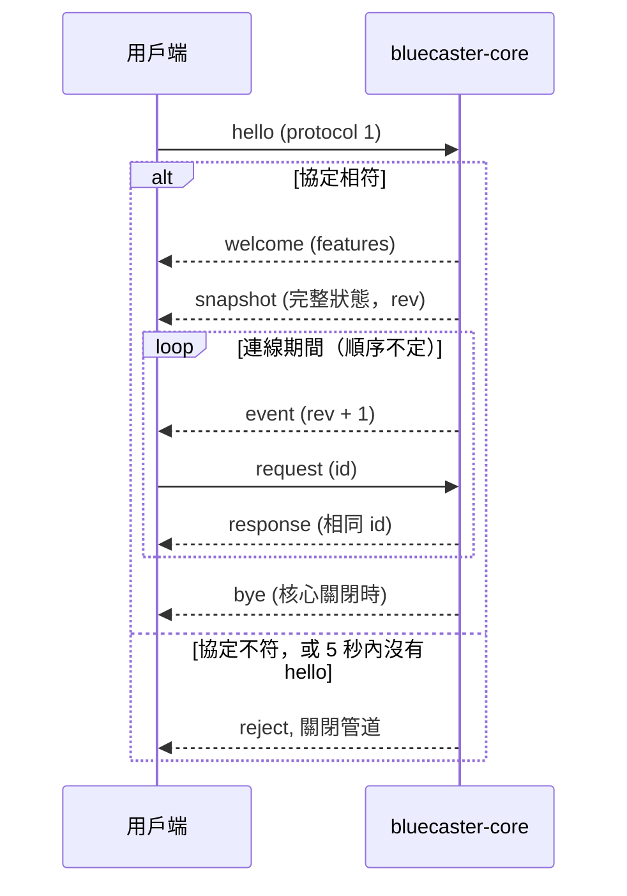

# 整合 (IPC)
{: .no_toc }

本頁說明第三方工具如何與 BlueCaster 核心通訊：顯示串流狀態、啟動及停止設定檔、設定音量，或透過 BlueCaster 的藍牙連結存取耳機本身的服務。有這類功能的工具列在 [搭配使用的工具](works-with)。

{: .warning }
> 在 2.0.2 搶先版期間，通訊協定仍可能變更。以 [`app/src/crates/ipc/src/protocol.rs`](https://github.com/SeiyaFunaokaJP/BlueCaster/blob/main/app/src/crates/ipc/src/protocol.rs)，以及由它產生、位於 [`app/src/ui/src/ipc/bindings`](https://github.com/SeiyaFunaokaJP/BlueCaster/tree/main/app/src/ui/src/ipc/bindings) 的 TypeScript 型別為準。本頁說明如何使用，不會列出每個欄位。

## 目錄
{: .no_toc .text-delta }

1. TOC
{:toc}

## 連線 {#connecting}

只要 BlueCaster 在執行，核心（`bluecaster-core.exe`）就會執行，無論視窗是否開啟。核心會在一條屬於執行它的使用者的具名管道上接聽：

```
\\.\pipe\bluecaster-<user SID>
```

- `<user SID>` 是已登入使用者的 SID 字串（`S-1-5-21-...`），例如可用 `whoami /user` 查詢。每位使用者都有自己的核心與管道；管道的 DACL 只允許該使用者存取，並拒絕遠端用戶端。
- 管道使用位元組模式。可同時連線多個用戶端（BlueCaster 視窗就是其中之一），每個用戶端都會收到相同的狀態與事件。
- 在 2.0.x 以前，管道名稱為 `\\.\pipe\a2dpwb-<user SID>`。BlueCaster 3.0.0 **兩個** 名稱都提供，並在 3.0.0 推出後至少 6 個月內繼續提供舊名稱。用戶端應先嘗試 `bluecaster-<user SID>`，失敗時再改用舊名稱。通訊協定版本仍為 1。
- 要檢查核心是否在執行，請查看管道，而不是核心的 mutex：管道不存在，就表示核心沒有執行。
- 以 `BLUECASTER_INSTANCE=<name>` 啟動的開發版本，會改在 `\\.\pipe\bluecaster-<SID>-<name>` 上接聽，因此可以與已安裝的版本同時執行。

### 服務管道 {#the-service-pipe}

BlueCaster 服務是開發人員模式中的原型功能，可讓使用者在登入畫面上使用藍牙鍵盤和滑鼠。在安裝了此服務的電腦上，核心會以 Windows 服務的形式執行。這時不會有每位使用者專屬的管道。核心會改為提供一條所有使用者共用的管道：

```
\\.\pipe\bluecaster-service
```

- 請先嘗試 `bluecaster-<user SID>`，再嘗試 `bluecaster-service`。服務不會以舊名稱提供管道。兩條管道上的訊框、交握與請求都相同。
- 開啟管道時，只要求 `GENERIC_READ | FILE_WRITE_DATA`。若要變更管道的模式，請加上 `FILE_WRITE_ATTRIBUTES`。要求 `GENERIC_WRITE` 的用戶端會被管道拒絕，因為這項存取權包含建立管道其他執行個體的權限（`FILE_CREATE_PIPE_INSTANCE`）。Python 的 `open(..., "r+b")` 會要求 `GENERIC_WRITE`，因此請改用 `CreateFileW`（例如透過 `ctypes`）。
- 若要確認伺服器確實是 BlueCaster，請比對管道伺服器的處理程序識別碼（`GetNamedPipeServerProcessId`）與 `BlueCaster` 服務的處理程序識別碼（`QueryServiceStatusEx`）。服務停止期間，其他程式可能會建立同名的管道。
- 變更整台電腦的請求會傳回錯誤 `ipc.needs_admin`，例如開發人員模式、介面卡驅動程式，以及新增鍵盤和滑鼠。工具無法授予系統管理員核准。請要求使用者在 BlueCaster 視窗中進行變更，由視窗向 Windows 要求核准。
- 核心以服務形式執行時，部分請求會傳回 `ipc.not_in_service`。`app.quit` 就是其中之一，因為服務必須持續執行，鍵盤和滑鼠才能使用。請改用 `app.close`：它會停止串流，並關閉 BlueCaster 視窗與系統匣圖示。

### 訊框 {#frames}

雙向的每則訊息都是一個訊框：先是 JSON 的長度（**u32 little-endian**），接著是 JSON（UTF-8）。超過 4 MiB 的訊框會被拒絕。

### 交握 {#handshake}

1. 用戶端在連線後 5 秒內傳送 `hello`：
   ```json
   {"type": "hello", "protocol": 1, "client": "mytool/1.2.0"}
   ```
   `client` 是您自訂的名稱與版本，會顯示在核心的記錄中。
2. 核心會回應 `welcome`；或是回應 `reject` 並關閉管道（通訊協定版本不符，或沒有收到 hello）：
   ```json
   {"type": "welcome", "protocol": 1, "server": "bluecaster-core/2.0.2-beta.12", "features": ["rfcomm"]}
   {"type": "reject", "reason": "protocol 2 not supported (core speaks 1)"}
   ```
3. 核心傳送包含完整狀態的 `snapshot`，之後再傳送 `event`。

通訊協定版本必須完全一致。向下相容的新增功能，則改由 `features` 公告（請參閱 [相容性](#compatibility)）。



## 狀態與事件 {#state-and-events}

```json
{"type": "snapshot", "rev": 41, "state": {"adapter": {...}, "devices": [...], "stream": {...}, "profiles": [...], "active_profile": "WH-1000XM5", "settings": {...}, ...}}
{"type": "event", "rev": 42, "event": {"kind": "stream", "value": {"state": "streaming", "profile": "WH-1000XM5", "info": {"codec": "ldac", "bitrate_kbps": 990, ...}, "volume": 80, ...}}}
```

用戶端不需要自行保存狀態：只要保留最後一份快照，再把每個事件套用上去即可。每個狀態事件都會 **取代快照中的一整個部分**：

| 事件 `kind` | 取代 |
|:--|:--|
| `adapter` | `adapter` |
| `devices` | `devices` |
| `scanning`、`le_scanning` | `scanning`、`le_scanning` |
| `stream` | `stream`（狀態、訊息、設定檔、編解碼器資訊、音量、電量） |
| `profiles` | `profiles` 與 `active_profile` |
| `settings` | `settings` |
| `update` | `update` |
| `capture` | `capture` |
| `v1_running`、`verbose`、`crashes` | 同名的欄位 |

`stream.state` 為 `idle`、`connecting`、`streaming`、`reconnecting`、`error` 之一；`stream.message` 以 [訊息鍵](#errors-and-messages) 說明原因。

`adapter.active` 是 BlueCaster 正在使用的 USB 介面卡。沒有開啟任何介面卡時（第一次掃描或連線之前，以及藍牙重新啟動期間），其值為 `null`。

```json
"active": {"display_name": "RTL8761BU (0x2357:0x0604)", "windows_name": "TP-Link UB500 Adapter", "vid": 9047, "pid": 1540, "vendor": "Realtek", "chip": "RTL8761BU", "bt_version": "5.1"}
```

`vid` 和 `pid` 是數字。`windows_name`、`chip` 和 `bt_version` 可能為 `null`。只有 Realtek 介面卡才能得知 `chip`。

每個用戶端不需訂閱就會收到狀態事件。只有在狀態改變時才會送出事件，因此連線可能很長一段時間都收不到任何訊息。

**修訂編號。** 每個狀態事件都帶有下一個修訂編號（`rev` + 1）。編號出現缺漏，表示遺失了事件：請傳送 `state.snapshot` 取得新的快照。用戶端讀取太慢時，核心也會主動傳送新的 `snapshot`。非狀態事件（`link`、`log`、`receiver`、`rfcomm_data`、`rfcomm_closed`、`media_button`）帶有目前的修訂編號，但不會讓編號遞增。

核心關閉時，會傳送 `bye` 事件並關閉管道。

## 請求 {#requests}

```json
{"type": "request", "id": 7, "method": "stream.start", "params": {"profile": "WH-1000XM5"}}
{"type": "response", "id": 7, "result": null, "error": null}
```

- `id` 是用戶端自訂的任意數字，回應會原樣帶回。請求會並行執行，因此回應的順序可能與請求不同。
- 沒有參數的方法可省略 `params`。
- 會變更狀態的請求，要等變更完成後才會回應，變更也會以事件送達。用戶端應依據事件顯示狀態，而不是依據回應。

### 錯誤與訊息 {#errors-and-messages}

```json
{"type": "response", "id": 8, "result": null, "error": {"code": "rfcomm.not_connected", "message": {"key": "ipc.error.rfcomm_not_connected", "args": []}}}
```

`code` 供程式判斷使用（`adapter.driver_missing`、`app.streaming`、...）。`message` 是 BlueCaster 語言檔（[`app/lang`](https://github.com/SeiyaFunaokaJP/BlueCaster/tree/main/app/lang)）中的翻譯鍵，附有 printf 樣式的參數，狀態中的狀態文字也採用相同格式。工具可以到語言檔查詢該鍵，也可以依代碼顯示自己的文字。

### 方法 {#methods}

供工具使用的方法：

| 方法 | 參數 | 結果 |
|:--|:--|:--|
| `state.snapshot` | -- | `Snapshot` |
| `stream.start` | `profile` | `null`；會先停止正在執行的串流 |
| `stream.stop` | -- | `null` |
| `stream.set_volume` | `volume`（AVRCP 絕對音量 0-127） | `null` |
| `stream.volume_step` | `delta`（-127 到 127） | 新的音量；請參閱[快速控制](#quick-controls) |
| `profile.set_active` | `name` | `null` |
| `profile.set_headset_mic` | `name`（選用）、`mode`（`off`、`auto`、`on`） | `null`；請參閱[快速控制](#quick-controls) |
| `profile.set_mic_muted` | `name`（選用）、`muted`（bool） | `null`；請參閱[快速控制](#quick-controls) |
| `profile.set_media_eq` | `name`（選用）、`enabled`（bool） | `null`；請參閱[快速控制](#quick-controls) |
| `device.scan` | `seconds`（3-600） | `Device[]`，也會以 `devices` 事件送達 |
| `device.scan_stop` | -- | `null`；執行中的 `device.scan` 隨即傳回 |
| `audio.devices` | -- | `AudioDevice[]`（擷取來源） |
| `diag.subscribe` | `logs`（層級或 `null`）、`link`（bool）、`receiver`（bool，選用） | `null`；為此連線開始或停止 `log` / `link` / `receiver` 事件 |
| `diag.info` | `{"mask": bool}`（選用） | `DiagInfo`（「複製診斷資訊」的文字） |
| `rfcomm.open`、`rfcomm.send`、`rfcomm.close` | 請參閱 [RFCOMM 轉送](#rfcomm-passthrough) | |

呼叫 `diag.subscribe` 時，請一律同時傳入 `logs` 和 `link`。每次呼叫都會同時設定兩者，因此省略 `logs` 會關閉記錄事件。

若只需變更一項設定，請使用[快速控制](#quick-controls)，而不是 `profile.save` 或 `settings.set`。

以下方法由 BlueCaster 視窗使用，工具應謹慎使用：`profile.save` / `profile.delete`、`settings.set`（會取代 **所有** 設定：請傳送最新的 `settings` 並附上您的變更，絕不要只傳送部分物件）、`device.forget` / `device.rename`、`adapter.*`（`adapter.assign_winusb` 與 `adapter.restore_driver` 會顯示 UAC 提示；`adapter.probe` 與 `adapter.run_script` 是開發人員模式的晶片工具，會停止藍牙堆疊）、`app.quit`。其他方法只供視窗本身的畫面使用，可能隨時變更，恕不另行通知：`stream.start_custom`、其他 `device.*` 方法（`device.import_windows_pairings` 會顯示 UAC 提示）、`audio.apps`、`audio.mixer` / `audio.mixer_set`、上述兩者以外的 `diag.*`、`receiver.*` 與 `app.*`。包含參數與結果的完整清單，請參閱 `protocol.rs` 中的 `Method` enum。

## RFCOMM 轉送 {#rfcomm-passthrough}

`welcome.features` 包含 `"rfcomm"` 時可用（2.0.2-beta.10 以上）。工具可以透過 BlueCaster 既有的連結，存取耳機本身的 RFCOMM 服務（廠商控制 App 使用的電量、降噪、EQ 等）；Windows 本身看不到透過 BlueCaster 連線的耳機。

- `rfcomm.open {address, uuid}` → `{channel_id, mtu}`。`address` 必須是正在串流的裝置；核心絕不會為此另外連線或配對（`rfcomm.not_connected`）。`uuid` 是完整的 128 位元 UUID，或以藍牙基礎 UUID 為基準的 16 位元 `"xxxx"`。即使排在其他開啟請求之後，回應也會在 20 秒內送達，因此請至少等待 25 秒。錯誤：`rfcomm.not_connected`、`rfcomm.service_not_found`、`rfcomm.service_reserved`、`rfcomm.open_failed`、`rfcomm.busy`。
- 耳機與免持服務（`1108`、`1112`、`111E`、`111F`）不論使用哪種 UUID 形式，都會被拒絕並傳回 `rfcomm.service_reserved`。BlueCaster 會將它們用於耳機麥克風。
- RFCOMM 轉送需要傳統藍牙（A2DP）連線。對於透過 LE Audio 連線的裝置，`rfcomm.open` 一律傳回 `rfcomm.not_connected`。
- `rfcomm.send {channel_id, data}` → `null`。`data` 為 base64（標準格式、含補齊），每個請求最多 64 KiB，會依請求順序，以不超過 `mtu` 的訊框傳送。錯誤：`rfcomm.no_channel`、`rfcomm.busy`（佇列已滿，未傳送）、`rfcomm.timeout`（無法得知是否已傳送：請勿重送，請重新開啟通道）。
- 傳送大量資料（例如韌體更新）時，請放慢速度。通道與音訊共用同一條無線連結，快速傳送大量資料可能導致聲音中斷。
- 收到的資料會以 `rfcomm_data` 事件 `{channel_id, data}` 送達，而且只會送到開啟該通道的連線。
- `rfcomm.close {channel_id}` → `null`，會等到先前傳送的資料都送出後才回應；之後不會再收到 `rfcomm_closed`。
- 管道連線結束時，通道也會關閉；通道也可能以 `rfcomm_closed` 事件 `{channel_id, reason}` 關閉：`remote`（裝置關閉了通道，或連結中斷）、`disconnected`（A2DP 連線結束）、`stopped`（藍牙堆疊停止）、`overflow`（用戶端有超過 1 MiB 的已接收資料未讀取）。

## 耳機按鈕 {#headphone-buttons}

`welcome.features` 包含 `"media_button"` 時可用。耳機上的按鈕按下或放開時，每個用戶端都會收到 `media_button` 事件。不需要訂閱。

```json
{"type": "event", "rev": 42, "event": {"kind": "media_button", "value": {"button": "play", "pressed": true, "le_audio": false}}}
```

- `button` 為 `play`、`pause`、`stop`、`next`、`previous`、`fast_forward`、`rewind`、`volume_up`、`volume_down`、`mute` 之一。其他按鈕不會回報。
- 按下按鈕時 `pressed` 為 `true`，放開時為 `false`。LE Audio 耳機只會回報按下。
- 事件來自 LE Audio 耳機時，`le_audio` 為 `true`。
- 耳機會依照自己判斷的播放狀態傳送 `play` 或 `pause`，而這個判斷可能已經過時。如果只需要切換播放和暫停，請以相同方式處理兩者。
- BlueCaster 仍會把播放/暫停、下一首、上一首和停止當成媒體鍵傳給 Windows。如果您的工具會自行處理按鈕，請引導使用者關閉 **音訊裝置 > 用音訊裝置的按鈕控制播放**。關閉這項設定後，事件仍會送達。

## 快速控制 {#quick-controls}

當 `welcome.features` 包含 `"tool_controls"` 時可以使用。每個方法只變更一項設定，因此工具不需要傳送整個設定檔。

**在 BlueCaster 3.1 之前為實驗性功能。** 方法名稱和參數仍可能依據意見回饋調整。如有不相容的變更，`"tool_controls"` 將替換為新的功能名稱，讓工具能判斷核心支援哪個版本。

- `name` 是已儲存設定檔的名稱。省略時，會使用正在串流的設定檔；沒有串流時，則使用目前作用中的設定檔。名稱不明時會傳回 `profile.not_found`。
- 變更會儲存到設定檔，並像在 BlueCaster 視窗中變更一樣套用到串流。所有用戶端都會收到 `profiles` 事件。
- 傳送目前的值不會有任何變化。
- `profile.set_headset_mic` 的作用與視窗中的麥克風模式按鈕相同。`off` 會將麥克風靜音，但保留目前的模式。`auto` 和 `on` 會切換到該模式並取消靜音。未開啟開發人員模式時，`on` 會傳回 `developer.off`。
- `profile.set_mic_muted` 會將耳機麥克風靜音或取消靜音，不會變更模式。
- 在為該裝置設定好耳機麥克風之前，兩個麥克風方法都會傳回 `profile.no_mic_output`。裝置連線中時，則會傳回 `stream.busy`。
- `profile.set_media_eq` 會開啟或關閉播放等化器，串流不會重新連線。等化器的各個點會保留。
- `stream.volume_step` 會將耳機音量變更 `delta`，並傳回新的音量（0-127）。步進以耳機最後回報的音量為起點。沒有串流，或耳機尚未回報音量時，此方法會傳回 `stream.volume_unknown`。`delta` 超出 -127 到 127 時會傳回 `stream.bad_volume_step`。

## 相容性 {#compatibility}

- **功能。** 使用新增功能前，請先檢查 `welcome.features`。2.0.2-beta.10 之前的核心沒有這個欄位。
- **未知的請求。** 核心無法解讀的請求（未知的方法、錯誤的參數）會以錯誤 `ipc.bad_request` 回應，連線會保持開啟。2.0.2-beta.10 之前的核心則會直接關閉連線。其他無法解讀的訊框都會關閉連線。
- **新欄位。** 核心會陸續在狀態與事件中加入新欄位。請忽略不認得的欄位，不要因此拒絕訊息。事件種類也會以同樣的方式增加：遇到不認得的 `kind` 時，請略過該事件。
- **3.0.0 的更名**（[#193](https://github.com/SeiyaFunaokaJP/BlueCaster/issues/193)）：管道改為 `\\.\pipe\bluecaster-<SID>`。在 3.0.0 推出後至少 6 個月內，核心也會繼續以相同的通訊協定在 `\\.\pipe\a2dpwb-<SID>` 上接聽；移除前會先在發行說明中公告。請先嘗試 `bluecaster-<SID>`，失敗時再改用 `a2dpwb-<SID>`。核心的 mutex 改為 `Local\BlueCaster_Core`，同一期間內也會繼續持有 `Local\A2DPWB_v2_Core`，兩者的移除會一併公告。

## 範例 {#example}

以下是一個最小的 Python 用戶端（只使用標準程式庫），會輸出串流狀態並追蹤狀態變化：

```python
import json, struct, subprocess

sid = subprocess.run(["whoami", "/user", "/fo", "csv", "/nh"],
                     capture_output=True, text=True).stdout.strip().split(",")[1].strip('"')
pipe = open(rf"\\.\pipe\bluecaster-{sid}", "r+b", buffering=0)

def send(msg):
    b = json.dumps(msg).encode()
    pipe.write(struct.pack("<I", len(b)) + b)

def read_exact(n):
    buf = b""
    while len(buf) < n:
        chunk = pipe.read(n - len(buf))
        if not chunk:
            raise EOFError
        buf += chunk
    return buf

def recv():
    (n,) = struct.unpack("<I", read_exact(4))
    return json.loads(read_exact(n))

send({"type": "hello", "protocol": 1, "client": "example/0.1"})
welcome = recv()
assert welcome["type"] == "welcome", welcome
snap = recv()
print("stream:", snap["state"]["stream"]["state"])
while True:
    m = recv()
    if m["type"] == "event" and m["event"]["kind"] == "stream":
        s = m["event"]["value"]
        print("stream:", s["state"], (s.get("info") or {}).get("codec"))
    elif m["type"] == "event" and m["event"]["kind"] == "bye":
        break
```

若要試用工具而不影響已安裝的 BlueCaster，請設定 `BLUECASTER_INSTANCE` 與 `BLUECASTER_CONFIG_DIR` 後執行開發版本（請參閱 [建置](building)），並連線到開發版本的管道。
