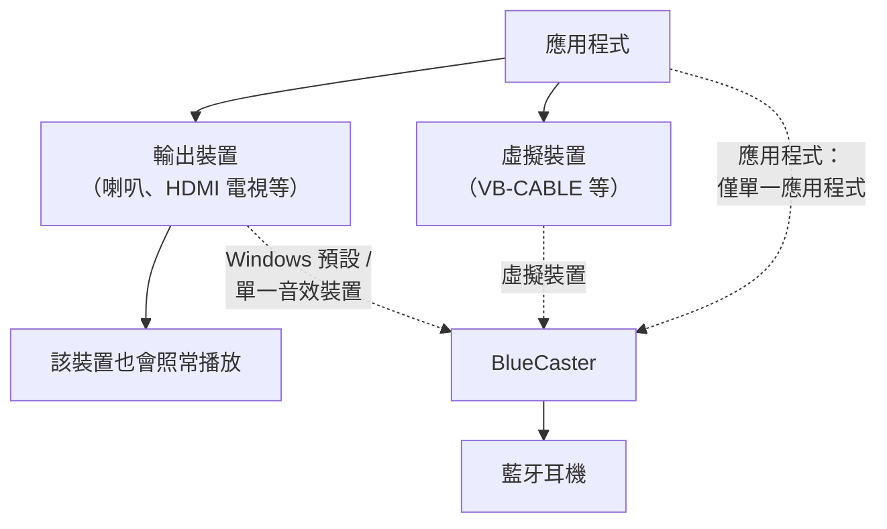
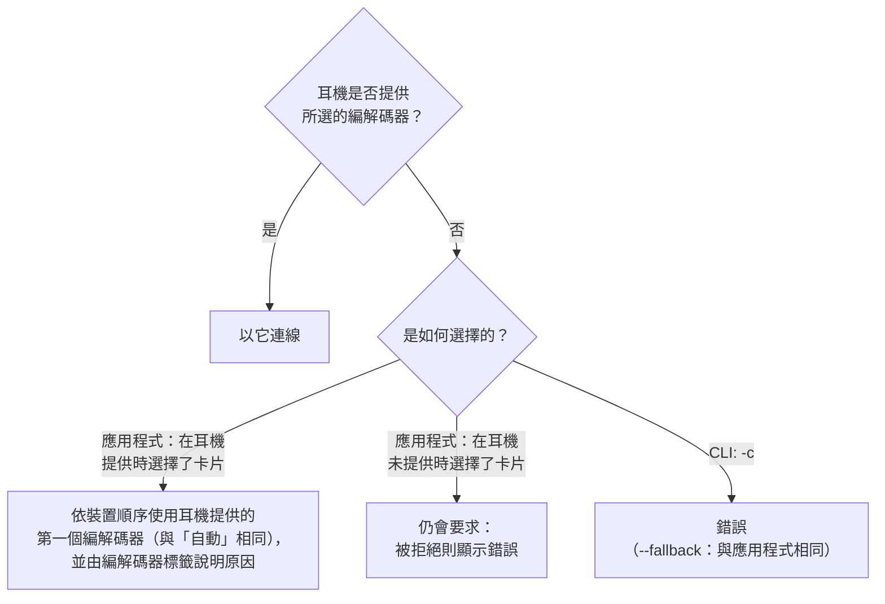

# 使用方式
{: .no_toc }

## 目錄
{: .no_toc .text-delta }

1. TOC
{:toc}

---

## 視窗

從「開始」功能表啟動 **BlueCaster**（或執行 `bluecaster.exe`）。左側功能表列出下文介紹的各個畫面：首頁、編解碼器、音訊裝置、介面卡、診斷、設定與關於；開發人員模式下另有「開發者」，在其中開啟音量混音程式後還有「音量混音程式」。視窗較窄時，功能表會收合為圖示。視窗只是 `bluecaster-core.exe` 的操作介面，該程式會在背景持續執行，因此關閉視窗並不會停止串流（請參閱 [系統匣與快顯視窗](#tray)）。

### 首頁

- 每個已儲存的音訊裝置各有一張卡片並排顯示，包含狀態與電量。已連線裝置的卡片也會顯示使用中的編解碼器（以清單呈現，見下文）及其位元率。若使用中的編解碼器不是您選擇的那一個，編解碼器那一行會短暫說明原因，例如 **aptX Adaptive (不支援 Opus)**（或 *使用中*）；幾秒後只留下警告標記（將滑鼠游標停在上方即可查看原因），狀態行則只顯示 **已連線**
- 每張卡片下方有 **連線** / **中斷連線**。同一時間只能連線一個裝置：在另一個裝置上按 **連線**，會先中斷目前裝置的連線，再連線到新裝置
- **音量**：耳機的音量（請參閱 [音量](#volume)）。按一下喇叭圖示即可靜音（BlueCaster 會傳送無聲），再按一次則取消靜音。其他裝置的卡片上，此滑桿會呈停用狀態
- 已連線裝置的卡片上有編解碼器清單，方便快速切換（例如玩遊戲用一種、聽音樂用另一種）。清單只以名稱列出裝置支援的編解碼器，與 [編解碼器](#codecs) 頁面相同，並顯示使用中的編解碼器，開啟 **自動選擇** 時也一樣。選擇編解碼器會關閉自動選擇（可在「編解碼器」頁面重新開啟）。選擇會立即生效：裝置會以新的編解碼器重新連線，下一次選擇則要等重新連線完成，與「編解碼器」頁面相同
- 串流期間，已連線裝置的卡片上會顯示小型連線品質圖表。輸出來源在 **音訊裝置** 中選擇；若輸出來源是尚未執行的應用程式，卡片上會顯示這一點
- 發生錯誤時會顯示原因；若有解決方法，也會顯示對應的按鈕（**替換為 WinUSB 驅動程式**、**開啟下載頁面**、**重新啟動藍牙**、**重試**、**編解碼器**、**音訊裝置** 等）
- 卡片上方會顯示下列訊息，直到您關閉為止：Windows 中有另一個藍牙介面卡正在使用時的警告，以及 OPPO 耳機已開啟 Hi-Res 時的通知（請參閱 [編解碼器](#codecs)）

在每個畫面上，側邊欄都會顯示每個裝置的相同資訊；系統匣快顯視窗則顯示已連線裝置的資訊。

### 編解碼器 {#codecs}

每個已儲存的音訊裝置各有一個區段，開頭是一個圓點（裝置連線期間為綠色）、裝置名稱與 **已配對** / **音訊** 標籤；位址顯示在 **音訊裝置** 中。下方是該裝置的編解碼器卡片，除非您自行調整順序，否則依音質由高到低排列。每張卡片有三條橫條（音質、低延遲、穩定性），並標示裝置上次連線時是否提供該編解碼器：**支援**（綠色標記）或 **不支援**（紅色標記）。開啟 **僅顯示支援的編解碼器**（預設）時，顯示的卡片都受支援，因此不會再標上 **支援**。從未連線過的裝置（例如從 Windows 匯入的裝置）此時只會顯示 **SBC** 卡片（每個藍牙音訊裝置都支援），以及已為它選擇的編解碼器；其他卡片會在第一次連線後出現，或在您關閉此開關後顯示。華為與榮耀耳機的 **LDAC** 卡片會一直保留並標示為 **未確認**，直到耳機列出 LDAC 為止，因為這些耳機可能要等選擇 LDAC 後才會列出它。以 LHDC V5 串流時（無論是您手動選擇或由自動選擇，但品質為 **低** 或開啟 ABR 時除外），若 OPPO 耳機為 LHDC V5 列出了峰值位元率，BlueCaster 會要求耳機開啟 Hi-Res 一次。耳機會為此重新連線一次；若位元率因此提高，首頁會通知您。之後 Hi-Res 會在耳機中保持開啟；沒有因此提高的耳機會還原設定。在開發人員模式下，LHDC V5 設定中的 **重新要求 Hi-Res** 會清除裝置列出的內容與已要求過的記錄，下次連線時便會再次要求。

- **自動選擇支援的音質最高的編解碼器**（位於頁面頂端，所有裝置共用一個設定；預設開啟）：每個裝置會使用其支援的音質最高的編解碼器，順序為 LHDC V5 > LDAC > aptX Adaptive > Opus > aptX HD > aptX > aptX LL > AAC > SBC XQ > SBC。自動選擇使用預設設定，與編解碼器設定中的 **自動** 相同：高音質、編解碼器支援時為 24 位元，以及 48 kHz（裝置不支援 48 kHz 時，改用其列出的其他取樣率，優先選 44.1 kHz；Windows 本身的取樣率會重新取樣）。卡片除了順序以外皆為唯讀（拖曳方式見下文；自動選擇會採用裝置支援的第一張卡片），使用中或自動選擇將採用的編解碼器會醒目顯示。按一下卡片或其 **...** 時，會詢問是否關閉自動選擇（**關閉自動選擇** / **取消**）；關閉後，即會選擇您按的那張卡片（其 **...** 會開啟該編解碼器的設定）。關閉自動選擇後，就能為每個裝置自行選擇編解碼器與設定；尚未選擇的裝置則沿用自動選擇的結果。自動選擇開啟期間，各裝置已選擇的編解碼器會保留下來。若 2.0.2 之前的設定曾為任何裝置選擇編解碼器，自動選擇一開始會是關閉的
- 自動選擇關閉時，按一下卡片即可為該裝置選擇編解碼器。選擇會立即儲存，正在串流的裝置會以它重新連線。您也可以選擇裝置不支援的卡片（**僅顯示支援的編解碼器** 關閉時才會顯示）：BlueCaster 仍會向裝置要求使用該編解碼器；若裝置拒絕，連線會停止並顯示說明原因的錯誤（請選擇其他卡片，或開啟自動選擇）。之後首頁、側邊欄、系統匣快顯視窗與系統匣圖示的工具提示會以幾個字說明原因（例如 *不支援 LDAC*）；只要連線因編解碼器而停止（裝置不支援、拒絕，或正用於其他音源），都會這樣顯示。為該裝置選擇其他卡片或設定，或開啟自動選擇，裝置就會重新連線。若您在裝置提供某個編解碼器時選擇了它，之後裝置卻不再提供（例如耳機改用了其他編解碼器），BlueCaster 會改用裝置順序中第一張受支援的卡片；除非您調整過順序，否則就是裝置支援的最佳編解碼器（請參閱 [明確指定的編解碼器不在清單中](#codec-fallback)）
- 拖曳裝置的卡片，即可自訂其編解碼器的順序（按住按鈕時會顯示手形游標；自動選擇關閉時，也可以在卡片上按 Alt 加方向鍵）。每個裝置各自保留自己的順序。自動選擇、尚未選擇編解碼器的裝置，以及所選編解碼器不受支援的裝置，都會使用第一張受支援的卡片。FastStream 與 Opus 05（**Opus (PipeWire)** 卡片，僅限開發人員模式；開發人員模式關閉時，即使已選擇也不會使用）無論排在哪裡，都只在您明確選擇時使用。**重設編解碼器順序** 會還原預設順序；只有在顯示的卡片不是預設順序時才會出現（手動移回原位也會恢復預設順序）。若正在串流的編解碼器因此改變，裝置會重新連線
- 為正在串流的裝置選擇其他編解碼器時，裝置會以該編解碼器重新連線。在裝置重新連線之前，卡片（以及首頁與系統匣快顯視窗中的編解碼器清單）不會接受下一次選擇，因此快速連續點選不會打斷仍在建立中的連線。切換編解碼器時不會顯示連線通知；連線裝置時才會顯示
- **僅顯示支援的編解碼器**（預設開啟；關閉後會同時顯示支援與不支援的編解碼器）：隱藏裝置未提供的編解碼器。裝置第一次連線之前，只會顯示 **SBC**（以及已為它選擇的編解碼器）
- 卡片上的 **...** 會開啟該編解碼器的設定。變更會立即生效。對於使用中的編解碼器，變更會儲存，裝置也會以新設定重新連線；例外的是 **Bitpool**，它會在聆聽期間直接變更，而下方的開關若不影響串流的建立方式，也不會重新連線。對於其他編解碼器，變更會保留到選擇該編解碼器時再使用。每個編解碼器各自保留設定（aptX Adaptive 與 aptX Adaptive LL 也各自保留），因此切換到其他編解碼器再切回來，原本的設定會恢復。只會提供編解碼器支援、且裝置上次連線時列出的選項。關閉頂端的 **僅顯示 *裝置* 支援的選項**（預設開啟；裝置列出選項後才會顯示），即可看到編解碼器的所有選項，例如裝置未列出的取樣率、位元深度、品質或 bitpool（標示為 *(不支援)*）。裝置可能會拒絕這些選項，此時連線會停止並顯示說明原因的錯誤。重新開啟此開關後，裝置未列出的選項會恢復為「自動」。各編解碼器的設定如下（自動選擇從不使用這些設定）：
  - **品質**：LDAC 為 **高** / **中** / **低**（990 / 660 / 330 kbps）；LHDC V5 為 **高** / **中高** / **中** / **低**（1000 / 900 / 500 / 400 kbps，即 Android 的四個等級）；aptX Adaptive 為 **高**（其低延遲模式是獨立的卡片 **aptX Adaptive LL**：265 kbps、48 kHz、無 ABR；請參閱 [aptX Adaptive](#aptx-adaptive)）。開啟 LHDC V5 的 ABR 時，品質會呈灰色（ABR 會維持在 400 kbps 以下）。AAC、Opus、Opus 05、SBC 與 SBC XQ 只有 **高** 一個等級，只顯示而不能選擇：即裝置接受的最高位元率（若有 ABR 或 VBR，位元率仍會變動；SBC 與 SBC XQ 會顯示其 bitpool 與訊框結構所得出的位元率）。aptX、aptX HD、aptX LL 與 FastStream 的位元率由編解碼器固定。舊版儲存、但編解碼器已不再提供的品質（aptX Adaptive 的標準 / 行動、AAC 的較低等級等）會以「高」載入
  - **自適應位元率 (ABR)**：適用於 LDAC、LHDC V5、aptX Adaptive、SBC 與 SBC XQ（請參閱 [ABR](#abr)）；AAC 則為 **VBR**
  - **低延遲**（LHDC V5，僅限有列出此功能的裝置）：聲音更快傳到耳機。ABR 關閉時，如果連線跟不上，位元率會逐級降低（1000、900、再到 500 kbps），連續一分鐘沒有問題後再逐級調回。封包在傳送佇列中等待 100 ms（而非 350 ms）就會被捨棄，因此連線不穩定時只會短暫斷音，不會持續延遲
  - **取樣率**：「自動」為 48 kHz；裝置不支援 48 kHz 時，改用其列出的其他取樣率（優先選 44.1 kHz），並顯示實際採用的取樣率（例如 *自動 (48000 Hz)*）。「自動」從不選擇 96 kHz，因為它會增加延遲、相容性較差，卻聽不出差別（Windows 以 48 kHz 混音）；若要使用 96 kHz，請在此處選擇。只會提供裝置列出的取樣率（LHDC V5 沒有 88.2 kHz；aptX Adaptive 只對列出 96 kHz 的裝置提供 96 kHz，請參閱 [aptX Adaptive](#aptx-adaptive)）。只列出一種取樣率的裝置會直接顯示該取樣率，不提供「自動」
  - **位元深度**：LDAC 與 LHDC V5 可選 16 或 24 位元，以裝置列出的為限（自動：24 位元；LHDC V5 僅限裝置有列出時）；aptX HD 與 aptX Adaptive 為 24 位元，其他編解碼器為 16 位元。LDAC 的 24 位元會以 32 位元取樣送入編碼器，與 Android 的 32 位元選項相同。位元深度不屬於 LDAC 的組態，因此無論選哪一種，耳機收到的串流都相同
  - **Bitpool**（SBC、SBC XQ）：一個有兩個控點的滑桿，分別設定最小與最大 bitpool，範圍為裝置列出的範圍。最大值就是使用中的 bitpool；最小值是會用到的最低 bitpool（也就是建立連線時範圍的下限，以及 ABR 最多能降到的值）。**自動** 會將兩者還原：最大值依品質而定，最小值則採用裝置與 ABR 本身的值。下方一行顯示聲道模式，每個編解碼器各自固定：SBC 為 Joint stereo，SBC XQ 為雙聲道。SBC XQ 的 bitpool 在 44.1 kHz 時最高 47，在 48 kHz 時最高 43；關閉 **僅顯示 *裝置* 支援的選項** 後最高可到 53。
  - **訊框結構**（SBC 與 SBC XQ，僅限開發人員模式）：區塊數、子頻帶數、位元配置，以及 SBC 的聲道模式。「自動」維持 16 區塊、8 子頻帶、Loudness 與 Joint stereo。裝置不接受的值會在連線時恢復為「自動」。在一位使用者測試的 Sony 裝置上，12 區塊會使聲音失真，還可能中斷連線（編碼器的輸出可以正確解碼，其他區塊數也都能正常播放）。開發人員模式關閉期間，這些選擇仍會保留，但不會使用。AAC 與 LHDC V5 的位元率不會超過裝置列出的上限

預設值的音質最好；大多數裝置維持 **自動** 即可。LE Audio 裝置（實驗性）有兩張卡片：**LC3** 與 **LC3 LL**（請參閱 [LE Audio](#le-audio)）。它們的 **...** 與通話編解碼器一樣，以唯讀方式顯示與 A2DP 編解碼器相同的欄位。aptX Adaptive 的低延遲模式有自己的卡片 **aptX Adaptive LL**，位於 **aptX Adaptive** 旁邊。自動選擇從不選它；舊版中設為低延遲的 aptX Adaptive 會顯示在這張卡片上。

傳統裝置的麥克風開啟期間（請參閱 [音訊裝置](#audio-devices)），音樂用的卡片會換成該裝置可用的通話編解碼器：LC3（32 kHz）、mSBC（16 kHz）與 CVSD（8 kHz），使用中的那一個會被選取。開啟 **自動選擇** 時，通話連結會選擇雙方都支援的最佳編解碼器，按一下卡片則會詢問是否關閉自動選擇。關閉自動選擇後，按一下卡片即可選擇通話編解碼器：麥克風會以它重新開啟；若耳機不支援，則改用下一個較低的編解碼器。**...** 以唯讀方式顯示其設定。麥克風關閉後，音樂用的卡片會恢復。自動選擇開啟期間，已選擇的通話編解碼器會保留下來。開啟 **僅顯示支援的編解碼器** 時，耳機不支援的編解碼器會隱藏。

LE Audio 裝置的麥克風開啟期間，音樂用的卡片後方會出現一張 **麥克風** 卡片（LC3，單聲道）。自動選擇關閉時，可在其 **...** 中從耳機支援的取樣率裡選擇麥克風的取樣率（**自動** 採用第一個；變更後裝置會重新連線）。自動選擇開啟時，則顯示使用中的取樣率。

BlueCaster 會在 `profiles.json` 中為每個裝置保留一個項目（其編解碼器、各編解碼器的設定與編解碼器順序），在該檔案中命名為「*裝置* | *編解碼器*」；視窗與系統匣選單只顯示裝置名稱。舊版可為同一個裝置建立多個設定檔。第一次啟動具有「編解碼器」畫面的版本時，會保留最近使用的設定檔（若無則保留第一個），並將其他設定檔合併進來，同時保留它們各自編解碼器的設定（品質、取樣率、位元深度、ABR、SBC 設定）。這些設定檔的名稱、輸出來源與封包大小不會保留；原本的 `profiles.json` 會以 `profiles-before-codecs.json` 為名，在設定資料夾中儲存一次。2.0.2 搶先版的 **自動選擇的順序…**（所有裝置共用一個順序，位於開發人員模式中）已不再使用：現在每個裝置都有自己的順序。

### 音訊裝置 {#audio-devices}

這裡列出 BlueCaster 可以串流到的耳機與喇叭，每個裝置各有自己的設定。下方的 **新增音訊裝置** 中，**掃描裝置** 會用 USB 介面卡尋找附近的裝置 30 秒，裝置一回應就會列出；**停止掃描** 可結束掃描。請先將耳機切換到配對模式。若有裝置已連線，BlueCaster 會在掃描前詢問是否中斷其連線。**新增** 會儲存找到的裝置並連線。BlueCaster 以前配對過的裝置會標示為 **已配對**。若掃描找不到裝置，請在 **手動:** 欄位輸入其位址，然後按一下 **新增**；輸入或貼上位址時會自動調整格式（`aa-bb-cc-dd-ee-ff`、`AABBCCDDEEFF` 與 `AA BB CC DD EE FF` 都會變成 `AA:BB:CC:DD:EE:FF`）。耳機看到的介面卡名稱是電腦名稱加上 BlueCaster，例如 *Taro-PC (BlueCaster)*，方便您與 Windows 本身的藍牙區分。若 Windows 曾透過其他介面卡（例如電腦內建的藍牙）配對某個裝置，BlueCaster 會先詢問您（**已在 Windows 中配對**：在 Windows 中將其移除，或選擇 **仍要新增**）。若 Windows 曾透過此介面卡配對某個裝置，BlueCaster 也會先詢問（設定精靈可以匯入該配對，請參閱 [服務與配對金鑰](#shared-pairing)）。已儲存的裝置可以重新命名或移除；移除時也會刪除其設定與配對，因此必須重新配對才能再次連線。每個已儲存的裝置有下列設定：

- **輸出來源**：**Windows 預設**（單獨列在最前面：即 Windows 預設輸出，括號中顯示其名稱，也可能是虛擬裝置；新裝置預設使用此項）、**音效裝置** 下的單一輸出裝置、虛擬裝置，或應用程式（請參閱 [擷取模式](#capture-modes)）。旁邊顯示 Windows 混合所擷取裝置時使用的格式（取樣率與位元深度，唯讀）。當裝置以其他格式串流時（或未連線時，其編解碼器設定要求其他格式），此格式會變成琥珀色，並在下方一行列出兩種格式（串流仍可進行，只是會轉換格式）。再下方是該輸出來源的說明
- **連線時設為 Windows 預設輸出**（開發人員模式下，使用虛擬裝置或音效裝置時）
- **輸入來源**：耳機的麥克風，以及開發人員模式下的 **連線時設為 Windows 預設輸入**（見下文）

每個裝置的 **輸入來源** 會將耳機的麥克風傳送到 Windows，供通話與語音聊天使用。BlueCaster 沒有自己的音訊驅動程式，因此會將麥克風的聲音播放到 VB-CABLE 等虛擬音訊線材。清單以應用程式錄音的那一端為每條線材命名（VB-CABLE 為 *CABLE Output*）；請在應用程式中將這一端選為麥克風。在清單旁選擇 **關閉** 或 **自動**：**自動** 只在有應用程式錄音時開啟麥克風，其餘時間播放都能維持完整音質。開發人員模式下還可選擇 **開啟**，讓麥克風一直開啟；開發人員模式關閉時，設為 **開啟** 的裝置會以 **自動** 模式運作。設為 **關閉** 時，清單仍會顯示，但呈灰色。**關閉** 與首頁和快顯視窗中的麥克風按鈕是同一個設定：對於設為 **自動** 或 **開啟** 的裝置，**關閉** 會像按鈕一樣停用麥克風，並記住原本的模式，按下按鈕即可恢復。**連線時設為 Windows 預設輸入**（開發人員模式下顯示；開發人員模式關閉時一律開啟）會在裝置連線期間，將線材的錄音端（*CABLE Output*）設為 Windows 預設麥克風。如此一來，從預設麥克風錄音的應用程式就會收到耳機麥克風的聲音，**自動** 也會為這些應用程式開啟麥克風。裝置中斷連線後，會恢復先前的預設裝置，除非您在這段期間選擇了其他裝置。

透過最下方的 **麥克風調整**，可在麥克風聲音送到應用程式之前加以處理。**輸入來源** 為 **關閉** 時，此項目會顯示為灰色。**使用麥克風調整** 可開啟或關閉處理。關閉時，麥克風聲音會原封不動地傳送，各滑桿的值會保持不變。**增益** 可調高或調低音量（-12 至 +24 dB）。**降噪** 可去除風扇聲、嗡嗡聲等持續的背景噪音。滑桿越靠右，降噪越強；越靠左，保留越多原本的聲音，拉到最左邊為 **關閉**。**噪音閘** 會在麥克風音量低於所選位準時將其靜音（拉到最左邊為 **關閉**）。限幅器可避免提高增益後的聲音破音。變更會立即生效，不需重新連線。開啟降噪後，麥克風會延遲約 20 ms；全部關閉時，麥克風聲音會原封不動地傳送。**診斷** 中的 **麥克風** 測試會照應用程式聽到的樣子錄音。

新裝置若已安裝 VB-CABLE，就會使用 VB-CABLE，否則使用 Hi-Fi Cable，但該線材已是其 **輸出來源** 時除外：傳統裝置設為 **自動**，LE Audio 裝置設為 **關閉**（在 LE Audio 裝置上，**自動** 會讓麥克風一直開啟）。若裝置的麥克風已開啟卻沒有線材，Windows 一列出線材，裝置就會取得一條。**音訊裝置** 畫面與設定精靈會建議安裝缺少的線材（請參閱 [擷取模式](#capture-modes)）。之後安裝線材時，BlueCaster 會依設定精靈的方式，重新設定它自動設定過的裝置，以及使用 **Windows 預設** 且麥克風也是這樣設定的裝置。兩種線材都有時，聲音使用 Hi-Fi Cable，麥克風使用 VB-CABLE。只有一種線材時，麥克風使用該線材，聲音則取自 **音效裝置** 下的輸出裝置（有螢幕或電視的音訊時用它，有多個時用其中的 Windows 預設輸出；否則用 Windows 預設輸出），不論哪個裝置是 Windows 預設輸出。您自行選擇的輸出來源或麥克風會維持不變。沒有線材時，若 Windows 同時有螢幕或電視的音訊與音效卡，聲音會取自螢幕或電視，麥克風則播放到音效卡，並設為 **關閉**。在開發人員模式下設為 **開啟** 後，錄製輸出裝置的應用程式（例如 OBS 的音訊輸出擷取）即可從那裡取得麥克風聲音；**自動** 無法判斷是否有程式在聽音效卡。在 **音訊裝置** 畫面新增的裝置也以相同方式設定。若裝置使用 **Windows 預設**，而麥克風播放到的線材正好是 Windows 預設輸出，聲音來源也會改用該裝置，否則麥克風的聲音會在耳機中播放出來。

若麥克風播放到 Hi-Fi Cable，而該線材的播放端與錄音端在 Windows 音效設定中的取樣率不同，就會顯示警告：若應用程式聽不到聲音，請將兩者設為相同的取樣率。清單只會列出應用程式可以錄音的線材。BlueCaster 本身正在擷取的線材不會列出（即 **輸出來源**，或使用 **Windows 預設** 時的 Windows 預設輸出；但另一個裝置連線期間被設為預設的輸出來源不在此限），同一條線材的另一端也不會列出（VB-CABLE 的 *CABLE In 16ch* 與 *CABLE Input* 都錄進同一個 *CABLE Output*），否則麥克風會與播放中的聲音混在一起。同樣地，**輸入來源** 不是 **關閉** 時，**輸出來源** 清單不會列出麥克風所播放到的線材。開啟 **開發者 > 應用程式設定 > 在來源清單中顯示所有音訊裝置** 後，兩個清單都會列出所有裝置：沒有錄音端的輸出（喇叭等）列在 **監聽** 下，因為它們只能播放麥克風的聲音；VB-CABLE 的 16 聲道線材顯示為 *CABLE Output · CABLE In 16ch*（先是共用的錄音端，再是它自己的名稱）；輸出來源所用的線材會呈灰色，名稱後附上 *(用作輸出來源)*。*CABLE Input* 與 *CABLE Output* 是同一條線材的兩端，因此要同時使用虛擬輸出來源與麥克風，就需要兩條線材。建議聲音使用 VB-Audio 的 **Hi-Fi Cable**（[VB-Audio 頁面](https://vb-audio.com/Cable/)上的 *HiFi-Cable & ASIO-Bridge*），因為它增加的延遲最少；麥克風則使用 VB-CABLE。麥克風所用的裝置也不能是 Windows 預設輸出：否則應用程式聽到的會是播放中的聲音混著麥克風，而設在其他裝置上的輸出來源則收不到任何聲音。**輸入來源** 下方會顯示警告提醒這一點。

麥克風開啟期間，傳統藍牙裝置會改用通話連線播放：以通話音質的單聲道播放（CVSD、mSBC 或 LC3，取雙方都支援的最佳者）。這段期間編解碼器會呈灰色；麥克風關閉後，裝置會直接回到原本的編解碼器，不需要重新連線。LE Audio 裝置則會繼續以平常的音質播放 LC3，同時傳送麥克風的聲音；切換模式時裝置會重新連線（在 LE Audio 裝置上，「自動」會讓麥克風一直開啟）。部分耳機可能會拒絕使用麥克風，或在沒有通話時顯示通話中。設為 **自動** 或 **開啟** 並選好裝置後，只要裝置已連線或正在連線，側邊欄、首頁與快顯視窗中編解碼器下方就會有一行 **麥克風：**，顯示麥克風的狀態：開啟時顯示編解碼器與取樣率並加上紅點（*麥克風：mSBC 16 kHz*），關閉時則以灰色顯示其模式。在首頁與快顯視窗中，旁邊的麥克風按鈕可停用麥克風：按鈕會加上刪除線、麥克風關閉、傳統裝置回到原本的編解碼器，**輸入來源** 也會顯示 **關閉**。再按一次即以原本的模式重新啟用麥克風；在 **輸入來源** 中選擇 **自動** 或 **開啟** 也一樣。「自動」在等待應用程式錄音時，按鈕會以虛線顯示；麥克風無法開啟時，按鈕會顯示警告標誌，原因請見其工具提示。

清單上方的 **所有音訊裝置** 包含適用於所有裝置的開關：**Windows 音量同步**（請參閱 [音量](#volume)）、**用音訊裝置的按鈕控制播放** 與 **自動重新連線**。各裝置的 **媒體封包大小上限** 位於 **開發者** 畫面（請參閱 [媒體封包大小上限](#max-packet)）。

### 診斷

- 串流期間的 **連線品質**：實際位元率、封包、傳送前捨棄的封包、擷取時捨棄的音訊、傳送佇列、裝置回報的延遲（請參閱 [延遲](#latency)）、無線電使用時間、訊號 (RSSI) 與 AFH 通道（請參閱 [連線品質與 AFH](#link-quality)）。耳機麥克風開啟期間，傳統裝置的通話連結也會以相同方式測量（其編解碼器，例如 mSBC，以及傳送的內容），**麥克風** 卡片則顯示傳回的封包：已接收、在無線傳輸中損壞，以及經過補償的數量
- **無線電**：顯示 2.4 GHz 頻段中的 79 個藍牙通道，標出連結使用的通道與介面卡略過的通道，下方對照 Wi-Fi 通道，並附上幾項讓連線更乾淨的提示。在開發人員模式下，**掃描** 會加上附近的 2.4 GHz Wi-Fi 網路（請參閱 [無線電分頁](#radio-tab)）
- 串流期間的 **編解碼器詳細資訊**：媒體酬載、標頭、編解碼器訊框與每個封包的訊框數，並將裝置端點列出的內容與實際使用的內容並列：SBC 為 bitpool、取樣率、聲道模式、區塊、子頻帶與位元配置；AAC 為物件類型、取樣率、聲道、峰值位元率與 VBR；其他編解碼器為取樣率、位元深度與峰值位元率
- **麥克風**：在串流期間測試傳統藍牙裝置的耳機麥克風。**錄音** 會開啟麥克風並錄製最多 10 秒，同時在長條上顯示音量（這段期間裝置會以通話音質播放；若這次連線從未開啟過麥克風，裝置會先重新連線）。**播放** 會在耳機上播放錄音。離開此分頁即結束測試，播放也會回到原本的編解碼器。目前尚不支援 LE Audio 裝置
- **連線流程**：最近一次連線嘗試的十一個階段（開始、藍牙介面卡、ACL / AVDTP 連線、功能探索、編解碼器選擇、音訊擷取、串流設定、編碼器、串流開始、音訊傳送，以及包含中斷 / 重新連線的連線維持），每個階段標示為 OK、警告或失敗，並附上所花的時間。**複製流程** 可複製這些內容
- **記錄**：即時記錄，可依層級（所有層級、資訊及以上、警告與錯誤、僅錯誤）、文字及目前的連線嘗試（**僅目前嘗試**）篩選。**複製顯示的記錄** 會複製目前顯示的內容。**開啟記錄資料夾** 會開啟記錄檔所在的資料夾；與 **複製診斷資訊** 不同，這些檔案未經遮蔽（包含藍牙位址與您的 Windows 使用者名稱）
- **開始 HCI 擷取** / **停止 HCI 擷取**（請參閱 [驗證媒體串流](#verify-stream)）
- **複製診斷資訊**：將版本、作業系統、介面卡、音訊裝置（編解碼器及其設定與順序）、連線流程、警告 / 錯誤與最近的記錄複製到剪貼簿，可直接貼到錯誤回報中。**遮蔽藍牙位址**（預設開啟）會將位址替換為 `<addr-1>`、`<addr-2>`...（介面卡本身為 `<adapter>`），裝置名稱替換為 `<device-1>`、`<device-2>`...，並隱藏 USB 序號、應用程式資料夾以上的檔案路徑（`<path>\BlueCaster\logs\...`）以及您的 Windows 帳戶（使用者名稱與 SID）。為錯誤回報複製的當機報告與錯誤訊息也會套用相同的遮蔽
- **回報問題**：
  - **詳細記錄**：**詳細（debug）** 或 **全部（trace，1 小時）** 會記錄更多關於藍牙、USB、音訊擷取與編碼的資訊。Debug 會維持開啟 24 小時，重新啟動後也不例外（以便排查啟動時的問題），之後會自動關閉。請先開啟，重現問題，再儲存診斷套件
  - **診斷套件 > 儲存…**：選擇是否包含 HCI 擷取（除非有人要求，否則請保持關閉：其中含有位址與裝置名稱），以及是否在文字檔中遮蔽藍牙位址，然後儲存為單一 `.zip`（位於設定資料夾的 `logs\bundles\`，保留最新的 3 個）。內容包括診斷資訊、核心、視窗與驅動程式輔助程式的記錄檔、當機報告、系統資訊（USB 藍牙介面卡及其驅動程式、Windows 已配對的裝置、音訊裝置）、設定與每個裝置的編解碼器設定（絕不包含連結金鑰），以及 HCI 飛行記錄器。HCI 擷取會保留位址（但不含配對金鑰）。BlueCaster 會盡量讓套件維持在 GitHub 25 MB 的附件上限以下（最新的記錄優先，文字最多 48 MB，以及最新的 5 個錄製檔與 2 個 minidump）
  - **在 GitHub 上回報**（儲存後）：開啟一份新的錯誤回報，其中已填入版本、Windows 組建、介面卡、耳機、編解碼器、擷取模式與診斷資訊（位址已遮蔽），並在檔案總管中顯示套件，方便您拖曳到回報中

BlueCaster 也會持續記錄部分資料，即使問題只發生過一次，事後仍可調查：

- **HCI 飛行記錄器**：最近幾分鐘的藍牙通訊會保留在記憶體中（媒體酬載會截短，配對金鑰會移除），並在串流失敗或連線中斷時儲存到 `logs\hci\`（保留最新的 10 個檔案）
- **當機報告**：BlueCaster 當機時，會將 `.dmp` minidump 與 `.txt` 檔案寫入 `logs\crash\`（每個程式保留最新的 5 個）

磁碟用量有上限：平常一天的記錄遠小於 1 MB，並保留 7 天。開啟詳細記錄時，一天的檔案最多只會寫入 100 MB 的 debug 與 trace 記錄（超過後直到隔天，只記錄資訊及以上層級）。飛行記錄器的檔案最多幾 MB，保留 10 個。

### 開發者 {#developer}

**設定 > 開發人員模式** 開啟時才會顯示；大多數使用者都不需要它。此畫面用於測試裝置與疑難排解，部分設定只對特定裝置有效。共有七個分頁：

- **應用程式設定**：**使用音量混音程式**（預設關閉）會啟用 **音量混音程式** 畫面、快顯視窗的應用程式清單與輸出靜音（請參閱 [擷取模式](#capture-modes)）。不建議使用；要讓電腦保持無聲，VB-CABLE 是較好的方法。**在來源清單中顯示所有音訊裝置**（預設關閉）會讓 **音訊裝置** 畫面上的 **輸出來源** 與 **輸入來源** 列出所有裝置，包括不適用的裝置（請參閱 [音訊裝置](#audio-devices)）。**隱藏虛擬音訊裝置警告**（預設關閉）會移除缺少 VB-Audio 線材的警告（請參閱 [擷取模式](#capture-modes)）。**檢查更新時包含 Alpha 版**（Alpha 版中預設開啟）也會通知 Alpha 版本（請參閱 [更新](#updates)）
- **編解碼器設定**：用來找出裝置為何沒有聲音的開關（RTP marker bit、記錄最初的媒體封包、AAC 組態與編碼器選項），以及每個已儲存裝置的 **媒體封包大小上限**（請參閱 [媒體封包大小上限](#max-packet)）。**自動選擇編解碼器時也使用各編解碼器的設定**：自動選擇開啟時，可以直接開啟編解碼器卡片的 **…** 而不會關閉自動選擇，自動選擇的編解碼器也會以這些設定連線，而不是以「自動」的設定。**讓取樣率和位元深度符合電腦的輸出**：設為「自動」的取樣率或位元深度，會改為依照 Windows 音效設定中輸出裝置的格式，而不是 48 kHz。在裝置為該編解碼器列出的取樣率中，BlueCaster 會優先採用電腦本身的取樣率，其次是同一系列（44.1 或 48 kHz 的倍數）中最接近的取樣率，再其次是高於它的最接近取樣率；16 位元的輸出會以 16 位元串流。**忽略裝置的最大位元率**：即使裝置列出的上限較低（LHDC V5、AAC 或 Opus 05 的位元率，或 SBC 的 bitpool），所有編解碼器仍以所選品質的位元率運作，**編解碼器** 畫面也會提供所有品質與 bitpool。超過上限時，裝置可能斷音或沒有聲音。**傳送佇列上限**：媒體封包在傳送佇列中最多可等待多久才會被捨棄，範圍為 50 到 2000 ms（留空 = 350 ms）；連線良好時，它不會降低延遲（請參閱 [延遲](#latency)）。**傳送時編碼**：連結停滯期間，音訊會以未編碼的狀態等待，而不是以已編碼的封包等待。因此開啟 ABR 時（SBC、SBC XQ、LDAC、LHDC V5 與 aptX Adaptive），音訊會以 ABR 在這段期間降低後的位元率送出，而不是停滯開始時的位元率。這不會縮短停滯本身：在無線電恢復之前，不會送出任何資料，只是之後追趕時需要的資料較少。等待超過傳送佇列上限的音訊無論如何都會被捨棄；「診斷」會將等待中的音訊計入傳送佇列的等待時間。以上項目預設皆為關閉，並在下次開始串流時生效；只要有任何一項開啟，就會顯示橫幅提示。**全部關閉** 可將它們全部還原
- **廠商**：設定 BlueCaster 是否使用耳機廠商自有的協定（華為：LDAC，OPPO：Hi-Res；請參閱 [編解碼器](#codecs)）。每家廠商各有 **廠商協定**：**自動**（名稱可辨識為該廠商的耳機；預設）、**一律**（任何裝置）或 **不使用**。OPPO 另有 **每次連線都要求 Hi-Res（每次重新連線）**。變更會在下次開始串流時生效；只要有任何一項變更，就會顯示橫幅提示，**全部關閉** 可將它們全部還原。開發人員模式關閉時不會使用這些設定
- **記錄**：記錄檔的保留天數（預設 7 天）、每日大小上限（預設 100 MB）、持續開啟的詳細記錄（沒有 24 小時或 1 小時的限制，且從核心啟動時就開始記錄）、每 10 秒一行的串流狀態，以及 **新增標記**（在記錄中寫入一行編號，方便之後找到該時間點）。關閉開發人員模式會還原為預設值
- **對端接收器測試**：串流到另一台電腦上的測量用接收器，並比較送出與實際抵達的內容（請參閱 [對端接收器測試](#receiver)）
- **晶片**：在使用 WinUSB 的介面卡上執行晶片指令碼，也就是直接輸入或從檔案載入的晶片請求，供想為晶片加入支援的人使用（請參閱 [加入晶片支援](chip-support#chip-scripts)）。可能變更晶片的指令行，要在您按下 **允許執行** 後才會執行；執行期間藍牙會停止，下次需要時再重新啟動
- **偵錯**：實驗性功能，預設全部關閉。**配對金鑰與 Windows**：**還原原始驅動程式時，也將 LE 金鑰複製到 Windows** 會在 **還原原始驅動程式** 時，將 BlueCaster 的 LE 金鑰（Long Term Key、EDIV、Rand、金鑰長度、Identity Resolving Key）寫入 Windows，但只限 Windows 已為該介面卡保存了 LE 金鑰的裝置。Windows 原有的金鑰會儲存在 `pairing\replaced_windows_keys.json` 中，只有您的 Windows 使用者能讀取。**與 Windows 比較**（需要系統管理員權限）會針對一個介面卡，統計連結金鑰與 LE 金鑰在 BlueCaster 與 Windows 中相同、不同，或只存在於一方的裝置數量。畫面與記錄中只顯示數字，絕不顯示位址或金鑰，因此可以放心分享結果。它也會列出 Windows 為該介面卡及其 LE 裝置保存的值的名稱、類型與大小，但絕不顯示其內容

### 介面卡

- 偵測到的 USB 藍牙介面卡，以及其晶片、位址、USB ID、藍牙版本、**驅動程式** 與 **韌體**。插入或拔除介面卡時，清單會自動更新。驅動程式為 **原始驅動程式**（Windows 或製造商安裝的驅動程式；將滑鼠游標停在上方即可查看其名稱）或 **WinUSB 驅動程式**（BlueCaster 使用的驅動程式）。Realtek 介面卡即使尚未使用過，也會顯示取自其 USB 序號的位址；其他介面卡的位址與藍牙版本，要等 Windows 的藍牙或 BlueCaster 使用過該介面卡後才會顯示（將滑鼠游標停在該行上即可查看原因）。BlueCaster 無法使用的介面卡（部分 MediaTek 與 Qualcomm 型號）會保留原本的驅動程式，其 WinUSB 與韌體按鈕也會停用。在開發人員模式下，仍可為其指派 WinUSB；在使用 WinUSB 的介面卡上按 **讀取晶片資訊**，會將晶片對幾個讀取命令的回應儲存到 `logs\probe\`，供想為它加入支援的人使用（執行期間藍牙會停止，下次需要時再重新啟動）。接著按 **在 GitHub 回報**，會開啟一個已填入這些資訊的 issue。BlueCaster 自行載入韌體的介面卡（Intel、MediaTek、Qualcomm）啟動期間，畫面會顯示載入進度，以及是否失敗
- **替換為 WinUSB 驅動程式** / **還原原始驅動程式**（請參閱 [安裝設定](setup#winusb)）。每次 Windows 都會要求系統管理員權限，所有帶有盾牌圖示的按鈕都是如此。還原時，對於 Windows 也曾透過此介面卡配對的裝置，BlueCaster 會將較新的配對交給 Windows，這些裝置在 Windows 中不需重新配對即可連線。**限制：**LE 金鑰不會移交，因此 Windows 透過 LE（LE Audio）使用的裝置必須在 Windows 中重新配對（可在開發人員模式下試用：**開發者 > 偵錯**）
- 韌體所用的 **藍牙晶片**，以及 **下載韌體**、**開啟下載頁面** 與 **開啟韌體資料夾**（請參閱 [韌體](setup#firmware)）。其他廠商的介面卡則會顯示韌體的來源，例如 **來自 MediaTek 的驅動程式**、**來自韌體資料夾** 或 **不需要**；BlueCaster 載入韌體後會顯示 **已載入**。韌體來自 Realtek Windows 驅動程式的 Realtek 介面卡會改為顯示 **使用自訂韌體**，選取 **使用驅動程式的韌體** 即可切換回來
- **避開 Wi-Fi 通道**：自動、關閉或手動，旁邊顯示 Wi-Fi 通道：自動時為目前避開的通道，關閉時不顯示（兩者皆為唯讀），手動時則為您輸入的通道（請參閱 [連線品質與 AFH](#link-quality)）
- **藍牙堆疊**：已停止（第一次掃描或連線時啟動）、正在啟動、就緒或錯誤，以及 **重新啟動藍牙**
- **使用此介面卡**（有兩張以上介面卡使用 WinUSB 時，顯示在每張介面卡的卡片上）：BlueCaster 會開啟該介面卡，而不是找到的第一張。藍牙會在其上重新啟動，串流會重新連線。所選介面卡卡片上的**自動選擇**改回找到的第一張。正在使用的介面卡標示為**使用中**，名稱顯示在**藍牙堆疊**旁；已選擇但尚未使用的介面卡（藍牙下次啟動時會開啟它，或被其他程式佔用）標示為**已選擇**

### 設定

| 區段 | 設定 |
|:--------|:---------|
| 外觀 | 語言、佈景主題（系統 / 淺色 / 深色） |
| 啟動 | **隨 Windows 啟動** 與 **在系統匣中啟動**（請參閱 [隨 Windows 啟動](#autostart)）、**最小化至系統匣** 與 **系統匣視窗的開啟位置**（請參閱 [系統匣與快顯視窗](#tray)） |
| 通知 | **裝置連線時通知**（裝置、電量、編解碼器及其設定；預設開啟）、**電池電量低時通知**：**低於 20%**（預設）、**低於 10%**、**低於 5%** 或 **永不**，每次連線只通知一次（電量回升到比門檻高 5 個百分點後，才會再次通知） |
| 更新 | **檢查更新**、**啟動時檢查更新**、**檢查更新時包含搶先版**（也會通知 Beta 版本）、**立即更新**（請參閱 [更新](#updates)） |
| 進階 | **開發人員模式**（加入 [開發者](#developer) 畫面、編解碼器設定中 SBC 的 **訊框結構**、**音訊裝置** 畫面 **服務** 標籤中的配對金鑰（請參閱 [服務與配對金鑰](#shared-pairing)）、**Opus (PipeWire)** 編解碼器、**介面卡** 畫面的 **讀取晶片資訊**，並在記錄中寫入更多詳細資訊；不需要重新啟動）、**設定資料夾** 與 **開啟設定資料夾**、**執行設定精靈** |

**結束 BlueCaster** 位於最下方。**關於** 畫面顯示版本與 BlueCaster 的授權；**第三方軟體** 下則列出程式庫、**第三方授權**、VB-Audio 的線材屬於 VB-Audio 捐贈軟體的說明，以及線材的對話方塊（**虛擬音訊裝置**）。

### 首次執行設定

第一次啟動時（尚未有音訊裝置，或沒有任何介面卡使用 WinUSB），會開啟 **設定精靈**；在您完成或略過一次之前，每次啟動都會開啟。首先，選擇介面卡、驅動程式與韌體（Windows 曾透過該介面卡配對的裝置會列在最前面，因為它們將無法再搭配 Windows 使用）。接著尋找您的音訊裝置：「連線」會以最適合該裝置的設定儲存裝置並連線；Windows 配對過的裝置會先詢問；**匯入 Windows 的配對** 會列出 Windows 透過此介面卡配對的裝置（請參閱 [服務與配對金鑰](#shared-pairing)）；沒有裝置也可以按 **下一步**，之後再到 **音訊裝置** 畫面新增。最後是 **一般設定**：佈景主題、**隨 Windows 啟動** 與 **在系統匣中啟動**（首次設定會將兩者開啟）、通知與 **啟動時檢查更新**。請參閱 [安裝設定](setup#first-run)。可從 **設定 > 執行設定精靈** 再次開啟。

## 系統匣與快顯視窗 {#tray}

無論視窗是否開啟，BlueCaster 都會在系統匣中持續執行：

- **按左鍵** 點選系統匣圖示會開啟快顯視窗：裝置及其狀態、**連線** / **中斷連線**、音量、裝置切換、編解碼器（與首頁一樣可從清單選擇）、連線品質，以及 **開啟 BlueCaster**。快顯視窗的高度會配合內容調整。按 Esc 或點選其他位置即可隱藏。若錯誤需要在主視窗的某個畫面（編解碼器、音訊裝置、介面卡）處理，按下錯誤的按鈕就會在該畫面開啟主視窗
- **設定 > 系統匣視窗的開啟位置**（預設為 **系統匣圖示**）：在 Windows 11 上選擇 **快速設定（音量按鈕）** 時，系統匣圖示會開啟主視窗，快顯視窗則改為隨快速設定一起開啟，顯示在其面板上方，並隨面板一起關閉。您可以在快顯視窗中操作，而不會關閉這些面板。若螢幕高度不足，快顯視窗會開啟在面板左側。選擇 **不開啟** 時，不會開啟快顯視窗，系統匣圖示會開啟主視窗。
- **按右鍵** 會開啟選單：**開啟 BlueCaster**、依名稱列出的前 10 個裝置（LE Audio 項目會標示「(LE Audio)」，正在串流的裝置會打勾；點選即可連線到該裝置）、**中斷連線** 與 **結束**。選單會立即開啟，不需要啟動視窗
- 工具提示會顯示 BlueCaster 目前是閒置還是已連線

**設定 > 最小化至系統匣** 開啟時（預設），最小化或關閉視窗只會將它隱藏到系統匣，串流會繼續進行。關閉此設定時，視窗會最小化至工作列，關閉視窗則會結束 BlueCaster。系統匣選單中的 **結束** 或 **設定 > 結束 BlueCaster** 會停止串流、釋放介面卡，並完全關閉 BlueCaster。

## 隨 Windows 啟動 {#autostart}

**設定 > 隨 Windows 啟動** 會在您登入時啟動 BlueCaster。開啟 **在系統匣中啟動** 時，BlueCaster 會在背景啟動：只顯示系統匣圖示，您可以從圖示開啟視窗。關閉此設定時（預設），會開啟主視窗。此設定儲存為 `HKEY_CURRENT_USER\Software\Microsoft\Windows\CurrentVersion\Run` 下名為 `BlueCaster` 的值，資料為 `"<folder>\bluecaster-core.exe"`；開啟 **在系統匣中啟動** 時，後面會加上 `--background`。若要手動關閉，請刪除該值。在 v1 上覆蓋安裝 v2 時，會開啟 **在系統匣中啟動**，因為 v1 一律在系統匣中啟動。

## CLI 模式

`bluecaster-core.exe --cli` 會在主控台中串流，使用與視窗相同的核心。請先結束 BlueCaster（系統匣 > **結束**），因為同一時間只有一個程式能使用介面卡。CLI 不會讀取已儲存裝置的設定；所有內容都以選項指定。

### 基本用法

```bash
# Auto-select best codec
bluecaster-core.exe --cli -d AA:BB:CC:DD:EE:FF
```

按 Ctrl+C 即可停止串流。CLI 會輸出狀態、編解碼器與位元率，結束時再輸出已傳送與已捨棄的封包數。

### 編解碼器選擇

```bash
bluecaster-core.exe --cli -d AA:BB:CC:DD:EE:FF -c ldac      # LDAC
bluecaster-core.exe --cli -d AA:BB:CC:DD:EE:FF -c aptxhd    # aptX HD
bluecaster-core.exe --cli -d AA:BB:CC:DD:EE:FF -c aptxll    # aptX Low Latency
bluecaster-core.exe --cli -d AA:BB:CC:DD:EE:FF -c aptx      # aptX
bluecaster-core.exe --cli -d AA:BB:CC:DD:EE:FF -c aac       # AAC
bluecaster-core.exe --cli -d AA:BB:CC:DD:EE:FF -c sbc       # SBC
bluecaster-core.exe --cli -d AA:BB:CC:DD:EE:FF -c lhdcv5    # LHDC V5
bluecaster-core.exe --cli -d AA:BB:CC:DD:EE:FF -c opus      # Opus (48 kHz, 256 kbps)
bluecaster-core.exe --cli -d AA:BB:CC:DD:EE:FF -c opus05    # PipeWire's Opus 05 (to PipeWire sinks)
bluecaster-core.exe --cli -d AA:BB:CC:DD:EE:FF -c aptxad    # aptX Adaptive (48 kHz; --rate 96000 for 96 kHz)
```

自動選擇的優先順序：LHDC V5 > LDAC > aptX Adaptive > Opus > aptX HD > aptX > aptX LL > AAC > SBC XQ > SBC（FastStream 與 Opus 05 只在明確選擇時使用）

若耳機不提供所要求的編解碼器，CLI 會停止並顯示說明原因的錯誤。請使用 `-c auto`（預設）來採用耳機提供的最佳編解碼器，或使用 `--fallback`，像應用程式一樣改用耳機提供的最佳編解碼器，而不是所要求的編解碼器（請參閱 [aptX 系列與 aptX Adaptive](#aptx-compatibility)）。

### 品質

```bash
bluecaster-core.exe --cli -d AA:BB:CC:DD:EE:FF -c ldac -q hq   # High, 990 kbps (default)
bluecaster-core.exe --cli -d AA:BB:CC:DD:EE:FF -c ldac -q sq   # Medium, 660 kbps
bluecaster-core.exe --cli -d AA:BB:CC:DD:EE:FF -c ldac -q mq   # Low, 330 kbps

# LHDC V5: hq 1000 / mhq 900 / sq 500 / mq 400 kbps
bluecaster-core.exe --cli -d AA:BB:CC:DD:EE:FF -c lhdcv5 -q sq   # Medium, 500 kbps

# aptX Adaptive: hq 427 / ll 265 kbps
bluecaster-core.exe --cli -d AA:BB:CC:DD:EE:FF -c aptxad -q ll   # Low Latency
```

其他編解碼器沒有品質設定：一律以 `hq` 執行，也就是耳機接受的最高位元率（aptX、aptX HD、aptX LL 與 FastStream 的位元率由編解碼器固定）。編解碼器沒有的等級（LHDC V5 以外的 `mhq`、aptX Adaptive 的 `sq` / `mq`、aptX Adaptive 以外的 `ll`）會以 `hq` 執行。

### ABR（自適應位元率） {#abr}

```bash
bluecaster-core.exe --cli -d AA:BB:CC:DD:EE:FF -c ldac -a
bluecaster-core.exe --cli -d AA:BB:CC:DD:EE:FF -c lhdcv5 -a
bluecaster-core.exe --cli -d AA:BB:CC:DD:EE:FF -c aptxad -a
```

ABR 會在藍牙連線不穩定時自動降低位元率，並在狀況改善後提高。LDAC 會在其品質模式之間切換；LHDC V5 依照 Android 的策略，維持在 160 到 400 kbps 之間；aptX Adaptive 會在「高」的範圍內於各等級之間切換（請參閱 [aptX Adaptive](#aptx-adaptive)）；SBC 與 SBC XQ 每秒將 bitpool 降低 2 或提高 1。使用 SBC、SBC XQ 與 aptX Adaptive 時，若連線曾在某個 bitpool 或等級被迫退回，要等 10 秒後才會再次嘗試該值；每次在該處再度退回，等待時間就加倍（最長 2 分鐘），因此在低一級就能穩定的裝置會停留在那一級。在該值維持一分鐘沒有問題後，等待時間會重新計算。在視窗中，ABR 位於編解碼器的設定中（**編解碼器** 畫面上卡片的 **...**）。

### 裝置探索

```bash
# Nearby devices, found with the USB adapter (10 seconds; --scan 20 for longer)
bluecaster-core.exe --cli --scan
```

請先將耳機切換到配對模式。

### 所有選項 {#all-options}

| 選項 | 說明 |
|:-------|:------------|
| `-d <addr>` | 耳機 / 接收器的藍牙位址（`AA:BB:CC:DD:EE:FF`；預設：第一個與 Windows 配對的音訊裝置） |
| `--device-name <name>` | 裝置名稱，搭配 `-d` 使用，作用與已儲存裝置的名稱相同（華為耳機以此辨識） |
| `-l` | 列出與 Windows 配對的藍牙裝置後結束 |
| `-u <adapter>` | 有多個介面卡使用 WinUSB 時，要使用的 USB 介面卡：執行個體 ID、裝置路徑或 `VID:PID`（例如 `0bda:8771`） |
| `-c <codec>` | `ldac`、`aptxhd`、`aptxll`、`aptx`、`aptxad`、`aac`、`sbcxq`、`sbc`、`lhdcv5`、`opus`、`opus05`、`faststream`、`auto`（預設：`auto`） |
| `-q <mode>` | 品質：`hq`（高，預設）；LDAC 與 LHDC V5 另有 `sq`（中）與 `mq`（低），LHDC V5 另有 `mhq`（中高）；aptX Adaptive 另有 `ll`（低延遲）。其他編解碼器的任何等級都以 `hq` 執行 |
| `-a` | ABR（LDAC、LHDC V5 與 aptX Adaptive；SBC / SBC XQ：自適應 bitpool） |
| `--fallback` | 耳機不提供 `-c` 指定的編解碼器時，像應用程式一樣改用耳機提供的最佳編解碼器，而不是以錯誤停止 |
| `-m <mode>` | 擷取模式：`loopback`（預設）、`virtual`、`app` |
| `--audio-device <id>` | `-m virtual` 使用的播放裝置 |
| `--app <exe>` | `-m app` 使用的執行檔（例如 `spotify.exe`） |
| `--headset-mic` | 耳機麥克風（請參閱 [音訊裝置](#audio-devices)）：將耳機的麥克風播放到 `--mic-output`；這段期間傳統裝置以通話音質播放。搭配 `--le-audio` 時，會使用同時傳輸麥克風的 LE Audio 設定 |
| `--mic-output <名稱>` | 麥克風要播放到的輸出裝置，以其名稱的一部分指定（例如 `"CABLE Input"`；預設：Windows 預設輸出），或要寫入的 `.wav` 檔案 |
| `--voice-codec <cvsd\|msbc\|lc3_swb>` | 搭配 `--headset-mic`，傳統裝置：要使用的最佳通話編解碼器（耳機不支援時改用下一個較低的編解碼器；預設：雙方都支援的最佳編解碼器） |
| `--mic-rate <Hz>` | 搭配 `--headset-mic --le-audio`：麥克風的取樣率（例如 `16000`；耳機不支援時，改用其支援的第一個取樣率） |
| `--mic-gain <dB>` | 搭配 `--headset-mic`：麥克風的增益（-12 至 24；預設 0） |
| `--mic-noise-suppression` | 搭配 `--headset-mic`：為麥克風降噪 |
| `--rate <hz>` | 擷取取樣率（預設：48 kHz；裝置不支援 48 kHz 時，改用其列出的其他取樣率） |
| `--bits <16\|24>` | 位元深度（預設：編解碼器支援時為 24） |
| `--max-packet <bytes>` | 媒體封包大小上限，679-1679，預設 1023（請參閱 [媒體封包大小上限](#max-packet)） |
| `--sbc-blocks <n>`, `--sbc-subbands <n>`, `--sbc-alloc <method>`, `--sbc-bitpool <n>` | SBC / SBC XQ 訊框結構：區塊數 4/8/12/16（預設 16）、子頻帶數 4/8（預設 8）、位元配置 `loudness`（預設）或 `snr`、bitpool（預設：依品質而定） |
| `--sbc-mode <mode>` | SBC 聲道模式：`joint_stereo`（預設）、`stereo`、`mono`（雙聲道請使用 `-c sbcxq`） |
| `--afh <auto\|off\|6,11>` | AFH 主機通道分類（請參閱 [連線品質與 AFH](#link-quality)） |
| `--remote-sink <host[:port]\|auto>` | 顯示對端接收器收到的內容；未指定 `-d` 時，會串流到該接收器（請參閱 [對端接收器測試](#receiver)） |
| `--scan [seconds]` | 列出附近的裝置後結束（預設 10 秒） |
| `--probe` | 將介面卡對讀取命令的回應儲存到 `logs\probe\` 後結束，適用於 BlueCaster 尚無法使用的介面卡（請參閱 [加入晶片支援](chip-support)） |
| `--script <file>`, `--allow-writes` | 在介面卡上執行晶片指令碼，儲存其報告後結束；`--allow-writes` 允許執行可能變更晶片的指令行（請參閱 [加入晶片支援](chip-support#chip-scripts)） |
| `-h` | 顯示說明 |

開發與測試用途另有下列選項：`--hci-tcp <host:port>`（以透過 TCP 連線的虛擬控制器取代 WinUSB 介面卡）、`--test-tone`（以左 1 kHz / 右 1.5 kHz 的測試音取代擷取的音訊）、`--duration <s>`（經過指定秒數後停止）、`--sessions <n>`（連續串流 n 次，相當於在應用程式中中斷連線再連線）、`--restart`（搭配 `--sessions`：每次之間重新啟動藍牙）、`--restart-on-link`（連結一建立就重新開始工作階段，如同在連線期間變更設定時一樣）、`--wait-off`（關閉耳機不會結束執行）與 `--hci-capture <file.pklg>`（擷取整個執行期間的 HCI）；請參閱 [建置](building#emu)。`-h` 會列出 LE Audio 選項（請參閱 [LE Audio](#le-audio)）。`--services` 會在開始串流後，列出裝置透過 SDP 公布的服務。

未加上 `--cli` 時，`bluecaster-core.exe` 會作為常駐程式執行，並同時啟動視窗；但加上 `--background` 時除外（只顯示系統匣圖示；開啟 **在系統匣中啟動** 時，**隨 Windows 啟動** 會使用此選項）。`bluecaster-core.exe --quit` 會要求執行中的 BlueCaster 停止串流並結束（安裝程式會使用此選項）。

## 擷取模式 {#capture-modes}

BlueCaster 支援四種音訊擷取模式：單獨列在最前面的 **Windows 預設**，以及列在 **音效裝置**、**虛擬裝置** 與 **應用程式** 下的模式。每種模式在音訊路徑上的不同位置擷取音訊：

| 模式 | 錄製的內容 |
|:-----|:----------------|
| Windows 預設 | Windows 預設輸出裝置播放的內容：所有應用程式混合後的音訊 |
| 虛擬裝置 | 應用程式播放到所選裝置（例如 VB-CABLE）的內容 |
| 單一音效裝置 | 單一輸出裝置（喇叭、USB 耳機、電視等）播放的內容 |
| 應用程式 | 只有單一應用程式（及其子處理程序）播放的內容，且已經過該應用程式本身的處理。需要 Windows 11 或 Windows 10 版本 2004（組建 19041）以上 |



**音訊裝置** 畫面的 **輸出來源** 下方也有相同的說明。新裝置會擷取 **Windows 預設**，不必安裝任何其他軟體即可使用（若已安裝虛擬線材，新裝置的初始設定請參閱上文的 **輸入來源**）；您也可以在該處選擇其他來源。

擷取 **Windows 預設** 是複製音訊，不會讓音訊從預設輸出裝置上消失，因此音訊也會在該裝置（喇叭、有線耳機、HDMI 電視等）上播放。若只想從藍牙耳機聽到聲音，請使用 VB-CABLE 等虛擬裝置。

在開發人員模式下開啟 **開發者 > 應用程式設定 > 使用音量混音程式** 後，**連線時將 Windows 預設輸出靜音**（位於 **音量混音程式** 畫面；預設關閉）會在串流期間將該裝置靜音，並在串流停止時解除靜音；除了測試音以外，所有擷取來源都適用。這不會影響 BlueCaster 擷取的音訊。此時 Windows 的靜音鍵會改為將耳機靜音（BlueCaster 傳送無聲；再按一次即可恢復播放），裝置則維持靜音。音量鍵在 Windows 中也會解除靜音，但此時裝置仍維持靜音，耳機則繼續播放。使用 LE Audio 裝置時，靜音鍵只會讓裝置維持靜音。您自己靜音的裝置會維持靜音。若 BlueCaster 意外結束，裝置會維持靜音，請在 Windows 中解除靜音。開發人員模式關閉時，無論此設定為何，都不會靜音。

開啟該開關後，無論是否搭配靜音，都可以在 **音量混音程式** 畫面與快顯視窗中設定各應用程式的音量。即使輸出已靜音（Windows 混音程式此時可能會切斷聲音），這些設定仍可使用。若 Windows 預設輸出是虛擬裝置，將它靜音可能會讓串流也沒有聲音：此時請關閉靜音。

使用虛擬裝置或音效裝置時，**連線時設為 Windows 預設輸出** 會在串流期間將所選裝置設為 Windows 預設輸出，讓應用程式不必變更 Windows 設定就能播放到該裝置。串流停止時，BlueCaster 會切換回先前的預設裝置。此開關在開發人員模式下提供；開發人員模式關閉時，無論設定為何都一律開啟。

- 在虛擬裝置下，**輸出來源** 清單只會列出 BlueCaster 偵測為虛擬音訊裝置的裝置。
- **虛擬線材**：建議聲音使用 VB-Audio 的 **Hi-Fi Cable**（增加的延遲最少），耳機的麥克風則使用 **VB-CABLE**。只要缺少其中一種，**音訊裝置** 畫面與設定精靈就會顯示無法關閉的警告；兩者都安裝後，會改為顯示一行綠色的確認訊息（**開發者 > 應用程式設定 > 隱藏虛擬音訊裝置警告** 可隱藏這兩者）。其中的 **深入了解** 會列出兩種線材，也可從 **關於** 開啟。VB-CABLE 的 **安裝** 會從 VB-Audio 下載其 VB-CABLE 安裝套件（1.3 MB），並原封不動地安裝（會要求系統管理員權限）。若下載失敗，**下載** 會改為開啟 VB-Audio 的頁面；若線材沒有出現，請重新啟動 Windows。Hi-Fi Cable 的 **下載** 會開啟 VB-Audio 的頁面。已安裝的線材會有 **解除安裝**，它會執行 VB-Audio 自己的安裝程式將線材移除，再像裝置管理員一樣掃描硬體變更（只要求一次系統管理員權限）；之後若線材仍在清單中，請重新啟動 Windows。Hi-Fi Cable 會隨 ASIO Bridge 一起安裝。使用了已移除線材的裝置，會像新裝置一樣以剩下的線材重新設定。兩種線材都是 VB-Audio 的捐贈軟體（[vb-cable.com](https://vb-cable.com/)，**關於** 畫面中也有說明），捐款歸 VB-Audio 所有；在公司或其他組織中使用時，VB-Audio 要求每次安裝都取得授權（[授權](https://vb-audio.com/Services/licensing.htm)）。
- 不會變更預設通訊裝置（通話應用程式使用的裝置）。
- 部分應用程式在重新啟動前，仍會在先前的裝置上播放。
- 若 BlueCaster 意外結束，預設裝置不會切換回來。請在 Windows 音效設定中變更。

在 **音效裝置** 下，**輸出來源** 清單會列出 Windows 的每個輸出裝置，每個只列一次（VB-CABLE 的 16 聲道線材只在開啟 **開發者 > 應用程式設定 > 在來源清單中顯示所有音訊裝置** 後列出）。BlueCaster 會錄製所選裝置播放的內容，並與虛擬裝置一樣，在串流期間將其設為 Windows 預設輸出（請參閱上文的 **連線時設為 Windows 預設輸出**）。如此一來，螢幕的 HDMI 音訊等閒置的輸出就能代替虛擬線材；**Windows 音量同步** 會同步該裝置的音量。若連線時找不到該裝置（已拔除或已停用），BlueCaster 會改為傳送 **Windows 預設** 的音訊，連線狀態也會說明這一點；**音訊裝置** 畫面則會將該裝置顯示為未連線。

### 應用程式模式 {#application-mode}

應用程式模式會傳送單一應用程式的音訊，例如音樂播放器、瀏覽器或音效應用程式。請在 **輸出來源** 清單的「應用程式」下選擇應用程式。清單會顯示目前正在播放音訊的應用程式；若找不到您的應用程式，請先在其中開始播放，再按一下清單旁的 **重新整理**。應用程式的子處理程序也包含在內，因此以獨立處理程序播放音訊的瀏覽器也能使用。

- 應用程式不必正在執行。BlueCaster 仍會連線到耳機，並在應用程式啟動後開始傳送。若應用程式在串流期間結束，BlueCaster 會保持連線，並在應用程式重新啟動時再次擷取。
- 應用程式也會繼續在其本身的輸出裝置上播放。若只想從耳機聽到聲音，請將該輸出裝置靜音（主音量）；這不會影響 BlueCaster 擷取的內容。但請不要在 Windows 音量混音程式中將該應用程式靜音，否則耳機也會沒有聲音。
- Windows 音量混音程式中該應用程式的滑桿，會改變傳送到耳機（以及其輸出裝置）的音量。主音量與音量鍵不會改變傳送的音訊；開啟 **Windows 音量同步** 時，則會改為調整耳機的音量（請參閱 [音量](#volume)）。
- Windows 會將音訊轉換為 BlueCaster 要求的取樣率，因此不受音效設定中裝置格式的限制。
- Windows 10 版本 2004（組建 19041）之前的版本不支援依應用程式擷取。在這些版本上，連線到設為「應用程式」擷取的裝置時，會顯示錯誤，要求您選擇其他輸出來源。

### 音量 {#volume}

串流期間，若耳機支援 AVRCP 絕對音量，就能使用首頁與系統匣快顯視窗上的 **音量** 滑桿（否則會呈停用狀態）。此滑桿會設定耳機本身的音量，因此傳送的音訊能保持完整解析度。旁邊的喇叭圖示可靜音（將耳機音量設為 0）與取消靜音（恢復先前的音量）。音量為 0 時，無論是以何種方式設定（喇叭圖示、滑桿、Windows 或耳機的按鈕），BlueCaster 都會傳送無聲，因為許多耳機在最低音量時仍會發出微弱的聲音。滑桿也會跟著耳機上的音量按鈕與觸控操作變動。

**Windows 音量同步**（位於 **音訊裝置** 畫面，適用於所有裝置；預設開啟）會在串流期間連動某個 Windows 音量與耳機音量，讓兩者一起變動。同步的是 BlueCaster 所擷取裝置的 Windows 音量：使用 **Windows 預設** 與應用程式時為預設輸出裝置，使用虛擬裝置或單一音效裝置時為所選裝置。關閉同步時，Windows 音量與耳機音量各自獨立。

- 耳機的音量按鈕與手勢，以及 **音量** 滑桿，會調整同步的 Windows 音量；在音效設定中拖曳該裝置的音量滑桿，則會改變耳機的音量。
- 音量鍵與 Windows 音量飛出視窗一律作用於預設輸出裝置，因此只有在預設輸出裝置就是同步的裝置時，才會改變耳機的音量（通常都是如此，但使用虛擬裝置或音效裝置且未開啟 **連線時設為 Windows 預設輸出** 時除外）。
- 開始串流時，耳機會套用 Windows 的音量；停止串流時，裝置會恢復原本的音量。
- 音訊是在套用 Windows 音量之前擷取的，因此只會在耳機端降低一次音量。若同步的音量也會改變擷取的音訊，音量就會被套用兩次：此時請關閉同步（請參閱 [系統層級音效應用程式](#effects-apps)）。
- 靜音不會同步：將輸出裝置靜音只會讓電腦無聲，不會將耳機靜音。

舊版可讓裝置跟隨另一個輸出裝置的音量（在開發人員模式下）；此選項已不再使用。

BlueCaster 會為每個音訊裝置儲存各自的音量，並在裝置連線後、傳送任何音訊之前立即恢復，因此一個裝置的音量不會沿用到另一個裝置。

### 耳機按鈕 {#headphone-buttons}

串流期間，耳機上的播放/暫停、下一首與上一首控制（按鈕或觸控手勢，例如 WH-1000XM4 上的輕點兩下）可以控制電腦上的播放：BlueCaster 會將它們以媒體鍵傳給 Windows，再送到 Windows 媒體控制項中顯示的應用程式（Spotify、瀏覽器、媒體播放器等）。停止指令也會一併傳送。

- 播放與暫停都會當作 Windows 的播放/暫停鍵，因此即使耳機認定的狀態已經過時，每次輕點都一定會在播放與暫停之間切換。
- BlueCaster 會告知耳機目前是否正在播放音訊（依據是否有音訊可擷取），因此取下時會自動暫停的耳機能送出正確的指令。
- 快轉 / 倒轉（按住按鈕）沒有對應的 Windows 媒體鍵，因此會被忽略。
- 音量手勢會改變耳機本身的音量；開啟 **Windows 音量同步** 時，同步的 Windows 音量也會跟著改變（請參閱 [音量](#volume)）。
- 可透過 **音訊裝置 > 用音訊裝置的按鈕控制播放** 關閉此功能（一個開關適用於所有裝置），例如其他程式也會回應媒體鍵、導致動作重複時。

此功能需要耳機支援 AVRCP，幾乎所有耳機都支援。若不支援，串流仍可照常進行，只是無法使用按鈕。

### 系統層級音效應用程式 {#effects-apps}

系統層級的音效應用程式（等化器、音效增強器、虛擬環繞音效應用程式等）通常會安裝自己的虛擬輸出裝置。其他應用程式播放到該裝置；音效應用程式處理音訊後，再將結果播放到您在音效應用程式中選擇的輸出裝置。耳機能否聽到音效，取決於您選擇的 BlueCaster 模式：

| 設定 | 傳到耳機的內容 |
|:--------|:----------------------------|
| 虛擬裝置：音效應用程式本身的虛擬裝置 | 套用音效 **之前** 的音訊：應用程式送入音效應用程式的內容 |
| 應用程式：音效應用程式 | 套用音效 **之後** 的音訊：音效應用程式播放的內容（建議） |
| 虛擬裝置：音效應用程式的輸出裝置（例如設為其輸出的 VB-CABLE） | 套用音效之後的音訊（適用於不支援應用程式模式的 Windows 版本） |

在應用程式模式下，音效應用程式的輸出裝置可以是任何裝置：BlueCaster 擷取的是應用程式播放的內容，而不是裝置播放的內容，因此該裝置只是讓音訊有個去處。若不想讓電腦同時播放聲音，請選擇沒有人在聽的輸出（例如螢幕的 HDMI 音訊），或將該裝置的主音量靜音。VB-CABLE 等虛擬裝置也可以作為無聲的輸出目標，但並非必要。該裝置必須已啟用並已連接。

若音效應用程式本身的虛擬裝置是 Windows 預設輸出裝置，其音量也會降低音效應用程式收到的音訊。此時若開啟 **Windows 音量同步**，音量變更就會套用兩次（在音效應用程式的輸入端與耳機上）。請關閉同步，改用耳機的音量或 **音量** 滑桿。

#### 為什麼 BlueCaster 沒有自己的虛擬輸出裝置 {#no-virtual-device}

要讓藍牙耳機出現在 Windows 的輸出裝置清單中，供音效應用程式直接選擇，需要核心模式的音訊驅動程式。BlueCaster 並未內含這種驅動程式：

- 撰寫與維護核心音訊驅動程式的工作量很大，而且其中的錯誤可能導致 Windows 當機（藍色畫面）。
- Windows 10 與 11 只會載入由 Microsoft 簽署的驅動程式。取得該簽章需要 EV 程式碼簽署憑證（每年數百美元）與 Microsoft 合作夥伴中心帳戶，而這通常要以公司名義註冊。
- 唯一能繞過簽章的方法是 Windows 測試簽章模式，但它會降低系統安全性，並導致部分軟體無法運作（例如具有反作弊機制的遊戲）。BlueCaster 不會依賴此模式。

應用程式模式，或 VB-CABLE 等免費的虛擬裝置，都能達到相同的效果。

- Windows 沒有用來變更預設裝置的公開 API。BlueCaster 與其他音訊切換工具一樣，使用未公開的 IPolicyConfig 介面（Windows 10 與 11）。

{: .warning }
音效裝置與虛擬裝置使用 WASAPI 共用模式：取樣率為「自動」時（包括自動選擇），BlueCaster 會要求 48 kHz（耳機不支援 48 kHz 時，改為要求其列出的其他取樣率，優先選 44.1 kHz），並由 WASAPI 將裝置的 **預設格式** 重新取樣為該取樣率。若要以 96 kHz 使用 LDAC，請在編解碼器的設定中選擇 96 kHz；不需要變更 **音效設定 > 裝置內容 > 進階** 中的 **預設格式**。

## 編解碼器比較

| 編解碼器 | 最適合 | 取捨 |
|:------|:---------|:----------|
| LHDC V5 | 最高的位元率與取樣率（最高 1000 kbps、192 kHz） | 支援的裝置少；需要穩定的連線 |
| LDAC (HQ) | 在許多 Sony 與 Android 取向的裝置上提供最高音質 | 延遲較高，需要穩定的連線 |
| LDAC (ABR) | 兼顧音質與穩定性 | 位元率隨連線狀況變動 |
| aptX Adaptive | 高音質並有低延遲模式，適用於採用 Qualcomm 晶片的裝置 | 位元率隨連結狀況變動 |
| Opus | 效率高，256 kbps 下音質良好 | 支援的接收端少（Android 的 A2DP Opus、PipeWire） |
| aptX HD | 高音質，支援的裝置較多 | 固定 576 kbps |
| aptX | 支援的 aptX 裝置最多 | 16 位元，352/384 kbps |
| aptX LL | 遊戲、影片（低延遲） | 音質較低（16 位元） |
| AAC | Apple 裝置，效率佳 | 音質中等 |
| SBC XQ | 只要裝置的 SBC 允許，音質就遠優於 SBC | 需要雙聲道與 bitpool ≥ 29；約 385-552 kbps |
| SBC | 相容性最高 | 音質最低 |

**編解碼器** 畫面在每張編解碼器卡片上，以三條橫條呈現相同的比較。

## aptX 系列與 aptX Adaptive {#aptx-compatibility}

BlueCaster 支援三種以 [libopenaptx](https://github.com/pali/libopenaptx) 編碼的 aptX 編解碼器，以及以 [AKS-Logic/aptx-adaptive-linux](https://github.com/AKS-Logic/aptx-adaptive-linux) 的編碼器編碼的 aptX Adaptive。

{: .warning }
**aptX HD 與 aptX Low Latency** 依照 Android / PipeWire 的實作，並通過編碼/解碼往返測試，但尚未以實際耳機驗證。

{: .note }
**只需要傳統 aptX？** Windows 10 的內建藍牙堆疊已支援傳統 aptX（不含 aptX HD、aptX LL 或 aptX Adaptive），因此不需要 BlueCaster。BlueCaster 主要適用於 LDAC、aptX HD 與 aptX Low Latency。

| 編解碼器 | Vendor ID / Codec ID | RTP 標頭 | 狀態 |
|:------|:---------------------|:-----------|:-------|
| aptX Adaptive | 0x000000D7 / 0x00AD | 有 | 支援（265-427 kbps、48 / 96 kHz、24 位元） |
| aptX HD | 0x000000D7 / 0x0024 | 有 | 支援（576 kbps，24 位元輸入） |
| aptX | 0x0000004F / 0x0001 | 無 | 支援（44.1/48 kHz 時 352/384 kbps） |
| aptX Low Latency | 0x0000000A 或 0x000000D7 / 0x0002 | 無 | 支援（352 kbps） |

### aptX Adaptive {#aptx-adaptive}

{: .note }
**aptX Adaptive 已在 48 kHz 下以實際耳機確認：** 有使用者在 2.0.2-beta.6 上將它串流到 EarFun Air Pro 4+，沒有斷音或卡頓，與傳統 aptX 一樣穩定（[#86](https://github.com/SeiyaFunaokaJP/BlueCaster/issues/86)）。它也通過了單元測試、上游的位元完全一致測試套件，以及針對虛擬藍牙接收端的端對端測試（`tools/emu`，會檢查 RTP 標頭、封包大小與訊框類型；由於沒有開放的解碼器，因此不會解碼音訊）。上游回報在 Linux / PipeWire 上搭配 Bose QuietComfort Ultra（第 1 代）與 B&W Px7 S2e，以 48 kHz 的高與低延遲模式都能正常運作。96 kHz（高，646 kbps）也已以實際耳機確認（[#86](https://github.com/SeiyaFunaokaJP/BlueCaster/issues/86)）。只有在您於編解碼器設定中選擇 96 kHz（CLI 為 `--rate 96000`），且耳機是列出 96 kHz 的 R2 接收端時（設定也只在此時提供此選項），BlueCaster 才會使用它；低延遲模式一律不使用。「自動」（包括自動選擇）以 48 kHz 串流。[歡迎回報](https://github.com/SeiyaFunaokaJP/BlueCaster/issues/11)。

編碼器是 [AKS-Logic/aptx-adaptive-linux](https://github.com/AKS-Logic/aptx-adaptive-linux) 以純 Rust 撰寫的 aptX Adaptive 編碼器（MIT）。上游說明它是無塵室（clean-room）重新實作，其數值表格是從合法取得的 Qualcomm 出貨二進位檔與空中擷取資料重建而來；不含任何 Qualcomm 的程式碼、SDK 或二進位檔（請參閱 [授權](licenses)）。

- **選擇方式**：耳機既不提供 LHDC V5 也不提供 LDAC 時，「自動」會選擇它。您也可以在 **編解碼器** 畫面選擇 **aptX Adaptive**，或使用 `-c aptxad`。
- **格式**：48 kHz 立體聲、24 位元；若選擇 96 kHz，且裝置有列出 96 kHz（aptX Adaptive R2），則在「高」品質下使用 96 kHz。要求 44.1 kHz 時，會以 48 kHz 擷取。
- **耳機**：R1 接收端（無能力擴充，例如 B&W Px7 S2e）與 R2 接收端（R2 位元流）。

| 品質（**...** / `-q`） | R1 接收端 | R2 接收端 | 封包 |
|:-------------------------|:---------|:---------|:--------|
| 高（`hq`） | 427 kbps | 427 kbps | 12 ms、656 位元組 |
| 低延遲（`ll`） | 265 kbps | 270 kbps | 10 ms、348 位元組 |

只有 aptX Adaptive 會使用 `ll`；其他編解碼器會將它視為「高」。標準與行動等級（R1 364 / 318 kbps，R2 270 / 204 kbps）已不再作為品質選項提供：以其中之一儲存的裝置，以及 `-q sq` / `-q mq`，都會以「高」執行；但 ABR 仍會在這些等級之間切換。

**ABR**（編解碼器設定中的 **ABR**，CLI 為 `-a`）：在「高」品質下，傳送佇列中有 3 個以上的封包時，位元率會降低一個等級（先降到標準，再降到行動，不會更低），最多約每 0.5 秒一次；佇列中的封包維持在 1 個以下約 3 秒後，會提高一個等級（最高到「高」）。低延遲模式沒有 ABR。

### aptX Adaptive 不會「降級」為 aptX

BlueCaster 連線時，耳機會公布一份 **編解碼器清單**（AVDTP 串流端點），BlueCaster 再從中選擇一個編解碼器。aptX Adaptive 與傳統 aptX 是清單中各自獨立的項目，因此編解碼器內部不會從其中一個「降級」為另一個：

- **耳機同時列出傳統 aptX** -- 許多 aptX Adaptive 耳機都是如此，因為 Qualcomm 宣傳 aptX Adaptive 向下相容 aptX / aptX HD。「自動」會選擇 aptX Adaptive（排在 aptX HD 與 aptX 之前）；只有在您選擇傳統 aptX 時才會使用它，它是耳機清單中另一個獨立的編解碼器，而不是 aptX Adaptive 的降級模式。
- **耳機只列出 aptX Adaptive**（沒有傳統 aptX、aptX HD 或 aptX LL）-- 選擇 aptX 時，會改用耳機提供的最佳編解碼器（依 **編解碼器** 畫面上該裝置的順序），通常就是 aptX Adaptive 本身。

自動選擇的優先順序：LHDC V5 > LDAC > aptX Adaptive > Opus > aptX HD > aptX > aptX LL > AAC > SBC XQ > SBC（FastStream 與 Opus 05 只在明確選擇時使用）

### 明確指定的編解碼器不在清單中 {#codec-fallback}

當您指定的編解碼器不在耳機的清單中時：

| 位置 | 行為 |
|:------|:---------|
| 應用程式（**編解碼器**，自動選擇關閉） | 與「自動」一樣，依裝置的順序（除非您拖曳過卡片，否則就是「自動」的優先順序），以耳機提供的第一個編解碼器連線。例如選擇了 Opus，而耳機提供 aptX Adaptive、aptX、AAC 與 SBC 時，會使用 aptX Adaptive，而不是排在 Opus 下一個的 aptX；若將 SBC XQ 拖曳到最前面，則使用 SBC XQ。編解碼器標籤會短暫顯示改用了哪個編解碼器及原因。這適用於在耳機有提供時選擇的編解碼器；此時 **編解碼器** 畫面會將實際使用的編解碼器顯示為已選擇。若選擇卡片時耳機（上次連線時）並未提供，BlueCaster 仍會照樣要求，不會改用其他編解碼器：若耳機拒絕，連線會停止並顯示錯誤。 |
| CLI（`-c <codec>`） | 以錯誤停止（「裝置不支援 ...」）；若您指定的是 aptX、aptX HD 或 aptX LL，而耳機只提供 aptX Adaptive，訊息會說明這一點。加上 `--fallback` 即可像應用程式一樣改用其他編解碼器，或使用 `-c auto`。 |



舊版改為提供 **此編解碼器無法使用時改用其他支援的編解碼器** 選項；現在一律會改用其他編解碼器。部分 2.0.2 搶先版會改用排在所選編解碼器下一個的編解碼器，而不是最佳的編解碼器。

### 耳機連線到其他裝置時缺少編解碼器 {#sep-in-use}

耳機會在串流端點 (SEP) 上提供各個編解碼器。在雙重（多點）連線時，正在串流到手機或電腦的端點會被回報為 **使用中**，在該串流停止之前，無法使用其編解碼器。有些耳機也只在連線單一裝置時，才提供高解析度編解碼器（LDAC、L2HC 等）。此時 BlueCaster 會記錄：

```
remote SEP 6: sink audio, IN USE (codec not queried)
remote SEPs in use by another connection: 1 of 6 audio sink SEP(s); ...
capability discovery complete (LDAC=false ... , 1 of 6 audio sink SEP(s) in use)
```

錯誤訊息也會說明端點正由其他裝置使用。請中斷耳機與手機 / 電腦的連線（或在耳機的應用程式中關閉雙重連線），然後再次連線。若電腦的內建藍牙仍與耳機配對，該電腦也算是其他裝置。

Sony 耳機（例如 WH-1000XM4）在開啟 **同時連接 2 台裝置**（多點連線）時不提供 LDAC：請在 Sony Sound Connect 應用程式中將其關閉，然後重新連線。部分型號（例如 WH-1000XM6）可同時使用 LDAC 與多點連線。

耳機專用的應用程式（電量、降噪、EQ）需要另一條到耳機的連線，來自手機或這台電腦的內建藍牙。這條連線存在期間，耳機處於雙重連線狀態，在 BlueCaster 中切換編解碼器可能會較慢或失敗。切換編解碼器前，請先中斷手機的連線或關閉該應用程式。[EncoDeck](works-with) 則是透過 BlueCaster 自己的連線控制耳機，因此不會增加第二條連線。

### 取樣率

aptX、aptX HD 與 aptX LL 只支援 44.1 kHz 與 48 kHz（aptX Adaptive 為 48 kHz；若選擇 96 kHz 且耳機有列出，則為 96 kHz）。BlueCaster 會從耳機公布的取樣率中選擇一個（「自動」時為 48 kHz，沒有則為 44.1 kHz），並由 WASAPI 對擷取的音訊重新取樣。使用 aptX 時，不需要變更 Windows 音效設定。

### 檢查耳機提供的編解碼器

1. 連線到耳機。
2. 開啟 **診斷**，在記錄篩選欄位中輸入 `remote`。

相同的記錄行也會寫入設定資料夾中的記錄檔（`%APPDATA%\BlueCaster\logs\<YYYY-MM-DD>\core.log`；這些檔案未經遮蔽，附加到回報之前請先檢查）；在 CLI 模式下則會輸出到主控台。功能相關的記錄行會確切列出耳機提供的編解碼器：

```
remote supports aptX (SEID ..., [...])
remote supports aptX Adaptive (SEID ..., [...])
remote vendor codec 0x........./0x.... (SEID ...) - unsupported
capability discovery complete (LDAC=false aptX HD=false aptX LL=false aptX=true aptX Adaptive=true SBC=true SBC XQ=true AAC=true LHDC V5=false Opus=false Opus 05=false FastStream=false)
```

- `aptX=true` -- 可使用傳統 aptX（即使同時為 `aptX Adaptive=true`）；「自動」會使用它。
- `aptX=false`、`aptX HD=false`、`aptX LL=false` 且 `aptX Adaptive=true` -- 耳機只提供 aptX Adaptive；請選擇 aptX Adaptive，或使用自動、AAC 或 SBC。
- `aptX Adaptive=true [not usable]` -- 耳機提供的 aptX Adaptive 不支援 BlueCaster 所需的 48 kHz 立體聲。
- `remote vendor codec ... - unsupported` -- BlueCaster 未實作的其他廠商編解碼器。

## 媒體封包大小上限（依裝置） {#max-packet}

每個裝置的 **媒體封包大小上限**（位於 **開發者** 畫面，每個已儲存的裝置一個欄位；CLI：`--max-packet <bytes>`）設定每個藍牙封包中音訊資料的上限，範圍為 679 到 1679 位元組，讓需要不同數值的音訊裝置可以各自設定。「開發者」畫面只在開發人員模式（**設定 > 開發人員模式**）下顯示；大多數使用者都不需要它。音訊裝置本身的上限 (MTU) 也一律適用，BlueCaster 會採用兩者中較小的值。變更會從下次連線開始生效。這原本是設定檔的設定（位於 **進階** 中）：裝置會沿用為其保留的設定檔中的值（請參閱 [編解碼器](#codecs)）；1.1 之前的 v1 所儲存的設定檔，則沿用當時的全域設定值。

**建議使用 1023（預設）。** 這個大小剛好可放入一個藍牙基頻封包 (3-DH5)。較大的值只能節省 1-2% 的額外負擔，而且每遺失一個封包，就會遺失更多音訊。679 剛好可放入一個 2-DH5 封包，也是 LDAC 接受的最小值。

## 驗證媒體串流 (bluecaster_decode) {#verify-stream}

大多數耳機無法顯示正在使用的編解碼器。**診斷 > 開始 HCI 擷取** / **停止 HCI 擷取** 會錄製 HCI 封包記錄（設定資料夾中的 `logs\hci\hci_<date>_<time>.pklg`），其中包含編解碼器協商與傳送的每個媒體封包。以 LDAC 990 kbps 串流時，檔案每小時約增加 0.5 GB，因此請只擷取需要的時間。在 CLI 模式下，`--hci-capture <file.pklg>` 會錄製整個執行期間。

您可以在連線前或串流期間開始擷取。若在連線期間開始，BlueCaster 會先寫入它保留的連線建立封包（L2CAP 通道建立與 AVDTP 訊號，包含編解碼器協商），因此仍可分析該檔案。錄製期間與停止後，「診斷」都會顯示檔案路徑。

您可以在 Wireshark 中開啟擷取檔，或使用 `bluecaster_decode` 開發人員工具檢查（需從原始碼建置，請參閱 [建置](building)）：

```
bluecaster_decode "%APPDATA%\BlueCaster\logs\hci\hci_20260925_120000.pklg" -o C:\temp\check
```

此工具會追蹤 AVDTP 訊號（SET_CONFIGURATION / RECONFIGURE，以及耳機是否接受），擷取 BlueCaster 傳送的媒體封包，並依協商的組態進行檢查：

| 編解碼器 | 檢查內容 | 輸出 |
|:------|:----------------|:-------|
| SBC, SBC XQ, FastStream, AAC, aptX, aptX HD, aptX LL, Opus, Opus 05 | 以參考解碼器完整解碼；比對訊框參數與組態；媒體酬載標頭中的訊框數 | 可試聽的 `<prefix>.<n>.<codec>.wav` |
| LDAC | 僅訊框標頭（同步字、取樣率、聲道模式、訊框長度）、訊框數、位元率。目前沒有開放原始碼的 LDAC 解碼器 | 僅報告 |
| LHDC V5 | 僅訊框標頭（媒體酬載標頭中的訊框數、序號）、位元率。目前沒有開放原始碼的解碼器 | 僅報告 |
| aptX Adaptive | 僅其本身的 RTP 標頭（樣本數時間戳記、延遲模式）與編解碼器封包標頭。目前沒有開放原始碼的解碼器 | 僅報告 |

`bluecaster_decode --le-audio` 會對 LE Audio 擷取（透過 CIS 傳送的 LC3）進行相同的檢查。

對每個串流，此工具也會回報 RTP 序號缺漏、RTP 時間戳記的前進速度、位元率，以及藍牙控制器回報為已完成的 ACL 封包數。最後一行為 `RESULT: OK` 或 `RESULT: PROBLEMS FOUND`（結束代碼 0 或 1）。

{: .note }
這能顯示 BlueCaster 傳送了什麼，以及這些內容對協商的編解碼器是否有效。由於接收端只能解碼協商好的編解碼器，若耳機播放的聲音正確，報告也沒有問題，就足以證明確實使用了該編解碼器。

## 連線品質與 AFH {#link-quality}

**診斷 > 連線品質** 會顯示 BlueCaster 在串流期間傳送的內容：實際位元率、已傳送的封包、傳送前捨棄的封包（在傳送佇列中等待過久，因為無線連結跟不上）、擷取時捨棄的音訊（電腦跟不上）、傳送佇列、無線電使用時間、**訊號（與理想值之差）**（連線的 RSSI，相對於控制器的黃金接收範圍：0 = 良好，負值 = 太弱；這不是絕對值，低於該範圍時會另外標示實際強度的上限，單位為 dBm），以及連結在 79 個藍牙通道中跳頻使用了多少個 (AFH)。首頁與系統匣快顯視窗會將這些資訊總結為良好、普通或不佳；若連結正常但電腦捨棄了音訊，則顯示電腦忙碌。

當 Windows 本身的音訊引擎出現異常時（負載過重，或其他音訊軟體拖住它），也可能在 BlueCaster 取得音訊之前就跳過一段音訊。**複製診斷資訊** 會將這些中斷及其遺失的音訊，與電腦忙碌和無線電分開計算：計入此處的斷音不是連結造成的。

藍牙會自動避開繁忙的通道 (AFH)，但它只能從錯誤中得知 Wi-Fi 的存在。BlueCaster 也會在每次連線時告知控制器應避開哪些通道（AFH 主機通道分類）：

| AFH | |
|:--|:--|
| 自動（預設） | 只避開這台電腦所連線的 2.4 GHz Wi-Fi 通道（連線期間每 30 秒重新檢查）。電腦未連線至 2.4 GHz Wi-Fi 時（未連線、使用 5 GHz，或使用有線網路）不做任何處理。只讀取通道編號，不需要位置權限；編號為 1 到 14 的 6 GHz 通道會視為 2.4 GHz |
| 關閉 | 不指定：由控制器自行決定 |
| 手動，例如 `6,11` | 這些 Wi-Fi 通道（1 到 14） |

對於電腦只是收得到訊號的網路，「自動」會交由控制器本身的 AFH 處理：避開鄰居繁忙的通道會讓跳頻範圍少掉 22 MHz，反而可能使連線變差。若仍想避開這類通道，請在「手動」中輸入。

一律會保留至少 20 個藍牙通道。可在 **介面卡** 畫面、`settings.json`（設定資料夾）中的 `"afh"`，或 CLI 模式的 `--afh` 設定。無線電資訊列會顯示避開了哪些 Wi-Fi 通道。是否有幫助取決於您的環境：請使用對端接收器測試來測量。

### 無線電分頁 {#radio-tab}

**診斷 > 無線電** 會繪製介面卡為該連結回報的通道圖（Read AFH Channel Map），即使電腦沒有 Wi-Fi，也能看出連結在哪裡受到干擾。紅色通道是介面卡本身的 AFH 排除的通道；若某個 Wi-Fi 通道寬度的大部分都是紅色，分頁會指出該通道。BlueCaster 要求介面卡避開的通道（上文的自動或手動）會加上外框。

在開發人員模式下，**掃描** 會請 Windows 重新掃描 Wi-Fi，並將每個 2.4 GHz 網路畫在頻段上方，訊號越強位置越高。在 Windows 11 24H2 及更新版本中，此清單屬於位置資料：Windows 可能會要求位置存取權限，而關閉 **讓傳統型應用程式存取您的位置** 時，Windows 不會提供清單。掃描不會改變 AFH：「自動」仍只避開這台電腦自己的通道（原因見上文）。

### 綜合 {#afh-blend}

在開發人員模式下，**避開 Wi-Fi 通道** 還提供 **綜合**，強度可選 **弱**、**中** 或 **強**。它會避開「自動」所避開的通道，另外還會避開兩項訊號都指向干擾的藍牙通道：11 MHz 以內收到的 Wi-Fi 網路（從 -90 dBm 開始計入，-50 dBm 時完全計入），以及介面卡本身在最近的通道圖中略過該通道的頻率。在「弱」與「中」下，介面卡一直正常使用的強訊號網路，單憑這一點並不會被避開。強度越高，越容易避開通道，一律保留的通道也越少：79 個中保留 56 個（弱）、48 個（中）或 40 個（強）。

「綜合」啟用期間，BlueCaster 每 2 分鐘掃描一次 Wi-Fi，因此與 **掃描** 一樣需要位置存取權限；沒有權限時，只依介面卡的通道圖決定。「綜合」尚未在實際介面卡上測量過，可能比「自動」更差：繼續使用前，請以 [對端接收器測試](#receiver) 比較。不在開發人員模式時，會以「自動」執行。在 `settings.json` 與 `--afh` 中寫作 `blend-mild`、`blend-medium` 或 `blend-strong`。

## 延遲 {#latency}

您聽到的聲音落後電腦的時間，是幾項延遲的總和。電腦端包括：音訊引擎的 10 ms 週期、編碼器每 10 ms 一輪的處理、編解碼器本身的訊框（AAC 的 1024 個取樣為 21 ms，LDAC 封包約 5 ms），以及傳送佇列；連線良好時，傳送佇列幾乎是空的（**診斷 > 連線品質** 會顯示）。最大的一部分在音訊裝置中：裝置會先緩衝串流再播放，以撐過無線電中斷，而在 LDAC 與 LHDC V5 的位元率下會緩衝得更多。無論由什麼裝置傳送音訊，這一部分都相同，手機也不例外。

若裝置支援延遲回報（Delay Reporting），會在串流建立後以及延遲改變時，將延遲告知 BlueCaster；**診斷 > 連線品質** 會以 **裝置延遲（回報值）** 顯示（**複製診斷資訊** 也會包含）。不支援延遲回報的裝置會顯示短橫線。Android 會用同一份回報延後影像，使其與聲音保持同步。Windows 沒有這種機制，因此影片播放器的畫面會比聲音早出現這段延遲的時間。大多數播放器可以將音訊或影像延後指定的時間（音訊偏移或音訊延遲設定）：請將它設為回報的延遲，或嘗試不同的值，直到口型對上為止。遊戲無法用這種方式解決，但較低的位元率（LDAC 中或低、訊框較小的編解碼器、aptX Adaptive LL、aptX LL）可讓部分裝置減少緩衝。

開發人員模式的 **傳送佇列上限**（**開發者 > 編解碼器設定**）限制封包在被捨棄前最多可等待多久；它本身不會增加延遲，連線良好時也不會有封包接近此上限。只有在無線電停滯時才有影響：此時較短的上限會以一段聲音中斷，換取之後較少的延遲。

## 對端接收器測試 (tools/linux_sink) {#receiver}

連線品質畫面顯示的是 BlueCaster 傳送的內容。若要查看實際抵達的內容，請在另一台執行 Linux 的電腦上執行 `tools/linux_sink/bluecaster_sink.py`。它會直接驅動該電腦的一般藍牙介面卡（內建的即可；透過 HCI user channel 使用 Bumble），作為支援所有編解碼器（包括 LDAC）的 A2DP 接收端，測量每個抵達的媒體封包，並透過網路提供統計資料。

將 `tools/linux_sink` 資料夾複製到 Linux 電腦（只需要這個資料夾），然後執行：

```bash
sh setup.sh      # once: decoder libraries, Python environment (Ubuntu / Debian, Python 3.11+)
sudo sh run.sh   # start the receiver (root: it takes the Bluetooth adapter)
```

在 Windows 電腦上，結束 BlueCaster（系統匣 > **結束**），然後執行：

```bash
bluecaster-core.exe --cli --remote-sink auto -c ldac --test-tone
```

`--remote-sink auto` 會在區域網路上尋找接收器，並串流到其藍牙介面卡（除非 `-d` 指定了其他裝置），每 5 秒及結束時輸出接收器的統計資料：位元率、遺失與延遲的封包（RTP 序號）、抖動與間隔、模擬播放緩衝區的斷音與跳過、串流 / 解碼錯誤，以及接收端的 RSSI（相對於其黃金接收範圍：0 = 良好，負值 = 太弱）。未加上 `--test-tone` 時，會傳送系統音訊。`--remote-sink <host[:port]>` 可直接指定接收器，不必搜尋。

同樣的測試也能在視窗中進行：開啟 **設定 > 開發人員模式**，再開啟 **開發者 > 對端接收器測試**。將 **接收器** 留空即可在區域網路上尋找接收器（或輸入其位址）；**連線** 會連線到接收器的統計資料。選擇編解碼器、其設定、音源（**測試音** 或 **系統音訊**），必要時再選擇接收器提供的 L2CAP MTU 與播放緩衝區，然後按 **開始**。測試會逐步檢查，並將這台電腦送出的內容與接收器統計的內容並列顯示。不需要先結束任何程式：視窗會使用執行中的 BlueCaster。

兩端都從串流的第一個封包開始計數，因此可以比較傳送與接收的封包數：兩者應該相等。藍牙會在控制器內部重新傳送遺失的無線封包，而 BlueCaster 在連結存續期間不會放棄任何封包，因此無線連結不佳時，會在接收端呈現為間隔、抖動與斷音，而不是封包遺失。連結跟不上時，傳送端會在傳送前捨棄封包。兩端都無法得知控制器重新傳送的次數。介面卡的傳送失敗次數只計算它放棄的封包；由於 BlueCaster 不會放棄封包，因此通常維持為 0。

工具執行期間，接收端電腦本身的藍牙堆疊無法使用該介面卡。探索使用 UDP 連接埠 51201 的廣播，因此兩台電腦必須位於相同的網段（否則請輸入位址）。所有選項與統計通訊協定請參閱 `tools/linux_sink/README.md`。

## 服務與配對金鑰 {#shared-pairing}

**音訊裝置** 中已儲存的裝置有一個 **服務** 標籤。對於 LE Audio 項目，此標籤會列出上次連線時的 GATT 服務，不顯示金鑰。對於傳統裝置，點選此標籤會展開：

- 開發人員模式下，最上方是 **配對金鑰**（點選前保持摺疊；與服務一樣以 **名稱** / **值** 表格顯示）：**Link Key** 是 BlueCaster 為該裝置保存的連結金鑰及其類型；**Long Term Key (LTK)**（附金鑰長度，例如 *金鑰長度 16*）與 **Identity Resolving Key (IRK)** 則是裝置的 LE 金鑰。LE 金鑰是由連結金鑰而來：BlueCaster 會在配對後立即向裝置索取；若裝置先前已配對，則在下次連線時索取（每個裝置在每次藍牙啟動後索取一次）。雙方會由連結金鑰推導出 Long Term Key（跨傳輸金鑰推導），裝置則提供其 Identity Resolving Key。只有支援此功能的裝置才會提供，而且僅限由 BlueCaster 主導的連線（通常是 BlueCaster 發起的連線）；不需要開啟 LE Audio。BlueCaster 沒有的金鑰會顯示 **無**，絕不會顯示捏造的數值。若缺少 LE 金鑰，金鑰下方會有一行說明原因：尚未索取（BlueCaster 只在自己發起的連線中索取），或裝置的回應（無法提供、拒絕、無回應）。金鑰依藍牙傳送的位元組順序顯示（最低有效位元組在前）。金鑰旁的複製按鈕可複製該金鑰，例如讓同一台電腦上的另一個系統以同一個介面卡使用相同的配對。任何取得這些金鑰的人都能冒充該裝置：請勿分享
- 其下方（非開發人員模式下只有這一項）是裝置公開的服務，以 **名稱** / **GUID** 表格顯示。**名稱** 是藍牙名稱；若沒有，則為裝置自己的名稱；再沒有，則為 Qualcomm GAIA、Google Fast Pair 等已知廠商的名稱（都沒有時顯示 **未知服務**）。裝置連線時會查詢此清單；未連線時，則顯示上次連線時的清單

**匯入 Windows 的配對** 位於設定精靈的裝置步驟中（適用於使用 WinUSB 的介面卡；當 Windows 曾透過該介面卡配對 BlueCaster 尚未儲存的裝置時才會顯示）。它會列出這些裝置並全部勾選，再接手 Windows 藍牙在該介面卡改用 WinUSB 之前為其保存的連結金鑰。如此一來，透過該介面卡與 Windows 配對過的耳機，不需重新配對即可連線到 BlueCaster。由於只有系統能讀取這些金鑰，Windows 會要求系統管理員權限。BlueCaster 已有金鑰的裝置會保留自己的金鑰（該裝置之後才與 BlueCaster 配對，因此 Windows 的金鑰較舊）。Windows 透過其他介面卡（例如電腦內建的藍牙）建立的金鑰無法使用，因為配對屬於介面卡的位址。Windows 不會儲存金鑰類型，因此匯入的金鑰類型為 4。裝置的 LE 金鑰（Long Term Key 與 Identity Resolving Key）會隨連結金鑰一起匯入，供 LE Audio 使用。匯入的耳機會以 Windows 中的名稱加入已儲存的裝置，可以直接連線。Windows 配對過的裝置通常不在配對模式，因此掃描時不會出現；匯入則不需配對模式即可接手。若掃描時出現了該裝置，或您輸入了它的位址，**新增**（設定精靈中為 **連線**）會先提醒它已由 Windows 配對；**仍要新增** 會將其作為新裝置重新配對。

## LE Audio（實驗性） {#le-audio}

BlueCaster 也可以串流到 LE Audio 耳機（BAP 單播，透過連線等時串流傳送 LC3），並支援耳機音量（VCP）、媒體按鈕（MCP）、一對耳機的左右兩耳（CSIP），以及遊戲耳機的低延遲模式（GMAP）。此功能為**實驗性功能**，可依裝置選擇：只有裝置的 LE Audio 項目才會使用。它只在一個介面卡（MediaTek MT7925，有已知問題）與藍牙模擬器上測試過，因此可能無法搭配您的裝置使用；日常聆聽請使用傳統的 A2DP。

需求：

- 支援**等時通道（ISO）的 Bluetooth 5.2 或更新版本**的 USB 藍牙介面卡（與 A2DP 一樣指派 WinUSB）。不支援 ISO 的介面卡會被拒絕，並顯示「adapter does not support LE Audio (no ISO buffers)」。
- 支援 LE Audio（LC3）的耳機。部分型號需要先在其專用應用程式中開啟 LE Audio。

使用方式：

1. 將耳機切換到配對模式，在 **音訊裝置** 畫面掃描裝置。LE Audio 裝置會標示 **LE Audio**，一對耳機則標示 **LE Audio 組**（選擇其中任一耳即可，BlueCaster 會找到另一耳）。同時支援 A2DP 的耳機只會列出一次：**新增** 會為兩種方式都儲存，由 **可用時使用 LE Audio（實驗性）** 決定以哪一種方式連線。若耳機支援，只要以其中一種方式配對，兩種方式都能使用（傳統配對之後，BlueCaster 會向耳機索取其 LE 金鑰）。
2. 在 **編解碼器** 畫面上，裝置有兩張卡片：**LC3**（預設），即耳機接受的最佳 LC3 組態；以及 **LC3 LL**，對支援 GMAP 遊戲角色的耳機使用較短的 LC3 訊框，其他耳機則無論選哪一張都使用媒體組態。播放期間，**...** 會顯示取樣率與位元率。舊版預設使用 LC3 LL，而且選擇時不會儲存，因此原本使用 LC3 LL 的裝置現在會以 LC3 開始；設為 LC3 的裝置則維持不變。只能擷取音效裝置與虛擬裝置。
3. **音訊裝置** 中的 **輸入來源** 也會將耳機的麥克風傳送到電腦，同時播放仍維持 LC3 音質（請參閱 [音訊裝置](#audio-devices)；CLI 模式下為 `--headset-mic`）。

LE Audio 預設為關閉，目前只在開發人員模式下提供。若要使用，請在開發人員模式下，於 **介面卡** 畫面開啟 **可用時使用 LE Audio（實驗性）**。只有介面卡支援 LE Audio 時才會顯示此開關，切換後藍牙會重新啟動。已連線的裝置隨後會立即重新連線，透過 LE Audio 或傳統連線。

在 CLI 模式下，`--le-audio -d <位址>` 會串流到 LE Audio 裝置，`--le-device <位址>` 會加入群組中的另一個裝置（另一耳），`--le-scan` 會列出附近的 LE Audio 裝置，`--le-low-latency` / `--le-preset <名稱>` 則用來選擇組態（`bluecaster-core.exe --cli -h` 會列出所有 LE 選項）。

## 更新 {#updates}

BlueCaster 每天最多檢查一次 GitHub Releases（**設定 > 啟動時檢查更新**；**檢查更新時包含搶先版** 也會通知 Beta 版本）。有新版本時，對話方塊會以幾行文字說明新功能（附有完整說明的連結），並提供 **立即更新**（免安裝版為 **開啟下載頁面**）與 **稍後**。選擇 **稍後** 後，在下一個版本推出之前，更新只會顯示在「設定」中。「設定」中也會提供更新：

- **安裝版**：**立即更新** 會下載已簽署的更新。若有音訊裝置已連線，會等到裝置中斷連線後才安裝，因此更新絕不會中斷音訊。接著 BlueCaster 會關閉、安裝新版本，然後自動重新啟動。
- **免安裝版**（或未進行更新簽署的組建）：**開啟下載頁面** 會開啟發行頁面。

在開發人員模式下，**開發者 > 應用程式設定 > 檢查更新時包含 Alpha 版** 也會通知 Alpha 版本：這些是在兩個 Beta 版之間推出的組建（例如加入新晶片支援），推出較頻繁，測試也較少。不在開發人員模式時，不會通知 Alpha 版本。

## 疑難排解

若聲音斷斷續續或卡頓、連線失敗，或位元率低於預期，請參閱 **[斷音與連線問題](wireless)**，其中整理了過去回報最後查出的原因，以及應該先檢查的項目。

### 視窗顯示核心未執行

視窗需要 `bluecaster-core.exe` 位於同一資料夾中，並會自動啟動它。「BlueCaster 核心未執行」表示無法啟動核心：請重新安裝 BlueCaster（或重新解壓縮免安裝版 zip）。「核心版本不同」表示兩個程式來自不同版本：請將兩者安裝為相同版本（安裝最新版本即可）。

### 指派或還原驅動程式失敗

- 「系統管理員權限要求已遭拒絕」：驅動程式未變更。請再按一次按鈕，並允許權限要求。
- 「變更驅動程式失敗」：詳細資訊請查看 **診斷 > 記錄**。
- 「介面卡未恢復為先前的驅動程式」：若介面卡是用 Zadig 設定的，Windows 可能會再次選用 Zadig 的 WinUSB 驅動程式套件。請在裝置管理員中刪除該驅動程式套件（介面卡 > 解除安裝裝置，並勾選「嘗試移除此裝置的驅動程式」），然後拔下並重新插入介面卡。
- 「驅動程式已還原，但 Windows 一次只使用一個藍牙介面卡」：Windows 中有另一個藍牙介面卡（例如電腦內建的介面卡）正在使用。若要改在 Windows 中使用此介面卡，請在裝置管理員中停用另一個介面卡，然後拔下並重新插入此介面卡。
- 介面卡恢復原本的驅動程式後，某個裝置無法在 Windows 中連線：請在 Windows 設定中將其移除後重新配對。BlueCaster 只會將 Windows 曾透過此介面卡配對之裝置的配對交給 Windows，且不包括其 LE 金鑰。

### 藍牙介面卡沒有回應 {#adapter-no-answer}

若介面卡開啟後沒有任何回應（不回應 HCI Reset），BlueCaster 會在 5 秒後放棄，再開啟一次；若仍無回應，會顯示「藍牙介面卡沒有回應」。請拔下介面卡，重新插入後再試一次（或按 **重新啟動藍牙**）。不需要重新啟動 BlueCaster：啟動失敗時會釋放介面卡，每次重新啟動也都會重新初始化介面卡。

為避免介面卡卡住，BlueCaster 會在開啟介面卡時重設其 USB 管道，並在關閉時傳送 HCI Reset。

### Windows 無法讀取藍牙介面卡 {#adapter-hung}

若 BlueCaster 在介面卡運作時意外停止，介面卡的晶片可能會卡住。此時 Windows 會在裝置管理員中將其顯示為「不明的 USB 裝置 (裝置描述元要求失敗)」，BlueCaster 則顯示「Windows 無法讀取藍牙介面卡」。

晶片只有在斷電後才會恢復：

- USB 介面卡：拔下後重新插入。
- 內建介面卡：按住 **Shift** 鍵並選擇 **關機**，然後重新開機。重新啟動，或在啟用快速啟動時關機，晶片都會持續通電。

### 更新後的配對問題

BlueCaster 使用 SSP (Just Works) 搭配 **General Bonding** 進行配對，並儲存連結金鑰，讓耳機不需重新配對即可重新連線（v2 會讀取 v1 的連結金鑰）。若您曾以舊版 BlueCaster 與耳機配對，而耳機已無法連線，請在耳機上移除 BlueCaster 的配對（清除配對清單的方法請參閱耳機的說明書），然後重新配對。

### 連線逾時 {#connection-timeouts}

BlueCaster 會註冊 SDP 記錄（A2DP Source、AVRCP Controller / Target），讓耳機能將它識別為音訊來源。若連線嘗試逾時，半開的連線會被拆除，因此您可以直接重試，不需要重新啟動 BlueCaster。請確認耳機已開機、在範圍內，且未連線到其他裝置。

若連結建立後沒有傳輸任何資料，或耳機沒有回應，失敗的連線會自動重試（最多 3 次）。若耳機已不認得配對（已重設，或已與其他電腦配對），會捨棄儲存的金鑰並重新配對一次。之後錯誤訊息會說明發生了什麼事：

| 訊息 | 意義 |
|:--|:--|
| 裝置沒有回應 | 未開機、超出範圍，或無法連線（新裝置：需處於配對模式） |
| 連線已建立，但之後沒有傳輸任何資料 | 無線電環境問題：請再試一次，或移動介面卡 / 裝置 |
| 裝置有回應，但隨後自行結束連線 | 裝置目前不接受連線：正在關機、充電或已連線到其他裝置 |
| 驗證失敗，重新配對後仍然失敗 | 將裝置切換到配對模式，或移除其配對清單項目，然後再試一次 |

與耳機的 **第一次連線** 需要配對模式；之後會使用儲存的連結金鑰自動重新連線。若耳機已在配對模式卻仍然失敗，耳機可能仍連線著手機或其他電腦（也可能是透過 LE Audio）：請在那邊中斷連線，若耳機的應用程式有此選項，請關閉 LE Audio，然後將耳機切換到配對模式並再次連線。此時記錄會顯示 `signaling connection failed (0x66)`（因安全性被拒絕：耳機保留了先前配對的金鑰，例如與這台電腦的 Windows 藍牙配對時的金鑰）或 `(0x67)`（因資源不足被拒絕：耳機正被其他裝置佔用）。

連線中斷時會自動重新連線（最多 10 次）。若電腦在串流期間進入睡眠，BlueCaster 會在喚醒後重新連線；這些嘗試不計入次數。

若您是以關閉再開啟耳機的方式，在電腦與手機之間切換耳機，請關閉 **音訊裝置 > 自動重新連線**。如此一來，中斷的連線會維持中斷，BlueCaster 也會釋放藍牙介面卡，讓耳機可以連線到手機。要再次連線到電腦時，請在首頁按 **連線**。
